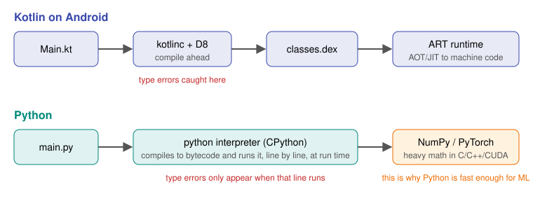

# Day 1: Your AI Workstation and First Python Program

**Phase 1 · Week 1 · ~90 minutes**

## Objectives

By the end of this lesson you can:

- [ ] Explain why Python, not Kotlin, is the language of ML research and training.
- [ ] Describe how Python runs your code, compared with Kotlin on Android.
- [ ] Create an isolated project environment and install packages into it.
- [ ] Run Python three ways: a script, the interactive REPL, and a Jupyter notebook.
- [ ] Open a free GPU notebook in Google Colab.

**Prerequisites.** None. This is the first lesson.

---

## The big idea

You're about to spend a year in a new workshop. Before building anything, you set up the bench: the language, the tools, and a clean, repeatable way to install libraries.

**Why Python?** Not because it's fast. Pure Python is roughly 10–100× slower than Kotlin for plain loops. It won because it's a great *steering wheel*: short, readable code that tells fast libraries written in C, C++ and CUDA what to do. When you multiply two huge matrices in NumPy or train a network in PyTorch, Python makes one call and optimized native code does billions of operations. Every major ML library, tutorial, paper implementation and model hub targets Python first.

!!! android "Android bridge"
    It's the same relationship as Kotlin and the Android NDK. Your app logic is in Kotlin, but a camera filter or audio codec runs in C++ through JNI. In ML, Python is the app logic and NumPy/PyTorch are the native layer. You'll still use Kotlin later, to *ship* models in Android apps (Phase 6), but you'll *build and train* them in Python.

## How Python runs your code

<figure class="diagram" markdown>

<figcaption>Kotlin checks types at build time. Python finds type errors only when the line runs, and hands heavy math to native code.</figcaption>
</figure>

Three consequences you'll feel immediately:

1. **No build step.** You edit a file and run it. No Gradle, no waiting.
2. **Errors arrive late.** Calling a method that doesn't exist won't fail until that exact line executes. Type hints and a good editor recover much of what the Kotlin compiler gave you.
3. **Loops are slow, library calls are fast.** The rule for all of ML: *don't loop over numbers in Python; ask NumPy or PyTorch to do the whole array at once.* You'll see exactly why on Day 4.

## Terminology

| Term | Meaning | Closest Android equivalent |
|---|---|---|
| **Interpreter** | The program (`python`) that reads and executes your `.py` files | ART, but without the ahead-of-time compile |
| **Package** | A reusable library you install, e.g. `numpy` | A Gradle dependency |
| **pip** | Python's package installer | The part of Gradle that downloads dependencies |
| **PyPI** | The public package registry | Maven Central |
| **Virtual environment (venv)** | A folder holding one project's interpreter and packages, isolated from other projects | A module's own dependency set |
| **requirements.txt** | A list of a project's packages and versions | `dependencies { }` in `build.gradle.kts` |
| **REPL** | Read–Eval–Print Loop: type one line, see the result | The Kotlin REPL / scratch files |
| **Jupyter notebook** | A document of runnable code cells mixed with notes and charts | Nothing quite like it; think of a playground that keeps its output |

## Step 1: Install Python

You need Python **3.11 or newer**.

=== "macOS"

    ```bash
    # Install Homebrew first if you don't have it: https://brew.sh
    brew install python@3.12
    python3 --version
    ```

=== "Windows"

    Download the installer from [python.org/downloads](https://www.python.org/downloads/). On the first screen, tick **"Add python.exe to PATH"**. Then in PowerShell:

    ```powershell
    py --version
    ```

=== "Linux"

    ```bash
    sudo apt update && sudo apt install python3 python3-venv python3-pip
    python3 --version
    ```

Expected output is something like `Python 3.12.7`.

## Step 2: Create a project with its own environment

Make one folder for all your course work, and give it a virtual environment.

```bash
mkdir ai-course && cd ai-course
python3 -m venv .venv            # create the environment in .venv/
source .venv/bin/activate        # Windows: .venv\Scripts\activate
python --version                 # now points inside .venv
```

Your prompt now starts with `(.venv)`. Everything you install goes into this folder only.

```bash
pip install numpy pandas matplotlib jupyterlab
pip freeze > requirements.txt    # record exact versions
```

!!! warning "Common mistake"
    Installing packages without activating the venv puts them in your system Python, and months later two projects need conflicting versions. If your prompt doesn't show `(.venv)`, activate first. Add `.venv/` to `.gitignore`; commit `requirements.txt` instead.

??? tip "Optional: `uv`, a faster package manager"
    [uv](https://docs.astral.sh/uv/) is a newer tool that replaces `venv` + `pip` and is 10–100× faster. Same idea, different commands: `uv venv`, then `uv pip install numpy`. Plenty of modern ML repos use it. Either choice is fine for this course.

## Step 3: Your first program

Create `hello.py`:

```python
# hello.py
name = "Android engineer"
years = 8

print(f"Hello, {name}! {years} years of Kotlin, day 1 of AI.")

for day in range(1, 4):
    print(f"Day {day}: learning")
```

Run it:

```bash
python hello.py
```

```text
Hello, Android engineer! 8 years of Kotlin, day 1 of AI.
Day 1: learning
Day 2: learning
Day 3: learning
```

Notice what's missing compared to Kotlin: no `fun main()`, no `val`/`var`, no braces, no semicolons. **Indentation is the block structure.** The loop body is whatever is indented under the `for` line. `f"...{x}..."` is Python's string template, like Kotlin's `"...${x}..."`.

## Step 4: The REPL

Type `python` with no arguments:

```pycon
>>> 2 ** 10
1024
>>> import math
>>> math.sqrt(2)
1.4142135623730951
>>> type(3.0)
<class 'float'>
>>> exit()
```

Use the REPL for quick experiments, like a Kotlin scratch file.

## Step 5: Jupyter notebooks

Most ML exploration happens in notebooks, because you can run one step, look at the data or chart, then decide the next step without re-running everything.

```bash
jupyter lab
```

A browser tab opens. Click **Python 3** under *Notebook*, type into a cell and press ++shift+enter++:

```python
import numpy as np
np.arange(10) ** 2
```

```text
array([ 0,  1,  4,  9, 16, 25, 36, 49, 64, 81])
```

The output sits under the cell and stays there. Cells share memory: a variable defined in cell 1 is visible in cell 5.

!!! warning "Common mistake"
    Cells can be run in any order, so a notebook's state can drift from what's on screen. If something behaves strangely, use **Kernel → Restart Kernel and Run All Cells**. If it still works, your notebook is honest.

## Step 6: A free GPU in the cloud

Training neural networks (from Month 4) needs a GPU. You don't need to buy one. [Google Colab](https://colab.research.google.com/) gives you a hosted notebook with a free GPU tier.

1. Open Colab and create a new notebook.
2. **Runtime → Change runtime type → T4 GPU**.
3. Run:

```python
!nvidia-smi
import torch
print(torch.cuda.is_available())
```

You should see a GPU listed and `True`. Lines starting with `!` run shell commands in Colab.

[Kaggle Notebooks](https://www.kaggle.com/code) are an alternative with a weekly free GPU quota.

## Step 7: Editor setup

Use **VS Code** with the **Python** and **Jupyter** extensions, or **PyCharm** (familiar if you live in Android Studio, since both are JetBrains IDEs). Point the editor at `.venv` as the interpreter so autocompletion and type-checking see your packages.

!!! android "Android bridge"
    PyCharm's keymap, refactorings and debugger will feel like home. Android Studio's ++cmd+b++ / ++ctrl+b++ "go to declaration" works the same, and you can jump into NumPy's source the way you'd jump into AndroidX.

---

## Exercises

1. Create the `ai-course` folder with a venv and install `numpy`, `pandas`, `matplotlib` and `jupyterlab`. Commit `requirements.txt` and a `.gitignore` containing `.venv/` to a new private GitHub repo.
2. Write `about_me.py` that prints your name, then the numbers 1 to 10 with whether each is even or odd.
3. In a Jupyter notebook, compute `sum(range(1_000_001))`. Then time it with `%timeit sum(range(1_000_001))`, and compare with `%timeit np.arange(1_000_001).sum()` after `import numpy as np`. Write down both times.
4. Open Colab, switch to a GPU runtime and confirm `torch.cuda.is_available()` is `True`.

??? success "Solution to exercise 2"
    ```python
    print("My name is ...")
    for n in range(1, 11):
        kind = "even" if n % 2 == 0 else "odd"
        print(n, kind)
    ```
    `range(1, 11)` stops *before* 11, like Kotlin's `1 until 11`. `a if cond else b` is Python's version of Kotlin's `if (cond) a else b` expression.

??? success "What you should see in exercise 3"
    The NumPy version is typically 10–50× faster. Same answer, but the loop runs in C instead of the Python interpreter. Keep this number in mind; it is the reason the whole ML ecosystem is shaped the way it is.

## Resources

- [The official Python tutorial](https://docs.python.org/3/tutorial/): sections 1–4 pair well with tomorrow's lesson.
- [Kaggle Learn: Python](https://www.kaggle.com/learn/python): short, free, interactive exercises.
- [CS50's Introduction to Programming with Python](https://cs50.harvard.edu/python/): free Harvard course with videos, if you prefer lectures.
- [VS Code Python tutorial](https://code.visualstudio.com/docs/python/python-tutorial): editor setup with venvs.
- [JupyterLab documentation](https://jupyterlab.readthedocs.io/en/latest/getting_started/overview.html)
- [Google Colab FAQ](https://research.google.com/colaboratory/faq.html): limits of the free tier.
- [uv documentation](https://docs.astral.sh/uv/)

## Checklist

- [ ] Python 3.11+ installed and `python --version` works inside an activated venv.
- [ ] `requirements.txt` committed to your private course repo.
- [ ] Ran a script, the REPL and a Jupyter notebook.
- [ ] Measured the speed difference between a Python loop and NumPy.
- [ ] Ran a GPU check in Colab.
- [ ] Wrote today's journal entry.

**Next:** Day 2: Python's core types, through Kotlin eyes (coming soon)
