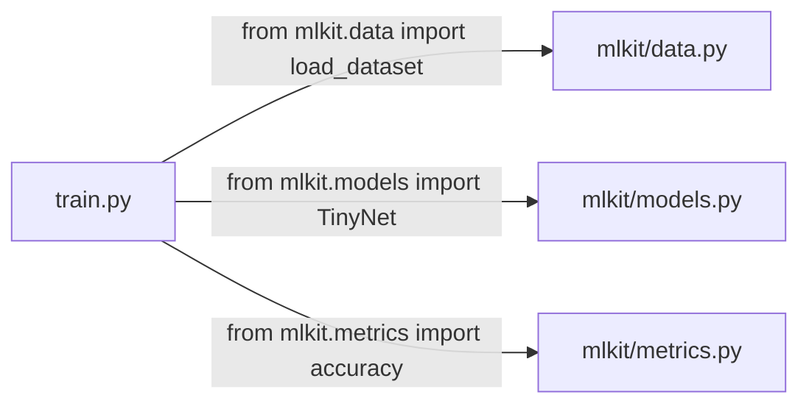

# Day 3: Functions, Classes and Modules

**Phase 1 · Week 1 · ~90 minutes**

## Objectives

- [ ] Write functions with default, keyword and variable arguments, and add type hints.
- [ ] Use lambdas and pass functions as values.
- [ ] Write a class, and a `@dataclass` as the equivalent of a Kotlin `data class`.
- [ ] Understand `self`, dunder methods like `__init__` and `__call__`, and why PyTorch models use them.
- [ ] Split code into modules and packages and import between them.

**Prerequisites.** [Day 2](day-02-python-types.md).

---

## The big idea

Functions and classes are the units you'll organize ML code with: a function to load data, a class for a model, a module for training utilities. Python's versions are looser than Kotlin's, but the **shape** you'll see in every PyTorch project is very regular. Today you learn enough to read that shape fluently.

## Functions

```python
def accuracy(correct: int, total: int) -> float:
    """Fraction of correct predictions."""
    return correct / total

accuracy(87, 100)    # 0.87
```

- `def` instead of `fun`; the body is indented.
- `: int` and `-> float` are **type hints**. Python doesn't enforce them at run time, but your editor and tools like `mypy` do. Use them; they bring back much of the safety you're used to.
- The string right under `def` is a **docstring**, Python's KDoc. Editors show it on hover.

### Default and keyword arguments

```python
def train(epochs: int = 10, lr: float = 1e-3, verbose: bool = False) -> None:
    print(f"training {epochs} epochs at lr={lr}")

train()                          # all defaults
train(5)                         # positional
train(lr=0.01, verbose=True)     # keyword, any order
```

Identical in spirit to Kotlin's named and default parameters. ML libraries lean on this heavily: a function may take 20 keyword arguments, all with sensible defaults.

!!! warning "Common mistake: mutable defaults"
    Defaults are evaluated **once**, when the function is defined.

    ```python
    def add_layer(name, layers=[]):     # BUG: one shared list
        layers.append(name)
        return layers

    add_layer("conv")   # ['conv']
    add_layer("relu")   # ['conv', 'relu']  !!
    ```

    Fix: use `None` and create inside.

    ```python
    def add_layer(name, layers=None):
        if layers is None:
            layers = []
        layers.append(name)
        return layers
    ```

### `*args` and `**kwargs`

```python
def log(*values, **options):
    print(values, options)

log(1, 2, 3, sep="-", end="!")
# (1, 2, 3) {'sep': '-', 'end': '!'}
```

`*args` collects extra positional arguments into a tuple (like Kotlin's `vararg`), `**kwargs` collects extra keyword arguments into a dict. The same stars **unpack** when calling:

```python
config = {"epochs": 3, "lr": 0.1}
train(**config)        # same as train(epochs=3, lr=0.1)
```

You'll see `**config` constantly when hyperparameters come from a YAML or JSON file.

### Functions are values

```python
def relu(x: float) -> float:
    return max(0.0, x)

activations = {"relu": relu, "square": lambda x: x * x}
activations["relu"](-2.0)      # 0.0
activations["square"](3.0)     # 9.0

sorted(["bbb", "a", "cc"], key=lambda s: len(s))   # ['a', 'cc', 'bbb']
```

A `lambda` is a one-expression anonymous function, like Kotlin's `{ x -> x * x }` but limited to a single expression.

## Classes

```python
class Counter:
    def __init__(self, start: int = 0):
        self.count = start          # instance attribute

    def increment(self, by: int = 1) -> None:
        self.count += by

    def __repr__(self) -> str:
        return f"Counter({self.count})"

c = Counter()
c.increment()
c.increment(5)
c              # Counter(6)
```

What's different from Kotlin:

- `__init__` is the constructor. There's no `new`; call the class like a function.
- Every method takes **`self`** explicitly as its first parameter. It's Kotlin's implicit `this`, made visible.
- Attributes are created by assigning to `self.something`; no field declarations.
- Everything is public. A leading underscore (`self._cache`) means "private by convention".
- Methods with double underscores (**dunder methods**) hook into syntax: `__repr__` is `toString()`, `__eq__` is `equals()`, `__len__` makes `len(obj)` work, `__call__` makes `obj(x)` work.

### Dataclasses: Python's `data class`

```python
from dataclasses import dataclass

@dataclass
class TrainConfig:
    epochs: int = 10
    lr: float = 1e-3
    batch_size: int = 32

cfg = TrainConfig(lr=0.01)
cfg                         # TrainConfig(epochs=10, lr=0.01, batch_size=32)
cfg == TrainConfig(lr=0.01) # True
```

`@dataclass` generates `__init__`, `__repr__` and `__eq__`, exactly what Kotlin's `data class` gives you. Add `frozen=True` for an immutable one (like all-`val` properties).

### Inheritance, and the shape of every PyTorch model

```python
class Layer:
    def forward(self, x):
        raise NotImplementedError

    def __call__(self, x):
        return self.forward(x)

class Scale(Layer):
    def __init__(self, factor: float):
        super().__init__()
        self.factor = factor

    def forward(self, x):
        return x * self.factor

double = Scale(2.0)
double(21)        # 42   calling the object runs forward()
```

This toy is the real pattern. A PyTorch model is a class that inherits from `nn.Module`, sets up layers in `__init__`, and defines `forward`. Calling `model(images)` goes through `__call__` into `forward`:

```python
import torch.nn as nn

class TinyNet(nn.Module):
    def __init__(self):
        super().__init__()
        self.fc = nn.Linear(784, 10)

    def forward(self, x):
        return self.fc(x)
```

You'll write dozens of these from Month 4. For now, just recognize the structure.

!!! android "Android bridge"
    It's the same contract as overriding `onCreate` or `onDraw`: the framework (`nn.Module`) owns the lifecycle and calls your override (`forward`) at the right time, adding hooks around it (gradient tracking, device placement) that you don't see.

## Decorators, briefly

`@dataclass` was a **decorator**: a function that takes a function or class and returns a modified one. You'll mostly *use* them, not write them:

```python
import functools, time

def timed(fn):
    @functools.wraps(fn)
    def wrapper(*args, **kwargs):
        t0 = time.perf_counter()
        result = fn(*args, **kwargs)
        print(f"{fn.__name__} took {time.perf_counter() - t0:.3f}s")
        return result
    return wrapper

@timed
def slow_sum(n):
    return sum(range(n))

slow_sum(10_000_000)    # slow_sum took 0.15s
```

Common ones you'll meet: `@torch.no_grad()` (run without tracking gradients), `@functools.lru_cache` (memoize), `@staticmethod`, `@property`.

## Modules and packages

A **module** is a `.py` file. A **package** is a folder of modules (traditionally with an `__init__.py`). A typical ML project:

```text
my_project/
├── train.py          # entry point: imports from mlkit
└── mlkit/            # a package
    ├── __init__.py   # marks the folder as a package (can be empty)
    ├── data.py       # def load_dataset(): ...
    ├── models.py     # class TinyNet: ...
    └── metrics.py    # def accuracy(): ...
```



```python
# mlkit/metrics.py
def accuracy(correct: int, total: int) -> float:
    return correct / total
```

```python
# train.py
from mlkit.metrics import accuracy
import mlkit.data as data

def main():
    print(accuracy(9, 10))

if __name__ == "__main__":
    main()
```

`if __name__ == "__main__":` means "run this only when the file is executed directly, not when imported". It's the Python `fun main()`.

Import styles you'll see:

```python
import numpy as np                 # alias: the universal convention
import torch.nn as nn
from pathlib import Path           # pull one name in
from collections import Counter, defaultdict
```

!!! android "Android bridge"
    Packages are like Kotlin packages plus Gradle modules rolled into one: the folder structure *is* the import path. There's no separate build config to register a new module.

---

## Exercises

1. Write `normalize(values: list[float]) -> list[float]` that rescales a list so its minimum is 0 and maximum is 1. Handle the case where all values are equal.
2. Make a `@dataclass` called `Prediction` with `label: str` and `confidence: float`. Create a list of five predictions and use `sorted(..., key=...)` to get the top three by confidence.
3. Write a class `RunningMean` with an `update(x)` method and a `value` attribute holding the mean of everything seen so far. Add `__repr__`. (You'll use exactly this to track loss during training.)
4. Create a package `mlkit/` with `metrics.py` containing `accuracy` and your `normalize`, and a `main.py` that imports and uses both.

??? success "Solutions"
    ```python
    # 1
    def normalize(values: list[float]) -> list[float]:
        lo, hi = min(values), max(values)
        if hi == lo:
            return [0.0 for _ in values]
        return [(v - lo) / (hi - lo) for v in values]

    # 2
    from dataclasses import dataclass

    @dataclass
    class Prediction:
        label: str
        confidence: float

    preds = [Prediction("cat", 0.7), Prediction("dog", 0.2), Prediction("fox", 0.9),
             Prediction("cow", 0.4), Prediction("owl", 0.05)]
    top3 = sorted(preds, key=lambda p: p.confidence, reverse=True)[:3]

    # 3
    class RunningMean:
        def __init__(self):
            self.total = 0.0
            self.n = 0
            self.value = 0.0

        def update(self, x: float) -> None:
            self.total += x
            self.n += 1
            self.value = self.total / self.n

        def __repr__(self) -> str:
            return f"RunningMean({self.value:.4f}, n={self.n})"
    ```

## Resources

- [Python tutorial §4 More Control Flow Tools](https://docs.python.org/3/tutorial/controlflow.html) (functions) and [§9 Classes](https://docs.python.org/3/tutorial/classes.html)
- [Python docs: dataclasses](https://docs.python.org/3/library/dataclasses.html)
- [Python tutorial §6 Modules](https://docs.python.org/3/tutorial/modules.html)
- [Real Python: Primer on decorators](https://realpython.com/primer-on-python-decorators/)
- [mypy: type hints cheat sheet](https://mypy.readthedocs.io/en/stable/cheat_sheet_py3.html)
- [PyTorch: Build the neural network](https://pytorch.org/tutorials/beginner/basics/buildmodel_tutorial.html): skim now just to spot the `nn.Module` pattern.

## Checklist

- [ ] I can write a function with defaults, keyword args and type hints.
- [ ] I know why `def f(x=[])` is a bug.
- [ ] I can write a class with `__init__`, a method and `__repr__`, and a `@dataclass`.
- [ ] I can explain how `model(x)` ends up calling `forward(x)`.
- [ ] I built a small package and imported from it.

**Next:** Day 4: NumPy arrays (coming soon)
