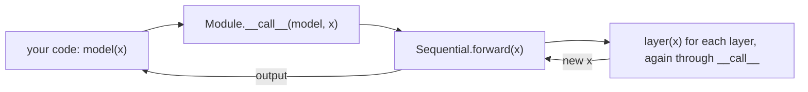
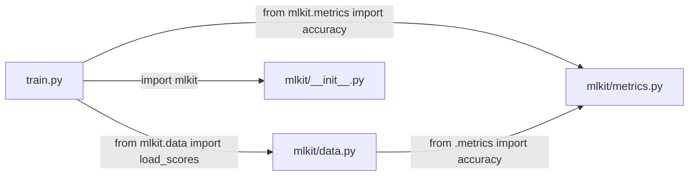

# Day 3a: Classes, Decorators and Modules

**Phase 1 · Week 1 · ~180 minutes**

This is the second half of Day 3. Do it the same day or the next. It's a long lesson: take a break before the "Modules and packages" section.

## Objectives

- [ ] Write a class with `__init__`, `self` and methods, and explain what `obj.method()` does underneath.
- [ ] Tell instance attributes from class attributes, and avoid the shared mutable class attribute.
- [ ] Read and set attributes by name with `getattr`, `setattr`, `hasattr` and `vars`.
- [ ] Make your objects work with Python syntax through dunder methods: `__repr__` / `__str__`, `__eq__` / `__hash__`, `__add__` / `__mul__` / `__rmul__`, `__len__`, `__getitem__` and `__call__`.
- [ ] Make operators work with plain numbers too, using reflected dunders like `__radd__` and returning `NotImplemented` for types you don't handle.
- [ ] Use `@property` (with a setter), `@classmethod` and `@staticmethod`.
- [ ] Inherit and override with `super()`, mark abstract methods, and pick composition when inheritance doesn't fit.
- [ ] Explain duck typing: why any object with the right methods works, with no interface declared.
- [ ] Write dataclasses with `field(default_factory=...)`, `frozen=True`, `order=True` and `__post_init__`.
- [ ] Explain how `model(x)` ends up calling `forward(x)` in a PyTorch-style model.
- [ ] Write a decorator with `functools.wraps`, and one that takes arguments, stack decorators and decorate methods, and read `@lru_cache` and `@torch.no_grad()`.
- [ ] Explain what `import` does, what `__name__` is, and organise code into a package with absolute and relative imports, run with `python -m`.

**Prerequisites.**

- [Day 3](day-03-functions-classes.md): functions as objects, default values evaluated once (the mutable-default trap and the `None` sentinel), `*args` / `**kwargs` and forwarding, LEGB scope, closures, lambdas and `key=`, and type hints. Decorators are built entirely from these.
- [Day 2](day-02-python-types.md): `is` vs `==`, `None`, truthiness, f-strings.
- [Day 2b](day-02b-collections.md): lists, tuples, dicts, and hashability (why a list can't be a dict key).
- [Day 1](day-01-setup.md): running `python file.py` and `python -m`, virtual environments. The multi-file examples run on your computer.

---

## The big idea

Day 3 showed that `def` is a statement that runs and builds a function object. Today the same rule covers the rest of Python's structure:

- `class StepCounter:` **runs the class body once**, builds a class object from what the body defined, and binds the name `StepCounter`. Calling the class builds instances.
- `@decorator` above a `def` **runs once, right after the `def`**, and moves the function's name to whatever the decorator returns.
- `import mlkit` **runs the file `mlkit` once**, builds a module object, caches it, and binds the name `mlkit`.

And one more idea: Python syntax is a set of hooks. `len(x)`, `a + b`, `x[i]`, `x(5)` and `print(x)` each call a method with a special name on the object. Define those methods, and your objects work with the syntax. Kotlin does the same with `operator fun` and `toString()`; Python uses it for everything, which is how NumPy arrays support `+` and how PyTorch models are called like functions.

**Analogy.** A class is a cookie cutter, and instances are the cookies. The cutter is a real object on the table (you can inspect it, and things stored on it are shared by every cookie), and each cookie carries its own icing (instance attributes). A module is a kitchen drawer that's filled the first time anyone opens it, and stays filled for everyone after that.

Keep this picture in mind. It explains why a list in a class body is shared by every instance, what the `@` in `@dataclass` does, and why a module's code runs only on its first import.

---

## Classes: `__init__`, `self` and methods

**What it is.** A **class** is a blueprint for objects; an **instance** is one object built from it. An instance carries **attributes** (its data) and the class provides **methods** (functions that work on an instance). `__init__` is the method Python calls to set up a new instance.

**Why it exists.** Anything with state that changes over time is a class: a model with weights, a running metric, a dataset, an optimizer. Every PyTorch model you write will be one.

**Kotlin comparison.**

```kotlin
class StepCounter(start: Int = 0) {
    var count = start
    fun increment(by: Int = 1) { count += by }
    override fun toString() = "StepCounter($count)"
}
val c = StepCounter()
c.increment(); c.increment(5)
```

```python
class StepCounter:
    def __init__(self, start: int = 0):
        self.count = start                 # creates the attribute 'count'

    def increment(self, by: int = 1) -> None:
        self.count += by

    def __repr__(self) -> str:
        return f"StepCounter({self.count})"

c = StepCounter()
c.increment()
c.increment(5)
c                        # StepCounter(6)
c.count                  # 6
```

What's different from Kotlin:

- There's no `new` keyword; you call the class like a function: `StepCounter()`.
- `__init__` plays the role of the constructor. Its parameters are what you pass to `StepCounter(...)`.
- Every method takes **`self`** as its first parameter. It's Kotlin's `this`, made explicit. Inside a method, you must write `self.count`; a bare `count` is looked up with LEGB (Day 3), not on the object, and fails with `NameError: name 'count' is not defined` (shown below).
- Attributes aren't declared. `self.count = start` creates the attribute by assigning to it, usually in `__init__`.
- Everything is public. A leading underscore (`self._cache`) means "private by convention: don't touch from outside". Nothing enforces it.
- `__repr__` plays the role of `toString()`; more on it in the dunder section.

**Underneath: what a call to the class does, and where `self` comes from.** `StepCounter(5)` runs three steps: Python creates a new, empty instance; calls `StepCounter.__init__(instance, 5)`, so `self` is that new instance; and returns the instance. `__init__` must return `None`; its job is to fill in `self`.

A method call `c.increment(2)` is shorthand for calling the function stored on the class with the instance as the first argument:

```python
c = StepCounter(5)
c.increment(2)                  # the usual way
StepCounter.increment(c, 2)     # exactly the same call, spelled out
c.count                         # 9

c.__dict__                      # {'count': 9}   an instance's attributes live in a dict
type(c.increment)               # <class 'method'>   a "bound method": function + instance
```

`c.increment` (no brackets) is a **bound method**: the class's function with `c` already attached as `self`. That's why you never pass `self` yourself.

**How it goes wrong.** Forgetting `self` in a method's parameter list gives an error that looks off by one:

```python
class Broken:
    def reset():                 # forgot self
        pass

try:
    Broken().reset()
except TypeError as e:
    print("TypeError:", e)
# TypeError: Broken.reset() takes 0 positional arguments but 1 was given
```

You passed zero arguments, but Python passed the instance as `self`: that's the "1 was given". And because attributes are created by assignment, a typo silently creates a new attribute instead of failing:

```python
c = StepCounter()
c.cuont = 10                     # typo: creates a NEW attribute, no error
c.count                          # 0    the real one is unchanged
c.__dict__                       # {'count': 0, 'cuont': 10}
```

A type checker or your editor's warnings catch this kind of typo; Python doesn't. The opposite slip, writing `count` instead of `self.count` inside a method, fails at run time:

```python
class Forgetful:
    def __init__(self):
        self.count = 0

    def show(self):
        return count             # forgot "self."

try:
    Forgetful().show()
except NameError as e:
    print("NameError:", e)
# NameError: name 'count' is not defined
```

### Attributes by name: `getattr`, `setattr`, `hasattr`, `vars` and `dir`

Sometimes the attribute's name is in a string, for example from a config file. Four built-in functions work with attributes by name:

- `getattr(obj, "name")` reads `obj.name`; `getattr(obj, "name", default)` returns `default` instead of failing when the attribute is missing;
- `setattr(obj, "name", value)` does `obj.name = value`;
- `hasattr(obj, "name")` returns `True` or `False`;
- `vars(obj)` returns the instance's attribute dict, the same object as `obj.__dict__`; `dir(obj)` lists every attribute name it can reach, including methods and the ones on its class.

```python
import math

c = StepCounter(3)
getattr(c, "count")              # 3
getattr(c, "lr", 0.01)           # 0.01   missing, so the default comes back
hasattr(c, "lr")                 # False
setattr(c, "lr", 0.1)            # same as c.lr = 0.1
c.lr                             # 0.1
vars(c)                          # {'count': 3, 'lr': 0.1}
vars(c) is c.__dict__            # True
[name for name in dir(c) if not name.startswith("_")]   # ['count', 'increment', 'lr']
getattr(math, "sqrt")(16.0)      # 4.0   modules are objects too

try:
    getattr(c, "momentum")       # no default given
except AttributeError as e:
    print("AttributeError:", e)
# AttributeError: 'StepCounter' object has no attribute 'momentum'
```

You'll see these in ML code that's driven by configs: `getattr(torch.nn, cfg["activation"])()` builds whichever activation class the config names, `hasattr(model, "module")` checks whether a model is wrapped, and `vars(args)` turns parsed command-line arguments into a dict. In Kotlin this would need reflection (`obj::class.memberProperties`); in Python it's an ordinary dict lookup, because attributes live in dicts.

### Private by convention, and name mangling

A single underscore, `self._step`, is a convention only. Two leading underscores, `self.__secret`, trigger **name mangling**: Python renames the attribute to `_ClassName__secret`, so a subclass can't overwrite it by accident. It isn't real privacy either:

```python
class Model:
    def __init__(self):
        self._step = 0           # "internal, please don't touch"
        self.__secret = 42       # stored as _Model__secret

m = Model()
m._step                  # 0     reachable, by convention left alone
m.__dict__               # {'_step': 0, '_Model__secret': 42}

try:
    m.__secret                   # outside the class, no renaming happens
except AttributeError as e:
    print("AttributeError:", e)
# AttributeError: 'Model' object has no attribute '__secret'
m._Model__secret         # 42    the mangled name still works
```

Inside the class body, Python rewrites `self.__secret` to `self._Model__secret`; outside it, `m.__secret` is looked up literally and isn't found. Use one underscore in your own code. You'll mostly meet two underscores when reading library code.

## Class attributes versus instance attributes

**What it is.** An **instance attribute** is set on `self` and belongs to one object. A **class attribute** is assigned directly in the class body and belongs to the class, so every instance shares it.

**Why it exists.** Class attributes hold things that are the same for every instance: constants, defaults, a counter of how many instances exist. Libraries use them for configuration, like a layer's `default_activation`.

**Kotlin comparison.** A class attribute is like a property in a `companion object`, except that in Python you can also read it *through* an instance.

```python
class Layer:
    created = 0                      # class attribute: one value, shared
    kind = "generic"

    def __init__(self, name: str):
        self.name = name             # instance attribute: one per object
        Layer.created += 1           # update the shared counter on the class

a = Layer("conv1")
b = Layer("fc1")
Layer.created            # 2
a.created, b.created     # (2, 2)    read through the instances: same value
a.kind                   # 'generic'
```

**Underneath: attribute lookup.** `a.kind` looks first in the instance's own dict, `a.__dict__`, then in the class, then in the class's parents (the inheritance section). It's the attribute version of LEGB. **Assigning** through an instance, though, always writes to the instance's own dict, which then hides the class attribute for that one object:

```python
a.__dict__               # {'name': 'conv1'}            no 'kind' here
a.kind = "conv"          # creates an INSTANCE attribute on a only
a.kind, b.kind           # ('conv', 'generic')
a.__dict__               # {'name': 'conv1', 'kind': 'conv'}
Layer.kind               # 'generic'   the class attribute is untouched
```

<figure class="diagram" markdown>
![Animation of attribute lookup. Two instance boxes, a.__dict__ holding name conv1 and b.__dict__ holding name fc1, point to the class Layer box holding created 2 and kind generic, which points to its parent class object. Reading a.kind misses a's dict and is found in the class. Assigning a.kind = conv adds a kind entry to a's own dict. Afterwards a.kind is found in a's dict while b.kind still reaches the class. A side panel shows instances e1 and e2 of Experiment both reaching one results list stored on the class](../../assets/img/phase-1/day03-attribute-lookup.svg)
<figcaption>Animated: reading an attribute searches the instance dict, then the class, then its parents; assigning always writes to the instance dict.</figcaption>
</figure>

That's why `__init__` above writes `Layer.created += 1` and not `self.created += 1`: the second would read the shared value, add one, and store the result as a new instance attribute, leaving the shared counter at 0.

!!! warning "Common mistake: a mutable class attribute"
    A list in the class body is created once, when the class body runs, and every instance shares it. It's the class-level twin of the mutable-default trap:

    ```python
    class Experiment:
        results = []                     # BUG: one list for ALL experiments

        def __init__(self, name):
            self.name = name

        def log(self, value):
            self.results.append(value)   # no assignment, so this finds the class's list

    e1 = Experiment("baseline")
    e2 = Experiment("bigger-lr")
    e1.log(0.81)
    e2.log(0.64)
    e1.results               # [0.81, 0.64]   e2's result leaked into e1
    ```

    Fix: create per-instance mutable state in `__init__`: `self.results = []`. Keep class attributes for values that are never mutated (numbers, strings, tuples).

## Dunder methods: making objects work with Python syntax

**What it is.** A **dunder method** ("double underscore", like `__repr__`) is a method with a special name that Python calls for you when your object is used with a piece of syntax or a built-in function. `len(x)` calls `x.__len__()`, `a + b` calls `a.__add__(b)`, `x[i]` calls `x.__getitem__(i)`, `x(5)` calls `x.__call__(5)`. The full list is called the **data model**.

**Why it exists.** It lets your classes behave like built-in types. NumPy arrays support `+` and `[]` through dunders. A PyTorch `Dataset` is a class with `__len__` and `__getitem__`. A model is called with `model(x)` through `__call__`. You'll write all of these.

**Kotlin comparison.** Kotlin does the same thing with `operator fun` and the methods every class inherits from `Any`:

| Python | Kotlin | Triggered by |
|---|---|---|
| `__repr__`, `__str__` | `toString()` | the REPL, `print`, f-strings |
| `__eq__`, `__hash__` | `equals()`, `hashCode()` | `==`, sets and dict keys |
| `__add__`, `__mul__`, `__neg__` | `operator fun plus`, `times`, `unaryMinus` | `a + b`, `a * b`, `-a` |
| `__len__` | `size` (by convention, not an operator) | `len(x)` |
| `__getitem__` | `operator fun get` | `x[i]` |
| `__call__` | `operator fun invoke` | `x(...)` |

### `__repr__` and `__str__`

Python has two text forms. `__repr__` is for developers: unambiguous, ideally looking like the code that would rebuild the object. The REPL, the debugger, containers and `!r` in f-strings use it. `__str__` is for end users; `print` and plain f-strings use it, and fall back to `__repr__` when there's no `__str__`.

```python
class Vec2:
    def __init__(self, x, y):
        self.x = x
        self.y = y

    def __repr__(self):
        return f"Vec2({self.x}, {self.y})"

    def __str__(self):
        return f"({self.x}, {self.y})"

v = Vec2(3, 4)
v                        # Vec2(3, 4)       the REPL uses __repr__
print(v)                 # (3, 4)           print uses __str__
f"{v} and {v!r}"         # '(3, 4) and Vec2(3, 4)'
[v, v]                   # [Vec2(3, 4), Vec2(3, 4)]   containers use __repr__
```

Without `__repr__` you get the default, the class name and a memory address, which tells you nothing during debugging:

```python
class Plain:
    pass

repr(Plain()).startswith("<__main__.Plain object at 0x")   # True (the address differs every run)
```

Always write `__repr__` for your own classes. If you write only one of the two, write `__repr__`.

### `__eq__` and `__hash__`

By default, `==` on your objects compares **identity**, the same as `is` (Day 2): two separate `Vec2(3, 4)` objects are not equal. Defining `__eq__` changes that. But defining `__eq__` also sets `__hash__` to `None`, which makes instances unhashable, so they can no longer go in a set or be dict keys. Python does this on purpose: equal objects must have equal hashes (Day 2b), and the default hash, based on identity, would break that rule.

```python
class Point:
    def __init__(self, x, y):
        self.x, self.y = x, y

    def __eq__(self, other):
        return isinstance(other, Point) and (self.x, self.y) == (other.x, other.y)

Point(1, 2) == Point(1, 2)       # True
try:
    {Point(1, 2)}
except TypeError as e:
    print("TypeError:", e)
# TypeError: cannot use 'Point' as a set element (unhashable type: 'Point')
```

That's the message from the ▶ Run button's Python 3.14; Python 3.13 and older say only `TypeError: unhashable type: 'Point'`. `isinstance(other, Point)` checks the other object's type first, so comparing a `Point` with a string returns `False` instead of crashing on `other.x`. The fix for the hash is to define `__hash__` from the same fields that `__eq__` compares: `return hash((self.x, self.y))`. Only do that if those fields never change after creation; a frozen dataclass (later in this lesson) does all of this for you. It's Kotlin's rule too: override `equals` and `hashCode` together.

### Arithmetic: `__add__`, `__mul__` and the reflected versions

```python
class Vec2:
    def __init__(self, x, y):
        self.x = x
        self.y = y

    def __repr__(self):
        return f"Vec2({self.x}, {self.y})"

    def __eq__(self, other):
        return isinstance(other, Vec2) and (self.x, self.y) == (other.x, other.y)

    def __hash__(self):
        return hash((self.x, self.y))

    def __add__(self, other):              # self + other
        return Vec2(self.x + other.x, self.y + other.y)

    def __mul__(self, k):                  # self * k   (k a number)
        return Vec2(self.x * k, self.y * k)

    def __rmul__(self, k):                 # k * self   ("reflected" multiply)
        return self * k

    def __neg__(self):                     # -self
        return Vec2(-self.x, -self.y)

a, b = Vec2(1, 2), Vec2(3, 4)
a + b                    # Vec2(4, 6)
a * 3                    # Vec2(3, 6)
3 * a                    # Vec2(3, 6)
-a                       # Vec2(-1, -2)
a + b == Vec2(4, 6)      # True
len({a, Vec2(1, 2)})     # 1     equal and hashable: the set keeps one
```

**Underneath: why `3 * a` needs `__rmul__`.** For `x * y`, Python first tries `x.__mul__(y)`. For `3 * a`, that's `int.__mul__(3, a)`: the int doesn't know about `Vec2` and returns a special value, `NotImplemented`, meaning "not my job". Python then tries the **reflected** method on the right operand, `a.__rmul__(3)`. Without `__rmul__`, both sides give up:

```python
class Vec2NoR:
    def __init__(self, x):
        self.x = x
    def __mul__(self, k):
        return Vec2NoR(self.x * k)

try:
    3 * Vec2NoR(1)
except TypeError as e:
    print("TypeError:", e)
# TypeError: unsupported operand type(s) for *: 'int' and 'Vec2NoR'
```

Kotlin solves `3 * a` with an extension function, `operator fun Int.times(v: Vec2)`. Python has no extensions, so the right-hand object handles it.

Every operator has a pair of dunders like this, one for each side. Now that you've seen how the pair works, here's the table:

| Operator | Left operand's method | Reflected (right operand's) method |
|---|---|---|
| `a + b` | `__add__` | `__radd__` |
| `a - b` | `__sub__` | `__rsub__` |
| `a * b` | `__mul__` | `__rmul__` |
| `a / b` | `__truediv__` | `__rtruediv__` |
| `a // b` | `__floordiv__` | `__rfloordiv__` |
| `a ** b` | `__pow__` | `__rpow__` |
| `a @ b` (matrix multiply, Day 10) | `__matmul__` | `__rmatmul__` |
| `-a` | `__neg__` | (one operand only) |

### Mixing your objects with numbers: `NotImplemented`

**What it is.** `NotImplemented` is a special built-in value that an operator dunder **returns** (not raises) to say "I don't know how to combine with this type; ask the other operand". If both operands return it, Python raises a clean `TypeError`.

**Why it exists.** Real numeric classes must accept plain numbers too: `v + 3`, `3 + v`, and `sum(list_of_values)`, which starts from the integer 0. And they must fail clearly when given nonsense. On Day 34 you'll build a tiny automatic-differentiation engine, a `Value` class whose every operator works this way.

**Kotlin comparison.** Kotlin picks an overload at compile time: you'd write `operator fun plus(other: Value)` and a second `operator fun plus(k: Double)`, plus an extension `operator fun Double.plus(v: Value)` for the reflected case. Python has one `__add__` per class, so the method checks the type at run time and returns `NotImplemented` for anything it doesn't handle.

**How it goes wrong first.** The `Vec2.__add__` above assumes `other` is a `Vec2`, so a number crashes it from inside, with a confusing message:

```python
try:
    Vec2(1, 2) + 3
except AttributeError as e:
    print("AttributeError:", e)
# AttributeError: 'int' object has no attribute 'x'
```

**Example: the fix.** Wrap plain numbers, return `NotImplemented` for anything else, and add the reflected methods:

```python
class Value:
    def __init__(self, data):
        self.data = data

    def __repr__(self):
        return f"Value({self.data})"

    def __add__(self, other):
        if isinstance(other, (int, float)):
            other = Value(other)               # wrap a plain number
        if not isinstance(other, Value):
            return NotImplemented              # "not my job": let Python try the other side
        return Value(self.data + other.data)

    def __radd__(self, other):                 # other + self, when other gave up
        return self + other                    # addition is symmetric: reuse __add__

    def __sub__(self, other):
        if isinstance(other, (int, float)):
            other = Value(other)
        if not isinstance(other, Value):
            return NotImplemented
        return Value(self.data - other.data)

    def __rsub__(self, other):                 # other - self: order matters here
        return Value(other) - self

Value(2) + Value(3)                    # Value(5)
Value(2) + 3                           # Value(5)
3 + Value(2)                           # Value(5)
sum([Value(1), Value(2), Value(3)])    # Value(6)
Value(10) - 3                          # Value(7)
3 - Value(10)                          # Value(-7)
try:
    Value(2) + "a"
except TypeError as e:
    print("TypeError:", e)
# TypeError: unsupported operand type(s) for +: 'Value' and 'str'
```

`isinstance(other, (int, float))` accepts a tuple of types and is `True` if `other` is any of them.

**Underneath: the trace of `3 + Value(2)`.**

1. Python calls `int.__add__(3, Value(2))`. The int doesn't know `Value`, so it returns `NotImplemented`.
2. Python calls the reflected method on the right operand: `Value(2).__radd__(3)`.
3. `__radd__` computes `self + other`, which is `Value(2).__add__(3)`: 3 is wrapped as `Value(3)`, and the result is `Value(5)`.

For `Value(2) + "a"`: `Value.__add__` returns `NotImplemented`, then `str` has no `__radd__` that accepts a `Value`, so both sides have given up and Python raises the `TypeError` itself, naming both types. You can see the special value directly:

```python
Value(2).__add__("a")          # NotImplemented
type(NotImplemented)           # <class 'NotImplementedType'>
```

`__rsub__` can't reuse `__sub__` the way `__radd__` reuses `__add__`: `3 - Value(10)` must compute `3 - 10`, so it builds `Value(3) - self`, with the operands in their original order.

!!! warning "Common mistake: no `__radd__`, so `sum()` fails"
    `sum` starts from `0` and computes `0 + first_item`. Without `__radd__`, the int's `__add__` gives up and nothing takes over:

    ```python
    class NoRadd:
        def __init__(self, data):
            self.data = data

        def __add__(self, other):
            return NoRadd(self.data + (other.data if isinstance(other, NoRadd) else other))

    try:
        sum([NoRadd(1), NoRadd(2)])
    except TypeError as e:
        print("TypeError:", e)
    # TypeError: unsupported operand type(s) for +: 'int' and 'NoRadd'
    ```

    The message names `int` on the left: that's the hidden starting 0. Fix: add `__radd__`. And don't confuse `NotImplemented` (a value an operator returns) with `NotImplementedError` (an exception a method raises, used later for unfinished hooks).

### Container dunders: `__len__` and `__getitem__`

A class with `__len__` and `__getitem__` behaves like a read-only sequence. This is exactly the contract of a PyTorch `Dataset` (Month 4): `len(dataset)` and `dataset[i]`, nothing else.

```python
class ReviewDataset:
    def __init__(self, texts: list[str], labels: list[int]):
        self.texts = texts
        self.labels = labels

    def __len__(self) -> int:
        return len(self.texts)

    def __getitem__(self, i):
        return self.texts[i], self.labels[i]

ds = ReviewDataset(["great app", "crashes a lot", "love it"], [1, 0, 1])
len(ds)                  # 3
ds[0]                    # ('great app', 1)
ds[-1]                   # ('love it', 1)    the lists handle negative indices for us
ds[0:2]                  # (['great app', 'crashes a lot'], [1, 0])
bool(ReviewDataset([], []))   # False   an object with __len__ == 0 is falsy (Day 2)
```

**Underneath.** `ds[0:2]` calls `ds.__getitem__(slice(0, 2, None))`: Python packs `0:2` into a **slice object** and passes it in. Our method passes it on to both lists, so slicing works for free. `bool(obj)` uses `__len__` when there's no `__bool__`, so an empty dataset is falsy, like an empty list.

A `for` loop also works on `ds`: when a class has no `__iter__` method, Python falls back to calling `__getitem__(0)`, `__getitem__(1)`, and so on until an `IndexError`. Modern classes define `__iter__` instead; that's [Day 3d](day-03d-iterators-generators.md).

```python
for text, label in ds:
    print(label, text)
# 1 great app
# 0 crashes a lot
# 1 love it
```

### `__call__`: objects you can call like functions

```python
class Scale:
    def __init__(self, factor: float):
        self.factor = factor

    def __call__(self, x: float) -> float:
        return x * self.factor

double = Scale(2.0)
double(21)               # 42.0    calls double.__call__(21)
callable(double)         # True
callable(ds)             # False   ReviewDataset has no __call__
```

The built-in `callable(x)` returns `True` if `x(...)` would be allowed: functions, classes, and objects whose class defines `__call__`. A callable object is a function that carries state, like a closure, but with named attributes you can inspect and change: `double.factor = 3.0`. This is how every PyTorch layer and model is called. Calling an object without `__call__` fails:

```python
try:
    ds(0)                        # meant ds[0]
except TypeError as e:
    print("TypeError:", e)
# TypeError: 'ReviewDataset' object is not callable
```

## `@property`, `@classmethod` and `@staticmethod`

These three lines starting with `@` are **decorators**. You'll learn how decorators work later in this lesson; for now, read them as labels that change how the method below them behaves.

### `@property`: computed and validated attributes

**What it is.** A **property** is a method that's accessed like an attribute, without brackets: `run.accuracy` instead of `run.accuracy()`. A property can also have a **setter**, a method that runs when someone assigns to it.

**Why it exists.** A computed value that should always be up to date (accuracy from correct and total), and validation on assignment (a learning rate must be positive). You can also start with a plain attribute and turn it into a property later without changing any caller.

**Kotlin comparison.** Kotlin properties with custom accessors do the same job, and Kotlin's `field` is the backing storage. In Python, you name the backing storage yourself, usually with an underscore:

```kotlin
class TrainingRun(var correct: Int = 0, var total: Int = 0) {
    val accuracy: Double get() = if (total == 0) 0.0 else correct.toDouble() / total
    var lr: Double = 0.01
        set(value) { require(value > 0) { "lr must be positive" }; field = value }
}
```

```python
class TrainingRun:
    def __init__(self, lr: float = 0.01):
        self.correct = 0
        self.total = 0
        self.lr = lr                     # goes through the setter below

    @property
    def accuracy(self) -> float:         # read-only: no setter defined
        return 0.0 if self.total == 0 else self.correct / self.total

    @property
    def lr(self) -> float:
        return self._lr                  # the backing attribute

    @lr.setter
    def lr(self, value: float) -> None:
        if value <= 0:
            raise ValueError(f"lr must be positive, got {value}")
        self._lr = value

run = TrainingRun()
run.correct, run.total = 87, 100
run.accuracy             # 0.87   computed on every access, no brackets
run.lr = 0.001           # runs the setter
run.lr                   # 0.001
run.__dict__             # {'correct': 87, 'total': 100, '_lr': 0.001}
```

`raise ValueError(...)` stops the method and reports an error, like Kotlin's `require(...)` or `throw IllegalArgumentException(...)`. Day 3b covers raising errors properly.

**Underneath.** `@property` replaces the `accuracy` function with a **property object** stored on the class. When you read `run.accuracy`, attribute lookup finds that object on the class, and the property object calls the getter function with `run` as `self`. `@lr.setter` adds a setter function to the existing `lr` property object. That's also why `__init__` can write `self.lr = lr`: the assignment goes through the setter, so validation runs from the very first value.

```python
type(TrainingRun.__dict__["accuracy"])     # <class 'property'>
```

**How it goes wrong.** Two errors to recognise:

```python
try:
    run.accuracy = 1.0                     # no setter was defined
except AttributeError as e:
    print("AttributeError:", e)
# AttributeError: property 'accuracy' of 'TrainingRun' object has no setter

try:
    run.lr = -0.1                          # the setter's validation
except ValueError as e:
    print("ValueError:", e)
# ValueError: lr must be positive, got -0.1
```

The third mistake is inside the setter itself: writing `self.lr = value` instead of `self._lr = value`. That assignment calls the setter again, which assigns again, forever, until Python stops it with `RecursionError: maximum recursion depth exceeded`. The backing attribute must have a different name from the property.

### `@classmethod`: alternative constructors

**What it is.** A **class method** receives the class itself as its first parameter, named `cls` by convention, instead of an instance. You call it on the class: `RunConfig.from_dict(...)`.

**Why it exists.** Mostly for **alternative constructors**: building an instance from a dict, a file or a string. You'll call one in Month 5 every time you load a pretrained Hugging Face model: `AutoModel.from_pretrained("bert-base-uncased")` is a class method.

**Kotlin comparison.** A factory function in a `companion object`: `RunConfig.fromMap(map)`.

```python
class RunConfig:
    def __init__(self, lr: float, epochs: int):
        self.lr = lr
        self.epochs = epochs

    def __repr__(self):
        return f"{type(self).__name__}(lr={self.lr}, epochs={self.epochs})"

    @classmethod
    def from_dict(cls, d: dict) -> "RunConfig":
        return cls(lr=d["lr"], epochs=d["epochs"])    # cls(...) builds an instance

    @staticmethod
    def is_valid_lr(lr: float) -> bool:               # no self, no cls
        return 0 < lr < 1

cfg = RunConfig.from_dict({"lr": 0.01, "epochs": 5})
cfg                                 # RunConfig(lr=0.01, epochs=5)
RunConfig.is_valid_lr(3.0)          # False
```

The return hint `"RunConfig"` is in quotes because the name `RunConfig` isn't bound until the whole `class` statement has finished running (the big idea again).

**Underneath: why `cls` and not the class name.** `cls` is whichever class the method was called on. A subclass inherits `from_dict` and gets instances of *itself*:

```python
class FineTuneConfig(RunConfig):            # a subclass (next section)
    pass

FineTuneConfig.from_dict({"lr": 1e-5, "epochs": 2})   # FineTuneConfig(lr=1e-05, epochs=2)
```

The repr says `FineTuneConfig` because `__repr__` uses `type(self).__name__`. `type(obj)` returns the object's class (itself an object), and every class has a `__name__` attribute holding its name as a string. Writing `RunConfig` in the f-string instead would label subclass instances wrongly.

```python
type(cfg)                # <class '__main__.RunConfig'>
type(cfg).__name__       # 'RunConfig'
```

If `from_dict` had written `return RunConfig(...)`, the subclass would get a plain `RunConfig` back: the classic bug with hard-coded class names in factories.

### `@staticmethod`

A **static method** gets neither `self` nor `cls`. It's a plain function that lives inside the class's namespace because it belongs there logically, like `RunConfig.is_valid_lr` above. Kotlin's equivalent is a companion function that touches no state. In Python, a module-level function is often the simpler choice; use `@staticmethod` when the function only makes sense next to the class.

!!! warning "Common mistake: calling an instance method on the class"
    ```python
    class Greeter:
        def hello(self):
            return "hi"

    try:
        Greeter.hello()               # no instance, so nothing fills self
    except TypeError as e:
        print("TypeError:", e)
    # TypeError: Greeter.hello() missing 1 required positional argument: 'self'
    ```

    Either create an instance first, `Greeter().hello()`, or, if the method doesn't use `self`, make it a `@staticmethod` or `@classmethod`.

## Inheritance, `super()` and overriding

**What it is.** **Inheritance** builds a new class (the **subclass**, or child) from an existing one (the **base class**, or parent). The child gets all the parent's methods and can **override** some of them by defining a method with the same name. `super()` gives access to the parent's version.

**Why it exists.** Frameworks use it to hand you a skeleton with hooks to fill in: PyTorch's `nn.Module` (fill in `forward`), PyTorch Lightning's `LightningModule` (fill in `training_step`), Keras and Lightning **callbacks** (fill in `on_epoch_end`). You inherit, override the hooks, and the framework calls them.

**Kotlin comparison.** Kotlin classes are `final` unless marked `open`, and an override needs the `override` keyword. In Python every class can be subclassed and every method can be overridden, with no keyword at all. `super().method()` is Kotlin's `super.method()`.

```kotlin
open class Callback(val name: String) {
    open fun onEpochEnd(epoch: Int, loss: Double): Boolean = false
}
class EarlyStopping(val patience: Int) : Callback("early-stop") {
    override fun onEpochEnd(epoch: Int, loss: Double): Boolean { /* ... */ return false }
}
```

```python
class Callback:
    def __init__(self, name: str):
        self.name = name

    def on_epoch_end(self, epoch: int, loss: float) -> bool:
        """Return True to stop training. The base class never stops."""
        return False


class PrintLogger(Callback):                   # (Callback) = "inherits from Callback"
    def __init__(self):
        super().__init__("logger")             # run the parent's __init__

    def on_epoch_end(self, epoch, loss):       # override
        print(f"[{self.name}] epoch {epoch}: loss {loss:.2f}")
        return False


class EarlyStopping(Callback):
    def __init__(self, patience: int):
        super().__init__("early-stop")
        self.patience = patience
        self.best = float("inf")               # infinity (Day 2): any loss beats it
        self.bad_epochs = 0

    def on_epoch_end(self, epoch, loss):
        if loss < self.best:
            self.best, self.bad_epochs = loss, 0
        else:
            self.bad_epochs += 1
        return self.bad_epochs >= self.patience
```

Now a tiny training loop that only knows about the base class. It calls the hook on each callback, whatever its real type:

```python
losses = [0.90, 0.70, 0.65, 0.66, 0.68, 0.69]
callbacks = [PrintLogger(), EarlyStopping(patience=2)]

for epoch, loss in enumerate(losses):
    stop = [cb.on_epoch_end(epoch, loss) for cb in callbacks]
    if any(stop):
        print(f"stopping after epoch {epoch}")
        break
# [logger] epoch 0: loss 0.90
# [logger] epoch 1: loss 0.70
# [logger] epoch 2: loss 0.65
# [logger] epoch 3: loss 0.66
# [logger] epoch 4: loss 0.68
# stopping after epoch 4
```

Trace `EarlyStopping` with `patience=2`: epoch 2 sets `best = 0.65`. Epoch 3's 0.66 is worse, so `bad_epochs = 1`; epoch 4's 0.68 is worse again, so `bad_epochs = 2`, which reaches the patience, and the method returns `True`. (`any(list)` is `True` if at least one element is truthy.)

**Underneath: method lookup.** `cb.on_epoch_end(...)` looks in the instance, then its class, then the parent classes in order, and the first match wins. That order is the **method resolution order** (MRO); you can print it. `isinstance` answers "is this object an instance of this class or any subclass?":

```python
EarlyStopping.__mro__
# (<class '__main__.EarlyStopping'>, <class '__main__.Callback'>, <class 'object'>)
isinstance(callbacks[1], Callback)      # True
issubclass(PrintLogger, Callback)       # True
```

`object` at the end is the root of every class, like Kotlin's `Any`. It's where the default `__repr__` and `__eq__` come from.

!!! warning "Common mistake: forgetting `super().__init__()`"
    If a subclass defines its own `__init__`, the parent's `__init__` does **not** run automatically (Kotlin forces you to call a parent constructor; Python doesn't). Whatever the parent sets up is then missing:

    ```python
    class QuietLogger(Callback):
        def __init__(self):
            self.count = 0                  # forgot super().__init__("quiet")

        def on_epoch_end(self, epoch, loss):
            print(self.name)
            return False

    try:
        QuietLogger().on_epoch_end(0, 0.5)
    except AttributeError as e:
        print("AttributeError:", e)
    # AttributeError: 'QuietLogger' object has no attribute 'name'
    ```

    The error appears far from the cause, in a method that looks innocent. Fix: call `super().__init__(...)` first thing in every subclass `__init__`. In PyTorch, forgetting it in a model fails on the first layer you assign in `__init__`, with `AttributeError: cannot assign module before Module.__init__() call`. The model section below explains why PyTorch notices at that exact line.

### Abstract methods

To *force* subclasses to implement a hook, mark it abstract. The `abc` module ("abstract base classes") refuses to create instances of a class that still has abstract methods, which is Kotlin's `abstract fun`:

```python
from abc import ABC, abstractmethod

class Metric(ABC):
    @abstractmethod
    def compute(self, preds, labels): ...      # "..." is a placeholder body

class Accuracy(Metric):
    def compute(self, preds, labels):
        return sum(p == y for p, y in zip(preds, labels)) / len(labels)

Accuracy().compute([1, 0, 1, 1], [1, 0, 0, 1])   # 0.75
try:
    Metric()
except TypeError as e:
    print("TypeError:", e)
# TypeError: Can't instantiate abstract class Metric without an implementation for abstract method 'compute'
```

`sum(p == y for ...)` adds up booleans: `True` counts as 1 and `False` as 0, so it counts the matches. A lighter-weight convention, used by PyTorch's `nn.Module`, is a base method that raises `NotImplementedError`; you'll see it in the model section below.

### Composition: "has a" instead of "is a"

Inheritance says "an `EarlyStopping` **is a** `Callback`". Often the honest relationship is "a `Trainer` **has** callbacks and **has** a model". That's **composition**: store the other objects as attributes and call them.

```python
class Trainer:
    def __init__(self, callbacks: list[Callback]):
        self.callbacks = callbacks               # has-a: holds them, doesn't inherit

    def fit(self, losses: list[float]) -> int:
        for epoch, loss in enumerate(losses):
            if any([cb.on_epoch_end(epoch, loss) for cb in self.callbacks]):
                return epoch
        return len(losses) - 1

Trainer([EarlyStopping(patience=1)]).fit([0.9, 0.8, 0.85, 0.7])   # 2
```

A useful rule: inherit when a framework asks you to (to fill in its hooks), and compose everywhere else. Kotlin's `by` delegation exists for the same reason. Deep inheritance trees in your own code are hard to follow; flat classes that hold each other are easy.

### Duck typing: the method is the contract

**What it is.** **Duck typing** means Python doesn't check an object's type before calling a method on it: it looks the method up when the call runs, and if the object has it, the call works. The name comes from "if it walks like a duck and quacks like a duck, it's a duck". The set of methods some code calls is called a **protocol**: `Trainer.fit` needs objects with `on_epoch_end`, `len()` needs `__len__`, a `for` loop needs `__iter__` or `__getitem__`.

**Why it exists.** It's how all the code above already works. `Trainer.fit` calls `cb.on_epoch_end(...)`; `Sequential.forward`, later in this lesson, calls `layer(x)`; a PyTorch `DataLoader` calls `len(dataset)` and `dataset[i]`. None of them check what class they were given. You can plug in any object with the right methods, including ones from libraries that have never heard of your base class.

**Kotlin comparison.** In Kotlin, the compiler only lets a `List<Callback>` call `onEpochEnd` if every element's type declares it, so the class must implement `interface Callback`:

```kotlin
interface Callback { fun onEpochEnd(epoch: Int, loss: Double): Boolean }
class LossHistory : Callback {                        // must declare the interface
    val losses = mutableListOf<Double>()
    override fun onEpochEnd(epoch: Int, loss: Double): Boolean { losses.add(loss); return false }
}
```

In Python, the base class `Callback` from earlier is optional. A class that inherits from nothing works in the same loop:

```python
class LossHistory:                         # does NOT inherit from Callback
    def __init__(self):
        self.losses = []

    def on_epoch_end(self, epoch, loss):
        self.losses.append(loss)
        return False

hist = LossHistory()
Trainer([hist]).fit([0.9, 0.7, 0.6])       # 2
hist.losses                                # [0.9, 0.7, 0.6]
isinstance(hist, Callback)                 # False   and it didn't matter
```

**Underneath.** Inside `fit`, `cb.on_epoch_end(epoch, loss)` is an attribute lookup on `cb` at the moment the line runs: instance dict, then class, then parents (the diagram earlier). Python never asks "is `cb` a `Callback`?". The only check is whether the lookup finds something callable. Built-ins work the same way: `len(x)` looks up `__len__` on `x`'s class, which is why `len` works on strings, lists, dicts and your `ReviewDataset` alike.

**How it goes wrong.** Nothing checks the protocol before the call, so a misnamed method fails only when that line runs, possibly hours into training:

```python
class Typo:
    def on_epoch_ended(self, epoch, loss):     # wrong name
        return False

try:
    Trainer([Typo()]).fit([0.9, 0.7])
except AttributeError as e:
    print("AttributeError:", e)
# AttributeError: 'Typo' object has no attribute 'on_epoch_end'
```

When you see `'X' object has no attribute 'some_method'` coming from library code, it usually means you passed an object that doesn't follow the protocol the library expected. Fixes: inherit from the framework's base class when there is one (its default methods fill the gaps, as `Callback.on_epoch_end` does), check `hasattr(cb, "on_epoch_end")` where an object is accepted, or declare the protocol with `typing.Protocol` so a type checker catches the typo before running (see Going further).

## Dataclasses: Python's `data class`

**What it is.** `@dataclass` is a decorator from the standard library that writes the boring methods for you. You list fields with type hints, and it generates `__init__`, `__repr__` and `__eq__` (plus more on request).

**Why it exists.** Configs, records and results: anything that's "a few named values". Training configs are almost always dataclasses.

**Kotlin comparison.** It's Kotlin's `data class`, nearly feature for feature:

| Kotlin `data class` | Python `@dataclass` |
|---|---|
| primary-constructor `val`s | annotated class-level fields |
| `toString`, `equals` | `__repr__`, `__eq__` (always) |
| `hashCode` | `__hash__`, only with `frozen=True` |
| `copy(lr = 0.1)` | `dataclasses.replace(cfg, lr=0.1)` |
| all `val` | `frozen=True` |
| `Comparable` by hand | `order=True` |

```python
from dataclasses import dataclass, field, replace, asdict

@dataclass
class TrainConfig:
    model: str
    epochs: int = 10
    lr: float = 1e-3
    layers: list[int] = field(default_factory=list)   # a NEW list per instance

cfg = TrainConfig("mlp", lr=0.01)
cfg                      # TrainConfig(model='mlp', epochs=10, lr=0.01, layers=[])
cfg == TrainConfig("mlp", lr=0.01)        # True   field-by-field equality
replace(cfg, epochs=3)   # TrainConfig(model='mlp', epochs=3, lr=0.01, layers=[])
asdict(cfg)              # {'model': 'mlp', 'epochs': 10, 'lr': 0.01, 'layers': []}
```

`replace` returns a modified copy, like Kotlin's `copy`. `asdict` turns it into a plain dict, which is one step away from a JSON file (Day 3c).

**Underneath.** When the `class` statement finishes, `@dataclass` reads the class's annotations, in order, and generates the source of an `__init__` with one parameter per field, then attaches it to the class. You can see the generated signature with the `inspect` module, the standard library's tools for looking inside live objects (functions, classes, modules); `inspect.signature` reports a callable's parameters:

```python
import inspect
inspect.signature(TrainConfig)
# <Signature (model: str, epochs: int = 10, lr: float = 0.001, layers: list[int] = <factory>) -> None>
```

`field(default_factory=list)` tells the generated `__init__` to call `list()` on each construction, the same fix as the `None` sentinel, written for you. A plain `= []` would be the mutable-default trap, and dataclasses refuse it outright:

```python
try:
    @dataclass
    class BadConfig:
        layers: list[int] = []
except ValueError as e:
    print("ValueError:", e)
# ValueError: mutable default <class 'list'> for field layers is not allowed: use default_factory
```

### `frozen=True` and `order=True`

`frozen=True` makes instances read-only, like an all-`val` data class, so the dataclass also generates `__hash__`: you can use instances as dict keys or put them in sets, as long as every field is hashable itself (see the warning below). `order=True` adds `<`, `<=`, `>` and `>=`, comparing the fields in order like tuples.

```python
from dataclasses import FrozenInstanceError

@dataclass(frozen=True, order=True)
class Version:
    major: int
    minor: int

v = Version(1, 4)
try:
    v.minor = 5
except FrozenInstanceError as e:
    print("FrozenInstanceError:", e)
# FrozenInstanceError: cannot assign to field 'minor'

sorted([Version(2, 0), Version(1, 10), Version(1, 4)])
# [Version(major=1, minor=4), Version(major=1, minor=10), Version(major=2, minor=0)]
{Version(1, 4): "stable"}[Version(1, 4)]  # 'stable'   hashable, so usable as a key
```

`Version(1, 10)` sorts after `Version(1, 4)` because the comparison is `(1, 10)` against `(1, 4)`: first fields tie, then 10 > 4. Compare the string `"1.10" < "1.4"`, which is `True`, because strings compare character by character.

!!! warning "Common mistake: a frozen dataclass with a list field"
    `frozen` stops you from reassigning fields; it doesn't freeze the objects inside them. The generated `__hash__` hashes the fields, so a list field makes the instance unhashable, and the list can still be changed in place:

    ```python
    @dataclass(frozen=True)
    class Shape:
        dims: list[int]

    s = Shape([2, 3])
    try:
        hash(s)
    except TypeError as e:
        print("TypeError:", e)
    # TypeError: unhashable type: 'list'
    s.dims.append(4)             # allowed: the field still points to the same list
    s                            # Shape(dims=[2, 3, 4])
    ```

    Fix: use immutable field types, a tuple instead of a list. `tuple[int, ...]` is the hint for "a tuple of ints, any length":

    ```python
    @dataclass(frozen=True)
    class Shape2:
        dims: tuple[int, ...]

    {Shape2((2, 3)): "ok"}[Shape2((2, 3))]     # 'ok'
    ```

### `__post_init__`: validation

The generated `__init__` calls a `__post_init__` method, if you define one, after setting the fields. That's the place for checks:

```python
@dataclass
class SplitConfig:
    train_frac: float = 0.8

    def __post_init__(self):
        if not 0 < self.train_frac < 1:
            raise ValueError(f"train_frac must be in (0, 1), got {self.train_frac}")

SplitConfig(0.9)         # SplitConfig(train_frac=0.9)
try:
    SplitConfig(1.5)
except ValueError as e:
    print("ValueError:", e)
# ValueError: train_frac must be in (0, 1), got 1.5
```

!!! warning "Common mistake: a field without a type hint"
    A dataclass only treats **annotated** names as fields. A plain `name = value` in the body is an ordinary class attribute, left out of `__init__`:

    ```python
    @dataclass
    class Run:
        model: str
        epochs = 10                  # no hint: NOT a field

    try:
        Run("mlp", epochs=3)
    except TypeError as e:
        print("TypeError:", e)
    # TypeError: Run.__init__() got an unexpected keyword argument 'epochs'
    ```

    Fix: `epochs: int = 10`.

## The shape of a PyTorch model, on a toy

You now have every piece needed to read a PyTorch model. Here's the pattern, built with plain Python so you can run it.

A **base class** owns the machinery and calls a hook you must override (like `Callback`). Calling an instance goes through `__call__` into `forward`:

```python
class Module:
    def __call__(self, x):
        # The real nn.Module does extra work around this line: hooks,
        # gradient bookkeeping and so on. Then it calls your forward().
        return self.forward(x)

    def forward(self, x):
        raise NotImplementedError(f"{type(self).__name__} must define forward()")


class Linear(Module):
    """y = w * x + b, applied to each value (a 1-input, 1-output 'layer')."""
    def __init__(self, w: float, b: float):
        super().__init__()
        self.w, self.b = w, b

    def forward(self, x: list[float]) -> list[float]:
        return [self.w * v + self.b for v in x]


class ReLU(Module):
    def forward(self, x):
        return [max(0.0, v) for v in x]


class Sequential(Module):
    def __init__(self, *layers: Module):            # any number of layers
        super().__init__()
        self.layers = list(layers)

    def forward(self, x):
        for layer in self.layers:
            x = layer(x)                             # each layer is callable: __call__
        return x

    def __len__(self):
        return len(self.layers)

    def __getitem__(self, i):
        return self.layers[i]


model = Sequential(Linear(2.0, -1.0), ReLU(), Linear(0.5, 0.0))
model([0.0, 1.0, 2.0])   # [0.0, 0.5, 1.5]
len(model)               # 3
type(model[1]).__name__  # 'ReLU'
```

**Trace `model([0.0, 1.0, 2.0])`:**

1. `model(...)` is `Module.__call__(model, x)`, which calls `model.forward(x)`, and lookup finds `Sequential.forward`.
2. Layer 0, `Linear(2.0, -1.0)`: `[2*0-1, 2*1-1, 2*2-1]` = `[-1.0, 1.0, 3.0]`.
3. Layer 1, `ReLU`: negatives become 0, giving `[0.0, 1.0, 3.0]`.
4. Layer 2, `Linear(0.5, 0.0)`: halves each value, giving `[0.0, 0.5, 1.5]`.



And a layer that forgot its `forward` fails with the base class's message:

```python
class Forgot(Module):
    pass

try:
    Forgot()([1.0])
except NotImplementedError as e:
    print("NotImplementedError:", e)
# NotImplementedError: Forgot must define forward()
```

The real thing looks almost the same. This is PyTorch (Month 4), not runnable here:

```python
# Run this on your computer (or in Colab), not in the browser.
import torch
import torch.nn as nn

class TinyNet(nn.Module):
    def __init__(self):
        super().__init__()               # required: sets up nn.Module's machinery
        self.fc1 = nn.Linear(784, 128)   # layers stored as attributes
        self.relu = nn.ReLU()
        self.fc2 = nn.Linear(128, 10)

    def forward(self, x):                # you override forward...
        return self.fc2(self.relu(self.fc1(x)))

model = TinyNet()
logits = model(torch.zeros(1, 784))     # ...and call the model: __call__ runs forward
```

Always call `model(x)`, never `model.forward(x)` directly: the hooks that `nn.Module.__call__` runs around `forward` would be skipped.

**Why the real `super().__init__()` is required.** `nn.Module` overrides `__setattr__`, the dunder that runs on every `self.something = value`. When the value is a layer, it records it in an internal dict of sub-modules; that's how `model.parameters()` later finds every weight. Those dicts are created by `nn.Module.__init__`. Without `super().__init__()`, the first `self.fc1 = nn.Linear(...)` has nowhere to go, and you get `AttributeError: cannot assign module before Module.__init__() call`. Our toy `Module` has no `__init__` of its own, so its `super().__init__()` calls only reach `object.__init__`, which does nothing; they're there so the toy reads like real PyTorch code.

!!! android "Android bridge"
    This is the Template Method pattern you already use. You override `onCreate` or `onDraw`, and the framework (the Activity lifecycle, the View system) calls it at the right time, with its own work around it. You never call `onDraw` yourself; you call `invalidate()`. In PyTorch you override `forward` and call `model(x)`; `nn.Module.__call__` is the framework that runs hooks and then your override.

## Decorators

**What it is.** A **decorator** is a function that takes a function (or a class) and returns a replacement for it, usually a wrapper that adds behaviour around the original. The `@name` line above a `def` applies it.

**Why it exists.** To add the same behaviour to many functions without editing each one: logging, timing, caching, turning off gradient tracking, registering a function in a lookup table. You've already used four: `@property`, `@classmethod`, `@staticmethod` and `@dataclass`.

**Kotlin comparison.** Kotlin has no direct equivalent. Annotations look similar (`@Composable`, `@Test`), but an annotation is only a marker; a compiler plugin or a framework must read it to change anything. A Python decorator is ordinary code that runs right away and replaces the function. The nearest Kotlin idea is a higher-order wrapper function:

```kotlin
inline fun <T> logged(name: String, block: () -> T): T {
    println("calling $name")
    return block().also { println("$name returned $it") }
}
val r = logged("add") { add(2, 3) }      // you wrap at every call site
```

Python lets you wrap the function **once**, at its definition, and every call is wrapped from then on.

Let's build one in steps. Each step uses only things you already know: functions as values, closures and `*args, **kwargs` forwarding, all from [Day 3](day-03-functions-classes.md).

**Step 1: a function that takes a function and returns a new one.** This is a closure (the inner `wrapper` remembers `fn`) plus the `*args, **kwargs` forwarding pattern:

```python
def logged(fn):
    def wrapper(*args, **kwargs):
        print(f"calling {fn.__name__}{args}")
        result = fn(*args, **kwargs)          # call the original, forwarding everything
        print(f"{fn.__name__} returned {result}")
        return result
    return wrapper

def add(a, b):
    return a + b

add_logged = logged(add)                      # wrap it
add_logged(2, 3)
# calling add(2, 3)
# add returned 5
# 5
```

**Step 2: reuse the name.** Usually you want the original name to mean the wrapped version:

```python
add = logged(add)        # rebind 'add' to the wrapper; the wrapper still holds the original
add(10, 20)
# calling add(10, 20)
# add returned 30
# 30
```

**Step 3: the `@` syntax is shorthand for exactly that.** These two are the same:

```python
@logged
def mul(a, b):
    return a * b
# ...means:  def mul(a, b): ...   and then   mul = logged(mul)

mul(4, 5)
# calling mul(4, 5)
# mul returned 20
# 20
```

**Underneath.** When the `def mul` statement runs, Python builds the function object, passes it to `logged`, and binds the name `mul` to whatever `logged` returns: the `wrapper`. The original function is still alive, held in the wrapper's closure cell `fn`. Every later call to `mul` runs the wrapper first.

<figure class="diagram" markdown>

<figcaption>Animated: `@logged` runs once, at definition time, and moves the name `mul` from the original function to the wrapper.</figcaption>
</figure>

**Step 4: keep the original's identity with `functools.wraps`.** The wrapper has its own name and no docstring, which confuses debugging, error messages and `help()`:

```python
mul.__name__             # 'wrapper'   not 'mul'
```

`functools.wraps(fn)` is itself a decorator, used on the wrapper, that copies `fn`'s name, docstring and other metadata onto it, and stores the original in `__wrapped__`:

```python
import functools

def logged(fn):
    @functools.wraps(fn)                       # copy fn's identity onto wrapper
    def wrapper(*args, **kwargs):
        print(f"calling {fn.__name__}{args}")
        result = fn(*args, **kwargs)
        print(f"{fn.__name__} returned {result}")
        return result
    return wrapper

@logged
def mul(a, b):
    """Multiply two numbers."""
    return a * b

mul.__name__, mul.__doc__    # ('mul', 'Multiply two numbers.')
mul.__wrapped__(4, 5)        # 20   the original, unwrapped: nothing printed
```

Always use `functools.wraps` in your decorators.

**Step 5, a realistic one: timing.** The same shape, measuring how long a call takes. `time.perf_counter()` returns a clock reading in seconds, for measuring intervals.

```python
import time

def timed(fn):
    @functools.wraps(fn)
    def wrapper(*args, **kwargs):
        t0 = time.perf_counter()
        result = fn(*args, **kwargs)
        elapsed = time.perf_counter() - t0
        print(f"{fn.__name__} took {elapsed:.4f}s")
        return result
    return wrapper

@timed
def slow_sum(n):
    return sum(range(n))

slow_sum(1_000_000)
# slow_sum took 0.0241s      (on my laptop; yours will differ, and the browser is slower)
# 499999500000
```

### Decorators with arguments

`@functools.wraps(fn)` had an argument. A decorator that takes arguments needs one more layer: the outer function receives the arguments and **returns a decorator**. Here's a logger with a configurable prefix:

```python
def log_calls(prefix: str):                   # 1. takes the decorator's arguments
    def decorator(fn):                        # 2. the real decorator
        @functools.wraps(fn)
        def wrapper(*args, **kwargs):         # 3. runs on every call
            print(f"{prefix} {fn.__name__}{args}")
            return fn(*args, **kwargs)
        return wrapper
    return decorator

@log_calls(prefix="[data]")
def load_split(name):
    return f"loaded {name}"

load_split("train")
# [data] load_split('train',)
# 'loaded train'
```

Trace `@log_calls(prefix="[data]")`. First, `log_calls("[data]")` runs and returns `decorator`, which remembers `prefix`. Second, `decorator(load_split)` runs and returns `wrapper`, which remembers `fn` and, through the enclosing scope, `prefix`. Third, the name `load_split` is bound to `wrapper`. So `@log_calls(prefix="[data]")` means `load_split = log_calls(prefix="[data]")(load_split)`. (The `,` in `('train',)` is how Python writes a one-element tuple, Day 2b.)

### Stacking decorators, and decorating methods

Several decorators can sit on one function. They apply **bottom-up**: the one nearest the `def` wraps first, and the top one wraps the result. So

```text
@outer
@inner
def step(): ...
```

means `step = outer(inner(step))`. Watch the order with decorators that print when they're applied:

```python
def tag(label):
    def decorator(fn):
        print(f"applying {label} to {fn.__name__}")
        return fn
    return decorator

@tag("outer")
@tag("inner")
def step():
    return "done"
# applying inner to step
# applying outer to step
```

Order matters whenever the wrappers do something: with `@staticmethod` on top of `@lru_cache`, the cache wraps the function first and `staticmethod` wraps the cached function, which is the order that works.

A decorator on a method works with no extra code, thanks to the `*args, **kwargs` forwarding. The method is a plain function when the decorator runs, and when you call `trainer.fit(3)`, the instance arrives as the first positional argument, inside `args`:

```python
class Trainer2:
    def __init__(self, name):
        self.name = name

    def __repr__(self):
        return f"Trainer2({self.name!r})"

    @logged
    def fit(self, epochs):
        return f"{self.name} trained for {epochs} epochs"

Trainer2("mlp").fit(3)
# calling fit(Trainer2('mlp'), 3)
# fit returned mlp trained for 3 epochs
# 'mlp trained for 3 epochs'
```

`args` is `(Trainer2('mlp'), 3)`: `self` first, then `epochs`. A wrapper written as `def wrapper(x)` would break on methods; `*args, **kwargs` passes `self` through untouched.

### Decorators you'll meet

`functools.lru_cache` remembers the results of previous calls (it **memoises**): call it again with the same arguments, and it returns the stored answer instead of recomputing. The naive recursive Fibonacci is the classic demonstration:

```python
from functools import lru_cache

@lru_cache(maxsize=None)          # maxsize=None: keep every result
def fib(n: int) -> int:
    return n if n < 2 else fib(n - 1) + fib(n - 2)

fib(30)                  # 832040
fib.cache_info()         # CacheInfo(hits=28, misses=31, maxsize=None, currsize=31)
```

Without the cache, `fib(30)` makes 2,692,537 calls. With it, each `n` from 0 to 30 is computed once (31 misses), and the other 28 lookups hit the cache. The arguments must be hashable, because the cache is a dict keyed by them. In ML, it's handy for expensive lookups that repeat, like loading the same file or tokenizer.

```python
@lru_cache(maxsize=None)
def total(xs):
    return sum(xs)

try:
    total([1, 2, 3])             # a list can't be a dict key
except TypeError as e:
    print("TypeError:", e)
# TypeError: unhashable type: 'list'
total((1, 2, 3))                 # 6   pass a tuple instead
```

`@torch.no_grad()` tells PyTorch not to record operations for gradients inside the function, which saves memory and time when you're only predicting. `no_grad` is a class, and `torch.no_grad()` creates an instance that acts as a decorator. PyTorch's docs write it with brackets, and older versions require them; since PyTorch 2.1 the bare `@torch.no_grad` is accepted too.

```python
# Run this on your computer (or in Colab), not in the browser.
import torch

@torch.no_grad()
def predict(model, x):
    return model(x).argmax(dim=1)     # no gradient bookkeeping in here
```

!!! warning "Common mistake: brackets on a decorator that takes no arguments"
    `@logged` and `@logged()` are different. The brackets **call** `logged` with no arguments first, and then use whatever that returns as the decorator:

    ```python
    try:
        @logged()
        def sub(a, b):
            return a - b
    except TypeError as e:
        print("TypeError:", e)
    # TypeError: logged() missing 1 required positional argument: 'fn'
    ```

    Rule: use brackets only when the decorator takes arguments, `@log_calls(prefix="x")` or `@functools.wraps(fn)`. Some decorators are written to accept both forms: `@dataclass` and `@dataclass(frozen=True)`, `@lru_cache` and `@lru_cache(maxsize=128)` (bare since Python 3.8). When in doubt, copy the form the library's docs use. The other classic: a wrapper that forgets `return result` turns every decorated function into one that returns `None` (the "print instead of return" bug, hidden inside a decorator).

## Modules and packages

### What a module is, and what `import` does

**What it is.** A **module** is a `.py` file. When you import it, Python builds a **module object** whose attributes are the file's top-level names: its functions, classes and variables. A **package** is a folder of modules, imported with dots: `mlkit.metrics` is the module `metrics.py` inside the folder `mlkit/`.

**Why it exists.** Once a project has more than one file, you need to share code between them: data loading in one module, models in another, metrics in a third.

**Kotlin comparison.** Kotlin's `import com.example.mlkit.accuracy` names something the compiler already knows about from the build. Python's `import` is a **statement that runs at run time**, finds a file, and executes it.

```python
import math
import sys

type(math)               # <class 'module'>
math.__name__            # 'math'
math.sqrt(16.0)          # 4.0

import math as m         # 'as' binds a different name to the same module object
m is math                # True
"math" in sys.modules    # True
sys.modules["math"] is math   # True
```

**Underneath: the five steps of `import mlkit`.**

<figure class="diagram" markdown>

<figcaption>Animated: the first import runs the file; every later import finds it in the `sys.modules` cache and runs nothing.</figcaption>
</figure>

1. **Check the cache.** `sys.modules` is a dict from module name to module object, for every module already imported in this process. If `mlkit` is there, skip to step 5.
2. **Find the file.** Search the folders listed in `sys.path`, in order, for `mlkit.py` or a folder `mlkit/`. Nothing found: `ModuleNotFoundError: No module named 'mlkit'`.
3. **Create and cache.** Create an empty module object and store it in `sys.modules["mlkit"]` straight away, **before** any of its code runs.
4. **Run it.** Run the file's code from top to bottom, with the module's dict as its global namespace. Every `def`, `class` and assignment at the top level becomes an attribute of the module.
5. **Bind the name** `mlkit` in the namespace that ran the `import`.

The cache is why a module's top-level code runs **once per process**, however many files import it. Caching *before* running (step 3 before step 4) matters too: if the file, while it runs, triggers an import of itself, directly or through another module, the second import finds the half-finished module in the cache instead of starting over. That's what makes a circular import see a "partially initialized" module, later in this section.

In this browser page there are no `.py` files to import, but you can watch steps 3 to 5 by hand. `types.ModuleType` creates an empty module object, and `exec(code, namespace)` runs a string of code inside a given namespace:

```python
import types

helpers = types.ModuleType("course_helpers")         # step 3: an empty module object...
sys.modules["course_helpers"] = helpers               # ...cached before its code runs
exec("print('running course_helpers')\nGREETING = 'hello'", helpers.__dict__)   # step 4: run its code
# running course_helpers

import course_helpers     # step 1 finds it in the cache: nothing runs, nothing printed
course_helpers.GREETING   # 'hello'
course_helpers is helpers # True
```

The same caching makes a module behave like a **singleton**: every importer gets the same module object, so a module-level variable is shared by the whole program.

**The import forms you'll see:**

```python
import numpy as np                     # alias: the universal convention for numpy
from collections import Counter, defaultdict   # bind only these names
from pathlib import Path
import os.path                         # a submodule: binds 'os', reach it as os.path
```

`from module import name` still runs (or finds in the cache) the whole module, then binds only the names you listed. Avoid `from module import *`: it dumps every public name into your namespace, so readers can't tell where a name came from, and it can silently overwrite your own names (or built-ins).

### `__name__` and `if __name__ == "__main__"`

**What it is.** Every module has a `__name__` attribute holding its import name: `math.__name__` is `'math'`, and `mlkit/metrics.py`, imported as part of the package, has `'mlkit.metrics'`. But the file you **run** as the program (`python train.py`) gets the special name `'__main__'` instead. This page's code runs as the main program too:

```python
__name__                 # '__main__'
math.__name__            # 'math'
```

**Why it exists.** It lets one file be both a library and a program. Code under `if __name__ == "__main__":` runs when the file is executed directly, and is skipped when another file imports it. Use it for a `main()` function, a quick self-test, or a command-line entry point.

**Kotlin comparison.** Kotlin's entry point is a function, `fun main()`, that the launcher calls; declaring it runs nothing. A Python file has no entry function: running it executes every top-level line. The guard is how you get "only when this is the program" behaviour.

**Example**, on your computer. Here's a small project (the full layout is in the next section):

```python
# Run this on your computer (or in Colab), not in the browser.
# mlkit/metrics.py
print(f"running mlkit/metrics.py    (__name__ = {__name__!r})")


def accuracy(correct: int, total: int) -> float:
    """Fraction of correct predictions."""
    return correct / total


if __name__ == "__main__":
    # Quick self-test: runs only when this file is the program.
    print("self-test:", accuracy(9, 10))
```

```python
# Run this on your computer (or in Colab), not in the browser.
# train.py
print(f"running train.py            (__name__ = {__name__!r})")

import mlkit
from mlkit.metrics import accuracy
from mlkit.data import load_scores
import mlkit.metrics            # already imported: nothing runs again


def main() -> None:
    print("accuracy:", accuracy(9, 10))
    print("scores:", load_scores())
    print("version:", mlkit.__version__)


if __name__ == "__main__":
    main()
```

Running each file directly (real output; the `print` at the top of each file shows when it runs and under which name):

```text
$ python train.py
running train.py            (__name__ = '__main__')
running mlkit/__init__.py   (__name__ = 'mlkit')
running mlkit/metrics.py    (__name__ = 'mlkit.metrics')
running mlkit/data.py       (__name__ = 'mlkit.data')
accuracy: 0.9
scores: [0.5, 0.9, 0.7]
version: 0.1.0

$ python mlkit/metrics.py
running mlkit/metrics.py    (__name__ = '__main__')
self-test: 0.9
```

Read it line by line. `train.py` is the program, so it's `'__main__'`. Importing `mlkit` runs the package's `__init__.py`; importing `mlkit.metrics` runs `metrics.py` once, under its import name, so its self-test is skipped. `mlkit/data.py` imports `metrics` too (next section), but `metrics` is already in the cache, so nothing prints twice, and neither does the final `import mlkit.metrics` line. In the second run, `metrics.py` is the program, so its guard is `True` and the self-test runs.

!!! warning "Common mistake: top-level code without the guard"
    Without the guard, importing a file runs everything in it. If `metrics.py` ended with a bare `print("self-test:", accuracy(9, 10))`, every `python train.py` would print the self-test first. If a file starts a 2-hour training run at the top level, importing one helper function from it starts training. Put anything that *does* something, rather than *defining* something, under `if __name__ == "__main__":`.

### Packages, `__init__.py`, and absolute versus relative imports

A typical layout:

```text
my_project/
├── train.py          # the entry point
├── scripts/
│   └── evaluate.py   # another entry point, in a subfolder
└── mlkit/            # a package
    ├── __init__.py   # runs on "import mlkit"; marks the folder as a package
    ├── metrics.py    # def accuracy(...)
    └── data.py       # def load_scores(...), uses metrics
```



```python
# Run this on your computer (or in Colab), not in the browser.
# mlkit/__init__.py
"""mlkit: tiny helpers for this course."""
print(f"running mlkit/__init__.py   (__name__ = {__name__!r})")

__version__ = "0.1.0"
```

```python
# Run this on your computer (or in Colab), not in the browser.
# mlkit/data.py
print(f"running mlkit/data.py       (__name__ = {__name__!r})")

from .metrics import accuracy   # relative: "metrics.py, in my own package"


def load_scores() -> list[float]:
    return [0.5, 0.9, 0.7]


if __name__ == "__main__":
    print("accuracy of a 2/3 run:", round(accuracy(2, 3), 3))
```

**`__init__.py`** runs when the package is first imported, and its top-level names become the package's attributes; that's where `mlkit.__version__` came from. It's often empty. Libraries use it to re-export the important names, which is why you can write `pd.DataFrame` instead of `pandas.core.frame.DataFrame`, the module where the class is defined. Since Python 3.3 a folder without `__init__.py` can still be imported (a "namespace package"), but give your own packages one: it's explicit and avoids surprises.

**Absolute imports** spell out the full path from the top: `from mlkit.metrics import accuracy`. **Relative imports** start with a dot and are relative to the current package: `from .metrics import accuracy` means "the `metrics` module in my own package", and `..` would go up one level. Use absolute imports in entry-point scripts, and either style inside a package.

**Underneath: `sys.path` decides what can be found.** `sys.path` is a list of folders, searched in order. Its first entry is set when Python starts:

- `python some/folder/script.py`: the folder **containing the script** (`some/folder`);
- `python -m package.module`: the **current working directory**.

The rest of the list holds the folders named in the `PYTHONPATH` environment variable, if you've set one, then the standard library and your virtual environment's `site-packages` (where `pip install` puts things, Day 1). Setting `PYTHONPATH=/home/you/my_project` is the other common fix for "No module named mlkit", though running from the project root with `-m` is simpler. Each imported module also records where it was loaded from in its `__file__` attribute, so `print(mlkit.__file__)` tells you exactly which file an import found. That first entry explains the two classic packaging errors, both shown with real output:

```text
$ python scripts/evaluate.py
sys.path[0] = /home/you/my_project/scripts
Traceback (most recent call last):
  File "/home/you/my_project/scripts/evaluate.py", line 3, in <module>
    from mlkit.metrics import accuracy
ModuleNotFoundError: No module named 'mlkit'

$ python -m scripts.evaluate
sys.path[0] = /home/you/my_project
running mlkit/__init__.py   (__name__ = 'mlkit')
running mlkit/metrics.py    (__name__ = 'mlkit.metrics')
0.75
```

(`scripts/evaluate.py` prints `sys.path[0]`, then imports `accuracy` and prints `accuracy(3, 4)`.) Run as a file, the search starts in `scripts/`, where there's no `mlkit`. Run with `-m` from the project root, the search starts in `my_project/`, and `mlkit` is found.

```text
$ python mlkit/data.py
running mlkit/data.py       (__name__ = '__main__')
Traceback (most recent call last):
  File "/home/you/my_project/mlkit/data.py", line 3, in <module>
    from .metrics import accuracy   # relative: "metrics.py, in my own package"
    ^^^^^^^^^^^^^^^^^^^^^^^^^^^^^
ImportError: attempted relative import with no known parent package

$ python -m mlkit.data
running mlkit/__init__.py   (__name__ = 'mlkit')
running mlkit/data.py       (__name__ = '__main__')
running mlkit/metrics.py    (__name__ = 'mlkit.metrics')
accuracy of a 2/3 run: 0.667
```

Run as a plain file, `data.py` is only `'__main__'` with no package around it, so "`.` = my package" has no meaning. Run with `-m`, Python imports the `mlkit` package first and runs `data.py` as part of it. **The rule: run modules inside a package with `python -m package.module`, from the project root.**

The first time a module is imported, Python also saves its compiled bytecode (Day 1) in a `__pycache__/` folder next to it, so the next run can skip compiling. Add `__pycache__/` to `.gitignore`.

### Circular imports

Two modules that import each other at the top level can fail, because one of them is only half-loaded when the other asks it for a name. Here `mlkit/models.py` starts with `from mlkit.training import fit`, and `mlkit/training.py` starts with `from mlkit.models import TinyModel`:

```text
$ python main.py
Traceback (most recent call last):
  File "/home/you/my_project/main.py", line 1, in <module>
    from mlkit.models import TinyModel
  File "/home/you/my_project/mlkit/models.py", line 1, in <module>
    from mlkit.training import fit        # models needs training...
    ^^^^^^^^^^^^^^^^^^^^^^^^^^^^^^
  File "/home/you/my_project/mlkit/training.py", line 1, in <module>
    from mlkit.models import TinyModel    # ...and training needs models
    ^^^^^^^^^^^^^^^^^^^^^^^^^^^^^^^^^^
ImportError: cannot import name 'TinyModel' from partially initialized module 'mlkit.models' (most likely due to a circular import) (/home/you/my_project/mlkit/models.py)
```

Follow the five import steps. `models` is put in the cache and starts running, but its first line imports `training`. `training` starts running and asks for `TinyModel` from `models`. `models` is in the cache (step 3 put it there before running it), so it isn't run again, but it's only **partially initialized**: it stopped at line 1, before `class TinyModel` ran. Fixes, best first: move the shared code into a third module that both import; or import inside the function that needs it (`def fit(model): from mlkit.models import TinyModel ...`), so the import runs at call time, after both modules have finished loading.

!!! warning "Common mistake: naming your file after a library"
    Your script's folder is first on `sys.path`, so a file called `numpy.py`, `random.py` or `torch.py` next to your script hides the real library:

    ```text
    $ python numpy.py
    Traceback (most recent call last):
      File "/home/you/demo/numpy.py", line 1, in <module>
        import numpy as np
      File "/home/you/demo/numpy.py", line 2, in <module>
        print(np.zeros(3))
              ^^^^^^^^
    AttributeError: module 'numpy' has no attribute 'zeros' (consider renaming '/home/you/demo/numpy.py' if it has the same name as a library you intended to import)
    ```

    `import numpy` found *your* file and imported it (itself). Python 3.13 and later add the "consider renaming" hint. Python 3.12 says `AttributeError: partially initialized module 'numpy' has no attribute 'zeros' (most likely due to a circular import)`: from Python's point of view it *is* a circular import, because `numpy.py` imported itself while half-loaded. Rename the file, and delete any `__pycache__` folder next to it.

!!! android "Android bridge"
    A Python package is a Kotlin package and a Gradle module rolled into one: the folder structure *is* the import path, and there's no build file to register a new module. The cost is that nothing checks imports before run time, and *how you launch* (`python file.py` versus `python -m`) changes what can be found, which Gradle never makes you think about. A module's top-level state is like a Kotlin `object`: created once, on first use, and shared by everyone who imports it.

## Going further

These are real and useful, but not needed yet:

- **Protocols**, duck typing that a type checker can verify: a `typing.Protocol` class lists the methods, and any class that has them matches, without inheriting: [typing module docs](https://docs.python.org/3/library/typing.html#typing.Protocol).
- `typing.Self`, the modern hint for "an instance of this class" (`def from_dict(cls, d) -> Self`), instead of the quoted `"RunConfig"`: [typing.Self](https://docs.python.org/3/library/typing.html#typing.Self).
- More dataclass options you'll meet in library code: `field(repr=False)` (hide a field from the repr), `kw_only=True` (keyword-only fields), `slots=True` (less memory per instance): [dataclasses docs](https://docs.python.org/3/library/dataclasses.html).
- **Enums**, Python's `enum class`: [enum docs](https://docs.python.org/3/library/enum.html).
- **Descriptors**, the machinery under `@property`, `@classmethod` and methods themselves: [Descriptor HowTo Guide](https://docs.python.org/3/howto/descriptor.html).
- **Multiple inheritance** and how the MRO is computed: [Python tutorial §9.5.1](https://docs.python.org/3/tutorial/classes.html#multiple-inheritance).
- `__slots__`, `__init_subclass__`, `__new__` and metaclasses: [Data model reference](https://docs.python.org/3/reference/datamodel.html).
- The full list of dunder methods (comparisons like `__lt__`, `__contains__` for `in`, `__bool__`, and in-place `__iadd__`): [Special method names](https://docs.python.org/3/reference/datamodel.html#special-method-names).
- `functools.cached_property` (a property computed once, then stored): [functools docs](https://docs.python.org/3/library/functools.html#functools.cached_property).
- The full import system (finders, loaders, `importlib.reload`, `__all__`): [The import system](https://docs.python.org/3/reference/import.html).
- Packaging your own library with `pyproject.toml` so `pip install -e .` works from anywhere: [Packaging Python Projects](https://packaging.python.org/en/latest/tutorials/packaging-projects/).
- Covered in their own lessons: `__iter__`, `__next__` and generators in [Day 3d](day-03d-iterators-generators.md); `raise` and custom exceptions in [Day 3b](day-03b-errors-files-json.md); `__enter__` / `__exit__` in [Day 3c](day-03c-files-json.md).

---

## Exercises

**Warm-ups**

1. **A dataclass, sorted by a key.** Make a `@dataclass` called `Prediction` with `label: str` and `confidence: float`. Create five predictions and use `sorted(..., key=..., reverse=True)` to get the top three by confidence.
2. **A property with a setter.** Write a class `Temperature` that stores `celsius`, has a `fahrenheit` property computed from it (`celsius * 9 / 5 + 32`), and a `fahrenheit` setter that converts back and stores `celsius`. Add a `__repr__` showing the temperature in °C with one decimal. Check that only `celsius` is stored in the instance's `__dict__`.

**Core**

3. **A running mean.** Write a class `RunningMean` with an `update(x)` method; a read-only property `value` giving the mean of everything seen so far (0.0 before any update); `__len__` giving how many values were seen; a `__repr__`; and a class method `from_values(values)` that builds one and feeds it a list. You'll use exactly this to track the loss during training.
4. **A call-counting decorator.** Write a decorator `count_calls` that counts how many times the decorated function is called. Store the count as an attribute on the wrapper (`wrapper.calls = 0`; functions are objects, so they can have attributes). Use `functools.wraps`. Check that `__name__` survives.
5. **A package, on your computer.** Create a package `mlkit/` with `metrics.py` containing `accuracy` and a `normalize(values)` function that rescales a list to the range 0 to 1 (return all zeros when every value is equal), plus a `main.py` next to the `mlkit/` folder that imports and uses both. Run it with `python main.py` and with `python -m main`.

**Predict the output**

6. Write down what each `print` shows, **in order**, before running it. Then run it and explain any surprise.

    ```python
    def announce(fn):
        print("decorating", fn.__name__)
        return fn

    class Tracker:
        seen = []
        level = 0

        def add(self, x):
            self.seen.append(x)
            self.level += 1

    @announce
    def run():
        return "ran"

    print("before calls")
    t1, t2 = Tracker(), Tracker()
    t1.add("x")
    t2.add("y")
    print(t1.seen, t1.level, t2.level, Tracker.level)

    from dataclasses import dataclass

    @dataclass
    class P:
        x: int

    print(P(1) == P(1), P(1) is P(1))
    print(run())
    ```

**Find and fix the bug**

7. This code should print each experiment's own scores and the `best` of each, and `describe` should keep its name. It prints the wrong scores and the wrong name. Find both bugs and fix them (one of the fixes takes two lines).

    ```python
    import functools

    def logged(fn):
        def wrapper(*args, **kwargs):
            print("->", fn.__name__)
            return fn(*args, **kwargs)
        return wrapper

    class Experiment:
        def __init__(self, name, scores=[]):
            self.name = name
            self.scores = scores

        def add(self, s):
            self.scores.append(s)

        @property
        def best(self):
            return max(self.scores)

        @logged
        def describe(self):
            return f"{self.name}: best={self.best}"

    a = Experiment("a")
    b = Experiment("b")
    a.add(0.7)
    b.add(0.9)
    print(a.scores, b.scores)
    print(a.describe())
    print(Experiment.describe.__name__)
    ```

**Challenge**

8. **A transform pipeline with a registry.** Data pipelines (like `torchvision.transforms`) chain small callable objects. Build:
    - a decorator **with an argument**, `register(name)`, that stores the decorated class in a module-level dict `TRANSFORMS` under `name` and returns the class unchanged;
    - two registered transform classes, `"scale"` (multiplies each value by a `factor`) and `"clip"` (limits each value to `[lo, hi]`), each with `__call__` and `__repr__`;
    - a class `Compose` that takes any number of transforms (`*transforms`), applies them in order through `__call__`, supports `len()` and `[i]`, has a readable `__repr__`, and has a class method `from_spec(spec)` that builds the pipeline from a list like `[("scale", {"factor": 2.0}), ("clip", {"lo": 0.0, "hi": 1.0})]`.

    Run `Compose.from_spec(...)` on `[-0.2, 0.1, 0.4, 0.8]`. Then show what happens when the spec names a transform that isn't registered.

??? success "Solutions"
    **1. A dataclass, sorted by a key.**

    ```python
    from dataclasses import dataclass

    @dataclass
    class Prediction:
        label: str
        confidence: float

    preds = [Prediction("cat", 0.70), Prediction("dog", 0.20), Prediction("fox", 0.90),
             Prediction("cow", 0.40), Prediction("owl", 0.05)]
    top3 = sorted(preds, key=lambda p: p.confidence, reverse=True)[:3]
    top3
    # [Prediction(label='fox', confidence=0.9), Prediction(label='cat', confidence=0.7), Prediction(label='cow', confidence=0.4)]
    ```

    The lambda turns each `Prediction` into the number to compare; `reverse=True` sorts from high to low; `[:3]` slices the first three. The readable output comes from the `__repr__` that `@dataclass` generated.

    **2. A property with a setter.**

    ```python
    class Temperature:
        def __init__(self, celsius: float):
            self.celsius = celsius

        @property
        def fahrenheit(self) -> float:
            return self.celsius * 9 / 5 + 32

        @fahrenheit.setter
        def fahrenheit(self, value: float) -> None:
            self.celsius = (value - 32) * 5 / 9

        def __repr__(self) -> str:
            return f"Temperature({self.celsius:.1f} °C)"

    t = Temperature(100)
    t.fahrenheit             # 212.0
    t.fahrenheit = 32        # runs the setter
    t.celsius                # 0.0
    t                        # Temperature(0.0 °C)
    t.fahrenheit = 98.6
    t, t.__dict__            # (Temperature(37.0 °C), {'celsius': 37.0})
    ```

    There is one source of truth, `celsius`; `fahrenheit` is computed from it on every read and converted back on every write, so the two can never disagree. That's why `__dict__` holds only `celsius`: the property object lives on the class, not the instance. The setter can assign `self.celsius` without recursion because `celsius` is a plain attribute, not the property being set.

    **3. A running mean.**

    ```python
    class RunningMean:
        def __init__(self):
            self._total = 0.0
            self._n = 0

        def update(self, x: float) -> None:
            self._total += x
            self._n += 1

        @property
        def value(self) -> float:
            return self._total / self._n if self._n else 0.0

        def __len__(self) -> int:
            return self._n

        def __repr__(self) -> str:
            return f"RunningMean(value={self.value:.4f}, n={self._n})"

        @classmethod
        def from_values(cls, values: list[float]) -> "RunningMean":
            rm = cls()
            for v in values:
                rm.update(v)
            return rm

    rm = RunningMean()
    rm.value                 # 0.0
    rm.update(0.9)
    rm.update(0.7)
    rm                       # RunningMean(value=0.8000, n=2)
    len(rm)                  # 2
    RunningMean.from_values([0.5, 0.25, 0.75])
    # RunningMean(value=0.5000, n=3)
    try:
        rm.value = 1.0
    except AttributeError as e:
        print("AttributeError:", e)
    # AttributeError: property 'value' of 'RunningMean' object has no setter
    ```

    Storing the total and the count, rather than every value, keeps memory constant however long training runs. `value` is a property, so it's always computed from the current state and can't be assigned. `from_values` uses `cls()`, so a subclass of `RunningMean` would get an instance of itself. `if self._n` relies on 0 being falsy to avoid dividing by zero.

    **4. A call-counting decorator.**

    ```python
    import functools

    def count_calls(fn):
        @functools.wraps(fn)
        def wrapper(*args, **kwargs):
            wrapper.calls += 1               # an attribute on the wrapper function object
            return fn(*args, **kwargs)
        wrapper.calls = 0
        return wrapper

    @count_calls
    def square(x):
        return x * x

    [square(v) for v in range(4)]            # [0, 1, 4, 9]
    square.calls                             # 4
    square.__name__                          # 'square'
    ```

    After decoration, the name `square` refers to `wrapper`, so `square.calls` is the attribute set on the wrapper. Inside the wrapper, the name `wrapper` is found in the enclosing scope (the E in LEGB). `wrapper.calls += 1` mutates an attribute rather than rebinding a variable, so no `nonlocal` is needed. `functools.wraps` copied the original's `__name__`.

    **5. A package, on your computer.**

    ```python
    # Run this on your computer (or in Colab), not in the browser.
    # mlkit/__init__.py   (empty file)

    # mlkit/metrics.py
    def accuracy(correct: int, total: int) -> float:
        return correct / total


    def normalize(values: list[float]) -> list[float]:
        lo, hi = min(values), max(values)
        if hi == lo:                       # every value equal: avoid dividing by zero
            return [0.0 for _ in values]
        return [(v - lo) / (hi - lo) for v in values]
    ```

    ```python
    # Run this on your computer (or in Colab), not in the browser.
    # main.py   (next to the mlkit/ folder)
    from mlkit.metrics import accuracy, normalize


    def main() -> None:
        print(accuracy(42, 50))
        print(normalize([2.0, 4.0, 6.0, 10.0]))
        print(normalize([3.0, 3.0]))


    if __name__ == "__main__":
        main()
    ```

    ```text
    $ python main.py
    0.84
    [0.0, 0.25, 0.5, 1.0]
    [0.0, 0.0]
    $ python -m main
    0.84
    [0.0, 0.25, 0.5, 1.0]
    [0.0, 0.0]
    ```

    Both commands put `my_project/` first on `sys.path` (the script's folder, or the current directory for `-m`), so `mlkit` is found. Running `python main.py` from a *different* folder still works, because `sys.path[0]` is the script's own folder; `python -m main` from a different folder fails with the one-line message `/usr/bin/python3: No module named main` (the path is your interpreter's). There's no traceback, because the `-m` launcher reports it before any of your code runs. `_` is the conventional name for a loop variable you don't use.

    **6. Predict the output.**

    ```python
    def announce(fn):
        print("decorating", fn.__name__)
        return fn

    class Tracker:
        seen = []
        level = 0

        def add(self, x):
            self.seen.append(x)
            self.level += 1

    @announce
    def run():
        return "ran"
    # decorating run

    print("before calls")
    # before calls
    t1, t2 = Tracker(), Tracker()
    t1.add("x")
    t2.add("y")
    print(t1.seen, t1.level, t2.level, Tracker.level)
    # ['x', 'y'] 1 1 0

    from dataclasses import dataclass

    @dataclass
    class P:
        x: int

    print(P(1) == P(1), P(1) is P(1))
    # True False
    print(run())
    # ran
    ```

    "decorating run" comes **first**, before "before calls": a decorator runs when the `def` statement runs, not when the function is called. In `Tracker`, `self.seen.append(x)` mutates the one shared class list (no assignment, so lookup finds the class attribute), while `self.level += 1` reads the class's 0 and **assigns** 1 to a new instance attribute on each object, so each instance has 1 and the class still has 0. The dataclass's generated `__eq__` compares fields, so two separate `P(1)` objects are equal (`==`) but not the same object (`is`). `announce` returned `fn` itself, so `run` is still the original function.

    **7. Find and fix the bug.**

    ```python
    import functools

    def logged(fn):
        @functools.wraps(fn)                    # bug 2 fix: keep the name and docstring
        def wrapper(*args, **kwargs):
            print("->", fn.__name__)
            return fn(*args, **kwargs)
        return wrapper

    class Experiment:
        def __init__(self, name, scores=None):  # bug 1 fix, line 1: no mutable default
            self.name = name
            self.scores = [] if scores is None else scores   # bug 1 fix, line 2: a new list per instance

        def add(self, s):
            self.scores.append(s)

        @property
        def best(self):
            return max(self.scores)

        @logged
        def describe(self):
            return f"{self.name}: best={self.best}"

    a = Experiment("a")
    b = Experiment("b")
    a.add(0.7)
    b.add(0.9)
    print(a.scores, b.scores)
    # [0.7] [0.9]
    print(a.describe())
    # -> describe
    # a: best=0.7
    print(Experiment.describe.__name__)
    # describe
    ```

    The buggy version printed `[0.7, 0.9] [0.7, 0.9]`, then `a: best=0.9`, then `wrapper`. Bug 1, the mutable default, causes the first two symptoms: both experiments were created without `scores`, so both got the single default list from the function object, and `a`'s "best" was `b`'s score. The `None` sentinel gives each instance its own list (the conditional expression `x if cond else y` is Day 2's). Bug 2: without `functools.wraps`, the decorated method's `__name__` was the wrapper's.

    **8. Challenge: a transform pipeline with a registry.**

    ```python
    TRANSFORMS = {}

    def register(name: str):
        def decorator(cls):
            TRANSFORMS[name] = cls             # record the class under its name
            return cls                         # return it unchanged
        return decorator

    @register("scale")
    class Scale:
        def __init__(self, factor: float):
            self.factor = factor

        def __call__(self, xs: list[float]) -> list[float]:
            return [x * self.factor for x in xs]

        def __repr__(self):
            return f"Scale(factor={self.factor})"

    @register("clip")
    class Clip:
        def __init__(self, lo: float, hi: float):
            self.lo, self.hi = lo, hi

        def __call__(self, xs):
            return [max(self.lo, min(x, self.hi)) for x in xs]

        def __repr__(self):
            return f"Clip(lo={self.lo}, hi={self.hi})"

    class Compose:
        def __init__(self, *transforms):
            self.transforms = list(transforms)

        def __call__(self, xs):
            for t in self.transforms:
                xs = t(xs)
            return xs

        def __len__(self):
            return len(self.transforms)

        def __getitem__(self, i):
            return self.transforms[i]

        def __repr__(self):
            inner = ", ".join(repr(t) for t in self.transforms)
            return f"Compose({inner})"

        @classmethod
        def from_spec(cls, spec: list[tuple[str, dict]]) -> "Compose":
            return cls(*[TRANSFORMS[name](**kwargs) for name, kwargs in spec])

    pipe = Compose.from_spec([("scale", {"factor": 2.0}), ("clip", {"lo": 0.0, "hi": 1.0})])
    pipe                     # Compose(Scale(factor=2.0), Clip(lo=0.0, hi=1.0))
    pipe([-0.2, 0.1, 0.4, 0.8])
    # [0.0, 0.2, 0.8, 1.0]
    len(pipe), pipe[0]       # (2, Scale(factor=2.0))
    sorted(TRANSFORMS)       # ['clip', 'scale']

    try:
        Compose.from_spec([("blur", {"radius": 3})])
    except KeyError as e:
        print("KeyError:", e)
    # KeyError: 'blur'
    ```

    In `Clip.__call__`, `min(x, self.hi)` caps each value at `hi`, then `max(self.lo, ...)` lifts it to at least `lo`. `@register("scale")` first calls `register("scale")`, which returns `decorator`; then `decorator(Scale)` stores the class and returns it, so `Scale` is still the class. `from_spec` looks up each class by name and builds it with `**kwargs`, the dict unpacked into keyword arguments; the outer `*[...]` unpacks the list of instances into `Compose(*transforms)`. In `__call__`, each transform's output becomes the next one's input: scaling gives `[-0.4, 0.2, 0.8, 1.6]`, and clipping to `[0, 1]` gives `[0.0, 0.2, 0.8, 1.0]`. An unknown name fails at the dict lookup with `KeyError`; Day 3b shows how to turn that into a clearer error message. This registry-plus-config pattern is how many ML frameworks build models and pipelines from config files.

## Resources

- [Python tutorial §9: Classes](https://docs.python.org/3/tutorial/classes.html): class and instance variables, inheritance, private variables.
- [Python docs: Data model, special method names](https://docs.python.org/3/reference/datamodel.html#special-method-names): every dunder and when Python calls it.
- [Python docs: dataclasses](https://docs.python.org/3/library/dataclasses.html): every option, including `field`, `frozen`, `order` and `__post_init__`.
- [Real Python: Primer on Python decorators](https://realpython.com/primer-on-python-decorators/): the same build-up as today, with more examples.
- [Python tutorial §6: Modules](https://docs.python.org/3/tutorial/modules.html): `__name__`, the module search path, packages, relative imports.
- [PyTorch: Build the neural network](https://pytorch.org/tutorials/beginner/basics/buildmodel_tutorial.html): skim it now to spot `nn.Module`, `__init__` and `forward`.

## Checklist

- [ ] I can write a class with `__init__`, `self` and methods, and explain that `c.increment(2)` is `StepCounter.increment(c, 2)`.
- [ ] I know how class attributes differ from instance attributes, and why a list in a class body is shared.
- [ ] I can read and set attributes by name with `getattr` (with a default), `setattr`, `hasattr` and `vars`.
- [ ] I can make a class work with `print`, `==`, sets and dict keys (`__eq__` with `__hash__`), `+`, `*` (including `3 * v` via `__rmul__`), `len`, `[]` and `()` through dunder methods.
- [ ] I can make `v + 3`, `3 + v` and `sum(values)` work with `__radd__`, and return `NotImplemented` for types I don't handle.
- [ ] I can use `@property` with a setter, `@classmethod` and `@staticmethod`.
- [ ] I can subclass with `super().__init__()`, override a method, mark one abstract, and I know when composition is the better fit.
- [ ] I can explain duck typing, and recognise the `'X' object has no attribute` error it causes.
- [ ] I can write a dataclass with `field(default_factory=list)`, `frozen=True`, `order=True` and `__post_init__`.
- [ ] I can explain how `model(x)` ends up calling `forward(x)`.
- [ ] I can write a decorator with `functools.wraps`, and one that takes arguments; I know stacked decorators apply bottom-up and that a method's `self` arrives in `*args`; and I can read `@lru_cache` and `@torch.no_grad()`.
- [ ] I can explain what `import` does, what `__name__` is, organise a package with absolute and relative imports, and explain why `python -m` matters for packages.

**Next:** [Day 3b: Errors and exceptions](day-03b-errors-files-json.md)
