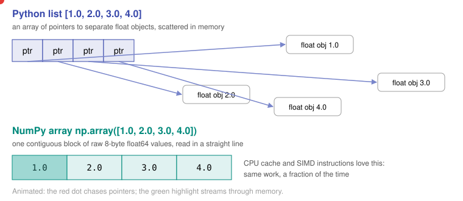
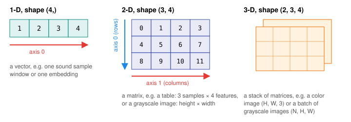

# Day 4: NumPy Arrays, and Why ML Runs on Them

**Phase 1 · Week 1 · ~120 minutes**

## Objectives

- [ ] Explain why a NumPy array is much faster than a Python list for numbers.
- [ ] Create arrays and read their `shape`, `ndim` and `dtype`.
- [ ] Index and slice 1-D and 2-D arrays, including boolean masks.
- [ ] Replace Python loops with **vectorized** operations and reductions along an axis.
- [ ] Choose a `dtype` and calculate how much memory an array uses.

**Prerequisites.** [Day 2](day-02-python-types.md) (lists, slicing) and [Day 3](day-03-functions-classes.md).

---

## The big idea

Everything in machine learning is numbers in grids: an image is a grid of pixel values, a sentence becomes a grid of token embeddings, a neural network layer is a grid of weights. **NumPy** (Numerical Python) gives Python one fast, compact grid type, the `ndarray` (n-dimensional array), plus hundreds of operations on it.

PyTorch tensors, TensorFlow/LiteRT tensors and JAX arrays all copy NumPy's design. **Learn NumPy well and you have learned the API of every ML framework.**

**Analogy.** A Python list is a shelf of labelled boxes, each box holding a pointer to a number stored somewhere else in the warehouse. A NumPy array is a single egg carton: every slot is the same size, they're side by side, and you can process the whole row in one sweep.

## Why it's fast

<figure class="diagram" markdown>

<figcaption>Animated: reading a list chases pointers around memory. Reading an array streams through one block.</figcaption>
</figure>

Three things make NumPy 10–100× faster than a Python loop:

1. **Contiguous memory.** Values sit next to each other, so the CPU cache fetches many at once.
2. **One type for all elements.** No per-element type checks: the loop is compiled C that knows every item is a `float64`.
3. **SIMD.** Modern CPUs process 4–16 numbers per instruction (NEON on your phone's ARM chip, AVX on laptops). NumPy's C loops use them.

Measure it yourself in Jupyter:

```python
import numpy as np

xs = list(range(1_000_000))
arr = np.arange(1_000_000)

%timeit [x * 2 for x in xs]     # ~30 ms
%timeit arr * 2                 # ~0.5 ms
```

!!! android "Android bridge"
    It's the difference between a `List<Float>` (boxed `java.lang.Float` objects, each on the heap) and a `FloatArray` (a primitive `float[]`). You already know to use `FloatArray` or a direct `ByteBuffer` when feeding a TFLite interpreter. A NumPy array *is* that primitive buffer, plus a shape.

## Creating arrays

```python
import numpy as np                 # always imported as np

a = np.array([1, 2, 3, 4])
a.shape    # (4,)      one axis with 4 elements
a.ndim     # 1
a.dtype    # dtype('int64')

np.zeros((2, 3))          # 2×3 of 0.0
np.ones(3)                # [1. 1. 1.]
np.arange(0, 10, 2)       # [0 2 4 6 8]   like range(), but an array
np.linspace(0, 1, 5)      # [0.   0.25 0.5  0.75 1.  ]  5 evenly spaced points

rng = np.random.default_rng(42)    # seeded random generator: reproducible
rng.normal(size=3)                 # 3 samples from a bell curve
rng.integers(0, 10, size=5)        # 5 random ints in [0, 10)
```

!!! tip "Always seed randomness"
    `default_rng(42)` gives the same "random" numbers every run. ML results depend on random initialization and shuffling, so seeding is how you make experiments reproducible.

## Shape: the most important attribute

<figure class="diagram" markdown>

<figcaption>Axis 0 is always the first number in the shape. In a 2-D array it runs down the rows.</figcaption>
</figure>

```python
m = np.arange(12).reshape(3, 4)
m
# array([[ 0,  1,  2,  3],
#        [ 4,  5,  6,  7],
#        [ 8,  9, 10, 11]])
m.shape     # (3, 4)   3 rows, 4 columns
```

Shapes you'll see constantly:

| Data | Typical shape | Meaning |
|---|---|---|
| A table of 1,000 houses with 8 features | `(1000, 8)` | (samples, features) |
| One RGB photo | `(224, 224, 3)` | (height, width, channels) |
| A batch of 32 photos | `(32, 224, 224, 3)` | (batch, height, width, channels) |
| A sentence of 12 tokens with 768-dim embeddings | `(12, 768)` | (tokens, embedding size) |

!!! warning "Common mistake"
    Most ML bugs in your first months will be shape bugs. Print `.shape` constantly. When a model input expects `(1, 224, 224, 3)` and you pass `(224, 224, 3)`, you'll get an error, or worse, a silent wrong answer.

## Indexing and slicing

Same rules as Day 2's list slicing, with one index per axis separated by commas:

```python
m[1, 2]      # 6        row 1, column 2
m[0]         # [0 1 2 3]          the whole first row
m[:, 1]      # [1 5 9]            column 1, every row
m[:2, 1:3]   # [[1 2] [5 6]]      top-left 2×2 block
m[-1]        # [ 8  9 10 11]      last row
```

**Boolean masks** select elements by a condition. This replaces most `if` statements inside loops:

```python
x = np.array([0.5, -1.2, 3.0, -0.1])
x > 0            # [ True False  True False]
x[x > 0]         # [0.5 3. ]    keep only the positives
```

!!! warning "Slices are views, not copies"
    The Day 2 sticky-note rule is back. A slice of a NumPy array shares memory with the original:

    ```python
    row = m[0]
    row[0] = 100
    m[0, 0]          # 100  the original changed!
    safe = m[0].copy()
    ```

    Views are a feature (no copying of huge arrays), but they cause subtle bugs when you modify data.

## Vectorization: no loops

**Vectorized** means "apply the operation to the whole array at once". Arithmetic is element-wise:

```python
a = np.array([1, 2, 3, 4])
a * 2          # [2 4 6 8]
a + a          # [2 4 6 8]
a ** 2         # [ 1  4  9 16]
np.sqrt(a)     # [1.   1.414 1.732 2.  ]
```

Here's ReLU, the most common neural-network activation function (you'll study it in Phase 3), in both styles:

=== "Python loop (slow)"

    ```python
    def relu_loop(values):
        out = []
        for v in values:
            out.append(v if v > 0 else 0.0)
        return out
    ```

=== "NumPy (fast)"

    ```python
    def relu(x):
        return np.maximum(0, x)

    relu(np.array([0.5, -1.2, 3.0, -0.1]))   # [0.5 0.  3.  0. ]
    ```

Same result, one line, and 50× faster on a large array.

## Reductions and the `axis` argument

A **reduction** collapses values into fewer: `sum`, `mean`, `max`, `min`, `std`, `argmax`.

```python
m.sum()          # 66               every element
m.sum(axis=0)    # [12 15 18 21]    collapse the rows: one total per column
m.sum(axis=1)    # [ 6 22 38]       collapse the columns: one total per row
m.mean(axis=0)   # [4. 5. 6. 7.]    average of each column
```

**How to remember `axis`:** the axis you name is the one that *disappears*. `m` has shape `(3, 4)`; `sum(axis=0)` removes the 3 and leaves shape `(4,)`.

Why this matters: with a dataset of shape `(samples, features)`, `data.mean(axis=0)` gives the average of each feature, which is the first step of normalizing data in Phase 2. With a model's output scores of shape `(batch, classes)`, `scores.argmax(axis=1)` gives the predicted class for each example.

## dtypes and memory

Every array has one **dtype** (data type) for all its elements.

| dtype | Bytes | Typical use |
|---|---|---|
| `float64` | 8 | NumPy's default; scientific computing |
| `float32` | 4 | Training neural networks (PyTorch default) |
| `float16` / `bfloat16` | 2 | Fast GPU training and inference |
| `int8` / `uint8` | 1 | Images (0–255) and **quantized models** on phones |

```python
np.zeros(1000, dtype=np.float64).nbytes   # 8000
np.zeros(1000, dtype=np.float32).nbytes   # 4000
np.zeros(1000, dtype=np.int8).nbytes      # 1000

img = rng.integers(0, 256, size=(224, 224, 3), dtype=np.uint8)
img.nbytes            # 150528  ≈ 147 KB
(img / 255.0).dtype   # float64  dividing silently upgrades the dtype
```

!!! android "Android bridge"
    This table is the heart of on-device AI. A model with 100 million weights is 400 MB in `float32` and 100 MB in `int8`. Moving from 4 bytes to 1 byte per weight, called **quantization**, is how models fit on phones and run on NPUs. You'll do it for real in Phase 6. The memory arithmetic starts here.

---

## Exercises

1. Create a `(5, 4)` array of random floats with a seeded generator. Print its shape, the mean of each column, and the max of each row.
2. Given `scores = np.array([[0.1, 0.7, 0.2], [0.8, 0.1, 0.1], [0.3, 0.3, 0.4]])` (3 images × 3 classes), find the predicted class for each image with one call.
3. Normalize an array to the range 0–1 without a loop: `(x - x.min()) / (x.max() - x.min())`. Compare to Day 3's list version.
4. Create a fake grayscale image `rng.integers(0, 256, size=(28, 28), dtype=np.uint8)`. Crop the centre 14×14, then count how many pixels are brighter than 200.
5. Time a Python loop that sums the squares of 1,000,000 numbers against `(arr ** 2).sum()`. Record the speed-up in your journal.
6. A model has 7 billion weights. How many GB is it in `float32`, `float16` and `int4` (half a byte)?

??? success "Solutions"
    ```python
    rng = np.random.default_rng(0)

    # 1
    x = rng.random((5, 4))
    x.shape, x.mean(axis=0), x.max(axis=1)

    # 2
    scores.argmax(axis=1)            # array([1, 0, 2])

    # 4
    img = rng.integers(0, 256, size=(28, 28), dtype=np.uint8)
    centre = img[7:21, 7:21]
    (centre > 200).sum()             # True counts as 1

    # 6
    # float32: 7e9 * 4   = 28 GB
    # float16: 7e9 * 2   = 14 GB
    # int4:    7e9 * 0.5 = 3.5 GB   ← why 4-bit models run on laptops and high-end phones
    ```

## Resources

- [NumPy: the absolute basics for beginners](https://numpy.org/doc/stable/user/absolute_beginners.html): the official guide, with diagrams.
- [NumPy quickstart](https://numpy.org/doc/stable/user/quickstart.html)
- [Jay Alammar: A Visual Intro to NumPy and Data Representation](https://jalammar.github.io/visual-numpy/): excellent illustrations of shapes, images and text as arrays.
- [From Python to NumPy (free book)](https://www.labri.fr/perso/nrougier/from-python-to-numpy/): vectorization in depth.
- [100 NumPy exercises](https://github.com/rougier/numpy-100): do the first 20 over the next two weeks.
- [CS231n Python/NumPy tutorial](https://cs231n.github.io/python-numpy-tutorial/): Stanford's quick tour, used by many ML courses.

## Checklist

- [ ] I can explain why arrays beat lists for numbers (memory layout, one dtype, SIMD).
- [ ] I check `.shape` and `.dtype` by habit.
- [ ] I can slice rows, columns and blocks, and use boolean masks.
- [ ] I know which way `axis=0` and `axis=1` collapse.
- [ ] I know slices are views and when to `.copy()`.
- [ ] I can work out an array's or model's memory size from its dtype.

**Next:** Day 5: Vectors, the atoms of machine learning (coming soon)
