# Day 5: Vectors, the Atoms of Machine Learning

**Phase 1 · Week 1 · ~120 minutes**

## Objectives

- [ ] Explain what a vector is in three ways: a list of numbers, an arrow, and a point in space.
- [ ] Add vectors, scale them and compute their length (norm), by hand and in NumPy.
- [ ] Compute a dot product and explain what it measures.
- [ ] Use cosine similarity to compare two vectors, and explain why search engines and RAG systems use it.
- [ ] Recognize that a single artificial neuron is a dot product plus a number.

**Prerequisites.** [Day 4](day-04-numpy-arrays.md) (NumPy arrays).

---

## The big idea

A **vector** is an ordered list of numbers. That's all. What makes vectors powerful is that we can treat that list as a **location** or a **direction** in space, and then use geometry to reason about data.

Machine learning represents *everything* as vectors:

| Thing | As a vector |
|---|---|
| A house | `[bedrooms, area_m2, age_years, distance_to_city_km]` = `[3, 120, 15, 8.5]` |
| A 28×28 grayscale image | 784 pixel brightness values in a row |
| A word or sentence | An **embedding**: typically 384–4096 numbers produced by a model, where similar meanings get nearby vectors |
| A user of your app | Counts of features they used, or a learned embedding of their behavior |

Once data is a vector, questions become geometry. *"Are these two support tickets about the same problem?"* becomes *"are these two vectors pointing the same way?"*

**Analogy.** Think of a vector as GPS directions: "3 blocks east, 1 block north". The list `[3, 1]` is the instructions; the arrow is the path you'd walk. With more numbers you're navigating in more dimensions. You can't picture 768 dimensions, but all the arithmetic works exactly the same as in 2-D, which is why we learn it in 2-D.

## Notation

We write vectors as bold lowercase letters, and their elements with subscripts:

\[
\mathbf{a} = [a_1, a_2, \dots, a_n] \qquad \text{e.g. } \mathbf{a} = [3, 1], \; a_1 = 3, \; a_2 = 1
\]

- \( n \) is the **dimension**: how many numbers the vector has.
- \( \mathbb{R}^n \) ("R n") means "the set of all vectors of \( n \) real numbers". "An embedding in \( \mathbb{R}^{768} \)" just means a vector of 768 floats.

In NumPy, a vector is a 1-D array:

```python
import numpy as np
a = np.array([3, 1])
a.shape     # (2,)   a 2-dimensional vector
```

!!! warning "Two meanings of 'dimension'"
    A vector with 768 numbers is "768-dimensional", but as a NumPy array it has `ndim == 1` (one axis). The first meaning is about the *space*; the second is about the *array's axes*. People mix them freely, so read from context.

## Adding and scaling vectors

**Addition** is element by element:

\[
\mathbf{a} + \mathbf{b} = [a_1 + b_1, \; a_2 + b_2]
\qquad [3, 1] + [1, 3] = [4, 4]
\]

Geometrically, place the tail of \( \mathbf{b} \) on the tip of \( \mathbf{a} \): the sum is the arrow from the origin to where you end up.

<figure class="diagram" markdown>
![Animation of vector addition: a = [3, 1] is drawn from the origin; b = [1, 3] slides so its tail sits at a's tip; the sum [4, 4] appears from the origin to b's new tip](../../assets/img/phase-1/vector-addition.svg)
<figcaption>Animated: adding vectors means following one arrow, then the other.</figcaption>
</figure>

**Scalar multiplication** stretches or shrinks a vector (a *scalar* is a single number):

\[
2\mathbf{a} = [2 \cdot 3, \; 2 \cdot 1] = [6, 2]
\qquad -1 \cdot \mathbf{a} = [-3, -1] \text{ (flipped)}
\]

```python
a = np.array([3, 1])
b = np.array([1, 3])
a + b        # array([4, 4])
a - b        # array([ 2, -2])
2 * a        # array([6, 2])
```

**Where this shows up:** a gradient descent update (Month 2) is literally `weights = weights - learning_rate * gradient`: one vector scaled and subtracted from another, millions of times.

## Length: the norm

The **length** or **norm** of a vector, written \( \|\mathbf{a}\| \), is the straight-line distance from the origin to its tip. It's Pythagoras:

\[
\|\mathbf{a}\| = \sqrt{a_1^2 + a_2^2 + \dots + a_n^2}
\qquad \|[3, 4]\| = \sqrt{9 + 16} = 5
\]

```python
np.linalg.norm(np.array([3, 4]))    # 5.0
np.sqrt((np.array([3, 4]) ** 2).sum())   # same thing, by hand
```

The **distance** between two points is the norm of their difference: \( \|\mathbf{a} - \mathbf{b}\| \). This is how k-nearest-neighbors (Phase 2) finds "the most similar houses".

A vector with length 1 is a **unit vector**. Dividing a vector by its norm, \( \mathbf{a} / \|\mathbf{a}\| \), keeps its direction and sets its length to 1. This is called **normalizing**, and vector databases often store normalized embeddings.

## The dot product

The **dot product** multiplies matching elements and adds the results:

\[
\mathbf{a} \cdot \mathbf{b} = a_1 b_1 + a_2 b_2 + \dots + a_n b_n = \sum_{i=1}^{n} a_i b_i
\]

Worked example:

\[
[1, 2, 3] \cdot [4, 5, 6] = 1 \cdot 4 + 2 \cdot 5 + 3 \cdot 6 = 4 + 10 + 18 = 32
\]

```python
u = np.array([1, 2, 3])
v = np.array([4, 5, 6])
np.dot(u, v)     # 32
u @ v            # 32   the @ operator is the modern spelling
(u * v).sum()    # 32   what it actually does
```

**What it means.** The same number can be computed from lengths and the angle \( \theta \) between the arrows:

\[
\mathbf{a} \cdot \mathbf{b} = \|\mathbf{a}\| \, \|\mathbf{b}\| \cos\theta
\]

So the dot product is large and positive when the vectors point the same way, zero when they're at right angles, and negative when they point apart. It's a measure of **alignment**, weighted by length.

## Cosine similarity

Divide out the lengths and you're left with only the angle:

\[
\text{cosine similarity}(\mathbf{a}, \mathbf{b}) = \cos\theta = \frac{\mathbf{a} \cdot \mathbf{b}}{\|\mathbf{a}\| \, \|\mathbf{b}\|}
\]

It always lies between −1 and 1.

<figure class="diagram" markdown>

<figcaption>Animated: as b rotates away from a, cosine similarity falls from 1 to −1.</figcaption>
</figure>

### Try it: drag the vectors

Drag the dots at the tips of **a** and **b**. Watch how the dot product depends on length, but cosine similarity depends only on direction.

<div class="vector-playground"></div>

!!! example "Experiments to try"
    1. Make **a** and **b** point the same way, then make **b** twice as long. The dot product doubles; the cosine stays 1.00.
    2. Put them at right angles, e.g. `[2, 0]` and `[0, 3]`. The dot product is exactly 0.
    3. Point them in opposite directions. Both go negative.

### Why AI engineers care

This formula is the core of **semantic search** and **RAG** (Retrieval-Augmented Generation, Phase 4). An embedding model turns each document and each question into a vector so that texts with similar *meaning* point in similar directions. To answer a question, you find the documents whose vectors have the highest cosine similarity to the question's vector, then hand those documents to the LLM.

A toy version, with hand-made 3-number "embeddings" where the dimensions mean `[royalty, masculinity, food]`:

```python
def cosine(a, b):
    return a @ b / (np.linalg.norm(a) * np.linalg.norm(b))

king  = np.array([0.95, 0.90, 0.05])
queen = np.array([0.93, 0.10, 0.05])
apple = np.array([0.02, 0.40, 0.98])

cosine(king, queen)   # ≈ 0.80   related
cosine(king, apple)   # ≈ 0.31
cosine(queen, apple)  # ≈ 0.11   barely related
```

Real embeddings have hundreds of dimensions and the dimensions don't have human-readable meanings; a model learns them. The math is identical.

!!! android "Android bridge"
    You've probably used this without knowing it. MediaPipe's **Text Embedder** and **Image Embedder** tasks return a vector for a piece of text or a photo, and provide a `cosineSimilarity()` helper to compare two of them, entirely on device. That's how an app can find "photos similar to this one" or match a user's query to FAQ entries offline. You'll build exactly that in Phase 6.

## A neuron is a dot product

Here's a preview of Month 4. An artificial **neuron** takes an input vector \( \mathbf{x} \), has a **weight** vector \( \mathbf{w} \) of the same size and a single number \( b \) called the **bias**, and computes:

\[
z = \mathbf{w} \cdot \mathbf{x} + b
\]

```python
x = np.array([2.0, 1.0, 3.0])     # input features
w = np.array([0.5, -0.2, 0.1])    # learned weights: how much each feature matters
b = 0.4                           # learned bias
z = w @ x + b                     # 0.5*2 - 0.2*1 + 0.1*3 + 0.4 = 1.5
```

The neuron's output is high when the input points in the same direction as its weights. In other words, each neuron is a little **pattern detector**, and "training" means finding weight vectors that point toward useful patterns. A layer is many neurons side by side, which turns into a matrix multiply: next week's topic.

## Common mistakes

!!! warning "Dot product of mismatched sizes"
    `np.array([1, 2]) @ np.array([1, 2, 3])` raises `ValueError: ... size mismatch`. Both vectors must have the same dimension. When it happens in a real model, it almost always means your input was preprocessed differently from the training data.

!!! warning "`*` is not the dot product"
    `u * v` multiplies element-wise and returns a vector. `u @ v` returns one number. Mixing them up is a common bug.

!!! warning "Cosine of a zero vector"
    A vector of all zeros has length 0, and dividing by it gives `nan`. Check for empty or blank inputs before embedding them.

---

## Exercises

1. By hand, then in NumPy: for \( \mathbf{a} = [2, -1, 3] \) and \( \mathbf{b} = [0, 4, 1] \), compute \( \mathbf{a} + \mathbf{b} \), \( 3\mathbf{a} \), \( \|\mathbf{a}\| \) and \( \mathbf{a} \cdot \mathbf{b} \).
2. Write `cosine(a, b)` and test it: identical vectors should give 1, `[1, 0]` vs `[0, 1]` should give 0, and `[1, 2]` vs `[-1, -2]` should give −1.
3. Write `normalize(v)` returning a unit vector. Show that for normalized vectors, the dot product *equals* the cosine similarity. (This is why vector databases normalize once at insert time: search then only needs dot products.)
4. **Mini word-similarity.** Represent these sentences as word-count vectors over the vocabulary `["model", "phone", "train", "battery", "data"]`, then find the most similar pair with cosine similarity:
    - "train the model on data"
    - "the phone battery died"
    - "more data helps the model train"
5. In the playground, find two vectors with a dot product of exactly 0 that aren't on the axes.

??? success "Solutions"
    ```python
    # 1
    a = np.array([2, -1, 3]); b = np.array([0, 4, 1])
    a + b                  # [2, 3, 4]
    3 * a                  # [6, -3, 9]
    np.linalg.norm(a)      # sqrt(4 + 1 + 9) = sqrt(14) ≈ 3.742
    a @ b                  # 0 - 4 + 3 = -1

    # 3
    def normalize(v):
        return v / np.linalg.norm(v)
    # normalize(a) @ normalize(b) == cosine(a, b), because both lengths are 1

    # 4
    vocab = ["model", "phone", "train", "battery", "data"]
    def to_vec(sentence):
        words = sentence.split()
        return np.array([words.count(w) for w in vocab])
    s1 = to_vec("train the model on data")          # [1, 0, 1, 0, 1]
    s2 = to_vec("the phone battery died")           # [0, 1, 0, 1, 0]
    s3 = to_vec("more data helps the model train")  # [1, 0, 1, 0, 1]
    cosine(s1, s3)   # 1.0   same words, so same direction
    cosine(s1, s2)   # 0.0   no words in common
    ```
    Notice the weakness: s1 and s3 score a perfect 1.0 even though their meaning differs slightly, and "phone died" vs "battery ran out" would score 0 despite meaning the same thing. Learned embeddings fix this. That's the story of Phase 4.

    ```python
    # 5: any [x, y] and [-y, x], e.g. [1, 2] and [-2, 1]: 1*(-2) + 2*1 = 0
    ```

## Resources

- [3Blue1Brown: Essence of Linear Algebra, ch. 1 "Vectors"](https://www.youtube.com/watch?v=fNk_zzaMoSs) and [ch. 9 "Dot products and duality"](https://www.youtube.com/watch?v=LyGKycYT2v0): the best visual introduction there is. Watch the whole series over Month 1.
- [Khan Academy: Vectors and spaces](https://www.khanacademy.org/math/linear-algebra/vectors-and-spaces): practice problems with hints.
- [Mathematics for Machine Learning (free book), ch. 2–3](https://mml-book.github.io/): the formal treatment, for later reference.
- [Immersive Math: Chapter 2 Vectors](http://immersivemath.com/ila/ch02_vectors/ch02.html) and [Chapter 3 The Dot Product](http://immersivemath.com/ila/ch03_dotproduct/ch03.html): an interactive linear algebra book.
- [MediaPipe Text Embedder for Android](https://ai.google.dev/edge/mediapipe/solutions/text/text_embedder/android): see cosine similarity used on device.

## Checklist

- [ ] I can describe a vector as a list, an arrow and a point.
- [ ] I can add, scale and find the norm of a vector by hand.
- [ ] I can compute a dot product and say what its sign means.
- [ ] I can explain cosine similarity and why it ignores length.
- [ ] I played with the vector playground and did the three experiments.
- [ ] I can write a neuron's output as \( \mathbf{w} \cdot \mathbf{x} + b \).

**Next:** Week 1 review and mini-project (Day 6), then Week 2 begins with [Day 8: Shapes, reshaping and indexing](day-08-shapes-indexing.md).
