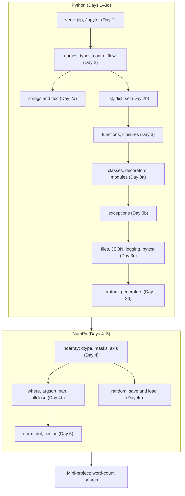
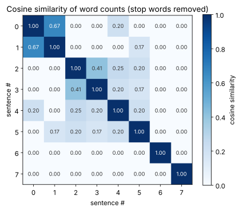

# Day 6: Week 1 Review and Mini-Project: Word-Count Search

**Phase 1 · Week 1 · ~300 minutes (plan two sittings)**

Week 1 grew to thirteen lessons, so this review is long on purpose. A good split: **sitting 1** is the recap, the self-check and two or three re-do items (about 100 minutes); **sitting 2** is the mini-project, a stretch goal and the retro (about 200 minutes).

## Objectives

By the end of today you can:

- [ ] Explain, without notes, the main idea of each of the thirteen Week 1 lessons and how they depend on each other.
- [ ] Answer the ten self-check questions, and re-do at least three of the week's hardest exercises from a blank file.
- [ ] Read a folder of JSON Lines files through a **generator pipeline** that skips bad lines with specific `except` clauses and reports what it skipped.
- [ ] Raise and catch your own exception classes, and chain them with `from`.
- [ ] Save a vocabulary as JSON and an array as `.npy`, load both back, and prove the round trip lost nothing.
- [ ] Turn notes into a count matrix, normalise its rows with an `np.where` guard against zero rows, and check a vectorised result against a loop with `np.allclose`.
- [ ] Rank the most similar pairs and answer search queries with `np.argsort`, and list the shared words with one-argument `np.where`.
- [ ] Explain, with real examples from your own output, where counting words fails and why that motivates embeddings.

**Prerequisites.** All of Week 1. What today uses from each:

- [Day 1](day-01-setup.md): a venv to run in, Jupyter or the ▶ Run buttons, and reading a traceback bottom-up.
- [Day 2](day-02-python-types.md): names and objects, `float` and `math.isclose`, truthiness, `for` / `enumerate` / `zip`, `continue`.
- [Day 2a](day-02a-strings.md): `lower`, `strip`, `split`, f-strings with format specs, `repr`, and characters as Unicode code points. (`str.translate` and `string.punctuation` are new today, in Milestone 3.)
- [Day 2b](day-02b-collections.md): lists, dicts, sets, comprehensions, `sorted`, tuples that sort by their first item.
- [Day 3](day-03-functions-classes.md): functions with type hints and docstrings, default arguments, `None` as a sentinel.
- [Day 3a](day-03a-classes-modules.md): classes, inheritance (`class BadRecord(ValueError)`), decorators, `if __name__ == "__main__":`.
- [Day 3b](day-03b-errors-files-json.md): `try` / `except` / `else`, the exception hierarchy, custom exceptions, `raise ... from`.
- [Day 3c](day-03c-files-json.md): `with`, `open(..., encoding="utf-8")`, `pathlib`, `tempfile.mkdtemp()`, `json.dump` / `json.loads`, JSON Lines.
- [Day 3d](day-03d-iterators-generators.md): generator functions, laziness, the one-shot trap, a read → parse → clean pipeline.
- [Day 4](day-04-numpy-arrays.md): `np.zeros`, dtypes, indexing, boolean masks with `&`, reductions with `axis=` and `keepdims=True`.
- [Day 4b](day-04b-numpy-toolkit.md): `np.where` (one and three arguments), `np.argsort(-a, kind="stable")`, `np.isclose` / `np.allclose`, `np.array_equal`.
- [Day 4c](day-04c-random-io-stats.md): `np.random.default_rng(seed)`, `permutation`, and `np.save` / `np.load`.
- [Day 5](day-05-vectors.md): norm, dot product, cosine similarity, unit vectors, and the zero-vector guard.

!!! info "How to read the code on this page"
    Every Python block has a **▶ Run** button, and blocks share their variables from top to bottom like notebook cells, so run them in order. Collapsed boxes contain code too: open and run them in order if you use the ▶ Run buttons, or the later blocks won't find their functions. Lines that fail on purpose are wrapped in `try` / `except`, and the comment shows the real error message. NumPy scalars print as `np.float64(...)`; in the browser, NumPy's default integer is `int32`, so where this page shows `int64` for an array you didn't give a dtype, ▶ Run shows `int32` (see [How lessons work](../../how-lessons-work.md)).

---

## What this week gave you

Thirteen lessons, one stack. Each fixes a gap the previous one left:

| Lesson | You learned | The one idea to keep |
|---|---|---|
| [1](day-01-setup.md) | venv, pip, the interpreter, Jupyter, Colab | Python is the steering wheel; native libraries do the work. Know which interpreter runs your code. |
| [2](day-02-python-types.md) | names, numbers, truthiness, control flow | Names are sticky notes on objects. `b = a` never copies. Compare floats with `isclose`. |
| [2a](day-02a-strings.md) | strings, slicing, methods, formatting, Unicode | Strings are immutable: every method returns a new string. Text is code points; files are bytes. |
| [2b](day-02b-collections.md) | list, tuple, dict, set, `Counter`, comprehensions | A dict or set finds a key by its hash in one step; a list searches one item at a time. |
| [3](day-03-functions-classes.md) | functions, arguments, scope, closures, hints | Defaults are evaluated once; closures read variables when called, not when made. |
| [3a](day-03a-classes-modules.md) | classes, dunders, dataclasses, decorators, modules | `model(x)` runs `__call__`, which runs `forward`. `@deco` is `f = deco(f)`. |
| [3b](day-03b-errors-files-json.md) | exceptions, `try` / `except`, custom errors, `from` | Catch the specific error you can handle; let the rest crash loudly. |
| [3c](day-03c-files-json.md) | `with`, files, `pathlib`, csv, JSON, logging, pytest | `with` always cleans up. JSON keys are strings and tuples come back as lists. |
| [3d](day-03d-iterators-generators.md) | iterators, generators, `itertools`, a data loader | A generator runs only when pulled, and only once. Pipelines of generators use constant memory. |
| [4](day-04-numpy-arrays.md) | `ndarray`, dtype, indexing, masks, views, `axis` | Don't loop over numbers in Python. Slices are views, masks are copies. The axis you name disappears. |
| [4b](day-04b-numpy-toolkit.md) | `where`, `clip`, `sort`, `argsort`, `unique`, `nan`, `allclose` | Every toolbar function has a silent trap: a wrong axis, a `nan`, an `==` on floats. |
| [4c](day-04c-random-io-stats.md) | random generators, splits, saving, percentiles | One seeded `default_rng`; shuffle samples and labels with one permutation. |
| [5](day-05-vectors.md) | vectors, norm, dot product, cosine similarity | Cosine compares *direction*, not length. It's the core of semantic search. |

Today's mini-project gives every row of that table a job:

<figure class="diagram" markdown>

<figcaption>Animated: the mini-project's six stages, and the lessons each one uses. Days 1, 3 and 3a sit under all of them.</figcaption>
</figure>

And here is how the concepts depend on each other. An arrow points from a lesson to the one that builds on it:



!!! android "Android bridge"
    This week was the equivalent of learning Kotlin syntax, collections, exceptions, `File` and `kotlinx.serialization`, `Sequence`, and `FloatArray` before writing your first real feature. The mini-project is that first feature: small, end to end, reading real files, failing politely on bad input, and built only from parts you now own.

## Self-check

Answer out loud or on paper first, then open the answer. If you miss more than three, re-read the lessons behind them before the mini-project.

??? question "1. `pip install numpy` worked in your terminal, but `import numpy` in Jupyter says `ModuleNotFoundError`. What is going on, and how do you check?"
    The terminal's `pip` and the notebook's kernel are different Python interpreters, so the package went into a different environment. Run `import sys; print(sys.executable)` in the notebook and `which python` (or `where python`) in the terminal and compare. Fix it by installing into the kernel's interpreter: `%pip install numpy` in the notebook, or `python -m pip install numpy` with the venv activated. A related trap: a notebook whose cells were run out of order has hidden state, so before trusting a result, use **Restart & Run All**. (Day 1)

??? question "2. Predict all six: `0.1 + 0.2 == 0.3`, `'10' < '9'`, `'photo.png'.strip('.png')`, `'photo.png'.removesuffix('.png')`, `a` after `a = [1, 2]; b = a; b += [3]`, and `s` after `s = 'ab'; t = s; t += 'c'`."
    `False`, `True`, `'hoto'`, `'photo'`, `[1, 2, 3]` and `'ab'`.

    `0.1` and `0.2` have no exact binary form, so their sum is `0.30000000000000004`; use `math.isclose`. Strings compare character by character, and `"1"` comes before `"9"`. `strip(".png")` removes any of the *characters* `.`, `p`, `n`, `g` from both ends, so it eats the leading `p` too; `removesuffix` removes the exact ending. `b += [3]` changes the one list both names point at, but `t += "c"` builds a new string (strings are immutable) and moves only `t`. (Days 2, 2a and 2b)

??? question "3. Why is `'owl' in labels` fast when `labels` is a set of a million strings and slow when it's a list? And why does `{['cat']: 1}` fail?"
    A set (like a dict) stores each item in a hash table: it computes `hash("owl")`, jumps to that slot and checks the few items there, so the cost doesn't grow with the size. A list has no index by value, so `in` compares items one by one, a million comparisons in the worst case. The hash is why keys must be **hashable**, which in practice means immutable: a list can change after it's stored, so `{["cat"]: 1}` raises `TypeError: cannot use 'list' as a dict key (unhashable type: 'list')` (Python 3.13 and earlier print the shorter `TypeError: unhashable type: 'list'`). Use a tuple, `{("cat",): 1}`. (Day 2b)

??? question "4. Three things that happen 'once' in Python functions: why is `def add(x, out=[])` a bug, what does `@timed` above `def f` mean, and how does `model(x)` end up in `model.forward(x)`?"
    Default values are evaluated once, when `def` runs, so every call shares one list; use `out=None` and create the list inside. `@timed` over `def f` is `f = timed(f)`, run once at definition time: `f` is now the wrapper, which is why the wrapper needs `functools.wraps` to keep `f`'s name and docstring. Calling an object runs its class's `__call__`; `nn.Module.__call__` does bookkeeping and then calls your `forward`. (Days 3 and 3a)

??? question "5. In this code, when does the second `except` run? What should the first line of the `except` block be if you want the caller to see the original error as the cause?"
    ```text
    try:
        record = json.loads(line)
    except ValueError:
        ...
    except json.JSONDecodeError:
        ...
    ```

    Never. `json.JSONDecodeError` is a subclass of `ValueError`, and Python takes the **first** `except` that matches, so the `ValueError` clause always wins. Put the more specific class first. To report your own error and keep the original, write `except json.JSONDecodeError as e:` and then `raise CorpusError("bad line") from e`; the traceback shows both, joined by "The above exception was the direct cause of the following exception". (Day 3b)

??? question "6. What does `json.loads(json.dumps({1: (2, 3)}))` give back, and what happens with `json.dumps({'x': np.float32(0.5)})`?"
    `{'1': [2, 3]}`: JSON object keys are always strings and JSON has no tuples, so the round trip changed both. The second raises `TypeError: Object of type float32 is not JSON serializable`; convert with `float(x)` (or `.item()`, or `.tolist()` for an array) before saving. (Day 3c)

??? question "7. `notes = (line for line in f if line.strip())`. You call `len(list(notes))` to log how many there are, then loop over `notes` to process them. What happens?"
    The loop runs zero times, with no error. A generator is one-shot: `list(notes)` pulled every item, and the second pass finds it finished. Materialise once (`notes = list(...)`), or create a fresh generator per pass. If `f` was opened in a `with` block that has already ended, even the first pass fails with `ValueError: I/O operation on closed file.` (Day 3d)

??? question "8. Predict: `np.array([250, 10], dtype=np.uint8) + 10`; `m[0]` after `m = np.arange(6); v = m[m > 2]; v[0] = 99`; `np.array([1.0, np.nan]) == np.nan`; `np.argsort(-np.array([0.2, 0.9, 0.5]))`."
    `array([ 4, 20], dtype=uint8)`: `uint8` holds 0–255 and wraps around, 260 − 256 = 4. `m` is unchanged, `array([0, 1, 2, 3, 4, 5])`: a mask makes a **copy** (a slice would have been a view). `array([False, False])`: `nan` is not equal to anything, itself included; use `np.isnan`. `array([1, 2, 0])`: the positions of the values from largest to smallest, the top-k idiom. (Days 4 and 4b)

??? question "9. You split a dataset with `rng = np.random.default_rng(0)`, then `rng.shuffle(X)` and `rng.shuffle(y)`. Why are your labels now wrong, and what's the fix?"
    The second shuffle draws new random numbers from the same generator, so it puts `y` in a *different* order from `X`: every sample loses its label, silently. Draw one order and apply it to both: `idx = rng.permutation(len(X))`, then `X[idx]`, `y[idx]`. Use `np.random.default_rng(seed)` objects rather than the legacy global `np.random.seed`, so each part of your code has its own reproducible stream. (Day 4c)

??? question "10. By hand: the cosine similarity of [1, 0, 1] and [1, 1, 0]. What does a cosine of 0 mean for word counts, and what must `cosine` do when one vector is all zeros?"
    The dot product is \( 1 + 0 + 0 = 1 \); both lengths are \( \sqrt{2} \); so \( 1 / (\sqrt{2} \cdot \sqrt{2}) = 0.5 \) (NumPy prints `0.4999999999999999`, float rounding). For word counts, 0 means no words in common. An all-zero vector has length 0, so the formula divides by zero and gives `nan`; check the norms first and return `0.0`. (Day 5)

## Re-do from blank

Pick **at least three** of these. For each, open an empty file or notebook, set a timer for 15 minutes, and write it without looking at the original lesson. Only then open the solution. These are the week's hardest exercises, and each one tests a mental model rather than a fact.

**A. Three silent bugs** ([Day 3, exercise 7](day-03-functions-classes.md#exercises)). Each function below has one bug, and none raises an error. The intended output is `[2, 20, 200]`, then `[1, 2] [3]`, then `['hi', '', '']`. Predict what it prints instead, then fix all three.

```text
def make_scalers(factors):
    scalers = []
    for f in factors:
        def scale(x):
            return x * f
        scalers.append(scale)
    return scalers

def collect(values, out=[]):
    for v in values:
        out.append(v)
    return out

def pad(tokens, length, fill=None):
    if not fill:
        fill = "<pad>"
    return tokens + [fill] * (length - len(tokens))
```

??? success "Solution A"
    ```python
    def make_scalers(factors):
        scalers = []
        for f in factors:
            def scale(x, f=f):          # bind this round's f now, as a default
                return x * f
            scalers.append(scale)
        return scalers

    def collect(values, out=None):      # None sentinel: a new list on every call
        if out is None:
            out = []
        for v in values:
            out.append(v)
        return out

    def pad(tokens, length, fill=None):
        if fill is None:                # "" is falsy, but it's a real value here
            fill = "<pad>"
        return tokens + [fill] * (length - len(tokens))

    print([s(2) for s in make_scalers([1, 10, 100])])
    print(collect([1, 2]), collect([3]))
    print(pad(["hi"], 3, fill=""))
    # [2, 20, 200]
    # [1, 2] [3]
    # ['hi', '', '']
    ```

    The buggy version prints `[200, 200, 200]`, `[1, 2, 3] [1, 2, 3]` and `['hi', '<pad>', '<pad>']`. **Late binding:** each `scale` looks up `f` when it is *called*, after the loop has finished, so all three see the last value; a default argument is evaluated when the `def` runs, so `f=f` freezes each round's value. **Mutable default:** `out=[]` was created once, so both calls append to the same list, and both printed names show it after both calls. **Truthiness:** `not ""` is `True`, so `if not fill` replaces an empty string the caller asked for; test `is None`.

**B. A retry decorator** ([Day 3b, exercise 7](day-03b-errors-files-json.md#exercises)). Write `@retry(times=3, on=(ConnectionError,))`: call the function up to `times` times (raise `ValueError` if `times < 1`); retry only on the exception types in `on`, printing `attempt N failed: <message>`; let any other exception through at once; when every attempt fails, raise `RetryError("gave up after N attempts")` chained with `from` to the last exception. Keep the function's name with `functools.wraps`.

??? success "Solution B"
    ```python
    import functools

    class RetryError(Exception):
        """Every attempt failed."""

    def retry(times=3, on=(ConnectionError,)):
        if times < 1:
            raise ValueError(f"times must be at least 1, got {times}")
        def decorator(func):
            @functools.wraps(func)
            def wrapper(*args, **kwargs):
                for attempt in range(1, times + 1):
                    try:
                        return func(*args, **kwargs)
                    except on as e:
                        print(f"attempt {attempt} failed: {e}")
                        last = e            # e is deleted when the except block ends
                raise RetryError(f"gave up after {times} attempts") from last
            return wrapper
        return decorator

    calls = {"n": 0}

    @retry(times=3)
    def download(url):
        calls["n"] += 1
        if calls["n"] < 3:
            raise ConnectionError(f"timeout #{calls['n']}")
        return f"got {url}"

    print(download("weights.bin"))
    # attempt 1 failed: timeout #1
    # attempt 2 failed: timeout #2
    # got weights.bin

    @retry(times=2)
    def always_down():
        raise ConnectionError("no network")

    try:
        always_down()
    except RetryError as e:
        print(f"{e!r} caused by {e.__cause__!r}")
    # attempt 1 failed: no network
    # attempt 2 failed: no network
    # RetryError('gave up after 2 attempts') caused by ConnectionError('no network')

    @retry()
    def bad_input():
        raise ValueError("bad url")

    try:
        bad_input()
    except ValueError as e:
        print("ValueError:", e)
    print(download.__name__)
    # ValueError: bad url
    # download
    ```

    Three layers: `retry(...)` takes the settings and returns `decorator`; `decorator(func)` returns `wrapper`; `wrapper` runs on every call. `except on as e` works because `except` accepts a tuple of classes. The `ValueError` isn't in `on`, so it passes straight through on the first attempt. `return` inside the loop leaves at the first success; the `raise` after the loop runs only when every attempt failed. `calls` is a dict so the function can change it without `global` (Day 3).

**C. An atomic save** ([Day 3c, exercise 8](day-03c-files-json.md#exercises)). Write a `@contextmanager` called `atomic_write(path)` that hands the caller a file whose contents go to `<name>.tmp` in the same folder. If the body succeeds, move the temporary file over `path` with `Path.replace`; if it raises, delete the temporary file and re-raise, leaving any existing `path` untouched. Show that a good file survives a failed save, that no `.tmp` file is left, and that a successful save replaces the file.

??? success "Solution C"
    ```python
    import json
    import tempfile
    from contextlib import contextmanager
    from pathlib import Path

    @contextmanager
    def atomic_write(path):
        path = Path(path)
        tmp = path.with_name(path.name + ".tmp")
        f = open(tmp, "w", encoding="utf-8")
        try:
            yield f
            f.close()
            tmp.replace(path)               # an atomic rename on the same file system
        except BaseException:
            f.close()
            tmp.unlink(missing_ok=True)
            raise                           # bare raise: the caller sees the original error

    folder = Path(tempfile.mkdtemp())
    ckpt = folder / "checkpoint.json"
    with atomic_write(ckpt) as f:
        json.dump({"epoch": 1}, f)

    try:
        with atomic_write(ckpt) as f:
            f.write('{"epoch": ')
            raise RuntimeError("crashed mid-save")
    except RuntimeError as e:
        print("RuntimeError:", e)
    print(ckpt.read_text(), sorted(p.name for p in folder.iterdir()))
    # RuntimeError: crashed mid-save
    # {"epoch": 1} ['checkpoint.json']

    with atomic_write(ckpt) as f:
        json.dump({"epoch": 2}, f)
    print(ckpt.read_text())
    # {"epoch": 2}
    ```

    The exception raised in the `with` body reappears inside the generator at the `yield`, so the `except` there sees it. Catching `BaseException` (not `Exception`) means even `KeyboardInterrupt` cleans up, and the bare `raise` passes it on unchanged. Closing before `replace` matters: on Windows an open file can't be renamed, and everywhere the buffered bytes must reach the disk first.

**D. A moving average over an endless stream** ([Day 3d, exercise 8](day-03d-iterators-generators.md#exercises)). Write a generator `moving_average(values, k)` that yields the mean of the last `k` values seen so far, keeps only `k` values in memory (use `collections.deque(maxlen=k)`), and keeps a running sum so each step costs the same for any `k`. Test it on `[4.0, 2.0, 3.0, 1.0, 2.0]` with `k=3`, and on the first 4 values of the endless stream `1/step` with `k=2`.

??? success "Solution D"
    ```python
    from collections import deque
    from itertools import count, islice

    def moving_average(values, k):
        window = deque(maxlen=k)            # when full, append drops the oldest value
        running = 0.0
        for v in values:
            if len(window) == k:
                running -= window[0]        # the oldest value is about to drop out
            window.append(v)
            running += v
            yield running / len(window)

    print([round(m, 3) for m in moving_average([4.0, 2.0, 3.0, 1.0, 2.0], k=3)])
    print([round(m, 3) for m in islice(moving_average((1 / s for s in count(1)), k=2), 4)])
    # [4.0, 3.0, 3.0, 2.0, 2.0]
    # [1.0, 0.75, 0.417, 0.292]
    ```

    The generator never asks for more than one value at a time, so `islice` can stop the infinite stream after four. The subtraction happens *before* `append`, while `window[0]` is still the value that's about to leave.

**E. Brighten an image, three bugs** ([Day 4, exercise 7](day-04-numpy-arrays.md#exercises)). This should brighten a `uint8` image by `amount`, cap it at 255 and leave the caller's image alone. Find all three bugs.

```text
def brighten(img, amount):
    bright = img
    bright += amount
    bright[bright > 255] = 255
    return bright
```

??? success "Solution E"
    ```python
    import numpy as np

    def brighten(img, amount):
        bright = img.astype(np.int16) + amount      # a new, wider array: no wrap, no aliasing
        return np.clip(bright, 0, 255).astype(np.uint8)

    photo = np.array([[100, 200], [240, 30]], dtype=np.uint8)
    out = brighten(photo, 50)
    print(out)
    print(photo)
    # [[150 250]
    #  [255  80]]
    # [[100 200]
    #  [240  30]]
    ```

    **Aliasing:** `bright = img` is a second name for the caller's array, and `+=` changes it in place. **Overflow:** `uint8` arithmetic wraps, so 240 + 50 became 34 before any comparison could see it. **A dead mask:** no `uint8` value is ever `> 255`, so the capping line did nothing. Widening to `int16` first fixes the last two; `astype` also makes a copy, which fixes the first.

**F. Fill gaps, then shuffle: two bugs** (Day 4b's `nan` rules plus Day 4c's shuffling; the [Day 4b](day-04b-numpy-toolkit.md#exercises) and [Day 4c](day-04c-random-io-stats.md#exercises) exercise 7s are its cousins). This should fill each missing value with its column's mean, then shuffle the samples. It runs, but the gaps stay `nan` and the labels no longer match their rows.

```text
def prepare(X, y, seed=0):
    X = X.copy()
    col_means = np.nanmean(X, axis=0)
    missing = X == np.nan
    X[missing] = col_means[np.nonzero(missing)[1]]
    rng = np.random.default_rng(seed)
    rng.shuffle(X)
    rng.shuffle(y)
    return X, y
```

??? success "Solution F"
    ```python
    import numpy as np

    def prepare(X, y, seed=0):
        X = X.copy()
        col_means = np.nanmean(X, axis=0)
        missing = np.isnan(X)                        # == np.nan is False everywhere
        X[missing] = col_means[np.nonzero(missing)[1]]
        order = np.random.default_rng(seed).permutation(len(X))
        return X[order], y[order]                    # one order for both

    X = np.array([[1.0, 10.0], [np.nan, 20.0], [3.0, np.nan], [4.0, 40.0]])
    y = np.array([0, 1, 2, 3])
    Xp, yp = prepare(X, y)
    print(Xp)
    print(yp)
    # [[ 3.         23.33333333]
    #  [ 1.         10.        ]
    #  [ 2.66666667 20.        ]
    #  [ 4.         40.        ]]
    # [2 0 1 3]
    ```

    Check the pairing: row 0 of `Xp` is the original row 2 (`3.0` and a filled gap), and `yp[0]` is 2. Column 1's mean is (10 + 20 + 40) / 3 ≈ 23.33, and column 0's is (1 + 3 + 4) / 3 ≈ 2.67. The permutation comes from Day 4c; the `isnan` fix from Day 4b.

    The fill line, step by step: `np.nonzero(missing)` returns two arrays, the row numbers and the column numbers of the `True` cells, here `(array([1, 2]), array([0, 1]))`. `[1]` keeps the column numbers. `col_means[...]` with that integer array picks one mean per missing cell (fancy indexing, Day 4): `col_means[[0, 1]]`. Then `X[missing] = ...` writes those values into the masked cells in the same row-by-row order that `nonzero` listed them, so each gap gets its own column's mean.

If you have more time, three more from earlier in the week are good re-dos: Day 2's bisection with `for ... else` (exercise 8), Day 2a's run-length encoding (exercise 8) and Day 2b's tokenizer vocabulary (exercise 8), and Day 3a's transform registry (exercise 8). The mini-project rebuilds the tokenizer vocabulary at full size.

---

## Mini-project: word-count search over a folder of notes

Day 5's exercise 4 compared three sentences over a hand-picked five-word vocabulary. Today you build the real thing, the way it would be built at work: the notes live in **files**, some lines are broken, the vocabulary and the vectors are **saved to disk** and loaded back, and the program answers two questions: *which notes are most alike?* and *which notes best match this search?*

This is the "bag of words" model that powered search engines and spam filters for decades, and it's still the baseline that embeddings are measured against.

### The idea, with an analogy

Every note is a shopping basket and every distinct word is a product on the shelf. A **count vector** is the receipt: one line per product in the shop, saying how many of that product went into the basket (mostly zeros). Two baskets are similar if their receipts point the same way: they bought the same products in similar proportions. Cosine similarity measures exactly that, and ignores how big each basket was. A search query is one more small basket, compared with every receipt on file.

### The math, one symbol at a time

- \( n \) is the number of notes. Today \( n = 8 \).
- The **vocabulary** \( V \) is the set of distinct words across all notes, each given a column number. \( |V| \) ("the size of V") is how many words it has. Today \( |V| = 45 \).
- The **count vector** of note \( i \) is \( \mathbf{x}_i \): element \( j \) is how many times word \( j \) appears in note \( i \).
- Stack the count vectors as rows and you get the **count matrix** \( X \), with shape \( n \times |V| \). \( X_{ij} \) is "count of word \( j \) in note \( i \)"; in NumPy, `X[i, j]`.
- The similarity of notes \( i \) and \( k \) is Day 5's cosine of two rows:

\[
\text{sim}(i, k) = \frac{\mathbf{x}_i \cdot \mathbf{x}_k}{\|\mathbf{x}_i\| \, \|\mathbf{x}_k\|}
\]

Counts are never negative, so the dot product is never negative, and the similarity of two count vectors is always between 0 (no words in common) and 1 (the same words in the same proportions).

**Unit rows.** Divide each row by its length and you get \( \hat{\mathbf{x}}_i = \mathbf{x}_i / \|\mathbf{x}_i\| \), a unit vector. For unit vectors the denominator is \( 1 \times 1 \), so the cosine *is* the dot product: \( \text{sim}(i, k) = \hat{\mathbf{x}}_i \cdot \hat{\mathbf{x}}_k \). That's why search systems normalise once, at save time, and then score every query with dot products only.

**Number of pairs.** Each of the \( n \) notes can pair with \( n - 1 \) others, and that counts every pair twice (\( i, k \) and \( k, i \)), so there are \( n(n-1)/2 \) pairs. For \( n = 8 \): \( 8 \cdot 7 / 2 = 28 \).

<figure class="diagram" markdown>

<figcaption>Animated: two rows of the real count matrix, and how their cosine similarity is built only from the words they share.</figcaption>
</figure>

**Worked example** (real rows from the project). Note #0 is "The phone battery drains fast when the screen is bright." It has "the" twice and 8 other words once, so \( \|\mathbf{x}_0\|^2 = 2^2 + 8 \cdot 1^2 = 12 \). Note #4 is "The model runs on the phone, without the cloud." It has "the" three times and 6 other words once, so \( \|\mathbf{x}_4\|^2 = 3^2 + 6 = 15 \). In the dot product every column where either count is 0 contributes nothing, so only the shared words count: "the" gives \( 2 \times 3 = 6 \) and "phone" gives \( 1 \times 1 = 1 \).

\[
\text{sim}(0, 4) = \frac{7}{\sqrt{12}\,\sqrt{15}} = \frac{7}{\sqrt{180}} \approx 0.522
\]

Hold on to that number. It will turn out to be the winner, for a bad reason.

### Spec

Write `word_search.py`. The notes are JSON Lines files (one JSON object per line, Day 3c) in a folder; a good line looks like `{"id": "n01", "text": "..."}`.

| Piece | Input → output | Rules |
|---|---|---|
| `CorpusError(Exception)`, `BadRecord(ValueError)` | exception classes | `CorpusError`: the notes can't be used at all. `BadRecord`: one line is valid JSON but not a usable note. |
| `read_lines(folder)` | folder → generator of `(file name, line number, line)` | every `*.jsonl` file, in sorted name order, line numbers from 1; raise `CorpusError` if the folder is missing or has no `.jsonl` files |
| `parse_note(line)` | `str` → `{"id": ..., "text": ...}` | raise `json.JSONDecodeError` (from `json.loads`) or `BadRecord` (not an object, no `"text"`, text not a `str`, text blank) |
| `parse_notes(lines, skipped)` | generator → generator of notes | skip blank lines silently; catch the two errors above, append `"file:line: ErrorType: message"` to `skipped`, carry on |
| `tokenize(text)` | `str` → `list[str]` | lowercase; delete ASCII punctuation; split on whitespace |
| `load_corpus(folder)` | folder → `ids, texts, docs, skipped` | raise `CorpusError` if no note survives |
| `build_vocab(docs)`, `save_vocab`, `load_vocab` | token lists → `dict[str, int]`; dict ↔ JSON file | alphabetical columns; the file holds `{"version": 1, "words": [...]}`; a broken file raises `CorpusError` chained with `from` |
| `count_matrix(docs, vocab)` | → `int64` array `(n, len(vocab))` | `X[i, j]` = count of word `j` in note `i`; ignore unknown words |
| `cosine(a, b)` | two 1-D arrays → `float` | Day 5's formula; `0.0` if either vector is all zeros. The loop-based reference. |
| `unit_rows(X)` | → float array, same shape | each row divided by its length; all-zero rows stay zero, with no warning (`np.where`) |
| `similarity_matrix(X)` | → `(n, n)` array | `S[i, k]` = cosine of rows `i` and `k`, from unit rows and `@` |
| `top_pairs(S, k)` | → list of `(score, i, j)` | the `k` best pairs with `i < j`, highest first, ties in pair order (`np.argsort`) |
| `shared_words(X, words, i, j)` | → `list[str]` | words in both notes, in column order (one-argument `np.where`) |
| `save_index` / `load_index` | folder ↔ `(vocab, U)` | `vocab.json` plus `vectors.npy` (`np.save` / `np.load`) |
| `search(query, vocab, U, k)` | → list of `(score, note index)` | best `k` notes with a score above 0; `[]` if no query word is in the vocabulary |
| `save_report(path, ids, pairs)` | → `report.json` | `{"pairs": [{"a": id, "b": id, "score": ...}]}`, ids not positions, scores rounded to 4 places |
| `main(folder)` | → exit code `int` | print the report, save `report.json`; print the error and return 1 on `CorpusError` |

Plain Python loops are fine for building the count matrix. The pairs and the search use NumPy.

### Starter code

Copy this into `word_search.py` (or a notebook) and fill in the `TODO`s. The two lists of lines are the test data, written into a temporary folder by `write_demo_notes`; they're fixed so your numbers can match the ones below. Running the block as it is only defines the data and the empty functions; each milestone below shows one way to fill them in.

```python
# word_search.py: Week 1 mini-project, word-count search over a folder of notes.
import json
import string
import tempfile
from pathlib import Path

import numpy as np

PART1 = [
    '{"id": "n01", "text": "The phone battery drains fast when the screen is bright."}',
    '{"id": "n02", "text": "My phone\'s battery dies fast with a bright screen!"}',
    '',
    '{"id": "n03", "text": "We train the model on labelled photos."}',
    '{"id": "n04", "text": "Training a model needs lots of labelled data."}',
    '{"id": "n05", "text": "Battery life is fine until the camera',
    '{"id": "n06", "text": "The model runs on the phone, without the cloud."}',
]
PART2 = [
    '{"id": "n07", "text": "Quantization makes the model smaller and faster on phones."}',
    '{"id": "n08", "title": "Draft, no text yet"}',
    '{"id": "n09", "text": "Cosine similarity compares two vectors."}',
    '{"id": "n10", "text": 42}',
    '{"id": "n11", "text": "   "}',
    '{"id": "n12", "text": "The handset\'s cell ran flat in an hour."}',
]


def write_demo_notes(folder: Path) -> Path:
    """Write the two test files into folder/notes and return that path."""
    notes = folder / "notes"
    notes.mkdir(parents=True, exist_ok=True)
    (notes / "part1.jsonl").write_text("\n".join(PART1) + "\n", encoding="utf-8")
    (notes / "part2.jsonl").write_text("\n".join(PART2) + "\n", encoding="utf-8")
    return notes


class CorpusError(Exception):
    """The notes can't be turned into a corpus at all."""


class BadRecord(ValueError):
    """A line that is valid JSON but isn't a usable note."""


def read_lines(folder):
    # TODO: check the folder; for each sorted *.jsonl path: with open(...), enumerate(f, start=1), yield
    raise NotImplementedError


def parse_note(line: str) -> dict:
    # TODO: json.loads, then raise BadRecord for each rule in the spec
    raise NotImplementedError


def parse_notes(lines, skipped: list[str]):
    # TODO: skip blank lines; try: yield parse_note(line) except ...: skipped.append(...)
    raise NotImplementedError


def tokenize(text: str) -> list[str]:
    # TODO: str.maketrans("", "", string.punctuation) builds a "delete these" table for translate
    raise NotImplementedError


def load_corpus(folder):
    # TODO: run the pipeline once into a list; raise CorpusError if it's empty
    raise NotImplementedError


def build_vocab(docs: list[list[str]]) -> dict[str, int]:
    raise NotImplementedError


def save_vocab(vocab: dict[str, int], path) -> None:
    raise NotImplementedError


def load_vocab(path) -> dict[str, int]:
    raise NotImplementedError


def count_matrix(docs: list[list[str]], vocab: dict[str, int]) -> np.ndarray:
    # TODO: start from np.zeros((len(docs), len(vocab)), dtype=np.int64)
    raise NotImplementedError


def cosine(a: np.ndarray, b: np.ndarray) -> float:
    raise NotImplementedError


def unit_rows(X: np.ndarray) -> np.ndarray:
    # TODO: norms with keepdims=True; divide by np.where(norms == 0, 1.0, norms)
    raise NotImplementedError


def similarity_matrix(X: np.ndarray) -> np.ndarray:
    raise NotImplementedError


def top_pairs(S: np.ndarray, k: int) -> list[tuple[float, int, int]]:
    # TODO: list the (i, j) pairs with i < j, their scores as an array, np.argsort(-scores, kind="stable")
    raise NotImplementedError


def shared_words(X: np.ndarray, words: list[str], i: int, j: int) -> list[str]:
    raise NotImplementedError


def save_index(folder, vocab, U) -> None:
    raise NotImplementedError


def load_index(folder):
    raise NotImplementedError


def search(query: str, vocab: dict[str, int], U: np.ndarray, k: int = 3):
    raise NotImplementedError


def save_report(path, ids: list[str], pairs) -> None:
    # TODO: build the dict in the spec, json.dumps(..., indent=2), write it
    raise NotImplementedError


def main(folder) -> int:
    # TODO: load, report, save; return 0, or print the error and return 1
    raise NotImplementedError
```

### Milestones

Do them in order, and check each against the expected output before moving on. Every output below is real. Each milestone has a collapsed "one way to write it"; try first, then compare. (With the ▶ Run buttons, open and run each one, or the checks after it will hit `NotImplementedError`.)

**Milestone 1: the files, and a lazy reader.** Write the test data, then `read_lines`. It's a generator (Day 3d) with the `yield` *inside* the `with`, so each file stays open exactly while its lines are being pulled and is closed as soon as the loop moves on. `sorted(folder.glob("*.jsonl"))` makes the order the same on every computer (Day 3c), and `enumerate(f, start=1)` numbers lines the way an editor does.

??? success "Milestone 1: one way to write it"
    ```python
    def read_lines(folder):
        """Yield (file name, line number, line) for every line of every .jsonl file."""
        folder = Path(folder)
        if not folder.is_dir():
            raise CorpusError(f"no such folder: {folder}")
        paths = sorted(folder.glob("*.jsonl"))
        if not paths:
            raise CorpusError(f"no .jsonl files in {folder}")
        for path in paths:
            with open(path, encoding="utf-8") as f:
                for lineno, line in enumerate(f, start=1):
                    yield path.name, lineno, line
    ```

```python
folder = write_demo_notes(Path(tempfile.mkdtemp()))
print(sorted(p.name for p in folder.iterdir()))
lines = read_lines(folder)
print(type(lines).__name__)
print(next(lines))
print(sum(1 for _ in lines))
# ['part1.jsonl', 'part2.jsonl']
# generator
# ('part1.jsonl', 1, '{"id": "n01", "text": "The phone battery drains fast when the screen is bright."}\n')
# 12
```

`read_lines(folder)` returned a generator without reading anything. `next` pulled the first line, with its `\n` still on the end. `sum(1 for _ in lines)` counts what's *left*: 13 lines in all, minus the one already pulled. The generator is now finished; a second count would give 0.

There's a subtlety in the folder checks: they're inside a generator function, so they run on the first `next()`, not when you call `read_lines`. The check still happens before any line is read, which is what matters, but the traceback will point at the loop that pulls from it.

```python
try:
    for item in read_lines(folder / "missing"):
        pass
except CorpusError as e:
    print("CorpusError:", str(e).replace(str(folder), "<folder>"))
# CorpusError: no such folder: <folder>/missing
```

(The real message contains the temporary folder's path, which is different on every run, so the check replaces it with `<folder>`.)

**Milestone 2: parse, and keep going past bad lines.** `parse_note` turns one line into a note or raises. `parse_notes` is the stage that decides what to do about it: skip blank lines quietly, catch the errors it expects, record them, and move on. This is Day 3b's rule in action: catch only what you can handle, so the `except` names exactly the two classes the spec expects, `(json.JSONDecodeError, BadRecord)`. Both happen to be subclasses of `ValueError`, so `except ValueError` would also catch them, but it would catch too much: a `ValueError` from a bug you add later (say an `int(record["id"])` on an id like `"n01"`) would be silently filed as a bad line instead of crashing.

??? success "Milestone 2: one way to write it"
    ```python
    def parse_note(line: str) -> dict:
        """One JSON line → {"id", "text"}, or raise JSONDecodeError / BadRecord."""
        record = json.loads(line)
        if not isinstance(record, dict):
            raise BadRecord(f"expected an object, got {type(record).__name__}")
        if "text" not in record:
            raise BadRecord("no 'text' field")
        text = record["text"]
        if not isinstance(text, str):
            raise BadRecord(f"'text' must be a string, got {type(text).__name__}")
        if not text.strip():
            raise BadRecord("'text' is blank")
        return {"id": record.get("id", "?"), "text": text}


    def parse_notes(lines, skipped: list[str]):
        """Yield the good notes; record every bad line in skipped."""
        for name, lineno, line in lines:
            line = line.strip()
            if not line:
                continue
            try:
                yield parse_note(line)
            except (json.JSONDecodeError, BadRecord) as e:    # only the errors we expect
                skipped.append(f"{name}:{lineno}: {type(e).__name__}: {e}")
    ```

```python
skipped = []
notes = parse_notes(read_lines(folder), skipped)
print(skipped)
good = list(notes)
print(len(good), good[0])
for s in skipped:
    print(s)
# []
# 8 {'id': 'n01', 'text': 'The phone battery drains fast when the screen is bright.'}
# part1.jsonl:6: JSONDecodeError: Unterminated string starting at: line 1 column 23 (char 22)
# part2.jsonl:2: BadRecord: no 'text' field
# part2.jsonl:4: BadRecord: 'text' must be a string, got int
# part2.jsonl:5: BadRecord: 'text' is blank
```

Four lines skipped, each with its file and line number, so you can open the file and look. The blank line 3 of `part1.jsonl` isn't listed: a blank line is normal, not an error. Note the first `print(skipped)`: it shows `[]`.

!!! warning "Common mistake: reading the error list before the pipeline has run"
    Building `notes` ran no code at all (Day 3d), so right after that line `skipped` is still empty; it fills up only while something pulls the notes through. A report written between the two lines says "0 lines skipped" and is wrong. Consume the pipeline first (here with `list(notes)`), then read `skipped`. The same laziness moves errors too: if `parse_note` had a bug, it would surface in `list(notes)`, not on the line that built `notes`.

!!! warning "Common mistake: `except Exception` around the whole loop"
    It's tempting to wrap the pipeline in one broad `try`, so "nothing can go wrong":

    ```python
    def parse_notes_broad(lines, skipped):
        try:
            for name, lineno, line in lines:
                if line.strip():
                    yield parse_note(line.strip())
        except Exception as e:
            skipped.append(f"{type(e).__name__}: {e}")

    skipped_broad = []
    print(len(list(parse_notes_broad(read_lines(folder), skipped_broad))), skipped_broad)
    # 4 ['JSONDecodeError: Unterminated string starting at: line 1 column 23 (char 22)']
    ```

    The first bad line ended the whole loop, so four good notes after it vanished, and the message lost its line number. Put the `try` around the *one* line that can fail, inside the loop, and catch the narrowest class that covers your expected errors.

**Milestone 3: tokens, and the whole corpus.** `tokenize` uses Day 2a's `lower` and `split()`, plus one new tool for deleting punctuation (shown below the solution): lowercase first, then delete punctuation, then `split()`, which also swallows runs of spaces. `load_corpus` runs the pipeline **once** into a list, because everything after it needs several passes over the notes.

??? success "Milestone 3: one way to write it"
    ```python
    _NO_PUNCT = str.maketrans("", "", string.punctuation)    # built once, at import time


    def tokenize(text: str) -> list[str]:
        """Lowercase, delete ASCII punctuation, split on whitespace."""
        return text.lower().translate(_NO_PUNCT).split()


    def load_corpus(folder):
        """Read every note once. Returns ids, texts, token lists and the skipped lines."""
        skipped = []
        notes = list(parse_notes(read_lines(folder), skipped))    # one pass, kept
        if not notes:
            raise CorpusError(f"no usable notes in {folder} (skipped lines: {len(skipped)})")
        ids = [note["id"] for note in notes]
        texts = [note["text"] for note in notes]
        docs = [tokenize(t) for t in texts]
        return ids, texts, docs, skipped
    ```

**New today: deleting characters with `translate`.** `string.punctuation` is a ready-made string of the 32 ASCII punctuation symbols, from the standard `string` module. `str.maketrans(from, to, delete)` builds a **translation table**: a dict keyed by code point (Day 2a's `ord` numbers) that says what each character becomes. Its first two arguments map characters one-to-one (unused here, so empty strings); every character of the third argument maps to `None`, which means "delete". `text.translate(table)` then walks the string once and applies the table:

```python
print(len(string.punctuation), string.punctuation)
table = str.maketrans("", "", ".,!")
print(table)
print("a.b, c!".translate(table))
# 32 !"#$%&'()*+,-./:;<=>?@[\]^_`{|}~
# {46: None, 44: None, 33: None}
# ab c
```

46, 44 and 33 are the code points of `.`, `,` and `!`. The Kotlin equivalent is `text.filterNot { it in punct }`. `translate` does the same in one pass of compiled code, and `_NO_PUNCT` builds the table once, at import time, instead of on every call.

```python
print(tokenize("My phone's battery dies fast with a bright screen!"))
print(tokenize("  ML,   on-device!  "))
ids, texts, docs, skipped = load_corpus(folder)
print(ids)
print(len(docs), [len(d) for d in docs])
# ['my', 'phones', 'battery', 'dies', 'fast', 'with', 'a', 'bright', 'screen']
# ['ml', 'ondevice']
# ['n01', 'n02', 'n03', 'n04', 'n06', 'n07', 'n09', 'n12']
# 8 [10, 9, 7, 8, 9, 9, 5, 8]
```

Deleting the apostrophe turned "phone's" into "phones", and deleting the hyphen glued "on-device" into "ondevice". That's a design decision, not a bug, but you should know you made it. From here on, notes are numbered by **position**, #0 to #7. The ids keep their gaps (no `n05`, `n08`, `n10` or `n11`), which is why the report you save at the end uses ids, not positions.

An empty folder of notes is a `CorpusError`, not a crash further down:

```python
empty = Path(tempfile.mkdtemp())
_ = (empty / "only-bad.jsonl").write_text('{"id": "x", "text": 7}\n', encoding="utf-8")
try:
    load_corpus(empty)
except CorpusError as e:
    print("CorpusError:", str(e).replace(str(empty), "<tmp>"))
# CorpusError: no usable notes in <tmp> (skipped lines: 1)
```

`write_text` returns the number of characters it wrote; assigning it to `_`, the conventional name for a value you don't need (Day 3d), keeps the ▶ Run button from echoing it.

!!! warning "Common mistake: punctuation that isn't ASCII"
    `string.punctuation` is only the 32 ASCII symbols. Text typed on a phone keyboard often uses the curly apostrophe `’`, which is a different character from the straight `'` and isn't in that list:

    ```python
    print(ord("’"), hex(ord("’")), ord("'"))
    print(tokenize("My phone’s battery"))
    # 8217 0x2019 39
    # ['my', 'phone’s', 'battery']
    ```

    The curly one is code point U+2019 (8217); the straight one is 39. So "phone’s" and "phone's" become different words. Real tokenizers handle Unicode properly; for today, know the limit exists.

**Milestone 4: the vocabulary, saved and loaded.** `sorted({w for doc in docs for w in doc})` gives the distinct words in a fixed order; `{w: i for i, w in enumerate(words)}` numbers them. On disk, save the **list** of words: the position in the list *is* the column number, and a JSON list keeps its order and its types. Loading wraps the errors a broken file can cause into one `CorpusError`, chained with `from` so the original stays in the traceback.

??? success "Milestone 4: one way to write it"
    ```python
    def build_vocab(docs: list[list[str]]) -> dict[str, int]:
        """Map every distinct word to a column index, in alphabetical order."""
        words = sorted({w for doc in docs for w in doc})
        return {w: i for i, w in enumerate(words)}


    def save_vocab(vocab: dict[str, int], path) -> None:
        """Save the words in column order; the list position is the column."""
        with open(path, "w", encoding="utf-8") as f:
            json.dump({"version": 1, "words": list(vocab)}, f, indent=1)


    def load_vocab(path) -> dict[str, int]:
        try:
            data = json.loads(Path(path).read_text(encoding="utf-8"))
            words = data["words"]
            if not isinstance(words, list) or not all(isinstance(w, str) for w in words):
                raise TypeError("'words' must be a list of strings")
        except (UnicodeDecodeError, json.JSONDecodeError, KeyError, TypeError) as e:
            raise CorpusError(f"{Path(path).name} is not a vocabulary file") from e
        return {w: i for i, w in enumerate(words)}
    ```

```python
vocab = build_vocab(docs)
print(len(vocab), list(vocab)[:6])
print(vocab["phone"], vocab["phones"], vocab["the"])
save_vocab(vocab, folder / "vocab.json")
print((folder / "vocab.json").read_text(encoding="utf-8")[:43])
print(load_vocab(folder / "vocab.json") == vocab)
# 45 ['a', 'an', 'and', 'battery', 'bright', 'cell']
# 27 28 36
# {
#  "version": 1,
#  "words": [
#   "a",
#   "an",
# True
```

`list(vocab)` lists a dict's keys in insertion order, which `build_vocab` made the column order, so the saved list and the columns match. "phone" and "phones" got different columns: to this program they're as unrelated as "phone" and "cloud". The `"version"` key costs nothing and lets a later version of your program recognise old files.

And a corrupted file gives one clear error, with the real cause attached:

```python
_ = (folder / "broken.json").write_text('{"words": ["a", "b"', encoding="utf-8")
try:
    load_vocab(folder / "broken.json")
except CorpusError as e:
    print(f"CorpusError: {e}")
    print(f"cause: {type(e.__cause__).__name__}: {e.__cause__}")
# CorpusError: broken.json is not a vocabulary file
# cause: JSONDecodeError: Expecting ',' delimiter: line 1 column 20 (char 19)
```

!!! warning "Common mistake: saving an index-to-word dict"
    The other natural way to save a vocabulary is the reverse dict, column number → word. JSON object keys must be strings, so `json` quietly converts the numbers, and the loaded dict doesn't answer the question you saved it for:

    ```python
    idx_to_word = {i: w for w, i in vocab.items()}
    back = json.loads(json.dumps(idx_to_word))
    print(list(back.items())[:2])
    try:
        back[0]
    except KeyError as e:
        print("KeyError:", e)
    # [('0', 'a'), ('1', 'an')]
    # KeyError: 0
    ```

    Save a list, as above, or convert on load: `{int(k): v for k, v in back.items()}`. On Android the same rule applies to a model's `labels.txt`: the line order is part of the model's contract.

**Milestone 5: the count matrix.** Make a zero matrix of the right shape, then for each note `i` and each word `w` in it, add 1 at `X[i, vocab[w]]`. Give the dtype explicitly: the counts are then `int64` everywhere, including in the browser, whose default integer is `int32`.

??? success "Milestone 5: one way to write it"
    ```python
    def count_matrix(docs: list[list[str]], vocab: dict[str, int]) -> np.ndarray:
        """Row i, column j = how many times word j appears in note i."""
        X = np.zeros((len(docs), len(vocab)), dtype=np.int64)
        for i, doc in enumerate(docs):
            for w in doc:
                if w in vocab:              # unknown words are ignored
                    X[i, vocab[w]] += 1
        return X
    ```

```python
X = count_matrix(docs, vocab)
print(X.shape, X.dtype)
cols = [vocab[w] for w in ["the", "phone", "battery", "model", "on"]]
print(X[:, cols])
print(X.sum(axis=1))
print(np.array_equal(X.sum(axis=1), [len(d) for d in docs]))
# (8, 45) int64
# [[2 1 1 0 0]
#  [0 0 1 0 0]
#  [1 0 0 1 1]
#  [0 0 0 1 0]
#  [3 1 0 1 1]
#  [1 0 0 1 1]
#  [0 0 0 0 0]
#  [1 0 0 0 0]]
# [10  9  7  8  9  9  5  8]
# True
```

`X[:, cols]` picks several columns at once with a list of indices (fancy indexing, Day 4; Day 8 has more). `X.sum(axis=1)` collapses the columns, giving one total per note, and `np.array_equal` (exact equality, Day 4b) confirms it matches the token counts from Milestone 3. That's a free sanity check: every token landed in exactly one column.

**Milestone 6: unit rows and the similarity matrix.** First the loop-based reference, Day 5's `cosine` with its zero guard. Then the fast version: normalise every row once, then one `@` per row. The zero guard moves into `np.where`: divide by the norm where it's non-zero, and by 1 where it's zero, so an all-zero row stays all zeros.

??? success "Milestone 6: one way to write it"
    ```python
    def cosine(a: np.ndarray, b: np.ndarray) -> float:
        """Cosine similarity; 0.0 if either vector is all zeros."""
        na, nb = np.linalg.norm(a), np.linalg.norm(b)
        if na == 0 or nb == 0:
            return 0.0
        return float(a @ b / (na * nb))


    def unit_rows(X: np.ndarray) -> np.ndarray:
        """Each row divided by its length; all-zero rows stay zero."""
        norms = np.linalg.norm(X, axis=1, keepdims=True)    # shape (n, 1)
        return X / np.where(norms == 0, 1.0, norms)


    def similarity_matrix(X: np.ndarray) -> np.ndarray:
        """S[i, k] = cosine of rows i and k."""
        U = unit_rows(X)
        return np.array([U @ U[i] for i in range(len(U))])
    ```

`np.linalg.norm(X, axis=1, keepdims=True)` gives one length per row as an `(8, 1)` column (Day 4's `keepdims`), and dividing the `(8, 45)` matrix by it divides each row by its own length, as on Day 5 (Day 9 gives the general rule, broadcasting). `U @ U[i]` is "dot every row of `U` with row `i`": one row of `S` per call. The check that matters is against the slow loop, whose correctness you can check by hand:

```python
print(round(cosine(X[0], X[4]), 4), X[0] @ X[4], X[0] @ X[0], X[4] @ X[4])
U = unit_rows(X)
print(np.allclose(np.linalg.norm(U, axis=1), 1.0))
S = similarity_matrix(X)
S_loop = np.array([[cosine(X[i], X[k]) for k in range(len(X))] for i in range(len(X))])
print(S.shape, np.allclose(S, S_loop))
Z = np.array([[3, 4], [0, 0]])
print(unit_rows(Z))
# 0.5217 7 12 15
# True
# (8, 8) True
# [[0.6 0.8]
#  [0.  0. ]]
```

The first line reproduces the worked example: a dot product of 7, squared lengths 12 and 15 (`X[0] @ X[0]` is the squared length). `np.allclose` says the two matrices agree. Don't expect them to be bit-for-bit identical: the fast version divides first and multiplies after, while the loop multiplies first and divides after, so some entries can differ in the 16th digit, and whether they do depends on your machine's maths library. That's exactly the case `allclose` exists for (Day 4b), and why you never compare float results with `==`. The tiny `Z` shows the guard: the zero row comes back as zeros, with no warning.

!!! warning "Common mistake: putting the division inside `np.where`"
    This looks like the same guard, but it isn't:

    ```python
    import warnings
    norms_z = np.linalg.norm(Z, axis=1, keepdims=True)
    with warnings.catch_warnings(record=True) as caught:
        warnings.simplefilter("always")
        bad = np.where(norms_z == 0, 0.0, Z / norms_z)
    print(bad)
    print([str(w.message) for w in caught])
    # [[0.6 0.8]
    #  [0.  0. ]]
    # ['invalid value encountered in divide']
    ```

    The result is right, but NumPy computes **both** branches in full before choosing (Day 4b), so `Z / norms_z` still divided 0 by 0 and raised a `RuntimeWarning`. On a real dataset that warning fires on every run, and people learn to ignore warnings, which is how the real ones get missed. Make the *input* safe (`Z / np.where(norms_z == 0, 1.0, norms_z)`), not the output. (`warnings.catch_warnings(record=True)` collects the warnings into a list instead of printing them, so the message can be shown here.)

**Milestone 7: the top pairs, and the words they share.** List every pair with `i < j` in order, look up their scores, and sort the scores with `np.argsort(-scores, kind="stable")`: descending, with ties kept in pair order (Day 4b). For the shared words, `(X[i] > 0) & (X[j] > 0)` is a mask of the columns both notes use, and one-argument `np.where` turns it into their positions.

??? success "Milestone 7: one way to write it"
    ```python
    def top_pairs(S: np.ndarray, k: int) -> list[tuple[float, int, int]]:
        """The k most similar pairs i < j, highest first; ties stay in pair order."""
        n = len(S)
        pairs = [(i, j) for i in range(n) for j in range(i + 1, n)]
        scores = np.array([S[i, j] for i, j in pairs])
        order = np.argsort(-scores, kind="stable")[:k]
        return [(float(scores[p]), pairs[p][0], pairs[p][1]) for p in order]


    def shared_words(X: np.ndarray, words: list[str], i: int, j: int) -> list[str]:
        """Words that appear in both note i and note j, in column order."""
        cols = np.where((X[i] > 0) & (X[j] > 0))[0]
        return [words[c] for c in cols]
    ```

```python
words = list(vocab)
best = top_pairs(S, 3)
print(len(top_pairs(S, 100)))
for score, i, j in best:
    print(f"{score:.3f}  #{i} & #{j}  shared: {shared_words(X, words, i, j)}")
# 28
# 0.522  #0 & #4  shared: ['phone', 'the']
# 0.488  #2 & #4  shared: ['model', 'on', 'the']
# 0.430  #4 & #5  shared: ['model', 'on', 'the']
```

Asking for 100 pairs gives all 28: slicing past the end of an array is not an error. `top_pairs` converts each score with `float(...)` and each index comes from a Python list, so the result holds plain Python numbers. That matters as soon as you save it.

!!! warning "Common mistake: saving NumPy numbers as JSON"
    Positions that come straight out of `np.argsort` or `np.where` are NumPy integers, and `json` refuses them:

    ```python
    pos = np.argsort(-S[0], kind="stable")[1]     # the note most like #0, after itself
    print(repr(pos.item()), type(pos).__name__)
    try:
        json.dumps({"best_match": pos})
    except TypeError as e:
        print("TypeError:", e)
    print(json.dumps({"best_match": int(pos)}))
    # 4 int64
    # TypeError: Object of type int64 is not JSON serializable
    # {"best_match": 4}
    ```

    Convert with `int(...)` / `float(...)` (or `.item()`, or `.tolist()` for a whole array) at the boundary where data leaves NumPy. In the browser, `pos` is an `int32`, so `type(pos).__name__` and the error both say `int32` there. (`np.float64` happens to work, because it's a subclass of Python's `float`; `np.float32` doesn't, as the self-check showed.)

**Milestone 8: save the index, search it, write the report.** A search tool doesn't rebuild everything per query. Save the vocabulary and the unit rows once; load them back; score a query by turning it into a count vector over the *saved* vocabulary (unknown words are dropped), normalising it, and taking one `@` with all the rows.

??? success "Milestone 8: one way to write it"
    ```python
    def save_index(folder, vocab: dict[str, int], U: np.ndarray) -> None:
        folder = Path(folder)
        save_vocab(vocab, folder / "vocab.json")
        np.save(folder / "vectors.npy", U)


    def load_index(folder):
        folder = Path(folder)
        vocab = load_vocab(folder / "vocab.json")
        U = np.load(folder / "vectors.npy")
        if U.shape[1] != len(vocab):
            raise CorpusError(f"vectors have {U.shape[1]} columns, vocab has {len(vocab)} words")
        return vocab, U


    def search(query: str, vocab: dict[str, int], U: np.ndarray, k: int = 3):
        """The k notes most like the query, as (score, note index), scores above 0 only."""
        q = count_matrix([tokenize(query)], vocab)[0]
        norm = np.linalg.norm(q)
        if norm == 0:
            return []                       # no query word is in the vocabulary
        scores = U @ (q / norm)
        order = np.argsort(-scores, kind="stable")[:k]
        return [(round(float(scores[d]), 3), int(d)) for d in order if scores[d] > 0]


    def save_report(path, ids: list[str], pairs) -> None:
        report = {"pairs": [{"a": ids[i], "b": ids[j], "score": round(s, 4)}
                            for s, i, j in pairs]}
        Path(path).write_text(json.dumps(report, indent=2), encoding="utf-8")
    ```

```python
save_index(folder, vocab, U)
vocab2, U2 = load_index(folder)
print(vocab2 == vocab, np.array_equal(U2, U), U2.dtype)
for query in ["battery dies fast", "train a model on the phone", "cell", "hello world"]:
    print(f"{query!r:30} {search(query, vocab2, U2)}")
save_report(folder / "report.json", ids, best)
saved = json.loads((folder / "report.json").read_text(encoding="utf-8"))
print(saved["pairs"][0])
print(np.allclose([p["score"] for p in saved["pairs"]], [s for s, _, _ in best], atol=5e-5))
# True True float64
# 'battery dies fast'            [(0.577, 1), (0.333, 0)]
# 'train a model on the phone'   [(0.632, 4), (0.617, 2), (0.408, 5)]
# 'cell'                         [(0.354, 7)]
# 'hello world'                  []
# {'a': 'n01', 'b': 'n06', 'score': 0.5217}
# True
```

Three different equality checks, each the right one for its job. The vocabulary is a dict, so `==`. `.npy` stores the exact bytes and dtype (Day 4c), so the loaded array is **exactly** equal, and `np.array_equal` is the honest check. The report rounded each score to 4 decimals, so the saved scores are only *close* to the computed ones: `np.allclose` with `atol=5e-5` (half of the last kept digit) says the rounding is the only difference. The report uses ids, so `#0 & #4` is saved as `n01` and `n06`.

!!! android "Android bridge"
    The `vocab.json` + `vectors.npy` pair is how on-device search ships: text models for MediaPipe and LiteRT carry their vocabulary file inside the `.tflite` model's metadata, so the app tokenizes input exactly as training did, and the vectors of your documents are computed once and stored, not recomputed per query. The atomic save from re-do C is Android's `AtomicFile` (in `androidx.core.util`), which writes the new contents to a separate file and replaces the original only in `finishWrite()`, while `failWrite()` throws the partial file away. Same idea, same reason: a crash mid-write must never leave a half-written index.

**Milestone 9: `main`.** Glue it together, and turn the expected failure into an exit code instead of a traceback. A folder with no notes is a user error with a clear message; anything else is a bug and should crash loudly.

??? success "Milestone 9: one way to write it"
    ```python
    def main(folder) -> int:
        try:
            ids, texts, docs, skipped = load_corpus(folder)
        except CorpusError as e:
            print("error:", e)
            return 1
        print(f"{len(ids)} notes loaded, {len(skipped)} lines skipped:")
        for line in skipped:
            print("  ", line)
        vocab = build_vocab(docs)
        X = count_matrix(docs, vocab)
        print(f"{len(vocab)} distinct words, X.shape = {X.shape}")
        U = unit_rows(X)
        save_index(folder, vocab, U)
        pairs = top_pairs(similarity_matrix(X), 3)
        words = list(vocab)
        print(f"{len(ids) * (len(ids) - 1) // 2} pairs compared. Top 3:")
        for score, i, j in pairs:
            print(f"  {score:.3f}  #{i} & #{j}  shared: {shared_words(X, words, i, j)}")
        best_score, i, j = pairs[0]
        print(f"\nMost similar pair ({best_score:.3f}):")
        print(f"  #{i} ({ids[i]}): {texts[i]}")
        print(f"  #{j} ({ids[j]}): {texts[j]}")
        save_report(Path(folder) / "report.json", ids, pairs)
        return 0
    ```

```python
code = main(folder)
print("exit code", code)
# 8 notes loaded, 4 lines skipped:
#    part1.jsonl:6: JSONDecodeError: Unterminated string starting at: line 1 column 23 (char 22)
#    part2.jsonl:2: BadRecord: no 'text' field
#    part2.jsonl:4: BadRecord: 'text' must be a string, got int
#    part2.jsonl:5: BadRecord: 'text' is blank
# 45 distinct words, X.shape = (8, 45)
# 28 pairs compared. Top 3:
#   0.522  #0 & #4  shared: ['phone', 'the']
#   0.488  #2 & #4  shared: ['model', 'on', 'the']
#   0.430  #4 & #5  shared: ['model', 'on', 'the']
#
# Most similar pair (0.522):
#   #0 (n01): The phone battery drains fast when the screen is bright.
#   #4 (n06): The model runs on the phone, without the cloud.
# exit code 0
```

As a script, the last line of `word_search.py` would be `raise SystemExit(main(Path("notes")))`: the exit code becomes the process's status, which shells and CI check (Day 3b). In a notebook, call `main(...)` and look at the return value instead.

**Now read it like an engineer.** Any person would say #0 and #1 are the obvious pair: both are about a phone battery dying fast with a bright screen. Your program picked #0 and #4, and the shared-words column says why: **"the"** carries most of the score (6 of the 7 in the dot product). The search results show the same weakness from the other side: "battery dies fast" finds #1 and #0, good, but "cell" finds only #7 and never the two battery notes. The code is correct; the *representation* is weak. That's the most useful thing this project teaches, and the stretch goals push on it.

### How to verify it works

Paste these checks under your functions and run them. They use tiny inputs where you can work the answer out by hand, plus every edge case the spec names: blank and broken lines, a missing folder, an unknown word, a zero row, a corrupted file.

```python
# 1. tokenizer
assert tokenize("Hello, World!") == ["hello", "world"]
assert tokenize("  ML,   on-device!  ") == ["ml", "ondevice"]

# 2. parsing: each bad kind of line raises the right error
assert parse_note('{"id": "a", "text": "ok"}') == {"id": "a", "text": "ok"}
for bad, err in [('{"text": 1}', BadRecord), ('[1, 2]', BadRecord),
                 ('{"id": "a"}', BadRecord), ('{"text": ', json.JSONDecodeError)]:
    try:
        parse_note(bad)
        raise AssertionError(f"no error for {bad!r}")
    except err:
        pass

# 3. the pipeline keeps going and records what it skipped
tmp = Path(tempfile.mkdtemp())
_ = (tmp / "a.jsonl").write_text('{"text": "x y"}\n\nnot json\n{"text": "y"}\n', encoding="utf-8")
skips = []
assert [n["text"] for n in parse_notes(read_lines(tmp), skips)] == ["x y", "y"]
assert len(skips) == 1 and skips[0].startswith("a.jsonl:3: JSONDecodeError")

# 4. folder-level errors are CorpusErrors
for broken in [tmp / "nope", Path(tempfile.mkdtemp())]:
    try:
        load_corpus(broken)
        raise AssertionError("no CorpusError")
    except CorpusError:
        pass

# 5. vocabulary round trip through JSON
v = build_vocab([["b", "a"], ["a", "c"]])
assert v == {"a": 0, "b": 1, "c": 2}
save_vocab(v, tmp / "v.json")
assert load_vocab(tmp / "v.json") == v

# 6. counts ignore unknown words
M = count_matrix([["a", "a", "b"], ["c", "zzz"]], v)
assert M.tolist() == [[2, 1, 0], [0, 0, 1]]

# 7. cosine and unit rows, zero rows included
assert np.isclose(cosine(np.array([1, 2]), np.array([2, 4])), 1.0)
assert cosine(np.array([0, 0]), np.array([1, 1])) == 0.0
assert np.array_equal(unit_rows(np.array([[3, 4], [0, 0]])), [[0.6, 0.8], [0.0, 0.0]])

# 8. the fast similarity matrix matches the loop
T = np.array([[1, 0], [2, 1], [0, 3]])
T_loop = [[cosine(T[i], T[k]) for k in range(3)] for i in range(3)]
assert np.allclose(similarity_matrix(T), T_loop)

# 9. top pairs: order and ties
P = top_pairs(similarity_matrix(T), 3)
assert [(i, j) for _, i, j in P] == [(0, 1), (1, 2), (0, 2)]
assert P[-1][0] == 0.0
tie = top_pairs(similarity_matrix(np.array([[1, 0], [1, 0], [1, 0]])), 3)
assert [(i, j) for _, i, j in tie] == [(0, 1), (0, 2), (1, 2)]

# 10. search: unknown words, saved index
save_index(tmp, v, unit_rows(M))
v2, U2 = load_index(tmp)
assert search("zzz qqq", v2, U2) == []
assert search("c", v2, U2) == [(1.0, 1)]
print("all checks passed")
# all checks passed
```

Check 9's tie case is three identical rows: every pair scores 1.0 (up to rounding), and `kind="stable"` keeps them in pair order. If your numbers differ from the milestones, print `X[:, cols]` again: almost every difference comes from the tokenizer (forgot to lowercase, or split before removing punctuation) or from the order of files and lines.

!!! android "Android bridge"
    You've shipped this algorithm already if you've used Room's full-text search. An `@Fts4` entity tokenizes text with a tokenizer you choose (`FtsOptions.TOKENIZER_SIMPLE`, `TOKENIZER_PORTER`, `TOKENIZER_UNICODE61`), and a `MATCH` query finds rows that contain the same *tokens*. It has the same blind spot you saw in Milestone 8: a search for "battery" never finds "cell".

??? success "Reference solution: the whole `word_search.py` (try the milestones first)"
    ```python
    # word_search.py: Week 1 mini-project, word-count search over a folder of notes.
    import json
    import string
    import tempfile
    from pathlib import Path

    import numpy as np

    PART1 = [
        '{"id": "n01", "text": "The phone battery drains fast when the screen is bright."}',
        '{"id": "n02", "text": "My phone\'s battery dies fast with a bright screen!"}',
        '',
        '{"id": "n03", "text": "We train the model on labelled photos."}',
        '{"id": "n04", "text": "Training a model needs lots of labelled data."}',
        '{"id": "n05", "text": "Battery life is fine until the camera',
        '{"id": "n06", "text": "The model runs on the phone, without the cloud."}',
    ]
    PART2 = [
        '{"id": "n07", "text": "Quantization makes the model smaller and faster on phones."}',
        '{"id": "n08", "title": "Draft, no text yet"}',
        '{"id": "n09", "text": "Cosine similarity compares two vectors."}',
        '{"id": "n10", "text": 42}',
        '{"id": "n11", "text": "   "}',
        '{"id": "n12", "text": "The handset\'s cell ran flat in an hour."}',
    ]


    def write_demo_notes(folder: Path) -> Path:
        """Write the two test files into folder/notes and return that path."""
        notes = folder / "notes"
        notes.mkdir(parents=True, exist_ok=True)
        (notes / "part1.jsonl").write_text("\n".join(PART1) + "\n", encoding="utf-8")
        (notes / "part2.jsonl").write_text("\n".join(PART2) + "\n", encoding="utf-8")
        return notes


    class CorpusError(Exception):
        """The notes can't be turned into a corpus at all."""


    class BadRecord(ValueError):
        """A line that is valid JSON but isn't a usable note."""


    # ---- reading: a lazy pipeline ------------------------------------------

    def read_lines(folder):
        """Yield (file name, line number, line) for every line of every .jsonl file."""
        folder = Path(folder)
        if not folder.is_dir():
            raise CorpusError(f"no such folder: {folder}")
        paths = sorted(folder.glob("*.jsonl"))
        if not paths:
            raise CorpusError(f"no .jsonl files in {folder}")
        for path in paths:
            with open(path, encoding="utf-8") as f:
                for lineno, line in enumerate(f, start=1):
                    yield path.name, lineno, line


    def parse_note(line: str) -> dict:
        """One JSON line → {"id", "text"}, or raise JSONDecodeError / BadRecord."""
        record = json.loads(line)
        if not isinstance(record, dict):
            raise BadRecord(f"expected an object, got {type(record).__name__}")
        if "text" not in record:
            raise BadRecord("no 'text' field")
        text = record["text"]
        if not isinstance(text, str):
            raise BadRecord(f"'text' must be a string, got {type(text).__name__}")
        if not text.strip():
            raise BadRecord("'text' is blank")
        return {"id": record.get("id", "?"), "text": text}


    def parse_notes(lines, skipped: list[str]):
        """Yield the good notes; record every bad line in skipped."""
        for name, lineno, line in lines:
            line = line.strip()
            if not line:
                continue
            try:
                yield parse_note(line)
            except (json.JSONDecodeError, BadRecord) as e:    # only the errors we expect
                skipped.append(f"{name}:{lineno}: {type(e).__name__}: {e}")


    _NO_PUNCT = str.maketrans("", "", string.punctuation)


    def tokenize(text: str) -> list[str]:
        """Lowercase, delete ASCII punctuation, split on whitespace."""
        return text.lower().translate(_NO_PUNCT).split()


    def load_corpus(folder):
        """Read every note once. Returns ids, texts, token lists and the skipped lines."""
        skipped = []
        notes = list(parse_notes(read_lines(folder), skipped))
        if not notes:
            raise CorpusError(f"no usable notes in {folder} (skipped lines: {len(skipped)})")
        ids = [note["id"] for note in notes]
        texts = [note["text"] for note in notes]
        docs = [tokenize(t) for t in texts]
        return ids, texts, docs, skipped


    # ---- vocabulary: a dict, saved as JSON ---------------------------------

    def build_vocab(docs: list[list[str]]) -> dict[str, int]:
        """Map every distinct word to a column index, in alphabetical order."""
        words = sorted({w for doc in docs for w in doc})
        return {w: i for i, w in enumerate(words)}


    def save_vocab(vocab: dict[str, int], path) -> None:
        """Save the words in column order; the list position is the column."""
        with open(path, "w", encoding="utf-8") as f:
            json.dump({"version": 1, "words": list(vocab)}, f, indent=1)


    def load_vocab(path) -> dict[str, int]:
        try:
            data = json.loads(Path(path).read_text(encoding="utf-8"))
            words = data["words"]
            if not isinstance(words, list) or not all(isinstance(w, str) for w in words):
                raise TypeError("'words' must be a list of strings")
        except (UnicodeDecodeError, json.JSONDecodeError, KeyError, TypeError) as e:
            raise CorpusError(f"{Path(path).name} is not a vocabulary file") from e
        return {w: i for i, w in enumerate(words)}


    # ---- vectors: NumPy ----------------------------------------------------

    def count_matrix(docs: list[list[str]], vocab: dict[str, int]) -> np.ndarray:
        """Row i, column j = how many times word j appears in note i."""
        X = np.zeros((len(docs), len(vocab)), dtype=np.int64)
        for i, doc in enumerate(docs):
            for w in doc:
                if w in vocab:
                    X[i, vocab[w]] += 1
        return X


    def cosine(a: np.ndarray, b: np.ndarray) -> float:
        """Cosine similarity; 0.0 if either vector is all zeros."""
        na, nb = np.linalg.norm(a), np.linalg.norm(b)
        if na == 0 or nb == 0:
            return 0.0
        return float(a @ b / (na * nb))


    def unit_rows(X: np.ndarray) -> np.ndarray:
        """Each row divided by its length; all-zero rows stay zero."""
        norms = np.linalg.norm(X, axis=1, keepdims=True)
        return X / np.where(norms == 0, 1.0, norms)


    def similarity_matrix(X: np.ndarray) -> np.ndarray:
        """S[i, k] = cosine of rows i and k."""
        U = unit_rows(X)
        return np.array([U @ U[i] for i in range(len(U))])


    def top_pairs(S: np.ndarray, k: int) -> list[tuple[float, int, int]]:
        """The k most similar pairs i < j, highest first; ties stay in pair order."""
        n = len(S)
        pairs = [(i, j) for i in range(n) for j in range(i + 1, n)]
        scores = np.array([S[i, j] for i, j in pairs])
        order = np.argsort(-scores, kind="stable")[:k]
        return [(float(scores[p]), pairs[p][0], pairs[p][1]) for p in order]


    def shared_words(X: np.ndarray, words: list[str], i: int, j: int) -> list[str]:
        """Words that appear in both note i and note j, in column order."""
        cols = np.where((X[i] > 0) & (X[j] > 0))[0]
        return [words[c] for c in cols]


    # ---- the saved index and search ----------------------------------------

    def save_index(folder, vocab: dict[str, int], U: np.ndarray) -> None:
        folder = Path(folder)
        save_vocab(vocab, folder / "vocab.json")
        np.save(folder / "vectors.npy", U)


    def load_index(folder):
        folder = Path(folder)
        vocab = load_vocab(folder / "vocab.json")
        U = np.load(folder / "vectors.npy")
        if U.shape[1] != len(vocab):
            raise CorpusError(f"vectors have {U.shape[1]} columns, vocab has {len(vocab)} words")
        return vocab, U


    def search(query: str, vocab: dict[str, int], U: np.ndarray, k: int = 3):
        """The k notes most like the query, as (score, note index), scores above 0 only."""
        q = count_matrix([tokenize(query)], vocab)[0]
        norm = np.linalg.norm(q)
        if norm == 0:
            return []
        scores = U @ (q / norm)
        order = np.argsort(-scores, kind="stable")[:k]
        return [(round(float(scores[d]), 3), int(d)) for d in order if scores[d] > 0]


    def save_report(path, ids: list[str], pairs) -> None:
        report = {"pairs": [{"a": ids[i], "b": ids[j], "score": round(s, 4)}
                            for s, i, j in pairs]}
        Path(path).write_text(json.dumps(report, indent=2), encoding="utf-8")


    def main(folder) -> int:
        try:
            ids, texts, docs, skipped = load_corpus(folder)
        except CorpusError as e:
            print("error:", e)
            return 1
        print(f"{len(ids)} notes loaded, {len(skipped)} lines skipped:")
        for line in skipped:
            print("  ", line)
        vocab = build_vocab(docs)
        X = count_matrix(docs, vocab)
        print(f"{len(vocab)} distinct words, X.shape = {X.shape}")
        U = unit_rows(X)
        save_index(folder, vocab, U)
        pairs = top_pairs(similarity_matrix(X), 3)
        words = list(vocab)
        print(f"{len(ids) * (len(ids) - 1) // 2} pairs compared. Top 3:")
        for score, i, j in pairs:
            print(f"  {score:.3f}  #{i} & #{j}  shared: {shared_words(X, words, i, j)}")
        best_score, i, j = pairs[0]
        print(f"\nMost similar pair ({best_score:.3f}):")
        print(f"  #{i} ({ids[i]}): {texts[i]}")
        print(f"  #{j} ({ids[j]}): {texts[j]}")
        save_report(Path(folder) / "report.json", ids, pairs)
        return 0


    if __name__ == "__main__":
        demo = write_demo_notes(Path(tempfile.mkdtemp()))
        status = main(demo)
        vocab, U = load_index(demo)
        print(search("battery dies fast", vocab, U))
        # On your computer, end with: raise SystemExit(status)
    ```

    Running it prints exactly the Milestone 9 output, then `[(0.577, 1), (0.333, 0)]`. Design notes: every stage is a small function you can test alone, which is what made the ten checks short. The only stateful object is the `skipped` list, passed in explicitly so the caller decides where errors go. NumPy values are converted to Python numbers at the two boundaries where data leaves NumPy (`top_pairs` and `search`), so the report saves cleanly. And the `if __name__ == "__main__":` block means you can `import word_search` from a notebook or a test file without running the demo (Day 3a).

### Stretch goals

Run each of these after the reference solution (or the milestones). Each builds on `folder`, `docs`, `vocab` and `X` from the milestones, except where it rebuilds them.

1. **Stop words from a file.** Write a `stopwords.txt` (one word per line) next to the notes with `a an and the is in of on my we with when without`. Load it into a set, filter the tokens, rebuild the vocabulary and the matrix. Does the top pair change? What happens to #0 vs #7?
2. **TF-IDF.** Instead of hand-picking stop words, let the corpus decide which words matter (formula below). Which pair wins now, with no stop-word list at all?
3. **A similarity heatmap.** Draw the stop-word version of `S` with `plt.imshow`, writing the value in each cell, and save it as an SVG.
4. **Log instead of collecting.** Replace the `skipped` list with Day 3c's `logging`: a `logger.warning` per bad line, and an `INFO` summary.
5. **Tests on your computer.** Move the checks from "How to verify it works" into `tests/test_word_search.py` as pytest functions, using `tmp_path` for the files and `pytest.raises` for the errors.

**TF-IDF in one paragraph.** Weight each count by how *rare* the word is across the corpus. The **document frequency** \( \text{df}(w) \) is the number of notes containing word \( w \). Its **inverse document frequency** is

\[
\text{idf}(w) = \ln\frac{n}{\text{df}(w)}
\]

where \( \ln \) is the natural logarithm (`np.log`). A word in every note gets \( \ln(n/n) = \ln 1 = 0 \): zero weight, automatically. A word in only one of our 8 notes gets \( \ln 8 \approx 2.079 \). The TF-IDF matrix is each column of \( X \) multiplied by its word's idf. The library version is scikit-learn's `TfidfVectorizer`, which you can try when you meet scikit-learn in Phase 2; it uses a smoothed formula, \( \ln\frac{1+n}{1+\text{df}} + 1 \), and normalises rows, so its numbers differ from these.

<figure class="diagram" markdown>

<figcaption>Stretch 3's result: with stop words removed, the battery pair (#0, #1) finally wins. Row #7 is all zeros off the diagonal, even though it means the same as #0.</figcaption>
</figure>

??? success "Stretch solutions"
    **1. Stop words from a file.**

    ```python
    _ = (folder / "stopwords.txt").write_text(
        "\n".join("a an and the is in of on my we with when without".split()) + "\n",
        encoding="utf-8")
    stop_words = set((folder / "stopwords.txt").read_text(encoding="utf-8").split())

    docs_sw = [[w for w in doc if w not in stop_words] for doc in docs]
    vocab_sw = build_vocab(docs_sw)
    X_sw = count_matrix(docs_sw, vocab_sw)
    S_sw = similarity_matrix(X_sw)
    print(len(stop_words), X_sw.shape)
    for score, i, j in top_pairs(S_sw, 3):
        print(f"{score:.3f}  #{i} & #{j}  shared: {shared_words(X_sw, list(vocab_sw), i, j)}")
    print(f"#0 vs #7: {S[0, 7]:.3f} before, {S_sw[0, 7]:.3f} after")
    # 13 (8, 32)
    # 0.667  #0 & #1  shared: ['battery', 'bright', 'fast', 'screen']
    # 0.408  #2 & #3  shared: ['labelled', 'model']
    # 0.250  #2 & #4  shared: ['model']
    # #0 vs #7: 0.204 before, 0.000 after
    ```

    `read_text().split()` splits on any whitespace, newlines included, so the file's lines become the set's items. The battery pair wins now, and the two training notes come second. But #0 vs #7 dropped from 0.204 (they only shared "the") to exactly 0. Hand-made lists are fragile, too: "not" is on many published stop-word lists, and dropping it turns "is not fast" into "is fast".

    **2. TF-IDF**, on the original tokens, stop words *kept*:

    ```python
    n_docs = X.shape[0]
    df = (X > 0).sum(axis=0)                 # in how many notes each word appears
    idf = np.log(n_docs / df)                # rare word → big weight, everywhere → small
    for w in ["the", "model", "battery", "quantization"]:
        k = vocab[w]
        print(f"{w:13s} df={df[k]}  idf={idf[k]:.3f}")

    T = X * idf                              # scale each column by its idf
    for score, i, j in top_pairs(similarity_matrix(T), 3):
        print(f"{score:.3f}  #{i} & #{j}")
    # the           df=5  idf=0.470
    # model         df=4  idf=0.693
    # battery       df=2  idf=1.386
    # quantization  df=1  idf=2.079
    # 0.321  #0 & #1
    # 0.157  #0 & #4
    # 0.121  #2 & #4
    ```

    With no stop-word list at all, TF-IDF already puts #0 and #1 on top, because "the" (in 5 of 8 notes) is weighted down and "battery", "bright" and "screen" (in 2 of 8) are weighted up. `(X > 0).sum(axis=0)` is Day 4 again: a boolean mask, then a reduction that collapses the rows. `df` can't be 0 here, because every word in the vocabulary came from some note; for a vocabulary loaded from elsewhere you'd guard it with `np.where`, as in `unit_rows`. `X * idf` multiplies an `(8, 45)` matrix by a `(45,)` vector column by column (broadcasting, Day 9).

    **3. Heatmap.**

    ```python
    import matplotlib
    matplotlib.use("Agg")                   # draw to a file, no window needed
    import matplotlib.pyplot as plt

    plt.rcParams.update({"font.size": 11, "figure.facecolor": "white"})
    n = len(S_sw)
    fig, ax = plt.subplots(figsize=(6.4, 5.2))
    im = ax.imshow(S_sw, cmap="Blues", vmin=0, vmax=1)
    for i in range(n):
        for j in range(n):
            ax.text(j, i, f"{S_sw[i, j]:.2f}", ha="center", va="center", fontsize=9,
                    color="white" if S_sw[i, j] > 0.6 else "#333333")
    ax.set_xticks(range(n))
    ax.set_yticks(range(n))
    ax.set_xlabel("note #")
    ax.set_ylabel("note #")
    ax.set_title("Cosine similarity of word counts (stop words removed)")
    fig.colorbar(im, ax=ax, label="cosine similarity")
    fig.savefig("day06-similarity-heatmap.svg", format="svg", bbox_inches="tight")
    print(S_sw.round(2)[:3])
    # [[1.   0.67 0.   0.   0.2  0.   0.   0.  ]
    #  [0.67 1.   0.   0.   0.   0.17 0.   0.  ]
    #  [0.   0.   1.   0.41 0.25 0.2  0.   0.  ]]
    ```

    This stretch is a preview of Day 19, so here is the block line by line. `plt.subplots(figsize=...)` makes a **figure** (the whole image, size in inches) and one **axes** (the plotting area inside it). `ax.imshow(S_sw, ...)` paints a 2-D array as a grid of coloured cells, row 0 at the top; `cmap="Blues"` picks the colours, and `vmin=0, vmax=1` pins the colour scale to the full cosine range so it doesn't stretch to the data. `ax.text(j, i, ...)` writes a label at x = `j` (the column) and y = `i` (the row): x comes first, the opposite of `S_sw[i, j]`. `ha` and `va` centre the text horizontally and vertically, and the label is white on dark cells. `set_xticks(range(n))` puts a tick at every note number. `fig.colorbar(im, ...)` adds the colour key, and `savefig(..., bbox_inches="tight")` trims the empty margin. `rcParams.update` sets defaults (font size, background) for every later figure.

    In a notebook, leave out the `matplotlib.use("Agg")` line and the plot appears under the cell. `S` is symmetric (`S[i, j] == S[j, i]`), which is why `top_pairs` only needed `i < j`. A one-hue colour map from light to dark suits a value that runs from 0 to 1.

    **Preview of Day 10.** The list of `U @ U[i]` rows is one matrix multiply, `U @ U.T`, where `U.T` (the transpose, Day 11) turns rows into columns:

    ```python
    U_sw = unit_rows(X_sw)
    print(np.allclose(U_sw @ U_sw.T, S_sw))
    # True
    ```

    That's 64 dot products in one call, running in compiled code. Day 10 explains how and why.

    **4. Logging.**

    ```python
    import logging
    import sys

    logging.basicConfig(level=logging.INFO, format="%(levelname)s %(message)s",
                        stream=sys.stdout, force=True)
    log = logging.getLogger("word_search")

    def parse_notes_logged(lines):
        good = bad = 0
        for name, lineno, line in lines:
            line = line.strip()
            if not line:
                continue
            try:
                note = parse_note(line)
            except (json.JSONDecodeError, BadRecord) as e:
                bad += 1
                log.warning("%s:%d: %s: %s", name, lineno, type(e).__name__, e)
                continue
            good += 1
            yield note
        log.info("%d notes, %d lines skipped", good, bad)

    notes_logged = list(parse_notes_logged(read_lines(folder)))
    # WARNING part1.jsonl:6: JSONDecodeError: Unterminated string starting at: line 1 column 23 (char 22)
    # WARNING part2.jsonl:2: BadRecord: no 'text' field
    # WARNING part2.jsonl:4: BadRecord: 'text' must be a string, got int
    # WARNING part2.jsonl:5: BadRecord: 'text' is blank
    # INFO 8 notes, 4 lines skipped
    ```

    `stream=sys.stdout` sends the log lines to the same place as `print` (by default they go to standard error), and `force=True` replaces any configuration made earlier in the session (Day 3c). The `try` covers only the call that can fail, `parse_note(line)`; the `continue` in the `except` skips the rest, so `good += 1` counts successes only and the code reads as "parse, or record and skip". The summary is logged when the generator finishes, which is after the last note is pulled.

    **5. Tests.**

    ```python
    # Run this on your computer (or in Colab), not in the browser.
    # tests/test_word_search.py   (run with: python -m pytest -v)
    import json

    import numpy as np
    import pytest

    from word_search import (BadRecord, CorpusError, cosine, load_corpus, parse_note,
                             parse_notes, read_lines, similarity_matrix, top_pairs, unit_rows)


    @pytest.mark.parametrize("line, err", [
        ('{"text": 1}', BadRecord),
        ('[1, 2]', BadRecord),
        ('{"text": ', json.JSONDecodeError),
    ])
    def test_bad_lines_raise(line, err):
        with pytest.raises(err):
            parse_note(line)


    def test_pipeline_skips_and_records(tmp_path):
        (tmp_path / "a.jsonl").write_text('{"text": "x y"}\n\nnot json\n', encoding="utf-8")
        skipped = []
        notes = list(parse_notes(read_lines(tmp_path), skipped))
        assert [n["text"] for n in notes] == ["x y"]
        assert skipped[0].startswith("a.jsonl:3:")


    def test_empty_folder_is_a_corpus_error(tmp_path):
        with pytest.raises(CorpusError, match="no .jsonl files"):
            load_corpus(tmp_path)


    def test_zero_rows_stay_zero():
        assert np.array_equal(unit_rows(np.array([[0, 0]])), [[0.0, 0.0]])


    def test_similarity_matches_loop():
        X = np.array([[1, 0], [2, 1], [0, 3]])
        expected = [[cosine(X[i], X[k]) for k in range(3)] for i in range(3)]
        assert similarity_matrix(X) == pytest.approx(np.array(expected))
        assert [(i, j) for _, i, j in top_pairs(similarity_matrix(X), 1)] == [(0, 1)]
    ```

    `tmp_path` gives each test its own empty folder, so no test sees another's files. `pytest.approx` compares the float arrays with a tolerance, the pytest version of `np.allclose`. `parametrize` turns one test function into three, one per bad line, so a failure names the line that broke.

### Where counting words fails

Run this tiny helper on four pairs a person would judge instantly:

```python
def sim(s1: str, s2: str) -> float:
    d = [tokenize(s1), tokenize(s2)]
    M = count_matrix(d, build_vocab(d))
    return cosine(M[0], M[1])

print(f"{sim('The dog bit the man.', 'The man bit the dog.'):.3f}")
print(f"{sim('The battery died.', 'The cell ran flat.'):.3f}")
print(f"{sim('The app is fast.', 'The app is not fast.'):.3f}")
print(f"{sim('We train models.', 'Training a model.'):.3f}")
# 1.000
# 0.289
# 0.894
# 0.000
```

Each number is wrong in a different way:

- **Word order is thrown away.** "dog bit the man" and "man bit the dog" score **1.000**: a bag of words only counts, so opposite meanings get identical vectors.
- **Synonyms don't match.** "battery died" and "cell ran flat" score **0.289**, all of it from "the". Remove stop words and it falls to 0.
- **Negation is nearly invisible.** "is fast" and "is not fast" score **0.894**: one extra word barely moves the vector, but flips the meaning.
- **Word forms are separate words.** "train models" and "training a model" score **0.000**: "train" ≠ "training", "model" ≠ "models". Stemming (cutting words down to a root) helps a little; it doesn't fix synonyms.

The synonym case is the one that matters most for AI products, and your own notes show it. Note #7, "The handset's cell ran flat in an hour.", means nearly the same as #0, and it scores **0.000** against it after stop-word removal; the search for "cell" earlier never found the battery notes either.

<figure class="diagram" markdown>

<figcaption>Animated: counting compares spellings, so a perfect paraphrase scores 0. The right-hand panel illustrates what embeddings do; it isn't real model output.</figcaption>
</figure>

No amount of cleverness in `tokenize` fixes this, because the information "battery and cell can mean the same thing" isn't in the eight notes. It has to be **learned from huge amounts of text**. That's what an **embedding model** does: it maps each sentence to a vector of a few hundred numbers such that sentences with similar meaning point in similar directions, even with no words in common. The rest of your program stays as you wrote it today: files in, a pipeline, vectors in a matrix saved to disk, cosine similarity, `argsort`. Embeddings arrive in **Phase 3**, and power semantic search and RAG in **Phase 4**, where you swap them in for the count vectors; you'll run an embedding model on a phone in Phase 6.

!!! warning "Common mistake: blaming the math"
    When similarity results look wrong, the cosine formula is almost never the problem; the **representation** is. Before tuning anything, print the vectors and the shared words, as Milestone 7 does. Debug the input to the math, not the math.

!!! tip "Counting still has a job"
    Bag-of-words and TF-IDF are fast, need no model and are fully explainable, so they remain strong baselines and are still used for keyword search (the BM25 ranking function in many search engines is a refined TF-IDF). Many production RAG systems combine keyword scores with embedding scores ("hybrid search"). Learn both.

---

## Weekly retro

Copy this into your learning journal and fill it in. Ten honest minutes here is worth more than an extra hour of reading.

```markdown
# Week 1 retro (Days 1–6)

## What I can now do without looking anything up
-
-

## What is still fuzzy (and which lesson to re-read)
-

## Self-check score: __ / 10
Questions I missed:

## Re-do from blank
- Items done (A–F): 
- The one I couldn't finish in 15 minutes, and why:

## Mini-project
- Milestones finished: 1 2 3 4 5 6 7 8 9
- Stretch goals finished: 1 2 3 4 5
- The bug that took me longest, and what it taught me:
- One sentence on why counting words fails for synonyms:

## Time spent this week: __ hours

## Kotlin/Android habit that helped:
## Kotlin/Android habit that got in the way:

## One thing I'll do differently in Week 2:
```

## Resources

- [Python tutorial: Errors and Exceptions](https://docs.python.org/3/tutorial/errors.html): `try`, `except`, custom exceptions and `raise ... from`, the backbone of Milestones 2 and 4.
- [Python docs: `json`](https://docs.python.org/3/library/json.html): `dump`, `loads`, `JSONDecodeError`, and the table of how Python types map to JSON types.
- [Python Functional Programming HOWTO](https://docs.python.org/3/howto/functional.html): iterators and generators at length, for the pipeline in Milestones 1 to 3.
- [NumPy: `numpy.argsort`](https://numpy.org/doc/stable/reference/generated/numpy.argsort.html) and [`numpy.allclose`](https://numpy.org/doc/stable/reference/generated/numpy.allclose.html): including `kind="stable"` and the exact tolerance formula.
- [Introduction to Information Retrieval (free book): tf-idf weighting](https://nlp.stanford.edu/IR-book/html/htmledition/tf-idf-weighting-1.html): the classic explanation of stretch 2, from Stanford.
- [Jurafsky and Martin, *Speech and Language Processing* (free draft)](https://web.stanford.edu/~jurafsky/slp3/): the chapter "Vector Semantics and Embeddings" starts with count vectors and TF-IDF and ends with learned embeddings, the bridge to Phases 3 and 4.
- [Google Machine Learning Crash Course: Embeddings](https://developers.google.com/machine-learning/crash-course/embeddings): a short, visual introduction to what replaces count vectors.

## Checklist

- [ ] I can say the main idea of each of the thirteen Week 1 lessons and how they depend on each other.
- [ ] I scored at least 7/10 on the self-check, and re-read the lessons behind the questions I missed.
- [ ] I re-did at least three of items A–F from a blank file.
- [ ] My notes reader is a generator pipeline that skips bad lines with specific `except` clauses and reports each one with its file and line.
- [ ] I raise `CorpusError` and `BadRecord` where they belong, and chain with `from` when I wrap another error.
- [ ] My vocabulary survives a JSON round trip and my vectors survive `np.save` / `np.load`, and I checked both.
- [ ] My `unit_rows` guards zero rows with `np.where` without a warning, and my fast similarity matrix matches the loop by `np.allclose`.
- [ ] My `top_pairs` and `search` use `np.argsort`, and `shared_words` uses `np.where`; all ten verification checks pass.
- [ ] I can explain why the first "most similar pair" was #0 and #4, and what fixed it.
- [ ] I can name four ways counting words fails, and say which one embeddings fix.
- [ ] I wrote my Week 1 retro in the journal.

**Next:** [Day 8: Shapes, reshaping and indexing](day-08-shapes-indexing.md)
