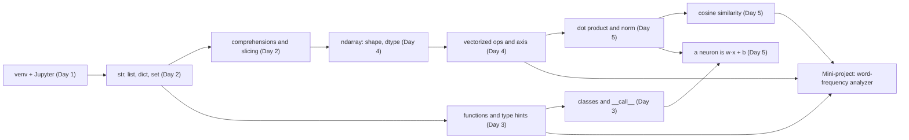

# Day 6: Week 1 Review and Mini-Project: Word-Frequency Analyzer

**Phase 1 · Week 1 · ~180 minutes**

## Objectives

By the end of today you can:

- [ ] Explain, without notes, the main idea of each Week 1 lesson and how they connect.
- [ ] Answer the self-check questions and re-do the week's hardest exercise from a blank file.
- [ ] Build a small program that turns sentences into count vectors over a vocabulary, using a tokenizer function and a NumPy matrix.
- [ ] Compare every pair of sentences with cosine similarity and report the most similar pair.
- [ ] Explain, with real examples from your own output, where counting words fails and why that motivates embeddings.

**Prerequisites.** All of Week 1: [Day 1](day-01-setup.md) (venv, Jupyter), [Day 2](day-02-python-types.md) (strings, lists, dicts, sets, comprehensions), [Day 3](day-03-functions-classes.md) (functions, type hints, modules), [Day 4](day-04-numpy-arrays.md) (arrays, shape, axis) and [Day 5](day-05-vectors.md) (dot product, norm, cosine similarity).

**Suggested time split.** 30 minutes recap and self-check, 20 minutes re-doing one exercise, 100 minutes mini-project, 30 minutes stretch goals and retro.

---

## What this week gave you

Five days, five tools. Each one fixes a gap the previous one left:

| Day | You learned | The one idea to keep |
|---|---|---|
| [1](day-01-setup.md) | venv, pip, REPL, Jupyter, Colab | Python is the steering wheel; fast native libraries do the work. Never install outside a venv. |
| [2](day-02-python-types.md) | `str`, `list`, `tuple`, `dict`, `set`, slicing, comprehensions | Names are sticky notes on objects. `b = a` never copies. |
| [3](day-03-functions-classes.md) | functions, type hints, `@dataclass`, `__call__`, modules | `model(x)` runs `__call__`, which runs `forward(x)`: the shape of every PyTorch model. |
| [4](day-04-numpy-arrays.md) | `ndarray`, `shape`, `dtype`, masks, vectorization, `axis` | Don't loop over numbers in Python. The axis you name is the one that disappears. |
| [5](day-05-vectors.md) | vectors, norm, dot product, cosine similarity | Cosine similarity compares *direction*, not length. It is the core of semantic search. |

Today's mini-project uses every row of that table, in order:

<figure class="diagram" markdown>

<figcaption>Animated: one sentence travelling through the week. Each day's tool does one step of today's project.</figcaption>
</figure>

And here is how the concepts depend on each other. Arrows mean "is built on":



!!! android "Android bridge"
    This week was the equivalent of learning Kotlin syntax, collections and `FloatArray` before writing your first real feature. The mini-project is that first feature: small, end to end, and built only from parts you now own.

## Self-check

Answer out loud or on paper first, then open the answer. If you miss more than three, re-read that day's lesson before starting the project.

??? question "1. If pure Python is 10–100× slower than Kotlin for loops, why is it the language of ML?"
    It is a *steering wheel*. Your Python code makes a few calls; NumPy and PyTorch run the heavy math in optimized C, C++ and CUDA. The library ecosystem, tutorials and model hubs all target Python first. (Day 1)

??? question "2. What is a virtual environment, and what goes in git instead of it?"
    A folder (`.venv/`) holding one project's interpreter and packages, isolated from other projects. You commit `requirements.txt` (from `pip freeze`) and put `.venv/` in `.gitignore`. (Day 1)

??? question "3. What are `7 / 2` and `7 // 2` in Python?"
    `3.5` and `3`. `/` always gives a float; `//` is floor division, like Kotlin's `Int / Int`. (Day 2)

??? question "4. `a = [1, 2]; b = a; b.append(3)`. What is `a`, and how would you have avoided changing it?"
    `[1, 2, 3]`. `b = a` puts a second label on the same list. Use `b = a.copy()` (or `list(a)`, or `a[:]`). (Day 2)

??? question "5. Why is `def add_layer(name, layers=[])` a bug?"
    Defaults are evaluated once, when the function is defined, so every call shares one list. Use `layers=None` and create the list inside the function. (Day 3)

??? question "6. You write `class Net(nn.Module)` with a `forward` method. How does `net(x)` end up running `forward(x)`?"
    Calling an object runs its `__call__` dunder method. `nn.Module.__call__` does some bookkeeping (hooks, gradient tracking) and calls your `forward`. Same contract as the framework calling your `onCreate`. (Day 3)

??? question "7. Give three reasons a NumPy array beats a Python list for a million floats."
    Contiguous memory (cache-friendly), one dtype for every element (no per-item type checks, compiled C loops), and SIMD instructions that process several numbers per instruction. (Day 4)

??? question "8. `m = np.arange(12).reshape(3, 4)`. What are `m.sum(axis=0).shape` and `m[:, 1]`?"
    `(4,)` and `array([1, 5, 9])`. Summing over axis 0 removes the 3 rows and leaves one total per column. `m[:, 1]` is column 1 from every row. (Day 4)

??? question "9. `row = m[0]; row[0] = 100`. Did `m` change? Why?"
    Yes. A NumPy slice is a **view** that shares memory with the original, the Day 2 sticky-note rule again. Use `m[0].copy()` when you need an independent array. (Day 4)

??? question "10. By hand: cosine similarity of [1, 0, 1] and [1, 1, 0]. And what does a cosine of 0 mean?"
    Dot product \( 1 + 0 + 0 = 1 \); both lengths are \( \sqrt{2} \); so \( 1 / (\sqrt{2} \cdot \sqrt{2}) = 0.5 \). (NumPy prints `0.4999999999999999`: float rounding.) A cosine of 0 means the vectors are at right angles: for word counts, *no words in common*. (Day 5)

## Re-do from blank

Pick **Day 2, exercise 3** and do it again in an empty file, without looking:

```python
a = [[0] * 3] * 3
a[0][0] = 1
print(a)
```

**Why this one.** It is a two-line puzzle, but it tests the one mental model that keeps coming back: names point at objects, and two names (or two slots of a list) can point at the *same* object. On Day 4 it returned as "slices are views", and in Phase 3 it will return as tensors that share storage. Bugs from this are silent: no error, just wrong numbers. If you can predict the output, explain it, fix it, and then show the NumPy version of the same trap, you own the idea.

Your task: (1) predict the output before running, (2) prove *why* with `is`, (3) fix it with a comprehension, (4) show the same sharing with a NumPy slice and the fix with `.copy()`.

??? success "Solution"
    ```python
    a = [[0] * 3] * 3
    a[0][0] = 1
    print(a)              # [[1, 0, 0], [1, 0, 0], [1, 0, 0]]
    print(a[0] is a[1])   # True   three slots, one inner list

    b = [[0] * 3 for _ in range(3)]    # a new inner list each time round
    b[0][0] = 1
    print(b)              # [[1, 0, 0], [0, 0, 0], [0, 0, 0]]

    import numpy as np
    m = np.zeros((3, 3), dtype=int)
    row = m[0]            # a view
    row[0] = 1
    print(m[0])           # [1 0 0]   the original changed
    safe = m[1].copy()    # an independent array
    safe[0] = 99
    print(m[1])           # [0 0 0]   the original did not change
    print(np.shares_memory(m, row), np.shares_memory(m, safe))   # True False
    ```

---

## Mini-project: a word-frequency analyzer

Day 5's exercise 4 compared three sentences over a hand-picked five-word vocabulary. Today you build the real thing: a program that takes any list of sentences, cleans them, **builds its own vocabulary**, turns every sentence into a **count vector**, compares **every pair** with cosine similarity and reports the most similar pair. This is the "bag of words" model that powered search engines and spam filters for decades, and it is still the baseline that embeddings are measured against.

### The idea, with an analogy

Imagine every sentence is a shopping basket and every distinct word is a product on the shelf. A count vector is the receipt: one line per product in the shop, with how many of that product went into the basket (mostly zeros). Two baskets are "similar" if their receipts point the same way: they bought the same products in similar proportions. Cosine similarity (Day 5) measures exactly that, and ignores how big each basket was.

### The math, one symbol at a time

- \( n \) is the number of sentences. Today \( n = 8 \).
- The **vocabulary** \( V \) is the set of distinct words across all sentences, each given a column number. \( |V| \) ("size of V") is how many words it has. Today \( |V| = 45 \).
- The **count vector** of sentence \( i \) is \( \mathbf{x}_i \in \mathbb{R}^{|V|} \): element \( j \) is how many times word \( j \) appears in sentence \( i \).
- Stack the count vectors as rows and you get the **count matrix** \( X \), with shape \( n \times |V| \). \( X_{ij} \) is "count of word \( j \) in sentence \( i \)". In NumPy, `X[i, j]`.
- The similarity of sentences \( i \) and \( k \) is Day 5's formula applied to two rows:

\[
\text{sim}(i, k) = \frac{\mathbf{x}_i \cdot \mathbf{x}_k}{\|\mathbf{x}_i\| \, \|\mathbf{x}_k\|}
\]

Because counts are never negative, the dot product is never negative, so the similarity of two count vectors is always between 0 (no words in common) and 1 (same words in the same proportions).

**Number of pairs.** Each of the \( n \) sentences can pair with \( n - 1 \) others, and each pair is counted twice that way (\( i, k \) and \( k, i \)), so there are \( n(n-1)/2 \) pairs. For \( n = 8 \): \( 8 \cdot 7 / 2 = 28 \).

<figure class="diagram" markdown>

<figcaption>Animated: two rows of the real count matrix, and how their cosine similarity is built only from the words they share.</figcaption>
</figure>

**Worked example** (these are real rows from the project). Sentence #0 is "The phone battery drains fast when the screen is bright." It has "the" twice and 8 other words once, so \( \|\mathbf{x}_0\|^2 = 2^2 + 8 \cdot 1^2 = 12 \). Sentence #4 is "The model runs on the phone, without the cloud." It has "the" three times and 6 other words once, so \( \|\mathbf{x}_4\|^2 = 3^2 + 6 = 15 \). In the dot product every column where either count is 0 contributes nothing, so only the shared words count: "the" gives \( 2 \times 3 = 6 \) and "phone" gives \( 1 \times 1 = 1 \).

\[
\text{sim}(0, 4) = \frac{7}{\sqrt{12}\,\sqrt{15}} = \frac{7}{\sqrt{180}} \approx 0.522
\]

Hold on to that number. It will turn out to be the "winner", for a bad reason.

### Spec

Write `word_freq.py` with these five functions and a `main()`:

| Function | Input → output | Rules |
|---|---|---|
| `tokenize(text)` | `str` → `list[str]` | lowercase; delete punctuation; split on whitespace |
| `build_vocab(docs)` | list of token lists → `dict[str, int]` | every distinct word gets a column index; alphabetical order so results are reproducible |
| `count_matrix(docs, vocab)` | token lists + vocab → `np.ndarray` of shape `(n, len(vocab))` | `X[i, j]` = count of word `j` in sentence `i`; ignore words not in the vocab |
| `cosine(a, b)` | two 1-D arrays → `float` | Day 5's formula; return `0.0` (not `nan`) if either vector is all zeros |
| `all_pairs(X)` | count matrix → list of `(score, i, j)` | every pair with `i < j`, sorted most similar first |

`main()` prints the matrix shape, the top 3 pairs with the words they share, and the most similar pair in full. Use plain Python loops for the pairs today; on Day 10 you'll replace the double loop with one matrix multiply.

### Starter code

Copy this into `word_freq.py` (or a notebook) and fill in the `TODO`s. The corpus is fixed so your numbers can match the ones below.

```python
"""Week 1 mini-project: a word-frequency analyzer."""
import string

import numpy as np

CORPUS = [
    "The phone battery drains fast when the screen is bright.",
    "My phone's battery dies fast with a bright screen!",
    "We train the model on labelled photos.",
    "Training a model needs lots of labelled data.",
    "The model runs on the phone, without the cloud.",
    "Quantization makes the model smaller and faster on phones.",
    "Cosine similarity compares two vectors.",
    "The handset's cell ran flat in an hour.",
]


def tokenize(text: str) -> list[str]:
    """Lowercase, delete ASCII punctuation, split on whitespace."""
    # TODO: hint: str.maketrans("", "", string.punctuation) builds a
    # "delete these characters" table for text.translate(...)
    raise NotImplementedError


def build_vocab(docs: list[list[str]]) -> dict[str, int]:
    """Map every distinct word to a column index, in alphabetical order."""
    # TODO: a set comprehension, sorted(), then a dict comprehension with enumerate
    raise NotImplementedError


def count_matrix(docs: list[list[str]], vocab: dict[str, int]) -> np.ndarray:
    """Row i, column j = how many times word j appears in sentence i."""
    # TODO: start from np.zeros((len(docs), len(vocab)), dtype=np.int64)
    raise NotImplementedError


def cosine(a: np.ndarray, b: np.ndarray) -> float:
    """Cosine similarity; 0.0 if either vector is all zeros."""
    # TODO
    raise NotImplementedError


def all_pairs(X: np.ndarray) -> list[tuple[float, int, int]]:
    """Cosine for every pair i < j, most similar first."""
    # TODO: two nested loops, j starting at i + 1
    raise NotImplementedError


def main() -> None:
    # TODO: tokenize the corpus, build the vocab and matrix, print the report
    pass


if __name__ == "__main__":
    main()
```

### Milestones

Do them in order and check each against the expected output before moving on. Every output below is real.

**Milestone 1: the tokenizer.** Lowercase first, then remove punctuation, then `split()` (which also swallows extra spaces).

```python
print(tokenize("My phone's battery dies fast with a bright screen!"))
# ['my', 'phones', 'battery', 'dies', 'fast', 'with', 'a', 'bright', 'screen']
print(tokenize("  ML,   on-device!  "))
# ['ml', 'ondevice']
```

Look closely at both outputs. Deleting the apostrophe turned "phone's" into "phones", and deleting the hyphen glued "on-device" into "ondevice". That is a design decision, not a bug, but you should know you made it.

!!! warning "Common mistake: punctuation that isn't ASCII"
    `string.punctuation` is only the 32 ASCII symbols `` !"#$%&'()*+,-./:;<=>?@[\]^_`{|}~ ``. Text pasted from a phone keyboard or a web page often uses the curly apostrophe `’`, which is not in that list: `tokenize("My phone’s battery")` gives `['my', 'phone’s', 'battery']`. Real tokenizers handle Unicode properly; for today, know the limit exists.

**Milestone 2: the vocabulary.** `sorted({w for doc in docs for w in doc})` gives the distinct words in a fixed order; `{w: i for i, w in enumerate(words)}` numbers them.

```python
docs = [tokenize(s) for s in CORPUS]
vocab = build_vocab(docs)
print(len(vocab))                                  # 45
print(list(vocab)[:8])
# ['a', 'an', 'and', 'battery', 'bright', 'cell', 'cloud', 'compares']
print(vocab["phone"], vocab["phones"], vocab["the"])   # 27 28 36
```

"phone" and "phones" got different columns. To this program they are as unrelated as "phone" and "cloud".

!!! warning "Common mistake: an unordered vocabulary"
    If you number the words straight from a `set` (`{w: i for i, w in enumerate(set_of_words)}`), the order of a set of strings can change between runs of Python, so column 3 might be "battery" today and "cloud" tomorrow. Similarity scores stay the same, but saved matrices and printed columns stop matching. Sort first. On Android the same rule applies to a model's label list: the index order is part of the contract.

**Milestone 3: the count matrix.** Make a zero matrix of the right shape, then for each sentence `i` and each word `w` in it, add 1 at `X[i, vocab[w]]`.

```python
X = count_matrix(docs, vocab)
print(X.shape, X.dtype)          # (8, 45) int64

cols = [vocab[w] for w in ["the", "phone", "battery", "model", "on"]]
print(X[:, cols])                # every row, just these 5 columns
# [[2 1 1 0 0]
#  [0 0 1 0 0]
#  [1 0 0 1 1]
#  [0 0 0 1 0]
#  [3 1 0 1 1]
#  [1 0 0 1 1]
#  [0 0 0 0 0]
#  [1 0 0 0 0]]
print(X.sum(axis=1))             # [10  9  7  8  9  9  5  8]   words per sentence
```

`X[:, cols]` picks several columns at once with a list of indices (you'll meet this "fancy indexing" properly on Day 8). `X.sum(axis=1)` collapses the columns, so you get one total per sentence: a free sanity check against counting the words by eye.

**Milestone 4: cosine with a guard.** Reuse Day 5's `cosine`, but return `0.0` when a norm is 0. Check it on the worked example:

```python
print(round(cosine(X[0], X[4]), 4))                # 0.5217
print(X[0] @ X[4], X[0] @ X[0], X[4] @ X[4])        # 7 12 15
print(cosine(X[0], np.zeros(len(vocab))))          # 0.0   not nan
```

`X[0] @ X[0]` is the squared length, so the three numbers are exactly the 7, 12 and 15 from the worked example.

**Milestone 5: all pairs.** Two nested loops with `j` starting at `i + 1` visit each pair once and skip comparing a sentence with itself. Collect `(score, i, j)` tuples and sort with `reverse=True`: tuples sort by their first element, so the highest score comes first.

**Milestone 6: the report.** Print the top pairs and, for each, the words both sentences contain (a helper `shared_words(X, vocab, i, j)` that keeps the column names where both counts are above 0). Your output should be:

```text
8 sentences, 45 distinct words, X.shape = (8, 45)
28 pairs compared. Top 3:
  0.522  #0 & #4  shared: ['phone', 'the']
  0.488  #2 & #4  shared: ['model', 'on', 'the']
  0.430  #4 & #5  shared: ['model', 'on', 'the']

Most similar pair (0.522):
  #0: The phone battery drains fast when the screen is bright.
  #4: The model runs on the phone, without the cloud.
```

**Now read it like an engineer.** Any human would say #0 and #1 are the obvious pair: both are about a phone battery dying fast with a bright screen. Your program picked #0 and #4 instead, and the shared-words column says why: **"the"** carries most of the score (6 of the 7 in the dot product). The code is correct; the *representation* is weak. That's the most useful thing this project teaches, and the stretch goals fix it step by step.

### How to verify it works

Paste these checks under your functions and run them. They use tiny inputs where you can work out the answer by hand, plus the edge cases (empty vector, unknown word).

```python
assert tokenize("Hello, World!") == ["hello", "world"]
assert tokenize("  ML,   on-device!  ") == ["ml", "ondevice"]

v = build_vocab([["b", "a"], ["a", "c"]])
assert v == {"a": 0, "b": 1, "c": 2}

M = count_matrix([["a", "a", "b"], ["c", "zzz"]], v)   # "zzz" is not in v
assert M.tolist() == [[2, 1, 0], [0, 0, 1]]

assert np.isclose(cosine(np.array([1, 2]), np.array([2, 4])), 1.0)
assert cosine(np.array([1, 0]), np.array([0, 1])) == 0.0
assert cosine(np.array([0, 0]), np.array([1, 1])) == 0.0   # no nan

P = all_pairs(np.array([[1, 0], [2, 1], [0, 3]]))
assert len(P) == 3                      # 3 rows → 3 * 2 / 2 pairs
assert (P[0][1], P[0][2]) == (0, 1)     # the two rows that point almost the same way
assert P[-1] == (0.0, 0, 2)             # [1, 0] and [0, 3] are at right angles
print("all checks passed")
# all checks passed
```

Then run the full program and compare with the Milestone 6 output line by line. If your numbers differ, print `X[:, cols]` again: almost every difference comes from the tokenizer (forgot to lowercase, or split before removing punctuation).

!!! android "Android bridge"
    You've shipped this algorithm already if you've used Room's full-text search. An `@Fts4` entity tokenizes text with a tokenizer you choose (`FtsOptions.TOKENIZER_SIMPLE`, `TOKENIZER_PORTER`, `TOKENIZER_UNICODE61`) and a `MATCH` query finds rows that contain the same *tokens*. It has the same blind spot you're about to see: a search for "battery" never finds "cell". On-device ML text models also need a fixed word list: text models built for MediaPipe and LiteRT typically ship their vocabulary file inside the `.tflite` model's metadata, so the app tokenizes input exactly as training did, the same role your `vocab` dict plays here.

??? success "Reference solution (try the milestones first)"
    ```python
    """Week 1 mini-project: a word-frequency analyzer."""
    import string

    import numpy as np

    CORPUS = [
        "The phone battery drains fast when the screen is bright.",
        "My phone's battery dies fast with a bright screen!",
        "We train the model on labelled photos.",
        "Training a model needs lots of labelled data.",
        "The model runs on the phone, without the cloud.",
        "Quantization makes the model smaller and faster on phones.",
        "Cosine similarity compares two vectors.",
        "The handset's cell ran flat in an hour.",
    ]

    _NO_PUNCT = str.maketrans("", "", string.punctuation)


    def tokenize(text: str) -> list[str]:
        """Lowercase, delete ASCII punctuation, split on whitespace."""
        return text.lower().translate(_NO_PUNCT).split()


    def build_vocab(docs: list[list[str]]) -> dict[str, int]:
        """Map every distinct word to a column index, in alphabetical order."""
        words = sorted({w for doc in docs for w in doc})
        return {w: i for i, w in enumerate(words)}


    def count_matrix(docs: list[list[str]], vocab: dict[str, int]) -> np.ndarray:
        """Row i, column j = how many times word j appears in sentence i."""
        X = np.zeros((len(docs), len(vocab)), dtype=np.int64)
        for i, doc in enumerate(docs):
            for w in doc:
                if w in vocab:              # words outside the vocabulary are ignored
                    X[i, vocab[w]] += 1
        return X


    def cosine(a: np.ndarray, b: np.ndarray) -> float:
        """Cosine similarity; 0.0 if either vector is all zeros."""
        na, nb = np.linalg.norm(a), np.linalg.norm(b)
        if na == 0 or nb == 0:
            return 0.0
        return float(a @ b / (na * nb))


    def all_pairs(X: np.ndarray) -> list[tuple[float, int, int]]:
        """Cosine for every pair i < j, most similar first."""
        n = X.shape[0]
        scores = []
        for i in range(n):
            for j in range(i + 1, n):
                scores.append((cosine(X[i], X[j]), i, j))
        return sorted(scores, reverse=True)


    def shared_words(X: np.ndarray, vocab: dict[str, int], i: int, j: int) -> list[str]:
        """Words that appear in both sentence i and sentence j."""
        words = list(vocab)                 # dict keys keep insertion order: index order
        return [words[k] for k in range(len(words)) if X[i, k] > 0 and X[j, k] > 0]


    def main() -> None:
        docs = [tokenize(s) for s in CORPUS]
        vocab = build_vocab(docs)
        X = count_matrix(docs, vocab)
        print(f"{len(CORPUS)} sentences, {len(vocab)} distinct words, X.shape = {X.shape}")

        pairs = all_pairs(X)
        print(f"{len(pairs)} pairs compared. Top 3:")
        for score, i, j in pairs[:3]:
            print(f"  {score:.3f}  #{i} & #{j}  shared: {shared_words(X, vocab, i, j)}")

        best_score, i, j = pairs[0]
        print(f"\nMost similar pair ({best_score:.3f}):")
        print(f"  #{i}: {CORPUS[i]}")
        print(f"  #{j}: {CORPUS[j]}")


    if __name__ == "__main__":
        main()
    ```

    Running `python word_freq.py` prints exactly the Milestone 6 output above. Design notes: `_NO_PUNCT` is built once at import time instead of on every call; `cosine` returns a plain `float` so the tuples print cleanly; `shared_words` relies on Python dicts keeping insertion order, which matches the column order because `build_vocab` inserted words in index order.

### Stretch goals

Run each of these in the same notebook after the reference solution, or paste them into `word_freq.py` below the functions. Stretch 2 and 3 reuse the `X` and `vocab` built in stretch 1.

1. **Stop words.** Add `tokenize_clean(text, stop_words)` that drops very common words ("the", "a", "on", ...). Rebuild the vocabulary and matrix. Does the top pair change? What happens to #0 vs #7?
2. **Normalize the rows so a dot product *is* the cosine.** Divide each row of `X` by its length to get a matrix `U` of unit vectors (Day 5, exercise 3). Show every row of `U` has length 1, and that `U[0] @ U[1]` equals `cosine(X[0], X[1])`.
3. **A similarity heatmap.** Fill an \( n \times n \) matrix `S` with the cosine of every pair (diagonal included) and draw it with `plt.imshow`, writing the value in each cell.
4. **TF-IDF teaser.** Instead of hand-picking stop words, let the corpus decide which words matter, as described below.

**TF-IDF in one paragraph.** Weight each count by how *rare* the word is across the corpus. The **document frequency** \( \text{df}(w) \) is the number of sentences containing word \( w \). Its **inverse document frequency** is

\[
\text{idf}(w) = \ln\frac{n}{\text{df}(w)}
\]

where \( \ln \) is the natural logarithm (`np.log`). A word in every sentence gets \( \ln(n/n) = \ln 1 = 0 \): zero weight, automatically. A word in only one of our 8 sentences gets \( \ln 8 \approx 2.079 \). The TF-IDF matrix is each column of \( X \) multiplied by its word's idf. You'll use the library version (scikit-learn's `TfidfVectorizer`) in Phase 2; it uses a smoothed formula, \( \ln\frac{1+n}{1+\text{df}} + 1 \), and normalizes rows, so its numbers differ from this teaser's.

<figure class="diagram" markdown>

<figcaption>Stretch 3's result: with stop words removed, the battery pair (#0, #1) finally wins. Row #7 is all zeros off the diagonal, even though it means the same as #0.</figcaption>
</figure>

??? success "Stretch solutions"
    **1. Stop words.**

    ```python
    STOP_WORDS = {"a", "an", "and", "the", "is", "in", "of", "on",
                  "my", "we", "with", "when", "without"}

    def tokenize_clean(text: str, stop_words: set[str] = STOP_WORDS) -> list[str]:
        return [w for w in tokenize(text) if w not in stop_words]

    docs = [tokenize_clean(s) for s in CORPUS]
    vocab = build_vocab(docs)
    X = count_matrix(docs, vocab)
    print(X.shape)
    for score, i, j in all_pairs(X)[:3]:
        print(f"{score:.3f}  #{i} & #{j}  shared: {shared_words(X, vocab, i, j)}")
    print(f"#0 vs #7: {cosine(X[0], X[7]):.3f}")
    # (8, 32)
    # 0.667  #0 & #1  shared: ['battery', 'bright', 'fast', 'screen']
    # 0.408  #2 & #3  shared: ['labelled', 'model']
    # 0.250  #2 & #4  shared: ['model']
    # #0 vs #7: 0.000
    ```

    The battery pair wins now, and the two training sentences come second. But #0 vs #7 dropped from 0.204 (they only shared "the") to exactly 0. Hand-made stop-word lists are also fragile: "not" is on many published lists, and dropping it turns "is not fast" into "is fast".

    **2. Unit rows.**

    ```python
    norms = np.linalg.norm(X, axis=1)        # one length per row: shape (8,)
    print(norms.round(3))

    U = np.zeros(X.shape)                    # float array, same shape as X
    for i in range(X.shape[0]):
        U[i] = X[i] / norms[i]               # Day 5's normalize(), row by row

    print(np.linalg.norm(U, axis=1))         # every row now has length 1
    print(U[0] @ U[1], cosine(X[0], X[1]))
    print(np.isclose(U[0] @ U[1], cosine(X[0], X[1])))
    # [2.449 2.449 2.    2.449 2.    2.449 2.236 2.236]
    # [1. 1. 1. 1. 1. 1. 1. 1.]
    # 0.6666666666666669 0.6666666666666667
    # True
    ```

    The last digits differ because the divisions happen in a different order; that's why you compare floats with `np.isclose`, never `==`. If a sentence had no words left after stop-word removal, its norm would be 0 and this loop would fill its row with `nan` (NumPy prints a `RuntimeWarning` instead of raising an error): guard it the same way `cosine` does. Vector databases store embeddings already normalized like `U` for exactly this reason: each search comparison becomes a single dot product.

    **3. Heatmap.**

    ```python
    import matplotlib
    matplotlib.use("Agg")                   # draw to a file, no window needed
    import matplotlib.pyplot as plt

    n = X.shape[0]
    S = np.zeros((n, n))
    for i in range(n):
        for j in range(n):
            S[i, j] = cosine(X[i], X[j])    # the full grid, diagonal included

    plt.rcParams.update({"font.size": 11, "figure.facecolor": "white"})
    fig, ax = plt.subplots(figsize=(6.4, 5.2))
    im = ax.imshow(S, cmap="Blues", vmin=0, vmax=1)
    for i in range(n):
        for j in range(n):
            ax.text(j, i, f"{S[i, j]:.2f}", ha="center", va="center", fontsize=9,
                    color="white" if S[i, j] > 0.6 else "#333333")
    ax.set_xticks(range(n))
    ax.set_yticks(range(n))
    ax.set_xlabel("sentence #")
    ax.set_ylabel("sentence #")
    ax.set_title("Cosine similarity of word counts (stop words removed)")
    fig.colorbar(im, ax=ax, label="cosine similarity")
    fig.savefig("day06-similarity-heatmap.svg", format="svg", bbox_inches="tight")
    print(S.round(2)[:3])
    # [[1.   0.67 0.   0.   0.2  0.   0.   0.  ]
    #  [0.67 1.   0.   0.   0.   0.17 0.   0.  ]
    #  [0.   0.   1.   0.41 0.25 0.2  0.   0.  ]]
    ```

    In a notebook, drop the `matplotlib.use("Agg")` line and the plot appears under the cell. `S` is symmetric (`S[i, j] == S[j, i]`), which is why the loop in `all_pairs` only needed `j > i`. A one-hue colour map from light to dark suits a value that runs from 0 to 1. Plotting gets a full lesson on Day 19.

    **Preview of Day 10.** With the unit rows from stretch 2, the whole grid is a single matrix multiply, `U @ U.T`, where `U.T` is `U` flipped so its rows become columns:

    ```python
    print(np.allclose(U @ U.T, S))   # True
    ```

    That's 64 dot products in one call, running in C. Day 10 explains how and why.

    **4. TF-IDF**, on the raw tokens, stop words *kept*:

    ```python
    docs_raw = [tokenize(s) for s in CORPUS]
    vocab_raw = build_vocab(docs_raw)
    C = count_matrix(docs_raw, vocab_raw)

    n_docs = C.shape[0]
    df = (C > 0).sum(axis=0)                 # in how many sentences each word appears
    idf = np.log(n_docs / df)                # rare word → big weight, everywhere → small
    for w in ["the", "model", "battery", "quantization"]:
        k = vocab_raw[w]
        print(f"{w:13s} df={df[k]}  idf={idf[k]:.3f}")

    T = C * idf                              # scale each column by its idf
    for score, i, j in all_pairs(T)[:3]:
        print(f"{score:.3f}  #{i} & #{j}")
    # the           df=5  idf=0.470
    # model         df=4  idf=0.693
    # battery       df=2  idf=1.386
    # quantization  df=1  idf=2.079
    # 0.321  #0 & #1
    # 0.157  #0 & #4
    # 0.121  #2 & #4
    ```

    With no stop-word list at all, TF-IDF already puts #0 and #1 on top, because "the" (in 5 of 8 sentences) is weighted down and "battery", "bright" and "screen" (in 2 of 8) are weighted up. `(C > 0).sum(axis=0)` is Day 4 again: a boolean mask, then a reduction that collapses the rows. `C * idf` multiplies an `(8, 45)` matrix by a `(45,)` vector, column by column; that rule is called broadcasting and is Day 9's topic.

### Where counting words fails

Run this tiny helper on four pairs a human would judge instantly:

```python
def sim(s1, s2):
    d = [tokenize(s1), tokenize(s2)]
    v = build_vocab(d)
    M = count_matrix(d, v)
    return cosine(M[0], M[1])

print(f"{sim('The dog bit the man.', 'The man bit the dog.'):.3f}")
print(f"{sim('The battery died.', 'The cell ran flat.'):.3f}")
print(f"{sim('The app is fast.', 'The app is not fast.'):.3f}")
print(f"{sim('We train models.', 'Training a model.'):.3f}")
# 1.000
# 0.289
# 0.894
# 0.000
```

Each number is wrong in a different way:

| Failure | Example | What happened |
|---|---|---|
| **Word order is thrown away** | "dog bit the man" vs "man bit the dog": **1.000** | A bag of words only counts; opposite meanings get identical vectors. |
| **Synonyms don't match** | "battery died" vs "cell ran flat": **0.289** | The only match is "the". Remove stop words and it falls to 0. |
| **Negation is invisible** | "is fast" vs "is not fast": **0.894** | One extra word barely moves the vector, but flips the meaning. |
| **Word forms are separate words** | "train models" vs "training a model": **0.000** | "train" ≠ "training", "model" ≠ "models". Stemming helps a bit; it doesn't fix synonyms. |

The synonym case is the one that matters most for AI products, and your own corpus shows it. Sentence #7, "The handset's cell ran flat in an hour.", means nearly the same as #0, and it scores **0.000** against it after stop-word removal:

<figure class="diagram" markdown>

<figcaption>Animated: counting compares spellings, so a perfect paraphrase scores 0. The right-hand panel is an illustration of what embeddings do, not real model output.</figcaption>
</figure>

No amount of cleverness in `tokenize` fixes this, because the information "battery and cell can mean the same thing" isn't in the eight sentences. It has to be **learned from huge amounts of text**. That is what an **embedding model** does: it maps each sentence to a vector of a few hundred numbers such that sentences with similar meaning point in similar directions, even with no words in common. The rest of your pipeline stays exactly as you wrote it today: vectors in a matrix, cosine similarity, top pairs. You'll swap the count vectors for embeddings in **Phase 4** (semantic search and RAG), and run an embedding model on a phone in Phase 6.

!!! warning "Common mistake: blaming the math"
    When similarity results look wrong, the cosine formula is almost never the problem. The **representation** is. Before tuning anything, print the vectors and the shared words, as Milestone 6 does. Debug the input to the math, not the math.

!!! tip "Counting still has a job"
    Bag-of-words and TF-IDF are fast, need no model, and are fully explainable, so they remain strong baselines and are still used for keyword search (the BM25 ranking function in many search engines is a refined TF-IDF). Many production RAG systems combine keyword scores with embedding scores ("hybrid search"). Learn both.

---

## Weekly retro

Copy this into your learning journal and fill it in. Ten honest minutes here is worth more than an extra hour of reading.

```markdown
# Week 1 retro (Days 1–6)

## What I can now do without looking anything up
-
-

## What is still fuzzy (and which day to re-read)
-

## Self-check score: __ / 10
Questions I missed:

## Mini-project
- Milestones finished: 1 2 3 4 5 6
- Stretch goals finished: 1 2 3 4
- The bug that took me longest, and what it taught me:
- One sentence on why counting words fails for synonyms:

## Time spent this week: __ hours (plan was ~12)

## Kotlin/Android habit that helped:
## Kotlin/Android habit that got in the way:

## One thing I'll do differently in Week 2:
```

## Resources

- [Python docs: string methods](https://docs.python.org/3/library/stdtypes.html#string-methods) and [the `string` module](https://docs.python.org/3/library/string.html): `lower`, `split`, `translate`, `maketrans` and `string.punctuation`, everything the tokenizer used.
- [NumPy: `numpy.linalg.norm`](https://numpy.org/doc/stable/reference/generated/numpy.linalg.norm.html): including the `axis` argument used in stretch 2.
- [Matplotlib: `pyplot.imshow`](https://matplotlib.org/stable/api/_as_gen/matplotlib.pyplot.imshow.html): the heatmap function, with its colour-map options.
- [Introduction to Information Retrieval (free book): tf-idf weighting](https://nlp.stanford.edu/IR-book/html/htmledition/tf-idf-weighting-1.html): the classic explanation of today's stretch 4, from Stanford.
- [scikit-learn: text feature extraction](https://scikit-learn.org/stable/modules/feature_extraction.html#text-feature-extraction): `CountVectorizer` and `TfidfVectorizer`, the library versions of today's project (Phase 2).
- [Jurafsky and Martin, *Speech and Language Processing* (free draft)](https://web.stanford.edu/~jurafsky/slp3/): the chapter "Vector Semantics and Embeddings" starts with count vectors and TF-IDF and ends with learned embeddings, exactly the bridge to Phase 4.
- [Google Machine Learning Crash Course: Embeddings](https://developers.google.com/machine-learning/crash-course/embeddings): a short, visual introduction to what replaces count vectors.

## Checklist

- [ ] I scored at least 7/10 on the self-check, and re-read the lessons behind the questions I missed.
- [ ] I re-did Day 2's exercise 3 from a blank file, including the NumPy view version.
- [ ] My `word_freq.py` passes all the checks and prints the Milestone 6 output.
- [ ] I can explain why the first "most similar pair" was #0 and #4, and what fixed it.
- [ ] I finished at least one stretch goal (stop words or normalized rows).
- [ ] I can name four ways counting words fails, and say which one embeddings fix.
- [ ] I wrote my Week 1 retro in the journal.

**Next:** [Day 8: Shapes, reshaping and indexing](day-08-shapes-indexing.md)
