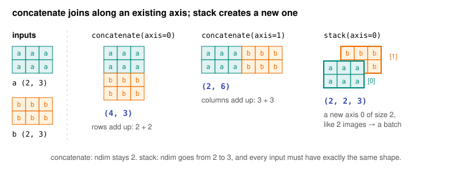

# Day 8: Shapes, Reshaping and Indexing

**Phase 1 · Week 2 · ~90 minutes**

## Objectives

- [ ] Explain why `reshape` is almost free: the data stays put and only the way it is read changes (row-major, "C order").
- [ ] Use `-1` in `reshape`, and know when `flatten` copies and `ravel` doesn't.
- [ ] Add a batch axis with `np.newaxis`, `None` or `np.expand_dims`, and remove size-1 axes with `squeeze`.
- [ ] Convert an image between HWC and CHW with `np.transpose`, and explain NHWC (LiteRT/TFLite) vs NCHW (PyTorch).
- [ ] Pick elements with integer-array ("fancy") indexing, and know it returns a copy, not a view.
- [ ] Choose between `np.stack` (new axis) and `np.concatenate` (existing axis).

**Prerequisites.** [Day 4](day-04-numpy-arrays.md) (NumPy arrays: shape, slicing, views).

---

## The big idea

On Day 4 you learned that an array is one flat block of memory plus a **shape**. Today's lesson takes that seriously: most of the "plumbing" in ML code is changing the shape of an array so it fits what the next function or model expects. An image arrives as `(224, 224, 3)`, the model wants `(1, 224, 224, 3)`; PyTorch wants `(1, 3, 224, 224)`; the model returns `(1, 1000)` and you want `(1000,)`.

**Analogy.** Think of an egg carton holding 12 eggs in one long row. You can label the carton "3 rows of 4" or "4 rows of 3" without touching a single egg. You just agree on a new way to count them. That's `reshape`. Taking the eggs out and arranging them in a different order (say, all brown eggs first) is a different operation: that's `transpose`, and it really does change which egg comes next.

## Reshape: same data, new shape

<figure class="diagram" markdown>

<figcaption>Animated: reshape relabels the same block of memory. Numbers stay in reading order; only the row length changes.</figcaption>
</figure>

```python
import numpy as np

a = np.arange(12)
a.shape            # (12,)

g = a.reshape(3, 4)
g
# [[ 0  1  2  3]
#  [ 4  5  6  7]
#  [ 8  9 10 11]]

h = a.reshape(4, 3)
h
# [[ 0  1  2]
#  [ 3  4  5]
#  [ 6  7  8]
#  [ 9 10 11]]

np.shares_memory(a, g), np.shares_memory(a, h)   # (True, True)  no data copied
g[0, 0] = 100
a[0]               # 100   g is a view onto a's memory
```

The rule NumPy uses to "fill" the new shape is **row-major order**, also called **C order** (because the C language lays out 2-D arrays this way): fill row 0 from left to right, then row 1, and so on. The *last* axis changes fastest.

### The math: from a position to an address

Let's name things. Say the array has shape \( (R, C) \): \( R \) rows and \( C \) columns. The element in row \( i \), column \( j \) (both counted from 0) lives at flat position:

\[
\text{position}(i, j) = i \cdot C + j
\]

In words: skip \( i \) full rows of \( C \) elements each, then step \( j \) more.

Worked example. In `g` (shape \( (3, 4) \), so \( C = 4 \)), element `g[2, 1]` is at \( 2 \cdot 4 + 1 = 9 \). In `h` (shape \( (4, 3) \), \( C = 3 \)), position 9 is row \( 9 \div 3 = 3 \), remainder \( 0 \): `h[3, 0]`. Both are the value 9, because both point at the same slot.

For three axes, shape \( (A, B, C) \), the same idea stacks up: \( \text{position}(i, j, k) = i \cdot B C + j \cdot C + k \).

NumPy stores these "how far to jump" numbers per axis as **strides**, in bytes:

```python
g[2, 1], h[3, 0], a[9]                 # (9, 9, 9)
np.ravel_multi_index((2, 1), (3, 4))    # 9         position(i, j) for you
g.strides          # (32, 8)   int64 = 8 bytes: next column +8, next row +4*8 = 32
h.strides          # (24, 8)   rows are 3 long now: +3*8
```

`reshape` usually only writes a new shape and new strides. That's why reshaping a 600 MB array is instant.

### `-1`: "you work it out"

One dimension can be `-1`, meaning "whatever makes the total come out right". The rule: unknown = total size ÷ product of the known sizes, so `a.reshape(3, -1)` gives \( 12 \div 3 = 4 \).

```python
a.reshape(3, -1).shape      # (3, 4)
a.reshape(-1, 6).shape      # (2, 6)
a.reshape(2, -1, 3).shape   # (2, 2, 3)
a.reshape(-1).shape         # (12,)    flatten to 1-D

a.reshape(5, 3)    # ValueError: cannot reshape array of size 12 into shape (5,3)
a.reshape(-1, -1)  # ValueError: can only specify one unknown dimension
```

You'll see `x.reshape(len(x), -1)` or `x.reshape(batch_size, -1)` everywhere: "keep the batch axis, squash everything else into one long feature vector".

!!! android "Android bridge"
    You've done this by hand. `Bitmap.getPixels()` fills a flat `IntArray`, and you read pixel `(x, y)` as `pixels[y * width + x]`. That is exactly \( i \cdot C + j \) with \( i = y \) and \( C = \) `width`. A NumPy shape is that index arithmetic, built in. Likewise `ByteBuffer.asFloatBuffer()` gives a new *view* of the same bytes without copying, the way `reshape` does.

### `flatten` vs `ravel`

Both turn any array into 1-D. The difference is memory:

```python
m = np.arange(6).reshape(2, 3)
f = m.flatten()     # always a COPY
r = m.ravel()       # a VIEW when it can be (a copy only if it must)

f[0] = 99;  m[0, 0]     # 0    m untouched
r[0] = 77;  m[0, 0]     # 77   m changed through r
np.shares_memory(m, f), np.shares_memory(m, r)   # (False, True)
```

Use `ravel()` (or `reshape(-1)`) when you only need to read; use `flatten()` when you want an independent copy you can change safely.

## Adding and removing axes

A model rarely takes one example. It takes a **batch**, with the batch size as the first axis. A LiteRT/TFLite image classifier typically declares its input as `[1, 224, 224, 3]`: one image, 224 high, 224 wide, 3 colour channels. Your photo is `(224, 224, 3)`, so you need one extra axis of size 1 at the front. Three equivalent spellings:

```python
rng = np.random.default_rng(0)
img = rng.integers(0, 256, size=(224, 224, 3), dtype=np.uint8)
img.shape                         # (224, 224, 3)

img[np.newaxis].shape             # (1, 224, 224, 3)
img[None, ...].shape              # (1, 224, 224, 3)   np.newaxis is literally None
np.expand_dims(img, axis=0).shape # (1, 224, 224, 3)

np.shares_memory(img, img[np.newaxis])   # True   adding a size-1 axis copies nothing
```

`None` can go anywhere in the index. It inserts a size-1 axis at that position. This is how you turn a vector into a column or a row (you'll use it constantly in Day 9's broadcasting):

```python
v = np.array([1, 2, 3])
v[:, None].shape    # (3, 1)   a column
v[None, :].shape    # (1, 3)   a row
```

The reverse is `squeeze`, which removes axes of size 1. Model outputs come back with a batch axis you usually don't want:

```python
out = np.zeros((1, 1000), dtype=np.float32)   # e.g. 1000 class scores for 1 image
out.squeeze().shape          # (1000,)
np.squeeze(out, axis=0).shape  # (1000,)   safer: say which axis

x = np.zeros((1, 3, 1, 5))
x.squeeze().shape            # (3, 5)      removes EVERY size-1 axis
x.squeeze(axis=2).shape      # (1, 3, 5)
x.squeeze(axis=1)            # ValueError: cannot select an axis to squeeze out which has size not equal to one
```

!!! warning "Common mistake: bare `squeeze()`"
    `squeeze()` with no axis removes *all* size-1 axes. That's fine until the day your batch happens to have one item, or a model has one output: `np.zeros((1, 1)).squeeze().shape` is `()`, a scalar, and the next line that does `out[0]` crashes. In production code, always pass `axis=`.

## Transpose: changing the order of axes

`reshape` keeps reading order. Sometimes you need to change the *meaning* of the axes, for example from height-width-channels (**HWC**) to channels-height-width (**CHW**). That's a **transpose**: you give the new order of the old axes.

```python
chw = np.transpose(img, (2, 0, 1))   # new axis 0 = old axis 2 (C), then H, then W
chw.shape                    # (3, 224, 224)

img[10, 20]                  # [  2 130 173]   pixel (10, 20): R, G, B
chw[:, 10, 20]               # [  2 130 173]   the same three values

back = np.transpose(chw, (1, 2, 0))
back.shape, np.array_equal(back, img)   # ((224, 224, 3), True)
```

Read `(2, 0, 1)` as "take old axis 2 first, then old axis 0, then old axis 1". `np.moveaxis(img, -1, 0)` does the same thing and some people find it easier to read.

Like `reshape`, `transpose` returns a view: it just swaps the strides. But the result is no longer stored in row-major order (`chw.flags['C_CONTIGUOUS']` is `False`). When you need a real CHW buffer, for example to hand to a runtime, call `np.ascontiguousarray(chw)`, which copies the data into the new order.

### NHWC vs NCHW

With a batch axis **N** in front, there are two conventions for images:

<figure class="diagram" markdown>

<figcaption>Animated: the same image, two orders in memory. The highlight follows pixel 0's red, green and blue values.</figcaption>
</figure>

| Layout | Shape of a batch | Who uses it |
|---|---|---|
| **NHWC** "channels last" | `(N, H, W, C)`, e.g. `(1, 224, 224, 3)` | TensorFlow, Keras, LiteRT/TFLite, Android `Bitmap` pixels |
| **NCHW** "channels first" | `(N, C, H, W)`, e.g. `(1, 3, 224, 224)` | PyTorch (`nn.Conv2d` expects it) |

Why two? Historical and hardware reasons. PyTorch grew up on GPUs, where NVIDIA's cuDNN library was first optimized for channels-first planes. TensorFlow's mobile runtime went channels-last, which matches how cameras and `Bitmap`s deliver pixels (RGB together per pixel) and suits the way many CPU and mobile kernels process all channels of a pixel at once. Neither is "right"; you just have to convert at the boundary:

```python
nhwc = np.zeros((32, 224, 224, 3), dtype=np.float32)
nhwc.transpose(0, 3, 1, 2).shape     # (32, 3, 224, 224)   NHWC → NCHW
```

!!! warning "Common mistake: reshape instead of transpose"
    `img.reshape(3, 224, 224)` has the right *shape* and no error, but it's garbage: it re-cuts the interleaved R,G,B,R,G,B… stream into three chunks, mixing channels. See it on a tiny image:

    ```python
    small = np.arange(12).reshape(2, 2, 3)   # H=2, W=2, C=3
    small.transpose(2, 0, 1)[0]   # [[0 3] [6 9]]   correct red plane
    small.reshape(3, 2, 2)[0]     # [[0 1] [2 3]]   R, G, B of pixel 0 plus R of pixel 1: nonsense
    ```

    A model fed this still returns confident predictions. They're just wrong. Rule: **if the meaning of the axes changes, use `transpose`; if you're only grouping or splitting, use `reshape`.**

!!! android "Android bridge"
    When you fill a `ByteBuffer` for a LiteRT `Interpreter`, the usual loop goes pixel by pixel and writes R, G, B for each one. That *is* NHWC. If a model was exported from PyTorch it may still declare an NCHW input such as `[1, 3, 224, 224]`, and the same loop would feed it scrambled data. Check `interpreter.getInputTensor(0).shape()` before writing preprocessing code, and match it.

### A quick word on `.T`

For a 2-D array, `.T` swaps rows and columns: shape `(2, 3)` becomes `(3, 2)`. It's shorthand for `transpose()` with the axes reversed (so on a 3-D array it reverses all three axes, and on a 1-D array it does nothing). Day 11 covers what transposing means for matrices.

```python
np.arange(6).reshape(2, 3).T
# [[0 3]
#  [1 4]
#  [2 5]]
```

## Fancy indexing: picking with a list of indices

Day 4's slices (`a[1:4]`) pick a regular range. **Fancy indexing** passes an array (or list) of integer positions, in any order, with repeats allowed:

```python
a = np.array([10, 20, 30, 40, 50])
a[[0, 2, 4]]        # [10 30 50]
a[[4, 0, 0]]        # [50 10 10]

m = np.arange(12).reshape(3, 4)
m[[2, 0]]           # rows 2 then 0:     [[ 8  9 10 11] [ 0  1  2  3]]
m[:, [3, 1]]        # columns 3 then 1:  [[ 3  1] [ 7  5] [11  9]]
m[[0, 1, 2], [3, 2, 1]]   # pairs (0,3) (1,2) (2,1): [3 6 9]
```

That last one surprises people: two index arrays are paired up element by element, not combined into a block. It's exactly what you need for "for each example, take the probability of its true label", a key step in the loss function you'll meet in Phase 3:

```python
probs = np.array([[0.1, 0.2, 0.7],
                  [0.6, 0.3, 0.1],
                  [0.2, 0.5, 0.3]])   # 3 examples × 3 classes
labels = np.array([2, 0, 1])
probs[np.arange(3), labels]          # [0.7 0.6 0.5]
```

Shuffling a dataset is also fancy indexing: the same random order applied to features and labels keeps them matched.

```python
rng = np.random.default_rng(42)
X = np.arange(10).reshape(5, 2); y = np.array([0, 1, 0, 1, 1])
perm = rng.permutation(5)    # [4 2 3 1 0]
X[perm], y[perm]             # rows reordered together
```

**Fancy indexing returns a copy.** A slice is regular (start, stop, step), so NumPy can express it as a view with new strides. An arbitrary list like `[4, 0, 0]` can't be expressed with strides, so NumPy builds a new array.

```python
a = np.array([10, 20, 30, 40, 50])
s = a[1:4]; f = a[[1, 2, 3]]
np.shares_memory(a, s), np.shares_memory(a, f)   # (True, False)
f[0] = -1;  a      # [10 20 30 40 50]   unchanged
s[0] = -1;  a      # [10 -1 30 40 50]   changed through the view
```

!!! warning "Common mistake: assigning through a fancy index twice"
    *Assigning* with a fancy index on the left writes into the original: `x[[0, 2]] = 5` works. But chaining makes a copy first and writes into that: `x[[0, 2]][0] = 5` silently changes nothing. Do the assignment in one indexing step.

## Stacking and concatenating

Two ways to glue arrays together, and the difference is whether you get a **new axis**:

<figure class="diagram" markdown>

<figcaption>concatenate grows an existing axis; stack adds a new one.</figcaption>
</figure>

```python
a = np.array([1, 2, 3]); b = np.array([4, 5, 6])
np.concatenate([a, b])           # [1 2 3 4 5 6]          shape (6,)
np.stack([a, b])                 # [[1 2 3] [4 5 6]]      shape (2, 3)
np.stack([a, b], axis=1)         # [[1 4] [2 5] [3 6]]    shape (3, 2)

p = np.ones((2, 3)); q = np.zeros((2, 3))
np.concatenate([p, q], axis=0).shape   # (4, 3)
np.concatenate([p, q], axis=1).shape   # (2, 6)
np.stack([p, q]).shape                 # (2, 2, 3)
```

Building a batch from separate images is the classic use of `stack`:

```python
imgs = [np.zeros((224, 224, 3), dtype=np.uint8) for _ in range(4)]
np.stack(imgs).shape          # (4, 224, 224, 3)   a batch of 4: correct
np.concatenate(imgs).shape    # (896, 224, 3)      one very tall image: wrong
```

The rules: `stack` needs every input to have exactly the same shape. `concatenate` needs every axis to match *except* the one you join along. (`np.vstack` and `np.hstack` are older shortcuts; prefer the explicit two.)

```python
np.stack([np.zeros(3), np.zeros(4)])
# ValueError: all input arrays must have the same shape
```

---

## Exercises

1. **Predict the shape** (write your answer first, then check with `.shape`). Start with `x = np.zeros((2, 3, 4))`.
    1. `x.reshape(6, -1)`
    2. `x.reshape(-1)`
    3. `x[None]`
    4. `x[:, None]`
    5. `np.transpose(x, (2, 0, 1))`
    6. `np.stack([x, x])`
    7. `np.concatenate([x, x], axis=1)`
    8. `x[:, [0, 2]]`
    9. `x[..., 0]` (the `...` means "all the axes before")
    10. `np.stack([x, x], axis=-1)`
2. A classifier returns `out` with shape `(1, 1, 10)`. Get a `(10,)` vector of scores and the predicted class, in two different ways.
3. You have a grayscale digit `digit` of shape `(28, 28)`, `uint8`. A LiteRT model wants `float32` input of shape `(1, 28, 28, 1)` with values in 0–1. Produce it in one line.
4. A PyTorch pipeline gives you `nchw` of shape `(8, 3, 32, 32)`. Convert it to NHWC. Prove it's right by checking that `nchw[5, :, 10, 20]` equals the converted array's `[5, 10, 20, :]`. Then show that `reshape(8, 32, 32, 3)` fails the same check.
5. Given `scores = np.array([0.05, 0.40, 0.10, 0.30, 0.15])` and `names = np.array(["cat", "dog", "fox", "owl", "pig"])`, print the top-3 names and scores using `np.argsort` and fancy indexing. Then change the first element of your top-3 scores array and confirm `scores` is unchanged. Why?
6. **Challenge (a Vision Transformer preview).** Split `img = np.arange(16).reshape(4, 4)` into four 2×2 patches, shape `(4, 2, 2)`, in the order top-left, top-right, bottom-left, bottom-right, using only `reshape` and `transpose`.

??? success "Solutions"
    ```python
    import numpy as np

    # 1
    x = np.zeros((2, 3, 4))
    x.reshape(6, -1).shape               # (6, 4)      24 / 6 = 4
    x.reshape(-1).shape                  # (24,)
    x[None].shape                        # (1, 2, 3, 4)
    x[:, None].shape                     # (2, 1, 3, 4)
    np.transpose(x, (2, 0, 1)).shape     # (4, 2, 3)
    np.stack([x, x]).shape               # (2, 2, 3, 4)  new axis in front
    np.concatenate([x, x], axis=1).shape # (2, 6, 4)     3 + 3
    x[:, [0, 2]].shape                   # (2, 2, 4)     2 picked along axis 1
    x[..., 0].shape                      # (2, 3)        an integer index removes its axis
    np.stack([x, x], axis=-1).shape      # (2, 3, 4, 2)  new axis at the end

    # 2
    rng = np.random.default_rng(1)
    out = rng.random((1, 1, 10)).astype(np.float32)
    scores = out.squeeze()               # or np.squeeze(out, axis=(0, 1))
    scores.shape, scores.argmax()        # ((10,), np.int64(1))
    out.reshape(-1).argmax()             # 1   same answer

    # 3
    digit = rng.integers(0, 256, size=(28, 28), dtype=np.uint8)
    inp = digit[np.newaxis, :, :, np.newaxis].astype(np.float32) / 255.0
    inp.shape, inp.dtype                 # ((1, 28, 28, 1), dtype('float32'))
    # also fine: digit.reshape(1, 28, 28, 1), since adding size-1 axes keeps reading order

    # 4
    nchw = rng.random((8, 3, 32, 32)).astype(np.float32)
    nhwc = nchw.transpose(0, 2, 3, 1)
    nhwc.shape                                               # (8, 32, 32, 3)
    np.array_equal(nchw[5, :, 10, 20], nhwc[5, 10, 20, :])   # True
    wrong = nchw.reshape(8, 32, 32, 3)
    np.array_equal(nchw[5, :, 10, 20], wrong[5, 10, 20, :])  # False

    # 5
    scores = np.array([0.05, 0.40, 0.10, 0.30, 0.15])
    names = np.array(["cat", "dog", "fox", "owl", "pig"])
    top3 = np.argsort(scores)[::-1][:3]  # argsort is ascending, so reverse it
    top3, names[top3], scores[top3]      # [1 3 4] ['dog' 'owl' 'pig'] [0.4  0.3  0.15]
    picked = scores[top3]
    picked[0] = 0.0
    scores[1]                            # 0.4   fancy indexing made a copy

    # 6
    img = np.arange(16).reshape(4, 4)
    patches = img.reshape(2, 2, 2, 2).transpose(0, 2, 1, 3).reshape(4, 2, 2)
    patches
    # [[[ 0  1]
    #   [ 4  5]]
    #
    #  [[ 2  3]
    #   [ 6  7]]
    #
    #  [[ 8  9]
    #   [12 13]]
    #
    #  [[10 11]
    #   [14 15]]]
    ```
    How 6 works: `reshape(2, 2, 2, 2)` reads the axes as (patch row, row inside patch, patch column, column inside patch). `transpose(0, 2, 1, 3)` brings the two "which patch" axes together in front, and the final `reshape` merges them into one patch index. Vision Transformers cut images into patches exactly like this.

## Resources

- [NumPy: Indexing on ndarrays](https://numpy.org/doc/stable/user/basics.indexing.html): the official guide to slicing, `newaxis`, and integer-array (fancy) indexing, including views vs copies.
- [NumPy reference: `numpy.reshape`](https://numpy.org/doc/stable/reference/generated/numpy.reshape.html) and [`numpy.stack`](https://numpy.org/doc/stable/reference/generated/numpy.stack.html): read the `order` argument of reshape to see C vs Fortran order.
- [NumPy: the absolute basics for beginners](https://numpy.org/doc/stable/user/absolute_beginners.html): the sections on reshaping and adding axes have good pictures.
- [Jay Alammar: A Visual Intro to NumPy and Data Representation](https://jalammar.github.io/visual-numpy/): shapes of images and text, drawn.
- [Dive into Deep Learning: Data Manipulation](https://d2l.ai/chapter_preliminaries/ndarray.html): the same operations on tensors, in PyTorch and other frameworks.
- [PyTorch: `torch.permute`](https://pytorch.org/docs/stable/generated/torch.permute.html): PyTorch's name for transposing axes, the call you'll use to go NCHW ↔ NHWC.
- [LiteRT (formerly TensorFlow Lite) documentation](https://ai.google.dev/edge/litert): where on-device input tensor shapes are documented.

## Checklist

- [ ] I can explain why `reshape` is instant and compute a flat position with \( i \cdot C + j \).
- [ ] I use `-1` confidently and know `flatten` copies while `ravel` usually doesn't.
- [ ] I can turn `(224, 224, 3)` into `(1, 224, 224, 3)` three ways, and I pass `axis=` to `squeeze`.
- [ ] I know when to `transpose` instead of `reshape`, and I can convert NHWC ↔ NCHW.
- [ ] I know fancy indexing returns a copy, and what `m[[0, 1], [2, 3]]` picks.
- [ ] I can choose between `stack` and `concatenate` by asking "do I want a new axis?"
- [ ] I got at least 8 of the 10 shape predictions right before checking.

**Next:** Day 9: Broadcasting (coming soon)
