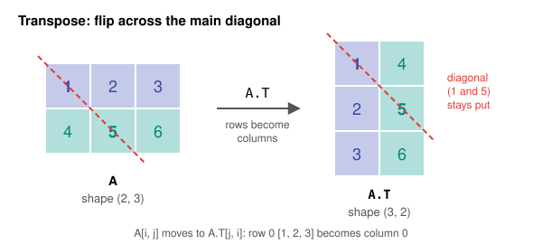

# Day 11: Transpose, Identity and Inverse

**Phase 1 · Week 2 · ~90 minutes**

## Objectives

- [ ] Transpose a matrix by hand and in NumPy, and predict the new shape.
- [ ] Read a 2×2 matrix as a **transformation** of the plane: its columns are where the basis vectors land.
- [ ] Explain what the identity matrix and the inverse matrix do, and compute a 2×2 inverse by hand.
- [ ] Use the determinant to tell how a matrix scales area, and to spot a matrix that has no inverse.
- [ ] Solve a linear system with `np.linalg.solve`, and explain why it beats `inv(A) @ b`.
- [ ] Explain why ML training almost never inverts a matrix.

**Prerequisites.** [Day 5](day-05-vectors.md) (vectors, dot product) and [Day 10](day-10-matrices-matmul.md) (matrices, `A @ B`, the shape rule `(m, n) @ (n, p) → (m, p)`).

---

## The big idea

Yesterday a matrix was a grid of numbers you multiply. Today it gets a second, more useful personality: **a matrix is a machine that moves space**. Feed it a vector, and it hands back a moved vector: stretched, rotated, sheared or flipped.

Once you see matrices that way, three questions come naturally:

| Question | Answer |
|---|---|
| Which machine does nothing? | The **identity** matrix \( I \) |
| Which machine undoes this one? | The **inverse** \( A^{-1} \) |
| How much does this machine stretch areas? | The **determinant** \( \det(A) \) |

Plus one bookkeeping tool, the **transpose**, which shows up in every ML formula because it fixes shapes so that matrix multiplications line up.

**Analogy.** Think of a photo-editing app. "Rotate 90°" is a matrix. "Do nothing" is the identity. "Undo" is the inverse. And if you squash the photo to zero height, there's no undo button: the information is gone. That last case, a matrix with determinant 0, is called **singular**.

## The transpose

The **transpose** of a matrix \( A \), written \( A^\top \) ("A transpose"), turns its rows into columns. The element in row \( i \), column \( j \) moves to row \( j \), column \( i \):

\[
(A^\top)_{ji} = A_{ij}
\qquad
A = \begin{bmatrix} 1 & 2 & 3 \\ 4 & 5 & 6 \end{bmatrix}
\;\Rightarrow\;
A^\top = \begin{bmatrix} 1 & 4 \\ 2 & 5 \\ 3 & 6 \end{bmatrix}
\]

A matrix of shape \( (m, n) \) becomes shape \( (n, m) \). Picture it as a mirror flip across the **main diagonal** (top-left to bottom-right): the diagonal elements stay put, everything else swaps sides.

<figure class="diagram" markdown>

<figcaption>The transpose mirrors a matrix across its main diagonal: row 0 becomes column 0.</figcaption>
</figure>

```python
import numpy as np

A = np.array([[1, 2, 3],
              [4, 5, 6]])
A.shape          # (2, 3)
A.T
# [[1 4]
#  [2 5]
#  [3 6]]
A.T.shape        # (3, 2)
```

`A.T` is free: NumPy doesn't copy any numbers, it returns a **view** that reads the same memory with the strides swapped (the Day 8 idea of a new shape and strides over the same buffer).

### Two rules you'll use constantly

**Transposing a product reverses the order:**

\[
(AB)^\top = B^\top A^\top
\]

Why reversed? Shapes force it. If \( A \) is \( (2, 3) \) and \( B \) is \( (3, 2) \), then \( AB \) is \( (2, 2) \). \( A^\top \) is \( (3, 2) \) and \( B^\top \) is \( (2, 3) \): only \( B^\top A^\top \) has matching inner sizes. (It's like taking off socks and shoes: the last thing you put on comes off first.)

```python
B = np.array([[1, 0],
              [2, 1],
              [0, 3]])
(A @ B).T
# [[ 5 14]
#  [11 23]]
B.T @ A.T
# [[ 5 14]
#  [11 23]]
np.array_equal((A @ B).T, B.T @ A.T)   # True
```

**The dot product is a transpose in disguise.** Math books treat a vector as a **column**: a matrix of shape \( (n, 1) \). Then \( \mathbf{x}^\top \) is a row of shape \( (1, n) \), and a row times a column is a \( (1, 1) \) result, one number:

\[
\mathbf{x} \cdot \mathbf{y} = \mathbf{x}^\top \mathbf{y}
\qquad
\begin{bmatrix} 1 & 2 & 3 \end{bmatrix}
\begin{bmatrix} 4 \\ 5 \\ 6 \end{bmatrix} = 1 \cdot 4 + 2 \cdot 5 + 3 \cdot 6 = 32
\]

You'll see \( \mathbf{w}^\top \mathbf{x} \) in every ML paper. It just means "the dot product of \( \mathbf{w} \) and \( \mathbf{x} \)", exactly the neuron from Day 5.

```python
x = np.array([1, 2, 3])
y = np.array([4, 5, 6])
x @ y            # 32
x.T.shape        # (3,)   .T does nothing to a 1-D array!

xc = x.reshape(-1, 1)    # column vector, shape (3, 1)
yc = y.reshape(-1, 1)
xc.T @ yc        # array([[32]])   the "textbook" version, as a 1x1 matrix
```

!!! warning "Common mistake: `.T` on a 1-D array"
    A NumPy 1-D array has one axis, so there is nothing to swap: `x.T` is the same shape `(3,)`. If you really need a row or column, reshape it to 2-D first (`x.reshape(1, -1)` or `x.reshape(-1, 1)`, or `x[None, :]` / `x[:, None]` from Day 8).

## Matrices move space

Here is the key picture. In 2-D, every vector is built from two **basis vectors**:

- \( \hat{\imath} \) ("i-hat") \( = [1, 0] \), one step right.
- \( \hat{\jmath} \) ("j-hat") \( = [0, 1] \), one step up.

The vector \( [2, 3] \) is "2 of \( \hat{\imath} \) plus 3 of \( \hat{\jmath} \)". Now multiply a 2×2 matrix by \( \hat{\imath} \):

\[
\begin{bmatrix} a & b \\ c & d \end{bmatrix} \begin{bmatrix} 1 \\ 0 \end{bmatrix} = \begin{bmatrix} a \\ c \end{bmatrix}
\qquad
\begin{bmatrix} a & b \\ c & d \end{bmatrix} \begin{bmatrix} 0 \\ 1 \end{bmatrix} = \begin{bmatrix} b \\ d \end{bmatrix}
\]

**The first column is where \( \hat{\imath} \) lands. The second column is where \( \hat{\jmath} \) lands.** And because every other vector is a mix of \( \hat{\imath} \) and \( \hat{\jmath} \), it lands at the same mix of the new columns. (This is Day 10's "matrix-vector product is a weighted sum of columns", seen geometrically.) Grid lines stay straight, parallel and evenly spaced, and the origin stays put. A transformation with those properties is called **linear**.

<figure class="diagram" markdown>
![Animation: the unit square with i-hat in red and j-hat in blue starts as the identity, morphs into a parallelogram under the shear matrix with columns [1, 0] and [1, 1], returns, then rotates 90 degrees under the matrix with columns [0, 1] and [-1, 0]; the matching matrix is shown on the right with each column colored like the basis vector it moves](../../assets/img/phase-1/day11-transform-morph.svg)
<figcaption>Animated: the matrix's columns are exactly where î (red) and ĵ (blue) end up; the square just follows.</figcaption>
</figure>

### Four transformations with real numbers

| Name | Matrix | \( \hat{\imath} \to \) | \( \hat{\jmath} \to \) | Effect |
|---|---|---|---|---|
| Scale | \( \begin{bmatrix} 2 & 0 \\ 0 & 3 \end{bmatrix} \) | \( [2, 0] \) | \( [0, 3] \) | stretch x by 2, y by 3 |
| Rotate 90° | \( \begin{bmatrix} 0 & -1 \\ 1 & 0 \end{bmatrix} \) | \( [0, 1] \) | \( [-1, 0] \) | quarter turn counterclockwise |
| Shear | \( \begin{bmatrix} 1 & 1 \\ 0 & 1 \end{bmatrix} \) | \( [1, 0] \) | \( [1, 1] \) | slant, like italic text |
| Reflect | \( \begin{bmatrix} 1 & 0 \\ 0 & -1 \end{bmatrix} \) | \( [1, 0] \) | \( [0, -1] \) | mirror across the x-axis |

Rotation by any angle \( \theta \) (theta, measured counterclockwise) follows the same rule. \( \hat{\imath} \) goes to \( [\cos\theta, \sin\theta] \) and \( \hat{\jmath} \) to \( [-\sin\theta, \cos\theta] \):

\[
R(\theta) = \begin{bmatrix} \cos\theta & -\sin\theta \\ \sin\theta & \cos\theta \end{bmatrix}
\qquad
R(90°) = \begin{bmatrix} 0 & -1 \\ 1 & 0 \end{bmatrix}
\]

```python
S = np.array([[2, 0], [0, 3]])
S @ np.array([1, 0]), S @ np.array([0, 1]), S @ np.array([1, 1])
# (array([2, 0]), array([0, 3]), array([2, 3]))

theta = np.pi / 2                      # 90 degrees in radians
R = np.array([[np.cos(theta), -np.sin(theta)],
              [np.sin(theta),  np.cos(theta)]])
R @ np.array([1, 0])
# array([6.123234e-17, 1.000000e+00])   that first number is "zero" in floating point
(R @ np.array([2, 1])).round(3)
# array([-1.,  2.])                     [2, 1] turned a quarter to [-1, 2]

H = np.array([[1, 1], [0, 1]])         # shear
square = np.array([[0, 1, 1, 0],       # the 4 corners of the unit square,
                   [0, 0, 1, 1]])      # one corner per column
H @ square
# [[0 1 2 1]
#  [0 0 1 1]]     the top corners slid right: a parallelogram

F = np.array([[1, 0], [0, -1]])        # reflect
F @ np.array([2, 3])                   # array([ 2, -3])
```

Notice the trick in `H @ square`: putting many points as columns of one matrix transforms them all in one multiply. That's exactly how a neural-network layer processes a whole batch (Day 12).

**Doing two transformations in a row is a matrix product.** "Rotate, then scale" is \( S(R\mathbf{v}) = (SR)\mathbf{v} \). Read right to left: the matrix nearest the vector acts first. Order matters, as Day 10 warned:

```python
R = np.array([[0, -1], [1, 0]])
M = S @ R                    # rotate first, then scale
M @ np.array([1, 0])         # array([0, 3])   î -> [0, 1] -> stretched by 3
R @ S @ np.array([1, 0])     # array([0, 2])   scale first, then rotate: different!
```

## The identity matrix

The **identity matrix** \( I \) is the transformation that does nothing: \( \hat{\imath} \) stays at \( [1, 0] \), \( \hat{\jmath} \) stays at \( [0, 1] \). So its columns are the basis vectors themselves, giving 1s on the diagonal and 0s everywhere else:

\[
I_2 = \begin{bmatrix} 1 & 0 \\ 0 & 1 \end{bmatrix}
\qquad
I\mathbf{v} = \mathbf{v}
\qquad
AI = IA = A
\]

It is the matrix version of the number 1 (\( 5 \times 1 = 5 \)). It's always square, \( n \times n \); the subscript, often omitted, gives \( n \).

```python
I = np.eye(2)
# [[1. 0.]
#  [0. 1.]]
A = np.array([[2., 1.], [1., 3.]])
np.array_equal(A @ I, A), np.array_equal(I @ A, A)   # (True, True)
np.eye(3, dtype=int)
# [[1 0 0]
#  [0 1 0]
#  [0 0 1]]
```

## The inverse: undo

The **inverse** of a square matrix \( A \), written \( A^{-1} \) ("A inverse"), is the transformation that puts everything back. Apply \( A \), then \( A^{-1} \), and you've done nothing:

\[
A^{-1} A = A A^{-1} = I
\]

Like \( 5 \times \tfrac{1}{5} = 1 \). If \( A \) rotates 90° counterclockwise, \( A^{-1} \) rotates 90° clockwise. If \( A \) doubles x, \( A^{-1} \) halves it.

**The 2×2 formula.** For \( A = \begin{bmatrix} a & b \\ c & d \end{bmatrix} \): swap \( a \) and \( d \), negate \( b \) and \( c \), and divide everything by \( ad - bc \):

\[
A^{-1} = \frac{1}{ad - bc} \begin{bmatrix} d & -b \\ -c & a \end{bmatrix}
\]

Worked example with \( A = \begin{bmatrix} 2 & 1 \\ 1 & 3 \end{bmatrix} \): \( ad - bc = 2 \cdot 3 - 1 \cdot 1 = 5 \), so

\[
A^{-1} = \frac{1}{5} \begin{bmatrix} 3 & -1 \\ -1 & 2 \end{bmatrix} = \begin{bmatrix} 0.6 & -0.2 \\ -0.2 & 0.4 \end{bmatrix}
\]

Check one entry of \( AA^{-1} \): row 1 of \( A \) dot column 1 of \( A^{-1} \) is \( 2(0.6) + 1(-0.2) = 1 \).

```python
A_inv = np.linalg.inv(A)
# [[ 0.6 -0.2]
#  [-0.2  0.4]]
A @ A_inv
# [[ 1.00000000e+00  0.00000000e+00]
#  [-5.55111512e-17  1.00000000e+00]]    the identity, up to rounding
np.allclose(A @ A_inv, np.eye(2))        # True

v = np.array([1., 2.])
w = A @ v          # array([4., 7.])   move it...
A_inv @ w          # array([1., 2.])   ...and move it back
```

!!! warning "Common mistake: `A ** -1` is not the inverse"
    `A ** -1` (or `1 / A`) takes the reciprocal of **each element**, like `*` vs `@` on Day 10. The matrix inverse is `np.linalg.inv(A)`. Also, only **square** matrices can have an inverse: a `(3, 2)` matrix changes the dimension, and there's no way back.

## The determinant: how much area changes

That number \( ad - bc \) in the denominator has a name: the **determinant**, \( \det(A) \). It tells you **how much the transformation scales area**. The unit square (area 1) lands on a parallelogram whose area is \( |\det(A)| \), and every other shape scales by the same factor.

\[
\det \begin{bmatrix} a & b \\ c & d \end{bmatrix} = ad - bc
\]

<figure class="diagram" markdown>
![Animation in three panels: the unit square with area 1; under A with columns [2, 1] and [1, 3] it grows into a parallelogram of area 5; under the matrix with columns [1, 2] and [2, 4] both basis vectors land on the same line and the square collapses into a line segment of area 0](../../assets/img/phase-1/day11-determinant.svg)
<figcaption>Animated: det = 5 means every area grows 5×; det = 0 means the plane is squashed onto a line.</figcaption>
</figure>

What its value tells you:

| \( \det(A) \) | Meaning | Example |
|---|---|---|
| \( > 1 \) | areas grow | scale `[[2,0],[0,3]]`: det 6 |
| \( = 1 \) | areas unchanged | any rotation, the shear `[[1,1],[0,1]]` |
| between 0 and 1 | areas shrink | `[[0.5,0],[0,0.5]]`: det 0.25 |
| \( = 0 \) | the plane is squashed onto a line (or a point) | `[[1,2],[2,4]]` |
| \( < 0 \) | the plane is **flipped** over, like a mirror image; \( |\det| \) still gives the area factor | reflect `[[1,0],[0,-1]]`: det −1 |

**Why det 0 means no inverse.** Look at \( \begin{bmatrix} 1 & 2 \\ 2 & 4 \end{bmatrix} \) (called `Sg`, for "singular", in the code below). Its second column \( [2, 4] \) is just twice the first \( [1, 2] \), so \( \hat{\imath} \) and \( \hat{\jmath} \) land on the same line, and the whole plane collapses onto that line. Many different inputs now give the same output (for example `[2, -1]` lands on `[0, 0]`, the same place as the origin). Given an output, you can't tell which input it came from, so no undo can exist. In the formula, you'd be dividing by \( ad - bc = 0 \). A matrix like this is called **singular**; one with an inverse is **invertible**.

!!! note "How NumPy 2 shows single numbers"
    In Jupyter, a scalar result such as a determinant displays as `np.float64(5.000000000000001)`. The comments here show the plain value, which is also what `print()` gives you.

```python
np.linalg.det(A)          # 5.000000000000001   (rounding again; it's 5)
np.linalg.det(S), np.linalg.det(R), np.linalg.det(H), np.linalg.det(F)
# 6.0, 1.0, 1.0, -1.0       scale, rotate, shear, reflect

Sg = np.array([[1., 2.], [2., 4.]])
np.linalg.det(Sg)         # 0.0
Sg @ np.array([2., -1.])  # array([0., 0.])   a non-zero input that vanishes
np.linalg.inv(Sg)         # LinAlgError: Singular matrix
```

Two handy facts: \( \det(AB) = \det(A)\det(B) \) (areas scale, then scale again: `S @ R` above has det \( 6 \times 1 = 6 \)), and \( \det(A^{-1}) = 1 / \det(A) \) (the undo shrinks by the same factor the original grew).

!!! warning "Common mistake: testing `det == 0`"
    In floating point, a matrix that is singular "in theory" often gets a determinant like `1e-17` instead of exactly 0, and a matrix that is merely close to singular can have a perfectly ordinary-looking determinant. Don't use the determinant as a singularity test in code; let `np.linalg.solve` raise `LinAlgError`, or check `np.linalg.cond(A)` (the **condition number**: how much the matrix amplifies rounding errors; huge, like `1e16`, means "effectively singular").

## Solving \( A\mathbf{x} = \mathbf{b} \)

The most common practical use of all this: **solve a system of linear equations**. Say

\[
\begin{aligned}
2x_1 + 1x_2 &= 5 \\
1x_1 + 3x_2 &= 10
\end{aligned}
\qquad\Longleftrightarrow\qquad
\underbrace{\begin{bmatrix} 2 & 1 \\ 1 & 3 \end{bmatrix}}_{A}
\underbrace{\begin{bmatrix} x_1 \\ x_2 \end{bmatrix}}_{\mathbf{x}}
=
\underbrace{\begin{bmatrix} 5 \\ 10 \end{bmatrix}}_{\mathbf{b}}
\]

In transformation language: "which vector \( \mathbf{x} \) does \( A \) move onto \( \mathbf{b} \)?" On paper the answer is \( \mathbf{x} = A^{-1}\mathbf{b} \). In code, don't compute the inverse; ask NumPy to solve directly:

```python
A = np.array([[2., 1.], [1., 3.]])
b = np.array([5., 10.])
x = np.linalg.solve(A, b)
x                       # array([1., 3.])
A @ x                   # array([ 5., 10.])   check: it really is a solution
np.linalg.inv(A) @ b    # array([1., 3.])     same answer here, but...
```

**Why `solve` is preferred over `inv(A) @ b`:**

1. **Speed.** `solve` factors \( A \) once (an *LU decomposition*, which you don't need to know yet) and uses it directly. `inv` does that same factoring and then extra work to build the full inverse, which you then still multiply by \( \mathbf{b} \).

    ```python
    import time
    rng = np.random.default_rng(0)
    M = rng.normal(size=(2000, 2000))
    b = rng.normal(size=2000)

    t = time.perf_counter(); x1 = np.linalg.solve(M, b); t_solve = time.perf_counter() - t
    t = time.perf_counter(); x2 = np.linalg.inv(M) @ b; t_inv = time.perf_counter() - t
    print(f"solve: {t_solve*1000:.0f} ms, inv then @: {t_inv*1000:.0f} ms")
    # solve: 116 ms, inv then @: 408 ms      (your timings will differ; the ratio is the point)
    np.allclose(x1, x2)    # True
    ```

2. **Numerical stability.** Every float operation rounds a little. Building the inverse adds more operations, and for nearly singular matrices the rounding errors get amplified. A classic badly behaved matrix is the *Hilbert matrix*, with entries \( 1/(i + j + 1) \):

    ```python
    n = 12
    Hm = np.array([[1 / (i + j + 1) for j in range(n)] for i in range(n)])
    b2 = Hm @ np.ones(n)             # so the true answer is all ones
    x_solve = np.linalg.solve(Hm, b2)
    x_inv = np.linalg.inv(Hm) @ b2
    print(f"{np.linalg.cond(Hm):.1e}")                       # 1.6e+16  effectively singular
    print(f"{np.linalg.norm(Hm @ x_solve - b2):.1e}")        # 6.0e-16  solve: tiny residual
    print(f"{np.linalg.norm(Hm @ x_inv - b2):.1e}")          # 2.4e-01  inv: way off
    ```

    The **residual** \( \|A\mathbf{x} - \mathbf{b}\| \) measures how badly a candidate \( \mathbf{x} \) fails the equations. `solve` gives an answer that satisfies the equations to machine precision; the inverse route misses by 0.24.

!!! warning "Common mistake: `inv` in production code"
    A rule numerical people repeat: *if you're writing `inv(A) @ b`, you want `solve(A, b)`.* The same goes for `B @ inv(A)`-style code: rewrite it as a solve. Explicit inverses are for learning and for tiny fixed matrices (like 2×2 or 3×3 graphics transforms).

!!! android "Android bridge"
    You've been using these matrices for years. `android.graphics.Matrix` is a **3×3 affine matrix** used by `Canvas.concat()`, `ImageView` (with `scaleType = MATRIX`) and many gesture libraries. The top-left 2×2 block is exactly today's scale, rotate and shear; the third column holds a translation, which is why it needs a 3×3 (a trick called *homogeneous coordinates*). `Matrix.setRotate(degrees)` writes a rotation matrix, `Matrix.postScale(sx, sy)` multiplies a scale on afterwards, `postConcat(other)` multiplies by any matrix, and `mapPoints(float[])` is matrix-times-vector for each point.

    The classic use of the inverse: the user taps a zoomed and rotated image, and you need to know which pixel of the *original* image they hit. The screen point is \( M\mathbf{p} \); you want \( \mathbf{p} \), so you apply \( M^{-1} \):

    ```kotlin
    val m = Matrix().apply {
        setRotate(30f)        // rotate about (0, 0)
        postScale(2f, 2f)     // then zoom 2x
    }
    val inverse = Matrix()
    if (m.invert(inverse)) {                 // false if m is singular (det 0)
        val pts = floatArrayOf(event.x, event.y)
        inverse.mapPoints(pts)               // pts now in image coordinates
    }
    ```

    Notice `invert()` returns a `Boolean`: it is the Android API telling you about singular matrices. A `setScale(0f, 1f)` matrix squashes everything onto a line and can't be inverted.

## Why ML rarely inverts matrices

You might expect ML to solve big equations all day. Mostly it doesn't, for three reasons:

1. **Models aren't linear.** A neural network has non-linear activations (ReLU, Day 12) between its matrix multiplies, so there's no single \( A\mathbf{x} = \mathbf{b} \) to solve for the weights.
2. **Weight matrices usually aren't square.** A layer mapping 784 pixels to 128 features has a \( (128, 784) \) weight matrix: no inverse exists, and that's fine because the network never needs to run backwards.
3. **Inverting is expensive.** It costs roughly \( n^3 \) operations: for \( n = 100{,}000 \) features that's \( 10^{15} \), which is impractical.

Instead, ML uses **gradient descent** (Month 2): start with a guess, measure the error, nudge the weights downhill, repeat. Only matrix multiplies and vector updates, which GPUs and phone NPUs are built for.

**The one place you'll meet an inverse.** Linear regression (fitting a straight line, Phase 2) has an exact formula, the **normal equation**:

\[
\mathbf{w} = (X^\top X)^{-1} X^\top \mathbf{y}
\]

Here \( X \) is the data (one row per example), \( \mathbf{y} \) the targets, \( \mathbf{w} \) the weights to learn. Every piece is something from today: transposes, a product, an inverse. And, following today's rule, you'd compute it with `solve`, not `inv`. A preview (we'll derive it properly later):

```python
rng = np.random.default_rng(42)
x = np.linspace(0, 10, 50)
y = 3 * x + 2 + rng.normal(0, 1, size=50)     # a noisy line: slope 3, intercept 2
X = np.column_stack([x, np.ones_like(x)])     # shape (50, 2): [x, 1] per row
w = np.linalg.solve(X.T @ X, X.T @ y)         # solves (X^T X) w = X^T y
w.round(3)                      # array([3.045, 1.865])   close to the true 3 and 2
np.polyfit(x, y, 1).round(3)    # array([3.045, 1.865])   NumPy's own line fit agrees
```

Notice `X.T @ X` has shape `(2, 50) @ (50, 2) = (2, 2)`: a tiny square matrix, no matter how many data points. That's why the normal equation works for small feature counts, and why gradient descent takes over when features number in the thousands or millions.

---

## Exercises

1. By hand, write the transpose of \( A = \begin{bmatrix} 1 & 2 \\ 3 & 4 \\ 5 & 6 \end{bmatrix} \) and give its shape. Then, with \( B = \begin{bmatrix} 1 & 0 & 2 \\ 0 & 1 & 1 \end{bmatrix} \), check in NumPy that \( (AB)^\top = B^\top A^\top \). What shape is \( AB \)?
2. The matrix \( R = \begin{bmatrix} 0 & -1 \\ 1 & 0 \end{bmatrix} \) rotates 90°. Where does it send \( [3, 1] \)? What is \( \det(R) \)? Compute \( R^{-1} \) and compare it with \( R^\top \). What do you notice, and why does it make geometric sense?
3. Using the 2×2 formula, invert \( M = \begin{bmatrix} 4 & 7 \\ 2 & 6 \end{bmatrix} \) by hand. Verify with `np.allclose(M @ M_inv, np.eye(2))`.
4. Solve with `np.linalg.solve`: \( 3x + 2y = 12 \) and \( x - y = -1 \). Check your answer by substituting back.
5. Which of these are singular? Decide using the columns first (is one a multiple of the other?), then confirm with `np.linalg.det`: \( \begin{bmatrix} 2 & 4 \\ 1 & 2 \end{bmatrix} \), \( \begin{bmatrix} 3 & 1 \\ 6 & 2 \end{bmatrix} \), \( \begin{bmatrix} 1 & 2 \\ 3 & 4 \end{bmatrix} \).
6. A shear \( H = \begin{bmatrix} 1 & 1.5 \\ 0 & 1 \end{bmatrix} \) slants an image. Predict \( H^{-1} \) without the formula (what undoes "slide right by 1.5 per unit of height"?), then check it with `np.linalg.inv`, and show that it moves `H @ [2, 1]` back to `[2, 1]`.

??? success "Solutions"
    ```python
    import numpy as np

    # 1
    A = np.array([[1, 2], [3, 4], [5, 6]])
    A.T
    # [[1 3 5]
    #  [2 4 6]]        shape (2, 3)
    B = np.array([[1, 0, 2], [0, 1, 1]])
    (A @ B).T.shape, (B.T @ A.T).shape, np.array_equal((A @ B).T, B.T @ A.T)
    # ((3, 3), (3, 3), True)       AB is (3, 2) @ (2, 3) = (3, 3)

    # 2
    R = np.array([[0, -1], [1, 0]])
    R @ np.array([3, 1])     # array([-1,  3])
    np.linalg.det(R)         # 1.0   rotations don't change area
    np.linalg.inv(R)
    # [[ 0.  1.]
    #  [-1. -0.]]           (-0. is just a signed floating-point zero)
    R.T
    # [[ 0  1]
    #  [-1  0]]
    np.allclose(np.linalg.inv(R), R.T)   # True
    ```
    For a rotation, the inverse *is* the transpose. Undoing a 90° counterclockwise turn is a 90° clockwise turn, and \( R(-90°) \) happens to be \( R(90°) \) mirrored across the diagonal. Matrices with this property are called **orthogonal**; they're loved in numerics because "inverting" them is free.

    ```python
    # 3: ad - bc = 4*6 - 7*2 = 10; swap 4 and 6, negate 7 and 2, divide by 10
    M = np.array([[4., 7.], [2., 6.]])
    M_inv = np.array([[6., -7.], [-2., 4.]]) / 10
    # [[ 0.6 -0.7]
    #  [-0.2  0.4]]
    np.allclose(M @ M_inv, np.eye(2)), np.allclose(M_inv, np.linalg.inv(M))   # (True, True)

    # 4
    A4 = np.array([[3., 2.], [1., -1.]])
    b4 = np.array([12., -1.])
    np.linalg.solve(A4, b4)    # array([2., 3.])   x = 2, y = 3
    # check: 3*2 + 2*3 = 12 and 2 - 3 = -1

    # 5
    np.linalg.det(np.array([[2., 4.], [1., 2.]]))   # 0.0    column 2 = 2 * column 1: singular
    np.linalg.det(np.array([[3., 1.], [6., 2.]]))   # 0.0    column 1 = 3 * column 2: singular
    np.linalg.det(np.array([[1., 2.], [3., 4.]]))   # -2.0 (prints -2.0000000000000004)  invertible, and flips orientation

    # 6: undo by sliding LEFT by 1.5 per unit of height
    H = np.array([[1., 1.5], [0., 1.]])
    np.linalg.inv(H)
    # [[ 1.  -1.5]
    #  [ 0.   1. ]]
    p = np.array([2., 1.])
    H @ p                       # array([3.5, 1. ])
    np.linalg.inv(H) @ (H @ p)  # array([2., 1.])
    ```

## Resources

- [3Blue1Brown: Linear transformations and matrices (Essence of Linear Algebra, ch. 3)](https://www.youtube.com/watch?v=kYB8IZa5AuE): the "columns are where î and ĵ land" idea, animated. Watch this first.
- [3Blue1Brown: The determinant (ch. 6)](https://www.youtube.com/watch?v=Ip3X9LOh2dk) and [Inverse matrices, column space and null space (ch. 7)](https://www.youtube.com/watch?v=uQhTuRlWMxw): today's second half, beautifully visualized.
- [Khan Academy: Matrix transformations](https://www.khanacademy.org/math/linear-algebra/matrix-transformations): practice problems on transformations, inverses and determinants.
- [NumPy docs: `numpy.linalg.solve`](https://numpy.org/doc/stable/reference/generated/numpy.linalg.solve.html) and [`numpy.linalg.inv`](https://numpy.org/doc/stable/reference/generated/numpy.linalg.inv.html).
- [Mathematics for Machine Learning (free book), ch. 2](https://mml-book.github.io/): matrices, inverses and linear systems, formally.
- [Android reference: `android.graphics.Matrix`](https://developer.android.com/reference/android/graphics/Matrix): `setRotate`, `postScale`, `invert`, `mapPoints`.

## Checklist

- [ ] I can transpose a matrix and say what happens to its shape, and I know `.T` does nothing to a 1-D array.
- [ ] I can explain why \( (AB)^\top = B^\top A^\top \) and that \( \mathbf{x}^\top\mathbf{y} \) is a dot product.
- [ ] Given a 2×2 matrix, I can sketch where \( \hat{\imath} \) and \( \hat{\jmath} \) land.
- [ ] I can write the identity, and invert a 2×2 matrix by hand.
- [ ] I can say what det = 5, det = 0 and det = −1 mean geometrically.
- [ ] I use `np.linalg.solve(A, b)`, not `np.linalg.inv(A) @ b`, and can say why.
- [ ] I can explain why neural networks are trained with gradient descent instead of matrix inversion.

**Next:** [Day 12: A neural-network layer is a matrix multiply](day-12-layer-is-matmul.md)
