# Day 12: A Neural-Network Layer Is a Matrix Multiply

**Phase 1 · Week 2 · ~150 minutes**

## Objectives

- [ ] Go from one neuron, \( z = \mathbf{w} \cdot \mathbf{x} + b \), to a whole layer, \( \mathbf{z} = W\mathbf{x} + \mathbf{b} \), explain why row \( i \) of \( W \) is neuron \( i \), and say what the bias does.
- [ ] Read the names a layer goes by: dense, fully connected, linear, affine, pre-activation, activation.
- [ ] Run a layer on a whole batch with \( Z = XW^\top + \mathbf{b} \), predict every shape involved, and connect it to the one-example form \( W\mathbf{x} + \mathbf{b} \).
- [ ] Explain why stacking layers without a non-linearity gains nothing, and apply ReLU, sigmoid and tanh element-wise.
- [ ] Write a complete 2-layer forward pass in NumPy, turn its logits into probabilities with softmax, and generalise it to any list of layers.
- [ ] Explain why weights start random rather than all equal.
- [ ] Count a layer's parameters, its memory in `float32` and `int8`, its activation memory and its FLOPs.
- [ ] Keep a layer in `float32` and spot the silent promotion to `float64`.
- [ ] Recognise the same layer as PyTorch's `nn.Linear`, Keras's `Dense` and LiteRT's `FULLY_CONNECTED` op, including which way round each stores its weights.
- [ ] Read the three most common shape errors and fix them, and catch the two shape bugs that don't raise.

**Prerequisites.** What this lesson uses from earlier days:

- [Day 2a](day-02a-strings.md): the f-string alignment specs `:>7` (right-align in 7 characters) and `:<4` (left-align).
- [Day 2b](day-02b-collections.md): lists of tuples, unpacking a pair in a `for` loop (`for a, b in pairs`), slicing a list (`sizes[:-1]`, `sizes[1:]`) and `zip`.
- [Day 3b](day-03b-errors-files-json.md): `try` / `except ... as e`, used to show the real error messages.
- [Day 3d](day-03d-iterators-generators.md): a generator expression inside `sum(...)`, and `pairwise` (Python's `zipWithNext`).
- [Day 4](day-04-numpy-arrays.md): dtypes, `astype` (and that it truncates), `.nbytes`, type promotion, `np.maximum` versus `np.max`, `np.exp`, `argmax(axis=1)`, the mean of a boolean array as a fraction, and NumPy scalars displaying as `np.float64(...)`.
- [Day 4b](day-04b-numpy-toolkit.md): `np.allclose`, `.round()`.
- [Day 4c](day-04c-random-io-stats.md): `np.random.default_rng(seed)` and `rng.normal`.
- [Day 5](day-05-vectors.md): the neuron \( \mathbf{w} \cdot \mathbf{x} + b \), the bias, and a neuron as a pattern detector.
- [Day 8](day-08-shapes-indexing.md): `reshape`, adding an axis with `np.newaxis` / `None`, and `reshape(1, -1)`.
- [Day 9](day-09-broadcasting.md): broadcasting a `(out,)` bias over a `(batch, out)` matrix, `keepdims=True`, and the numerically safe softmax.
- [Day 10](day-10-matrices-matmul.md): matrix times vector as one dot product per row, matrix times matrix, the shape rule `(m, n) @ (n, p) → (m, p)`, and the cost \( m \cdot n \cdot p \) multiply-adds.
- [Day 11](day-11-transpose-identity-inverse.md): the transpose `.T`, and \( (AB)^\top = B^\top A^\top \).

!!! info "How to read the code on this page"
    Every Python block has a **▶ Run** button, and blocks share their variables from top to bottom like notebook cells, so run them in order. A bare expression on its own line shows its `repr()`, exactly as the `# comment` beside or below it says: arrays as `array([...])` with commas, single numbers as `np.float64(0.575)`. Lines that fail on purpose are wrapped in `try` / `except`, and the comment shows the real error message. The outputs come from 64-bit NumPy on a laptop; in the browser NumPy's default integer is `int32`, so where this page shows `np.int64(1)`, ▶ Run shows `np.int32(1)` ([How lessons work](../../how-lessons-work.md) explains why).

---

## The big idea

On Day 5 you met one neuron: a dot product plus a number. A **layer** is many neurons that all read the *same* input. Stack their weight vectors on top of each other and you have a matrix; run all of them at once and you have a matrix multiply. Stack several layers, with a simple bend between them, and you have a **neural network**.

That's the whole secret. The "network" inside a phone's image classifier is, to a first approximation, a chain of `@` operations, each followed by an addition and a bend. Everything else in this lesson is the bookkeeping around that chain: which way round the matrices are stored, what shape every array has, how many numbers the model holds, how much work one prediction costs, and the handful of bugs that bite everybody.

**Analogy.** Picture a panel of judges at a talent show. Every judge watches the same performance (the input). Each judge has their own scoring sheet: "how much do I care about singing, dancing, stage presence" (their weights) and their own mood offset (their bias). Each produces one score. Collect the panel's scoring sheets as rows of a table and you have \( W \). Collect their scores and you have \( \mathbf{z} \). A second panel then scores the first panel's scores: that's layer 2. And a rule like "scores below zero are recorded as zero" between the panels is the bend.

**Part 1: One layer**

## From one neuron to a layer

**What it is.** A **layer** is a group of neurons that all read the same input vector. Each neuron keeps its own weight vector and its own bias. Writing the weight vectors as the **rows** of one matrix \( W \) and the biases as one vector \( \mathbf{b} \) turns "run every neuron" into one matrix-vector product.

**Why it exists.** Speed and simplicity. A layer of 128 neurons as 128 separate dot products is a Python loop; as one `W @ x` it is a single call into optimised C (Day 4), or onto a GPU or phone NPU (Day 10). And one formula, \( W\mathbf{x} + \mathbf{b} \), describes a layer of any size.

**Intuition first.** Recap from Day 5. One neuron has a weight vector \( \mathbf{w} \) and a bias \( b \):

\[
z = \mathbf{w} \cdot \mathbf{x} + b = w_1 x_1 + w_2 x_2 + w_3 x_3 + b
\]

With \( \mathbf{x} = [2, 1, 3] \), \( \mathbf{w} = [0.5, -0.2, 0.1] \) and \( b = 0.4 \): \( z = 1 - 0.2 + 0.3 + 0.4 = 1.5 \).

Now take **4 neurons**, all reading the same 3 inputs. Each has its own weight vector of length 3 and its own bias. Write the weight vectors as the rows of a matrix, and the biases as a vector:

\[
W = \begin{bmatrix} 0.5 & -0.2 & 0.1 \\ 0 & 1 & -1 \\ 0.3 & 0.3 & 0.3 \\ -0.4 & 0.2 & 0.6 \end{bmatrix}
\qquad
\mathbf{b} = \begin{bmatrix} 0.4 \\ 0 \\ -1 \\ 0.1 \end{bmatrix}
\]

Row 1 of \( W \) is exactly the \( \mathbf{w} \) above; rows 2–4 belong to the other three neurons. The symbols, one at a time:

- \( W \) is the **weight matrix**. Its shape is **(out, in)**: one row per neuron (4), one column per input feature (3).
- \( \mathbf{b} \) is the **bias vector**: one number per neuron, shape (out,) = (4,).
- \( \mathbf{z} \) is the layer's output: one number per neuron, shape (4,).

From Day 10, a matrix times a vector is one dot product per row. So all four neurons fire at once:

\[
\mathbf{z} = W\mathbf{x} + \mathbf{b}
\qquad
z_i = (\text{row } i \text{ of } W) \cdot \mathbf{x} + b_i
\]

**By hand**, neuron by neuron, with \( \mathbf{x} = [2, 1, 3] \):

- neuron 1: \( 0.5 \cdot 2 - 0.2 \cdot 1 + 0.1 \cdot 3 + 0.4 = 1 - 0.2 + 0.3 + 0.4 = 1.5 \)
- neuron 2: \( 0 \cdot 2 + 1 \cdot 1 - 1 \cdot 3 + 0 = -2 \)
- neuron 3: \( 0.3 \cdot 2 + 0.3 \cdot 1 + 0.3 \cdot 3 - 1 = 0.6 + 0.3 + 0.9 - 1 = 0.8 \)
- neuron 4: \( -0.4 \cdot 2 + 0.2 \cdot 1 + 0.6 \cdot 3 + 0.1 = -0.8 + 0.2 + 1.8 + 0.1 = 1.3 \)

So \( \mathbf{z} = [1.5, -2, 0.8, 1.3] \). The code reproduces it twice, once neuron by neuron and once as a layer:

```python
import numpy as np

x = np.array([2.0, 1.0, 3.0])               # one input with 3 features

W = np.array([[ 0.5, -0.2,  0.1],           # neuron 1's weights (Day 5's w)
              [ 0.0,  1.0, -1.0],           # neuron 2
              [ 0.3,  0.3,  0.3],           # neuron 3
              [-0.4,  0.2,  0.6]])          # neuron 4
b = np.array([0.4, 0.0, -1.0, 0.1])         # one bias per neuron

# The slow way: one dot product per neuron
z_loop = np.array([W[i] @ x + b[i] for i in range(4)])
z_loop                        # array([ 1.5, -2. ,  0.8,  1.3])

# The layer way: one matrix-vector product
z = W @ x + b
z                             # array([ 1.5, -2. ,  0.8,  1.3])
W.shape, x.shape, z.shape     # ((4, 3), (3,), (4,))
```

`W[i]` is row `i` of `W` (Day 4's one-index-on-a-2-D-array), and the list comprehension (Day 2b) collects one dot product per neuron.

**How it works underneath.** The animation walks through the four rows. Each output number uses exactly one row of \( W \), all of \( \mathbf{x} \), and one entry of \( \mathbf{b} \). No neuron sees another neuron's weights; the matrix is only a convenient way to store four independent weight vectors side by side in one buffer.

<figure class="diagram" markdown>
![Animation: a 4 by 3 weight matrix W times the vector x = [2, 1, 3] plus bias b equals z = [1.5, -2, 0.8, 1.3]; each row of W is highlighted in turn together with its bias, its output and its neuron, while the full arithmetic for that neuron is shown below](../../assets/img/phase-1/day12-rows-are-neurons.svg)
<figcaption>Animated: row i of W, dotted with x, plus b_i, is neuron i's output. One W @ x + b does all four.</figcaption>
</figure>

The shape rule is Day 10's: \( (\text{out}, \text{in}) \) @ \( (\text{in},) \) gives \( (\text{out},) \). Three numbers in, four numbers out. A layer *changes the size* of the vector, which is how a network goes from 150,528 pixel values (a 224×224 RGB image) down to 1,000 class scores.

**How it goes wrong: neurons stored as columns.** If you build \( W \) by putting each neuron's weights in a **column** instead of a row, you get a (3, 4) matrix, and `W @ x` no longer lines up:

```python
W_cols = W.T                  # each column is one neuron: shape (3, 4)
try:
    W_cols @ x
except ValueError as e:
    print("ValueError:", e)
# ValueError: matmul: Input operand 1 has a mismatch in its core dimension 0, with gufunc signature (n?,k),(k,m?)->(n?,m?) (size 3 is different from 4)
```

Read it with Day 10's shape rule: the left matrix has 4 columns (`k` = 4) but `x` has 3 entries. **Fix:** decide the storage first. With neurons as rows, the formula is `W @ x`; with neurons as columns, it is `x @ W_cols` (a row vector times the matrix), which gives the same four numbers. Both conventions exist in real frameworks, and you'll meet them both below.

## What the bias does

**What it is.** The bias \( b_i \) is the output neuron \( i \) gives when every input is zero. It shifts the neuron's output up or down by a fixed amount, independent of the input.

**Why it exists.** Without it, every neuron is forced through the origin: an all-zero input always produces an all-zero output, whatever the weights. With it, a neuron can say "fire only when the weighted evidence is above 0.7", because \( \mathbf{w} \cdot \mathbf{x} - 0.7 > 0 \) is the same as \( \mathbf{w} \cdot \mathbf{x} > 0.7 \). The bias is a learned **threshold**. Day 5 met it as the delivery charge on the shopping bill.

```python
zero_input = np.zeros(3)
W @ zero_input                # array([0., 0., 0., 0.])          no bias: stuck at 0
W @ zero_input + b            # array([ 0.4,  0. , -1. ,  0.1])  the bias alone
```

Neuron 3 has bias −1: its weighted sum must exceed 1 before its output turns positive. That's the threshold reading, and it becomes important once ReLU (Part 2) silences everything below 0.

## Names you'll see for this layer

The layer \( W\mathbf{x} + \mathbf{b} \) goes by several names, and docs and papers use all of them:

- **Dense layer** (Keras's `Dense`): "dense" because every output is connected to every input; no weight is forced to be zero.
- **Fully connected layer**, often shortened to **FC** (LiteRT's `FULLY_CONNECTED`, many papers): the same idea, named after the diagram, where every input has an edge to every neuron.
- **Linear layer** (PyTorch's `nn.Linear`): named after the maths, although strictly it is *affine*, as the next bullet explains.
- **Affine** means "linear plus a constant shift". \( W\mathbf{x} \) alone is linear (Day 11's linearity rule: \( W(a\mathbf{x} + c\mathbf{y}) = aW\mathbf{x} + cW\mathbf{y} \)); adding \( \mathbf{b} \) breaks that rule, because \( W\mathbf{0} + \mathbf{b} = \mathbf{b} \neq \mathbf{0} \). Frameworks call it "linear" anyway.
- **Units**, **neurons**, **out_features** or **output dimension**: the number of rows of \( W \). **in_features** or **input dimension**: the number of columns.
- **Pre-activation** (or **logit** for the last layer): the raw output \( \mathbf{z} \), before any bend is applied. The bent output is the **activation**, introduced in Part 2.

When a Keras model summary says `Dense (None, 128)`, a PyTorch print says `Linear(in_features=784, out_features=128, bias=True)`, and Netron shows a `FULLY_CONNECTED` box, all three are this one formula.

## A batch: many inputs at once

**What it is.** A **batch** is a matrix \( X \) with one example per row, shape **(batch, in)**: the same "rows are samples, columns are features" layout as a spreadsheet or a pandas DataFrame. Running the layer on a batch produces a matrix \( Z \) with one row of outputs per example, shape (batch, out).

**Why it exists.** In practice you never push one example through at a time. Training processes batches of 32, 64 or more examples per step, and even on a phone you often classify several crops or frames in one call. One matrix-matrix product is far faster than a loop of matrix-vector products, because the hardware can reuse each weight it loads for every example in the batch.

**Intuition first.** We want every row of \( X \) to go through the layer. Each output entry is "example \( n \) dotted with neuron \( j \)'s weights". In Day 10's terms, entry \( (n, j) \) of a product is row \( n \) of the left matrix dotted with column \( j \) of the right matrix. So the right matrix needs the neurons as its *columns*. That's \( W^\top \) (Day 11), shape (in, out):

\[
Z = X W^\top + \mathbf{b}
\qquad
\underbrace{(\text{batch}, \text{in})}_{X} \; @ \; \underbrace{(\text{in}, \text{out})}_{W^\top} \;\to\; \underbrace{(\text{batch}, \text{out})}_{Z}
\]

The bias \( \mathbf{b} \) has shape (out,). Adding it to a (batch, out) matrix is Day 9's "Real use 2": shapes align from the right, so \( \mathbf{b} \) is added to **every row**. Every example gets the same biases.

**By hand.** Take a batch of two examples: the \( \mathbf{x} = [2, 1, 3] \) from before, and a new one, \( [1, -1, 2] \). Row 1 of \( Z \) is the \( \mathbf{z} \) we already have. Row 2, neuron by neuron:

- neuron 1: \( 0.5 \cdot 1 - 0.2 \cdot (-1) + 0.1 \cdot 2 + 0.4 = 0.5 + 0.2 + 0.2 + 0.4 = 1.3 \)
- neuron 2: \( 0 - 1 - 2 + 0 = -3 \)
- neuron 3: \( 0.3 - 0.3 + 0.6 - 1 = -0.4 \)
- neuron 4: \( -0.4 - 0.2 + 1.2 + 0.1 = 0.7 \)

```python
X = np.array([[2.0,  1.0, 3.0],             # example 1 (same x as before)
              [1.0, -1.0, 2.0]])            # example 2
Z = X @ W.T + b
X.shape, W.T.shape, Z.shape   # ((2, 3), (3, 4), (2, 4))
Z
# array([[ 1.5, -2. ,  0.8,  1.3],
#        [ 1.3, -3. , -0.4,  0.7]])
```

Row 1 of `Z` is exactly the `z` from before. Same weights, more data, one call.

**How it works underneath.** `W.T` copies nothing: it is a view with swapped strides (Day 11), so the matmul reads the same weight buffer. The product `X @ W.T` is a (2, 4) grid where cell \( (n, j) \) is example \( n \) dotted with neuron \( j \). Then `+ b` broadcasts: `b`'s shape (4,) is treated as (1, 4) and stretched down both rows without copying (Day 9).

<figure class="diagram" markdown>

<figcaption>Animated: example n (row n of X) produces row n of Z. All examples share the same W and b.</figcaption>
</figure>

**One example versus a batch: the same thing.** Maths books write one example as a column vector and the layer as \( W\mathbf{x} \). Code stores a batch as rows and writes \( XW^\top \). They agree: put the examples as the columns of a matrix, \( X^\top \), compute \( WX^\top \) (one column of outputs per example), and transpose the result. Day 11's rule gives \( (WX^\top)^\top = (X^\top)^\top W^\top = XW^\top \).

```python
W @ X.T                       # each COLUMN is one example's output: shape (4, 2)
# array([[ 1.1,  0.9],
#        [-2. , -3. ],
#        [ 1.8,  0.6],
#        [ 1.2,  0.6]])
np.allclose(X @ W.T, (W @ X.T).T)   # True
```

(Those columns are \( W\mathbf{x} \) *before* the bias: \( 1.1 + 0.4 = 1.5 \), and so on.) So when Day 33 writes \( W\mathbf{x} \) for one example and \( XW^\top \) for a batch, it is the same layer. Some books, and Day 54, store the weights the other way round, as (in, out), and write \( XW + \mathbf{b} \); that \( W \) is our \( W^\top \).

**How it goes wrong: forgetting the transpose.** This is the most common layer bug of all:

```python
try:
    X @ W                     # (2, 3) @ (4, 3): inner sizes 3 and 4
except ValueError as e:
    print("ValueError:", e)
# ValueError: matmul: Input operand 1 has a mismatch in its core dimension 0, with gufunc signature (n?,k),(k,m?)->(n?,m?) (size 4 is different from 3)
```

Read it as: "operand 1 (the right one, `W`) has 4 rows, but the left one has 3 columns, and those must match". **Fix:** `X @ W.T`. If the layer were square, say 4 → 4, there would be no error at all; the shape-debugging section at the end shows that silent version.

!!! note "Which way round each framework stores the weights"
    PyTorch's `nn.Linear` stores its weight with shape **(out_features, in_features)** and computes \( y = xW^\top + b \), exactly this page's convention. LiteRT's `FULLY_CONNECTED` op also stores weights as (out, in). Keras's `Dense` stores its **kernel** as **(in, out)** and computes \( XW + b \). Same maths, different storage. Whenever you copy weights between frameworks, check which one you're looking at.

**Part 2: The bend between layers**

## Why stacking layers needs a bend

**What it is.** If you stack two layers with nothing between them, you gain nothing: two matrix multiplies in a row are one matrix multiply.

\[
W_2(W_1\mathbf{x}) = (W_2 W_1)\mathbf{x}
\]

The brackets can move because matrix multiplication is associative (Day 10). \( W_2W_1 \) is one fixed matrix, so the "two-layer network" is a single layer in disguise. With biases it's the same story: \( W_2(W_1\mathbf{x} + \mathbf{b}_1) + \mathbf{b}_2 = (W_2W_1)\mathbf{x} + (W_2\mathbf{b}_1 + \mathbf{b}_2) \), one weight matrix and one bias vector.

**Why it matters.** Depth is the reason deep learning works, and this says depth alone does nothing. A stack of a hundred matrix multiplies can still only compute an affine function: flat planes in, flat planes out. It can't learn "this pixel pattern OR that one", or any curved boundary between classes.

**Intuition first.** Fold a sheet of paper along one straight line, then another, then another, without ever creasing it: you've only rotated and stretched it, and it's still flat. A bend between the layers is a crease. Many creases let the sheet take almost any shape.

**Example.** Our 3 → 4 layer `W`, followed by a 4 → 2 layer `W2s`:

```python
W2s = np.array([[1.0, -1.0, 0.0,  0.5],
                [0.0,  1.0, 1.0, -1.0]])
W_combined = W2s @ W          # (2, 4) @ (4, 3) -> (2, 3): one layer from 3 inputs to 2
W_combined.shape              # (2, 3)
W2s @ (W @ x)                 # array([ 3.7, -1.4])
W_combined @ x                # array([ 3.7, -1.4])
```

Two layers, one combined matrix, the same answer. The fix is to apply a non-linear function to every number between the layers; the most common one comes next.

## ReLU: the most common bend

**What it is.** **ReLU** (Rectified Linear Unit) keeps positive numbers and replaces negative ones with 0:

\[
\text{ReLU}(z) = \max(0, z)
\]

It is applied **element-wise**: each number on its own, so the shape doesn't change. A function applied between layers like this is called an **activation function**, and its output is the layer's **activations**, written \( \mathbf{h} \) (for "hidden", because these numbers are internal to the network) or \( H \) for a batch.

**Why it exists.** It is the crease from the paper analogy: a function with a corner, so stacked layers stop collapsing into one. It's also the cheapest non-linearity there is (one comparison per number), and its slope is exactly 1 for every positive input, which keeps training signals strong through many layers (Day 30 shows the slope, Day 31 the chain of slopes). That's why it is the default in modern networks.

**Intuition first.** Each neuron is a pattern detector (Day 5): \( z \) is large when the input matches its weights. ReLU says "if your pattern isn't present, stay silent; if it is, report how strongly". Combined with the bias as a threshold, a ReLU neuron is "output how far the evidence exceeds my threshold, or nothing".

<figure class="diagram" markdown>
![Left: the graphs of ReLU, sigmoid and tanh for z from minus 4 to 4; ReLU is flat at 0 for negative z and the line y = z for positive z, sigmoid is an S-curve from 0 to 1, tanh is an S-curve from minus 1 to 1; a dot slides along the ReLU graph. Right: the row [1.3, -3, -0.4, 0.7] passes through ReLU one number at a time and becomes [1.3, 0, 0, 0.7], with the negative entries turning to 0](../../assets/img/phase-1/day12-activations.svg)
<figcaption>Animated: ReLU zeroes negatives and keeps positives; sigmoid squashes into (0, 1), tanh into (−1, 1). On the right, row 2 of Z goes through ReLU element by element.</figcaption>
</figure>

**By hand.** Row 2 of \( Z \) is \( [1.3, -3, -0.4, 0.7] \). Element by element: \( \max(0, 1.3) = 1.3 \), \( \max(0, -3) = 0 \), \( \max(0, -0.4) = 0 \), \( \max(0, 0.7) = 0.7 \). So the activations are \( [1.3, 0, 0, 0.7] \): neurons 2 and 3 are silent for example 2.

```python
def relu(z):
    return np.maximum(0, z)   # element-wise, keeps the shape (Day 4's ufunc)

H = relu(Z)
H
# array([[1.5, 0. , 0.8, 1.3],
#        [1.3, 0. , 0. , 0.7]])
```

`np.maximum(0, z)` compares 0 with every element of `z` (the 0 broadcasts, Day 9) and keeps the larger of each pair.

**How it works underneath.** ReLU has no weights and no memory: it's a fixed rule. Its effect is to turn each neuron into a switch plus a ruler. For the inputs where a neuron's \( z \) is negative it contributes nothing to the next layer; where \( z \) is positive it passes \( z \) through unchanged. So, for any single input, the network behaves like an affine function built from only the neurons that are "on"; a different input switches a different set on, and gets a different affine function. That's where the creases come from.

**What a crease buys you.** The absolute value \( |x| \) is not affine (it has a corner at 0), so no single layer can compute it. Two ReLU neurons can, exactly: \( |x| = \text{ReLU}(x) + \text{ReLU}(-x) \). As a network, that's a hidden layer of 2 neurons with weights \( [1] \) and \( [-1] \), and an output neuron that adds them.

```python
xs = np.linspace(-3, 3, 7)              # 7 evenly spaced points from -3 to 3 (Day 4)
xs                                      # array([-3., -2., -1.,  0.,  1.,  2.,  3.])

W1_abs = np.array([[1.0], [-1.0]])      # 2 hidden neurons, 1 input: shape (2, 1)
W2_abs = np.array([[1.0, 1.0]])         # 1 output neuron reading 2 hidden: shape (1, 2)
H_abs = relu(xs.reshape(-1, 1) @ W1_abs.T)   # a batch of 7 one-feature examples -> (7, 2)
out_abs = H_abs @ W2_abs.T              # (7, 1)
out_abs.ravel()                         # array([3., 2., 1., 0., 1., 2., 3.])

bump = relu(xs) - 2 * relu(xs - 1) + relu(xs - 2)   # three shifted ReLUs
bump                                    # array([0., 0., 0., 0., 1., 0., 0.])
```

`xs.reshape(-1, 1)` turns the 7 numbers into a batch of 7 examples with one feature each (Day 8), and `.ravel()` flattens the (7, 1) answer back to 1-D for printing. The second line builds a triangle: three ReLUs, shifted by their biases (0, −1, −2), make a bump that is 0 everywhere except a peak of 1 at \( x = 1 \). Place many bumps side by side, with different heights, and you can trace any curve you like. That is the intuition behind the **universal approximation theorem** (Going further): one wide enough hidden layer of ReLUs can approximate any continuous function.

Now the collapse from the previous section, with a ReLU in the middle:

```python
W2s @ relu(W @ x)             # array([1.7, 0.6])     no longer equal to...
W_combined @ x                # array([ 3.7, -1.4])   ...the single combined layer
```

`W @ x` is \( [1.1, -2, 1.8, 1.2] \) (no bias in this demo). ReLU zeroed neuron 2's −2, so the second layer sees \( [1.1, 0, 1.8, 1.2] \) instead, and its second output changes from \( -2 + 1.8 - 1.2 = -1.4 \) to \( 0 + 1.8 - 1.2 = 0.6 \). No single matrix reproduces that switching, and no single matrix reproduces that for every input.

**How it goes wrong: `np.max` instead of `np.maximum`.** Day 4 warned about this pair; here is how it looks on a batch. `np.max(0, Z)` treats `0` as the array and `Z` as the axis, and fails; `np.max(Z, 0)` silently reduces over axis 0, the batch axis:

```python
try:
    np.max(0, Z)
except TypeError as e:
    print("TypeError:", e)
# TypeError: only integer scalar arrays can be converted to a scalar index

np.max(Z, 0)                  # array([ 1.5, -2. ,  0.8,  1.3])   shape (4,): one max per neuron
np.max(Z, 0).shape, Z.shape   # ((4,), (2, 4))
```

The second line raises nothing and returns plausible numbers, but it is the largest value of each column across the batch, with negatives kept and the batch axis gone. A shape check catches it at once. **Fix:** `np.maximum(0, Z)`: two inputs, element-wise, same shape out.

## Sigmoid and tanh: the other classic activations

ReLU is the default inside networks, but two older activations are everywhere too, and Days 30, 31 and 34 use them.

- **Sigmoid** squashes any number into the range (0, 1): \( \sigma(z) = \dfrac{1}{1 + e^{-z}} \). Here \( e^{-z} \) is `np.exp(-z)` (Day 4). Large positive \( z \) makes \( e^{-z} \) tiny, so \( \sigma \to 1 \); large negative \( z \) makes it huge, so \( \sigma \to 0 \); and \( \sigma(0) = 1/2 \). It turns a score into something you can read as a probability, so it's the usual last step of a yes/no classifier ("is this spam?").
- **Tanh** (hyperbolic tangent, `np.tanh`) squashes into (−1, 1), with \( \tanh(0) = 0 \). It's the same S-shape as sigmoid, stretched and centred on 0: \( \tanh(z) = 2\sigma(2z) - 1 \). Day 34 uses it for an output that must lie between −1 and +1.

By hand for the first entry of \( Z \), \( z = 1.5 \): \( e^{-1.5} = 0.2231 \), so \( \sigma(1.5) = 1 / 1.2231 = 0.8176 \).

```python
def sigmoid(z):
    return 1 / (1 + np.exp(-z))

sigmoid(Z).round(4)
# array([[0.8176, 0.1192, 0.69  , 0.7858],
#        [0.7858, 0.0474, 0.4013, 0.6682]])
np.tanh(Z).round(4)
# array([[ 0.9051, -0.964 ,  0.664 ,  0.8617],
#        [ 0.8617, -0.9951, -0.3799,  0.6044]])
sigmoid(0.0), np.tanh(0.0)    # (np.float64(0.5), np.float64(0.0))
```

Every number is between 0 and 1 for sigmoid and between −1 and 1 for tanh, and both keep the order of the inputs (a bigger \( z \) always gives a bigger output). The `0.69  ` with two trailing spaces is NumPy padding the column to line up; it's 0.6900 with the zeros dropped.

**Why ReLU replaced them inside networks.** Look at the ends of the S-curves in the figure: they are almost flat. For \( z = -3 \), sigmoid's output is 0.047 and barely moves when \( z \) changes. Training relies on that slope (Month 2), and a stack of layers multiplies the slopes together (Day 31), so many nearly flat slopes multiply to almost nothing and the early layers stop learning. That's the **vanishing gradient** problem. ReLU's slope is exactly 1 for every positive input, so the signal survives. Sigmoid and tanh survive at the edges of networks: sigmoid for a probability output, tanh for an output in (−1, 1), and both inside the gates of recurrent networks (LSTMs).

**Part 3: A whole network**

## A full 2-layer forward pass

**What it is.** A **multilayer perceptron** (**MLP**) is a stack of dense layers with an activation between each pair. Running an input through all the layers, first to last, is the **forward pass**. The vocabulary:

- The **input layer** is the input itself, \( \mathbf{x} \); it has no weights, so "a 2-layer network" counts only the weight layers.
- A **hidden layer** is any layer between the input and the output; its activations aren't part of the answer.
- The **output layer** is the last dense layer. Its raw outputs are the **logits**: one score per class, any real number, before any probability step.
- The **width** of a layer is its number of neurons. The **depth** of a network is its number of weight layers.

We'll build a tiny classifier: 4 input features → 8 hidden neurons → 3 output scores (one per class). Width 8, depth 2.

**Why it exists.** This is the smallest network that is more than a single layer, and its code is the template for everything bigger. A 100-layer network is this loop with more entries.

<figure class="diagram" markdown>

<figcaption>Animated: activation flows left to right. Every bundle of edges between two layers is one weight matrix of shape (out, in).</figcaption>
</figure>

**Intuition first.** The diagram is smaller than our code, but count its edges: 3 inputs × 4 hidden = 12 edges, and \( W_1 \) has 4 × 3 = 12 entries. **Each edge is one weight.** The second bundle has 4 × 2 = 8 edges, the 8 entries of \( W_2 \). The maths, for one example:

\[
\mathbf{h} = \text{ReLU}(W_1\mathbf{x} + \mathbf{b}_1) \qquad \mathbf{z} = W_2\mathbf{h} + \mathbf{b}_2
\]

and for a batch, which is what the code does:

\[
H = \text{ReLU}(XW_1^\top + \mathbf{b}_1) \qquad Z_2 = HW_2^\top + \mathbf{b}_2
\]

**Example.** The weights come from a seeded random generator (Day 4c), so your numbers match the page. Why random, and why this spread, is the topic of the section after next. `astype(np.float32)` keeps everything in 4-byte floats, the dtype models use; Part 4 explains why that matters.

```python
rng = np.random.default_rng(12)

# Layer sizes: 4 inputs -> 8 hidden -> 3 outputs
n_in, n_hidden, n_out = 4, 8, 3

# Parameters, PyTorch convention: W has shape (out, in)
W1 = rng.normal(0, 0.5, size=(n_hidden, n_in)).astype(np.float32)
b1 = np.zeros(n_hidden, dtype=np.float32)
W2 = rng.normal(0, 0.5, size=(n_out, n_hidden)).astype(np.float32)
b2 = np.zeros(n_out, dtype=np.float32)

# A batch of 5 examples, 4 features each
X = rng.normal(0, 1, size=(5, n_in)).astype(np.float32)

Z1 = X @ W1.T + b1            # layer 1, pre-activation
H = relu(Z1)                  # layer 1, activations
Z2 = H @ W2.T + b2            # layer 2: the logits
X.shape, Z1.shape, H.shape, Z2.shape   # ((5, 4), (5, 8), (5, 8), (5, 3))

Z2.round(3)
# array([[-0.484,  1.35 ,  0.429],
#        [ 0.178, -0.778,  0.759],
#        [-0.079, -0.317,  0.771],
#        [ 0.581, -1.153,  1.703],
#        [-0.239,  0.463, -0.065]], dtype=float32)
Z2.argmax(axis=1)             # array([1, 2, 2, 2, 1])   predicted class per example
(H == 0).mean()               # np.float64(0.575)        fraction of hidden values ReLU zeroed
```

`X`, `Z` and `H` now name this network's arrays; the small 3 → 4 example's `W`, `b` and `x` are still around. The array repr ends with `dtype=float32` because NumPy names any dtype other than the default `float64`. `argmax(axis=1)` gives, for each row, the column position of its largest value (Day 4), so example 1's prediction is class 1, because 1.35 is its largest logit. `H == 0` is a boolean array; its mean counts `True` as 1 and `False` as 0, so it is the fraction of zeros: 23 of the 40 hidden values.

**How it works underneath: the shape trail.** Read the shapes left to right: (5, 4) → (5, 8) → (5, 8) → (5, 3). The batch size never changes; only the feature dimension does, once per weight layer. ReLU keeps the shape. Every weight matrix's second number matches the width of whatever feeds into it, and its first number becomes the new width. If you can write this trail before running anything, you can debug almost any layer.

!!! warning "These predictions mean nothing (yet)"
    The weights came from a random number generator, so the "predictions" are noise. **Training** (Month 2 for the idea with linear models, Month 4 for neural networks) is the process of nudging every number in `W1`, `b1`, `W2`, `b2` so that the scores come out right on real data. The forward pass you wrote never changes. Only the numbers inside the matrices do.

## From logits to probabilities: softmax

**What it is.** Logits are any real numbers, so "1.35 for class 1" doesn't say how sure the model is. **Softmax** turns each row of logits into probabilities: exponentiate every score (making it positive), then divide by the row's total (making the row sum to 1):

\[
p_j = \frac{e^{z_j}}{\sum_k e^{z_k}}
\]

Day 9 built this, including the numerically safe version that subtracts each row's maximum first, and Day 54 studies it in full. Here is the plain version on our logits, which are small enough not to overflow:

```python
E = np.exp(Z2)
probs = E / E.sum(axis=1, keepdims=True)   # (5, 3) / (5, 1): each row divided by its own total
probs.round(3)
# array([[0.103, 0.642, 0.256],
#        [0.315, 0.121, 0.563],
#        [0.242, 0.191, 0.567],
#        [0.235, 0.042, 0.723],
#        [0.238, 0.479, 0.283]], dtype=float32)
probs.sum(axis=1)
# array([0.99999994, 1.        , 1.        , 1.        , 1.        ],
#       dtype=float32)
np.allclose(probs.sum(axis=1), 1)   # True
probs.argmax(axis=1)          # array([1, 2, 2, 2, 1])   the same predictions as the logits
```

Example 1 is 64.2% class 1. The first row sums to 0.99999994, not 1: `float32` keeps about 7 significant digits, so the three rounded probabilities add up to the nearest `float32` below 1. That's normal, and it is why you compare with `np.allclose`, never `==` (Day 4b).

`keepdims=True` keeps the summed axis as size 1, shape (5, 1), so the division broadcasts one total per row (Day 9's Bug 2 shows what happens without it). The predictions don't change, because \( e^z \) grows with \( z \): the biggest logit always becomes the biggest probability. That's why on-device code often skips softmax and takes the `argmax` of the logits when it only needs the top class.

## A forward pass for any list of layers

**What it is.** The 2-layer code above repeats the same two lines per layer. A real model has a list of `(W, b)` pairs and a loop that applies them in order, with ReLU after every layer except the last (the output stays as logits).

**Why it exists.** It's how frameworks are built: PyTorch's `nn.Sequential` (below) is a list of layers and a loop. Writing it once means a 3-layer or a 10-layer network is only a different list of sizes.

**Kotlin comparison.** In Kotlin you'd describe the network by its sizes, `listOf(4, 8, 3)`, pair consecutive sizes with `sizes.zipWithNext()`, and loop with `for ((index, layer) in layers.withIndex())`. Python's versions are `zip(sizes[:-1], sizes[1:])` (or `itertools.pairwise`, Day 3d), and `for i, (W, b) in enumerate(layers)`. What's the same: destructuring a pair in the loop header. What's different: Python has no static type for "a list of (matrix, vector) pairs", so a wrong shape is caught only when the matmul runs.

**The tricky line, traced.** `zip(sizes[:-1], sizes[1:])` pairs each size with the next one:

```python
sizes = [4, 8, 3]
sizes[:-1]                          # [4, 8]   every size except the last: the inputs of each layer
sizes[1:]                           # [8, 3]   every size except the first: the outputs of each layer
list(zip(sizes[:-1], sizes[1:]))    # [(4, 8), (8, 3)]   one (in, out) pair per weight layer
```

Three sizes give two layers: 4 → 8 and 8 → 3. `zip` stops at the shorter list, and both lists have length `len(sizes) - 1`, so nothing is dropped.

```python
def init_mlp(sizes, rng):
    """One (W, b) pair per layer, W of shape (out, in)."""
    layers = []
    for n_in, n_out in zip(sizes[:-1], sizes[1:]):
        W_l = rng.normal(0, 0.5, size=(n_out, n_in)).astype(np.float32)
        b_l = np.zeros(n_out, dtype=np.float32)
        layers.append((W_l, b_l))
    return layers

def forward(X, layers):
    h = X
    for i, (W_l, b_l) in enumerate(layers):
        h = h @ W_l.T + b_l
        if i < len(layers) - 1:     # ReLU after every layer except the last
            h = relu(h)
    return h

np.allclose(forward(X, [(W1, b1), (W2, b2)]), Z2)   # True    the same as the 2-layer code

deep = init_mlp([4, 16, 16, 3], np.random.default_rng(0))   # depth 3, width 16
[W_l.shape for W_l, b_l in deep]    # [(16, 4), (16, 16), (3, 16)]
forward(X, deep).shape              # (5, 3)
```

Trace `forward` on the 2-layer list: `h` starts as `X` (5, 4). At `i = 0`, `h @ W1.T + b1` is (5, 8), and since 0 < 1 ReLU runs. At `i = 1`, `h @ W2.T + b2` is (5, 3), and since 1 is not < 1 there's no ReLU: the logits come back untouched. Same numbers as `Z2`, which `np.allclose` (Day 4b) confirms.

**How it goes wrong: a ReLU on the output.** Writing `h = relu(h @ W_l.T + b_l)` for every layer, including the last, looks tidier and runs without error. But it zeroes every negative logit, and classes whose logits are all negative become indistinguishable:

```python
def forward_relu_everywhere(X, layers):
    h = X
    for W_l, b_l in layers:
        h = relu(h @ W_l.T + b_l)
    return h

forward_relu_everywhere(X, [(W1, b1), (W2, b2)]).round(3)[:2]
# array([[0.   , 1.35 , 0.429],
#        [0.178, 0.   , 0.759]], dtype=float32)
```

Example 1's −0.484 became 0, and a later softmax would treat it as a much more likely class than it is. **Fix:** no activation on the output layer; the loss or the softmax takes the raw logits.

## Initialisation: why the weights start random

**What it is.** **Initialisation** is choosing the weights before training starts. We used `rng.normal(0, 0.5, ...)` for the weights (random numbers centred on 0, spread 0.5) and zeros for the biases. Both choices are deliberate.

**Why random, not all equal.** Suppose every weight of `W1` starts at the same number. Then every hidden neuron computes the same dot product and gives the same output, for every input. Training changes each weight according to its contribution to the error (Day 33), and identical neurons make identical contributions, so they get identical updates and stay identical forever. Eight neurons behave like one. Random starting weights break this **symmetry**: each neuron starts out detecting a different pattern and can grow into a different job. Biases can start at zero, because the random weights already make the neurons differ.

```python
W1_same = np.full((8, 4), 0.1, dtype=np.float32)   # every weight 0.1
H_same = relu(X @ W1_same.T + b1)
H_same[:2].round(3)
# array([[0.56, 0.56, 0.56, 0.56, 0.56, 0.56, 0.56, 0.56],
#        [0.  , 0.  , 0.  , 0.  , 0.  , 0.  , 0.  , 0.  ]], dtype=float32)
np.allclose(H_same, H_same[:, :1])   # True    all 8 columns equal column 0
```

`np.full(shape, value)` makes an array filled with one value (Day 4). `H_same[:, :1]` is column 0 kept as a (5, 1) column, so the comparison broadcasts it across all 8 columns (Day 9): every hidden neuron gives the same output. With all-zero weights it's worse: every hidden value is 0 and nothing reaches the output.

**Why the spread matters.** Each layer's outputs are sums of `in` products, so their spread grows or shrinks with the weights' spread, and over many layers it compounds: too large and activations explode, too small and they fade to 0. Day 37 pushes a batch through 10 ReLU layers to show it, and the standard fix scales the spread by the number of inputs, \( \sqrt{2/\text{in}} \) for ReLU (**He initialisation**). Frameworks do this for you: `nn.Linear` and Keras's `Dense` initialise themselves sensibly. Our 0.5 is fine for a 2-layer toy.

**Part 4: What a layer costs**

## Counting parameters

**What it is.** A model's **parameters** are the numbers training adjusts: every weight and every bias. A layer with `in` inputs and `out` neurons has `in × out` weights plus `out` biases:

\[
\text{params} = \text{in} \cdot \text{out} + \text{out}
\]

**Why it exists.** Parameter count decides the model file's size, how much RAM it needs on a phone, and how long it takes to download. It's the first number quoted for any model ("a 7-billion-parameter LLM").

**By hand.** Our 4 → 8 → 3 network: layer 1 has \( 4 \cdot 8 + 8 = 40 \), layer 2 has \( 8 \cdot 3 + 3 = 27 \), total 67. A classic digit classifier for 28×28 images, 784 → 128 → 10: \( 784 \cdot 128 + 128 = 100{,}480 \) and \( 128 \cdot 10 + 10 = 1{,}290 \), total 101,770.

```python
def count_params(sizes):
    total = 0
    for n_in, n_out in zip(sizes[:-1], sizes[1:]):
        p = n_in * n_out + n_out
        print(f"{n_in:>4} -> {n_out:<4} weights {n_in*n_out:>7}  biases {n_out:>4}  total {p:>7}")
        total += p
    return total

print("total:", count_params([4, 8, 3]))
#    4 -> 8    weights      32  biases    8  total      40
#    8 -> 3    weights      24  biases    3  total      27
# total: 67

digits = count_params([784, 128, 10])    # a classic digit classifier (28×28 images)
#  784 -> 128  weights  100352  biases  128  total  100480
#  128 -> 10   weights    1280  biases   10  total    1290
digits                                   # 101770
sum(W_l.size + b_l.size for W_l, b_l in deep)   # 403    counted from the real arrays
```

`:>7` right-aligns a value in 7 characters and `:<4` left-aligns it in 4 (Day 2a), which keeps the table's columns straight. The table rows are printed inside the function, so they appear before `total:`. The last line counts from real arrays instead of from sizes: `.size` is an array's number of elements, and the generator expression inside `sum(...)` (Day 3d) adds them up for each `(W, b)` pair of the 4 → 16 → 16 → 3 network: \( (64 + 16) + (256 + 16) + (48 + 3) = 403 \).

**Underneath: where the parameters live.** In the digit classifier the first layer holds 100,480 of the 101,770 parameters, 98.7%. The layer that touches the big input is almost always the expensive one, which is why image models replace a first dense layer with convolutions (Month 5), which reuse a few weights across the whole image.

**How it goes wrong: forgetting the biases, or counting edges both ways.** `784 * 128 + 128 * 10 = 101,632` misses the 138 biases; small here, but a habit that matters when comparing with a framework's count. And the count of a layer depends only on `in` and `out`, never on the batch size: `count_params` has no batch argument, and a model doesn't grow when you feed it more examples.

## Memory: `float32`, `int8` and activations

**What it is.** Memory is parameters times bytes per parameter. Each `float32` weight is 4 bytes and each `int8` weight is 1 byte (Day 4's dtype table). `.nbytes` gives an array's buffer size in bytes:

```python
print("float32 bytes:", digits * 4, " int8 bytes:", digits * 1)
# float32 bytes: 407080  int8 bytes: 101770

W_big = np.zeros((128, 784), dtype=np.float32)   # the digit model's first weight matrix
W_big.nbytes                  # 401408     128 * 784 * 4
W_big.astype(np.int8).nbytes  # 100352     a quarter
```

**Why it matters on a phone.** A 400 KB model is nothing, but the same arithmetic on MobileNetV2's 3.4 million parameters gives 13.6 MB in `float32` and 3.4 MB in `int8`, and an LLM's billions of parameters make the choice of bytes-per-weight the whole question. Smaller weights also mean less data moved from memory per prediction, which is where most of a phone's energy goes (Day 13).

!!! warning "Common mistake: `astype(np.int8)` is not quantization"
    The 4× shrink above is real, but `astype(np.int8)` on real weights destroys them: it truncates toward zero (Day 4), so every weight between −1 and 1, which is nearly all of them, becomes 0.

    ```python
    np.array([0.37, -1.6, 2.9, 0.08]).astype(np.int8)   # array([ 0, -1,  2,  0], dtype=int8)
    ```

    (Values outside −128…127 are worse: NumPy doesn't define what a float-to-int cast gives for them.) Real **quantization** first divides by a **scale** \( s \) so the weights spread over the integer range, rounds, and stores \( s \) next to the integers; reading them back computes \( \text{real} = s \cdot (q - \text{zero point}) \). Tomorrow's lesson builds it (Day 13, "From your laptop to a phone NPU: why int8") and shows the 32-bit accumulator a quantized matmul needs. **Fix:** never `astype` weights to an integer type directly; quantize with a scale, or let the converter (LiteRT's post-training quantization) do it.

**Activations take memory too.** While a batch runs, every layer's output exists at once, at least briefly: `batch × width × 4` bytes per layer in `float32`. For the digit model with a batch of 32:

```python
np.zeros((32, 784), dtype=np.float32).nbytes   # 100352   the input batch
np.zeros((32, 128), dtype=np.float32).nbytes   # 16384    the hidden activations H
```

Here they are small, but for image models the activations, not the weights, often set the peak memory: a single 224×224×32 `float32` feature map is \( 224 \cdot 224 \cdot 32 \cdot 4 = 6{,}422{,}528 \) bytes, 6.4 MB, for one image. Training keeps every layer's activations for the backward pass (Day 33), which is why training needs far more memory than running a model.

## Keeping a layer in `float32`

**What it is.** A model has one dtype for its arithmetic, almost always `float32` (4 bytes) on a phone and in PyTorch by default. Every array that enters the layer, the input, the weights and the bias, should have that dtype, so the output has it too.

**Why it matters.** Memory and speed: `float64` doubles every buffer and runs slower on phone CPUs and GPUs, many of which have no fast `float64` path at all. Compatibility: a LiteRT float model's input tensor is `float32`; in Kotlin you fill it with a `FloatArray` or a `ByteBuffer` of 4-byte floats, and from Python a `float64` array is rejected with a type-mismatch error. PyTorch's `nn.Linear` raises a dtype-mismatch `RuntimeError` when given `float64` input.

**Example.** Our forward pass stayed `float32` because every piece was `float32`. One default-dtype array is enough to change that:

```python
(X @ W1.T + b1).dtype         # dtype('float32')
b_default = np.zeros(8)       # np.zeros defaults to float64
(X @ W1.T + b_default).dtype  # dtype('float64')    the whole output promoted
(X @ W1.T + 0.1).dtype        # dtype('float32')    a plain Python float adapts
(X @ W1.T).nbytes, (X @ W1.T + b_default).nbytes   # (160, 320)   twice the memory
```

**How it works underneath.** This is Day 4's type promotion. `float32 + float64` must produce a dtype that holds both exactly, which is `float64` (Day 4's rule 1: same kind, the bigger size wins), so NumPy converts the `float32` matrix up and allocates a `float64` result. A plain Python number is "weak" (rule 5) and adapts to the array's dtype, so `+ 0.1` is harmless. The danger is an *array* created without a `dtype=`: `np.zeros`, `np.ones`, `rng.normal` and `np.array([...])` of Python floats all give `float64`.

**How it goes wrong.** Nothing fails in NumPy: the output is the same numbers in a bigger dtype. The error shows up later and far away, when the array reaches a model. Recognise it by printing `.dtype` at the layer boundary. **Fix:** create every parameter with `dtype=np.float32` (or `.astype(np.float32)` once, up front), and check `assert out.dtype == np.float32` before handing data to a model.

## FLOPs: how much work a layer is

**What it is.** A **FLOP** is one floating-point operation: one multiplication or one addition. A **multiply-accumulate** (**MAC**, also called a multiply-add) is one multiplication followed by adding the result into a running sum, \( s \leftarrow s + w \cdot x \): the step a dot product repeats. One MAC is 2 FLOPs.

**Why it matters.** FLOPs decide how long one prediction takes and how much battery it burns. Model papers quote them next to the parameter count, and on-device work is constantly about trading one for the other.

**The formula.** Each output number is a dot product of length `in`: `in` MACs. There are `batch × out` output numbers. So:

\[
\text{MACs} = \text{batch} \cdot \text{in} \cdot \text{out}
\qquad
\text{FLOPs} = 2 \cdot \text{batch} \cdot \text{in} \cdot \text{out}
\]

This is Day 10's cost \( m \cdot n \cdot p \) multiply-adds, with \( m = \text{batch} \), \( n = \text{in} \), \( p = \text{out} \). The formula leaves out the bias additions (`batch × out` of them) and the ReLU comparisons (another `batch × out`). That's fine: they grow with `batch × out`, while the matmul grows with `batch × in × out`, so for any real layer they are a rounding error. For the 784 → 128 layer, the bias adds 128 FLOPs per image against 200,704 for the matmul.

**By hand.** One image through 784 → 128 → 10: \( 2 \cdot 784 \cdot 128 = 200{,}704 \) plus \( 2 \cdot 128 \cdot 10 = 2{,}560 \), total 203,264.

```python
def flops(batch, sizes):
    return sum(2 * batch * i * o for i, o in zip(sizes[:-1], sizes[1:]))

flops(1, [784, 128, 10])      # 203264
flops(32, [784, 128, 10])     # 6504448
```

That's 0.203264 million FLOPs (MFLOPs) per image, and exactly 32 times as many, 6.504448 MFLOPs, for a batch of 32: work grows linearly with the batch, while the parameters stay the same.

**A real phone-sized model for scale (figures from the MobileNetV2 paper).** MobileNetV2 at 224×224 has about **3.4 million parameters** and needs about **300 million multiply-adds per image**, so about 600 million FLOPs. Most of that work is convolutions (Month 5), which are matrix multiplies in disguise; its final classifier is equivalent to a 1280 → 1000 fully connected layer. Run it at 30 frames per second and you need about 18 billion FLOPs every second, on a battery. That's why phones have GPUs and NPUs, and why model size and FLOPs come up in every on-device AI discussion.

**How it goes wrong: MACs versus FLOPs.** Papers and tools disagree on which they report, and a factor of 2 hides in every comparison. MobileNetV2's "300M" is multiply-adds; a profiler reporting "600 MFLOPs" for the same model agrees with it. Check the unit before comparing two models.

**Part 5: The same layer in real frameworks**

## PyTorch, Keras and LiteRT

PyTorch isn't installed yet (you'll set it up in Month 4), so here's the code without output. Read it for the shapes:

```python
# Run this on your computer (or in Colab), not in the browser.
import torch

layer = torch.nn.Linear(4, 8)       # in_features=4, out_features=8
print(layer.weight.shape)           # torch.Size([8, 4])   -> (out, in), like our W1
print(layer.bias.shape)             # torch.Size([8])

x = torch.randn(5, 4)               # a batch of 5 examples
y = layer(x)                        # computes x @ layer.weight.T + layer.bias
print(y.shape)                      # torch.Size([5, 8])

model = torch.nn.Sequential(        # our NumPy forward pass, line for line
    torch.nn.Linear(4, 8),
    torch.nn.ReLU(),
    torch.nn.Linear(8, 3),
)
print(sum(p.numel() for p in model.parameters()))   # 67, as count_params said
```

The shape comments follow from PyTorch's documented convention, not from a run on this machine. `numel()` is PyTorch's `.size`. `nn.Sequential` is the `forward` loop from Part 3, and the ReLU is its own entry in the list, which makes "no ReLU after the last layer" explicit.

**Keras** writes the same layer as `tf.keras.layers.Dense(8, activation="relu")`: you give only the output size, and Keras works out `in` from the first input it sees. Its weight, the **kernel**, has shape (in, out) = (4, 8), and it computes `x @ kernel + bias`, the \( XW + \mathbf{b} \) convention from Part 1. The `activation=` argument fuses the bend into the layer.

**LiteRT.** When either model is converted to a `.tflite` file, each dense layer shows up as a **`FULLY_CONNECTED`** operator. Open a `.tflite` file in the free [Netron](https://netron.app/) viewer and you'll see the boxes; click one and its weight tensor reads `[8, 4]`, (out, in), whichever framework it came from. A following ReLU usually gets fused into the operator as its **fused activation function**, so it doesn't appear as a separate box.

!!! android "Android bridge"
    When your app calls `interpreter.run(input, output)` on an image classifier, this is what happens under the hood. The input `ByteBuffer` (shape `[1, 224, 224, 3]`, NHWC: batch, height, width, channels) is fed to the first operator; then LiteRT executes a chain of operators like `CONV_2D`, `DEPTHWISE_CONV_2D` and `FULLY_CONNECTED`, each one a matrix multiply (or a convolution, which is one in disguise) plus a bias plus a fused activation, on the CPU, or on the GPU or NPU if you attached a delegate. The leading `1` is the batch axis from Part 1: a batch of one.

    The `output` you passed in, say an `Array(1) { FloatArray(1000) }`, is filled with the **last layer's output**: batch of 1, 1,000 class scores. The prediction is the position of the largest score, our `argmax`. In Kotlin, `scores.max()` (or `maxOrNull()`) returns the largest *value*, not its position; the position is:

    ```kotlin
    val scores = output[0]
    val best = scores.indices.maxBy { scores[it] }   // the argmax: index of the largest score
    ```

    (`maxBy` is the Kotlin 1.7+ name; on older Kotlin it's `maxByOrNull`, which returns a nullable `Int?`.) Many exported classifiers include a final softmax, so the scores may already be probabilities; either way, `argmax` picks the same class. A fully quantized model gives you `uint8` or `int8` values instead; convert each to a real number with the output tensor's scale and zero point, \( \text{real} = s \cdot (q - \text{zero point}) \) (Day 13).

## Shape debugging

Almost every bug you'll hit while writing layers is a shape bug. Here are the three most common with the exact messages NumPy 2.x prints, then the two that print nothing. Throughout, `X` is the (5, 4) batch, `W1` is (8, 4) and `b1` is (8,).

**1. Forgetting the transpose.** You met it in Part 1: `X @ W1` fails with `matmul: Input operand 1 has a mismatch in its core dimension 0 ... (size 8 is different from 4)`. Fix: `X @ W1.T`. You get exactly the same message when the *input* has the wrong number of features (3 instead of 4, say), which in a real app usually means the preprocessing differs from training.

**2. A bias of the wrong shape.**

```python
try:
    X @ W1.T + np.zeros(4)    # bias sized to the INPUT, not the output
except ValueError as e:
    print("ValueError:", e)
# ValueError: operands could not be broadcast together with shapes (5,8) (4,)
```

The bias has one entry per **output** neuron, so it must be `(out,)` = `(8,)`. Day 9's rule: trailing sizes 8 and 4 differ and neither is 1.

**3. A single example passed as a 1-D vector.**

```python
x1 = np.ones(4, dtype=np.float32)   # one example, shape (4,), not (1, 4)
(x1 @ W1.T).shape                   # (8,)    works, but the batch axis is gone
try:
    (x1 @ W1.T).argmax(axis=1)
except np.exceptions.AxisError as e:
    print("AxisError:", e)
# AxisError: axis 1 is out of bounds for array of dimension 1

x1_batch = x1[np.newaxis, :]        # shape (1, 4): a batch of one (Day 8)
(x1_batch @ W1.T).shape             # (1, 8)
(x1_batch @ W1.T).argmax(axis=1)    # array([0])
```

`x1 @ W1.T` quietly works, because `@` accepts a 1-D left operand (Day 10), so the error only shows up later, in code that expects a batch axis. `np.exceptions.AxisError` is NumPy's error for a bad `axis=`. **Fix:** make a batch of one with `x1[np.newaxis, :]` or `x1.reshape(1, -1)`, giving (1, 4) → (1, 8). This is the NumPy version of LiteRT insisting on `[1, 224, 224, 3]` rather than `[224, 224, 3]`.

!!! warning "Common mistake: a column bias that only crashes sometimes"
    A bias stored as a column, shape `(8, 1)`, crashes with a batch of 5. But with a batch of exactly 8, `(8, 8) + (8, 1)` broadcasts happily: it adds bias `j` to every value in **row** `j`, which is example `j`, instead of to column `j`, neuron `j`. The shape is right, the numbers are wrong, and nothing tells you.

    ```python
    b_col = np.arange(8, dtype=np.float32).reshape(8, 1)   # biases 0..7, as a column
    b_row = b_col.ravel()                                   # the same biases, shape (8,)
    try:
        X @ W1.T + b_col                                    # batch of 5
    except ValueError as e:
        print("ValueError:", e)
    # ValueError: operands could not be broadcast together with shapes (5,8) (8,1)

    X8 = np.random.default_rng(8).normal(size=(8, 4)).astype(np.float32)   # batch of exactly 8
    (X8 @ W1.T + b_col).shape, (X8 @ W1.T + b_row).shape    # ((8, 8), (8, 8))
    np.allclose(X8 @ W1.T + b_col, X8 @ W1.T + b_row)       # False
    ```

    `np.arange(8)` is `0, 1, ..., 7` (Day 4), used here so the biases differ. **Fix:** keep biases 1-D, `(out,)`, and print shapes while you build. A batch size equal to a layer width is common (8, 32, 128), so this bug is not rare.

!!! warning "Common mistake: (in, out) versus (out, in) on a square layer"
    If you copy weights between frameworks (Keras stores `(in, out)`, PyTorch and LiteRT's `FULLY_CONNECTED` use `(out, in)`) and the layer is square, like 128 → 128, a missing transpose raises no error. The model gives garbage:

    ```python
    rng_sq = np.random.default_rng(128)
    W_sq = rng_sq.normal(size=(128, 128)).astype(np.float32)   # (out, in), square
    X_sq = rng_sq.normal(size=(4, 128)).astype(np.float32)
    (X_sq @ W_sq).shape, (X_sq @ W_sq.T).shape    # ((4, 128), (4, 128))   same shape
    np.allclose(X_sq @ W_sq, X_sq @ W_sq.T)       # False                  different numbers
    ```

    `X_sq @ W_sq` dots each example with the *columns* of `W_sq`, which are no neuron's weights. When numbers look wrong but shapes look fine, suspect a transpose, and test one layer against a hand loop with `np.allclose`.

## Summary

After the teaching above, the whole lesson on one table:

| Thing | Shape or formula |
|---|---|
| one layer, one example | \( \mathbf{z} = W\mathbf{x} + \mathbf{b} \): (out, in) @ (in,) + (out,) → (out,) |
| one layer, a batch | \( Z = XW^\top + \mathbf{b} \): (batch, in) @ (in, out) + (out,) → (batch, out) |
| ReLU, sigmoid, tanh | element-wise, shape unchanged |
| softmax | each row → probabilities summing to 1, same `argmax` |
| parameters | `in · out + out` per layer, independent of batch |
| bytes | params × 4 (`float32`) or × 1 (`int8`, with a scale) |
| FLOPs | `2 · batch · in · out` per layer (MACs are half that) |
| storage | PyTorch and LiteRT (out, in); Keras (in, out) |

---

## Going further

- **Leaky ReLU and dead ReLUs**: a ReLU neuron whose \( z \) is negative for every input outputs 0 forever and stops learning ("dead"); leaky ReLU keeps a small slope, \( \max(0.01z, z) \). [PyTorch: `torch.nn.LeakyReLU`](https://docs.pytorch.org/docs/stable/generated/torch.nn.LeakyReLU.html).
- **GELU**, the smooth ReLU-like activation used in transformers such as BERT and GPT. [Hendrycks and Gimpel, "Gaussian Error Linear Units" (arXiv)](https://arxiv.org/abs/1606.08415).
- **Xavier and He initialisation**: scaling the starting weights by the number of inputs so activations neither explode nor vanish; Day 37 demonstrates the problem. [CS231n: Neural Networks Part 2, "Weight Initialization"](https://cs231n.github.io/neural-networks-2/).
- **The universal approximation theorem**: one wide enough hidden layer can approximate any continuous function, the formal version of the "bumps" above. [Michael Nielsen, chapter 4: a visual proof](http://neuralnetworksanddeeplearning.com/chap4.html).
- **Batch normalisation**: standardising each layer's pre-activations over the batch (Day 9's standardising, inside the network) to make deep networks train faster. [Ioffe and Szegedy (arXiv)](https://arxiv.org/abs/1502.03167).
- **Convolution as a matrix multiply (im2col)**: how `CONV_2D` reorganises image patches into a matrix so it can run as one big matmul. [CS231n: Convolutional Networks, "Implementation as Matrix Multiplication"](https://cs231n.github.io/convolutional-networks/).
- **`np.einsum`** writes a layer as index notation, `np.einsum("bi,oi->bo", X, W) + b`, which reads like the maths and generalises to attention. [NumPy: `numpy.einsum`](https://numpy.org/doc/stable/reference/generated/numpy.einsum.html).

---

## Exercises

1. **Warm-up: one layer by hand.** With \( W = \begin{bmatrix} 1 & 2 \\ 0 & -1 \\ 3 & 1 \end{bmatrix} \), \( \mathbf{x} = [1, 2] \) and \( \mathbf{b} = [0, 1, -2] \), compute \( \mathbf{z} = W\mathbf{x} + \mathbf{b} \) and \( \text{ReLU}(\mathbf{z}) \) by hand, then in NumPy. How many neurons does this layer have, and how many inputs does each read?
2. **Warm-up: counting.** A digit classifier has layers 784 → 256 → 128 → 10. Count the parameters per layer and in total. How many KiB (1 KiB = 1,024 bytes) is it in `float32`, and in `int8` with one byte per parameter?
3. **Core: a dense function, checked against loops.** Write `dense(X, W, b)` returning `X @ W.T + b`. Check it against a double `for` loop over examples and neurons with `np.allclose`, for `X` of shape (6, 5) and `W` of shape (2, 5), all drawn with `rng = np.random.default_rng(3)`.
4. **Core: FLOPs.** How many FLOPs does a forward pass of the 784 → 128 → 10 network take for a batch of 32? How many does a 1280 → 1000 classifier layer (like MobileNetV2's last layer) take for one image, and what fraction is that of MobileNetV2's 600 million FLOPs?
5. **Core: reading an error.** You have `X` of shape (10, 6) and `W` of shape (4, 6). Run `X @ W` inside `try` / `except` and print the full error. How do you fix it, what is the output shape, and what shape must `b` be?
6. **Predict the output.** Without running anything, write down the shapes of `A`, `B` and `C`, and the values of `C`:

    ```python
    X6 = np.array([[1., 0.], [0., 1.], [1., 1.]])
    W1_6 = np.array([[1., -1.], [-1., 1.], [1., 1.]]);  b1_6 = np.array([0., 0., -1.])
    W2_6 = np.array([[1., 1., 1.]]);                    b2_6 = np.array([0.5])
    A = X6 @ W1_6.T + b1_6
    B = relu(A)
    C = B @ W2_6.T + b2_6
    ```

    Then run it (with `relu` from the lesson) and check.
7. **Find and fix the bugs.** This `forward` is meant to run an 8 → 8 → 3 network on a batch. It runs without error on a batch of 8 and returns a (8, 3) array, and the numbers are wrong. Find both bugs, and prove each one with `np.allclose` against a version that loops over the examples one at a time, `W @ x + b` per example.

    ```python
    def forward_buggy(X, W1, b1, W2, b2):
        h = np.maximum(0, X @ W1 + b1.reshape(-1, 1))   # W1: (8, 8), b1: (8,)
        return h @ W2.T + b2                             # W2: (3, 8), b2: (3,)
    ```

8. **Challenge: a digit MLP, end to end.** Build a 784 → 256 → 128 → 10 MLP in `float32` with `init_mlp`-style weights (seed 0, spread 0.05) and a batch of 16 random "images" (`rng.random((16, 784), dtype=np.float32)`). (a) Print the shape trail through every layer. (b) Report the parameters, the `float32` and `int8` bytes, and the FLOPs per image. (c) Check the output is still `float32`. (d) Show that the network *without* ReLUs equals one combined layer, `X @ (W3 @ W2 @ W1).T` plus a combined bias, and that the real network with ReLUs doesn't.

??? success "Solutions"
    **1.** By hand, row by row: \( z_1 = 1 \cdot 1 + 2 \cdot 2 + 0 = 5 \), \( z_2 = 0 \cdot 1 - 1 \cdot 2 + 1 = -1 \), \( z_3 = 3 \cdot 1 + 1 \cdot 2 - 2 = 3 \). ReLU turns −1 into 0.

    ```python
    import numpy as np

    W = np.array([[1, 2], [0, -1], [3, 1]])
    x = np.array([1, 2])
    b = np.array([0, 1, -2])
    z = W @ x + b
    z                        # array([ 5, -1,  3])
    np.maximum(0, z)         # array([5, 0, 3])
    W.shape                  # (3, 2)
    ```

    The layer has 3 neurons, one per row of \( W \), and each reads 2 inputs, one per column. The integer inputs give an integer result, which is fine for hand checks; a real layer would be `float32`.

    **2.** Per layer, `in · out + out`:

    ```python
    import numpy as np

    sizes = [784, 256, 128, 10]
    per_layer = [i * o + o for i, o in zip(sizes[:-1], sizes[1:])]
    per_layer, sum(per_layer)            # ([200960, 32896, 1290], 235146)
    total = sum(per_layer)
    total * 4 / 1024, total * 1 / 1024   # (918.5390625, 229.634765625)
    ```

    That's 918.5 KiB in `float32` and 229.6 KiB in `int8`. `zip(sizes[:-1], sizes[1:])` gives the three (in, out) pairs (784, 256), (256, 128) and (128, 10); the first layer again holds most of the parameters (85%), because it touches the 784-pixel input. Dividing by 1,024 gives KiB; dividing by 1,000 would give kB, 940.6 and 235.1.

    **3.** The double loop computes each output cell as its own dot product, the definition; `dense` does all of them in one matmul:

    ```python
    import numpy as np

    def dense(X, W, b):
        return X @ W.T + b

    rng = np.random.default_rng(3)
    X = rng.normal(size=(6, 5))
    W = rng.normal(size=(2, 5))
    b = rng.normal(size=2)
    Z = dense(X, W, b)
    Z_loop = np.zeros((6, 2))
    for n in range(6):            # every example
        for j in range(2):        # every neuron
            Z_loop[n, j] = W[j] @ X[n] + b[j]
    Z.shape, np.allclose(Z, Z_loop)   # ((6, 2), True)
    ```

    Cell \( (n, j) \) of \( XW^\top \) is row \( n \) of \( X \) dotted with column \( j \) of \( W^\top \), which is row \( j \) of \( W \): exactly `W[j] @ X[n]`. `np.allclose` rather than `==` because the matmul may add the products in a different order, and floating-point sums can differ in the last bit (Day 4b).

    **4.** `2 · batch · in · out`, summed over layers:

    ```python
    import numpy as np

    2 * 32 * 784 * 128 + 2 * 32 * 128 * 10   # 6504448
    2 * 1 * 1280 * 1000                      # 2560000
    2 * 1 * 1280 * 1000 / 600_000_000        # 0.004266666666666667
    ```

    6,504,448 FLOPs (6.5 million) for the batch of 32, and 2,560,000 (2.56 million) for MobileNetV2's classifier on one image: about 0.43% of the model's 600 million. The underscores in `600_000_000` are digit separators, ignored by Python. The classifier holds 1.28 million of the model's 3.4 million parameters but does under half a percent of its work: dense layers are parameter-heavy and compute-light, convolutions the opposite.

    **5.** Run it and read the message:

    ```python
    import numpy as np

    X = np.zeros((10, 6))
    W = np.zeros((4, 6))
    try:
        X @ W
    except ValueError as e:
        print("ValueError:", e)
    # ValueError: matmul: Input operand 1 has a mismatch in its core dimension 0, with gufunc signature (n?,k),(k,m?)->(n?,m?) (size 4 is different from 6)

    b = np.zeros(4)
    (X @ W.T + b).shape      # (10, 4)
    ```

    `W` is stored (out, in) = (4, 6): 4 neurons reading 6 features. `X @ W` asks for (10, 6) @ (4, 6), and the inner sizes 6 and 4 differ. `W.T` is (6, 4), so `X @ W.T` is (10, 6) @ (6, 4) → (10, 4): one row per example, one column per neuron. `b` needs one entry per neuron, shape (4,), so it broadcasts across the 10 rows.

    **6.** Shapes: `X6` is (3, 2) and `W1_6.T` is (2, 3), so `A` is (3, 3); ReLU keeps it, so `B` is (3, 3); `W2_6.T` is (3, 1), so `C` is (3, 1). Values, row by row: example \( [1, 0] \) gives \( A = [1, -1, 1 - 1] = [1, -1, 0] \), \( B = [1, 0, 0] \), \( C = 1 + 0.5 = 1.5 \). Example \( [0, 1] \): \( A = [-1, 1, 0] \), \( B = [0, 1, 0] \), \( C = 1.5 \). Example \( [1, 1] \): \( A = [0, 0, 1] \), \( B = [0, 0, 1] \), \( C = 1.5 \).

    ```python
    import numpy as np

    def relu(z):
        return np.maximum(0, z)

    X6 = np.array([[1., 0.], [0., 1.], [1., 1.]])
    W1_6 = np.array([[1., -1.], [-1., 1.], [1., 1.]]);  b1_6 = np.array([0., 0., -1.])
    W2_6 = np.array([[1., 1., 1.]]);                    b2_6 = np.array([0.5])
    A = X6 @ W1_6.T + b1_6
    B = relu(A)
    C = B @ W2_6.T + b2_6
    A.shape, B.shape, C.shape    # ((3, 3), (3, 3), (3, 1))
    A
    # array([[ 1., -1.,  0.],
    #        [-1.,  1.,  0.],
    #        [ 0.,  0.,  1.]])
    C
    # array([[1.5],
    #        [1.5],
    #        [1.5]])
    ```

    Each example switches on exactly one hidden neuron with value 1, so the output is always 1 + 0.5. The output layer has one neuron, so `C` is (3, 1), a column, not (3,): keep that in mind when you compare it with a 1-D label array (Day 9's Bug 1).

    **7.** Bug 1: `X @ W1` is missing the transpose; with a square (8, 8) `W1` it runs, but dots each example with the columns of `W1`. Bug 2: `b1.reshape(-1, 1)` makes the bias a (8, 1) column, which on a batch of exactly 8 adds bias `j` to example `j` instead of neuron `j`. Neither raises, because 8 = 8 everywhere.

    ```python
    import numpy as np

    def forward_buggy(X, W1, b1, W2, b2):
        h = np.maximum(0, X @ W1 + b1.reshape(-1, 1))
        return h @ W2.T + b2

    def forward_fixed(X, W1, b1, W2, b2):
        h = np.maximum(0, X @ W1.T + b1)
        return h @ W2.T + b2

    def forward_loop(X, W1, b1, W2, b2):     # one example at a time: the definition
        rows = []
        for x in X:
            h = np.maximum(0, W1 @ x + b1)
            rows.append(W2 @ h + b2)
        return np.array(rows)

    rng = np.random.default_rng(7)
    X = rng.normal(size=(8, 8))
    W1 = rng.normal(size=(8, 8)); b1 = rng.normal(size=8)
    W2 = rng.normal(size=(3, 8)); b2 = rng.normal(size=3)
    ref = forward_loop(X, W1, b1, W2, b2)
    forward_buggy(X, W1, b1, W2, b2).shape                  # (8, 3)    the right shape...
    np.allclose(forward_buggy(X, W1, b1, W2, b2), ref)      # False     ...and wrong numbers

    def only_bug2(X, W1, b1, W2, b2):        # transpose fixed, column bias still there
        return np.maximum(0, X @ W1.T + b1.reshape(-1, 1)) @ W2.T + b2

    np.allclose(only_bug2(X, W1, b1, W2, b2), ref)          # False     bug 2 alone is enough
    np.allclose(forward_fixed(X, W1, b1, W2, b2), ref)      # True
    ```

    `for x in X` iterates over the rows of a 2-D array, one example per step. The loop version can't have either bug: it uses Day 5's one-example form, where `W1 @ x` needs no transpose and `b1` adds to the (8,) output position by position. Testing a batched layer against that loop is the standard way to catch shape bugs that don't raise.

    **8.** Build the layers, then trace, count and compare:

    ```python
    import numpy as np

    def relu(z):
        return np.maximum(0, z)

    rng = np.random.default_rng(0)
    sizes = [784, 256, 128, 10]
    layers = []
    for n_in, n_out in zip(sizes[:-1], sizes[1:]):
        layers.append((rng.normal(0, 0.05, size=(n_out, n_in)).astype(np.float32),
                       np.zeros(n_out, dtype=np.float32)))
    X = rng.random((16, 784), dtype=np.float32)

    # (a) shape trail
    h = X
    print("input", h.shape)
    for i, (W, b) in enumerate(layers):
        h = h @ W.T + b
        if i < len(layers) - 1:
            h = relu(h)
        print("layer", i + 1, h.shape)
    # input (16, 784)
    # layer 1 (16, 256)
    # layer 2 (16, 128)
    # layer 3 (16, 10)

    # (b) parameters, bytes, FLOPs per image
    params = sum(W.size + b.size for W, b in layers)
    flops_per_image = sum(2 * W.shape[0] * W.shape[1] for W, b in layers)
    params, params * 4, params * 1, flops_per_image   # (235146, 940584, 235146, 469504)

    # (c) dtype
    h.dtype                  # dtype('float32')

    # (d) without ReLU: one combined layer; with ReLU: not
    (W1, b1), (W2, b2), (W3, b3) = layers
    linear_only = ((X @ W1.T + b1) @ W2.T + b2) @ W3.T + b3
    W_all = W3 @ W2 @ W1                         # (10, 784)
    b_all = W3 @ (W2 @ b1 + b2) + b3             # (10,)
    W_all.shape, np.allclose(linear_only, X @ W_all.T + b_all, atol=1e-5)   # ((10, 784), True)
    np.allclose(h, X @ W_all.T + b_all, atol=1e-5)                          # False
    ```

    `rng.random(shape, dtype=np.float32)` draws uniform numbers in [0, 1) (Day 4c) directly as `float32`, standing in for pixel values scaled to 0–1. `W.shape[0] * W.shape[1]` is out × in, so the FLOPs line is the lesson's formula with batch 1. The combined weight is \( W_3W_2W_1 \) because each layer multiplies on the left in the one-example form, \( W_3(W_2(W_1\mathbf{x})) \); its shape is (10, 784), a single 784 → 10 layer. The combined bias pushes \( \mathbf{b}_1 \) through the later weights: \( W_3(W_2\mathbf{b}_1 + \mathbf{b}_2) + \mathbf{b}_3 \). `atol=1e-5` loosens the tolerance because `float32` holds only about 7 significant digits, and multiplying the matrices in a different order rounds differently. With ReLUs, the numbers differ for real: depth now buys something.

## Resources

- [3Blue1Brown: "But what is a neural network?"](https://www.youtube.com/watch?v=aircAruvnKk): the best visual explanation of layers, weights and biases, including the "weights as a matrix" moment. 19 minutes.
- [Michael Nielsen: Neural Networks and Deep Learning, chapter 1](http://neuralnetworksanddeeplearning.com/chap1.html): a free book that builds exactly this forward pass, then trains it. (The site is served over plain `http`.)
- [CS231n: Neural Networks Part 1](https://cs231n.github.io/neural-networks-1/): Stanford's notes on neurons, layers, activation functions and parameter counting.
- [Dive into Deep Learning: Multilayer Perceptrons](https://d2l.ai/chapter_multilayer-perceptrons/mlp.html): the same material with runnable code, ReLU, sigmoid and tanh, and a preview of training.
- [PyTorch docs: torch.nn.Linear](https://docs.pytorch.org/docs/stable/generated/torch.nn.Linear.html): the official shapes and formula \( y = xA^\top + b \).
- [MobileNetV2 paper (arXiv)](https://arxiv.org/abs/1801.04381): source of the parameter and multiply-add figures; skim the tables, not the whole paper.
- [LiteRT overview (Google AI Edge)](https://ai.google.dev/edge/litert): where `FULLY_CONNECTED` and the other operators run on Android.

## Checklist

- [ ] I can explain why row \( i \) of \( W \) is neuron \( i \)'s weight vector, and what the bias does.
- [ ] I know that dense, fully connected and linear name the same layer, and what "affine", "pre-activation" and "activation" mean.
- [ ] I can write \( \mathbf{z} = W\mathbf{x} + \mathbf{b} \) and \( Z = XW^\top + \mathbf{b} \), give every shape, and show they agree.
- [ ] I can explain why a non-linearity is needed between layers, and apply ReLU, sigmoid and tanh.
- [ ] I wrote and ran a 2-layer forward pass in NumPy, followed its shape trail, turned its logits into probabilities, and generalised it to a list of layers.
- [ ] I can explain why weights start random and not all equal.
- [ ] I can count a layer's parameters, bytes (weights and activations) and FLOPs, and I know `astype(np.int8)` is not quantization.
- [ ] I keep a layer in `float32` and can spot a `float64` promotion.
- [ ] I can map `nn.Linear(in, out)`, Keras's `Dense` and LiteRT's `FULLY_CONNECTED` to the same maths, and say which way round each stores its weights.
- [ ] I can read the three shape errors above, fix each, and catch the column-bias and square-transpose bugs with `np.allclose`.

**Next:** [Day 13: Week 2 Review and Mini-Project: Matrix-Multiply Benchmark](day-13-week2-review.md)
