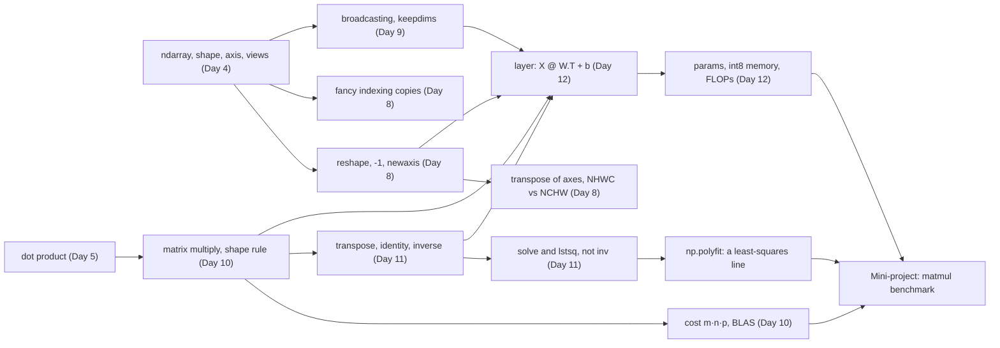

# Day 13: Week 2 Review and Mini-Project: Matrix-Multiply Benchmark

**Phase 1 · Week 2 · ~180 minutes (a long day: split it over two sessions, as below)**

## Objectives

By the end of today you can:

- [ ] Explain, without notes, the main idea of each Week 2 lesson and how they feed into one neural-network layer.
- [ ] Answer the self-check questions and re-do the week's hardest exercise (Day 8's image patches) from a blank file.
- [ ] Write a pure-Python matrix multiply, prove it matches `A @ B` with `np.allclose`, and time both fairly: warm-up, several runs, the fastest one.
- [ ] Compute GFLOP/s from a timing, and read the slope of a log-log plot as the exponent in "time grows like \( n^3 \)", with `np.polyfit`.
- [ ] Explain the thousand-fold gap between the two in terms of interpreter overhead, SIMD, cache blocking and multithreading.
- [ ] Explain why a phone NPU runs matrix multiplies in `int8`, and what "accumulate in `int32`" means.

**Prerequisites.** All of Week 2, and the Week 1 tools the project is built from:

- [Day 3](day-03-functions-classes.md): lambdas, closures and the late-binding loop trap (the timer takes a zero-argument function).
- [Day 3a](day-03a-classes-modules.md): modules, `import`, `__name__` and `if __name__ == "__main__"` (the project is a script you import from), and `time.perf_counter()` from the timing decorator.
- [Day 3b](day-03b-errors-files-json.md): `raise ValueError(...)` for bad input, `try` / `except ... as e`, and `assert condition, message` for internal checks.
- [Day 4](day-04-numpy-arrays.md): dtypes and `.nbytes`, `astype`, integer overflow ("`uint8` 250 + 10 is 4"), `.tolist()`, `timeit` and `%timeit`, and why a Python loop over numbers is slow.
- [Day 4b](day-04b-numpy-toolkit.md): `np.allclose` and why floats need a tolerance.
- [Day 8](day-08-shapes-indexing.md): `reshape`, `transpose` of axes, NHWC vs NCHW, fancy indexing, and Exercise 8 (image patches).
- [Day 9](day-09-broadcasting.md): the broadcasting rules, stride 0, `keepdims=True`, and the bias broadcast.
- [Day 10](day-10-matrices-matmul.md): \( C_{ij} = \sum_k A_{ik}B_{kj} \), the triple loop, the shape rule, the cost \( m \cdot n \cdot p \) multiply-adds, and BLAS.
- [Day 11](day-11-transpose-identity-inverse.md): the transpose, the inverse, `np.linalg.solve` and `np.linalg.lstsq`.
- [Day 12](day-12-layer-is-matmul.md): a layer is \( Z = XW^\top + \mathbf{b} \), ReLU, parameter counts, `float32` vs `int8` memory, and FLOPs.

**Suggested time split.** Session 1 (about 90 minutes): the recap and self-check (30), the re-do (20), and mini-project Milestones 1 to 3 (40). Session 2 (about 90 minutes): Milestones 4 to 6 and reading the chart (50), the weekly retro (10), and then the optional parts: the stretch goals and the int8 section (30).

!!! info "How to read the code on this page"
    Most Python blocks have a **▶ Run** button and share their variables from top to bottom, like notebook cells. The mini-project is different: it's a script, `bench.py`, that you write in a file on your computer and run with `python bench.py`. So the starter code, the milestone checks, the full benchmark and the stretch goals start with `# Run this on your computer (or in Colab), not in the browser.` and have no Run button. Two reasons: they import from your own `bench.py`, which doesn't exist in the browser, and the full benchmark runs for several seconds on a laptop and far longer in the browser's single-threaded WebAssembly Python. The reference solution's functions *do* run in the browser, followed by a small benchmark sized to finish in a few seconds there.

---

## What this week gave you

Five days, one destination: by Friday a neural-network layer was a matrix multiply plus a broadcast. Each day added one piece:

| Day | You learned | The one idea to keep |
|---|---|---|
| [8](day-08-shapes-indexing.md) | `reshape` and `-1`, when reshape copies, `flatten` vs `ravel`, `None` / `expand_dims` / `squeeze`, `transpose` and `.T`, NHWC vs NCHW, fancy indexing, `take_along_axis`, `stack` / `concatenate` / `split`, `repeat` / `tile` | `reshape` changes how memory is *read*, never the order; `transpose` changes the order of the axes. Slices are views; fancy indexing always copies. NHWC for LiteRT, NCHW for PyTorch. |
| [9](day-09-broadcasting.md) | the broadcasting rules, stride 0, in-place limits, standardising, a bias over a batch, per-channel normalisation, one-hot comparisons, pairwise distances, the classic bugs | Align shapes from the right; each pair must be equal or contain a 1. Stretching is free (stride 0). Reduce a non-leading axis and you need `keepdims=True`. |
| [10](day-10-matrices-matmul.md) | \( C_{ij} = \sum_k A_{ik}B_{kj} \), the triple loop, `@` with 1-D operands, the shape rule and its error message, `@` vs `*` vs `np.dot`, the algebra rules, the dtype of a product, batched `@`, cost \( mnp \), BLAS | Inner dimensions match, outer survive. \( AB \neq BA \), but \( (AB)C = A(BC) \). A matmul is \( mnp \) multiply-adds, \( 2mnp \) FLOPs. |
| [11](day-11-transpose-identity-inverse.md) | \( A^\top \) and \( (AB)^\top = B^\top A^\top \), symmetric matrices and \( X^\top X \), matrices as transformations, \( I \), diagonal matrices, \( A^{-1} \), \( \det \), orthogonal matrices, the condition number, `solve` and `lstsq` | A matrix moves space. Determinant 0 means no undo. Use `solve` (or `lstsq`), not `inv`. |
| [12](day-12-layer-is-matmul.md) | \( Z = XW^\top + \mathbf{b} \), the bias, ReLU / sigmoid / tanh, a 2-layer forward pass, softmax, random initialisation, parameters, `float32` vs `int8` memory, FLOPs and MACs, `nn.Linear` / `Dense` / `FULLY_CONNECTED`, shape debugging | Row \( i \) of \( W \) is neuron \( i \). Without a bend between them, two layers collapse into one. A layer costs \( 2 \cdot \text{batch} \cdot \text{in} \cdot \text{out} \) FLOPs. |

Here is the whole week as one journey, a 28×28 digit becoming a prediction:

<figure class="diagram" markdown>

<figcaption>Animated: one input travelling through the week. Every arrow is a shape change you can predict on paper.</figcaption>
</figure>

And here is how the concepts depend on each other. Arrows mean "is built on":



!!! android "Android bridge"
    If Week 1 was learning Kotlin syntax, Week 2 was learning what your app's `interpreter.run(input, output)` actually does: shape the `ByteBuffer` (Day 8), normalise pixels (Day 9), then run a chain of operators that are mostly matrix multiplies plus a bias and an activation (Days 10–12). Today you measure *why* those operators are handed to optimised native code (and, on a phone, to the GPU or NPU) instead of being written as loops.

## Self-check

Answer out loud or on paper first, then open the answer. If you miss more than three, re-read that day's lesson before starting the project.

??? question "1. `a = np.arange(12)`; `r = a.reshape(3, 4)`. Did that copy the 12 numbers? And what does `a.reshape(-1, 6)` give?"
    No copy: `r` is a view of the same memory (`np.shares_memory(a, r)` is `True`), read row by row in C order. `-1` means "work it out": 12 / 6 = 2, so the shape is `(2, 6)`. (Day 8)

??? question "2. `x = np.arange(6)`. After `y = x[[0, 2]]; y[0] = 99`, what is `x`? And after `z = x[0:3]; z[0] = 99`?"
    The first leaves `x` unchanged, `array([0, 1, 2, 3, 4, 5])`: fancy indexing (a list of positions) always returns a **copy**, because an arbitrary list of positions can't be described with strides. The second changes it to `array([99,  1,  2,  3,  4,  5])`: a slice is a **view**, so writing through `z` writes into `x`. That's also why `x[[0, 2]][0] = 5` does nothing: it writes into a temporary copy. (Days 4 and 8)

??? question "3. You have an image `img` of shape (224, 224, 3). Give the LiteRT input shape and the PyTorch input shape, and the NumPy call for each."
    LiteRT wants NHWC `(1, 224, 224, 3)`: `img[np.newaxis]` (or `np.expand_dims(img, 0)`). PyTorch wants NCHW `(1, 3, 224, 224)`: `np.transpose(img[np.newaxis], (0, 3, 1, 2))`. It must be a `transpose`, not a `reshape`: reshape keeps the memory order and would scramble the pixels. (Day 8)

??? question "4. What shape do (5, 1) and (1, 4) broadcast to? Why does `np.ones((4, 3)) + np.ones(4)` fail? And does `X - X.mean(axis=0)` on a (1,000,000, 3) `X` build a million copies of the mean?"
    `(5, 4)`: each size-1 axis stretches. The second fails with `ValueError: operands could not be broadcast together with shapes (4,3) (4,)`, because shapes align from the **right**: 3 vs 4 is neither equal nor 1. If you meant "one number per row", make it `(4, 1)` with `np.ones(4)[:, None]`. And no: the `(3,)` mean is read with a stride of 0 along the stretched axis, so the same 24 bytes are reused for every row. Only the result is a new full-size array. (Day 9)

??? question "5. `S` has shape (2, 3). Why does `S / S.sum(axis=1)` fail, what's the fix, and why is a square `S` worse?"
    `S.sum(axis=1)` removes axis 1 and leaves `(2,)`. Aligned from the right against `(2, 3)`, the 2 row totals land under the 3 **columns**: 3 vs 2, error. `S / S.sum(axis=1, keepdims=True)` keeps the totals as a `(2, 1)` column that stretches across each row, so every row then sums to 1. With a square `S` the shapes happen to line up the wrong way, so it runs and divides each *column* by a row's total: no error, wrong numbers. (Day 9)

??? question "6. `A` is (32, 784) and `B` is (784, 128). What is the shape of `A @ B`, how many multiply-adds does it take, and what does `A * B` do?"
    `(32, 128)`: inner 784s match, outer 32 and 128 survive. Cost \( 32 \cdot 784 \cdot 128 = 3{,}211{,}264 \) multiply-adds, or about 6.4 million FLOPs. `A * B` is element-wise and raises `ValueError: operands could not be broadcast together with shapes (32,784) (784,128)`; on two square matrices of the same shape it would run silently and give the wrong numbers. (Day 10)

??? question "7. Is \( AB = BA \)? Is \( (AB)\mathbf{v} = A(B\mathbf{v}) \)? Which of the last two is cheaper for 1000×1000 matrices?"
    Usually \( AB \neq BA \) (not commutative), but brackets can move: \( (AB)\mathbf{v} = A(B\mathbf{v}) \) (associative). \( A(B\mathbf{v}) \) is two matrix-vector products, \( 2 \times 10^6 \) multiply-adds, versus \( 10^9 \) for forming \( AB \) first. (Day 10)

??? question "8. A 2×2 matrix has determinant 0. What does it do to the plane, and what should you use instead of `inv(A) @ b` in general?"
    It squashes the plane onto a line (or a point): area becomes 0, information is lost, so there is no inverse. In general use `np.linalg.solve(A, b)`: faster and numerically more stable than building the inverse, and `np.linalg.lstsq` when there are more equations than unknowns. (Day 11)

??? question "9. `nn.Linear(784, 128)`: what shape is its weight, what is the formula for a batch `X`, how many parameters does it have, and how many bytes do they take in `float32` and in `int8`?"
    Weight `(128, 784)`, (out, in); bias `(128,)`. For `X` of shape `(batch, 784)`: \( Z = XW^\top + \mathbf{b} \), shape `(batch, 128)`. Parameters: \( 784 \cdot 128 + 128 = 100{,}480 \). At 4 bytes each that's 401,920 bytes in `float32`; at 1 byte each, 100,480 bytes in `int8`, a quarter (plus a few bytes for the scale). Keras's `Dense(128)` stores the same weights the other way round, as a (784, 128) kernel. (Day 12)

??? question "10. Two layer-building traps: why does every network put a ReLU between its matrix multiplies, and why is a bias stored as shape (8, 1) dangerous in a layer with 8 outputs?"
    Without a bend, \( W_2(W_1\mathbf{x}) = (W_2W_1)\mathbf{x} \): two layers collapse into one matrix, so depth adds nothing. ReLU, \( \max(0, z) \) element-wise, breaks that. The `(8, 1)` bias: with a batch of exactly 8, `(8, 8) + (8, 1)` broadcasts and adds bias \( i \) to every entry of **row \( i \)** (example \( i \)) instead of column \( i \) (neuron \( i \)). The shape is right, the numbers are wrong, and nothing crashes; with any other batch size it fails loudly. Keep biases 1-D, `(out,)`. (Days 9 and 12)

## Re-do from blank

Pick **Day 8, Exercise 8 (Challenge: image patches)** and do it again in an empty file, without looking, then extend it with Days 10 to 12:

1. Split `img4 = np.arange(16).reshape(4, 4)` into four 2×2 patches, shape `(4, 2, 2)`, in the order top-left, top-right, bottom-left, bottom-right, using only `reshape` and `transpose`.
2. Prove it with slicing: patch 1 must equal `img4[0:2, 2:4]`. Show that the shortcut `img4.reshape(4, 2, 2)` fails the same check.
3. Flatten each patch to a row: a `(4, 4)` matrix of "tokens", one row per patch.
4. Push the tokens through one layer with 3 neurons: `W = [[1, 0, 0, 0], [0.25, 0.25, 0.25, 0.25], [1, -1, -1, 1]]`, `b = [0, 0, 0.5]`. Predict the output shape before running it.

**Why this one.** It's the only exercise of the week where `reshape` alone gives a plausible-looking wrong answer, so it tests the deepest idea of Day 8: memory order versus axis order. Steps 3 and 4 then make it the week in miniature: shapes (Day 8), the shape rule (Day 10), a transpose to line the shapes up (Day 11), and a layer with a broadcast bias (Days 9 and 12). It's also not a toy: a Vision Transformer starts exactly like this, cutting the image into patches and multiplying each flattened patch by a weight matrix (the "patch embedding").

??? success "Solution"
    ```python
    import numpy as np

    img4 = np.arange(16).reshape(4, 4)

    # 1. axes: (patch row, row in patch, patch col, col in patch);
    #    transpose brings the two "which patch" axes together, then merge them
    patches = img4.reshape(2, 2, 2, 2).transpose(0, 2, 1, 3).reshape(4, 2, 2)

    # 2. check against slicing
    print(np.array_equal(patches[1], img4[0:2, 2:4]))
    # True
    wrong = img4.reshape(4, 2, 2)
    print(wrong[1])
    # [[4 5]
    #  [6 7]]
    print(np.array_equal(wrong[1], img4[0:2, 2:4]))
    # False

    # 3. one row per patch
    tokens = patches.reshape(4, -1)
    print(tokens)
    # [[ 0  1  4  5]
    #  [ 2  3  6  7]
    #  [ 8  9 12 13]
    #  [10 11 14 15]]

    # 4. a layer with 3 neurons: (4, 4) @ (4, 3) -> (4, 3)
    W = np.array([[1.0, 0.0, 0.0, 0.0],        # neuron 0: "top-left pixel"
                  [0.25, 0.25, 0.25, 0.25],    # neuron 1: "patch average"
                  [1.0, -1.0, -1.0, 1.0]])     # neuron 2: "diagonal contrast"
    b = np.array([0.0, 0.0, 0.5])
    E = tokens @ W.T + b
    print(tokens.shape, W.T.shape, E.shape)
    # (4, 4) (4, 3) (4, 3)
    print(E)
    # [[ 0.   2.5  0.5]
    #  [ 2.   4.5  0.5]
    #  [ 8.  10.5  0.5]
    #  [10.  12.5  0.5]]
    ```
    Why it works: `reshape(2, 2, 2, 2)` only relabels the 16 numbers in memory order, so its axes mean (patch row, row inside the patch, patch column, column inside the patch). `transpose(0, 2, 1, 3)` moves the two "which patch" axes next to each other, and the last `reshape` merges them into one patch index (this one has to copy, because the transposed axes are no longer in memory order). The shortcut `img4.reshape(4, 2, 2)` cuts memory into consecutive runs of 4, so `wrong[1]` is row 1 of the image folded in half, `[[4, 5], [6, 7]]`, not the top-right patch. In step 4, `W` is (out, in) = (3, 4) like `nn.Linear`, so the batch formula needs `W.T`, and the `(3,)` bias broadcasts over the 4 rows. Neuron 2 gives 0.5 for every patch because in `arange` data every patch has the same diagonal contrast (for patch 0: 0 − 1 − 4 + 5 = 0), plus its bias of 0.5.

---

## Mini-project: a matrix-multiply benchmark

On Day 10 you timed the triple loop against `@` on 100×100 matrices with `%timeit`, and NumPy won by about 1,500 times. Today you turn that single number into a proper experiment: many sizes, a fair timer you write yourself, a correctness check, a chart, and an explanation of every feature of the chart.

### The idea, with an analogy

Imagine paying for 1,000 grocery items. **Option 1:** take each item to the till on its own, queue, scan, pay, walk back. **Option 2:** put everything on a conveyor belt, and a scanner that reads eight barcodes at once rings it all up while three more tills split the trolley. Both buy the same 1,000 items. Option 1 is dominated by the walking and queuing *around* each item; Option 2 has almost no per-item overhead.

The pure-Python triple loop is Option 1: every single multiply-add goes through the Python interpreter. NumPy's `@` is Option 2: one call hands the whole job to a compiled library (BLAS, Day 10) that processes many numbers per instruction on several cores. Same arithmetic, same answer, very different bill.

Two separate questions hide in this benchmark, and the chart answers both:

1. **How does the time grow with \( n \)?** That's the *shape* of each curve. It's set by the algorithm, and it's the same for both: \( n^3 \).
2. **How big is each step?** That's the *height* of each curve, the constant factor. It's set by the implementation and the hardware, and it differs by thousands of times.

### The math, one symbol at a time

**Work.** Multiplying two \( n \times n \) matrices (Day 10's \( m = n = p \)) takes \( n \cdot n \cdot n = n^3 \) multiply-adds: \( n^2 \) cells in the result, each a dot product of length \( n \). Counting the multiply and the add separately, as Day 10 and Day 12 did:

\[
\text{FLOPs}(n) = 2n^3
\]

For \( n = 128 \): \( 2 \cdot 128^3 = 4{,}194{,}304 \) FLOPs.

**Speed.** If one multiply takes \( t \) seconds, the speed in **GFLOP/s** (billions of floating-point operations per second; "G" is \( 10^9 \)) is

\[
\text{GFLOP/s} = \frac{2n^3}{t \cdot 10^9}
\]

Worked example from the run below: \( n = 128 \) in pure Python took \( t = 0.0857 \) s, so \( 4{,}194{,}304 / (0.0857 \cdot 10^9) = 0.049 \) GFLOP/s. NumPy did the same multiply in 0.0000369 s: \( 4{,}194{,}304 / 36{,}900 \), about 114 GFLOP/s.

**Why a log-log plot is a straight line.** Suppose the time is \( t = c \cdot n^3 \), where \( c \) is the constant "seconds per multiply-add" of your implementation. Take the logarithm of both sides (\( \log \) turns products into sums and powers into multiples: \( \log(xy) = \log x + \log y \), \( \log(n^3) = 3 \log n \)):

\[
\log t = \log c + 3 \log n
\]

That's the equation of a straight line, \( y = b + a x \), with \( x = \log n \), \( y = \log t \), intercept \( b = \log c \) and **slope \( a = 3 \)**. So on a plot with *both* axes logarithmic ("log-log"), any power law \( t = c n^k \) is a straight line whose slope is the exponent \( k \), and the constant \( c \) only moves the line up or down.

- A slope of 3 means "double \( n \), time ×8" (\( 2^3 = 8 \)).
- The vertical gap between two parallel lines is the ratio of their constants: how many times faster one implementation is.

**Which logarithm?** It doesn't matter. Changing the base multiplies *every* log by the same constant (\( \log_2 x = \ln x / \ln 2 \)), which stretches both axes equally, so the slope, a ratio of a change in \( y \) to a change in \( x \), stays the same. Below, the worked example uses \( \log_2 \) because doublings are easy to read, and the code uses `np.log` (the natural log, \( \ln \)). They agree.

Worked example: from \( n = 64 \) to \( n = 128 \), pure Python went from 10.2 ms to 85.7 ms, a factor of 8.40. One doubling of \( n \) is a step of 1 in \( \log_2 n \), so the slope between those two points is \( \log_2 8.40 = 3.07 \). Close to 3, as predicted.

<figure class="diagram" markdown>

<figcaption>Animated: a matmul's work is an n × n × n block. Double n and it holds 8 of the old blocks, so the time goes up 8×.</figcaption>
</figure>

### Measuring a slope: `np.polyfit`

**What it is.** `np.polyfit(x, y, deg)` finds the polynomial of degree `deg` that passes closest to the points \( (x_i, y_i) \), in the least-squares sense (the smallest total of squared vertical misses), and returns its coefficients, highest power first. With `deg=1` that's a straight line \( y = a x + b \), returned as `[a, b]`.

**Why you need it.** Two points give a slope, but every timing is a little noisy. Fitting one line through all five sizes averages the noise out. Underneath it is Day 11's `np.linalg.lstsq`: "find the line" is an over-determined linear system (five points, two unknowns), solved by least squares.

**Example.** Three points that lie exactly on \( y = 2x + 1 \):

```python
import numpy as np

np.polyfit([0, 1, 2], [1, 3, 5], 1)
# array([2., 1.])
```

Slope 2, intercept 1. Now fake timings that follow \( t = 5 \times 10^{-9} \, n^3 \) exactly, fitted in three different log bases:

```python
ns = np.array([16, 32, 64, 128])
ts = 5e-9 * ns**3
ts
# array([2.048000e-05, 1.638400e-04, 1.310720e-03, 1.048576e-02])
np.polyfit(np.log(ns), np.log(ts), 1)
# array([  3.        , -19.11382792])
np.polyfit(np.log2(ns), np.log2(ts), 1)
# array([  3.        , -27.57542476])
np.polyfit(np.log10(ns), np.log10(ts), 1)
# array([ 3.     , -8.30103])
```

The slope is 3 in every base; only the intercept, \( \log c \), changes with the base. Your `slope(ns, ts)` function will be one line: `np.polyfit(np.log(ns), np.log(ts), 1)[0]`, where `[0]` picks the slope out of `[slope, intercept]`.

!!! warning "Common mistake: fitting without the logs"
    `np.polyfit(ns, ts, 1)` fits a straight line to the raw times, which aren't on a straight line at all:

    ```python
    np.polyfit(ns, ts, 1)[0]
    # np.float64(9.684591304347832e-05)
    ```

    That number is "seconds per unit of \( n \)" for a line that fits a cubic badly; it says nothing about the exponent. (`np.float64(...)` is how ▶ Run shows a single NumPy float.) Take the log of **both** \( n \) and \( t \), then fit.

### Spec

Write `bench.py` with these functions and a `__main__` block:

| Function | Input → output | Rules |
|---|---|---|
| `matmul_py(A, B)` | two lists of lists → list of lists | the Day 10 triple loop; `(n, m)` times `(m, p)`; raise `ValueError` if the inner sizes differ |
| `check_correct(rng)` | a NumPy `Generator` → nothing | compare `matmul_py` with `A @ B` using `np.allclose` on square **and** non-square shapes; `assert` on failure |
| `best_time(fn, min_repeats=3, budget=0.3)` | a zero-argument function → seconds | one warm-up call, then repeat until at least `min_repeats` runs and `budget` seconds; return the **fastest** run |
| `gflops(n, seconds)` | → `float` | \( 2n^3 / t / 10^9 \) |
| `slope(ns, ts)` | sizes and times → `float` | slope of the best straight line through \( (\log n, \log t) \), with `np.polyfit` |
| `run(py_sizes, np_sizes, seed=13, py_budget=1.0, np_budget=0.3)` | → two dicts `{n: seconds}` | time pure Python on 16, 32, 64, 128, 256 and NumPy on 16 … 2048; print a table and both slopes |
| `plot(py_times, np_times, path=None)` | → a matplotlib figure | **given** in the starter code: log-log time vs \( n \) with a dashed slope-3 guide, GFLOP/s in a second panel; saves an SVG if `path` is given |

Pure Python stops at 256 on purpose: 256 already takes almost a second per multiply, and 2048 would take \( 8^3 = 512 \) times longer, about seven minutes for a single run.

### Starter code

Copy this into a file called `bench.py` and fill in the `TODO`s. `plot()` is complete: Day 19 teaches matplotlib properly, so copy it as given for now. The script runs on your computer with `python bench.py` from the folder that holds it. In Colab, put `%%writefile bench.py` as the very first line of the cell (above the comment line) and run the cell to save the file, then run `!python bench.py` in a new cell.

```python
# Run this on your computer (or in Colab), not in the browser.
# bench.py: Week 2 mini-project, pure-Python vs NumPy matrix multiply benchmark.
import time

import numpy as np
import matplotlib.pyplot as plt


def matmul_py(A, B):
    """C = A @ B for lists of lists. A is (n, m), B is (m, p)."""
    # TODO: Day 10's triple loop. Check the inner sizes first and raise ValueError.
    raise NotImplementedError


def check_correct(rng):
    """Compare matmul_py with A @ B on square AND non-square shapes."""
    # TODO: for a few (shape_a, shape_b) pairs: rng.random(...), .tolist(),
    #       np.allclose(np.array(matmul_py(...)), A @ B), assert on failure
    raise NotImplementedError


def best_time(fn, min_repeats=3, budget=0.3):
    """Warm up once, then run fn() at least min_repeats times and until about
    budget seconds have been spent. Return the FASTEST run, in seconds."""
    # TODO: time.perf_counter() before and after each call
    raise NotImplementedError


def gflops(n, seconds):
    # TODO: 2 n^3 FLOPs per n x n matmul
    raise NotImplementedError


def slope(ns, ts):
    """Slope of the best straight line through (log n, log t)."""
    # TODO: np.polyfit(x, y, 1) returns [slope, intercept]
    raise NotImplementedError


def run(py_sizes, np_sizes, seed=13, py_budget=1.0, np_budget=0.3):
    # TODO: check_correct, then time the NumPy sizes, then the pure-Python sizes
    #       (convert with .tolist() OUTSIDE the timed function), print a table
    #       and both slopes, and return (py_times, np_times)
    raise NotImplementedError


def plot(py_times, np_times, path=None, note="One run on my machine. Yours will differ."):
    """Two log-log panels: time vs n, and GFLOP/s vs n. Saves to path if given."""
    plt.rcParams.update({"font.size": 11, "font.family": "DejaVu Sans",
                         "svg.fonttype": "none"})
    PY, NP = "#ef6c00", "#3949ab"
    fig, (ax1, ax2) = plt.subplots(1, 2, figsize=(10, 4.2), facecolor="white")

    for times, color, marker, label in [(py_times, PY, "o", "pure Python (triple loop)"),
                                        (np_times, NP, "s", "NumPy  A @ B  (BLAS)")]:
        ns = sorted(times)
        ax1.loglog(ns, [times[n] for n in ns], marker=marker, color=color,
                   lw=2, ms=6, label=label)
        ax2.loglog(ns, [gflops(n, times[n]) for n in ns], marker=marker,
                   color=color, lw=2, ms=6, label=label)

    # A dashed "slope 3" guide: time proportional to n^3, anchored at the first Python point
    n0, n_max = min(py_times), max(np_times)
    guide = np.array([n0, n_max])
    ax1.loglog(guide, py_times[n0] * (guide / n0) ** 3, ls="--", color="#999",
               lw=1, label="guide: time ∝ n³ (slope 3)")

    ax1.set_xlabel("matrix size n  (n × n times n × n)")
    ax1.set_ylabel("time per multiply (seconds, log scale)")
    ax1.set_title("Time vs n (log-log)")
    ax2.set_xlabel("matrix size n")
    ax2.set_ylabel("GFLOP/s = 2n³ / time / 10⁹  (log scale)")
    ax2.set_title("Speed: billions of FLOPs per second")
    ticks = sorted(set(py_times) | set(np_times))
    for ax in (ax1, ax2):
        ax.grid(True, which="major", color="#ddd", lw=0.8)
        ax.set_axisbelow(True)
        for side in ("top", "right"):
            ax.spines[side].set_visible(False)
        ax.set_xticks(ticks, [str(t) for t in ticks])
        ax.minorticks_off()
    ax2.text(n0, gflops(n0, np_times[n0]) * 1.6, "NumPy", color=NP, fontsize=10)
    ax2.text(n0, gflops(n0, py_times[n0]) * 1.6, "pure Python", color=PY, fontsize=10)
    ax1.legend(frameon=False, fontsize=9, loc="upper left")
    fig.text(0.5, -0.02, note, ha="center", color="#555", fontsize=9.5)
    fig.tight_layout()
    if path is not None:
        fig.savefig(path, format="svg", bbox_inches="tight", facecolor="white")
        print("saved", path)
    return fig


if __name__ == "__main__":
    py_times, np_times = run(py_sizes=[16, 32, 64, 128, 256],
                             np_sizes=[16, 32, 64, 128, 256, 512, 1024, 2048])
    plot(py_times, np_times, "benchmark.svg")
```

`python bench.py` prints the table and saves the chart as `benchmark.svg` next to the script. The `if __name__ == "__main__":` guard (Day 3a) is what makes the next step work: when another file does `from bench import matmul_py`, Python runs `bench.py` with `__name__` set to `"bench"`, so the functions get defined but the slow benchmark doesn't start.

### Milestones

Do them in order. For the checks, make a second file next to `bench.py`, say `try_bench.py`, paste a milestone's code into it, and run `python try_bench.py` after each change to `bench.py`. (An interactive Python shell also works, but it keeps the first version of `bench` it imported, so edits don't show up until you restart it.) Every output below is real; the timings are from one run on a 4-core cloud container, and **yours will differ**.

**Milestone 1: the triple loop.** Start from Day 10's `matmul`, with two changes:

- Replace Day 10's `assert n == n2, ...` with `if m != m2: raise ValueError(...)`. Day 3b's rule: `assert` is for "this can't happen unless my code has a bug", and it disappears under `python -O`; a caller passing mismatched matrices is bad *input*, which must always be checked, and `ValueError` is what NumPy raises for the same mistake.
- Look up `A[i]` and `C[i]` once per row instead of once per multiply-add: `Ai, Ci = A[i], C[i]` before the `j` loop. Each `A[i]` is a list lookup the interpreter would otherwise repeat \( n \cdot p \) times.

Then check Day 10's hand-worked example:

```python
# Run this on your computer (or in Colab), not in the browser.
from bench import matmul_py

print(matmul_py([[1, 2, 3], [4, 5, 6]], [[7, 8], [9, 10], [11, 12]]))
# [[58.0, 64.0], [139.0, 154.0]]
```

(The numbers are floats because the running total starts at `0.0`. `58.0 == 58` is `True` in Python, so the comparison in the checks below still works.)

**Milestone 2: prove it's correct before timing it.** A fast wrong answer is worthless, and a benchmark of a buggy function measures nothing. Compare against NumPy on several shapes, including non-square ones: a square-only test can't catch swapped `m` and `p`. Use `np.allclose` (Day 4b), never `==`, on floats: the two implementations add the same numbers in a different order, so the last digits can differ. `assert C.shape == expected, C.shape` is Day 3b's `assert condition, message`: if it fails, the message shows the shape you actually got.

```python
# Run this on your computer (or in Colab), not in the browser.
import numpy as np
from bench import check_correct

rng = np.random.default_rng(13)
check_correct(rng)
# correctness: matmul_py matches A @ B on 4 shape pairs
```

**Milestone 3: a fair timer.** You've timed code twice already: Day 3a's timing decorator read `time.perf_counter()` (a high-resolution clock meant for measuring intervals, like Kotlin's `System.nanoTime()`) before and after a call, and Day 4's `timeit` / `%timeit` ran a statement many times and kept the best. `best_time` is your own small `timeit`, with three rules:

1. **Warm up.** Call `fn()` once and throw the time away. Day 10 warned that a first call can include one-time setup: loading code, the BLAS library starting its worker threads, memory being touched for the first time.
2. **Repeat, with a budget.** Run at least `min_repeats` times *and* until `budget` seconds have been spent. A 10 µs call then runs tens of thousands of times, a 1 s call three times, and both finish in about the budget.
3. **Report the minimum.** Noise (other programs, the operating system, the CPU changing its clock speed) only ever makes a run *slower*, never faster, so the fastest run is the one closest to the true cost. This is the same argument the `timeit` docs make.

`best_time(lambda: A @ B)` passes a `lambda` with no parameters, so `best_time` can call it as `fn()` as often as it likes (Day 3's lambdas).

```python
# Run this on your computer (or in Colab), not in the browser.
import time
import numpy as np
from bench import matmul_py, best_time, gflops

rng = np.random.default_rng(13)
n = 64
A, B = rng.random((n, n)), rng.random((n, n))
A_list, B_list = A.tolist(), B.tolist()          # convert ONCE, outside the timer

t0 = time.perf_counter()
_ = A @ B                                        # the very first call, timed alone
first = time.perf_counter() - t0

t_np = best_time(lambda: A @ B)
t_py = best_time(lambda: matmul_py(A_list, B_list))
print(f"NumPy first call: {first*1e6:8.1f} µs   best: {t_np*1e6:6.1f} µs")
print(f"pure Python best: {t_py*1e3:8.1f} ms")
print(f"speed-up {t_py/t_np:,.0f}x   NumPy {gflops(n, t_np):.1f} GFLOP/s   Python {gflops(n, t_py):.3f} GFLOP/s")
# one run printed (yours will differ):
# NumPy first call:     79.3 µs   best:   10.3 µs
# pure Python best:     10.4 ms
# speed-up 1,006x   NumPy 50.8 GFLOP/s   Python 0.051 GFLOP/s
```

`_ = A @ B` stores the result in the throwaway name `_`; that's the Python convention for "I don't need this value", and it also stops a notebook from printing a 64×64 array. Look at the first line: in this run the very first `A @ B` was about 8 times slower than the best one (it varies from run to run; 2 to 10 times is typical). Without the warm-up call you'd be benchmarking the setup.

!!! warning "Common mistake: timing the conversion"
    `best_time(lambda: matmul_py(A.tolist(), B.tolist()))` also times the conversion from array to lists on every run. Prepare inputs outside the timed function, so you measure only the thing you're comparing.

**Milestone 4: the table.** Loop over the sizes, store `{n: seconds}` in two dicts, and print one row per size. Time NumPy *before* the slow Python runs, so the long loop can't affect it (a CPU that has been busy for seconds may have slowed its clock down to stay cool). Here is the full output of the reference solution, from `python bench.py`:

```text
correctness: matmul_py matches A @ B on 4 shape pairs
    n   pure Python        NumPy   speed-up  Py GFLOP/s  NumPy GFLOP/s
   16        0.2 ms    0.0012 ms       130x      0.0532           6.90
   32        1.3 ms    0.0021 ms       606x      0.0524          31.77
   64       10.2 ms    0.0080 ms     1,270x      0.0515          65.43
  128       85.7 ms    0.0369 ms     2,325x      0.0489         113.79
  256      866.8 ms    0.3817 ms     2,271x      0.0387          87.91
  512             -    1.3054 ms          -           -         205.64
 1024             -   12.1429 ms          -           -         176.85
 2048             -   68.9078 ms          -           -         249.32
log-log slope, pure Python (16..256): 3.10
log-log slope, NumPy (512..2048): 2.86
saved benchmark.svg
```

The table is built with Day 2a's f-string specs: `{n:>5}` right-aligns in 5 characters, `{t*1e3:>10.1f}` shows milliseconds with one decimal, and `{ratio:>9,.0f}` adds thousands separators and no decimals.

**Milestone 5: measure the slope.** `slope(ns, ts)` is the one-line `np.polyfit` from above. Pure Python gives 3.10: the algorithm's \( n^3 \), measured. For NumPy, fit only the three largest sizes (512, 1024, 2048): below that, fixed overheads (the Python call, starting threads) are a big part of each tiny timing and the curve is flatter.

**Milestone 6: the chart.** Call the given `plot(py_times, np_times, "benchmark.svg")`. Read what it draws: both curves with `ax.loglog` (both axes logarithmic), the dashed guide \( t = t_{16} \cdot (n / 16)^3 \) as a "slope 3" reference, axis labels with units, and a note saying where it was measured.

<figure class="diagram" markdown>
![Two log-log panels from one benchmark run. Left: time per multiply against matrix size n from 16 to 2048. The pure-Python line rises from 0.2 milliseconds at n = 16 to 0.87 seconds at n = 256 and lies on top of a dashed slope-3 guide line. The NumPy line sits roughly three orders of magnitude lower, rising from 1.2 microseconds at n = 16 to 69 milliseconds at n = 2048, flatter at small n. Right: GFLOP/s. Pure Python is flat around 0.04 to 0.05; NumPy climbs from 6.9 at n = 16 to between 88 and 249 for n of 128 and above](../../assets/img/phase-1/day13-benchmark.svg)
<figcaption>The real output of the reference solution: one run on a 4-core cloud container (Python 3.13, NumPy 2.5, OpenBLAS). Yours will differ.</figcaption>
</figure>

### How to verify it works

Paste these checks into `try_bench.py` and run it. They use tiny inputs where you can work out the answer by hand, plus fake timings where you *know* the exponent.

```python
# Run this on your computer (or in Colab), not in the browser.
import numpy as np
from bench import matmul_py, best_time, gflops, slope

# 1. Day 10's hand-worked example
assert matmul_py([[1, 2, 3], [4, 5, 6]], [[7, 8], [9, 10], [11, 12]]) == [[58, 64], [139, 154]]
# 2. Non-square shapes: (2, 3) @ (3, 4) -> (2, 4)
C = matmul_py([[1, 0, 0], [0, 1, 0]], [[1, 2, 3, 4], [5, 6, 7, 8], [9, 10, 11, 12]])
assert (len(C), len(C[0])) == (2, 4) and C == [[1, 2, 3, 4], [5, 6, 7, 8]]
# 3. A shape mismatch must raise ValueError, like NumPy does
try:
    matmul_py([[1, 2]], [[1, 2]])
    raise AssertionError("expected ValueError")
except ValueError as e:
    print("ValueError:", e)
# 4. Agrees with NumPy on random floats (allclose, not ==)
rng = np.random.default_rng(0)
A, B = rng.random((7, 5)), rng.random((5, 3))
assert np.allclose(matmul_py(A.tolist(), B.tolist()), A @ B)
# 5. The FLOP arithmetic
assert gflops(1000, 2.0) == 1.0          # 2 * 10^9 FLOPs in 2 s = 1 GFLOP/s
# 6. slope() recovers the exponent from perfect fake data
ns = np.array([16, 32, 64, 128])
assert np.isclose(slope(ns, 5e-9 * ns**3), 3.0)
assert np.isclose(slope(ns, 1e-6 * ns**2), 2.0)
# 7. best_time warms up once and then runs at least min_repeats times
calls = []
t = best_time(lambda: calls.append(1), min_repeats=3, budget=0.0)
assert len(calls) == 4 and t >= 0
print("all checks passed")
# ValueError: inner dimensions differ: 2 vs 1
# all checks passed
```

Check 3 uses a pattern from Day 3b: if `matmul_py` doesn't raise, the next line raises `AssertionError` itself, so a missing check can't pass silently. Check 7 counts calls with a list, because a lambda can't contain an assignment but can call `calls.append(1)`: one warm-up plus three timed runs is 4.

Then run the whole script. Your numbers will differ from the table above, but three things should hold on any machine: the correctness line prints, the pure-Python slope is close to 3 (2.8 to 3.3 is normal), and NumPy is hundreds to thousands of times faster from \( n = 64 \) up.

### Reading the chart

**The slopes: the algorithm.** The pure-Python line lies right on top of the dashed slope-3 guide. That's \( n^3 \) measured, not assumed: double \( n \), eight times the work, eight times the time. NumPy's line is *also* roughly parallel to it for large \( n \): NumPy runs the same \( n^3 \) algorithm, much faster per step. A library can shrink the constant \( c \); it can't make the textbook algorithm stop being \( n^3 \).

Two honest deviations, both visible in the table:

- Pure Python's slope is a little **above** 3 (3.10), and from 128 to 256 the time grew 10.1×, not 8×. At \( n = 256 \) the three matrices are 196,608 separate Python float objects scattered in memory, and walking down a column of `B` (`B[k][j]` for each `k`) jumps between 256 different lists. They no longer fit in the fast caches close to the CPU core, so each step waits a little longer for memory.
- NumPy's slope over 512…2048 is **below** 3 (2.86), because its GFLOP/s is still climbing over that range: bigger matrices keep all four cores busy and spread the fixed costs over more work. The dips (at 256 and 1024 in this run) are real but machine-specific: they come from where the library switches strategies and from other programs sharing the container. Run it twice and they move. Don't over-read single points.

**The gap: the constant factor.** Per multiply-add, pure Python took about 41 nanoseconds at \( n = 128 \) (0.0857 s / 128³); NumPy took about 0.008 nanoseconds (8 picoseconds) at \( n = 2048 \). That's roughly 5,000 times less time for the same operation. This CPU runs at 2.1 GHz, so 41 ns is about 86 clock cycles for one multiply and one add, work the hardware can do in a fraction of one cycle. Where do the cycles go, and how does BLAS get them back?

| Source of the gap | Pure Python | NumPy `@` (OpenBLAS here) |
|---|---|---|
| **Interpreter overhead** | Every `total += Ai[k] * B[k][j]` is a dozen bytecodes: look up two lists, index them (with bounds checks), check both types, create a new float object for the product and another for the sum, update reference counts. | One Python call. The loop is compiled machine code; numbers are raw 8-byte doubles packed side by side (Day 4). |
| **SIMD** (Single Instruction, Multiple Data) | One multiply per operation. | One instruction multiplies and adds a whole register of numbers: 4 doubles with AVX2, 8 with AVX-512, and FMA (fused multiply-add, Day 10) does both in one step. |
| **Cache blocking** | Reads `B` column-wise, jumping around memory. | Works on small tiles of \( A \), \( B \) and \( C \) sized to stay in the CPU caches, so each number loaded from main memory is reused many times (Day 10's "cache tiling"). |
| **Multithreading** | One core. | Splits \( C \) into blocks and computes them on all cores at once (every cell is independent, Day 10). On this container at \( n = 1024 \): about 60 GFLOP/s on 1 thread, about 95 on 2, about 230 on 4 (stretch goal 4). |

The first row is by far the biggest. That's why a "smarter" pure-Python loop barely helps (stretch goal 3 shows this), and why Day 4's rule holds: don't loop over numbers in Python.

!!! warning "Common mistake: one run, one conclusion"
    A benchmark is a measurement, and measurements are noisy, especially on a laptop with other apps open or in a shared cloud container. Take the minimum of several runs, run the whole script twice, and only trust differences that are much larger than the run-to-run wobble. A 2,000× gap survives any noise; a 10% difference between two NumPy calls usually doesn't.

!!! android "Android bridge"
    You already know this lesson from Android performance work. A Kotlin loop over a `FloatArray` runs as JIT/AOT-compiled code on ART, so it's far closer to the "compiled loop" column than Python is, but it's single-threaded and rarely gets the hand-tuned SIMD, cache tiling and threading of a BLAS kernel (ART's optimising compiler can vectorise some simple loops, but not into that). That's why on-device ML doesn't run your model in app code: LiteRT runs its operators in native kernels (on the CPU, through its XNNPACK backend, with SIMD and multiple threads), or hands them to the GPU or NPU through a delegate. And the measuring discipline is the one Jetpack **Microbenchmark** (`androidx.benchmark`, with its `BenchmarkRule`) enforces for a piece of code: warm up, repeat, report a robust statistic, never trust the first run. (Jetpack Macrobenchmark is its sibling for whole-app journeys such as startup and scrolling.)

??? success "Reference solution (try the milestones first)"
    `bench.py` is the next two blocks, one after the other. The first, the functions, has a ▶ Run button: it defines everything and runs nothing.

    ```python
    # bench.py: Week 2 mini-project, pure-Python vs NumPy matrix multiply benchmark.
    import time

    import numpy as np
    import matplotlib.pyplot as plt


    # ---------- Milestone 1: the triple loop (Day 10), made a little faster ----------
    def matmul_py(A, B):
        """C = A @ B for lists of lists. A is (n, m), B is (m, p)."""
        n, m = len(A), len(A[0])
        m2, p = len(B), len(B[0])
        if m != m2:
            raise ValueError(f"inner dimensions differ: {m} vs {m2}")
        C = [[0.0] * p for _ in range(n)]
        for i in range(n):
            Ai, Ci = A[i], C[i]           # look the rows up once, not n*p times
            for j in range(p):
                total = 0.0
                for k in range(m):
                    total += Ai[k] * B[k][j]
                Ci[j] = total
        return C


    # ---------- Milestone 2: prove it's correct ----------
    def check_correct(rng):
        """Compare matmul_py with A @ B on square AND non-square shapes."""
        pairs = [((1, 1), (1, 1)), ((2, 3), (3, 2)), ((5, 7), (7, 4)), ((16, 16), (16, 16))]
        for shape_a, shape_b in pairs:
            A = rng.random(shape_a)
            B = rng.random(shape_b)
            C = np.array(matmul_py(A.tolist(), B.tolist()))
            assert C.shape == (shape_a[0], shape_b[1]), C.shape
            assert np.allclose(C, A @ B), (shape_a, shape_b)
        print(f"correctness: matmul_py matches A @ B on {len(pairs)} shape pairs")


    # ---------- Milestone 3: a fair timer ----------
    def best_time(fn, min_repeats=3, budget=0.3):
        """Warm up once, then run fn() at least min_repeats times and until about
        budget seconds have been spent. Return the FASTEST run, in seconds."""
        fn()                                   # warm-up, not measured
        best, spent, runs = float("inf"), 0.0, 0
        while runs < min_repeats or spent < budget:
            t0 = time.perf_counter()
            fn()
            dt = time.perf_counter() - t0
            best = min(best, dt)
            spent += dt
            runs += 1
        return best


    def gflops(n, seconds):
        """Speed of one n x n matmul: 2 n^3 FLOPs (a multiply and an add per step)."""
        return 2 * n**3 / seconds / 1e9


    def slope(ns, ts):
        """Slope of the best straight line through (log n, log t)."""
        return np.polyfit(np.log(ns), np.log(ts), 1)[0]


    # ---------- Milestones 4 and 5: the benchmark and the slopes ----------
    def run(py_sizes, np_sizes, seed=13, py_budget=1.0, np_budget=0.3):
        rng = np.random.default_rng(seed)
        check_correct(rng)

        np_times = {}                          # NumPy first, before the long Python runs
        for n in np_sizes:
            A, B = rng.random((n, n)), rng.random((n, n))
            np_times[n] = best_time(lambda: A @ B, budget=np_budget)

        py_times = {}
        for n in py_sizes:
            A, B = rng.random((n, n)), rng.random((n, n))
            A_list, B_list = A.tolist(), B.tolist()        # convert ONCE, outside the timer
            py_times[n] = best_time(lambda: matmul_py(A_list, B_list), budget=py_budget)

        print(f"{'n':>5} {'pure Python':>13} {'NumPy':>12} {'speed-up':>10}"
              f" {'Py GFLOP/s':>11} {'NumPy GFLOP/s':>14}")
        for n in sorted(np_times):
            t_np = np_times[n]
            if n in py_times:
                t_py = py_times[n]
                print(f"{n:>5} {t_py*1e3:>10.1f} ms {t_np*1e3:>9.4f} ms {t_py/t_np:>9,.0f}x"
                      f" {gflops(n, t_py):>11.4f} {gflops(n, t_np):>14.2f}")
            else:
                print(f"{n:>5} {'-':>13} {t_np*1e3:>9.4f} ms {'-':>10}"
                      f" {'-':>11} {gflops(n, t_np):>14.2f}")

        ns = sorted(py_times)
        print(f"log-log slope, pure Python ({ns[0]}..{ns[-1]}): "
              f"{slope(ns, [py_times[n] for n in ns]):.2f}")
        big = sorted(np_times)[-3:]            # the three largest NumPy sizes
        print(f"log-log slope, NumPy ({big[0]}..{big[-1]}): "
              f"{slope(big, [np_times[n] for n in big]):.2f}")
        return py_times, np_times


    # ---------- Milestone 6: the chart (given; Day 19 teaches matplotlib) ----------
    def plot(py_times, np_times, path=None, note="One run on my machine. Yours will differ."):
        """Two log-log panels: time vs n, and GFLOP/s vs n. Saves to path if given."""
        plt.rcParams.update({"font.size": 11, "font.family": "DejaVu Sans",
                             "svg.fonttype": "none"})
        PY, NP = "#ef6c00", "#3949ab"
        fig, (ax1, ax2) = plt.subplots(1, 2, figsize=(10, 4.2), facecolor="white")

        for times, color, marker, label in [(py_times, PY, "o", "pure Python (triple loop)"),
                                            (np_times, NP, "s", "NumPy  A @ B  (BLAS)")]:
            ns = sorted(times)
            ax1.loglog(ns, [times[n] for n in ns], marker=marker, color=color,
                       lw=2, ms=6, label=label)
            ax2.loglog(ns, [gflops(n, times[n]) for n in ns], marker=marker,
                       color=color, lw=2, ms=6, label=label)

        # A dashed "slope 3" guide: time proportional to n^3, anchored at the first Python point
        n0, n_max = min(py_times), max(np_times)
        guide = np.array([n0, n_max])
        ax1.loglog(guide, py_times[n0] * (guide / n0) ** 3, ls="--", color="#999",
                   lw=1, label="guide: time ∝ n³ (slope 3)")

        ax1.set_xlabel("matrix size n  (n × n times n × n)")
        ax1.set_ylabel("time per multiply (seconds, log scale)")
        ax1.set_title("Time vs n (log-log)")
        ax2.set_xlabel("matrix size n")
        ax2.set_ylabel("GFLOP/s = 2n³ / time / 10⁹  (log scale)")
        ax2.set_title("Speed: billions of FLOPs per second")
        ticks = sorted(set(py_times) | set(np_times))
        for ax in (ax1, ax2):
            ax.grid(True, which="major", color="#ddd", lw=0.8)
            ax.set_axisbelow(True)
            for side in ("top", "right"):
                ax.spines[side].set_visible(False)
            ax.set_xticks(ticks, [str(t) for t in ticks])
            ax.minorticks_off()
        ax2.text(n0, gflops(n0, np_times[n0]) * 1.6, "NumPy", color=NP, fontsize=10)
        ax2.text(n0, gflops(n0, py_times[n0]) * 1.6, "pure Python", color=PY, fontsize=10)
        ax1.legend(frameon=False, fontsize=9, loc="upper left")
        fig.text(0.5, -0.02, note, ha="center", color="#555", fontsize=9.5)
        fig.tight_layout()
        if path is not None:
            fig.savefig(path, format="svg", bbox_inches="tight", facecolor="white")
            print("saved", path)
        return fig
    ```

    The second block is the end of the file: the full benchmark. It needs a real machine (several seconds there, far longer in the browser) and it writes `benchmark.svg` to disk.

    ```python
    # Run this on your computer (or in Colab), not in the browser.
    if __name__ == "__main__":
        py_times, np_times = run(py_sizes=[16, 32, 64, 128, 256],
                                 np_sizes=[16, 32, 64, 128, 256, 512, 1024, 2048])
        plot(py_times, np_times, "benchmark.svg")
    ```

    `python bench.py` printed the Milestone 4 table and drew the chart above, in about 13 seconds; most of it is the pure-Python 256. (If you later want the file name to come from the command line, as in `python bench.py out.svg`, that's what `sys.argv` is for: the list of words typed after `python`. This project doesn't need it.)

    Design notes:

    - **NumPy is timed first**, so the long Python loop can't heat up the CPU before the fast measurements.
    - **The lambdas capture loop variables, and that's safe here.** Day 3's late-binding trap: a lambda looks up `A` and `B` when it's *called*, not when it's created. Here `best_time` calls it straight away, inside the same loop iteration, so it always sees the current matrices. It bites when you store the lambdas and call them later:

        ```python
        fns = [lambda: n for n in (16, 32)]
        [f() for f in fns]           # [32, 32]   both see the last n
        fns = [lambda n=n: n for n in (16, 32)]
        [f() for f in fns]           # [16, 32]   a default argument freezes each value
        ```

    - **`svg.fonttype: "none"`** keeps the chart's labels as real text in the SVG instead of drawn outlines, so they stay sharp and searchable.

    **A browser-sized run.** The same functions, with three pure-Python sizes, five NumPy sizes and small time budgets, so it finishes in a few seconds even in the browser. `plot` with no `path` returns the figure without saving a file, and ▶ Run shows it under the block.

    ```python
    py_small, np_small = run(py_sizes=[16, 32, 64], np_sizes=[16, 32, 64, 128, 256],
                             py_budget=0.1, np_budget=0.05)
    fig = plot(py_small, np_small, note="Browser-sized run: three Python sizes, five NumPy sizes.")
    # one run on my laptop printed (yours will differ, and ▶ Run is slower):
    # correctness: matmul_py matches A @ B on 4 shape pairs
    #     n   pure Python        NumPy   speed-up  Py GFLOP/s  NumPy GFLOP/s
    #    16        0.2 ms    0.0012 ms       123x      0.0545           6.72
    #    32        1.2 ms    0.0021 ms       581x      0.0546          31.74
    #    64       10.4 ms    0.0080 ms     1,297x      0.0505          65.45
    #   128             -    0.0376 ms          -           -         111.53
    #   256             -    0.3108 ms          -           -         107.96
    # log-log slope, pure Python (16..64): 3.06
    # log-log slope, NumPy (64..256): 2.64
    ```

    In the browser, Python is compiled to WebAssembly and NumPy runs on one thread without your laptop's tuned BLAS, so both columns are slower and the gap between them is different. The pure-Python slope should still come out near 3: the algorithm doesn't care where it runs.

### Stretch goals (optional)

These measure *your machine's* NumPy and BLAS, so they run on your computer. Solutions 1 to 3 are self-contained: each re-defines the 10-line `best_time` and `gflops` (and, for 3, `matmul_py`) instead of importing them, so you can paste it into a new file and run it from anywhere. Solution 4 is a shell loop that imports from your finished `bench.py`, so run it in that folder.

1. **`np.einsum`.** Write the matmul as `np.einsum("ik,kj->ij", A, B)`: the string literally says \( C_{ij} = \sum_k A_{ik}B_{kj} \) (the index `k` appears in the inputs but not the output, so it's summed). Check it equals `A @ B`, then time it at \( n = 512 \) with and without `optimize=True`.
2. **`float32` vs `float64`, and integers.** Time `A @ B` at \( n = 1024 \) in both float types and compare GFLOP/s and bytes. Then time a 256×256 multiply in `float32`, `int32` and `int8`, and look at the first few entries of the `int8` result next to the `int32` one.
3. **A blocked (tiled) pure-Python version.** Write `matmul_blocked(A, B, bs=32)` that loops over 32×32 tiles, and `matmul_ikj` that reorders the loops to i-k-j (so the inner loop walks along a row of `B`). Verify both with `np.allclose`, time them at 128 and 256, and explain the result.
4. **Threads.** If `np.show_config()` says your NumPy uses OpenBLAS, run a 1024×1024 benchmark with `OPENBLAS_NUM_THREADS=1`, `2` and your core count.

??? success "Stretch solutions"
    **1. `einsum`.**

    ```python
    # Run this on your computer (or in Colab), not in the browser.
    import time
    import numpy as np

    def best_time(fn, min_repeats=3, budget=0.3):
        """Same as bench.py: warm up once, then return the fastest of several runs."""
        fn()
        best, spent, runs = float("inf"), 0.0, 0
        while runs < min_repeats or spent < budget:
            t0 = time.perf_counter()
            fn()
            dt = time.perf_counter() - t0
            best, spent, runs = min(best, dt), spent + dt, runs + 1
        return best

    def gflops(n, seconds):
        return 2 * n**3 / seconds / 1e9

    rng = np.random.default_rng(13)
    n = 512
    A, B = rng.random((n, n)), rng.random((n, n))
    print("einsum equal:", np.allclose(A @ B, np.einsum("ik,kj->ij", A, B)),
          np.allclose(A @ B, np.einsum("ik,kj->ij", A, B, optimize=True)))
    for name, fn in [("A @ B", lambda: A @ B),
                     ("einsum", lambda: np.einsum("ik,kj->ij", A, B)),
                     ("einsum optimize=True", lambda: np.einsum("ik,kj->ij", A, B, optimize=True))]:
        t = best_time(fn)
        print(f"{name:<22} {t*1e3:8.2f} ms  {gflops(n, t):7.1f} GFLOP/s")
    # one run printed (yours will differ):
    # einsum equal: True True
    # A @ B                      1.09 ms    246.2 GFLOP/s
    # einsum                    35.17 ms      7.6 GFLOP/s
    # einsum optimize=True       1.27 ms    211.6 GFLOP/s
    ```

    (`best, spent, runs = min(best, dt), spent + dt, runs + 1` is the three updates from `bench.py` on one line: the right side is computed first, then unpacked into the three names, Day 2b.) Plain `einsum` runs its own generic C loop: compiled, so well over 100 times faster than pure Python, but without BLAS's tiling and threads. With `optimize=True` it recognises the pattern and hands it to the same BLAS routine as `@` (in a second run it took 3.67 ms; the extra planning work and noise make small differences between the two BLAS paths meaningless). `einsum` is worth knowing because it reads exactly like the math and handles batched products such as `"bik,bkj->bij"`; you'll see it in attention code.

    **2. Data types.**

    ```python
    # Run this on your computer (or in Colab), not in the browser.
    import time
    import numpy as np

    def best_time(fn, min_repeats=3, budget=0.3):
        """Same as bench.py: warm up once, then return the fastest of several runs."""
        fn()
        best, spent, runs = float("inf"), 0.0, 0
        while runs < min_repeats or spent < budget:
            t0 = time.perf_counter()
            fn()
            dt = time.perf_counter() - t0
            best, spent, runs = min(best, dt), spent + dt, runs + 1
        return best

    def gflops(n, seconds):
        return 2 * n**3 / seconds / 1e9

    rng = np.random.default_rng(13)
    n = 1024
    A64, B64 = rng.random((n, n)), rng.random((n, n))
    A32, B32 = A64.astype(np.float32), B64.astype(np.float32)
    for name, a, b in [("float64", A64, B64), ("float32", A32, B32)]:
        t = best_time(lambda: a @ b)
        print(f"{name}  n={n}: {t*1e3:7.2f} ms  {gflops(n, t):6.1f} GFLOP/s  bytes per matrix {a.nbytes:,}")
    # one run printed (yours will differ):
    # float64  n=1024:   11.00 ms   195.2 GFLOP/s  bytes per matrix 8,388,608
    # float32  n=1024:    5.23 ms   410.8 GFLOP/s  bytes per matrix 4,194,304

    n = 256
    Ai = rng.integers(-128, 128, size=(n, n), dtype=np.int8)
    Bi = rng.integers(-128, 128, size=(n, n), dtype=np.int8)
    for name, a, b in [("float32", Ai.astype(np.float32), Bi.astype(np.float32)),
                       ("int32", Ai.astype(np.int32), Bi.astype(np.int32)),
                       ("int8", Ai, Bi)]:
        t = best_time(lambda: a @ b)
        print(f"{name:<8} n={n}: {t*1e3:8.3f} ms   result dtype {(a @ b).dtype}")
    # one run printed (yours will differ):
    # float32  n=256:    0.098 ms   result dtype float32
    # int32    n=256:   18.803 ms   result dtype int32
    # int8     n=256:   18.566 ms   result dtype int8
    print("int8 @ int8:", (Ai @ Bi)[0, :3], " int32:", (Ai.astype(np.int32) @ Bi.astype(np.int32))[0, :3])
    # int8 @ int8: [118  -6  -3]  int32: [154998 182778 -54787]
    ```

    Three lessons. `float32` is about twice as fast as `float64` here (2.1× in this run): half the bytes to move, and twice as many numbers per SIMD register. Integer matmul in NumPy is far *slower* than float (about 190× at 256 in this run), because BLAS only does floating point, so NumPy falls back to a plain compiled loop for integers: what's fast depends on the kernels your library ships, not on the data type in principle. And `int8 @ int8` returns `int8`, so the sums **overflow and wrap around** silently, exactly Day 4's "`uint8` 250 + 10 is 4" (Day 10 showed the same for `int32`). You can check the wrap by hand: 154,998 = 605 · 256 + 118, so modulo 256 it's 118, the first `int8` value; 182,778 leaves 250, which as a signed 8-bit number is 250 − 256 = −6. Real int8 hardware avoids this by accumulating in `int32` (next section).

    **3. Blocked and reordered pure Python.**

    ```python
    # Run this on your computer (or in Colab), not in the browser.
    import time
    import numpy as np

    def best_time(fn, min_repeats=3, budget=0.3):
        """Same as bench.py: warm up once, then return the fastest of several runs."""
        fn()
        best, spent, runs = float("inf"), 0.0, 0
        while runs < min_repeats or spent < budget:
            t0 = time.perf_counter()
            fn()
            dt = time.perf_counter() - t0
            best, spent, runs = min(best, dt), spent + dt, runs + 1
        return best

    def matmul_py(A, B):
        """The bench.py triple loop, i-j-k order."""
        n, m, p = len(A), len(A[0]), len(B[0])
        C = [[0.0] * p for _ in range(n)]
        for i in range(n):
            Ai, Ci = A[i], C[i]
            for j in range(p):
                total = 0.0
                for k in range(m):
                    total += Ai[k] * B[k][j]
                Ci[j] = total
        return C

    def matmul_ikj(A, B):
        """Same sum, loops reordered i-k-j so the inner loop walks along a ROW of B."""
        n, m, p = len(A), len(A[0]), len(B[0])
        C = [[0.0] * p for _ in range(n)]
        for i in range(n):
            Ai, Ci = A[i], C[i]
            for k in range(m):
                a, Bk = Ai[k], B[k]
                for j in range(p):
                    Ci[j] += a * Bk[j]
        return C

    def matmul_blocked(A, B, bs=32):
        """Tiled loops: finish all the work on one bs x bs tile before moving on."""
        n, m, p = len(A), len(A[0]), len(B[0])
        C = [[0.0] * p for _ in range(n)]
        for i0 in range(0, n, bs):
            for k0 in range(0, m, bs):
                for j0 in range(0, p, bs):
                    for i in range(i0, min(i0 + bs, n)):
                        Ai, Ci = A[i], C[i]
                        for k in range(k0, min(k0 + bs, m)):
                            a, Bk = Ai[k], B[k]
                            for j in range(j0, min(j0 + bs, p)):
                                Ci[j] += a * Bk[j]
        return C

    rng = np.random.default_rng(13)
    for n in (128, 256):
        A, B = rng.random((n, n)), rng.random((n, n))
        Al, Bl = A.tolist(), B.tolist()
        ref = A @ B
        for name, fn in [("matmul_py (i-j-k)", matmul_py), ("matmul_ikj", matmul_ikj),
                         ("matmul_blocked bs=32", matmul_blocked)]:
            assert np.allclose(fn(Al, Bl), ref)
            t = best_time(lambda: fn(Al, Bl), budget=1.0)
            print(f"n={n:<4} {name:<22} {t*1e3:8.1f} ms")
    # one run printed (yours will differ):
    # n=128  matmul_py (i-j-k)          85.9 ms
    # n=128  matmul_ikj                 88.4 ms
    # n=128  matmul_blocked bs=32      116.1 ms
    # n=256  matmul_py (i-j-k)         850.9 ms
    # n=256  matmul_ikj                756.9 ms
    # n=256  matmul_blocked bs=32      881.7 ms
    ```

    How the i-k-j loop works: for each `A[i][k]`, it adds `A[i][k]` times the whole row `B[k]` into row `C[i]`. Every `C[i][j]` still ends up as \( \sum_k A_{ik}B_{kj} \), accumulated in a different order. Blocking made pure Python *slower* at both sizes in this run (in another run it edged past i-j-k at 256 by a few percent, but still lost to i-k-j): its three extra loop levels and `min()` calls are more interpreter work, and that costs about as much as the cache misses it saves. Walking along rows (`ikj`) helps at 256, where the plain loop starts to jump around memory (11% in this run; treat it as "somewhat"). None of this comes close to closing a 2,000× gap, because the gap is mostly interpreter overhead, not memory. Blocking is a big win in compiled code, where arithmetic is so fast that memory *is* the bottleneck; that's exactly where BLAS uses it.

    **4. Threads.** First, which BLAS does your NumPy use? `np.show_config()` prints how NumPy was built; look for the `blas:` entry near the top. Here it began:

    ```python
    # Run this on your computer (or in Colab), not in the browser.
    import numpy as np
    np.show_config()
    # Build Dependencies:
    #   blas:
    #     detection method: pkgconfig
    #     found: true
    #     ...
    #     name: scipy-openblas
    #     openblas configuration: OpenBLAS 0.3.34.106.0  USE64BITINT DYNAMIC_ARCH NO_AFFINITY
    #     ...
    ```

    OpenBLAS reads the number of threads to use from an **environment variable**: a `NAME=value` setting that the shell hands to every program it starts, the way your app reads `BuildConfig` values, except set from outside the program. Python reads them with `os.environ.get("NAME")`, like Kotlin's `System.getenv("NAME")`. OpenBLAS reads `OPENBLAS_NUM_THREADS` once, when NumPy is first imported, so setting it later from inside Python has no effect: set it in the shell, in front of the command. Run this in a terminal (macOS/Linux) in the folder that holds your finished `bench.py`:

    ```bash
    for t in 1 2 4; do OPENBLAS_NUM_THREADS=$t python -c "
    import numpy as np; from bench import best_time, gflops
    A = np.random.default_rng(13).random((1024, 1024)); B = A.T.copy()
    t = best_time(lambda: A @ B); print('$t threads:', round(gflops(1024, t), 1), 'GFLOP/s')"; done
    ```

    How to read it: `for t in 1 2 4; do ...; done` is the shell's loop, running the body once with `t` set to each value. `OPENBLAS_NUM_THREADS=$t python ...` sets the variable for that one command only. `python -c "..."` runs the quoted string as a program, and the shell replaces `$t` inside it before Python sees it. On the 4-core cloud container, two rounds printed 57.1 and 62.0 GFLOP/s on 1 thread, 91.5 and 101.8 on 2, and 240.4 and 218.9 on 4: more threads, more speed, because the cells of \( C \) are independent (Day 10). The container shares its cores with other work, so the steps are uneven; on your own idle machine, expect a cleaner, close-to-linear climb up to your number of physical cores. On Windows, run `set OPENBLAS_NUM_THREADS=1` first, then the `python -c` command. If your NumPy uses a different BLAS (for example Apple's Accelerate on Apple Silicon Macs), this variable has no effect.

### From your laptop to a phone NPU: why int8

This section is optional, like the stretch goals. Your benchmark measured `float64`, because that's NumPy's default. A phone running a model at 30 frames per second needs billions of multiply-adds every second (Day 12's MobileNetV2 example: about 18 billion FLOPs per second), on a battery, without getting hot. So phone accelerators make every multiply-add as cheap as possible, and the biggest lever is the **number format**: most NPUs are built around **8-bit integer** (`int8`) matrix multiplies.

Why int8 wins, in order of importance:

1. **Moving data costs more than computing on it.** Reading a number from main memory takes far more energy than one multiply-add on it. An `int8` weight is 1 byte instead of 4 for `float32` (Day 12's 4× shrink), so a quantized model moves a quarter of the bytes. Stretch 2 showed the same effect between `float64` and `float32`.
2. **Integer multipliers are small.** An 8-bit integer multiply-add circuit is much smaller and uses much less energy than a 32-bit floating-point one. For the same chip area and power budget, an NPU can pack many more int8 multiply-adds that all run in parallel.
3. **Four times the values per register.** The same SIMD register holds 4× more int8 values than float32 values. CPUs added instructions for exactly this: ARM's dot-product instructions (`SDOT`/`UDOT`) on phone CPUs, and VNNI on recent Intel and AMD CPUs (the container that ran this benchmark has AVX-512 VNNI).

**How a quantized matmul stays accurate.** Day 12 warned that `astype(np.int8)` destroys weights, and that real quantization divides by a **scale** first. Here is the whole recipe. Each float tensor gets a scale \( s \) and is stored as integers \( q = \text{round}(x / s) \) in −127…127. (This is the *symmetric* scheme: the zero point from Day 12's \( \text{real} = s \cdot (q - \text{zero point}) \) is 0.) The multiply-adds run on the integers and are summed in a **32-bit accumulator**; one multiplication by \( s_X s_W \) at the end turns the result back into real units:

\[
XW^\top \approx s_X s_W \,(Q_X Q_W^\top)
\]

Here \( Q_X \) and \( Q_W \) are the int8 versions of \( X \) and \( W \), and \( s_X \), \( s_W \) their scales. It works because each \( x \approx s_X q_x \) and \( w \approx s_W q_w \), so every product \( x w \approx s_X s_W \, q_x q_w \), and the common factor \( s_X s_W \) can be pulled out of the whole sum. Try it:

```python
import numpy as np

rng = np.random.default_rng(13)
X = rng.normal(size=(32, 256)).astype(np.float32)      # a batch of activations
W = rng.normal(size=(128, 256)).astype(np.float32)     # a layer: 256 -> 128

def quantize(a):
    """Symmetric int8: map [-max|a|, +max|a|] onto [-127, 127]."""
    scale = np.abs(a).max() / 127
    q = np.round(a / scale).astype(np.int8)
    return q, scale

qX, sX = quantize(X)
qW, sW = quantize(W)
print(qX.dtype, qX.nbytes, "bytes vs", X.nbytes, "bytes in float32")
# int8 8192 bytes vs 32768 bytes in float32

Z_float = X @ W.T                                       # the float32 answer
acc = qX.astype(np.int32) @ qW.astype(np.int32).T       # int8 x int8, summed in int32
Z_int8 = acc * (sX * sW)                                # back to real units
rel_err = np.abs(Z_int8 - Z_float).max() / np.abs(Z_float).max()
print("max |int32 accumulator|:", np.abs(acc).max())
# max |int32 accumulator|: 52506
print(f"worst error relative to the largest output: {rel_err:.2%}")
# worst error relative to the largest output: 1.27%

wrong = qX @ qW.T                                       # int8 accumulator: overflows!
print("int8 accumulator, first 3:", wrong[0, :3], " correct:", acc[0, :3])
# int8 accumulator, first 3: [-26 104 121]  correct: [  -26 -5272  8569]
```

Line by line: `quantize` finds the largest absolute value, makes it map to 127, rounds everything (`np.round`, then `astype` is safe because the values are already whole numbers inside −127…127). `astype(np.int32)` before the `@` widens both operands, so NumPy's integer matmul sums in 32 bits. `{rel_err:.2%}` formats a fraction as a percentage with two decimals (Day 2a). The largest accumulator value, 52,506, is far outside int8's −128…127 but nowhere near int32's ±2.1 billion.

A quarter of the memory, about 1% error on this random layer, and the right answer only if the sums are kept in 32 bits. Look at the int8 row: the first value, −26, is correct, and that tells you when overflow bites. Wrapping keeps a result's value modulo 256, so any true sum that happens to lie inside −128…127 survives unchanged; −5,272 and 8,569 don't, so they come back as garbage. Real quantization tools are smarter about scales (per output channel, calibrated on real data), and trained networks tolerate this rounding well; you'll quantize a real model in Phase 6. This NumPy version shows the arithmetic, not the speed: as stretch 2 showed, NumPy has no fast integer matmul. The speed comes from int8 kernels in XNNPACK and from NPU hardware.

!!! android "Android bridge: int8 models in LiteRT"
    When you convert a model with LiteRT's post-training **full-integer quantization**, the `.tflite` file stores int8 weights plus a scale and zero point for each tensor (look at any tensor in Netron to see them). Its `FULLY_CONNECTED` and `CONV_2D` ops then run as int8 × int8 → int32 accumulate → rescale, exactly the three lines above. If the model's input tensor is also quantized, your `ByteBuffer` holds 1 byte per value (`[1, 224, 224, 3]` = 150,528 bytes instead of 602,112 for float32), and you read quantized output values and de-quantize them with the output tensor's scale and zero point. This is also why many NPUs only accelerate fully quantized models: a float op left in the graph can force the work back onto the CPU.

!!! warning "Common mistake: quantizing and forgetting the accumulator"
    If you ever write integer matmul code yourself (or debug a custom kernel), the product of two int8 values needs up to 16 bits (\( 127 \times 127 = 16{,}129 \)), and a sum of hundreds of them needs more. Accumulate in `int32`, then rescale. NumPy will happily return a wrapped-around `int8` result with no warning, as the last line above showed.

---

## Weekly retro

Copy this into your learning journal and fill it in. Ten honest minutes here is worth more than an extra hour of reading.

```markdown
# Week 2 retro (Days 8–13)

## What I can now do without looking anything up
-
-

## What is still fuzzy (and which day to re-read)
-

## Self-check score: __ / 10
Questions I missed:

## Mini-project
- Milestones finished: 1 2 3 4 5 6
- Stretch goals finished: 1 2 3 4
- My numbers: pure-Python slope ___, NumPy peak ___ GFLOP/s, speed-up at n=128 ___x
- My machine: CPU ___, cores ___, BLAS ___ (from np.show_config())
- One sentence on why the gap is so big:
- One sentence on why phones use int8:

## Time spent this week: __ hours (plan was ~12)

## Kotlin/Android habit that helped:
## Kotlin/Android habit that got in the way:

## One thing I'll do differently in Week 3 (pandas):
```

## Resources

- [NumPy: `numpy.matmul` reference](https://numpy.org/doc/stable/reference/generated/numpy.matmul.html): the exact rules for `@`, including stacked inputs.
- [NumPy: `numpy.polyfit` reference](https://numpy.org/doc/stable/reference/generated/numpy.polyfit.html): the least-squares fit behind `slope()`.
- [NumPy: `numpy.einsum` reference](https://numpy.org/doc/stable/reference/generated/numpy.einsum.html): the subscript notation and the `optimize` argument from stretch 1.
- [Python docs: `timeit`](https://docs.python.org/3/library/timeit.html): the standard-library benchmarking module; its notes explain why the minimum of several runs is the number to report.
- [OpenBLAS](https://www.openblas.net/): the BLAS library behind most pip-installed NumPy builds, the "Option 2" of today's analogy.
- [Jacob et al., "Quantization and Training of Neural Networks for Efficient Integer-Arithmetic-Only Inference" (arXiv)](https://arxiv.org/abs/1712.05877): the Google paper behind int8 inference in TensorFlow Lite; section 2 is the scale-and-accumulate scheme from today, in full.
- [LiteRT: post-training quantization](https://ai.google.dev/edge/litert/models/post_training_quantization): how to produce the int8 `.tflite` models from the Android bridge above.

## Checklist

- [ ] I can explain each Week 2 lesson's main idea and how they combine into one layer.
- [ ] I scored at least 7/10 on the self-check, re-read the lessons behind the questions I missed, and re-did Day 8's Exercise 8 from a blank file, pushing the patches through a layer.
- [ ] My `bench.py` passes all the checks, compares against `A @ B` with `np.allclose`, and times with a warm-up and the fastest of several runs.
- [ ] I can compute GFLOP/s from a timing, explain why a power law is a straight line on a log-log plot, and measure its slope with `np.polyfit`.
- [ ] I can name four reasons NumPy's `@` beats the triple loop, and which one is the biggest.
- [ ] I can explain why phone NPUs use int8 and why the sums are kept in int32.
- [ ] I wrote my Week 2 retro in the journal.

**Next:** [Day 15: pandas: DataFrames and Series](day-15-pandas-dataframes.md)
