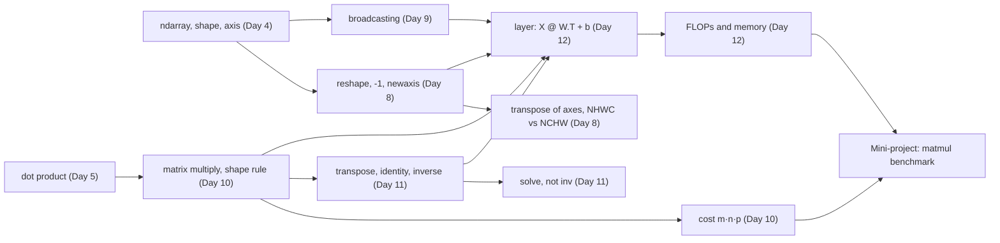

# Day 13: Week 2 Review and Mini-Project: Matrix-Multiply Benchmark

**Phase 1 · Week 2 · ~180 minutes**

## Objectives

By the end of today you can:

- [ ] Explain, without notes, the main idea of each Week 2 lesson and how they feed into one neural-network layer.
- [ ] Answer the self-check questions and re-do the week's hardest exercise from a blank file.
- [ ] Write a pure-Python matrix multiply, prove it matches `A @ B` with `np.allclose`, and time both fairly.
- [ ] Compute GFLOP/s from a timing, and read the slope of a log-log plot as the exponent in "time grows like \( n^3 \)".
- [ ] Explain the thousand-fold gap between the two in terms of interpreter overhead, SIMD, cache blocking and multithreading.
- [ ] Explain why a phone NPU runs matrix multiplies in `int8`, and what "accumulate in `int32`" means.

**Prerequisites.** All of Week 2: [Day 8](day-08-shapes-indexing.md) (shapes, reshape, transpose of axes), [Day 9](day-09-broadcasting.md) (broadcasting), [Day 10](day-10-matrices-matmul.md) (matrix multiplication, its cost and the triple loop), [Day 11](day-11-transpose-identity-inverse.md) (transpose, identity, inverse, `solve`) and [Day 12](day-12-layer-is-matmul.md) (a layer is \( XW^\top + \mathbf{b} \), FLOPs).

**Suggested time split.** 30 minutes recap and self-check, 20 minutes re-doing one exercise, 90 minutes mini-project, 40 minutes stretch goals, the int8 section and the retro.

---

## What this week gave you

Five days, one destination: by Friday a neural-network layer was "just" a matrix multiply. Each day added one piece:

| Day | You learned | The one idea to keep |
|---|---|---|
| [8](day-08-shapes-indexing.md) | `reshape`, `-1`, `newaxis`, `squeeze`, `transpose`, fancy indexing, `stack` | `reshape` changes how memory is *read*, never the order. `transpose` changes the order. NHWC for LiteRT, NCHW for PyTorch. |
| [9](day-09-broadcasting.md) | broadcasting rules, standardizing, pairwise distances | Align shapes from the right; each pair must be equal or contain a 1. Stretching is free (stride 0). |
| [10](day-10-matrices-matmul.md) | \( C_{ij} = \sum_k A_{ik}B_{kj} \), `@` vs `*`, cost \( mnp \) | Inner dimensions match, outer survive. \( AB \neq BA \). A matmul is \( mnp \) multiply-adds. |
| [11](day-11-transpose-identity-inverse.md) | \( A^\top \), \( I \), \( A^{-1} \), \( \det \), `np.linalg.solve` | A matrix moves space. Determinant 0 means no undo. Use `solve`, not `inv`. |
| [12](day-12-layer-is-matmul.md) | \( Z = XW^\top + \mathbf{b} \), ReLU, parameters, FLOPs | Row \( i \) of \( W \) is neuron \( i \). A layer costs \( 2 \cdot \text{batch} \cdot \text{in} \cdot \text{out} \) FLOPs. |

Here is the whole week as one journey, a 28×28 digit becoming a prediction:

<figure class="diagram" markdown>

<figcaption>Animated: one input travelling through the week. Every arrow is a shape change you can predict on paper.</figcaption>
</figure>

And here is how the concepts depend on each other. Arrows mean "is built on":



!!! android "Android bridge"
    If Week 1 was learning Kotlin syntax, Week 2 was learning what your app's `interpreter.run(input, output)` actually does: shape the `ByteBuffer` (Day 8), normalize pixels (Day 9), then run a chain of operators that are mostly matrix multiplies (Days 10–12). Today you measure *why* those operators are handed to optimized native code (and, on a phone, to the GPU or NPU) instead of being written as loops.

## Self-check

Answer out loud or on paper first, then open the answer. If you miss more than three, re-read that day's lesson before starting the project.

??? question "1. `a = np.arange(12)`; `r = a.reshape(3, 4)`. Did that copy the 12 numbers? And what does `a.reshape(-1, 6)` give?"
    No copy: `r` is a view of the same memory (`np.shares_memory(a, r)` is `True`), read row by row in C order. `-1` means "work it out": 12 / 6 = 2, so the shape is `(2, 6)`. (Day 8)

??? question "2. You have an image `img` of shape (224, 224, 3). Give the LiteRT input shape and the PyTorch input shape, and the NumPy call for each."
    LiteRT wants NHWC `(1, 224, 224, 3)`: `img[np.newaxis]` (or `np.expand_dims(img, 0)`). PyTorch wants NCHW `(1, 3, 224, 224)`: `np.transpose(img[np.newaxis], (0, 3, 1, 2))`. It must be a `transpose`, not a `reshape`: reshape keeps the memory order and would scramble the pixels. (Day 8)

??? question "3. What shape do (5, 1) and (1, 4) broadcast to? And why does `np.ones((4, 3)) + np.ones(4)` fail?"
    `(5, 4)`: each size-1 axis stretches. The second fails because shapes align from the **right**: 3 vs 4 is neither equal nor 1. If you meant "one number per row", make it `(4, 1)` with `np.ones(4)[:, None]`. (Day 9)

??? question "4. `X` is (1,000,000, 3). Does `X - X.mean(axis=0)` build a million-row copy of the mean?"
    No. The `(3,)` mean is broadcast with a stride of 0 along the stretched axis, so the same 24 bytes are read over and over. Only the result is a new full-size array. (Day 9)

??? question "5. `A` is (32, 784) and `B` is (784, 128). What is the shape of `A @ B`, how many multiply-adds does it take, and what does `A * B` do?"
    `(32, 128)`: inner 784s match, outer 32 and 128 survive. Cost \( 32 \cdot 784 \cdot 128 = 3{,}211{,}264 \) multiply-adds, or about 6.4 million FLOPs. `A * B` is element-wise and raises a broadcasting `ValueError` here; on two square matrices of the same shape it would run silently and give the wrong numbers. (Day 10)

??? question "6. Is \( AB = BA \)? Is \( (AB)\mathbf{v} = A(B\mathbf{v}) \)? Which of the last two is cheaper for 1000×1000 matrices?"
    Usually \( AB \neq BA \) (not commutative), but brackets can move: \( (AB)\mathbf{v} = A(B\mathbf{v}) \) (associative). \( A(B\mathbf{v}) \) is two matrix-vector products, about \( 2 \times 10^6 \) multiply-adds, versus about \( 10^9 \) for forming \( AB \) first. (Day 10)

??? question "7. A 2×2 matrix has determinant 0. What does it do to the plane, and what should you use instead of `inv(A) @ b` in general?"
    It squashes the plane onto a line (or a point): area becomes 0, information is lost, so there is no inverse. In general use `np.linalg.solve(A, b)`: faster and numerically more stable than building the inverse. (Day 11)

??? question "8. `nn.Linear(784, 128)`: what shape is its weight, what is the formula for a batch `X`, and how many parameters does it have?"
    Weight `(128, 784)`, i.e. (out, in); bias `(128,)`. For `X` of shape `(batch, 784)`: \( Z = XW^\top + \mathbf{b} \), shape `(batch, 128)`. Parameters: \( 784 \cdot 128 + 128 = 100{,}480 \). (Day 12)

??? question "9. Why does every network put a ReLU (or another non-linearity) between its matrix multiplies?"
    Without it, \( W_2(W_1\mathbf{x}) = (W_2W_1)\mathbf{x} \): two layers collapse into one matrix, so depth adds nothing. ReLU, \( \max(0, z) \) element-wise, breaks that. (Day 12)

??? question "10. A bias stored as shape (8, 1) works fine with a batch of exactly 8 in a layer with 8 outputs. Why is that dangerous?"
    `(8, 8) + (8, 1)` broadcasts: it adds bias \( i \) to every entry of **row \( i \)** (example \( i \)) instead of to column \( i \) (neuron \( i \)). The shape is right, the numbers are wrong, and nothing crashes. With any other batch size it fails loudly. Keep biases 1-D, `(out,)`. (Days 9 and 12)

## Re-do from blank

Pick **Day 8, exercise 6** and do it again in an empty file, without looking, then extend it with Day 12:

1. Split `img = np.arange(16).reshape(4, 4)` into four 2×2 patches, shape `(4, 2, 2)`, in the order top-left, top-right, bottom-left, bottom-right, using only `reshape` and `transpose`.
2. Prove it with slicing: patch 1 must equal `img[0:2, 2:4]`. Show that the shortcut `img.reshape(4, 2, 2)` fails the same check.
3. Flatten each patch to a row: a `(4, 4)` matrix of "tokens", one row per patch.
4. Push the tokens through one layer with 3 neurons: `W = [[1, 0, 0, 0], [0.25, 0.25, 0.25, 0.25], [1, -1, -1, 1]]`, `b = [0, 0, 0.5]`. Predict the output shape before running it.

**Why this one.** It is the only exercise of the week where `reshape` alone gives a plausible-looking wrong answer, so it tests the deepest idea of Day 8: memory order versus axis order. Steps 3 and 4 then make it the week in miniature: shapes (Day 8), the shape rule (Day 10), a transpose to line the shapes up (Day 11), and a layer with a broadcast bias (Days 9 and 12). It is also not a toy: a Vision Transformer starts exactly like this, cutting the image into patches and multiplying each flattened patch by a weight matrix (the "patch embedding").

??? success "Solution"
    ```python
    import numpy as np

    img = np.arange(16).reshape(4, 4)

    # 1. (patch row, row in patch, patch col, col in patch) -> bring the "which patch" axes together
    patches = img.reshape(2, 2, 2, 2).transpose(0, 2, 1, 3).reshape(4, 2, 2)

    # 2. check against slicing
    print(np.array_equal(patches[1], img[0:2, 2:4]))   # True
    wrong = img.reshape(4, 2, 2)
    print(wrong[1])
    # [[4 5]
    #  [6 7]]          that's half of row 1, not the top-right patch
    print(np.array_equal(wrong[1], img[0:2, 2:4]))     # False

    # 3. one row per patch
    tokens = patches.reshape(4, -1)
    print(tokens)
    # [[ 0  1  4  5]
    #  [ 2  3  6  7]
    #  [ 8  9 12 13]
    #  [10 11 14 15]]

    # 4. a layer with 3 neurons: (4, 4) @ (4, 3) -> (4, 3)
    W = np.array([[1.0, 0.0, 0.0, 0.0],        # neuron 0: "top-left pixel"
                  [0.25, 0.25, 0.25, 0.25],    # neuron 1: "patch average"
                  [1.0, -1.0, -1.0, 1.0]])     # neuron 2: "diagonal contrast"
    b = np.array([0.0, 0.0, 0.5])
    E = tokens @ W.T + b
    print(tokens.shape, W.T.shape, E.shape)    # (4, 4) (4, 3) (4, 3)
    print(E)
    # [[ 0.   2.5  0.5]
    #  [ 2.   4.5  0.5]
    #  [ 8.  10.5  0.5]
    #  [10.  12.5  0.5]]
    ```
    Each row of `E` is one patch described by 3 numbers. Neuron 2 gives 0.5 for every patch because in `arange` data every patch has the same diagonal contrast (0 + 5 − 1 − 4 = 0), plus its bias of 0.5.

---

## Mini-project: a matrix-multiply benchmark

On Day 10 you timed one 200×200 multiply and saw NumPy win by several hundred times. Today you turn that single number into a proper experiment: many sizes, a fair timer, a correctness check, a chart, and an explanation of every feature of the chart.

### The idea, with an analogy

Imagine paying for 1,000 grocery items. **Option 1:** take each item to the till on its own, queue, scan, pay, walk back. **Option 2:** put everything on a conveyor belt, and a scanner that reads eight barcodes at once rings it all up while three more tills split the trolley. Both buy the same 1,000 items. Option 1 is dominated by the walking and queuing *around* each item; Option 2 has almost no per-item overhead.

The pure-Python triple loop is Option 1: every single multiply-add goes through the Python interpreter. NumPy's `@` is Option 2: one call hands the whole job to a compiled library (BLAS) that processes many numbers per instruction on several cores. Same arithmetic, same answer, very different bill.

Two separate questions hide in this benchmark, and the chart answers both:

1. **How does the time grow with \( n \)?** That's the *shape* of each curve. It is set by the algorithm, and it is the same for both: \( n^3 \).
2. **How big is each step?** That's the *height* of each curve, the constant factor. It is set by the implementation and the hardware, and it differs by thousands of times.

### The math, one symbol at a time

**Work.** Multiplying two \( n \times n \) matrices (Day 10's \( m = n = p \)) takes \( n \cdot n \cdot n = n^3 \) multiply-adds: \( n^2 \) cells in the result, each a dot product of length \( n \). Counting the multiply and the add separately:

\[
\text{FLOPs}(n) = 2n^3
\]

For \( n = 128 \): \( 2 \cdot 128^3 = 4{,}194{,}304 \) FLOPs.

**Speed.** If one multiply takes \( t \) seconds, the speed in **GFLOP/s** (billions of floating-point operations per second; "G" is \( 10^9 \)) is

\[
\text{GFLOP/s} = \frac{2n^3}{t \cdot 10^9}
\]

Worked example from the run below: \( n = 128 \) in pure Python took \( t = 0.0965 \) s, so \( 4{,}194{,}304 / (0.0965 \cdot 10^9) \approx 0.043 \) GFLOP/s. NumPy did the same multiply in 0.0000470 s: about 89 GFLOP/s.

**Why a log-log plot is a straight line.** Suppose the time is \( t = c \cdot n^3 \), where \( c \) is the constant "seconds per multiply-add" of your implementation. Take the logarithm of both sides (\( \log \) turns products into sums and powers into multiples: \( \log(xy) = \log x + \log y \), \( \log(n^3) = 3 \log n \)):

\[
\log t = \log c + 3 \log n
\]

That is the equation of a straight line, \( y = b + a x \), with \( x = \log n \), \( y = \log t \), intercept \( b = \log c \) and **slope \( a = 3 \)**. So on a plot with *both* axes logarithmic ("log-log"), any power law \( t = c n^k \) is a straight line whose slope is the exponent \( k \), and the constant \( c \) only moves the line up or down.

- A slope of 3 means "double \( n \), time ×8" (\( 2^3 = 8 \)).
- The vertical gap between two parallel lines is the ratio of their constants: how many times faster one implementation is.

Worked example: from \( n = 64 \) to \( n = 128 \), pure Python went from 11.3 ms to 96.5 ms, a factor of 8.54. The slope between those two points is \( \log_2 8.54 \approx 3.09 \). Close to 3, as predicted.

<figure class="diagram" markdown>

<figcaption>Animated: a matmul's work is an n × n × n block. Double n and it holds 8 of the old blocks, so the time goes up 8×.</figcaption>
</figure>

### Spec

Write `bench.py` with these functions and a `__main__` block:

| Function | Input → output | Rules |
|---|---|---|
| `matmul_py(A, B)` | two lists of lists → list of lists | the Day 10 triple loop; `(n, m)` times `(m, p)`; raise `ValueError` if the inner sizes differ |
| `check_correct(rng)` | a NumPy `Generator` → nothing | compare `matmul_py` with `A @ B` using `np.allclose` on square **and** non-square shapes; `assert` on failure |
| `best_time(fn, min_repeats=3, budget=0.3)` | a zero-argument function → seconds | one warm-up call, then repeat until at least `min_repeats` runs and `budget` seconds; return the **fastest** run |
| `gflops(n, seconds)` | → `float` | \( 2n^3 / t / 10^9 \) |
| `slope(ns, ts)` | sizes and times → `float` | slope of the best straight line through \( (\log n, \log t) \), with `np.polyfit` |
| `run(py_sizes, np_sizes)` | → two dicts `{n: seconds}` | time pure Python on 16, 32, 64, 128, 256 and NumPy on 16 … 2048; print a table and both slopes |
| `plot(py_times, np_times, path)` | → saves an SVG | log-log time vs \( n \) for both, plus a dashed slope-3 guide line; GFLOP/s in a second panel |

Pure Python stops at 256 on purpose: 256 already takes about a second per multiply, and 2048 would take about 512 times longer (\( 8^3 \)), around eight minutes for a single run.

### Starter code

Copy this into `bench.py` and fill in the `TODO`s.

```python
"""Week 2 mini-project: pure-Python vs NumPy matrix multiply benchmark."""
import time

import numpy as np


def matmul_py(A, B):
    """C = A @ B for lists of lists. A is (n, m), B is (m, p)."""
    # TODO: Day 10's triple loop. Check the inner sizes first and raise ValueError.
    raise NotImplementedError


def check_correct(rng):
    """Compare matmul_py with A @ B on square AND non-square shapes."""
    # TODO: for a few (shape_a, shape_b) pairs: rng.random(...), .tolist(),
    #       np.allclose(np.array(matmul_py(...)), A @ B)
    raise NotImplementedError


def best_time(fn, min_repeats=3, budget=0.3):
    """Warm up once, then run fn() at least min_repeats times and until about
    budget seconds have been spent. Return the FASTEST run, in seconds."""
    # TODO: time.perf_counter() before and after each call
    raise NotImplementedError


def gflops(n, seconds):
    # TODO: 2 n^3 FLOPs per n x n matmul
    raise NotImplementedError


def slope(ns, ts):
    """Slope of the best straight line through (log n, log t)."""
    # TODO: np.polyfit(x, y, 1) returns [slope, intercept]
    raise NotImplementedError


def run(py_sizes, np_sizes, seed=13):
    # TODO: check_correct, then time NumPy sizes, then pure-Python sizes
    #       (convert with .tolist() OUTSIDE the timed function), print a table
    raise NotImplementedError


def plot(py_times, np_times, path, note="One run on my machine. Yours will differ."):
    # TODO: matplotlib, ax.loglog(...), a dashed n^3 guide, labels, fig.savefig(path)
    raise NotImplementedError


if __name__ == "__main__":
    import sys
    py_times, np_times = run(py_sizes=[16, 32, 64, 128, 256],
                             np_sizes=[16, 32, 64, 128, 256, 512, 1024, 2048])
    if len(sys.argv) > 1:
        plot(py_times, np_times, sys.argv[1], *sys.argv[2:3])
```

Run it with `python bench.py` for the table, or `python bench.py benchmark.svg` for the table and the chart.

### Milestones

Do them in order. Every output below is real; the timings are from one run on a 4-core cloud container, and **yours will differ**.

**Milestone 1: the triple loop.** Start from Day 10's version. One small speed-up worth making: look up `A[i]` and `C[i]` once per row instead of once per multiply-add. Then check Day 10's hand-worked example:

```python
print(matmul_py([[1, 2, 3], [4, 5, 6]], [[7, 8], [9, 10], [11, 12]]))
# [[58.0, 64.0], [139.0, 154.0]]
```

(The numbers are floats because the running total starts at `0.0`. `58.0 == 58` is `True` in Python, so the comparison in the checks below still works.)

**Milestone 2: prove it's correct before timing it.** A fast wrong answer is worthless, and a benchmark of a buggy function measures nothing. Compare against NumPy on several shapes, including non-square ones: a square-only test can't catch swapped `m` and `p`. Use `np.allclose`, never `==`, on floats: the two implementations add the same numbers in a different order, so the last digits can differ.

```python
rng = np.random.default_rng(13)
check_correct(rng)
# correctness: matmul_py matches A @ B on 4 shape pairs
```

**Milestone 3: a fair timer.** Three rules: use `time.perf_counter()` (a high-resolution clock meant for measuring intervals), throw away the first call, and report the **minimum** of several runs. The minimum is the run with the least interference from the rest of the machine; noise only ever makes things slower.

```python
n = 64
A, B = rng.random((n, n)), rng.random((n, n))
A_list, B_list = A.tolist(), B.tolist()          # convert ONCE, outside the timer

t0 = time.perf_counter(); A @ B; first = time.perf_counter() - t0
t_np = best_time(lambda: A @ B)
t_py = best_time(lambda: matmul_py(A_list, B_list))
print(f"NumPy first call: {first*1e6:8.1f} µs   best: {t_np*1e6:6.1f} µs")
print(f"pure Python best: {t_py*1e3:8.1f} ms")
print(f"speed-up {t_py/t_np:,.0f}x   NumPy {gflops(n, t_np):.1f} GFLOP/s   Python {gflops(n, t_py):.3f} GFLOP/s")
# one run printed:
# NumPy first call:    112.4 µs   best:   10.9 µs
# pure Python best:     11.6 ms
# speed-up 1,057x   NumPy 47.9 GFLOP/s   Python 0.045 GFLOP/s
```

Look at the first line: the very first `A @ B` was ten times slower than the best one in this run (it varies; a few times slower is typical). That is the warm-up cost (the library starting its worker threads, memory being touched for the first time). Without the warm-up call you would be benchmarking the setup.

!!! warning "Common mistake: timing the conversion"
    `best_time(lambda: matmul_py(A.tolist(), B.tolist()))` also times the conversion from array to lists on every run. Prepare inputs outside the timed function, so you measure only the thing you are comparing.

**Milestone 4: the table.** Loop over the sizes, store `{n: seconds}` in two dicts, and print one row per size. Here is the full output of the reference solution:

```text
correctness: matmul_py matches A @ B on 4 shape pairs
    n   pure Python        NumPy   speed-up  Py GFLOP/s  NumPy GFLOP/s
   16        0.2 ms    0.0015 ms       121x      0.0456           5.52
   32        1.4 ms    0.0026 ms       542x      0.0471          25.53
   64       11.3 ms    0.0109 ms     1,035x      0.0463          47.93
  128       96.5 ms    0.0470 ms     2,052x      0.0435          89.20
  256      920.6 ms    0.4457 ms     2,066x      0.0364          75.29
  512             -    1.6095 ms          -           -         166.78
 1024             -    9.3858 ms          -           -         228.80
 2048             -  156.6820 ms          -           -         109.65
log-log slope, pure Python (16..256): 3.08
log-log slope, NumPy (256..2048): 2.79
```

**Milestone 5: measure the slope.** `np.polyfit(np.log(ns), np.log(ts), 1)` fits the straight line \( \log t = b + a \log n \) and returns `[a, b]`. The slope `a` is your measured exponent. Pure Python gives 3.08: the algorithm's \( n^3 \), measured. For NumPy, fit only \( n \ge 256 \): below that, fixed overheads (the function call, starting threads) dominate and the curve is flatter.

**Milestone 6: the chart.** Plot both curves with `ax.loglog`, add a dashed line \( t = t_{16} \cdot (n / 16)^3 \) as a "slope 3" guide, label the axes with units, and save as SVG. Put a note on the figure saying where it was measured.

<figure class="diagram" markdown>
![Two log-log panels from one benchmark run. Left: time per multiply against matrix size n from 16 to 2048. The pure-Python line rises from 0.2 milliseconds at n = 16 to 0.92 seconds at n = 256 and lies on top of a dashed slope-3 guide line. The NumPy line sits roughly three orders of magnitude lower, rising from 1.5 microseconds at n = 16 to 157 milliseconds at n = 2048, flatter at small n. Right: GFLOP/s. Pure Python is flat around 0.04 to 0.05; NumPy climbs from 5.5 at n = 16 to between 75 and 229 for n of 128 and above](../../assets/img/phase-1/day13-benchmark.svg)
<figcaption>The real output of the reference solution: one run on a 4-core cloud container (Python 3.13, NumPy 2.5, OpenBLAS). Yours will differ.</figcaption>
</figure>

### How to verify it works

Paste these checks under your functions and run them. They use tiny inputs where you can work out the answer by hand, plus fake timings where you *know* the exponent.

```python
# 1. Day 10's hand-worked example
assert matmul_py([[1, 2, 3], [4, 5, 6]], [[7, 8], [9, 10], [11, 12]]) == [[58, 64], [139, 154]]
# 2. Non-square shapes: (2, 3) @ (3, 4) -> (2, 4)
C = matmul_py([[1, 0, 0], [0, 1, 0]], [[1, 2, 3, 4], [5, 6, 7, 8], [9, 10, 11, 12]])
assert (len(C), len(C[0])) == (2, 4) and C == [[1, 2, 3, 4], [5, 6, 7, 8]]
# 3. A shape mismatch must raise, like NumPy does
try:
    matmul_py([[1, 2]], [[1, 2]])
    raise AssertionError("expected ValueError")
except ValueError as e:
    print("ValueError:", e)
# 4. Agrees with NumPy on random floats (allclose, not ==)
rng = np.random.default_rng(0)
A, B = rng.random((7, 5)), rng.random((5, 3))
assert np.allclose(matmul_py(A.tolist(), B.tolist()), A @ B)
# 5. The FLOP arithmetic
assert gflops(1000, 2.0) == 1.0          # 2 * 10^9 FLOPs in 2 s = 1 GFLOP/s
# 6. slope() recovers the exponent from perfect fake data
ns = np.array([16, 32, 64, 128])
assert np.isclose(slope(ns, 5e-9 * ns**3), 3.0)
assert np.isclose(slope(ns, 1e-6 * ns**2), 2.0)
# 7. best_time warms up once and then runs at least min_repeats times
calls = []
t = best_time(lambda: calls.append(time.perf_counter()), min_repeats=3, budget=0.0)
assert len(calls) == 4 and t >= 0
print("all checks passed")
# ValueError: inner dimensions differ: 2 vs 1
# all checks passed
```

Then run the whole script. Your numbers will differ from the table above, but three things should hold on any machine: the correctness line prints, the pure-Python slope is close to 3 (2.8 to 3.3 is normal), and NumPy is hundreds to thousands of times faster from \( n = 64 \) up.

### Reading the chart

**The slopes: the algorithm.** The pure-Python line lies right on top of the dashed slope-3 guide. That is \( n^3 \) measured, not assumed: double \( n \), eight times the work, eight times the time. Note that NumPy's line is *also* roughly parallel to it for large \( n \): NumPy runs the same \( n^3 \) algorithm, just much faster per step. A library can shrink the constant \( c \); it cannot make the textbook algorithm stop being \( n^3 \).

Two honest deviations, both visible in the table:

- Pure Python's slope is a little **above** 3 (3.08), and from 128 to 256 the time grew 9.5×, not 8×. At \( n = 256 \) the three matrices are 196,608 separate Python float objects scattered in memory, and walking down a column of `B` (`B[k][j]` for each `k`) jumps between 256 different lists. They no longer fit in the fast caches close to the CPU core, so each step waits a little longer for memory.
- NumPy's slope over 256…2048 is **below** 3 (2.79), because its GFLOP/s is still climbing over that range: bigger matrices keep all four cores busy and amortize fixed costs. The dips (at 256 and at 2048 in this run) are real but machine-specific: they come from where the library switches strategies and from other programs sharing the container. Run it twice and they move. Don't over-read single points.

**The gap: the constant factor.** Per multiply-add, pure Python took about 46 nanoseconds at \( n = 128 \); NumPy took about 0.009 nanoseconds (9 picoseconds) at \( n = 1024 \). That's roughly 5,000 times less time for the same operation. At 2.8 GHz, 46 ns is about 130 clock cycles for one multiply and one add. Where do they go, and how does BLAS get it back?

| Source of the gap | Pure Python | NumPy `@` (OpenBLAS here) |
|---|---|---|
| **Interpreter overhead** | Every `total += Ai[k] * B[k][j]` is a dozen bytecodes: look up two lists, index them (with bounds checks), check both types, create a new float object for the product and another for the sum, update reference counts. | One Python call. The loop is compiled machine code; numbers are raw 8-byte doubles packed side by side (Day 4). |
| **SIMD** (Single Instruction, Multiple Data) | One multiply per operation. | One instruction multiplies and adds a whole register of numbers: 4 doubles with AVX2, 8 with AVX-512, and FMA (fused multiply-add) does both in one step. |
| **Cache blocking** | Reads `B` column-wise, jumping around memory. | Works on small tiles of \( A \), \( B \) and \( C \) sized to stay in the CPU caches, so each number loaded from main memory is reused many times. |
| **Multithreading** | One core. | Splits \( C \) into blocks and computes them on all cores at once (every cell is independent, Day 10). On this container: about 55 GFLOP/s on 1 thread, about 105 on 2 at \( n = 1024 \). |

The first row is by far the biggest. That's why a "smarter" pure-Python loop barely helps (stretch goal 3 shows this), and why the rule from Day 4 holds: don't loop over numbers in Python.

!!! warning "Common mistake: one run, one conclusion"
    A benchmark is a measurement, and measurements are noisy, especially on a laptop with other apps open or in a shared cloud container. Take the minimum of several runs, run the whole script twice, and only trust differences that are much larger than the run-to-run wobble. A 2,000× gap survives any noise; a 10% difference between two NumPy calls usually doesn't.

!!! android "Android bridge"
    You already know this lesson from Android performance work. A Kotlin loop over a `FloatArray` runs as JIT/AOT-compiled code on ART, so it's far closer to the "compiled loop" column than Python is, but it is still single-threaded and usually doesn't use SIMD. That's why on-device ML doesn't run your model in app code: LiteRT runs its operators in native kernels (on the CPU, through its XNNPACK backend, with SIMD and multiple threads), or hands them to the GPU or NPU through a delegate. And the measuring discipline is the same one Jetpack Macrobenchmark enforces: warm up, repeat, report a robust statistic, and never trust the first run.

??? success "Reference solution (try the milestones first)"
    ```python
    """Week 2 mini-project: pure-Python vs NumPy matrix multiply benchmark."""
    import time

    import numpy as np


    # ---------- Milestone 1: the triple loop (Day 10), made a little faster ----------
    def matmul_py(A, B):
        """C = A @ B for lists of lists. A is (n, m), B is (m, p)."""
        n, m = len(A), len(A[0])
        m2, p = len(B), len(B[0])
        if m != m2:
            raise ValueError(f"inner dimensions differ: {m} vs {m2}")
        C = [[0.0] * p for _ in range(n)]
        for i in range(n):
            Ai, Ci = A[i], C[i]           # look the rows up once, not n*p times
            for j in range(p):
                total = 0.0
                for k in range(m):
                    total += Ai[k] * B[k][j]
                Ci[j] = total
        return C


    def check_correct(rng):
        """Milestone 2: compare against NumPy on square AND non-square shapes."""
        for shape_a, shape_b in [((1, 1), (1, 1)), ((2, 3), (3, 2)),
                                 ((5, 7), (7, 4)), ((16, 16), (16, 16))]:
            A = rng.random(shape_a)
            B = rng.random(shape_b)
            C = np.array(matmul_py(A.tolist(), B.tolist()))
            assert C.shape == (shape_a[0], shape_b[1]), C.shape
            assert np.allclose(C, A @ B), (shape_a, shape_b)
        print("correctness: matmul_py matches A @ B on 4 shape pairs")


    # ---------- Milestone 3: a fair timer ----------
    def best_time(fn, min_repeats=3, budget=0.3):
        """Warm up once, then run fn() at least `min_repeats` times and until about
        `budget` seconds have been spent. Return the FASTEST run, in seconds."""
        fn()
        best, spent, runs = float("inf"), 0.0, 0
        while runs < min_repeats or spent < budget:
            t0 = time.perf_counter()
            fn()
            dt = time.perf_counter() - t0
            best, spent, runs = min(best, dt), spent + dt, runs + 1
        return best


    def gflops(n, seconds):
        return 2 * n**3 / seconds / 1e9   # 2 FLOPs (multiply + add) per n^3 multiply-adds


    def slope(ns, ts):
        """Slope of the best straight line through (log n, log t)."""
        return np.polyfit(np.log(ns), np.log(ts), 1)[0]


    # ---------- Milestone 4: the benchmark ----------
    def run(py_sizes, np_sizes, seed=13):
        rng = np.random.default_rng(seed)
        check_correct(rng)

        np_times = {}
        for n in np_sizes:
            A, B = rng.random((n, n)), rng.random((n, n))
            np_times[n] = best_time(lambda: A @ B)

        py_times = {}
        for n in py_sizes:
            A, B = rng.random((n, n)), rng.random((n, n))
            A_list, B_list = A.tolist(), B.tolist()        # plain Python lists
            py_times[n] = best_time(lambda: matmul_py(A_list, B_list), budget=1.0)

        print(f"{'n':>5} {'pure Python':>13} {'NumPy':>12} {'speed-up':>10}"
              f" {'Py GFLOP/s':>11} {'NumPy GFLOP/s':>14}")
        for n in sorted(np_times):
            t_np = np_times[n]
            if n in py_times:
                t_py = py_times[n]
                print(f"{n:>5} {t_py*1e3:>10.1f} ms {t_np*1e3:>9.4f} ms {t_py/t_np:>9,.0f}x"
                      f" {gflops(n, t_py):>11.4f} {gflops(n, t_np):>14.2f}")
            else:
                print(f"{n:>5} {'-':>13} {t_np*1e3:>9.4f} ms {'-':>10}"
                      f" {'-':>11} {gflops(n, t_np):>14.2f}")

        ns = sorted(py_times)
        print(f"log-log slope, pure Python ({ns[0]}..{ns[-1]}): "
              f"{slope(ns, [py_times[n] for n in ns]):.2f}")
        big = [n for n in np_times if n >= 256]
        print(f"log-log slope, NumPy ({big[0]}..{big[-1]}): "
              f"{slope(big, [np_times[n] for n in big]):.2f}")
        return py_times, np_times


    # ---------- Milestone 5: the chart ----------
    def plot(py_times, np_times, path, note="One run on my machine. Yours will differ."):
        import matplotlib
        import matplotlib.ticker
        matplotlib.use("Agg")
        import matplotlib.pyplot as plt

        plt.rcParams.update({"font.size": 11, "font.family": "DejaVu Sans",
                             "svg.fonttype": "none"})
        PY, NP = "#ef6c00", "#3949ab"
        fig, (ax1, ax2) = plt.subplots(1, 2, figsize=(10, 4.2), facecolor="white")

        for times, color, marker, label in [(py_times, PY, "o", "pure Python (triple loop)"),
                                            (np_times, NP, "s", "NumPy  A @ B  (OpenBLAS)")]:
            ns = sorted(times)
            ax1.loglog(ns, [times[n] for n in ns], marker=marker, color=color,
                       lw=2, ms=6, label=label)
            ax2.loglog(ns, [gflops(n, times[n]) for n in ns], marker=marker,
                       color=color, lw=2, ms=6, label=label)

        # A dashed "slope 3" guide: time proportional to n^3, anchored at the first Python point
        n0 = min(py_times)
        guide = np.array([n0, 2048])
        ax1.loglog(guide, py_times[n0] * (guide / n0) ** 3, ls="--", color="#999",
                   lw=1, label="guide: time ∝ n³ (slope 3)")

        ax1.set_xlabel("matrix size n  (n × n times n × n)")
        ax1.set_ylabel("time per multiply (seconds, log scale)")
        ax1.set_title("Time vs n (log-log)")
        ax2.set_xlabel("matrix size n")
        ax2.set_ylabel("GFLOP/s = 2n³ / time / 10⁹  (log scale)")
        ax2.set_title("Speed: billions of FLOPs per second")
        for ax in (ax1, ax2):
            ax.grid(True, which="major", color="#ddd", lw=0.8)
            ax.set_axisbelow(True)
            for side in ("top", "right"):
                ax.spines[side].set_visible(False)
            ticks = [16, 32, 64, 128, 256, 512, 1024, 2048]
            ax.set_xticks(ticks, [str(t) for t in ticks])
            ax.xaxis.set_minor_locator(matplotlib.ticker.NullLocator())
        ax2.text(16, gflops(16, np_times[16]) * 1.6, "NumPy", color=NP, fontsize=10)
        ax2.text(16, gflops(16, py_times[16]) * 1.6, "pure Python", color=PY, fontsize=10)
        ax1.legend(frameon=False, fontsize=9, loc="upper left")
        fig.text(0.5, -0.02, note, ha="center", color="#555", fontsize=9.5)
        fig.tight_layout()
        fig.savefig(path, format="svg", bbox_inches="tight", facecolor="white")
        print("saved", path)


    if __name__ == "__main__":
        import sys
        py_times, np_times = run(py_sizes=[16, 32, 64, 128, 256],
                                 np_sizes=[16, 32, 64, 128, 256, 512, 1024, 2048])
        if len(sys.argv) > 1:
            plot(py_times, np_times, sys.argv[1], *sys.argv[2:3])
    ```

    `python bench.py benchmark.svg` printed the Milestone 4 table and drew the chart above (it takes about 10 seconds; most of it is the pure-Python 256). Design notes: NumPy is timed *before* the slow Python runs so that the long loop doesn't affect it; the lambdas are called immediately inside the loop, so capturing `A` and `B` by name is safe here; `matplotlib.use("Agg")` lets the script save figures without a display (on a server or in CI); `svg.fonttype: "none"` keeps the labels as real text in the SVG instead of drawn outlines.

### Stretch goals

Each stretch goal imports from your finished `bench.py`, so run them from the same folder.

1. **`np.einsum`.** Write the matmul as `np.einsum("ik,kj->ij", A, B)`: the string literally says \( C_{ij} = \sum_k A_{ik}B_{kj} \) (the index `k` appears in the inputs but not the output, so it is summed). Check it equals `A @ B`, then time it at \( n = 512 \) with and without `optimize=True`.
2. **`float32` vs `float64`, and integers.** Time `A @ B` at \( n = 1024 \) in both float types and compare GFLOP/s and bytes. Then time a 256×256 multiply in `float32`, `int32` and `int8`, and look at the first few entries of the `int8` result next to the `int32` one.
3. **A blocked (tiled) pure-Python version.** Write `matmul_blocked(A, B, bs=32)` that loops over 32×32 tiles, and `matmul_ikj` that just reorders the loops to i-k-j (so the inner loop walks along a row of `B`). Verify both with `np.allclose`, time them at 128 and 256, and explain the result.
4. **Threads.** If `np.show_config()` says your NumPy uses OpenBLAS, run a 1024×1024 benchmark with `OPENBLAS_NUM_THREADS=1`, `2` and your core count. (The variable must be set before NumPy is imported, so set it in the shell.)

??? success "Stretch solutions"
    **1. `einsum`.**

    ```python
    import numpy as np
    from bench import best_time, gflops

    rng = np.random.default_rng(13)
    n = 512
    A, B = rng.random((n, n)), rng.random((n, n))
    print("einsum equal:", np.allclose(A @ B, np.einsum("ik,kj->ij", A, B)),
          np.allclose(A @ B, np.einsum("ik,kj->ij", A, B, optimize=True)))
    for name, fn in [("A @ B", lambda: A @ B),
                     ("einsum", lambda: np.einsum("ik,kj->ij", A, B)),
                     ("einsum optimize=True", lambda: np.einsum("ik,kj->ij", A, B, optimize=True))]:
        t = best_time(fn)
        print(f"{name:<22} {t*1e3:8.2f} ms  {gflops(n, t):7.1f} GFLOP/s")
    # one run printed (yours will differ):
    # einsum equal: True True
    # A @ B                      1.69 ms    159.1 GFLOP/s
    # einsum                    36.98 ms      7.3 GFLOP/s
    # einsum optimize=True       1.41 ms    190.8 GFLOP/s
    ```

    Plain `einsum` runs its own generic C loop: compiled (so well over 100 times faster than pure Python) but without BLAS's tiling and threads. With `optimize=True` it recognizes the pattern and hands it to the same BLAS routine as `@`. `einsum` is worth knowing because it reads exactly like the math and handles batched products such as `"bik,bkj->bij"`; you will see it in attention code.

    **2. Data types.**

    ```python
    n = 1024
    A64, B64 = rng.random((n, n)), rng.random((n, n))
    A32, B32 = A64.astype(np.float32), B64.astype(np.float32)
    for name, a, b in [("float64", A64, B64), ("float32", A32, B32)]:
        t = best_time(lambda: a @ b)
        print(f"{name}  n={n}: {t*1e3:7.2f} ms  {gflops(n, t):6.1f} GFLOP/s  bytes per matrix {a.nbytes:,}")
    # float64  n=1024:   10.78 ms   199.1 GFLOP/s  bytes per matrix 8,388,608
    # float32  n=1024:    5.64 ms   380.9 GFLOP/s  bytes per matrix 4,194,304

    n = 256
    Ai = rng.integers(-128, 128, size=(n, n), dtype=np.int8)
    Bi = rng.integers(-128, 128, size=(n, n), dtype=np.int8)
    for name, a, b in [("float32", Ai.astype(np.float32), Bi.astype(np.float32)),
                       ("int32", Ai.astype(np.int32), Bi.astype(np.int32)),
                       ("int8", Ai, Bi)]:
        t = best_time(lambda: a @ b)
        print(f"{name:<8} n={n}: {t*1e3:8.3f} ms   result dtype {(a @ b).dtype}")
    # float32  n=256:    0.104 ms   result dtype float32
    # int32    n=256:   13.533 ms   result dtype int32
    # int8     n=256:   12.452 ms   result dtype int8
    print("int8 @ int8:", (Ai @ Bi)[0, :3], " int32:", (Ai.astype(np.int32) @ Bi.astype(np.int32))[0, :3])
    # int8 @ int8: [-3 95 40]  int32: [-71939 -81313 -77016]
    ```

    Three lessons. `float32` is about twice as fast as `float64` here (1.9× in this run): half the bytes to move, and twice as many numbers per SIMD register. Integer matmul in NumPy is over 100× *slower* than float, because BLAS only does floating point, so NumPy falls back to a plain loop for integers: what is fast depends on the kernels your library ships, not on the data type in principle. And `int8 @ int8` returns `int8`, so the sums **overflow and wrap around** silently: −71,939 doesn't fit in −128…127. Real int8 hardware avoids this by accumulating in `int32` (next section).

    **3. Blocked and reordered pure Python.**

    ```python
    import numpy as np
    from bench import best_time, matmul_py

    def matmul_blocked(A, B, bs=32):
        """Tiled triple loop: work on bs x bs tiles so each tile stays 'hot' in cache."""
        n, m, p = len(A), len(A[0]), len(B[0])
        C = [[0.0] * p for _ in range(n)]
        for i0 in range(0, n, bs):
            for k0 in range(0, m, bs):
                for j0 in range(0, p, bs):
                    for i in range(i0, min(i0 + bs, n)):
                        Ai, Ci = A[i], C[i]
                        for k in range(k0, min(k0 + bs, m)):
                            a, Bk = Ai[k], B[k]
                            for j in range(j0, min(j0 + bs, p)):
                                Ci[j] += a * Bk[j]
        return C

    def matmul_ikj(A, B):
        """Same sum, loops reordered i-k-j so the inner loop walks along a ROW of B."""
        n, m, p = len(A), len(A[0]), len(B[0])
        C = [[0.0] * p for _ in range(n)]
        for i in range(n):
            Ai, Ci = A[i], C[i]
            for k in range(m):
                a, Bk = Ai[k], B[k]
                for j in range(p):
                    Ci[j] += a * Bk[j]
        return C

    rng = np.random.default_rng(13)
    for n in (128, 256):
        A, B = rng.random((n, n)), rng.random((n, n))
        Al, Bl = A.tolist(), B.tolist()
        ref = A @ B
        for name, fn in [("matmul_py (i-j-k)", matmul_py), ("matmul_ikj", matmul_ikj),
                         ("matmul_blocked bs=32", matmul_blocked)]:
            assert np.allclose(fn(Al, Bl), ref)
            t = best_time(lambda: fn(Al, Bl), budget=1.0)
            print(f"n={n:<4} {name:<22} {t*1e3:8.1f} ms")
    # one run printed (yours will differ):
    # n=128  matmul_py (i-j-k)          97.7 ms
    # n=128  matmul_ikj                 98.9 ms
    # n=128  matmul_blocked bs=32      133.8 ms
    # n=256  matmul_py (i-j-k)         905.6 ms
    # n=256  matmul_ikj                811.8 ms
    # n=256  matmul_blocked bs=32     1124.8 ms
    ```

    Blocking made pure Python *slower* at both sizes: its three extra loop levels and `min()` calls are more interpreter work, and that costs more than the cache misses it saves. Walking along rows (`ikj`) helps a little at 256, where the plain loop starts to jump around memory (10% in this run; in an earlier run on the same container it was a third, so treat it as "somewhat"). None of this comes close to closing a 2,000× gap, because the gap is mostly interpreter overhead, not memory. Blocking is a big win in compiled code, where arithmetic is so fast that memory *is* the bottleneck; that's exactly where BLAS uses it.

    **4. Threads.** In the shell (macOS/Linux):

    ```bash
    for t in 1 2 4; do OPENBLAS_NUM_THREADS=$t python -c "
    import numpy as np; from bench import best_time, gflops
    A = np.random.default_rng(13).random((1024, 1024)); B = A.T.copy()
    t = best_time(lambda: A @ B); print('$t threads:', round(gflops(1024, t), 1), 'GFLOP/s')"; done
    ```

    On the 4-core cloud container, three rounds gave about 55 GFLOP/s on 1 thread and about 105 on 2 (nearly double, as expected, since the cells of \( C \) are independent), while 4 threads varied between 80 and 160 GFLOP/s from round to round, because the container shares its cores with other work. On your own idle machine, expect a cleaner, close-to-linear climb up to your number of physical cores. On Windows, set the variable with `set OPENBLAS_NUM_THREADS=1` first. If your NumPy uses a different BLAS (for example Apple's Accelerate on some macOS builds), this variable has no effect.

### From your laptop to a phone NPU: why int8

Your benchmark measured `float64`, because that is NumPy's default. A phone running a model at 30 frames per second needs billions of multiply-adds every second (Day 12's MobileNetV2 example: about 18 billion FLOPs per second), on a battery, without getting hot. So phone accelerators make every multiply-add as cheap as possible, and the biggest lever is the **number format**: most NPUs are built around **8-bit integer** (`int8`) matrix multiplies.

Why int8 wins, in order of importance:

1. **Moving data costs more than computing on it.** Reading a number from main memory takes far more energy than one multiply-add on it. An `int8` weight is 1 byte instead of 4 for `float32` (Day 12's 4× shrink), so a quantized model moves a quarter of the bytes. Stretch 2 showed the same effect between `float64` and `float32`.
2. **Integer multipliers are small.** An 8-bit integer multiply-add circuit is much smaller and uses much less energy than a 32-bit floating-point one. For the same chip area and power budget, an NPU can pack many more int8 multiply-adds that all run in parallel.
3. **Twice the SIMD width again.** The same register holds 4× more int8 values than float32 values. CPUs added instructions just for this: ARM's dot-product instructions (`SDOT`/`UDOT`) on phone CPUs, and VNNI on recent Intel and AMD CPUs (the container that ran this benchmark has AVX-512 VNNI).

How a quantized matmul stays accurate: each float tensor gets a **scale** \( s \), and is stored as integers \( q = \text{round}(x / s) \) in −127…127. The multiply-adds run on the integers and are summed in a **32-bit accumulator**; one multiplication by \( s_X s_W \) at the end turns the result back into real units:

\[
XW^\top \approx s_X s_W \,(Q_X Q_W^\top)
\]

Here \( Q_X \) and \( Q_W \) are the int8 versions of \( X \) and \( W \), and \( s_X \), \( s_W \) their scales. Try it:

```python
import numpy as np

rng = np.random.default_rng(13)
X = rng.normal(size=(32, 256)).astype(np.float32)      # a batch of activations
W = rng.normal(size=(128, 256)).astype(np.float32)     # a layer: 256 -> 128

def quantize(a):
    """Symmetric int8: map [-max|a|, +max|a|] onto [-127, 127]."""
    scale = np.abs(a).max() / 127
    q = np.round(a / scale).astype(np.int8)
    return q, scale

qX, sX = quantize(X)
qW, sW = quantize(W)
print(qX.dtype, qX.nbytes, "bytes vs", X.nbytes, "bytes in float32")
# int8 8192 bytes vs 32768 bytes in float32

Z_float = X @ W.T                                       # the float32 answer
acc = qX.astype(np.int32) @ qW.astype(np.int32).T       # int8 x int8, summed in int32
Z_int8 = acc * (sX * sW)                                # back to real units
rel_err = np.abs(Z_int8 - Z_float).max() / np.abs(Z_float).max()
print("max |int32 accumulator|:", np.abs(acc).max())
# max |int32 accumulator|: 52506
print(f"worst error relative to the largest output: {rel_err:.2%}")
# worst error relative to the largest output: 1.27%

wrong = qX @ qW.T                                       # int8 accumulator: overflows!
print("int8 accumulator, first 3:", wrong[0, :3], " correct:", acc[0, :3])
# int8 accumulator, first 3: [-26 104 121]  correct: [  -26 -5272  8569]
```

A quarter of the memory, about 1% error on this random layer, and the right answer only if the sums are kept in 32 bits (the first value matches only by luck). Real quantization tools are smarter about scales (per output channel, calibrated on real data), and trained networks tolerate this rounding well; you'll quantize a real model in Phase 6. This NumPy version shows the arithmetic, not the speed: as stretch 2 showed, NumPy has no fast integer matmul. The speed comes from int8 kernels in XNNPACK and from NPU hardware.

!!! android "Android bridge: int8 models in LiteRT"
    When you convert a model with LiteRT's post-training **full-integer quantization**, the `.tflite` file stores int8 weights plus a scale and zero point for each tensor (look at any tensor in Netron to see them). Its `FULLY_CONNECTED` and `CONV_2D` ops then run as int8 × int8 → int32 accumulate → rescale, exactly the three lines above. If the model's input tensor is also quantized, your `ByteBuffer` holds 1 byte per value (`[1, 224, 224, 3]` = 150,528 bytes instead of 602,112 for float32), and you read quantized output values and de-quantize them with the output tensor's scale and zero point. This is also why many NPUs only accelerate fully quantized models: a float op left in the graph can force the work back onto the CPU.

!!! warning "Common mistake: quantizing and forgetting the accumulator"
    If you ever write integer matmul code yourself (or debug a custom kernel), the product of two int8 values needs up to 16 bits, and a sum of hundreds of them needs more. Accumulate in `int32`, then rescale. NumPy will happily return a wrapped-around `int8` result with no warning.

---

## Weekly retro

Copy this into your learning journal and fill it in. Ten honest minutes here is worth more than an extra hour of reading.

```markdown
# Week 2 retro (Days 8–13)

## What I can now do without looking anything up
-
-

## What is still fuzzy (and which day to re-read)
-

## Self-check score: __ / 10
Questions I missed:

## Mini-project
- Milestones finished: 1 2 3 4 5 6
- Stretch goals finished: 1 2 3 4
- My numbers: pure-Python slope ___, NumPy peak ___ GFLOP/s, speed-up at n=128 ___x
- My machine: CPU ___, cores ___, BLAS ___ (from np.show_config())
- One sentence on why the gap is so big:
- One sentence on why phones use int8:

## Time spent this week: __ hours (plan was ~12)

## Kotlin/Android habit that helped:
## Kotlin/Android habit that got in the way:

## One thing I'll do differently in Week 3 (pandas):
```

## Resources

- [NumPy: `numpy.matmul` reference](https://numpy.org/doc/stable/reference/generated/numpy.matmul.html): the exact rules for `@`, including stacked inputs.
- [NumPy: `numpy.einsum` reference](https://numpy.org/doc/stable/reference/generated/numpy.einsum.html): the subscript notation and the `optimize` argument from stretch 1.
- [Python docs: `timeit`](https://docs.python.org/3/library/timeit.html): the standard-library benchmarking module; its notes explain why the minimum of several runs is the number to report.
- [Matplotlib: `pyplot.loglog`](https://matplotlib.org/stable/api/_as_gen/matplotlib.pyplot.loglog.html): log-log plotting, used for the chart.
- [OpenBLAS](https://www.openblas.net/): the BLAS library behind most pip-installed NumPy builds, the "Option 2" of today's analogy.
- [Jacob et al., "Quantization and Training of Neural Networks for Efficient Integer-Arithmetic-Only Inference" (arXiv)](https://arxiv.org/abs/1712.05877): the Google paper behind int8 inference in TensorFlow Lite; section 2 is the scale-and-accumulate scheme from today, in full.
- [LiteRT: post-training quantization](https://ai.google.dev/edge/litert/models/post_training_quantization): how to produce the int8 `.tflite` models from the Android bridge above.

## Checklist

- [ ] I scored at least 7/10 on the self-check, and re-read the lessons behind the questions I missed.
- [ ] I re-did Day 8's exercise 6 from a blank file and pushed the patches through a layer.
- [ ] My `bench.py` passes all the checks, prints the table and saves the chart.
- [ ] I can explain why a power law is a straight line on a log-log plot, and what my measured slope means.
- [ ] I can name four reasons NumPy's `@` beats the triple loop, and which one is the biggest.
- [ ] I finished at least one stretch goal.
- [ ] I can explain why phone NPUs use int8 and why the sums are kept in int32.
- [ ] I wrote my Week 2 retro in the journal.

**Next:** Day 15: pandas: DataFrames and Series (coming soon)
