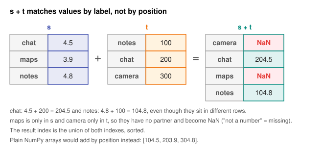

# Day 15: pandas: DataFrames and Series

**Phase 1 · Week 3 · ~90 minutes**

## Objectives

- [ ] Explain what a **Series** is (a NumPy array plus an index of labels) and what a **DataFrame** is (a set of Series sharing one index).
- [ ] Create both from Python lists and dicts, and from a list of records.
- [ ] Load a CSV with `pd.read_csv` and inspect it with `shape`, `columns`, `dtypes`, `index`, `head`, `tail`, `info` and `describe`.
- [ ] Predict how two Series combine (by **label**, not by position) and where `NaN` comes from.
- [ ] Explain why column arithmetic is fast (it is vectorized NumPy underneath) and get the NumPy array out with `.to_numpy()`.
- [ ] Read `info()` and `describe()` output critically and list what is wrong with a dataset before touching it.

**Prerequisites.** [Day 4](day-04-numpy-arrays.md) (arrays, `dtype`, vectorized operations) and [Day 8](day-08-shapes-indexing.md) (shapes, indexing, `[:, None]`).

---

## The big idea

Week 2 was all about NumPy arrays: grids of numbers with **one** dtype and **positions** (row 0, column 2). Real data doesn't look like that. A table of apps has a text name, a decimal rating, an integer review count and a date, side by side. And you want to say "the rating column of the Maps app", not "element `[1, 2]`".

**pandas** is the Python library for exactly this: labelled, mixed-type tables. Nearly every ML project starts in pandas (load, inspect, clean, combine), and ends by handing a clean NumPy array to the model. This week you'll do that whole journey on one realistic, deliberately messy dataset.

It has two core types:

- A **Series** is a single column: a 1-D NumPy array of values, plus an **index** that gives every value a label.
- A **DataFrame** is a table: several Series, one per column, that **share the same index**. Each column has its own dtype.

**Analogy.** A DataFrame is a spreadsheet where every column is a strictly typed list and the row labels down the left edge are glued to all of them. Cut the sheet into vertical strips with scissors and each strip, with a copy of the row labels, is a Series.

This lesson was tested on **pandas 3.0** (with NumPy 2.5). If you have pandas 2, almost everything is identical; the two differences that show up here are pointed out where they happen.

## Series: a labelled 1-D array

```python
import numpy as np
import pandas as pd

s = pd.Series([4.5, 3.9, 4.8], index=["chat", "maps", "notes"], name="rating")
print(s)
# chat     4.5
# maps     3.9
# notes    4.8
# Name: rating, dtype: float64
```

The left column is the **index** (the labels), the right column the **values**. The footer tells you the Series' `name` and its `dtype`. Take it apart:

```python
s.index         # Index(['chat', 'maps', 'notes'], dtype='str')
s.to_numpy()    # array([4.5, 3.9, 4.8])     a plain NumPy array (Day 4)
s.dtype         # dtype('float64')
s.shape         # (3,)
s.name          # 'rating'
```

<figure class="diagram" markdown>
![Animated diagram: a Series named rating drawn as two side-by-side columns, a grey index with labels chat, maps, notes and a blue values column 4.5, 3.9, 4.8; arrows show s.index is an Index object and s.to_numpy() is a contiguous float64 NumPy array of three 8-byte cells; then the lookup s["maps"] is animated: the label maps is found in the index, it sits at position 1, and values[1] = 3.9 is highlighted](../../assets/img/phase-1/day15-series-anatomy.svg)
<figcaption>Animated: a Series is a NumPy array plus an index. Looking up a label means finding its position, then reading the array.</figcaption>
</figure>

You can look up by **label** or by **position**:

```python
s["maps"]       # 3.9   by label
s.iloc[1]       # 3.9   by position (iloc = "integer location"; more on Day 16)
```

And everything you learned about NumPy works, because the values *are* a NumPy array. Operations run on the array, and the index rides along to label the result:

```python
s * 2
# chat     9.0
# maps     7.8
# notes    9.6
# Name: rating, dtype: float64

s > 4.0
# chat      True
# maps     False
# notes     True
# Name: rating, dtype: bool

s.max(), s.idxmax()   # (4.8, 'notes')   idxmax gives the LABEL of the largest value
```

In Jupyter or the REPL, a single number pulled out of pandas displays as a NumPy scalar, e.g. `(np.float64(4.8), 'notes')`. The comments in this lesson show the plain value, which is also what `print()` gives you.

If you don't give an index, pandas makes one: `0, 1, 2, ...`. A dict gives you labels for free:

```python
pd.Series([10, 20, 30])
# 0    10
# 1    20
# 2    30
# dtype: int64

pd.Series({"chat": 4.5, "maps": 3.9})
# chat    4.5
# maps    3.9
# dtype: float64
```

### The one thing NumPy never did: alignment by label

When you combine two Series, pandas **matches values by label**, not by position. This is the most important difference from NumPy, and the source of most "where did these NaNs come from?" moments.

```python
t = pd.Series([100, 200, 300], index=["notes", "chat", "camera"])

s + t
# camera      NaN
# chat      204.5
# maps        NaN
# notes     104.8
# dtype: float64

s.to_numpy() + t.to_numpy()     # array([104.5, 203.9, 304.8])   by position: chat + notes, ...
```

<figure class="diagram" markdown>

<figcaption>Values meet their partner with the same label. A label with no partner gets NaN.</figcaption>
</figure>

`NaN` ("not a number") is how pandas marks a **missing** value. The result's index is the union of both indexes, sorted. If you'd rather treat a missing partner as 0, say so explicitly: `s.add(t, fill_value=0)` gives `camera 300.0, chat 204.5, maps 3.9, notes 104.8`.

Alignment is a feature: in a table, row labels keep values attached to the right thing even after you sort or filter. But it means the index is never "just decoration".

!!! warning "Common mistake: missing values silently change the dtype"
    NumPy integer arrays have no way to store "missing", so pandas switches to `float64` and uses `NaN`:

    ```python
    pd.Series([1, 2, None])
    # 0    1.0
    # 1    2.0
    # 2    NaN
    # dtype: float64
    ```

    When an integer column you expected shows up as `float64`, check it for missing values first.

## DataFrame: a dict of Series sharing an index

The most common way to build a DataFrame by hand is a dict: **keys become column names, lists become columns**.

```python
df = pd.DataFrame({
    "name": ["Chat", "Maps", "Notes", "Camera"],
    "rating": [4.5, 3.9, 4.8, 4.2],
    "installs": [1_000_000, 50_000, 100_000, 500_000],
})
print(df)
#      name  rating  installs
# 0    Chat     4.5   1000000
# 1    Maps     3.9     50000
# 2   Notes     4.8    100000
# 3  Camera     4.2    500000
```

The unlabelled left column `0 1 2 3` is the index; we didn't give one, so pandas made a `RangeIndex`. Now pull the table apart:

<figure class="diagram" markdown>
![Animation: a 4-row DataFrame with a grey index column 0 to 3 and three columns name, rating and installs; the columns slide apart, each gets a dtype tag (str, float64, int64) and the label df["column"], and a faint copy of the index labels 0 to 3 appears beside each column, showing every column Series shares the same index; then the columns slide back together](../../assets/img/phase-1/day15-dataframe-split.svg)
<figcaption>Animated: a DataFrame is a set of column Series, each with one dtype, all sharing the same index.</figcaption>
</figure>

```python
df.shape      # (4, 3)          rows, columns   (an attribute, not a method: no parentheses)
len(df)       # 4               number of rows
df.columns    # Index(['name', 'rating', 'installs'], dtype='str')
df.index      # RangeIndex(start=0, stop=4, step=1)
df.dtypes
# name            str
# rating      float64
# installs      int64
# dtype: object
```

Each column has its **own** dtype, which is how a table can hold text and numbers at once while each column stays a fast, single-type array. One pair of brackets with a column name gives you that column as a Series; a **list** of names gives you a smaller DataFrame:

```python
type(df["rating"])              # pandas.Series
df["rating"]
# 0    4.5
# 1    3.9
# 2    4.8
# 3    4.2
# Name: rating, dtype: float64

type(df[["name", "rating"]])    # pandas.DataFrame   (note the double brackets)
```

!!! note "pandas 3: text columns are `str`"
    In pandas 3, text columns get the dedicated `str` dtype, as you see above. In pandas 2 they showed up as `object`, a generic "any Python object" dtype. Older tutorials and Stack Overflow answers will show `object`; for text it means the same thing.

The other common constructor takes a **list of records**, one dict per row. This is the shape your data arrives in from a JSON API:

```python
rows = [
    {"name": "Chat", "rating": 4.5, "installs": 1_000_000},
    {"name": "Maps", "rating": 3.9, "installs": 50_000},
]
pd.DataFrame(rows)
#    name  rating  installs
# 0  Chat     4.5   1000000
# 1  Maps     3.9     50000
```

### Choosing a meaningful index

Any column can become the index with `set_index`. Then you can look rows up by label with `.loc`:

```python
by_name = df.set_index("name")
print(by_name)
#         rating  installs
# name
# Chat       4.5   1000000
# Maps       3.9     50000
# Notes      4.8    100000
# Camera     4.2    500000

by_name.loc["Maps"]
# rating          3.9
# installs    50000.0
# Name: Maps, dtype: float64
```

Notice that a **row** came back as a Series too, labelled by column names. A Series has one dtype, so the integer `50000` was converted to the float `50000.0` to share the row with `3.9`. Columns are the natural unit in pandas; rows are assembled on demand. Day 16 covers `.loc` and `.iloc` properly.

!!! android "Android bridge"
    A DataFrame plays the role a Room table, or a `List<App>` of data classes, plays in your app, with one big difference in **memory layout**:

    ```kotlin
    data class App(val name: String, val rating: Double, val installs: Long)
    val apps = listOf(App("Chat", 4.5, 1_000_000), App("Maps", 3.9, 50_000))
    val avg = apps.map { it.rating }.average()
    ```

    A `List<App>` is **row-oriented**: each `App` is a separate object on the heap, and computing the average rating hops between objects. SQLite, which Room sits on, stores rows together too. A DataFrame is **column-oriented**: it is closer to keeping one `DoubleArray` of all ratings and one `LongArray` of all installs, side by side, with the index as a shared row key. `df["rating"].mean()` then scans one contiguous block of doubles in C. `df.dtypes` is the closest thing to your `@Entity` schema, and `set_index("name")` is like declaring a key column, except that a pandas index **is allowed to contain duplicates**, so don't rely on it being unique the way a `@PrimaryKey` is.

## Column operations are vectorized NumPy

Arithmetic on columns is element-wise and runs in compiled code, exactly like Day 4's arrays. No loops:

```python
df["installs_k"] = df["installs"] // 1000       # new column from an existing one
df["popular"] = df["installs"] >= 500_000       # a comparison gives a bool column
print(df)
#      name  rating  installs  installs_k  popular
# 0    Chat     4.5   1000000        1000     True
# 1    Maps     3.9     50000          50    False
# 2   Notes     4.8    100000         100    False
# 3  Camera     4.2    500000         500     True
```

Assigning to `df["new_name"]` adds a column (the right side must have one value per row, or be a single value that broadcasts, Day 9).

When it's time to feed a model, `.to_numpy()` hands you the underlying array. Select **numeric** columns first: a mix of text and numbers can only become an `object` array (an array of generic Python objects), which no model accepts.

```python
df["rating"].to_numpy()                   # array([4.5, 3.9, 4.8, 4.2])
X = df[["rating", "installs"]].to_numpy()
X.shape, X.dtype                          # ((4, 2), dtype('float64'))   rows × features, ready for Week 2's math
df.to_numpy().dtype                       # dtype('O')                   'O' = object: the text column forced it
```

You'll also see `.values` in older code. It does nearly the same thing, but the pandas docs recommend `.to_numpy()`.

!!! warning "Common mistake: chained assignment (pandas 3 changed this)"
    `df["rating"][0] = 5.0` looks like it sets one cell. In pandas 3 it **never** modifies `df`: every intermediate result behaves like a copy (a behaviour called **Copy-on-Write**), so you edit a temporary Series and throw it away. pandas warns with `ChainedAssignmentError: A value is being set on a copy of a DataFrame or Series through chained assignment.` Do it in one step instead: `df.loc[0, "rating"] = 5.0`. (In pandas 2 the chained version *sometimes* worked and sometimes raised the infamous `SettingWithCopyWarning`; that warning no longer exists in pandas 3.)

## First contact with the real dataset

From now until Day 19 we work with one dataset: `play_store_apps.csv`, 486 imaginary Android apps with realistic problems baked in. Load it straight from the course site:

```python
BASE = "https://manjulkadyan.github.io/ai-leaning/assets/data/"
apps = pd.read_csv(BASE + "play_store_apps.csv")
apps.shape      # (486, 12)
```

Offline? Download the file from the [Datasets](../../datasets.md) page and pass its local path instead: `pd.read_csv("play_store_apps.csv")`.

`read_csv` reads the header row as column names, makes a `RangeIndex`, and **guesses a dtype for each column** from its contents. Those guesses are the first clue to what is wrong with the data. The habit to build: never analyze a table you haven't looked at. Four views, every time.

### 1. `head()` and `tail()`: eyeball some rows

```python
cols = ["app_name", "category", "rating", "installs", "size_mb"]
print(apps[cols].head().to_string())
```
```text
            app_name      category  rating    installs size_mb
0     Bright Quest X  Productivity     3.8     50,000+    47.7
1      Quick Cleaner  Productivity     3.9  1,000,000+    11.4
2  Pocket Radio Kids         Tools     3.7  1,000,000+    26.8
3    Lumen Learn Pro         Games     4.0    100,000+   202.2
4        Quick Quest  productivity     NaN    100,000+    29.5
```

`head(n)` shows the first `n` rows (default 5), `tail(n)` the last. `.to_string()` prints every column without wrapping; with 12 columns, selecting a few keeps it readable. Already in five rows: `productivity` in lowercase next to `Productivity`, a missing rating, and installs written as text with commas and a `+`.

### 2. `info()`: one line per column

```python
apps.info()
```
```text
<class 'pandas.DataFrame'>
RangeIndex: 486 entries, 0 to 485
Data columns (total 12 columns):
 #   Column        Non-Null Count  Dtype
---  ------        --------------  -----
 0   app_id        486 non-null    str
 1   app_name      486 non-null    str
 2   category      486 non-null    str
 3   rating        468 non-null    float64
 4   reviews       486 non-null    int64
 5   installs      486 non-null    str
 6   size_mb       474 non-null    str
 7   price_usd     486 non-null    float64
 8   has_ads       486 non-null    str
 9   min_android   486 non-null    float64
 10  last_updated  486 non-null    str
 11  developer_id  486 non-null    str
dtypes: float64(3), int64(1), str(8)
memory usage: 45.7 KB
```

Read it as two checks per column. **Non-Null Count** below 486 means missing values. **Dtype** should match what the column means. (The memory figure is a shallow estimate; `apps.info(memory_usage="deep")` measures the strings too and reports 232.8 KB.)

### 3. `describe()`: summary statistics of the numeric columns

```python
print(apps.describe().round(2).to_string())
```
```text
       rating     reviews  price_usd  min_android
count  468.00      486.00     486.00       486.00
mean     4.17    17232.86       0.51        10.10
std      0.45   124059.08       1.80         1.66
min      2.90        1.00       0.00         7.00
25%      3.80      378.75       0.00         9.00
50%      4.20     1572.50       0.00        10.00
75%      4.50     7083.75       0.00        11.00
max      5.00  2525379.00       9.99        13.00
```

Only **4** of the 12 columns appear. `describe()` summarizes numeric columns by default, and it skipped `size_mb` and `installs` without a word, because `read_csv` loaded them as text.

### 4. `describe(exclude="number")`: the text columns

```python
print(apps.describe(exclude="number").to_string())
```
```text
                       app_id           app_name category installs             size_mb has_ads last_updated developer_id
count                     486                486      486      486                 474     486          486          486
unique                    480                480       26       10                 349       2          309           41
top     com.pocket.radio.kids  Pocket Radio Kids    Games  10,000+  Varies with device     Yes   2026-09-04         D020
freq                        2                  2      113      126                   8     303            6           22
```

For text, the summary is different: `count` (non-missing), `unique` (distinct values), `top` (the most common value) and `freq` (how often it occurs).

## What the statistics mean

`describe()` is eight formulas. Let's define each with the small `df` from earlier, ratings \( 4.5, 3.9, 4.8, 4.2 \).

**count** \( n \) is the number of non-missing values: \( n = 4 \). For `rating` in `apps` it is 468, not 486: missing values are skipped, not counted as zero.

**mean** \( \bar{x} \) ("x bar") is the average. With \( x_i \) the \( i \)-th value and \( \sum \) meaning "add up for \( i = 1 \) to \( n \)":

\[
\bar{x} = \frac{1}{n}\sum_{i=1}^{n} x_i = \frac{4.5 + 3.9 + 4.8 + 4.2}{4} = \frac{17.4}{4} = 4.35
\]

**std** \( s \) is the standard deviation, the typical distance of a value from the mean. pandas uses the **sample** standard deviation, which divides by \( n - 1 \):

\[
s = \sqrt{\frac{1}{n-1}\sum_{i=1}^{n} (x_i - \bar{x})^2}
\]

Worked example: the distances from 4.35 are \( 0.15, -0.45, 0.45, -0.15 \). Squared: \( 0.0225, 0.2025, 0.2025, 0.0225 \), which add up to \( 0.45 \). Divide by \( n - 1 = 3 \) to get \( 0.15 \), and \( \sqrt{0.15} = 0.3873 \).

**min / max** are the smallest and largest values.

**25% / 50% / 75%** are **percentiles** (also called quartiles): the value below which that fraction of the data lies. 50% is the **median**, the middle value. pandas sorts the values (\( 3.9, 4.2, 4.5, 4.8 \)), numbers them from position 0 to \( n - 1 = 3 \), and for percentile \( p \) looks at position \( p \cdot (n - 1) \), blending linearly between neighbours when that lands between two values:

- 25%: position \( 0.25 \times 3 = 0.75 \), three quarters of the way from 3.9 to 4.2: \( 3.9 + 0.75 \times 0.3 = 4.125 \).
- 50%: position 1.5, halfway between 4.2 and 4.5: \( 4.35 \).
- 75%: position 2.25: \( 4.5 + 0.25 \times 0.3 = 4.575 \).

```python
print(df[["rating"]].describe())
#          rating
# count  4.000000
# mean   4.350000
# std    0.387298
# min    3.900000
# 25%    4.125000
# 50%    4.350000
# 75%    4.575000
# max    4.800000
```

!!! warning "Common mistake: pandas and NumPy disagree on std (and on NaN)"
    NumPy's `std` divides by \( n \) (the **population** formula) unless you pass `ddof=1` ("delta degrees of freedom": divide by \( n - \text{ddof} \)). pandas divides by \( n - 1 \) by default. Same data, two answers:

    ```python
    r = df["rating"]
    r.std()                   # 0.3872983346207416   pandas: n - 1
    r.to_numpy().std()        # 0.3354101966249684   NumPy:  n
    r.std(ddof=0)             # 0.3354101966249684   make pandas match NumPy
    ```

    pandas also **skips** `NaN`, while NumPy propagates it: `apps["rating"].mean()` is `4.1662...`, but `apps["rating"].to_numpy().mean()` is `nan`. Use `np.nanmean` if you leave pandas.

## Reading the warning lights

You haven't changed a single value yet, but those four views already list the cleaning work for Day 17. This is the point of first contact: **find the problems, write them down, fix nothing yet**. Fixing before you've seen everything leads to fixes that create new problems.

| What the output shows | Where | What it means |
|---|---|---|
| `rating`: 468 non-null of 486 | `info()` | 18 apps have no rating (unrated apps). |
| `size_mb`: dtype `str`, 474 non-null | `info()` | A numeric column loaded as text, plus 12 missing values. |
| `size_mb`: top value `Varies with device` (8 times) | `describe(exclude="number")` | The reason for the text dtype: one non-number turns the whole column into `str`. |
| `installs`: dtype `str`, 10 unique values | `info()`, `describe` | Install **buckets** like `1,000,000+`, stored as text with commas and `+`. You can't sort or average them yet. |
| `last_updated`: dtype `str` | `info()` | Dates as text. "Which apps were updated in 2026?" needs real dates. |
| `has_ads`: dtype `str`, 2 unique values | `describe` | `Yes` / `No` strings that really mean `True` / `False`. |
| `min_android`: `float64`, mean 10.10 | `describe()` | Versions like `8.0` and `13` loaded as floats. An "average Android version of 10.1" is meaningless. |
| `category`: 26 unique values | `describe` | Far too many for a handful of real store categories: `Productivity`, `productivity`, `PRODUCTIVITY`, `Productivity ` (trailing space)... |
| `app_id`: 480 unique of 486 | `describe` | 6 rows repeat an app that already appears: duplicates. |
| `reviews`: mean 17,233 but median 1,572, max 2,525,379 | `describe()` | Not an error, but **very skewed**: a few hits have most of the reviews, so the mean describes almost no real app. |
| `price_usd`: 25%, 50% and 75% all 0.00 | `describe()` | Not an error: most apps are free. Means of price will be dragged around by a few paid ones. |
| `developer_id`: 41 unique | `describe` | `developers.csv` has 40 developers, so one ID here has no match. That matters when we join the tables on Day 18. |

You can peek at the category mess directly (fixing it is Day 17's job):

```python
apps["category"].unique().tolist()[:12]
# ['Productivity', 'Tools', 'Games', 'productivity', 'Finance', 'Education',
#  'Health & Fitness', 'Photography', 'tools', 'games', 'PRODUCTIVITY', 'Music & Audio']
```

!!! warning "Common mistake: trusting `describe()` as the full picture"
    `describe()` with no arguments only covers numeric columns, and numeric-looking columns stored as text simply vanish from it. Always run `info()` first and ask of each column, "is this the dtype it should be?" A column you expected to be a number but that shows `str` is the most common sign of dirty data.

!!! example "Try it"
    Run `apps.sample(5, random_state=0)` a few times with different `random_state` values. `head()` only ever shows the top of the file, and files are often sorted, so a random sample is a fairer look. Spot any problem from the table above in your sample.

---

## Exercises

1. **Your phone's storage.** Build a Series of 5 app sizes in MB with app names as the index: Maps 180.5, Photos 95.0, Notes 42.3, Game 310.8, Clock 12.1, and `name="size_mb"`. Find the largest app's label and size, the total, and the sizes in GB (divide by 1024, round to 3 decimals).
2. **Records to a table.** Turn this list of records into a DataFrame: `Pixel A` (8 GB RAM, $499), `Pixel Pro` (16, $999), `Galaxy M` (6, $299), `Moto G` (4, $199), with keys `model`, `ram_gb`, `price_usd`. Print its shape and dtypes, add a `usd_per_gb` column, then make `model` the index and look up the `usd_per_gb` of the Galaxy M.
3. **Predict, then run.** With `a = pd.Series([1, 2, 3], index=["x", "y", "z"])` and `b = pd.Series([10, 20, 30], index=["z", "y", "x"])`, write down `a + b` and `a.to_numpy() + b.to_numpy()` before running them. Then predict `a + pd.Series([10, 20], index=["x", "w"])`, including its dtype.
4. **Audit the dtypes.** For `apps`: how many columns of each dtype are there (hint: `apps.dtypes` is itself a Series, so it has `.value_counts()`)? Which columns are numeric (`apps.select_dtypes(include="number")`)? How many missing values does each column have? Use only `len(apps)` and `apps.count()`, which counts the non-missing values per column.
5. **Mean vs median.** Compute the mean, median and max of `apps["reviews"]`. How many times bigger is the mean than the median? How many of the 486 apps have more reviews than the mean? What does that tell you about using the mean here?
6. **Two standard deviations.** Compute the std of `apps["rating"]` with pandas, then with `np.std` on `.to_numpy()`. Explain the `nan`, fix it with `np.nanstd`, then make NumPy agree with pandas exactly.

??? success "Solutions"
    ```python
    import numpy as np
    import pandas as pd

    # 1
    sizes = pd.Series([180.5, 95.0, 42.3, 310.8, 12.1],
                      index=["Maps", "Photos", "Notes", "Game", "Clock"], name="size_mb")
    sizes.idxmax(), sizes.max()      # ('Game', 310.8)
    sizes.sum()                      # 640.7
    (sizes / 1024).round(3)
    # Maps      0.176
    # Photos    0.093
    # Notes     0.041
    # Game      0.304
    # Clock     0.012
    # Name: size_mb, dtype: float64

    # 2
    phones = [
        {"model": "Pixel A", "ram_gb": 8, "price_usd": 499},
        {"model": "Pixel Pro", "ram_gb": 16, "price_usd": 999},
        {"model": "Galaxy M", "ram_gb": 6, "price_usd": 299},
        {"model": "Moto G", "ram_gb": 4, "price_usd": 199},
    ]
    p = pd.DataFrame(phones)
    p.shape          # (4, 3)
    p.dtypes
    # model          str
    # ram_gb       int64
    # price_usd    int64
    # dtype: object
    p["usd_per_gb"] = p["price_usd"] / p["ram_gb"]
    print(p)
    #        model  ram_gb  price_usd  usd_per_gb
    # 0    Pixel A       8        499   62.375000
    # 1  Pixel Pro      16        999   62.437500
    # 2   Galaxy M       6        299   49.833333
    # 3     Moto G       4        199   49.750000
    p.set_index("model").loc["Galaxy M", "usd_per_gb"]    # 49.833333333333336

    # 3
    a = pd.Series([1, 2, 3], index=["x", "y", "z"])
    b = pd.Series([10, 20, 30], index=["z", "y", "x"])
    a + b
    # x    31
    # y    22
    # z    13
    # dtype: int64
    a.to_numpy() + b.to_numpy()      # array([11, 22, 33])   by position
    a + pd.Series([10, 20], index=["x", "w"])
    # w     NaN
    # x    11.0
    # y     NaN
    # z     NaN
    # dtype: float64     NaN can't live in an int64 array, so the result is float64
    ```

    For 4 to 6, first load the data as in the lesson (`apps = pd.read_csv(BASE + "play_store_apps.csv")`).

    ```python
    # 4
    apps.dtypes.value_counts()
    # str        8
    # float64    3
    # int64      1
    # Name: count, dtype: int64
    apps.select_dtypes(include="number").columns.tolist()
    # ['rating', 'reviews', 'price_usd', 'min_android']
    len(apps) - apps.count()         # missing per column: rating 18, size_mb 12, every other column 0

    # 5
    rv = apps["reviews"]
    rv.mean(), rv.median(), rv.max()     # (17232.85802469136, 1572.5, 2525379)
    round(rv.mean() / rv.median(), 1)    # 11.0
    (rv > rv.mean()).sum()               # 69
    ```
    Only 69 of 486 apps (14%) are above the "average". One app alone has 2.5 million reviews and pulls the mean up. For skewed data like this the median is the better "typical value"; Day 19 shows the same skew on a log-scale plot.

    ```python
    # 6
    r = apps["rating"]
    r.std()                              # 0.45407170805131253
    arr = r.to_numpy()
    np.std(arr)                          # nan     the 18 NaNs poison the sum
    np.nanstd(arr)                       # 0.4535863292829194    skips NaN, but divides by n
    np.nanstd(arr, ddof=1)               # 0.45407170805131253   now identical to pandas
    ```

## Resources

- [pandas: 10 minutes to pandas](https://pandas.pydata.org/docs/user_guide/10min.html): the official quick tour of Series, DataFrames and the most common operations.
- [pandas: Intro to data structures](https://pandas.pydata.org/docs/user_guide/dsintro.html): Series, DataFrame and label alignment explained in depth.
- [pandas: Getting started tutorials](https://pandas.pydata.org/docs/getting_started/intro_tutorials/index.html): short illustrated lessons, starting with "What kind of data does pandas handle?".
- [pandas: Copy-on-Write](https://pandas.pydata.org/docs/user_guide/copy_on_write.html): why chained assignment no longer works in pandas 3.
- [Python Data Science Handbook: Introducing Pandas Objects](https://jakevdp.github.io/PythonDataScienceHandbook/03.01-introducing-pandas-objects.html): free book chapter, "Series as specialized dictionary", "DataFrame as a dict of Series".
- [Kaggle Learn: Pandas](https://www.kaggle.com/learn/pandas): free, short, hands-on micro-course with exercises in the browser.

## Checklist

- [ ] I can explain a Series as "NumPy array + index + name" and a DataFrame as "Series sharing an index".
- [ ] I can build a DataFrame from a dict of lists and from a list of records.
- [ ] I can predict where `NaN` appears when two Series with different labels are combined.
- [ ] I know `df["col"]` gives a Series and `df[["a", "b"]]` gives a DataFrame.
- [ ] I can get a float NumPy array out of the numeric columns with `.to_numpy()`.
- [ ] I set single values with `df.loc[row, col] = value`, never `df[col][row] = value`.
- [ ] I run `head()`, `info()` and `describe()` (both kinds) on every new dataset, and I can list most of the warning lights in the table above from memory.
- [ ] I know pandas' `std` divides by \( n - 1 \) and skips `NaN`, and NumPy's doesn't.

**Next:** [Day 16: Selecting, filtering and sorting](day-16-pandas-selecting.md)
