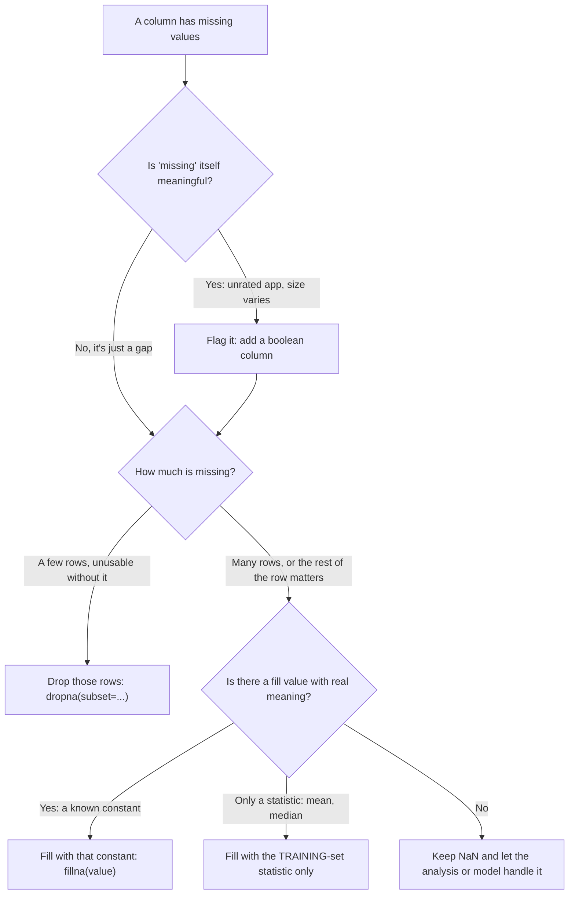
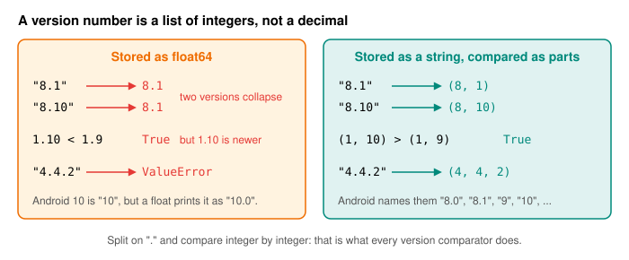

# Day 17: Missing Data and Cleaning

**Phase 1 · Week 3 · ~90 minutes**

## Objectives

- [ ] Audit a fresh DataFrame for mess: wrong dtypes, missing values, duplicates and inconsistent text.
- [ ] Find and drop exact duplicate rows, and show the before/after row counts.
- [ ] Normalize messy category text with `.str.strip().str.title()` and know where `.title()` goes wrong.
- [ ] Detect missing values with `isna`, and choose between dropping, filling and flagging them, for a reason.
- [ ] Convert text columns into real types: installs to `int64`, sizes to `float64`, dates to `datetime64`, Android versions to proper version strings.
- [ ] Explain data leakage when filling with statistics, and why fill values come from the training set only.
- [ ] Wrap every step in a reusable `clean_apps(df)` function.

**Prerequisites.** [Day 15](day-15-pandas-dataframes.md) (`read_csv`, `info`, `dtypes`, Series vs DataFrame) and [Day 16](day-16-pandas-selecting.md) (`.loc`, boolean masks, `assign`, `value_counts`).

---

## The big idea

Real data arrives dirty. The same category spelled four ways, numbers stored as text with commas in them, blanks where a value should be, the same row twice. A model, or a chart, or a `groupby`, can't fix any of that. It will happily compute nonsense: "Games" and "games" become two different categories, and you can't add up install counts that are strings.

**Cleaning** means making every column mean one thing and have one type, while keeping the honest gaps (missing values) visible instead of papering over them.

**Analogy.** Think of an airport bag check. Every bag goes through the same fixed stations in the same order: weigh it, scan it, tag it. Nobody inspects bags "by eye" at the gate. Cleaning is the same: a fixed sequence of steps that every row passes through, written once as a function, so tomorrow's file gets exactly the same treatment as today's.

This lesson works through every documented problem in the course dataset (see the [Datasets page](../../datasets.md)) and ends with one function, `clean_apps(df)`, that you'll reuse for the rest of the week. The code was tested on pandas 3.0.

## Step 0: audit before you touch anything

Load the data the usual way:

```python
import numpy as np
import pandas as pd

BASE = "https://manjulkadyan.github.io/ai-leaning/assets/data/"
raw = pd.read_csv(BASE + "play_store_apps.csv")    # or a local path after downloading
raw.shape    # (486, 12)
```

(If you're offline, download `play_store_apps.csv` from the [Datasets page](../../datasets.md) and pass its path instead.) We call it `raw` and never modify it, so you can always compare before and after.

`.info()` is the single most useful audit call. It shows each column's dtype and how many values are **not** missing:

```python
raw.info()
```

```text
<class 'pandas.DataFrame'>
RangeIndex: 486 entries, 0 to 485
Data columns (total 12 columns):
 #   Column        Non-Null Count  Dtype  
---  ------        --------------  -----  
 0   app_id        486 non-null    str    
 1   app_name      486 non-null    str    
 2   category      486 non-null    str    
 3   rating        468 non-null    float64
 4   reviews       486 non-null    int64  
 5   installs      486 non-null    str    
 6   size_mb       474 non-null    str    
 7   price_usd     486 non-null    float64
 8   has_ads       486 non-null    str    
 9   min_android   486 non-null    float64
 10  last_updated  486 non-null    str    
 11  developer_id  486 non-null    str    
dtypes: float64(3), int64(1), str(8)
memory usage: 45.7 KB
```

Read it like a code review. Each line below is a problem to fix:

| Column | What `.info()` tells you | Why it's a problem |
|---|---|---|
| `installs` | `str` | "Install count" should be a number. It's text like `"1,000,000+"`. |
| `size_mb` | `str`, 474 non-null | A size should be a float. Some rows say `"Varies with device"`, so pandas gave up and kept text. And 12 are missing. |
| `last_updated` | `str` | Dates as text can't be subtracted, and sorting them only works by luck of the format. |
| `min_android` | `float64` | Looks fine, but `10.0` is not how Android versions work (more below). |
| `rating` | 468 non-null | 18 apps have no rating. |

Two problems `.info()` can't show: duplicate rows and inconsistent spelling. You find those with two more calls:

```python
raw.duplicated().sum()        # 6      rows that exactly repeat an earlier row
raw["category"].nunique()     # 26     distinct category strings... for 8 real categories
```

Pandas 3 note: text columns now get the dedicated `str` dtype (pandas 2 showed them as `object`). Missing values in a `str` column are still `NaN`.

<figure class="diagram" markdown>

<figcaption>Animated: the six steps of this lesson, applied to one illustrative messy row. Each step fixes one column and its dtype.</figcaption>
</figure>

## Step 1: exact duplicate rows

`duplicated()` returns a boolean Series: `True` for every row that is an exact copy of an **earlier** row (all 12 columns equal). `keep=False` marks every copy instead, which is handy for looking at them side by side:

```python
raw.duplicated().sum()               # 6
raw.duplicated(keep=False).sum()     # 12    6 pairs

cols = ["app_id", "app_name", "rating", "installs"]
print(raw[raw.duplicated(keep=False)].sort_values("app_id")[cols].head(4).to_string())
#                    app_id          app_name  rating  installs
# 6    com.calm.camera.plus  Calm Camera Plus     4.6   50,000+
# 383  com.calm.camera.plus  Calm Camera Plus     4.6   50,000+
# 277     com.lumen.quest.x     Lumen Quest X     4.1  100,000+
# 354     com.lumen.quest.x     Lumen Quest X     4.1  100,000+
```

Drop them, keeping the first copy:

```python
dedup = raw.drop_duplicates(ignore_index=True)
len(raw), len(dedup)          # (486, 480)
dedup["app_id"].is_unique     # True    one row per app now
```

`ignore_index=True` renumbers the rows `0 … 479`. Without it the index keeps gaps where the dropped rows were (the last label would still be `485`), which surprises you later with `.loc`.

!!! warning "Common mistake: deduplicating on the wrong columns"
    `drop_duplicates()` with no arguments only drops rows that match in **every** column, which is the safe default. `drop_duplicates(subset="app_id")` would also drop two *different* rows for the same app (say, an old and a new scrape) and silently keep whichever came first. Here both checks agree (after the exact drop, `app_id` is unique), but always check that before reaching for `subset=`.

## Step 2: normalize the category text

Look at all the spellings of one category:

```python
mask = dedup["category"].str.contains("games", case=False)
print(dedup.loc[mask, "category"].value_counts().to_string())
# category
# Games     111
#  Games      5
# games       1
# GAMES       1
```

Four strings, one meaning. Two different kinds of mess: **whitespace** (`" Games"` has a leading space, others in the file have trailing spaces) and **case**. Two string methods fix both, applied to the whole column at once through the `.str` accessor:

- `.str.strip()` removes whitespace from both ends.
- `.str.title()` makes the first letter of every word uppercase and the rest lowercase.

```python
category = dedup["category"].str.strip().str.title()
category.nunique()            # 8
print(category.value_counts().to_string())
# category
# Games               118
# Tools                77
# Education            68
# Productivity         64
# Photography          48
# Health & Fitness     40
# Music & Audio        35
# Finance              30
```

26 spellings became 8 categories, and `Games` grew from 111 to 118.

**Does `.title()` survive the `&`?** Two of our categories contain an ampersand, so check before trusting it:

```python
"health & fitness".title()     # 'Health & Fitness'
"MUSIC & AUDIO".title()        # 'Music & Audio'
"kid's games".title()          # "Kid'S Games"     !!
"3d games".title()             # '3D Games'
```

Python's `title()` starts a new "word" after **any** character that isn't a letter. A space or `&` is a boundary, so both of our categories come out right. But an apostrophe is a boundary too, so `kid's` becomes `Kid'S`. Our dataset has no apostrophes (you'll assert the exact 8 names in the exercises), but if yours does, use `string.capwords`, which only splits on whitespace: `string.capwords("kid's games")` gives `"Kid's Games"`. On a whole column that is `s.map(string.capwords)` (after `import string`).

!!! warning "Common mistake: normalizing case but not whitespace"
    `.str.lower()` alone turns `" Games"` into `" games"`, still different from `"games"`. Trailing spaces are invisible when you print a table, which is exactly why they survive. Print `repr()` of the unique values (`sorted(map(repr, s.unique()))`) when counts look off.

## Missing values: what NaN is

Pandas marks a missing value as `NaN` ("not a number", a special float value). In `str` columns it's also `NaN`; in datetime columns it's `NaT` ("not a time"). The rules that matter:

```python
np.nan == np.nan       # False   NaN is not equal to anything, even itself
pd.isna(np.nan)        # True    so always test with isna / notna, never ==
pd.isna(None)          # True

s = pd.Series([4.5, np.nan, 3.0])
s.sum(), s.count(), len(s)   # (7.5, 2, 3)
s.mean()                     # 3.75
s.mean(skipna=False)         # nan
```

Pandas reductions **skip** missing values by default. In math, the mean over the \( n_{\text{obs}} \) observed values is

\[
\bar{x} = \frac{1}{n_{\text{obs}}} \sum_{i \in \text{obs}} x_i
\]

- \( x_i \): the \( i \)-th value of the column.
- \( \text{obs} \): the set of positions that are **not** missing.
- \( n_{\text{obs}} \): how many of those there are (what `.count()` returns, not `len`).
- \( \bar{x} \) ("x bar"): the mean.

Worked example: for `[4.5, NaN, 3.0]`, \( n_{\text{obs}} = 2 \), so \( \bar{x} = (4.5 + 3.0) / 2 = 3.75 \), not \( 7.5 / 3 = 2.5 \). Convenient, but it means a column that is 90% missing still gives you a confident-looking mean. Always know your **missing rate**:

```python
dedup["rating"].isna().sum()             # 18
dedup["rating"].isna().mean().round(3)   # 0.038   isna() is True/False, so its mean is the fraction
```

\( 18 / 480 = 0.0375 \): under 4% of apps have no rating.

## Drop, fill or flag?

There are three things you can do with a missing value, and none of them is "always right":

- **Drop** the rows: `df.dropna(subset=["rating"])`. Simple and honest, but you lose the whole row, including all its other good columns.
- **Fill** it: `df["rating"].fillna(value)`. Keeps the row, but you're inventing data.
- **Flag** it: add a boolean column like `rating_missing`. Keeps the fact that it was missing, which is often information in itself: an app with no rating might be brand new.



Here is what each costs on our 480 rows:

```python
len(dedup.dropna())                     # 450   drops a row if ANY column is missing (rating or size)
len(dedup.dropna(subset=["rating"]))    # 462   only rows missing a rating

r = dedup["rating"]
r.median()                              # 4.2
filled = r.fillna(r.median())
r.std().round(3), filled.std().round(3) # (0.454, 0.445)   filling shrinks the spread

flagged = dedup.assign(rating_missing=dedup["rating"].isna())
print(flagged.loc[[4, 7], ["app_name", "rating", "rating_missing"]].to_string())
#          app_name  rating  rating_missing
# 4     Quick Quest     NaN            True
# 7  Spark Camera X     NaN            True
```

Notice what the median fill did: 18 apps now claim a rating of exactly 4.2 that nobody gave them, and the standard deviation (the typical spread, from Day 9) dropped, because we added 18 values right in the middle. A model trained on that believes ratings are more uniform than they are.

**Our decision for this dataset:** `clean_apps` will *not* fill ratings or sizes. Cleaning fixes things that are objectively wrong (wrong type, wrong spelling, repeated rows). Whether to drop, fill or flag a gap depends on the question you ask later, so that decision belongs to the analysis or the model, not to the cleaning function.

!!! warning "Common mistake: data leakage from filling with statistics"
    In Phase 2 you'll split data into a **training set** (the model learns from it) and a **test set** (held back to measure how well it does on data it has never seen). If you compute the fill value, a mean, a median, a min/max for scaling, on the *whole* dataset before splitting, information from the test rows leaks into training. Your test score then looks better than real life will be. The rule: **compute statistics on the training set only, then apply those same numbers to the test set.**

    ```python
    rng = np.random.default_rng(17)
    idx = rng.permutation(len(apps))                  # apps = clean_apps(raw), defined below
    train, test = apps.iloc[idx[:384]], apps.iloc[idx[384:]]

    round(train["rating"].mean(), 3), round(apps["rating"].mean(), 3)   # (4.175, 4.166)  train vs all rows

    fill = train["rating"].median()                   # 4.2   learned from train only
    train = train.assign(rating=train["rating"].fillna(fill))
    test = test.assign(rating=test["rating"].fillna(fill))   # same number, not test's own median
    ```

    Here the numbers barely differ, but the habit matters: on small or shifting data the gap is real. Scikit-learn's `SimpleImputer` and `Pipeline` exist to enforce exactly this; you'll meet them in Phase 2.

## Step 3: installs from text to int

`"1,000,000+"` is a **bucket label**: "at least a million installs". Casting it directly fails:

```python
dedup["installs"].astype(int)
# ValueError: invalid literal for int() with base 10: '50,000+'
```

Remove the comma and the plus, then cast:

```python
installs = (dedup["installs"]
            .str.replace(",", "", regex=False)
            .str.replace("+", "", regex=False)
            .astype("int64"))
installs.dtype                       # dtype('int64')
installs.head(3).tolist()            # [50000, 1000000, 1000000]
installs.min(), installs.max()       # (1000, 100000000)
```

`regex=False` says "this is a literal character, not a pattern". It's the default since pandas 2, but write it anyway: in a regular expression `+` means "one or more of the previous thing", and `.str.replace("+", "", regex=True)` fails with `nothing to repeat at position 0`.

Keep in mind what the number means: `1000000` is the *lower bound* of a bucket, not an exact count. It's fine for sorting and grouping; summing it gives "at least this many".

!!! android "Android bridge"
    This is the DTO-to-domain mapping you already write. Retrofit hands you a `AppDto(installs: String, sizeMb: String?)` straight from JSON, and you never let that reach the UI: a mapper turns it into `App(installs: Long, sizeMb: Float?)`, e.g. `dto.installs.replace(",", "").removeSuffix("+").toLong()`. A missing value becomes `null` in Kotlin and `NaN` in pandas, and in both worlds the type (`Float?`) tells every caller "this can be absent". `clean_apps` below is that mapper, applied to 480 rows at once.

## Step 4: size_mb, "Varies with device" → NaN → float

```python
s = dedup["size_mb"]
(s == "Varies with device").sum(), s.isna().sum()    # (8, 12)

s.astype(float)
# ValueError: could not convert string to float: 'Varies with device'

size = s.replace("Varies with device", np.nan).astype("float64")
size.dtype, size.isna().sum()      # (dtype('float64'), 20)
```

Replace the known placeholder with `NaN`, then cast. 12 truly missing + 8 "varies" = 20 `NaN`. Note that we lost a distinction: "unknown" and "depends on the device" now look the same. If that matters for your question, flag it *before* converting (exercise 3).

!!! warning "Common mistake: `errors="coerce"` as a first resort"
    `pd.to_numeric(s, errors="coerce")` turns anything unparseable into `NaN`. It's tempting, and it hides problems you'd want to know about:

    ```python
    pd.to_numeric(pd.Series(["12.5", "Varies with device", "1,024", "7 MB"]), errors="coerce").tolist()
    # [12.5, nan, nan, nan]
    ```

    `"1,024"` and `"7 MB"` were perfectly good sizes, now silently gone. Replace the placeholders you *know* about, then use a strict `astype`, so any surprise raises an error instead of becoming a gap.

## Step 5: last_updated, text → datetime

```python
lu = pd.to_datetime(dedup["last_updated"], format="%Y-%m-%d")
lu.dtype                    # dtype('<M8[us]')    i.e. datetime64[us]
lu.min(), lu.max()          # (Timestamp('2023-02-19 00:00:00'), Timestamp('2026-09-30 00:00:00'))
print(lu.dt.year.value_counts().sort_index().to_string())
# last_updated
# 2023      7
# 2024     15
# 2025    121
# 2026    337
```

`format="%Y-%m-%d"` states the format explicitly (4-digit year, month, day), so pandas never guesses and a row in another format raises an error instead of being misread (is `10/02/2026` October 2 or February 10?). Once it's a datetime you get the `.dt` accessor (`.dt.year`, `.dt.month`, `.dt.day_name()`) and real date arithmetic: subtracting two dates gives a duration.

Why not leave it as text? Text dates only sort correctly when every one is zero-padded: `"2026-2-10" < "2026-10-01"` is `False` as strings, because `"2"` comes after `"1"`.

## Step 6: min_android, float → version string

The CSV stores `min_android` as `7.0, 8.0, 9.0, … 13.0`, so pandas parsed it as `float64`. But a version is not a decimal number:

<figure class="diagram" markdown>

<figcaption>A version is a list of integers separated by dots. A float can't hold it.</figcaption>
</figure>

```python
float("8.1") == float("8.10")    # True    two different versions collapse into one
float("1.10") < float("1.9")     # True    but version 1.10 comes after 1.9
float("4.4.2")                   # ValueError: could not convert string to float: '4.4.2'
```

Android's own names are `"7.0"` (Nougat), `"8.0"` and `"8.1"` (Oreo), then plain `"9"`, `"10"`, `"11"`, … from Android 9 on. So the clean form is a string in that style:

```python
def to_version(v: float) -> str:
    return f"{v:.1f}" if v < 9 else str(int(v))    # 8.0 → "8.0", 10.0 → "10"

min_android = dedup["min_android"].map(to_version).astype("str")
print(min_android.value_counts().to_string())
# min_android
# 10     116
# 11      98
# 8.0     72
# 9       66
# 12      59
# 13      41
# 7.0     28
```

Strings fix the identity problem but not ordering: `sorted(["10", "9", "8.0"])` gives `['10', '8.0', '9']`, alphabetical. When you need to compare versions, split into integers:

```python
sorted(min_android.unique(), key=lambda v: tuple(int(p) for p in v.split(".")))
# ['7.0', '8.0', '9', '10', '11', '12', '13']
```

!!! android "Android bridge"
    You know the number Android itself compares: the **API level**. In Gradle you write `minSdk = 26`, not `minSdk = 8.0`, and at runtime you check `Build.VERSION.SDK_INT >= Build.VERSION_CODES.Q` (29). The version name ("8.0", "10") is a human label; the API level is the integer that orders correctly. Exercise 2 maps one to the other.

## The reusable function: `clean_apps`

Each step worked on its own. Now put them in one function, in order, so every future load gets identical treatment:

```python
import numpy as np
import pandas as pd


def clean_apps(df: pd.DataFrame) -> pd.DataFrame:
    """Return a cleaned copy of the Play Store apps table. The input is not modified."""
    out = df.drop_duplicates(ignore_index=True)
    return out.assign(
        category=out["category"].str.strip().str.title(),
        installs=(out["installs"]
                  .str.replace(",", "", regex=False)
                  .str.replace("+", "", regex=False)
                  .astype("int64")),
        size_mb=out["size_mb"].replace("Varies with device", np.nan).astype("float64"),
        last_updated=pd.to_datetime(out["last_updated"], format="%Y-%m-%d"),
        min_android=out["min_android"].map(
            lambda v: f"{v:.1f}" if v < 9 else str(int(v))
        ).astype("str"),
    )


raw = pd.read_csv(BASE + "play_store_apps.csv")
apps = clean_apps(raw)
raw.shape, apps.shape          # ((486, 12), (480, 12))
print(raw["installs"].dtype)   # str     raw is untouched
```

`assign` (Day 16) returns a new DataFrame with the listed columns replaced, so the function never mutates its input. You can also call it in a chain: `pd.read_csv(path).pipe(clean_apps)`.

**Before and after**, computed from `raw` and `apps`:

```text
                           before  after
rows                          486    480
duplicate rows                  6      0
category spellings             26      8
rating NaN                     18     18
size_mb NaN                    12     20
size 'Varies with device'       8      0
```

```text
               before           after
app_id            str             str
app_name          str             str
category          str             str
rating        float64         float64
reviews         int64           int64
installs          str           int64
size_mb           str         float64
price_usd     float64         float64
has_ads           str             str
min_android   float64             str
last_updated      str  datetime64[us]
developer_id      str             str
```

(The second table is `pd.DataFrame({"before": raw.dtypes.astype(str), "after": apps.dtypes.astype(str)})`.) And three rows side by side:

```python
cols = ["app_name", "category", "installs", "size_mb", "min_android", "last_updated"]
print(raw.loc[[0, 1, 2], cols].to_string())
#             app_name      category    installs size_mb  min_android last_updated
# 0     Bright Quest X  Productivity     50,000+    47.7          9.0   2026-02-10
# 1      Quick Cleaner  Productivity  1,000,000+    11.4          7.0   2024-12-19
# 2  Pocket Radio Kids         Tools  1,000,000+    26.8          7.0   2026-05-24
print(apps.loc[[0, 1, 2], cols].to_string())
#             app_name      category  installs  size_mb min_android last_updated
# 0     Bright Quest X  Productivity     50000     47.7           9   2026-02-10
# 1      Quick Cleaner  Productivity   1000000     11.4         7.0   2024-12-19
# 2  Pocket Radio Kids         Tools   1000000     26.8         7.0   2026-05-24
```

The rows look almost the same printed, but now `apps["installs"].sum()` is `217463000` instead of an error, and the dates can be subtracted.

!!! warning "Common mistake: chained assignment (and why the function uses `assign`)"
    Under pandas 3's Copy-on-Write, `df[df["rating"].isna()]["rating"] = 0.0` **never** changes `df`: the first `[...]` produces a new object and you write into that. Pandas 3 emits a `ChainedAssignmentError` warning and `df` keeps all 18 `NaN`. (Pandas 2 printed a `SettingWithCopyWarning` and *sometimes* worked, which was worse.) Write in one step with `df.loc[df["rating"].isna(), "rating"] = 0.0`, or build new columns with `assign` as `clean_apps` does.

!!! warning "Common mistake: cleaning twice"
    `clean_apps(apps)` fails with `AttributeError: Can only use .str accessor with string values, not integer`, because `installs` is already an int. Clean exactly once, right after loading, and keep `raw` and `apps` as separate names.

---

## Exercises

1. **`has_ads` to bool.** Convert `has_ads` (`"Yes"`/`"No"`) into a real boolean column with `.map`. Check there are no `NaN` (a typo like `"yes"` would become `NaN`), then find the fraction of apps with ads.
2. **API levels.** Add a `min_sdk` integer column to `apps` by mapping the version string to its API level: 7.0 → 24, 8.0 → 26, 9 → 28, 10 → 29, 11 → 30, 12 → 31, 13 → 33. How many apps require API 29 (Android 10) or higher?
3. **Keep the "varies" information.** Starting from `raw`, build a boolean `size_varies` column that is `True` only for `"Varies with device"` (not for truly missing sizes), aligned with `apps`. How many of each kind of missing are there? Compare the median `installs` of the two groups.
4. **Staleness.** Using `pd.Timestamp("2026-10-01")` as "today", compute how many days ago each app was updated. How many apps haven't been updated in over a year, and which app is the stalest?
5. **Assert your cleaning.** Write `check_clean(df)` that `assert`s: no duplicate rows, exactly the 8 expected category names, `installs` is `int64`, `size_mb` is `float64`, `last_updated` is a datetime, every `min_android` is one of the 7 expected strings, and every non-missing rating is between 1 and 5. It should pass on `apps` and fail on `raw`.
6. **Leakage, by hand.** Explain in two sentences why `apps["size_mb"].fillna(apps["size_mb"].mean())` is fine for drawing a chart today, but wrong as a preprocessing step before training and testing a model.

??? success "Solutions"
    ```python
    import numpy as np
    import pandas as pd
    # clean_apps as defined in the lesson
    raw = pd.read_csv(BASE + "play_store_apps.csv")
    apps = clean_apps(raw)

    # 1
    ads = apps["has_ads"].map({"Yes": True, "No": False})
    ads.dtype, ads.isna().sum()     # (dtype('bool'), 0)
    ads.sum(), ads.mean().round(3)  # (301, 0.627)   301 of the 480 clean apps show ads

    # 2
    API_LEVEL = {"7.0": 24, "8.0": 26, "9": 28, "10": 29, "11": 30, "12": 31, "13": 33}
    apps2 = apps.assign(min_sdk=apps["min_android"].map(API_LEVEL))
    apps2["min_sdk"].dtype, apps2["min_sdk"].isna().sum()    # (dtype('int64'), 0)
    (apps2["min_sdk"] >= 29).sum()                           # 314

    # 3   flag BEFORE converting; drop duplicates the same way so rows line up
    dedup = raw.drop_duplicates(ignore_index=True)
    size_varies = dedup["size_mb"] == "Varies with device"
    size_varies.sum(), dedup["size_mb"].isna().sum()         # (8, 12)   8 varies + 12 unknown = 20 NaN in apps
    apps3 = apps.assign(size_varies=size_varies)
    print(apps3.groupby("size_varies")["installs"].median().to_string())
    # size_varies
    # False    10000.0
    # True     30000.0

    # 4
    age = (pd.Timestamp("2026-10-01") - apps["last_updated"]).dt.days
    age.min(), age.max(), (age > 365).sum()                  # (1, 1320, 95)
    print(apps.loc[age.idxmax(), ["app_name", "last_updated"]].to_string())
    # app_name           Orbit Tasks Kids
    # last_updated    2023-02-19 00:00:00

    # 5
    def check_clean(df):
        assert not df.duplicated().any(), "duplicate rows"
        assert sorted(df["category"].unique()) == [
            "Education", "Finance", "Games", "Health & Fitness",
            "Music & Audio", "Photography", "Productivity", "Tools"], "categories"
        assert df["installs"].dtype == "int64"
        assert df["size_mb"].dtype == "float64"
        assert pd.api.types.is_datetime64_any_dtype(df["last_updated"])
        assert df["min_android"].isin(["7.0", "8.0", "9", "10", "11", "12", "13"]).all()
        assert df["rating"].dropna().between(1, 5).all()
        return True

    check_clean(apps)     # True
    check_clean(raw)      # AssertionError: duplicate rows
    ```

    6: For a chart, there is no "unseen" data, so any honest choice is fine (though a chart of filled sizes will show a fake spike at the mean). For a model, the mean must be computed on the training rows only and then reused on the test rows; using the full-data mean lets the test rows influence training, so the test score overstates how well the model will do on genuinely new data.

## Resources

- [pandas: Working with missing data](https://pandas.pydata.org/docs/user_guide/missing_data.html): `NaN`, `NaT`, `isna`, `fillna`, `dropna`, all in one guide.
- [pandas: Working with text data](https://pandas.pydata.org/docs/user_guide/text.html): the `.str` accessor, `strip`, `replace`, `title` and friends.
- [pandas: `to_datetime`](https://pandas.pydata.org/docs/reference/api/pandas.to_datetime.html): every option, including `format=` and `errors=`.
- [pandas: Copy-on-Write](https://pandas.pydata.org/docs/user_guide/copy_on_write.html): why chained assignment no longer works in pandas 3.
- [Python Data Science Handbook: Handling Missing Data](https://jakevdp.github.io/PythonDataScienceHandbook/03.04-missing-values.html): free chapter on how NaN and None behave.
- [scikit-learn: Common pitfalls and recommended practices](https://scikit-learn.org/stable/common_pitfalls.html): data leakage explained, with code. You'll come back to it in Phase 2.
- [Android: SDK platform release notes](https://developer.android.com/tools/releases/platforms): Android versions and their API levels.

## Checklist

- [ ] I audit a new DataFrame with `info()`, `isna().sum()`, `duplicated().sum()` and `nunique()` before changing anything.
- [ ] I can drop exact duplicates and explain what `subset=` and `ignore_index=` change.
- [ ] I normalize text with `.str.strip().str.title()` and I know `.title()` mangles apostrophes.
- [ ] I test for missing values with `isna`, never `== np.nan`.
- [ ] I choose between drop, fill and flag for a reason, and I compute fill statistics on training data only.
- [ ] I can convert installs to `int64`, sizes to `float64` and dates to `datetime64` without `errors="coerce"` hiding problems.
- [ ] I can explain why `10.0` is the wrong type for an Android version.
- [ ] I have a working `clean_apps(df)` and I call it once, right after loading.

**Next:** Day 18: groupby, merge and pivot (coming soon)
