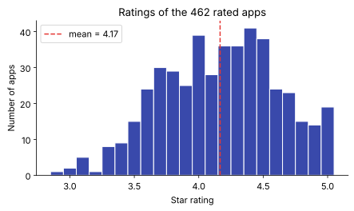

# Day 19: Plotting with Matplotlib

**Phase 1 · Week 3 · ~90 minutes**

## Objectives

- [ ] Explain matplotlib's object model: a **Figure** holds one or more **Axes**, and each Axes has two **Axis** objects with ticks and labels.
- [ ] Draw a line chart, histogram, scatter plot, bar chart and box plot from a DataFrame, and label each one properly.
- [ ] Use a **log scale** for skewed data like review counts, and explain what each tick means.
- [ ] Put several charts side by side with `plt.subplots(rows, cols)`.
- [ ] Save a figure to SVG or PNG, and use the pandas `.plot` shortcut.
- [ ] Pick the right chart for a question, and spot a misleading chart (truncated axis).

**Prerequisites.** [Day 15](day-15-pandas-dataframes.md) (DataFrames), [Day 16](day-16-pandas-selecting.md) (selecting and filtering), [Day 17](day-17-pandas-cleaning.md) (cleaning) and [Day 18](day-18-pandas-groupby-merge.md) (`groupby`).

---

## The big idea

A table of 480 apps tells you almost nothing at a glance. A picture of the same 480 apps tells you in one second that most ratings sit around 4.2, that a few apps have millions of reviews while most have a few thousand, and that games are much bigger downloads than anything else. **Plotting is how you look at data before you trust it**, and in ML you will plot constantly: the data before training, the loss curve during training, the errors after.

**Matplotlib** is Python's standard plotting library. pandas, seaborn and most ML tools draw with it underneath, so learning its model pays off everywhere.

**Analogy.** Think of a picture frame on a wall. The **Figure** is the whole frame, the thing you hang up (or save to a file). Inside it you mount one or more **Axes**: each is one chart, with its own drawing area, its own scales and its own title. Each Axes has two rulers, the x **Axis** and the y **Axis**, with tick marks and numbers on them. You draw your data on an Axes, never directly on the frame.

## The anatomy of a chart

<figure class="diagram" markdown>

<figcaption>Animated: Figure → Axes → Axis → ticks and labels; every part has a method on <code>fig</code> or <code>ax</code>.</figcaption>
</figure>

The names are confusing at first, so here they are once more:

| Part | Object | What it is | How you change it |
|---|---|---|---|
| Figure | `fig` | The whole image; what you save | `plt.subplots(figsize=(w, h))`, `fig.savefig(...)`, `fig.suptitle(...)` |
| Axes | `ax` | One chart area with data, scales and a coordinate system | `ax.plot`, `ax.hist`, `ax.scatter`, `ax.bar`, `ax.boxplot` |
| Axis | `ax.xaxis`, `ax.yaxis` | One ruler: maps data values to positions | `ax.set_xscale("log")`, `ax.set_xlim(0, 5)` |
| Ticks, tick labels | on each Axis | The marks and numbers on the ruler | `ax.set_xticks([...], labels=[...])` |
| Axis label | on each Axis | What the ruler measures, with its unit | `ax.set_xlabel("Size in MB")` |
| Title | on the Axes | What this chart shows | `ax.set_title("...")` |
| Legend | on the Axes | Which mark is which series | `label="..."` on each plot call, then `ax.legend()` |

!!! warning "Common mistake: Axes vs Axis"
    **Axes** (plural-looking, but one object) is a whole chart. **Axis** is one of its two rulers. `fig, ax = plt.subplots()` gives you one Figure and one Axes. When you ask for a grid, `plt.subplots(2, 2)` gives you a NumPy array of four Axes objects, shape `(2, 2)`.

### Two ways to call matplotlib

You will see two styles online. The **pyplot** style (`plt.plot(...)`, `plt.title(...)`) keeps an invisible "current Axes" and draws on it, like a global variable. The **object-oriented** style asks for the objects and calls methods on them (`ax.plot(...)`, `ax.set_title(...)`). This lesson uses the object-oriented style everywhere: it is explicit, it works the same with one chart or twenty, and it is what the matplotlib docs recommend for anything beyond a quick look. The method names differ slightly: `plt.title` becomes `ax.set_title`, `plt.xlabel` becomes `ax.set_xlabel`.

## Setup: the cleaned dataset

We use the Play Store dataset from Day 15 ([download it from the Datasets page](../../datasets.md) to work offline and replace `BASE + ...` with your local path). The cleaning is the short version from Day 17, the same steps Day 18 started from. This lesson was tested with pandas 3.0, NumPy 2.5 and matplotlib 3.11.

```python
import numpy as np
import pandas as pd
import matplotlib
matplotlib.use("Agg")            # draw into files, no window (leave this out in Jupyter)
import matplotlib.pyplot as plt

plt.rcParams.update({
    "font.size": 11,             # one fixed size for every chart
    "figure.facecolor": "white",
    "savefig.facecolor": "white",
    "axes.spines.top": False,    # drop the box's top and right edges
    "axes.spines.right": False,
})

BASE = "https://manjulkadyan.github.io/ai-leaning/assets/data/"
apps = pd.read_csv(BASE + "play_store_apps.csv")

# The short cleaning from Day 17 (same steps as Day 18)
apps = apps.drop_duplicates().assign(
    category=lambda d: d["category"].str.strip().str.title(),
    installs=lambda d: d["installs"].str.replace(",", "").str.rstrip("+").astype(int),
    size_mb=lambda d: d["size_mb"].replace("Varies with device", np.nan).astype(float),
    last_updated=lambda d: pd.to_datetime(d["last_updated"]),
)
print(apps.shape)
print(apps["category"].nunique(), "categories")
```

```text
(480, 12)
8 categories
```

Three settings in that block are worth knowing:

- `matplotlib.use("Agg")` picks the **backend**, the thing that turns your chart into pixels or vectors. `"Agg"` renders off-screen into files only, which is what you want in a script or on a server. In Jupyter, leave the line out: the notebook backend shows each figure under its cell.
- `plt.rcParams` holds matplotlib's defaults ("rc" is an old Unix name for a settings file). Setting them once at the top gives every chart the same font size and a white background.
- Every chart below ends with `fig.savefig(...)` and `plt.close(fig)`. The images in this lesson are exactly those files.

## Your first chart: a line

A **line chart** joins points in order. It is the chart for "how does something change over time?". Here: how many apps had their last update in each month. `resample("MS")` groups the dates by month (`"MS"` means month start) and `.size()` counts the rows in each.

```python
per_month = apps.set_index("last_updated").resample("MS").size()   # "MS" = month start
print(per_month.tail(3))

fig, ax = plt.subplots(figsize=(8, 3.5))           # one Figure, one Axes
ax.plot(per_month.index, per_month.to_numpy(), color="#3949ab", marker="o", markersize=3)
ax.set_title("When was each app last updated?")
ax.set_xlabel("Month of last update")
ax.set_ylabel("Number of apps")
ax.grid(alpha=0.3)
fig.savefig("day19-updates-line.svg", format="svg", bbox_inches="tight")
plt.close(fig)
```

```text
last_updated
2026-07-01    40
2026-08-01    50
2026-09-01    60
Freq: MS, dtype: int64
```

<figure class="diagram" markdown>

<figcaption>Most apps were updated recently; a long tail has not been touched for years.</figcaption>
</figure>

Read the code top to bottom: create the Figure and Axes, draw, label, save. Every chart in this lesson follows that recipe. `figsize=(8, 3.5)` is in inches; when saved, 1 inch is 72 points in SVG or `dpi` pixels in PNG.

## Histogram: the shape of one column

A **histogram** answers "what values does this column take, and how often?". It cuts the number line into **bins** (intervals) and draws one bar per bin, as tall as the number of values that fall in it. No new math: it's counting.

Ratings come in steps of 0.1 (3.9, 4.0, 4.1, ...). If a bin edge sat exactly on 4.0, rounding could push values into the wrong bar, so we put the edges *halfway between* the steps: 2.85, 2.95, ..., 5.05. That gives one bin per possible rating.

```python
ratings = apps["rating"].dropna()                  # 18 apps have no rating yet
edges = np.arange(2.85, 5.06, 0.1)                 # one bin per 0.1 star, centred on 2.9, 3.0, ...

fig, ax = plt.subplots(figsize=(7, 3.5))
counts, bin_edges, _ = ax.hist(ratings, bins=edges, color="#3949ab", edgecolor="white")
ax.axvline(ratings.mean(), color="#e53935", linestyle="--",
           label=f"mean = {ratings.mean():.2f}")
ax.set_title(f"Ratings of the {len(ratings)} rated apps")
ax.set_xlabel("Star rating")
ax.set_ylabel("Number of apps")
ax.legend()
fig.savefig("day19-ratings-hist.svg", format="svg", bbox_inches="tight")
plt.close(fig)

print(len(counts), "bins; tallest has", int(counts.max()), "apps")
```

```text
22 bins; tallest has 41 apps
```

<figure class="diagram" markdown>

<figcaption>Ratings pile up between 3.6 and 4.6; the mean is 4.17. There is a small bump at a perfect 5.0.</figcaption>
</figure>

`ax.hist` returns three things: the counts per bin, the bin edges, and the drawn bars. We kept the counts to print the tallest bin. `axvline` draws a vertical line across the whole Axes at one x value; the `label=` text is what `ax.legend()` shows.

!!! warning "Common mistake: trusting the default bins"
    `ax.hist(x)` uses 10 equal bins by default. Too few bins hide the shape; too many turn it into noise. For values that come in fixed steps (ratings, prices, ages), set the edges yourself so each step lands in its own bin. For continuous values, try two or three bin counts and see whether your conclusion survives.

## Log scales: when one app has 2.5 million reviews

Reviews are **skewed**: most apps have a few hundred or a few thousand, and a handful have millions. Look at the numbers first:

```python
reviews = apps["reviews"]
print(reviews.describe().round(0).to_string())

fig, (ax_lin, ax_log) = plt.subplots(1, 2, figsize=(10, 3.6))   # 1 row, 2 Axes

ax_lin.hist(reviews, bins=40, color="#90a4ae", edgecolor="white")
ax_lin.set_title("Linear x: almost everything is in bar 1")
ax_lin.set_xlabel("Reviews")
ax_lin.set_ylabel("Number of apps")

log_edges = np.logspace(0, np.log10(reviews.max()), 40)   # bins equally wide on a log scale
ax_log.hist(reviews, bins=log_edges, color="#00897b", edgecolor="white")
ax_log.set_xscale("log")
ax_log.set_title("Log x: the shape appears")
ax_log.set_xlabel("Reviews (log scale)")

fig.tight_layout()
fig.savefig("day19-reviews-linear-vs-log.svg", format="svg", bbox_inches="tight")
plt.close(fig)
```

```text
count        480.0
mean       17321.0
std       124811.0
min            1.0
25%          380.0
50%         1606.0
75%         7214.0
max      2525379.0
```

The median is 1,606 but the maximum is 2,525,379, over 1,500 times bigger. On a normal (linear) axis, the 40 bins each cover about 63,000 reviews, so about 96% of all apps land in the very first bar. You learn nothing.

<figure class="diagram" markdown>

<figcaption>Same data, two x scales. On the log scale the bulk of the apps becomes visible.</figcaption>
</figure>

Note the `1e6` at the end of the left x axis: matplotlib's way of saying "these tick numbers are in millions" (1e6 = \( 1 \times 10^6 \)). It is easy to miss.

### What a log scale is

A **logarithm** answers "10 to the power of what gives this number?". Written \( \log_{10}(x) \):

\[
\log_{10}(1) = 0 \qquad \log_{10}(10) = 1 \qquad \log_{10}(1{,}000) = 3 \qquad \log_{10}(1{,}000{,}000) = 6
\]

On a **log axis**, matplotlib places each value at the position of its logarithm. So 1, 10, 100, 1,000 are **equally spaced**: each step to the right means "**10 times more**", not "100 more". The tick label \( 10^3 \) means 1,000. Our biggest app sits at \( \log_{10}(2{,}525{,}379) \approx 6.4 \), only a little past \( 10^6 \), instead of 1,500 median-widths away.

Bins must change too. Equal-width bins on a linear scale look squashed on a log scale, so `np.logspace(0, np.log10(reviews.max()), 40)` makes 40 edges from \( 10^0 = 1 \) to \( 10^{6.4} \) that are equally spaced *on the log scale* (each edge is the previous one times the same factor).

!!! warning "Common mistake: log of zero"
    \( \log_{10}(0) \) does not exist (10 to no power gives 0), and negative numbers have no log either. Values of 0 or below simply cannot be placed on a log axis; matplotlib drops or clips them, often silently. Here the minimum is 1 review, so nothing is lost. For data with zeros, either plot zeros separately or use `ax.set_xscale("symlog")`, which is linear near zero and logarithmic further out, and say so in the axis label.

## Scatter: two columns at once

A **scatter plot** draws one dot per row, x from one column and y from another. It answers "is there a relationship?". Does an app with more reviews tend to have a better rating?

```python
rated = apps.dropna(subset=["rating"])

fig, ax = plt.subplots(figsize=(7, 4))
ax.scatter(rated["reviews"], rated["rating"], s=14, alpha=0.5, color="#3949ab")
ax.set_xscale("log")
ax.set_title("More reviews does not mean a better rating")
ax.set_xlabel("Reviews (log scale)")
ax.set_ylabel("Star rating")
ax.grid(alpha=0.3)
fig.savefig("day19-reviews-vs-rating.svg", format="svg", bbox_inches="tight")
plt.close(fig)

print(rated["rating"].corr(np.log10(rated["reviews"])).round(3))
```

```text
-0.007
```

<figure class="diagram" markdown>

<figcaption>No trend: popular and obscure apps get the same spread of ratings.</figcaption>
</figure>

Two details make this readable. The log x axis, for the same reason as above. And `alpha=0.5` makes each dot half transparent, so places where many dots overlap look darker instead of hiding each other. The printed number is the **correlation** between rating and \( \log_{10} \) of reviews: a score from −1 (perfect downward line) through 0 (no straight-line relationship) to +1 (perfect upward line). −0.007 is as close to "none" as data gets, which matches the picture. (Correlation gets a proper treatment later in the course; for now, look at the picture first.)

## Bar chart: one number per category

A **bar chart** compares one number across categories. Here: mean rating per category, using Day 18's `groupby`. Two choices make it easy to read: **horizontal bars**, so the category names don't have to be squeezed or rotated, and **sorted values**, so the ranking is visible at once (with `barh`, the first row is drawn at the bottom, so ascending order puts the best on top).

```python
by_cat = apps.groupby("category")["rating"].mean().sort_values()
print(by_cat.round(2).to_string())

fig, ax = plt.subplots(figsize=(7, 4))
bars = ax.barh(by_cat.index, by_cat.to_numpy(), color="#00897b", height=0.6)
ax.bar_label(bars, fmt="%.2f", padding=3)          # write each value at the bar's end
ax.set_xlim(0, 5)                                  # bars start at zero (more on this later)
ax.set_title("Mean rating by category")
ax.set_xlabel("Mean star rating")
fig.savefig("day19-rating-by-category.svg", format="svg", bbox_inches="tight")
plt.close(fig)
```

```text
category
Education           4.04
Health & Fitness    4.08
Finance             4.11
Productivity        4.13
Tools               4.15
Photography         4.18
Music & Audio       4.22
Games               4.28
```

<figure class="diagram" markdown>

<figcaption>Sorted horizontal bars starting at zero: the categories are honestly very similar.</figcaption>
</figure>

`ax.bar_label(bars, fmt="%.2f")` writes the value at the end of each bar, so the reader doesn't have to estimate from the axis. Because the bars start at zero, you can see the truth: the categories differ by about a quarter of a star.

## Box plot: the spread inside each category

A mean is one number; it hides the spread. A **box plot** summarises a whole group of values in five parts. First sort the values, then:

- the **median** (red line) is the middle value: half are below, half above;
- \( Q_1 \) and \( Q_3 \) (the box edges) are the **quartiles**: a quarter of the values are below \( Q_1 \), three quarters below \( Q_3 \). The box holds the middle half of the data;
- the **IQR** (interquartile range) is the box width, \( \text{IQR} = Q_3 - Q_1 \);
- the **whiskers** reach out to the furthest value that is still within \( 1.5 \times \text{IQR} \) of the box;
- anything beyond the whiskers is drawn as a single circle, an **outlier** ("flier" in matplotlib).

Worked example with the sizes of games:

```python
games = apps.loc[apps["category"] == "Games", "size_mb"].dropna()
q1, med, q3 = games.quantile([0.25, 0.5, 0.75])
iqr = q3 - q1
print(f"Q1={q1:.1f}  median={med:.1f}  Q3={q3:.1f}  IQR={iqr:.1f}")
print(f"whisker limit: {q3 + 1.5 * iqr:.1f}")
print("outliers:", games[games > q3 + 1.5 * iqr].sort_values().to_list())
print("log10 of max reviews:", round(np.log10(apps["reviews"].max()), 2))
print("share of apps in the first linear bin:", (apps["reviews"] < apps["reviews"].max() / 40).mean().round(3))
```

```text
Q1=49.8  median=78.5  Q3=107.9  IQR=58.1
whisker limit: 195.0
outliers: [202.2, 203.7, 205.2]
log10 of max reviews: 6.4
share of apps in the first linear bin: 0.958
```

So \( \text{IQR} = 107.9 - 49.8 = 58.1 \), the upper whisker limit is \( 107.9 + 1.5 \times 58.1 = 195.0 \) MB, and the three games above 195 MB are drawn as circles. (The last two lines check the numbers quoted in the log-scale section.) Now all eight categories at once, sorted by median:

```python
order = apps.groupby("category")["size_mb"].median().sort_values().index
groups = [apps.loc[apps["category"] == c, "size_mb"].dropna().to_numpy() for c in order]

fig, ax = plt.subplots(figsize=(8, 4))
ax.boxplot(groups, tick_labels=order, orientation="horizontal",
           medianprops={"color": "#e53935"})
ax.set_xscale("log")
ax.set_xticks([5, 10, 20, 50, 100, 200], labels=["5", "10", "20", "50", "100", "200"])
ax.set_title("Download size by category (sorted by median)")
ax.set_xlabel("Size in MB (log scale)")
fig.savefig("day19-size-by-category.svg", format="svg", bbox_inches="tight")
plt.close(fig)

print(apps.groupby("category")["size_mb"].median().loc[["Finance", "Games"]].to_string())
```

```text
category
Finance    20.7
Games      78.5
```

<figure class="diagram" markdown>

<figcaption>Games are about four times bigger downloads than Finance apps (median 78.5 MB vs 20.7 MB).</figcaption>
</figure>

`ax.boxplot` wants a list of arrays, one per box, with no NaN in them (hence `.dropna()`: 20 apps have no size). Sizes are skewed too, so this chart also uses a log axis, with hand-picked ticks because the default log ticks (just 10 and 100) were too sparse. If you read older code: `tick_labels=` was called `labels=` before matplotlib 3.9, and `orientation="horizontal"` used to be `vert=False`.

## Subplots, labelling and saving

You've already used **subplots**: `plt.subplots(1, 2)` returned one Figure and two Axes, which we unpacked as `fig, (ax_lin, ax_log)`. A bigger grid works the same way and returns a 2-D array of Axes, so you can loop over `axes.flat` (Exercise 3). Two helpers come up constantly:

- `sharex=True` / `sharey=True` give subplots the same scale, so they can be compared honestly;
- `fig.tight_layout()` nudges the Axes apart so titles and labels don't overlap.

**A label checklist** for every chart you show anyone: a title that says what the chart shows (ideally the conclusion, like "More reviews does not mean a better rating"), both axis labels with units, "(log scale)" in the label of any log axis, and a legend whenever there is more than one series.

**Saving.** `fig.savefig(path)` picks the format from the file extension, or from `format=`:

- **SVG** is a vector format: lines and text are stored as shapes, so it stays sharp at any zoom. Good for web pages and documents (this lesson). Text is stored as drawn outlines by default, so it looks the same on machines without the font.
- **PNG** is pixels. Set `dpi=200` or so for crisp images. Better for charts with thousands of points, where an SVG gets large.
- `bbox_inches="tight"` trims the empty margin around the chart.
- `plt.close(fig)` frees the figure. In a loop that makes 100 charts, forgetting it keeps all 100 in memory (matplotlib warns after 20 open figures).

## The pandas shortcut: `.plot`

pandas Series and DataFrames have a `.plot` accessor that calls matplotlib for you: `s.plot()` (line), `s.plot.bar()`, `s.plot.hist()`, `df.plot.scatter(x="a", y="b")`, `df.plot.box()`. It uses the index as the x axis and labels it for you. Pass `ax=ax` to draw on your own Axes, so you keep full control:

```python
buckets = apps["installs"].value_counts().sort_index()          # 1000, 5000, ... in order
buckets.index = [f"{n:,}+" for n in buckets.index]              # back to "1,000+" labels

fig, ax = plt.subplots(figsize=(8, 3.5))
buckets.plot.bar(ax=ax, color="#3949ab", rot=45)                # pandas draws on our Axes
ax.set_title("Apps per install bucket")
ax.set_xlabel("Installs")
ax.set_ylabel("Number of apps")
fig.savefig("day19-installs-pandas.svg", format="svg", bbox_inches="tight")
plt.close(fig)
```

<figure class="diagram" markdown>

<figcaption>The buckets are ordered by their numeric value, which is why we sorted before relabelling.</figcaption>
</figure>

The order matters: the install buckets were converted to integers in the cleaning step, so `sort_index()` puts them in numeric order. If we had sorted the text labels, "5,000,000+" would come before "50,000+". `.plot` is perfect for quick looks; for a chart you will show someone, you usually end up calling `ax` methods anyway.

!!! android "Android bridge: Canvas vs a charting library"
    On Android you can draw a chart two ways. Low level, you subclass `View`, override `onDraw(canvas: Canvas)` and call `canvas.drawLine`, `drawRect` and `drawText` with a `Paint`, doing every coordinate calculation yourself. High level, you drop in a library like **MPAndroidChart**: a `LineChart` or `BarChart` view, fed with `Entry` objects in a `LineDataSet`, with `chart.xAxis`, `chart.axisLeft`, `chart.legend` and `chart.description` to configure the parts. Matplotlib is the high-level kind, built on a low-level drawing layer of its own (lines, rectangles and text called "artists"). The mapping is close: the **Figure ≈ the `View`**, the whole thing that gets measured and drawn; an **Axes ≈ the chart's plotting area** inside it, the content rectangle where data coordinates are turned into pixels; `ax.xaxis` ≈ MPAndroidChart's `XAxis`, with its own labels and granularity. And the Agg backend plus `savefig` is like drawing a `View` into an off-screen `Bitmap` through a `Canvas` and calling `bitmap.compress(PNG, ...)`: rendering with no screen involved.

## Which chart for which question

| Question you're asking | Chart | Example from today | Watch out for |
|---|---|---|---|
| How does a value change over time? | Line | Apps updated per month | Sort by time; uneven gaps in dates |
| What values does one column take, and how often? | Histogram | Ratings | Bin edges and bin count |
| Is one column skewed, with a few giant values? | Histogram with log x | Reviews | Zeros and negatives can't go on a log axis |
| Do two numeric columns move together? | Scatter | Reviews vs rating | Overplotting: use `alpha`, small markers |
| How does one number compare across categories? | Bar (sorted, from zero) | Mean rating by category | Truncated axes; means of skewed data |
| How spread out is a column within each group? | Box plot | Size by category | Explain what the box and whiskers mean |
| How many rows fall in each category? | Bar of `value_counts()` | Apps per install bucket | Sort in a meaningful order |
| Several of the above at once | Subplots | Linear vs log reviews | `sharex`/`sharey` for fair comparison |

## Misleading charts: the truncated axis

A bar's **length** is the message: the reader compares lengths without reading the numbers. So a bar chart must start at zero. Here are the lowest and highest categories from the bar chart, drawn twice:

```python
pair = by_cat.loc[["Education", "Games"]]        # lowest and highest mean rating
print(pair.round(2).to_string())

fig, (ax_bad, ax_good) = plt.subplots(1, 2, figsize=(9, 3.6))
for ax in (ax_bad, ax_good):
    ax.bar(pair.index, pair.to_numpy(), color=["#90a4ae", "#ef6c00"], width=0.5)
    ax.set_ylabel("Mean star rating")

ax_bad.set_ylim(4.0, 4.3)                        # the trick: the axis starts at 4.0
ax_bad.set_title("Misleading: y starts at 4.0")
ax_good.set_ylim(0, 5)                           # honest: bars start at zero
ax_good.set_title("Honest: y starts at 0")

fig.tight_layout()
fig.savefig("day19-truncated-axis.svg", format="svg", bbox_inches="tight")
plt.close(fig)
```

```text
category
Education    4.04
Games        4.28
```

<figure class="diagram" markdown>

<figcaption>Same data. Starting the axis at 4.0 turns a 6% difference into what looks like a 6.6× difference.</figcaption>
</figure>

Do the arithmetic, with one more decimal than the printout (Games 4.283, Education 4.043). With the axis starting at 4.0, the visible part of each bar is its value minus 4.0: \( 4.283 - 4.000 = 0.283 \) for Games and \( 4.043 - 4.000 = 0.043 \) for Education. The bars look \( 0.283 / 0.043 \approx 6.6 \) times different, while the real values differ by \( 4.283 / 4.043 \approx 1.06 \), about 6%. Matplotlib won't do this by itself for bars (it starts bar axes at zero), so a truncated bar chart is almost always someone's deliberate `set_ylim`.

!!! warning "Common mistake: other ways charts mislead"
    - **Bars not starting at zero**, as above. (Line charts and scatter plots *may* zoom in, because they encode position, not length; label the axis clearly.)
    - **Means of skewed data.** One app with 2.5 million reviews drags its category's mean far above what a typical app has. Plot the median, or a box plot (Exercise 5).
    - **Unlabelled log axes.** A reader who assumes linear will badly misjudge the gaps. Always write "(log scale)".
    - **Different scales on side-by-side charts.** Two subplots with different y ranges invite a wrong comparison; use `sharey=True`.
    - **Hidden sample sizes.** A category mean from 3 apps and one from 114 apps look equally solid as bars. Say how many rows each bar summarises.

---

## Exercises

1. **Prices.** Make a histogram of `price_usd` for paid apps only (`price_usd > 0`). How many paid apps are there, and which prices occur? Is a histogram the best chart here, or would something else be clearer?
2. **Two series, one legend.** Scatter `size_mb` (log x) against `rating`, drawing apps with ads in one colour and without ads in another, with a legend. Then compute the mean rating for each group. Do ads seem to matter?
3. **A grid of subplots.** Draw rating histograms for Games, Tools, Education and Productivity in a 2×2 grid with `sharex=True, sharey=True`, a title on each Axes and one `fig.suptitle`. Print the shape of the Axes array.
4. **Pick the chart.** For each question, name the chart and the columns, without coding: (a) Do paid apps have smaller downloads than free apps? (b) Are apps updated more recently rated higher? (c) Which developer has the most apps? (d) How is `min_android` distributed?
5. **Mean vs median.** Plot mean reviews and median reviews per category as two horizontal bar charts side by side (`sharey=True`). Which category's ranking changes most, and why? Find the single app with the most reviews.
6. **SVG vs PNG.** Save the reviews-vs-rating scatter as SVG and as PNG at `dpi=200`, and compare the file sizes with `os.path.getsize`. When would you pick each?

??? success "Solutions"
    All solutions start from the setup block above (cleaned `apps`, `np`, `pd`, `plt`).

    ```python
    # 1
    paid = apps.loc[apps["price_usd"] > 0, "price_usd"]
    print(len(paid), "paid apps")
    print(paid.value_counts().sort_index().to_string())
    fig, ax = plt.subplots(figsize=(6, 3))
    ax.hist(paid, bins=np.arange(0, 10.5, 0.5), color="#3949ab", edgecolor="white")
    ax.set_title(f"Prices of the {len(paid)} paid apps")
    ax.set_xlabel("Price (USD)")
    ax.set_ylabel("Number of apps")
    fig.savefig("ex1-prices.svg", format="svg", bbox_inches="tight")
    plt.close(fig)

    # 2
    fig, ax = plt.subplots(figsize=(7, 4))
    for value, color in [("No", "#3949ab"), ("Yes", "#ef6c00")]:
        part = apps[apps["has_ads"] == value]
        ax.scatter(part["size_mb"], part["rating"], s=14, alpha=0.5, color=color,
                   label=f"has_ads = {value}")
    ax.set_xscale("log")
    ax.set_xlabel("Size in MB (log scale)")
    ax.set_ylabel("Star rating")
    ax.legend()
    fig.savefig("ex2-size-vs-rating.svg", format="svg", bbox_inches="tight")
    plt.close(fig)
    print(apps.groupby("has_ads")["rating"].mean().round(2).to_string())

    # 3
    cats = ["Games", "Tools", "Education", "Productivity"]
    fig, axes = plt.subplots(2, 2, figsize=(9, 6), sharex=True, sharey=True)
    print(axes.shape)
    edges = np.arange(2.85, 5.06, 0.1)
    for ax, cat in zip(axes.flat, cats):
        ax.hist(apps.loc[apps["category"] == cat, "rating"].dropna(), bins=edges,
                color="#00897b", edgecolor="white")
        ax.set_title(cat)
    for ax in axes[1]:
        ax.set_xlabel("Star rating")
    for ax in axes[:, 0]:
        ax.set_ylabel("Number of apps")
    fig.suptitle("Ratings in four categories")
    fig.tight_layout()
    fig.savefig("ex3-grid.svg", format="svg", bbox_inches="tight")
    plt.close(fig)

    # 5
    stats = apps.groupby("category")["reviews"].agg(["mean", "median"]).sort_values("median")
    print(stats.round(0).astype(int).to_string())
    fig, (ax_mean, ax_med) = plt.subplots(1, 2, figsize=(10, 4), sharey=True)
    ax_mean.barh(stats.index, stats["mean"].to_numpy(), color="#90a4ae")
    ax_mean.set_title("Mean reviews")
    ax_med.barh(stats.index, stats["median"].to_numpy(), color="#00897b")
    ax_med.set_title("Median reviews")
    fig.tight_layout()
    fig.savefig("ex5-mean-vs-median.svg", format="svg", bbox_inches="tight")
    plt.close(fig)
    top = apps.nlargest(1, "reviews")[["app_name", "category", "reviews"]]
    print(top.to_string(index=False))

    # 6
    import os
    fig, ax = plt.subplots(figsize=(7, 4))
    ax.scatter(apps["reviews"], apps["rating"], s=14, alpha=0.5)
    ax.set_xscale("log")
    fig.savefig("ex6.svg", format="svg", bbox_inches="tight")
    fig.savefig("ex6.png", dpi=200, bbox_inches="tight")
    plt.close(fig)
    for name in ["ex6.svg", "ex6.png"]:
        print(name, round(os.path.getsize(name) / 1024), "KB")
    ```

    Printed output:

    ```text
    50 paid apps
    price_usd
    0.99     3
    1.99    15
    2.99    11
    4.99     8
    9.99    13
    has_ads
    No     4.14
    Yes    4.18
    (2, 2)
                       mean  median
    category                       
    Music & Audio     11828     883
    Health & Fitness   4354    1156
    Tools              6143    1296
    Finance            9536    1548
    Productivity      10660    1744
    Photography       11456    1782
    Games             38601    2406
    Education         17348    2456
           app_name category  reviews
    Orbit Lens Lite    Games  2525379
    ex6.svg 87 KB
    ex6.png 80 KB
    ```

    1. 50 paid apps, at only five prices (0.99, 1.99, 2.99, 4.99, 9.99). With so few distinct values, a bar chart of `paid.value_counts().sort_index()` says the same thing more directly; a histogram is for values that vary continuously.
    2. 4.18 with ads vs 4.14 without: a difference of 0.04 stars, and the two dot clouds overlap completely. No visible effect in this data.
    3. `axes.shape` is `(2, 2)`; `axes.flat` walks the four Axes in reading order. With shared axes, the four histograms can be compared by eye directly.
    4. (a) Box plot of `size_mb` split by free vs paid (or two histograms with `sharex=True`). (b) Scatter of `last_updated` vs `rating`. (c) Bar chart of `developer_id.value_counts()`, sorted, top 10; merge with `developers.csv` (Day 18) for names. (d) Histogram, or a bar chart of `value_counts().sort_index()` since versions are a few discrete values.
    5. Games has the highest mean (38,601) mostly because of one app, Orbit Lens Lite, with 2,525,379 reviews; by median, Games (2,406) is close to Education (2,456). Music & Audio has a mean of 11,828 but the lowest median, 883: a few big apps and many small ones. For skewed data, the median describes the typical app.
    6. Here SVG was 87 KB and PNG 80 KB. Each of the ~480 dots is a separate shape in the SVG, so SVG grows with the number of points while PNG grows with the pixel count. Use SVG for line, bar and box charts on the web (sharp at any zoom, small); PNG for dense scatter plots or images, or when the destination can't show SVG. (Your sizes may differ slightly with versions.)

## Resources

- [Matplotlib: Quick start guide](https://matplotlib.org/stable/users/explain/quick_start.html): the official introduction, including the anatomy of a figure and the two coding styles.
- [Matplotlib gallery](https://matplotlib.org/stable/gallery/index.html): hundreds of example charts with their code; find one close to what you want and adapt it.
- [pandas user guide: Chart visualization](https://pandas.pydata.org/docs/user_guide/visualization.html): everything `.plot` can do.
- [Python Data Science Handbook, Chapter 4 (Jake VanderPlas)](https://jakevdp.github.io/PythonDataScienceHandbook/): free online; a thorough tour of matplotlib.
- [Fundamentals of Data Visualization (Claus O. Wilke)](https://clauswilke.com/dataviz/): free online book on choosing charts and making them honest, including axis and proportion rules.
- [MPAndroidChart on GitHub](https://github.com/PhilJay/MPAndroidChart): the Android charting library from the bridge, for comparison.

## Checklist

- [ ] I can explain Figure, Axes and Axis, and which one I call `.plot` on.
- [ ] I drew a line, histogram, scatter, bar and box plot from the apps data, each with a title and axis labels.
- [ ] I can explain what \( 10^3 \) on a log axis means and when to use a log scale.
- [ ] I can read a box plot: median, quartiles, IQR, whiskers, outliers.
- [ ] I made a grid of subplots and saved a figure as SVG and PNG.
- [ ] I can pick a chart for a question using the table, and spot a truncated axis.

**Next:** [Day 20: Week 3 review and mini-project](day-20-week3-review.md)
