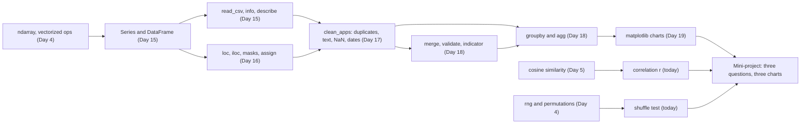

# Day 20: Week 3 Review and Mini-Project: Exploring the Play Store Data

**Phase 1 · Week 3 · ~180 minutes**

## Objectives

By the end of today you can:

- [ ] Explain, without notes, the main idea of each Week 3 lesson and how they chain into one analysis: load, clean, join, summarise, plot.
- [ ] Answer the self-check questions and rebuild `clean_apps` plus a `check_clean` guard from a blank file.
- [ ] Run a small exploratory analysis end to end: clean the apps table, merge in the developers, and answer three questions with three charts.
- [ ] Tell whether a difference between two groups is bigger than chance would give, using a **shuffle test** you write in NumPy.
- [ ] Measure how strongly two columns move together with the **correlation** \( r \), and recognise it as Day 5's cosine similarity in disguise.
- [ ] Write a one-paragraph finding per chart that says what the data shows and makes no causal claim.

**Prerequisites.** All of Week 3: [Day 15](day-15-pandas-dataframes.md) (DataFrames, Series, `read_csv`), [Day 16](day-16-pandas-selecting.md) (`.loc`, masks, sorting, `assign`), [Day 17](day-17-pandas-cleaning.md) (cleaning and `clean_apps`), [Day 18](day-18-pandas-groupby-merge.md) (`groupby`, `merge`, `validate`, `indicator`) and [Day 19](day-19-matplotlib.md) (matplotlib, log scales, box plots). The shuffle test also uses `rng` from [Day 4](day-04-numpy-arrays.md), and the correlation uses the cosine similarity from [Day 5](day-05-vectors.md).

**Suggested time split.** 30 minutes recap and self-check, 25 minutes re-doing the cleaning from blank, 90 minutes mini-project, 35 minutes stretch goals and the retro. All code was tested with pandas 3.0, NumPy 2.5 and matplotlib 3.11.

---

## What this week gave you

Five days, one skill: turning a messy CSV into an answer you can defend. Each day added one step:

| Day | You learned | The one idea to keep |
|---|---|---|
| [15](day-15-pandas-dataframes.md) | `Series`, `DataFrame`, `read_csv`, `head`/`info`/`describe`, the index | A DataFrame is a dict of NumPy-backed columns sharing one index. Operations align on **labels**, not positions. |
| [16](day-16-pandas-selecting.md) | `[]`, `.loc`, `.iloc`, masks with `&`, <code>&#124;</code> and `~`, `isin`, `query`, `sort_values`, `assign`, `value_counts` | `.loc` is by label, `.iloc` by position; after a sort they disagree. A filter is a boolean vector. |
| [17](day-17-pandas-cleaning.md) | duplicates, `str.strip().str.title()`, NaN, `fillna`/`dropna`, text to numbers, `to_datetime`, `clean_apps` | Audit first, fix with a function that returns a **new** table, and never fill missing values blindly. |
| [18](day-18-pandas-groupby-merge.md) | split-apply-combine, named `agg`, `transform`, `merge`, `validate`, `indicator`, `pivot_table` | `agg` gives one row per group, `transform` one value per row. A lookup join must not change the row count. |
| [19](day-19-matplotlib.md) | Figure/Axes/Axis, line, histogram, scatter, bar, box plot, log scales, subplots | Pick the chart from the question. Log scales for skewed data; bar axes start at zero. |

Here is the whole week as one pipeline. It is literally the first question of today's mini-project, from raw file to chart:

<figure class="diagram" markdown>
![Animated pipeline of six boxes: Day 15 read_csv gives a 486 by 12 table; Day 17 clean_apps gives 480 by 12; Day 18 merge with validate many_to_one gives 480 by 15; Day 16 a mask keeping free apps gives 430 rows; Day 18 groupby has_ads and mean gives two numbers, 4.15 without ads and 4.18 with ads; Day 19 draws them as two bars on an axis starting at zero, which look almost the same. A highlight moves along the boxes, two bars underneath shrink to show the number of rows and columns at each step, and a caption explains each step](../../assets/img/phase-1/day20-week3-pipeline.svg)
<figcaption>Animated: one question travelling through the week. Every step changes the table's shape in a way you can predict before running it.</figcaption>
</figure>

And here is how the concepts depend on each other. Arrows mean "is built on":



!!! android "Android bridge"
    If Week 2 was what `interpreter.run()` does inside, Week 3 is the data work around it, and you have done most of it in Kotlin already. A DataFrame is a Room table in memory, `groupby` and `merge` are `GROUP BY` and `LEFT JOIN` in a `@Query`, `clean_apps` is the mapper that turns a messy network DTO into a clean domain model, and a matplotlib Axes is a `Canvas` with rulers. The new part is the habit: before a model ever sees data, you *look* at it, and you write down what you saw.

## Self-check

Answer out loud or on paper first, then open the answer. If you miss more than three, re-read that day's lesson before starting the project.

??? question "1. What is the difference between `apps["rating"]` and `apps[["rating"]]`? And what does `apps["rating"].to_numpy()` give you?"
    `apps["rating"]` is a **Series** (one labelled column, 1-D). `apps[["rating"]]` is a **DataFrame** with one column (2-D), because you passed a list of column names. `.to_numpy()` drops the labels and gives the underlying NumPy array, here a `float64` array of shape `(480,)`. (Day 15)

??? question "2. `s = apps.sort_values("rating", ascending=False)`. Are `s.loc[0]` and `s.iloc[0]` the same row?"
    Almost never. `s.iloc[0]` is the **first row by position**: the highest-rated app. `s.loc[0]` is the row whose **label** is 0: the app that was first in the original table, wherever the sort moved it. Sorting reorders rows but keeps their labels. (Day 16)

??? question "3. Why does `apps[apps["rating"] > 4.5 and apps["has_ads"] == "Yes"]` fail, and how do you fix it?"
    `and` asks Python for a single `True`/`False` from a whole Series, and pandas refuses: `ValueError: The truth value of a Series is ambiguous`. Use the element-wise `&` and wrap each comparison in parentheses, because `&` binds tighter than `>` and `==`: `apps[(apps["rating"] > 4.5) & (apps["has_ads"] == "Yes")]`. (Day 16)

??? question "4. In pandas 3, does `apps[apps["rating"].isna()]["rating"] = 0` change `apps`? What should you write?"
    No. The filter produces a new DataFrame, the assignment lands on that temporary copy and is thrown away; pandas 3's Copy-on-Write guarantees it never reaches `apps`, and it warns with `ChainedAssignmentError`. Do it in one step with `apps.loc[apps["rating"].isna(), "rating"] = 0`, or return a new table with `assign`. (And think twice before filling ratings with 0 at all: an unrated app is not a 0-star app.) (Days 16 and 17)

??? question "5. 18 of the 480 apps have no rating. Over how many apps does `apps["rating"].mean()` average? And what do `groupby(...)["rating"].size()` and `.count()` each count?"
    `mean` skips NaN, so it averages the 462 rated apps. `size` counts **rows** in each group (rated or not); `count` counts **non-missing values**. When they differ, your group has missing data, which is worth knowing before you compare means. (Days 17 and 18)

??? question "6. After cleaning, an app's `installs` is `1000000`. What does that number really mean, and why couldn't `astype(int)` read the raw text?"
    The raw value was the text `"1,000,000+"`: a **bucket**, meaning "at least one million". The comma and the plus are not digits, so `astype(int)` raises `ValueError`; we removed them with `str.replace` first. So every installs number is a lower bound, and so is any mean you compute from them. (Day 17)

??? question "7. `apps` has 480 rows. How many rows does `apps.merge(devs, on="developer_id", how="inner")` have, how many with `how="left"`, and what would it mean if the left join had 489?"
    Inner: 478, because the 2 apps from developer `D099` have no match and are dropped silently. Left: 480, with NaN in the developer columns for those 2. A left join on a lookup table must keep the left row count exactly; 489 means some key appears twice on the right, so some apps were duplicated. `validate="many_to_one"` turns that into an error, and `indicator=True` shows the orphans. (Day 18)

??? question "8. What shape comes back from `apps.groupby("category")["installs"].agg("sum")` and from `.transform("sum")`?"
    `agg` reduces each group to one value: a Series of 8 rows, indexed by category. `transform` broadcasts each group's value back onto its rows: a Series of 480 values with the original index, so you can divide row by row, for example to get each app's share of its category. (Day 18)

??? question "9. Reviews range from a handful to 2.5 million. Why is a histogram on a linear axis useless here, and why can mean and median tell different stories?"
    On a linear axis the one huge app stretches the scale, so almost every app lands in the first bar. A log axis gives each factor of 10 the same width, so 100, 1,000 and 10,000 are evenly spaced and the shape becomes visible. The mean is pulled up by the few huge values; the median is the middle app and ignores how big the giants are. For skewed data, report both or prefer the median for "the typical app". (Day 19)

??? question "10. A bar chart of mean rating per category has its y axis starting at 4.0. What is wrong with it?"
    A bar's length *is* its value, so cutting the bottom off exaggerates differences: Education 4.04 and Games 4.28 looked over six times different on Day 19, while the real values differ by about 6%. Bars start at zero. If small differences matter, use dots on a range that you state clearly, not bars. (Day 19)

## Re-do from blank

Pick **Day 17's cleaning, plus its exercise 5**, and do it again in an empty file, without looking:

1. Load `play_store_apps.csv` and `developers.csv`.
2. Write `clean_apps(df)` that returns a new table: drop the exact duplicates, fix the category spelling, installs to `int64`, `"Varies with device"` to NaN so `size_mb` becomes `float64`, `last_updated` to a datetime, and `min_android` to a version string (`"8.0"`, `"9"`, `"10"`, …).
3. Write `check_clean(df)` that `assert`s every one of those promises (with a message for each), passes on the cleaned table and fails on the raw one.

**Why this one.** It is the whole of Day 17 in one function, and it needs pieces of every other day: column selection (Day 15), `assign` (Day 16), the `.str` methods and `to_datetime` (Day 17). It is also the step that everything else today rests on: if the cleaning is wrong, every chart after it is confidently wrong. And `check_clean` is the habit to keep: in a real ML pipeline, assertions like these run every time new data arrives, because a source that sent clean data last month can send `"1,000,000++"` this month.

??? success "Solution (run this block before the mini-project if you use the ▶ Run buttons)"
    ```python
    import numpy as np
    import pandas as pd

    BASE = "https://manjulkadyan.github.io/ai-leaning/assets/data/"
    raw = pd.read_csv(BASE + "play_store_apps.csv")
    devs = pd.read_csv(BASE + "developers.csv")


    def clean_apps(df: pd.DataFrame) -> pd.DataFrame:
        """Return a cleaned copy of the Play Store apps table. The input is not modified."""
        out = df.drop_duplicates(ignore_index=True)
        return out.assign(
            category=out["category"].str.strip().str.title(),
            installs=(out["installs"]
                      .str.replace(",", "", regex=False)
                      .str.replace("+", "", regex=False)
                      .astype("int64")),
            size_mb=out["size_mb"].replace("Varies with device", np.nan).astype("float64"),
            last_updated=pd.to_datetime(out["last_updated"], format="%Y-%m-%d"),
            min_android=out["min_android"].map(
                lambda v: f"{v:.1f}" if v < 9 else str(int(v))
            ).astype("str"),
        )


    CATEGORIES = ["Education", "Finance", "Games", "Health & Fitness",
                  "Music & Audio", "Photography", "Productivity", "Tools"]


    def check_clean(df: pd.DataFrame) -> bool:
        """Assert everything clean_apps promises. Raises AssertionError with a reason."""
        assert not df.duplicated().any(), "duplicate rows"
        assert sorted(df["category"].unique()) == CATEGORIES, "category spellings"
        assert df["installs"].dtype == "int64", "installs is not int64"
        assert df["size_mb"].dtype == "float64", "size_mb is not float64"
        assert pd.api.types.is_datetime64_any_dtype(df["last_updated"]), "last_updated is not a datetime"
        assert df["min_android"].isin(["7.0", "8.0", "9", "10", "11", "12", "13"]).all(), "min_android"
        assert df["rating"].dropna().between(1, 5).all(), "rating outside 1..5"
        return True


    apps = clean_apps(raw)
    print(raw.shape, "->", apps.shape)
    print("clean:", check_clean(apps))
    try:
        check_clean(raw)
    except AssertionError as e:
        print("raw fails:", e)
    ```

    ```text
    (486, 12) -> (480, 12)
    clean: True
    raw fails: duplicate rows
    ```

    No internet? Download both files from the [Datasets page](../../datasets.md) and replace `BASE + ...` with your local paths. The `raw` table fails on the *first* broken promise; to see each of them fail, fix them one at a time in a copy and re-run `check_clean`.

---

## Mini-project: three questions, three charts

So far each lesson asked you one small question at a time. Today you run a whole **exploratory data analysis** (EDA): the first look at a dataset that every ML project starts with, before any model is trained. You will answer three questions about the Play Store apps:

1. **Do apps with ads get lower ratings?**
2. **Which category has the most installs per app?**
3. **Do recently updated apps get higher ratings?**

Each answer is a table, a chart and one paragraph of findings. The paragraph is the real product, and it has one hard rule: **say what the data shows, not why.**

### The idea, with an analogy

You already do this with crash reports. Crashlytics shows that 40% of your crashes come from one phone model. Does that phone *cause* crashes? Maybe. Or maybe 40% of your users own it. Or the crash is in a code path only that model's camera triggers. A good bug report says what was observed ("40% of crashes, 25% of sessions"), how big the effect is, and how sure you are, and leaves the cause as a hypothesis until someone tests it.

An EDA finding is a bug report about data. Three things can fool you, and today you meet a tool for each:

| Trap | Example today | Tool |
|---|---|---|
| **Confounding**: a third thing drives both | every app with ads is free, so "ads vs no ads" secretly mixes in "free vs paid" | split the groups honestly (Day 16 masks) |
| **Noise**: small differences that chance alone produces | a 0.03-star gap between two groups | the **shuffle test** |
| **Outliers**: one value moves a summary | one game with 100 million installs | compare mean, median and "mean without the top app" |

### The math, one symbol at a time

**Difference of means.** Split the ratings into group A (say, free apps with ads) and group B (free apps without). Let \( n_A \) be the number of apps in A, and \( x_1, \dots, x_{n_A} \) their ratings. The mean of A is the sum divided by the count (Day 15's `mean`):

\[
\bar{x}_A = \frac{1}{n_A} \sum_{i=1}^{n_A} x_i
\]

The bar over \( x \) is read "x bar" and always means "the average of". The observed difference is \( d = \bar{x}_A - \bar{x}_B \). Today, \( d = 4.180 - 4.149 = +0.031 \) stars.

**Is 0.031 big?** The ratings inside each group spread by about 0.45 stars (the standard deviation from Day 15), so the two groups overlap almost completely. But the real question is sharper: *if ads had nothing to do with ratings, how often would we see a gap this big anyway, just from which apps happened to land in which group?*

**The shuffle test** (statisticians call it a **permutation test**) answers that by simulation, no formulas needed:

1. Pretend the labels "ads" and "no ads" are meaningless.
2. Shuffle them randomly among the 414 rated free apps, keeping the group sizes (291 and 123).
3. Compute the difference of means for the shuffled labels. Repeat 10,000 times.
4. Count the share of shuffles whose difference is **at least as far from zero** as the real \( d \), in either direction.

That share is called the **p-value**, \( p \). If \( p \) is large (say 0.5), meaningless labels produce gaps like yours all the time, so your gap is no evidence of anything. If \( p \) is tiny (say 0.001), random labels almost never do that, so something real separates the groups. The usual rough line is 0.05, but treat it as a guide, not a law. And note what a small \( p \) does **not** tell you: *why* the groups differ. Confounders survive any amount of shuffling.

Worked example with 4 apps. Ratings A = {4.0, 5.0}, B = {3.0, 4.0}. Then \( \bar{x}_A = 4.5 \), \( \bar{x}_B = 3.5 \), \( d = 1.0 \). There are only 6 ways to choose which 2 of the 4 ratings are "A": {4, 5}, {4, 3}, {4, 4}, {5, 3}, {5, 4}, {3, 4} (the two 4.0s are different apps). Their differences are +1, −1, 0, 0, +1, −1. Four of the six are at least 1 away from zero, so \( p = 4/6 \approx 0.67 \): with four apps, a full star of difference means nothing. With hundreds of apps the shuffled differences crowd much closer to zero, and the test gets sharper.

**Correlation.** For question 3 both columns are numbers (days since update, rating), so instead of groups we ask: do they move together? Write the two columns as vectors \( \mathbf{x} \) and \( \mathbf{y} \), one entry per app. **Centre** each by subtracting its mean, \( \mathbf{x}_c = \mathbf{x} - \bar{x} \) (Day 9's broadcasting): now a positive entry means "above average". The **Pearson correlation** is the cosine similarity of the two centred vectors, exactly Day 5's formula:

\[
r = \frac{\mathbf{x}_c \cdot \mathbf{y}_c}{\lVert \mathbf{x}_c \rVert \, \lVert \mathbf{y}_c \rVert}
\]

- \( r = 1 \): the centred vectors point the same way, so the points lie on a rising straight line.
- \( r = -1 \): a falling straight line.
- \( r \approx 0 \): no *straight-line* relationship. (A U-shape can still hide behind \( r = 0 \), which is why you always plot.)

Worked example: \( \mathbf{x} = (1, 2, 3, 4) \), \( \mathbf{y} = (2, 4, 5, 9) \). Means 2.5 and 5, so \( \mathbf{x}_c = (-1.5, -0.5, 0.5, 1.5) \) and \( \mathbf{y}_c = (-3, -1, 0, 4) \). Dot product \( 4.5 + 0.5 + 0 + 6 = 11 \). Lengths \( \sqrt{5} \approx 2.236 \) and \( \sqrt{26} \approx 5.099 \). So \( r = 11 / (2.236 \cdot 5.099) \approx 0.965 \): strongly rising, as the numbers suggest.

```python
x = np.array([1.0, 2.0, 3.0, 4.0])
y = np.array([2.0, 4.0, 5.0, 9.0])
xc, yc = x - x.mean(), y - y.mean()          # centre both
r = (xc @ yc) / (np.linalg.norm(xc) * np.linalg.norm(yc))
print(xc, yc, xc @ yc)
print(round(r, 4), round(np.corrcoef(x, y)[0, 1], 4))
# [-1.5 -0.5  0.5  1.5] [-3. -1.  0.  4.] 11.0
# 0.9648 0.9648
```

`np.corrcoef` returns a 2×2 matrix (each variable against each); entry `[0, 1]` is \( r \). Correlation is also blind to units: measure age in days or in years and \( r \) stays the same, because the scale cancels between the top and the bottom of the fraction.

### Spec

Build these functions in one file or notebook, `eda.py`:

| Function | Input → output | Rules |
|---|---|---|
| `clean_apps(df)`, `check_clean(df)` | from the re-do above | unchanged |
| `merge_developers(apps, devs)` | → 480-row table | left join, `validate="many_to_one"`, `indicator=True`; assert the row count; print the orphans; drop `_merge` |
| `add_features(df)` | → new table | adds `is_free` (price is 0) and `days_since_update` (days before 2026-10-01, the dataset's "today" as on Day 17) |
| `q1_table(df)` | → one row per group | groups `paid`, `free, no ads`, `free, ads`; columns `n_apps`, `n_rated`, `mean`, `median`, `std` of rating |
| `shuffle_test(values, in_a, n_shuffles, seed)` | → `(observed, diffs, p)` | the four steps above, with `np.random.default_rng(seed)` |
| `q2_table(df)` | → one row per category | `n_apps`, `median`, `mean`, `mean_without_top`, `total`, `share_of_all` of installs; sorted by mean |
| `q3_table(df)`, `correlation(x, y)` | → one row per age group; → `float` | age groups < 3 months, 3–6, 6–12, 1–2 years, > 2 years; `r` by the formula, skipping pairs with a NaN |
| `plot_q1`, `plot_q2`, `plot_q3` | → save one SVG each | titles, axis labels with units, group sizes visible on the chart |

### Starter code

Copy this under your `clean_apps` and `check_clean`, and fill in the `TODO`s. (Running it as it is only defines the empty functions; the milestones below fill them in.)

```python
"""Week 3 mini-project: a guided exploratory analysis of the Play Store apps."""
# clean_apps, check_clean, raw, devs: paste yours from the re-do above

TODAY = pd.Timestamp("2026-10-01")       # the dataset's "today", as on Day 17


def merge_developers(apps, devs):
    # TODO: left join with validate="many_to_one" and indicator=True,
    #       assert len(result) == len(apps), print the orphan apps, drop "_merge"
    raise NotImplementedError


def add_features(df):
    # TODO: assign is_free and days_since_update (hint: (TODAY - date).dt.days)
    raise NotImplementedError


def q1_table(df):
    # TODO: a "group" label per row with np.where, then groupby(...)["rating"].agg(...)
    raise NotImplementedError


def shuffle_test(values, in_a, n_shuffles=10_000, seed=20):
    # TODO: observed difference; rng.permutation(in_a) in a loop; p = share as extreme
    raise NotImplementedError


def q2_table(df):
    # TODO: named agg on installs, including a custom "mean without the largest value"
    raise NotImplementedError


def q3_table(df):
    # TODO: pd.cut(days_since_update, bins=[0, 90, 180, 365, 730, 1500]) then groupby
    raise NotImplementedError


def correlation(x, y):
    # TODO: drop pairs with a NaN, centre, cosine similarity
    raise NotImplementedError
```

### Milestones

Do them in order. Every output below is real, and since the data and the seeds are fixed, yours should match exactly.

**Milestone 1: clean and check.** Done in the re-do: `apps = clean_apps(raw)` and `check_clean(apps)` is `True`.

**Milestone 2: merge and add features.** The developer table brings in `developer_name`, `country` and `founded_year`. Use Day 18's two safety checks, then add the two columns the questions need. Notice that each function returns a new table and the calls nest: no step modifies its input, so you can re-run any block without surprises.

```python
TODAY = pd.Timestamp("2026-10-01")       # the dataset's "today", as on Day 17


def merge_developers(apps: pd.DataFrame, devs: pd.DataFrame) -> pd.DataFrame:
    """Left-join the developer table onto apps, loudly."""
    assert devs["developer_id"].is_unique, "developers.csv has duplicate ids"
    full = apps.merge(devs, on="developer_id", how="left",
                      validate="many_to_one", indicator=True)
    assert len(full) == len(apps), "the join changed the row count"
    orphans = full.loc[full["_merge"] == "left_only", "app_name"].tolist()
    print(f"{len(orphans)} apps have no developer row: {orphans}")
    return full.drop(columns="_merge")


def add_features(df: pd.DataFrame) -> pd.DataFrame:
    """Columns the three questions need."""
    return df.assign(
        is_free=df["price_usd"] == 0,
        days_since_update=(TODAY - df["last_updated"]).dt.days,
    )


full = add_features(merge_developers(apps, devs))
print(full.shape)
print(full[["app_name", "country", "is_free", "has_ads", "days_since_update"]].head(3).to_string())
```

```text
2 apps have no developer row: ['Spark Quest X', 'Quick Fit Lite']
(480, 17)
            app_name country  is_free has_ads  days_since_update
0     Bright Quest X  Canada    False      No                233
1      Quick Cleaner      UK     True      No                651
2  Pocket Radio Kids  Canada     True     Yes                130
```

12 original columns, 3 from the developers, 2 new features: 17. Subtracting a date from a `Timestamp` gives a column of time spans (`timedelta`), and `.dt.days` turns each into a whole number of days.

**Milestone 3, question 1: do apps with ads get lower ratings?** Before comparing anything, look at how the two columns overlap. Set up matplotlib the same way as Day 19, then cross-tabulate:

```python
import matplotlib
matplotlib.use("Agg")            # draw into files, no window (leave this out in Jupyter)
import matplotlib.pyplot as plt

plt.rcParams.update({
    "font.size": 11,
    "figure.facecolor": "white",
    "savefig.facecolor": "white",
    "axes.spines.top": False,
    "axes.spines.right": False,
})
print(pd.crosstab(full["has_ads"], full["is_free"]))
```

```text
is_free  False  True 
has_ads              
No          50    129
Yes          0    301
```

The zero is the whole story of this question: **no paid app shows ads**. So "no ads" is a mix of 129 free apps and 50 paid ones, while "ads" is free apps only. Compare "ads" with "no ads" and you are partly comparing free with paid. That is a confounder, and the fix is to make three honest groups and compare like with like: free with ads against free without.

```python
def ads_group(df: pd.DataFrame) -> pd.Series:
    """Three honest groups: paid apps never show ads here, so 'no ads' alone mixes in price."""
    label = np.where(~df["is_free"], "paid",
                     np.where(df["has_ads"] == "Yes", "free, ads", "free, no ads"))
    return pd.Series(label, index=df.index, name="group")


def q1_table(df: pd.DataFrame) -> pd.DataFrame:
    return (df.groupby(ads_group(df))["rating"]
              .agg(n_apps="size", n_rated="count", mean="mean", median="median", std="std")
              .round(3))


print(q1_table(full).to_string())
```

```text
              n_apps  n_rated   mean  median    std
group                                              
free, ads        301      291  4.180    4.20  0.454
free, no ads     129      123  4.149    4.10  0.444
paid              50       48  4.121    4.15  0.482
```

`np.where(condition, a, b)` picks `a` where the condition is true and `b` elsewhere, element by element; nesting two of them gives three labels. Grouping by a Series (instead of a column name) works as long as it shares the table's index. Now the shuffle test, exactly the four steps from the math section:

```python
def shuffle_test(values, in_a, n_shuffles=10_000, seed=20):
    """Difference of means (group A minus the rest), and how often random relabelling
    gives a difference at least that big in either direction."""
    values = np.asarray(values, dtype=float)
    in_a = np.asarray(in_a, dtype=bool)
    observed = values[in_a].mean() - values[~in_a].mean()
    rng = np.random.default_rng(seed)
    diffs = np.empty(n_shuffles)
    for i in range(n_shuffles):
        shuffled = rng.permutation(in_a)          # same group sizes, labels scrambled
        diffs[i] = values[shuffled].mean() - values[~shuffled].mean()
    p = np.mean(np.abs(diffs) >= abs(observed))
    return observed, diffs, p


free_rated = full[full["is_free"] & full["rating"].notna()]
obs, diffs, p = shuffle_test(free_rated["rating"], free_rated["has_ads"] == "Yes")
print(f"free apps with a rating: {len(free_rated)}, with ads: {(free_rated['has_ads'] == 'Yes').sum()}")
print(f"observed difference (ads - no ads): {obs:+.3f} stars")
print(f"shuffled differences: middle 95% from {np.percentile(diffs, 2.5):+.3f} to {np.percentile(diffs, 97.5):+.3f}")
print(f"share of shuffles at least as extreme: {p:.2f}")
```

```text
free apps with a rating: 414, with ads: 291
observed difference (ads - no ads): +0.031 stars
shuffled differences: middle 95% from -0.096 to +0.096
share of shuffles at least as extreme: 0.52
```

`rng.permutation(in_a)` returns a shuffled copy of the boolean labels, so there are still exactly 291 `True`s. Unrated apps are dropped first (`notna()`): they have no rating to compare. Half of all random labellings give a gap at least as big as the real one. Now the chart: the three groups on the left, the 10,000 shuffled differences on the right.

```python
ORDER = ["paid", "free, no ads", "free, ads"]
COLORS = {"paid": "#ef6c00", "free, no ads": "#00897b", "free, ads": "#3949ab"}

fig, (ax1, ax2) = plt.subplots(1, 2, figsize=(11, 4), width_ratios=[1.2, 1])
groups = ads_group(full)
data = [full.loc[(groups == g) & full["rating"].notna(), "rating"] for g in ORDER]
box = ax1.boxplot(data, tick_labels=ORDER, widths=0.5, patch_artist=True,
                  medianprops={"color": "black"})
for patch, g in zip(box["boxes"], ORDER):
    patch.set_facecolor(COLORS[g])
    patch.set_alpha(0.35)
jitter = np.random.default_rng(20)
for i, (g, vals) in enumerate(zip(ORDER, data), start=1):
    ax1.scatter(i + jitter.uniform(-0.18, 0.18, len(vals)), vals, s=8, alpha=0.4, color=COLORS[g])
    ax1.plot(i, vals.mean(), marker="D", color="black", ms=6)
    ax1.text(i, 1.15, f"n = {len(vals)}\nmean {vals.mean():.2f}", ha="center", va="bottom", fontsize=9)
ax1.set_ylim(1, 5.2)
ax1.set_ylabel("Rating (stars)")
ax1.set_title("Ratings by group (◆ = mean)")

ax2.hist(diffs, bins=40, color="#b0bec5", edgecolor="white")
ax2.axvline(obs, color="#e53935", lw=2)
ax2.text(obs + 0.005, ax2.get_ylim()[1] * 0.9, f"real data\n{obs:+.3f}", color="#e53935", fontsize=9)
ax2.set_xlabel("Mean rating difference, ads − no ads (free apps)")
ax2.set_ylabel("Number of shuffles")
ax2.set_title(f"10,000 random relabellings: {p:.0%} as extreme")
fig.tight_layout()
fig.savefig("day20-q1-ads-rating.svg", format="svg", bbox_inches="tight")
plt.close(fig)
```

<figure class="diagram" markdown>
![Two panels. Left: box plots with every app as a jittered dot for three groups, paid (48 rated apps, mean 4.12), free without ads (123, mean 4.15) and free with ads (291, mean 4.18). The three boxes sit at almost the same height, between about 3.8 and 4.5 stars, and their dots overlap completely. Right: a bell-shaped histogram of 10,000 shuffled mean differences centred on zero, spreading from about minus 0.15 to plus 0.15; a red line marks the real difference, plus 0.031, well inside the bulk; the title says 52% of shuffles are as extreme](../../assets/img/phase-1/day20-q1-ads-rating.svg)
<figcaption>Question 1. Left: the three groups overlap almost completely. Right: the real gap (red) is an everyday value for random labels.</figcaption>
</figure>

The dots are **jittered**: each is shifted sideways by a small random amount so that the many apps with the same rating don't sit on top of each other. Sideways position means nothing; height is the rating.

!!! example "Finding 1 (an example of the paragraph to write)"
    Among the 414 rated free apps, those with ads average 4.18 stars and those without average 4.15: a gap of 0.03 stars, against a spread of about 0.45 stars inside each group. Randomly relabelling the apps produces a gap at least this large in 52% of 10,000 shuffles, so the data shows **no detectable difference** in rating between free apps with and without ads. Paid apps (48 rated, mean 4.12) are not part of the comparison because none of them shows ads. This does not mean ads have no effect on ratings, only that this sample of 480 apps cannot see one.

**Milestone 4, question 2: which category has the most installs per app?** "Per app" means a mean, and Day 19 warned you about means of skewed data. So compute three summaries side by side: the mean, the median, and the mean after removing each category's single biggest app. A custom function works inside named aggregation: pandas calls it once per group with that group's installs as a Series.

```python
def mean_without_top(s: pd.Series) -> float:
    """The mean after removing the single largest value."""
    return s.drop(s.idxmax()).mean()


def q2_table(df: pd.DataFrame) -> pd.DataFrame:
    out = df.groupby("category")["installs"].agg(
        n_apps="size", median="median", mean="mean",
        mean_without_top=mean_without_top, total="sum",
    )
    out["share_of_all"] = (out["total"] / out["total"].sum()).round(3)
    return out.sort_values("mean", ascending=False)


q2 = q2_table(full)
money = {c: "{:,.0f}".format for c in ["median", "mean", "mean_without_top", "total"]}
print(q2.to_string(formatters=money))
print(full.nlargest(1, "installs")[["app_name", "category", "installs"]].to_string(index=False))
```

```text
                  n_apps median      mean mean_without_top       total  share_of_all
category                                                                            
Games                118 50,000 1,254,331          410,350 148,011,000         0.681
Music & Audio         35 10,000   371,143           87,941  12,990,000         0.060
Education             68 50,000   280,426          135,358  19,069,000         0.088
Finance               30 50,000   206,167          178,793   6,185,000         0.028
Productivity          64 10,000   166,719          153,492  10,670,000         0.049
Photography           48 50,000   159,812          141,936   7,671,000         0.035
Tools                 77 10,000   117,623          106,013   9,057,000         0.042
Health & Fitness      40 10,000    95,250            72,051   3,810,000         0.018
       app_name category  installs
Orbit Lens Lite    Games 100000000
```

`out["share_of_all"] = ...` adds a column to `out`, a new table this function just built, so it is a normal one-step assignment, not a chained one. `formatters` gives `to_string` one formatting function per column; `"{:,.0f}".format` writes thousands separators. On a log scale, the three summaries per category look like this:

```python
fig, ax = plt.subplots(figsize=(9, 4.5))
cats = q2.index[::-1]                       # largest mean at the top
ypos = np.arange(len(cats))
h = 0.26
ax.barh(ypos + h, q2.loc[cats, "mean"], height=h, color="#3949ab", label="mean")
ax.barh(ypos, q2.loc[cats, "mean_without_top"], height=h, color="#9fa8da", label="mean without the biggest app")
ax.barh(ypos - h, q2.loc[cats, "median"], height=h, color="#00897b", label="median")
ax.set_yticks(ypos, labels=cats)
ax.set_xscale("log")
ax.set_xlim(5_000, 3_000_000)
ax.set_xticks([1e4, 1e5, 1e6], labels=["10k", "100k", "1M"])
ax.set_xlabel("Installs per app (log scale; installs are lower bounds such as '50,000+')")
ax.set_title("Installs per app by category")
ax.legend(frameon=False, loc="lower right", fontsize=9)
ax.grid(axis="x", alpha=0.3)
fig.tight_layout()
fig.savefig("day20-q2-installs-category.svg", format="svg", bbox_inches="tight")
plt.close(fig)
```

<figure class="diagram" markdown>

<figcaption>Question 2. Dark: the mean. Light: the mean without each category's biggest app. Teal: the median, which only takes two values because installs are buckets.</figcaption>
</figure>

A log scale is right here because the values span three factors of ten, but notice what it does to bars: the difference between 410,000 and 1,250,000 looks modest, though it is three times. Read the tick labels, not the bar lengths.

!!! example "Finding 2"
    Games has the most installs per app by the mean, about 1.25 million, and its 118 apps hold 68% of all installs in the dataset. Half of that mean comes from a single app, Orbit Lens Lite, with 100 million installs; without it, Games still leads at about 410,000 per app, more than twice the next category. The typical app tells a different story: the median game sits in the 50,000+ bucket, the same as Education, Finance and Photography. Music & Audio's second place by mean depends entirely on one app (371,000 drops to 88,000 without it). So "most installs per app" holds for Games by the mean, with or without its biggest hit, but not for the typical app. All figures are lower bounds, since installs are recorded as buckets.

!!! warning "Common mistake: the mean of a skewed column, alone"
    A category's mean installs can be set by one app, so a ranking by mean can be a ranking of who happens to own a hit. Always print the median next to the mean, and when they disagree, look at the largest values (`nlargest`) before writing a sentence. Here the medians only take the values 10,000 and 50,000, because they are bucket edges: with bucketed data, even the median is coarse.

**Milestone 5, question 3: do recently updated apps get higher ratings?** Two numeric columns, so two tools: a table of age groups (cut the continuous ages into bins with `pd.cut`, then `groupby` as usual) and the correlation \( r \).

```python
AGE_BINS = [0, 90, 180, 365, 730, 1500]
AGE_LABELS = ["< 3 mo", "3–6 mo", "6–12 mo", "1–2 yr", "> 2 yr"]


def q3_table(df: pd.DataFrame) -> pd.DataFrame:
    age_group = pd.cut(df["days_since_update"], bins=AGE_BINS, labels=AGE_LABELS)
    return (df.groupby(age_group, observed=True)["rating"]
              .agg(n_apps="size", n_rated="count", mean="mean", median="median")
              .round(2))


def correlation(x, y) -> float:
    """Pearson r = cosine similarity of the centred vectors (Day 5). Drops pairs with a NaN."""
    x, y = np.asarray(x, dtype=float), np.asarray(y, dtype=float)
    keep = ~(np.isnan(x) | np.isnan(y))
    xc, yc = x[keep] - x[keep].mean(), y[keep] - y[keep].mean()
    return float(xc @ yc / (np.linalg.norm(xc) * np.linalg.norm(yc)))


print(q3_table(full).to_string())
r = correlation(full["days_since_update"], full["rating"])
print(f"r = {r:.3f}   pandas: {full['days_since_update'].corr(full['rating']):.3f}")
```

```text
                   n_apps  n_rated  mean  median
days_since_update                               
< 3 mo                148      143  4.15     4.2
3–6 mo                121      119  4.14     4.1
6–12 mo               116      109  4.18     4.3
1–2 yr                 82       78  4.17     4.2
> 2 yr                 13       13  4.36     4.2
```

```text
r = 0.050   pandas: 0.050
```

`pd.cut` puts each value in a half-open interval such as (90, 180]: more than 90 days, up to and including 180. It returns a **categorical** column that remembers the bin order, so the table comes out youngest first rather than alphabetically; `observed=True` lists only the bins that have apps. Your hand-written `correlation` agrees with pandas' built-in `Series.corr`, which also skips the pairs where a rating is missing.

```python
fig, ax = plt.subplots(figsize=(9, 4))
rated = full[full["rating"].notna()]
ax.scatter(rated["days_since_update"], rated["rating"], s=12, alpha=0.35, color="#3949ab",
           label="one app")
q3 = q3_table(full)
mid = [(lo + hi) / 2 for lo, hi in zip(AGE_BINS[:-1], AGE_BINS[1:])]
mid[-1] = rated.loc[rated["days_since_update"] > 730, "days_since_update"].median()
ax.plot(mid, q3["median"], color="#ef6c00", marker="o", lw=2, label="median rating of each age group")
for edge in AGE_BINS[1:-1]:                 # the group boundaries
    ax.axvline(edge, color="#999", lw=0.8, ls="--")
for i, (xm, n) in enumerate(zip(mid, q3["n_rated"])):
    ax.text(xm, 1.55 if i % 2 else 1.2, f"{AGE_LABELS[i]}\nn = {n}", ha="center", fontsize=8.5, color="#555")
ax.set_ylim(1, 5.6)
ax.set_yticks(np.arange(1, 5.1, 0.5))
ax.set_xlabel("Days since the last update (on 2026-10-01)")
ax.set_ylabel("Rating (stars)")
ax.set_title(f"Update recency vs rating: r = {r:.2f}")
ax.legend(frameon=False, loc="upper right", ncols=2, fontsize=9)
ax.grid(alpha=0.3)
fig.tight_layout()
fig.savefig("day20-q3-recency-rating.svg", format="svg", bbox_inches="tight")
plt.close(fig)
```

<figure class="diagram" markdown>

<figcaption>Question 3. The cloud is flat: apps updated last week and apps untouched for two years spread over the same range of ratings.</figcaption>
</figure>

The last orange point sits at the median age of the 13 oldest apps rather than the middle of its bin, because that bin runs all the way to 1,500 days and has only a few apps scattered across it.

!!! example "Finding 3"
    Rating shows essentially no linear relationship with update recency: the correlation between days since the last update and rating is \( r = 0.05 \) across the 462 rated apps, and the median rating of every age group is between 4.1 and 4.3. The 13 apps not updated for over two years have the highest mean (4.36), but 13 apps is too few to trust that, and their median (4.2) is the same as the newest group's. This dataset gives no sign that recently updated apps are rated higher. It also cannot tell us what happens to an app's rating *after* an update, since we only see each app once.

**Milestone 6: write it up.** Put the three charts and three paragraphs in one place (a notebook or a Markdown file next to the SVGs), in the order question, chart, finding. Each finding above follows the same five-part recipe:

1. **The numbers**, with the group sizes (\( n \)).
2. **How big** the effect is, compared with the spread or with chance (shuffle test, \( r \)).
3. **The caveat** that could change the reading (confounding, an outlier, small \( n \), lower-bound data).
4. **What the data shows**, in one plain sentence.
5. **What it does not show**, said out loud.

!!! warning "Common mistake: causal words in an observational finding"
    The data was collected by watching, not by experimenting, so it can show *associations* only. Read your paragraph and replace any causal word:

    | Avoid (claims a cause) | Write instead (describes the data) |
    |---|---|
    | "Ads **lower** ratings" / "ads **hurt** ratings" | "Apps with ads **have** lower ratings **in this sample**" |
    | "Updating your app **improves** its rating" | "Recently updated apps **are rated** higher / about the same" |
    | "Being a game **leads to** more installs" | "Games **have** more installs per app" |
    | "**because** of", "**due to**", "**drives**", "**makes**" | "**is associated with**", "**goes together with**", "**differs by**" |
    | "There is **no effect**" | "This data shows **no detectable difference**" |

    The last row matters as much as the first: "no difference found" in 414 apps is not proof that there is none.

!!! android "Android bridge: when you do want a cause, run an experiment"
    You have a tool for causal questions already: an **A/B test**. Firebase A/B Testing (on top of Remote Config) and the Play Console's store listing experiments assign users or visitors to variants **at random**, so the only systematic difference between the groups is the thing you changed. Randomisation is what kills confounders like "paid apps never show ads", and it is why an experiment can say "variant B *causes* a 2% higher conversion" while today's analysis cannot. The analysis step is even the same idea as your shuffle test: "if the variant did nothing, how often would random assignment alone produce a gap this big?" EDA finds the questions worth an experiment; the experiment answers them.

### How to verify it works

Paste these checks under your functions and run them. Some use tiny inputs where you know the answer; others check that the tables add up.

```python
# 1. Cleaning and the join
assert check_clean(apps) and full.shape == (480, 17)
assert full["country"].isna().sum() == 2                 # the two D099 apps, kept by the left join
# 2. The question-1 groups cover every app exactly once
t1 = q1_table(full)
assert t1["n_apps"].sum() == 480 and t1.loc["paid", "n_apps"] == 50
# 3. shuffle_test on data where you know the answer
same = np.full(60, 4.2)
o, d, p_same = shuffle_test(same, np.arange(60) < 30, n_shuffles=200)
assert o == 0 and p_same == 1.0                          # identical groups: every shuffle is as extreme
split = np.r_[np.full(30, 5.0), np.full(30, 3.0)]
o, d, p_split = shuffle_test(split, np.arange(60) < 30, n_shuffles=2000)
assert o == 2.0 and p_split == 0.0                       # perfectly separated: no shuffle gets close
# 4. correlation: perfect lines, NaN handling, and agreement with NumPy
assert np.isclose(correlation([1, 2, 3], [10, 20, 30]), 1.0)
assert np.isclose(correlation([1, 2, 3], [3, 2, 1]), -1.0)
assert np.isclose(correlation([1, 2, np.nan, 4], [2, 4, 100, 8]), 1.0)
rng = np.random.default_rng(0)
a, b = rng.normal(size=50), rng.normal(size=50)
assert np.isclose(correlation(a, b), np.corrcoef(a, b)[0, 1])
# 5. Question 2 adds up, and mean_without_top drops exactly one value
assert mean_without_top(pd.Series([1, 2, 100])) == 1.5
assert q2["n_apps"].sum() == 480 and np.isclose(q2["share_of_all"].sum(), 1.0, atol=0.005)
# 6. Question 3: every app lands in exactly one age group
assert q3_table(full)["n_apps"].sum() == 480
print("all checks passed")
# all checks passed
```

Then re-run your milestones and compare your printed tables with the ones above, number for number. If a count is off, the cleaning or the join is the first suspect: print `len()` after every step.

??? success "Reference solution (try the milestones first)"
    One standalone file: everything above, in order, with a `main()` that answers all three questions and saves the three charts. It runs in about a second.

    ```python
    """Week 3 mini-project: a guided exploratory analysis of the Play Store apps."""
    import numpy as np
    import pandas as pd
    import matplotlib
    matplotlib.use("Agg")
    import matplotlib.pyplot as plt

    BASE = "https://manjulkadyan.github.io/ai-leaning/assets/data/"
    TODAY = pd.Timestamp("2026-10-01")
    CATEGORIES = ["Education", "Finance", "Games", "Health & Fitness",
                  "Music & Audio", "Photography", "Productivity", "Tools"]
    plt.rcParams.update({"font.size": 11, "figure.facecolor": "white", "savefig.facecolor": "white",
                         "axes.spines.top": False, "axes.spines.right": False})


    # ---------- Milestone 1: clean and check ----------
    def clean_apps(df):
        out = df.drop_duplicates(ignore_index=True)
        return out.assign(
            category=out["category"].str.strip().str.title(),
            installs=(out["installs"].str.replace(",", "", regex=False)
                      .str.replace("+", "", regex=False).astype("int64")),
            size_mb=out["size_mb"].replace("Varies with device", np.nan).astype("float64"),
            last_updated=pd.to_datetime(out["last_updated"], format="%Y-%m-%d"),
            min_android=out["min_android"].map(
                lambda v: f"{v:.1f}" if v < 9 else str(int(v))).astype("str"),
        )


    def check_clean(df):
        assert not df.duplicated().any(), "duplicate rows"
        assert sorted(df["category"].unique()) == CATEGORIES, "category spellings"
        assert df["installs"].dtype == "int64", "installs is not int64"
        assert df["size_mb"].dtype == "float64", "size_mb is not float64"
        assert pd.api.types.is_datetime64_any_dtype(df["last_updated"]), "last_updated"
        assert df["min_android"].isin(["7.0", "8.0", "9", "10", "11", "12", "13"]).all(), "min_android"
        assert df["rating"].dropna().between(1, 5).all(), "rating outside 1..5"
        return True


    # ---------- Milestone 2: merge and features ----------
    def merge_developers(apps, devs):
        assert devs["developer_id"].is_unique, "developers.csv has duplicate ids"
        full = apps.merge(devs, on="developer_id", how="left",
                          validate="many_to_one", indicator=True)
        assert len(full) == len(apps), "the join changed the row count"
        orphans = full.loc[full["_merge"] == "left_only", "app_name"].tolist()
        print(f"{len(orphans)} apps have no developer row: {orphans}")
        return full.drop(columns="_merge")


    def add_features(df):
        return df.assign(is_free=df["price_usd"] == 0,
                         days_since_update=(TODAY - df["last_updated"]).dt.days)


    # ---------- Milestone 3: ads and ratings ----------
    ORDER = ["paid", "free, no ads", "free, ads"]
    COLORS = {"paid": "#ef6c00", "free, no ads": "#00897b", "free, ads": "#3949ab"}


    def ads_group(df):
        label = np.where(~df["is_free"], "paid",
                         np.where(df["has_ads"] == "Yes", "free, ads", "free, no ads"))
        return pd.Series(label, index=df.index, name="group")


    def q1_table(df):
        return (df.groupby(ads_group(df))["rating"]
                  .agg(n_apps="size", n_rated="count", mean="mean", median="median", std="std")
                  .round(3))


    def shuffle_test(values, in_a, n_shuffles=10_000, seed=20):
        values = np.asarray(values, dtype=float)
        in_a = np.asarray(in_a, dtype=bool)
        observed = values[in_a].mean() - values[~in_a].mean()
        rng = np.random.default_rng(seed)
        diffs = np.empty(n_shuffles)
        for i in range(n_shuffles):
            shuffled = rng.permutation(in_a)
            diffs[i] = values[shuffled].mean() - values[~shuffled].mean()
        return observed, diffs, np.mean(np.abs(diffs) >= abs(observed))


    def plot_q1(df, obs, diffs, p, path):
        fig, (ax1, ax2) = plt.subplots(1, 2, figsize=(11, 4), width_ratios=[1.2, 1])
        groups = ads_group(df)
        data = [df.loc[(groups == g) & df["rating"].notna(), "rating"] for g in ORDER]
        box = ax1.boxplot(data, tick_labels=ORDER, widths=0.5, patch_artist=True,
                          medianprops={"color": "black"})
        for patch, g in zip(box["boxes"], ORDER):
            patch.set_facecolor(COLORS[g])
            patch.set_alpha(0.35)
        jitter = np.random.default_rng(20)
        for i, (g, vals) in enumerate(zip(ORDER, data), start=1):
            ax1.scatter(i + jitter.uniform(-0.18, 0.18, len(vals)), vals, s=8, alpha=0.4,
                        color=COLORS[g])
            ax1.plot(i, vals.mean(), marker="D", color="black", ms=6)
            ax1.text(i, 1.15, f"n = {len(vals)}\nmean {vals.mean():.2f}", ha="center",
                     va="bottom", fontsize=9)
        ax1.set_ylim(1, 5.2)
        ax1.set_ylabel("Rating (stars)")
        ax1.set_title("Ratings by group (◆ = mean)")
        ax2.hist(diffs, bins=40, color="#b0bec5", edgecolor="white")
        ax2.axvline(obs, color="#e53935", lw=2)
        ax2.text(obs + 0.005, ax2.get_ylim()[1] * 0.9, f"real data\n{obs:+.3f}",
                 color="#e53935", fontsize=9)
        ax2.set_xlabel("Mean rating difference, ads − no ads (free apps)")
        ax2.set_ylabel("Number of shuffles")
        ax2.set_title(f"{len(diffs):,} random relabellings: {p:.0%} as extreme")
        fig.tight_layout()
        fig.savefig(path, format="svg", bbox_inches="tight")
        plt.close(fig)


    # ---------- Milestone 4: installs by category ----------
    def mean_without_top(s):
        return s.drop(s.idxmax()).mean()


    def q2_table(df):
        out = df.groupby("category")["installs"].agg(
            n_apps="size", median="median", mean="mean",
            mean_without_top=mean_without_top, total="sum")
        out["share_of_all"] = (out["total"] / out["total"].sum()).round(3)
        return out.sort_values("mean", ascending=False)


    def plot_q2(q2, path):
        fig, ax = plt.subplots(figsize=(9, 4.5))
        cats = q2.index[::-1]
        ypos, h = np.arange(len(cats)), 0.26
        ax.barh(ypos + h, q2.loc[cats, "mean"], height=h, color="#3949ab", label="mean")
        ax.barh(ypos, q2.loc[cats, "mean_without_top"], height=h, color="#9fa8da",
                label="mean without the biggest app")
        ax.barh(ypos - h, q2.loc[cats, "median"], height=h, color="#00897b", label="median")
        ax.set_yticks(ypos, labels=cats)
        ax.set_xscale("log")
        ax.set_xlim(5_000, 3_000_000)
        ax.set_xticks([1e4, 1e5, 1e6], labels=["10k", "100k", "1M"])
        ax.set_xlabel("Installs per app (log scale; installs are lower bounds such as '50,000+')")
        ax.set_title("Installs per app by category")
        ax.legend(frameon=False, loc="lower right", fontsize=9)
        ax.grid(axis="x", alpha=0.3)
        fig.tight_layout()
        fig.savefig(path, format="svg", bbox_inches="tight")
        plt.close(fig)


    # ---------- Milestone 5: recency and ratings ----------
    AGE_BINS = [0, 90, 180, 365, 730, 1500]
    AGE_LABELS = ["< 3 mo", "3–6 mo", "6–12 mo", "1–2 yr", "> 2 yr"]


    def q3_table(df):
        age_group = pd.cut(df["days_since_update"], bins=AGE_BINS, labels=AGE_LABELS)
        return (df.groupby(age_group, observed=True)["rating"]
                  .agg(n_apps="size", n_rated="count", mean="mean", median="median").round(2))


    def correlation(x, y):
        x, y = np.asarray(x, dtype=float), np.asarray(y, dtype=float)
        keep = ~(np.isnan(x) | np.isnan(y))
        xc, yc = x[keep] - x[keep].mean(), y[keep] - y[keep].mean()
        return float(xc @ yc / (np.linalg.norm(xc) * np.linalg.norm(yc)))


    def plot_q3(df, q3, r, path):
        fig, ax = plt.subplots(figsize=(9, 4))
        rated = df[df["rating"].notna()]
        ax.scatter(rated["days_since_update"], rated["rating"], s=12, alpha=0.35,
                   color="#3949ab", label="one app")
        mid = [(lo + hi) / 2 for lo, hi in zip(AGE_BINS[:-1], AGE_BINS[1:])]
        mid[-1] = rated.loc[rated["days_since_update"] > 730, "days_since_update"].median()
        ax.plot(mid, q3["median"], color="#ef6c00", marker="o", lw=2,
                label="median rating of each age group")
        for edge in AGE_BINS[1:-1]:
            ax.axvline(edge, color="#999", lw=0.8, ls="--")
        for i, (xm, n) in enumerate(zip(mid, q3["n_rated"])):
            ax.text(xm, 1.55 if i % 2 else 1.2, f"{AGE_LABELS[i]}\nn = {n}", ha="center",
                    fontsize=8.5, color="#555")
        ax.set_ylim(1, 5.6)
        ax.set_yticks(np.arange(1, 5.1, 0.5))
        ax.set_xlabel("Days since the last update (on 2026-10-01)")
        ax.set_ylabel("Rating (stars)")
        ax.set_title(f"Update recency vs rating: r = {r:.2f}")
        ax.legend(frameon=False, loc="upper right", ncols=2, fontsize=9)
        ax.grid(alpha=0.3)
        fig.tight_layout()
        fig.savefig(path, format="svg", bbox_inches="tight")
        plt.close(fig)


    # ---------- Everything, in order ----------
    def main():
        raw = pd.read_csv(BASE + "play_store_apps.csv")
        devs = pd.read_csv(BASE + "developers.csv")
        apps = clean_apps(raw)
        check_clean(apps)
        full = add_features(merge_developers(apps, devs))

        print("\nQ1: do apps with ads get lower ratings?")
        print(q1_table(full).to_string())
        free_rated = full[full["is_free"] & full["rating"].notna()]
        obs, diffs, p = shuffle_test(free_rated["rating"], free_rated["has_ads"] == "Yes")
        print(f"free apps: ads - no ads = {obs:+.3f} stars, shuffle p = {p:.2f}")
        plot_q1(full, obs, diffs, p, "day20-q1-ads-rating.svg")

        print("\nQ2: which category has the most installs per app?")
        q2 = q2_table(full)
        money = {c: "{:,.0f}".format for c in ["median", "mean", "mean_without_top", "total"]}
        print(q2.to_string(formatters=money))
        plot_q2(q2, "day20-q2-installs-category.svg")

        print("\nQ3: do recently updated apps get higher ratings?")
        q3 = q3_table(full)
        r = correlation(full["days_since_update"], full["rating"])
        print(q3.to_string())
        print(f"r = {r:.3f}")
        plot_q3(full, q3, r, "day20-q3-recency-rating.svg")


    if __name__ == "__main__":
        main()
    ```

    Printed output:

    ```text
    2 apps have no developer row: ['Spark Quest X', 'Quick Fit Lite']

    Q1: do apps with ads get lower ratings?
                  n_apps  n_rated   mean  median    std
    group                                              
    free, ads        301      291  4.180    4.20  0.454
    free, no ads     129      123  4.149    4.10  0.444
    paid              50       48  4.121    4.15  0.482
    free apps: ads - no ads = +0.031 stars, shuffle p = 0.52

    Q2: which category has the most installs per app?
                      n_apps median      mean mean_without_top       total  share_of_all
    category                                                                            
    Games                118 50,000 1,254,331          410,350 148,011,000         0.681
    Music & Audio         35 10,000   371,143           87,941  12,990,000         0.060
    Education             68 50,000   280,426          135,358  19,069,000         0.088
    Finance               30 50,000   206,167          178,793   6,185,000         0.028
    Productivity          64 10,000   166,719          153,492  10,670,000         0.049
    Photography           48 50,000   159,812          141,936   7,671,000         0.035
    Tools                 77 10,000   117,623          106,013   9,057,000         0.042
    Health & Fitness      40 10,000    95,250           72,051   3,810,000         0.018

    Q3: do recently updated apps get higher ratings?
                       n_apps  n_rated  mean  median
    days_since_update                               
    < 3 mo                148      143  4.15     4.2
    3–6 mo                121      119  4.14     4.1
    6–12 mo               116      109  4.18     4.3
    1–2 yr                 82       78  4.17     4.2
    > 2 yr                 13       13  4.36     4.2
    r = 0.050
    ```

    The three SVGs it saves are the charts shown in the milestones. Design notes: each question has a `q*_table` function (numbers) and a `plot_q*` function (picture), so you can test the numbers without drawing anything; every function returns a new object and none modifies its input, so `main()` can be re-run safely; and the seeds are fixed, so the shuffle test gives the same p-value every run.

### Stretch goals

Each one builds on the milestone code above, so run them after it.

1. **Ads inside each category.** Question 1 pooled all categories. Repeat the free-apps comparison *within* each category with `pivot_table` (count and mean of rating, `has_ads` across the top) and add a `diff` column. Does the pooled "no detectable difference" hide a consistent pattern?
2. **Studio country (the merge pays off).** Using the `country` column from the join, run `shuffle_test` for each country against all the others (rated apps with a known country, 5,000 shuffles each). Which country looks most different, and should you believe it?
3. **The shuffle test as one matrix multiply.** Week 2 said "don't loop over numbers in Python". Rewrite `shuffle_test` without the loop: build a `(10_000, 414)` matrix whose rows are shuffled copies of the labels (`rng.permuted(..., axis=1)`), and get all 10,000 group sums with a single `@`. Check you get the same answer as the loop.
4. **Your own question.** Pick one more question (for example: are bigger downloads rated differently? do older studios, by `founded_year`, have more installs?), and answer it with the full recipe: table, chart, a check against chance, and a five-part finding.

??? success "Stretch solutions"
    **1. Ads inside each category.**

    ```python
    free = full[full["is_free"]]
    by_cat = free.pivot_table(index="category", columns="has_ads", values="rating",
                              aggfunc=["count", "mean"])
    by_cat.columns = ["n_no_ads", "n_ads", "mean_no_ads", "mean_ads"]
    by_cat["diff"] = by_cat["mean_ads"] - by_cat["mean_no_ads"]
    print(by_cat.sort_values("diff").round(2).to_string())
    print("categories where ads apps rate higher:", (by_cat["diff"] > 0).sum(), "of", len(by_cat))
    ```

    ```text
                      n_no_ads  n_ads  mean_no_ads  mean_ads  diff
    category                                                      
    Education               16     45         4.15      4.00 -0.15
    Games                   24     75         4.35      4.29 -0.07
    Tools                   24     44         4.19      4.12 -0.07
    Photography             15     26         4.21      4.22  0.01
    Music & Audio            8     24         4.09      4.22  0.13
    Finance                  7     16         4.00      4.14  0.14
    Health & Fitness        13     22         3.95      4.16  0.21
    Productivity            16     39         3.98      4.22  0.24
    categories where ads apps rate higher: 5 of 8
    ```

    The direction flips from category to category: ads apps are 0.15 stars lower in Education and 0.24 higher in Productivity, and 5 of 8 categories lean "ads higher". With 7 to 75 apps per cell these are exactly the wobbles a shuffle test would call noise (try it on Productivity: 16 against 39 apps). Splitting is still worth doing: if *every* category had shown the same direction, the pooled result would have been hiding something. Here the split confirms Finding 1 rather than overturning it.

    **2. Studio country.**

    ```python
    rated = full[full["rating"].notna() & full["country"].notna()]
    rows = []
    for country in sorted(rated["country"].unique()):
        obs_c, _, p_c = shuffle_test(rated["rating"], rated["country"] == country,
                                     n_shuffles=5_000, seed=20)
        rows.append({"country": country, "n_rated": int((rated["country"] == country).sum()),
                     "mean": rated.loc[rated["country"] == country, "rating"].mean(),
                     "diff_vs_rest": obs_c, "p": p_c})
    countries = pd.DataFrame(rows).set_index("country").sort_values("p")
    print(countries.round(3).to_string())
    ```

    ```text
                 n_rated   mean  diff_vs_rest      p
    country                                         
    Japan             50  4.264         0.108  0.117
    Brazil            36  4.058        -0.119  0.135
    South Korea       36  4.258         0.098  0.214
    Germany           41  4.217         0.054  0.460
    USA              156  4.147        -0.031  0.506
    UK                22  4.114        -0.057  0.579
    India             98  4.150        -0.022  0.660
    Canada            21  4.162        -0.006  0.959
    ```

    Japan's studios are rated 0.11 stars above the rest, but random relabelling gives a gap that large 12% of the time, and that is the *best* of eight countries. This is the **multiple comparisons** trap: test eight groups and one of them will look special by luck alone. If you test 20 things at the usual 0.05 line, you expect about one false alarm even when nothing is going on. So: no country stands out. Note also that this question was only possible because of the merge, and that it silently excludes the two D099 apps, which have no country.

    **3. One matrix multiply.**

    ```python
    def shuffle_test_matmul(values, in_a, n_shuffles=10_000, seed=20):
        """Same test, no Python loop: one row of shuffled labels per shuffle, then one matmul."""
        values = np.asarray(values, dtype=float)
        in_a = np.asarray(in_a, dtype=bool)
        n_a, n_b = in_a.sum(), (~in_a).sum()
        observed = values[in_a].mean() - values[~in_a].mean()
        rng = np.random.default_rng(seed)
        L = rng.permuted(np.tile(in_a, (n_shuffles, 1)), axis=1).astype(float)  # each row shuffled
        sum_a = L @ values                       # (n_shuffles, n) @ (n,) -> (n_shuffles,)
        sum_b = values.sum() - sum_a             # whatever is not in A is in B
        diffs = sum_a / n_a - sum_b / n_b
        return observed, diffs, np.mean(np.abs(diffs) >= abs(observed))


    x_free = free_rated["rating"].to_numpy()
    a_free = (free_rated["has_ads"] == "Yes").to_numpy()
    obs_loop, diffs_loop, p_loop = shuffle_test(x_free, a_free)
    obs_mat, diffs_mat, p_mat = shuffle_test_matmul(x_free, a_free)
    print(f"loop:   observed {obs_loop:+.3f}, p = {p_loop:.3f}")
    print(f"matmul: observed {obs_mat:+.3f}, p = {p_mat:.3f}")
    print(f"spread of the shuffled differences: {diffs_loop.std():.4f} vs {diffs_mat.std():.4f}")
    ```

    ```text
    loop:   observed +0.031, p = 0.522
    matmul: observed +0.031, p = 0.517
    spread of the shuffled differences: 0.0489 vs 0.0489
    ```

    Row \( i \) of `L` is one shuffle, written as 0s and 1s, so `(L @ values)[i]` is the sum of the ratings that shuffle put in group A: a matrix-vector product as a stack of dot products (Day 10). The p-values differ in the third decimal because the two versions draw different random shuffles from the same seed; with 10,000 shuffles, a p-value is only accurate to about ±0.01 anyway. Here the vectorized version is not dramatically faster, because the loop only runs 10,000 times and most of the time goes into shuffling, not adding; it shines when the loop body is cheap and the loop is long. Watch the memory: `L` holds 10,000 × 414 floats, about 33 MB.

    **4.** No single answer. Check yours against the five-part recipe in Milestone 6, and against the "avoid / write instead" table.

---

## Weekly retro

Copy this into your learning journal and fill it in. Ten honest minutes here is worth more than an extra hour of reading.

```markdown
# Week 3 retro (Days 15–20)

## What I can now do without looking anything up
-
-

## What is still fuzzy (and which day to re-read)
-

## Self-check score: __ / 10
Questions I missed:

## Mini-project
- Milestones finished: 1 2 3 4 5 6
- Stretch goals finished: 1 2 3 4
- My three findings, one line each:
  - Q1 (ads vs rating):
  - Q2 (installs per category):
  - Q3 (recency vs rating):
- A causal word I caught myself writing, and what I replaced it with:
- The trap I would have fallen into without the milestones (confounding / noise / outlier):

## Time spent this week: __ hours (plan was ~12)

## Kotlin/Android habit that helped:
## Kotlin/Android habit that got in the way:

## One thing I'll do differently in Week 4 (linear algebra, part 2):
```

## Resources

- [pandas: Group by: split-apply-combine](https://pandas.pydata.org/docs/user_guide/groupby.html): the official guide to `groupby`, named aggregation and custom functions like `mean_without_top`.
- [pandas: `pandas.cut`](https://pandas.pydata.org/docs/reference/api/pandas.cut.html): binning a numeric column into intervals, as in question 3.
- [NumPy: `Generator.permutation`](https://numpy.org/doc/stable/reference/random/generated/numpy.random.Generator.permutation.html) and [`Generator.permuted`](https://numpy.org/doc/stable/reference/random/generated/numpy.random.Generator.permuted.html): the two shuffles used in the shuffle test and stretch 3.
- [Khan Academy: Statistics and probability](https://www.khanacademy.org/math/statistics-probability): free lessons on means, spread, correlation and significance tests, if you want the classical view of today's tools.
- [OpenIntro Statistics](https://www.openintro.org/book/os/): a free statistics textbook; its chapters on inference introduce randomization tests, the shuffle test of today.
- [Fundamentals of Data Visualization (Claus O. Wilke)](https://clauswilke.com/dataviz/): free online book; the chapters on visualizing distributions and associations match questions 1 and 3.
- [Firebase A/B Testing](https://firebase.google.com/docs/ab-testing): how randomised experiments are run on Android apps, the tool for the causal questions EDA can only raise.

## Checklist

- [ ] I scored at least 7/10 on the self-check, and re-read the lessons behind the questions I missed.
- [ ] I rebuilt `clean_apps` and `check_clean` from a blank file, and `check_clean` passes on the clean table and fails on the raw one.
- [ ] My merge keeps all 480 apps, uses `validate="many_to_one"`, and reports the 2 orphans.
- [ ] I answered all three questions with a table, a chart and a five-part finding each, and all my verification checks pass.
- [ ] I can explain what the shuffle test's p-value means, and what it does *not* tell me.
- [ ] I can compute a correlation by hand as the cosine of two centred vectors.
- [ ] My findings contain no causal words, and I can explain why the data can't support them.
- [ ] I finished at least one stretch goal.
- [ ] I wrote my Week 3 retro in the journal.

**Next:** Week 4 begins with [Day 22: Norms and distances](day-22-norms-distances.md)
