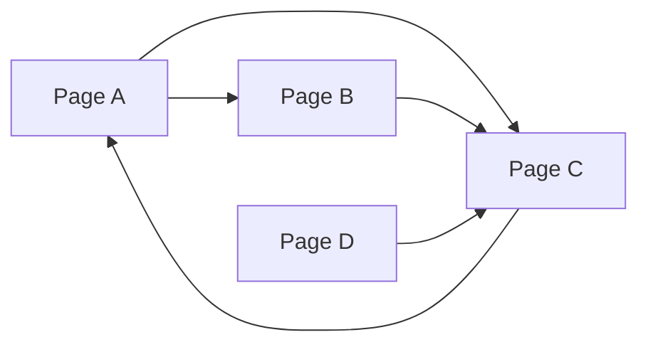
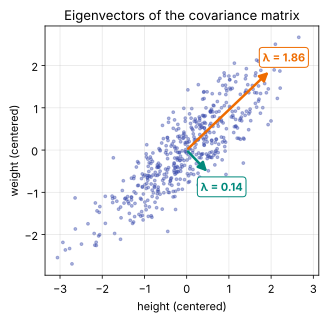

# Day 24: Eigenvectors, Intuitively

**Phase 1 · Week 4 · ~100 minutes**

## Objectives

- [ ] Explain what an eigenvector is (a direction a matrix only stretches) and what its eigenvalue is (the stretch factor).
- [ ] Find the eigenvalues and eigenvectors of a 2×2 matrix by hand, using the characteristic polynomial.
- [ ] Use `np.linalg.eig` and `np.linalg.eigh`, read their output correctly (eigenvectors are **columns**), and know when to use which.
- [ ] Explain why multiplying by a matrix over and over lines a vector up with the biggest eigenvector, and code **power iteration**.
- [ ] Rank the pages of a tiny 4-page web with PageRank, as an eigenvector problem.
- [ ] Say what negative and complex eigenvalues mean in pictures (flips and rotations).
- [ ] Explain why a symmetric matrix, like a covariance matrix, has perpendicular eigenvectors, and why that is the seed of PCA.

**Prerequisites.** [Day 11](day-11-transpose-identity-inverse.md) (matrices move space, the determinant, singular matrices), [Day 22](day-22-norms-distances.md) (the L2 norm and unit vectors) and [Day 23](day-23-rank-span.md) (span, linear independence, basis).

---

## The big idea

On Day 11 you saw a matrix as a machine that moves space: every vector goes in, a moved vector comes out. Most vectors get **turned** as well as stretched: they come out pointing somewhere new. But almost every matrix has a few special directions where it doesn't turn anything. A vector pointing that way comes out on the **same line**, only longer, shorter or flipped.

Those special directions are the matrix's **eigenvectors** ("eigen" is German for "own": the matrix's own directions). The amount of stretch along each is its **eigenvalue**.

**Analogy.** Roll out pizza dough with a rolling pin, always pushing in one direction. Draw some lines on the dough with flour first. A line drawn *along* the rolling direction just gets longer. A line drawn *across* it stays where it is. Every slanted line gets tilted towards the rolling direction. The two lines that kept their direction are the eigenvectors of "rolling"; how much each grew (say 3× and 1×) are the eigenvalues.

Why should an ML engineer care? Because eigenvectors answer questions like:

| Question | Eigen-answer |
|---|---|
| In which direction does my data spread the most? | The top eigenvector of its covariance matrix (PCA, Day 25) |
| What happens if I apply the same matrix again and again? | Everything lines up with the biggest eigenvector |
| Which web page is most important? | The eigenvector of the link matrix with eigenvalue 1 (PageRank) |
| Why do some recurrent networks explode or fade out? | Their repeated matrix has eigenvalues above or below 1 in size |

## The definition

A non-zero vector \( \mathbf{v} \) is an **eigenvector** of a square matrix \( A \) if multiplying by \( A \) only scales it:

\[
A\mathbf{v} = \lambda \mathbf{v}
\]

Reading it symbol by symbol:

- \( A \) is an \( n \times n \) matrix (square, so input and output live in the same space).
- \( \mathbf{v} \) is the eigenvector. It must not be the zero vector (\( A\mathbf{0} = \lambda\mathbf{0} \) for every \( \lambda \), which says nothing).
- \( \lambda \) ("lambda") is a plain number, the **eigenvalue**: the stretch factor along \( \mathbf{v} \).

The left side is a matrix-times-vector (Day 10's weighted sum of columns). The right side is just a number times a vector. The equation says the two give the same result: along \( \mathbf{v} \), the whole matrix behaves like a single number.

**A worked example.** Take

\[
A = \begin{bmatrix} 4 & 1 \\ 2 & 3 \end{bmatrix}
\]

Try three vectors:

\[
A\begin{bmatrix} 1 \\ 1 \end{bmatrix} = \begin{bmatrix} 4 + 1 \\ 2 + 3 \end{bmatrix} = \begin{bmatrix} 5 \\ 5 \end{bmatrix} = 5\begin{bmatrix} 1 \\ 1 \end{bmatrix}
\qquad
A\begin{bmatrix} 1 \\ -2 \end{bmatrix} = \begin{bmatrix} 4 - 2 \\ 2 - 6 \end{bmatrix} = \begin{bmatrix} 2 \\ -4 \end{bmatrix} = 2\begin{bmatrix} 1 \\ -2 \end{bmatrix}
\qquad
A\begin{bmatrix} 1 \\ 0 \end{bmatrix} = \begin{bmatrix} 4 \\ 2 \end{bmatrix}
\]

So \( [1, 1] \) is an eigenvector with eigenvalue 5, \( [1, -2] \) is an eigenvector with eigenvalue 2, and \( [1, 0] \) is not an eigenvector: \( [4, 2] \) points in a different direction.

```python
import numpy as np

A = np.array([[4., 1.],
              [2., 3.]])
A @ np.array([1., 1.])      # array([5., 5.])     5 × [1, 1]: eigenvector, λ = 5
A @ np.array([1., -2.])     # array([ 2., -4.])   2 × [1, -2]: eigenvector, λ = 2
A @ np.array([1., 0.])      # array([4., 2.])     not a multiple of [1, 0]: turned
A @ np.array([-3., -3.])    # array([-15., -15.]) 5 × [-3, -3]: any multiple works too
```

That last line matters: if \( \mathbf{v} \) is an eigenvector, so is \( 3\mathbf{v} \), \( -\mathbf{v} \) or \( 0.01\mathbf{v} \), with the same \( \lambda \). An eigenvector is really an **eigen-direction**, a whole line through the origin (the span of \( \mathbf{v} \), Day 23). Software picks one representative: the one of length 1.

<figure class="diagram" markdown>
![Animation: sixteen arrows of length 1, twelve grey and four colored, point around a circle; the matrix A with rows 4 1 and 2 3 is applied gradually, and the circle of arrow tips stretches into a tilted ellipse; most grey arrows swing towards the diagonal, while four orange and teal arrows lying on two dashed lines, the directions [1, 1] and [1, -2], only grow along their lines, by 5 and by 2](../../assets/img/phase-1/day24-eigen-arrows.svg)
<figcaption>Animated: A turns almost every arrow, but the arrows on the two dashed eigen-lines only stretch (×5 orange, ×2 teal).</figcaption>
</figure>

!!! warning "Common mistake: thinking eigenvectors are where a matrix does nothing"
    An eigenvector is not left alone; it is left **on its line**. It can be stretched (\( \lambda = 5 \)), shrunk (\( \lambda = 0.5 \)), flattened to zero (\( \lambda = 0 \)) or flipped (\( \lambda = -1 \)). Only \( \lambda = 1 \) means "unchanged".

## Finding them by hand

You can't guess eigenvectors for a big matrix, so here is the systematic route. It uses one fact from Day 11.

**Step 1: turn the equation into "a matrix squashes something to zero".** Move everything to one side. Since \( \lambda\mathbf{v} = \lambda I\mathbf{v} \) (the identity does nothing):

\[
A\mathbf{v} - \lambda I \mathbf{v} = \mathbf{0}
\quad\Longleftrightarrow\quad
(A - \lambda I)\,\mathbf{v} = \mathbf{0}
\]

\( A - \lambda I \) is just \( A \) with \( \lambda \) subtracted from each diagonal entry.

**Step 2: use the determinant.** We want a **non-zero** \( \mathbf{v} \) that \( A - \lambda I \) sends to zero. On Day 11 you saw that only a **singular** matrix (determinant 0) can squash a non-zero vector to zero; an invertible one could be undone, and \( \mathbf{0} \) can only come back to \( \mathbf{0} \). So the eigenvalues are exactly the numbers \( \lambda \) that make

\[
\det(A - \lambda I) = 0
\]

**Step 3: write it out.** For our \( A \):

\[
\det \begin{bmatrix} 4 - \lambda & 1 \\ 2 & 3 - \lambda \end{bmatrix}
= (4 - \lambda)(3 - \lambda) - 1 \cdot 2
= \lambda^2 - 7\lambda + 10
\]

This is the **characteristic polynomial** of \( A \) ("polynomial" just means a sum of powers of \( \lambda \)). Set it to zero and solve. It factors neatly:

\[
\lambda^2 - 7\lambda + 10 = (\lambda - 5)(\lambda - 2) = 0
\quad\Rightarrow\quad
\lambda_1 = 5, \;\; \lambda_2 = 2
\]

(If it doesn't factor, the school formula \( \lambda = \frac{-b \pm \sqrt{b^2 - 4ac}}{2a} \) with \( a = 1, b = -7, c = 10 \) gives the same \( \frac{7 \pm 3}{2} \).)

**Step 4: find each eigenvector.** Plug each \( \lambda \) back into \( (A - \lambda I)\mathbf{v} = \mathbf{0} \) and find a \( \mathbf{v} \) that works.

- \( \lambda = 5 \): \( A - 5I = \begin{bmatrix} -1 & 1 \\ 2 & -2 \end{bmatrix} \). Row 1 says \( -v_1 + v_2 = 0 \), so \( v_2 = v_1 \). Pick \( v_1 = 1 \): \( \mathbf{v}_1 = [1, 1] \). (Row 2 says the same thing times −2. It must: the matrix is singular, so its rows are dependent, Day 23.)
- \( \lambda = 2 \): \( A - 2I = \begin{bmatrix} 2 & 1 \\ 2 & 1 \end{bmatrix} \). Row 1 says \( 2v_1 + v_2 = 0 \), so \( v_2 = -2v_1 \): \( \mathbf{v}_2 = [1, -2] \).

Those match the vectors we tried earlier.

**A 2×2 shortcut.** For any 2×2 matrix the polynomial is always

\[
\lambda^2 - \operatorname{tr}(A)\,\lambda + \det(A) = 0
\]

where the **trace** \( \operatorname{tr}(A) \) is the sum of the diagonal (\( 4 + 3 = 7 \)). Two consequences hold for any size of matrix: the eigenvalues **add up to the trace** (\( 5 + 2 = 7 \)) and **multiply to the determinant** (\( 5 \times 2 = 10 \)). The second one ties back to Day 11: the determinant is how much area grows, and the area grows by 5 in one eigen-direction and by 2 in the other.

```python
np.trace(A), np.linalg.det(A)    # (7.0, 10.000000000000002)   rounding again; it's 10
np.roots([1, -7, 10])            # array([5., 2.])   roots of 1·λ² − 7·λ + 10
```

!!! note "Big matrices"
    For a 3×3 matrix the polynomial has a \( \lambda^3 \), for \( n \times n \) a \( \lambda^n \), and there's no neat formula beyond degree 4. Real software never builds the polynomial at all: it uses iterative algorithms (the "QR algorithm", in the LAPACK library NumPy calls). Do it by hand for 2×2 to understand it; use NumPy for everything else.

## Eigen in NumPy: `eig` and `eigh`

`np.linalg.eig` returns two things: the eigenvalues, and a matrix whose **columns** are the matching unit-length eigenvectors.

```python
vals, vecs = np.linalg.eig(A)
vals
# array([5., 2.])
vecs
# array([[ 0.70710678, -0.4472136 ],
#        [ 0.70710678,  0.89442719]])

v1 = vecs[:, 0]                  # column 0 goes with vals[0]
A @ v1, vals[0] * v1             # both array([3.53553391, 3.53553391])
np.allclose(A @ vecs, vecs * vals)   # True: every pair at once (vals broadcasts across columns, Day 9)

vecs[:, 1] / vecs[0, 1]          # array([ 1., -2.])   rescaled, it's our hand answer [1, -2]
np.linalg.norm(vecs, axis=0)     # array([1., 1.])     each column has length 1 (Day 22)
```

\( [0.707, 0.707] \) is \( [1, 1] / \sqrt{2} \), the unit vector along \( [1, 1] \); \( [-0.447, 0.894] \) is \( -[1, -2] / \sqrt{5} \). Notice the minus sign: NumPy is free to return either direction of the line, and different machines can differ.

!!! warning "Common mistake: reading eigenvectors as rows"
    `vecs[0]` is the first **row**, `[0.707, -0.447]`, which mixes two different eigenvectors and is not an eigenvector of anything. The eigenvector for `vals[i]` is the **column** `vecs[:, i]`. Also, `eig` does not promise any order: sort yourself if you need "largest first" (`order = np.argsort(vals)[::-1]`, then `vals[order]` and `vecs[:, order]`).

!!! note "If your output says `5.+0.j`"
    Eigenvalues can be complex numbers (you'll see why below), so some NumPy versions return a complex array such as `array([5.+0.j, 2.+0.j])` even when every imaginary part is zero. The outputs on this page come from NumPy 2.4, the version the ▶ Run button uses, which returns plain real numbers when it can. If you get the `+0.j` form, the numbers are the same; `vals.real` and `vecs.real` drop the zero imaginary parts.

### Symmetric matrices get their own function

A matrix is **symmetric** if it equals its own transpose, \( S = S^\top \): the entry in row \( i \), column \( j \) equals the one in row \( j \), column \( i \). For symmetric matrices use `np.linalg.eigh` (the "h" is for *Hermitian*, the complex-number version of symmetric). It is faster, it always returns **real** eigenvalues sorted **ascending**, and its eigenvectors are exactly **perpendicular**.

```python
S = np.array([[2., 1.],
              [1., 2.]])
w, Q = np.linalg.eigh(S)
w            # array([1., 3.])   smallest first
Q
# array([[-0.70710678,  0.70710678],
#        [ 0.70710678,  0.70710678]])
Q[:, 0] @ Q[:, 1]                # 2.2371143170757382e-17   0 up to rounding: perpendicular (Day 5)
np.allclose(Q.T @ Q, np.eye(2))  # True: unit length and perpendicular

vecs[:, 0] @ vecs[:, 1]          # 0.3162277660168379   not 0: A isn't symmetric, so its eigenvectors aren't perpendicular
                                 # (the sign depends on which way NumPy pointed each column)
```

You'll see why symmetric matrices behave so nicely at the end of the lesson.

!!! warning "Common mistake: `eigh` on a matrix that isn't symmetric"
    `eigh` doesn't check. It reads only the lower triangle and assumes the rest mirrors it, so on a non-symmetric matrix it silently answers a different question:

    ```python
    np.linalg.eigh(A).eigenvalues    # array([1.43844719, 5.56155281])   wrong for A (true: 5 and 2)
    ```

    It computed the eigenvalues of `[[4, 2], [2, 3]]`. Rule: `eigh` only when `np.allclose(M, M.T)`; otherwise `eig`.

## Multiply again and again: power iteration

What happens if you apply \( A \) to a vector, then apply it again to the result, and again? Write the starting vector as a mix of the two eigenvectors (they form a basis, Day 23). Our start \( [0, 1] \) is

\[
\begin{bmatrix} 0 \\ 1 \end{bmatrix} = \tfrac{1}{3}\begin{bmatrix} 1 \\ 1 \end{bmatrix} - \tfrac{1}{3}\begin{bmatrix} 1 \\ -2 \end{bmatrix}
\]

Each multiplication by \( A \) scales the first part by 5 and the second by 2, because that's what \( A \) does to each eigenvector. After \( k \) multiplications (\( A^k \) means \( A \) multiplied \( k \) times):

\[
A^k \begin{bmatrix} 0 \\ 1 \end{bmatrix} = \tfrac{1}{3} \cdot 5^k \begin{bmatrix} 1 \\ 1 \end{bmatrix} - \tfrac{1}{3} \cdot 2^k \begin{bmatrix} 1 \\ -2 \end{bmatrix}
\]

\( 5^k \) races away from \( 2^k \): after 10 steps the ratio is \( (2/5)^{10} \approx 0.0001 \). The first eigenvector wins, and the vector ends up pointing along \( [1, 1] \), the direction of the **dominant eigenvalue** (the one largest in size).

```python
for k in [1, 2, 5, 10]:
    print(k, np.linalg.matrix_power(A, k) @ np.array([0., 1.]))
# 1 [1. 3.]
# 2 [ 7. 11.]
# 5 [1031. 1063.]
# 10 [3254867. 3255891.]
```

The numbers explode (they grow like \( 5^k \)), but their direction settles. That gives the oldest eigenvector algorithm, **power iteration**: multiply, rescale to length 1 so nothing overflows, repeat.

```python
def power_iteration(M, v, steps):
    for k in range(1, steps + 1):
        v = M @ v
        v = v / np.linalg.norm(v)              # keep length 1 (Day 22)
        angle = np.degrees(np.arctan2(v[1], v[0]))
        if k <= 4 or k == steps:
            print(f"step {k:2d}: v = {v.round(4)}, angle {angle:.2f}°")
    return v

v = power_iteration(A, np.array([0., 1.]), 20)
# step  1: v = [0.3162 0.9487], angle 71.57°
# step  2: v = [0.5369 0.8437], angle 57.53°
# step  3: v = [0.6386 0.7696], angle 50.31°
# step  4: v = [0.6798 0.7334], angle 47.17°
# step 20: v = [0.7071 0.7071], angle 45.00°
v @ A @ v      # 4.999999983507325   the eigenvalue, 5
```

The last line recovers \( \lambda \): if \( \mathbf{v} \) is a unit eigenvector, \( \mathbf{v}^\top A \mathbf{v} = \mathbf{v}^\top (\lambda\mathbf{v}) = \lambda\, \mathbf{v} \cdot \mathbf{v} = \lambda \). (This expression is called the **Rayleigh quotient**.)

<figure class="diagram" markdown>

<figcaption>Animated: power iteration. Each step multiplies by A and rescales; the vector swings onto the dominant eigen-line [1, 1].</figcaption>
</figure>

How fast does it converge? The leftover error shrinks by \( |\lambda_2 / \lambda_1| \) each step, here \( 2/5 = 0.4 \). If the top two eigenvalues are close in size (say 5 and 4.9), power iteration crawls. It also needs the start vector to contain *some* of the dominant eigenvector: starting exactly on \( [1, -2] \) it would stay there forever.

## A tiny PageRank

Google's original ranking idea, **PageRank**, is power iteration on a matrix built from links. Picture a "random surfer" who clicks a random link on each page. The pages where the surfer spends the most time, in the long run, are the most important ones. Here's a tiny web of 4 pages:



**Building the matrix.** Make a 4×4 matrix \( M \) where column \( j \) describes where a surfer on page \( j \) goes next: if page \( j \) has \( k \) outgoing links, each linked page gets \( 1/k \). A has 2 links, so B and C each get 0.5 in column A. Every column adds up to 1 (it's a probability split). If \( \mathbf{r} \) holds the probability of being on each page, one click later it's \( M\mathbf{r} \).

```python
pages = ["A", "B", "C", "D"]
links = {"A": ["B", "C"], "B": ["C"], "C": ["A"], "D": ["C"]}

n = len(pages)
M = np.zeros((n, n))
for src, outs in links.items():
    for dst in outs:
        M[pages.index(dst), pages.index(src)] = 1 / len(outs)   # row = to, column = from
M
# array([[0. , 0. , 1. , 0. ],
#        [0.5, 0. , 0. , 0. ],
#        [0.5, 1. , 0. , 1. ],
#        [0. , 0. , 0. , 0. ]])
M.sum(axis=0)       # array([1., 1., 1., 1.])   each column is a probability split
```

**Damping.** Real surfers sometimes get bored and jump to a random page. PageRank models this with a **damping factor** \( d = 0.85 \): with probability 0.85 follow a link, otherwise jump anywhere (each page gets \( (1 - d)/n \)). That also rescues pages like D that nobody links to:

\[
G = d\,M + \frac{1 - d}{n}
\]

(the fraction is added to every entry, by broadcasting). The long-run probabilities \( \mathbf{r} \) are the ones that no longer change after a click: \( G\mathbf{r} = \mathbf{r} \). That is an eigenvector equation with \( \lambda = 1 \). Find it by power iteration:

```python
d = 0.85
G = d * M + (1 - d) / n

r = np.full(n, 1 / n)              # start: equally likely on every page
for step in range(1, 101):
    r_next = G @ r
    if np.abs(r_next - r).sum() < 1e-10:   # stop when nothing changes any more
        break
    r = r_next
print(step, r_next.round(4))
# 47 [0.3725 0.1958 0.3941 0.0375]
```

Page C wins (3 incoming links). A is a close second with only **one** incoming link, because that link comes from C, the most important page, which gives A its entire vote. D, with no incoming links, keeps only the random-jump share \( 0.15 / 4 = 0.0375 \). Notice no division by `norm` was needed here: every column of \( G \) sums to 1, so \( G \) never changes the total, and \( \mathbf{r} \) keeps summing to 1.

Check it against NumPy:

```python
vals_G, vecs_G = np.linalg.eig(G)
np.abs(vals_G).round(3)          # array([1.   , 0.601, 0.601, 0.   ])   λ = 1 is the biggest
top = vecs_G[:, np.argmax(np.abs(vals_G))].real
(top / top.sum()).round(4)       # array([0.3725, 0.1958, 0.3941, 0.0375])   same ranking
```

The second-largest eigenvalue has size 0.601, so the error shrinks by about 0.6 per click; that's why 47 steps were needed for \( 10^{-10} \). The real web has billions of pages: `eig` on a billion-by-billion matrix is impossible, but power iteration only needs repeated matrix-vector products over a very sparse matrix, which is exactly what made PageRank practical.

## Flips and rotations: negative and complex eigenvalues

**Negative eigenvalues flip.** The mirror \( F = \begin{bmatrix} 1 & 0 \\ 0 & -1 \end{bmatrix} \) from Day 11 leaves the x-axis alone (\( \lambda = 1 \)) and turns every vector on the y-axis around (\( \lambda = -1 \)). A flipped vector is still on its line, just pointing the other way, so it counts.

**Rotations have no real eigenvectors.** A 90° rotation turns *every* direction; no line through the origin survives. The characteristic polynomial of \( R = \begin{bmatrix} 0 & -1 \\ 1 & 0 \end{bmatrix} \) is \( \lambda^2 - 0 \cdot \lambda + 1 = \lambda^2 + 1 \), and \( \lambda^2 = -1 \) has no real solution. Its solutions are the **complex numbers** \( \pm i \), where \( i = \sqrt{-1} \) (Python writes it `1j`). You don't need complex arithmetic in this course; just learn to read the sign:

- Complex eigenvalues (they come in pairs \( a \pm bi \)) mean the matrix **rotates** part of the space.
- The rotation angle is the eigenvalue's angle, `np.angle(λ)`.
- The eigenvalue's size `abs(λ)` says whether that rotating part **grows** (above 1), **shrinks** (below 1) or keeps its size (exactly 1).

<figure class="diagram" markdown>

<figcaption>Animated: a flip keeps two lines (λ = 1 and λ = −1); a rotation keeps none, so its eigenvalues are complex.</figcaption>
</figure>

```python
F = np.array([[1., 0.], [0., -1.]])
np.linalg.eig(F).eigenvalues        # array([ 1., -1.])

R = np.array([[0., -1.], [1., 0.]])
np.linalg.eigvals(R)                # array([0.+1.j, 0.-1.j])   ±i: a pure rotation

theta = np.radians(30)
R30 = np.array([[np.cos(theta), -np.sin(theta)],
                [np.sin(theta),  np.cos(theta)]])
lam = np.linalg.eigvals(0.9 * R30)  # rotate 30° and shrink to 90%
np.abs(lam).round(4)                # array([0.9, 0.9])     size: shrink factor
np.degrees(np.angle(lam)).round(4)  # array([ 30., -30.])   angle: the rotation
```

Power iteration on a rotation never settles: the vector just keeps going round. The size of the eigenvalues is what decides the long run, which is a preview of a real ML problem. A **recurrent neural network** (an older kind of sequence model) multiplies its hidden state by the same weight matrix at every time step. If the biggest eigenvalue size is above 1 the values blow up (**exploding gradients**); below 1, they fade to nothing (**vanishing gradients**):

```python
v0 = np.array([1., 0.])
for scale in [0.9, 1.0, 1.1]:
    v = np.linalg.matrix_power(scale * R30, 50) @ v0    # 50 "time steps"
    print(scale, round(float(np.linalg.norm(v)), 4))
# 0.9 0.0052
# 1.0 1.0
# 1.1 117.3909
```

Fifty steps turn a 10% difference per step into a factor of 20,000 between the first and last line.

!!! android "Android bridge"
    `android.graphics.Matrix` has a method that ignores translation and applies only the 2×2 part: `mapVectors(float[])`. That is exactly \( A\mathbf{v} \), so you can watch eigenvectors in an app:

    ```kotlin
    val m = Matrix().apply { setScale(3f, 0.5f) }   // stretch x by 3, squash y to half
    val v = floatArrayOf(1f, 0f,   0f, 1f,   1f, 1f) // three vectors (x, y pairs)
    m.mapVectors(v)
    // v = [3, 0,   0, 0.5,   3, 0.5]
    // (1, 0) -> (3, 0): same line, λ = 3      (0, 1) -> (0, 0.5): same line, λ = 0.5
    // (1, 1) -> (3, 0.5): turned towards the x-axis, not an eigenvector
    ```

    A scale matrix has the axes as eigen-directions and the scale factors as eigenvalues; a pinch-zoom with `setScale(s, s)` makes **every** direction an eigenvector, with one repeated eigenvalue \( s \). `setRotate(30f)` keeps no direction, the complex case above. And the "repeat until nothing changes" loop of PageRank is the same idea as a layout pass that re-measures until sizes stop changing, a **fixed point**: an \( \mathbf{r} \) with \( G\mathbf{r} = \mathbf{r} \).

## Symmetric matrices and the road to PCA

The most important matrices in data science are symmetric, and the most important of those is the **covariance matrix**. A two-minute introduction (Month 2 does statistics properly):

- Take a data matrix \( X \) with one row per example and one column per feature, and **center** it: subtract each column's mean, so every feature averages 0 (broadcasting, Day 9). Call the result \( X_c \).
- The **variance** of a feature is the average squared distance from its mean: how spread out it is.
- The **covariance** of two features is the average of the *product* of their centered values. Positive means they tend to rise together, negative means one rises as the other falls, near 0 means no linear relation.
- All of these at once, for \( n \) examples: \( C = \frac{1}{n - 1} X_c^\top X_c \). Diagonal entries are variances, off-diagonal entries are covariances. (Dividing by \( n - 1 \) rather than \( n \) is a statistics convention you'll meet in Month 2.)

\( C \) is always symmetric. With Day 11's rule \( (AB)^\top = B^\top A^\top \): \( (X_c^\top X_c)^\top = X_c^\top (X_c^\top)^\top = X_c^\top X_c \).

```python
rng = np.random.default_rng(24)
height = rng.normal(0, 1.0, size=500)                   # a made-up feature
weight = 0.8 * height + rng.normal(0, 0.5, size=500)    # correlated with height
X = np.column_stack([height, weight])                   # shape (500, 2)

Xc = X - X.mean(axis=0)                                 # center each column
C = Xc.T @ Xc / (len(X) - 1)
C.round(3)
# array([[1.043, 0.859],
#        [0.859, 0.96 ]])
np.allclose(C, np.cov(X, rowvar=False))    # True   NumPy's own covariance agrees

w, Q = np.linalg.eigh(C)                   # symmetric, so eigh
w.round(3)                                 # array([0.141, 1.862])
Q.round(3)
# array([[ 0.69 , -0.724],
#        [-0.724, -0.69 ]])
Q[:, 0] @ Q[:, 1]                          # -1.8049113117610177e-17   0 up to rounding: perpendicular
```

<figure class="diagram" markdown>

<figcaption>The covariance matrix's eigenvectors are the cloud's natural axes; each arrow is 2 × √λ long, so its length shows the spread along it.</figcaption>
</figure>

Look at what the eigenvectors are: the **axes of the data cloud**. The top eigenvector (eigenvalue 1.86) points along the direction the data spreads the most, and the eigenvalue *is* the variance along that direction. The other one (0.14) is the perpendicular direction with the least spread. Total variance is preserved: \( 1.043 + 0.960 = 2.003 = 0.141 + 1.862 \) (the trace again). 1.862 out of 2.003, about 93%, of the spread lies along one direction. Keeping just that direction, and dropping the other, is **Principal Component Analysis** (PCA), tomorrow's topic.

Here is the code that drew the figure:

```python
import matplotlib.pyplot as plt

plt.rcParams.update({"font.size": 11, "figure.facecolor": "white", "savefig.facecolor": "white"})
fig, ax = plt.subplots(figsize=(6, 4.5))
ax.scatter(Xc[:, 0], Xc[:, 1], s=8, alpha=0.4, color="#3949ab")
for lam_i, q, color in [(w[1], Q[:, 1], "#ef6c00"), (w[0], Q[:, 0], "#00897b")]:
    q = q if q[0] > 0 else -q                       # point the arrows to the right
    end = 2 * np.sqrt(lam_i) * q
    ax.annotate("", xy=end, xytext=(0, 0),
                arrowprops=dict(arrowstyle="-|>", color=color, lw=2.5, mutation_scale=18))
    ax.text(*(end + 0.45 * q), f"λ = {lam_i:.2f}", color=color, fontweight="bold",
            ha="center", va="center", bbox=dict(boxstyle="round", fc="white", ec=color))
ax.set_aspect("equal")
ax.set_xlabel("height (centered)")
ax.set_ylabel("weight (centered)")
ax.set_title("Eigenvectors of the covariance matrix")
ax.grid(alpha=0.3)
fig.savefig("day24-covariance-eigvecs.svg", format="svg", bbox_inches="tight")
plt.close(fig)
```

### Why symmetric means perpendicular

This is a three-line argument, and every step is something you already know. Let \( S \) be symmetric with two eigenvectors \( \mathbf{v}_1, \mathbf{v}_2 \) and *different* eigenvalues \( \lambda_1 \neq \lambda_2 \). Compute the number \( (S\mathbf{v}_1) \cdot \mathbf{v}_2 \) in two ways:

\[
(S\mathbf{v}_1) \cdot \mathbf{v}_2 = (\lambda_1 \mathbf{v}_1) \cdot \mathbf{v}_2 = \lambda_1\, (\mathbf{v}_1 \cdot \mathbf{v}_2)
\]

\[
(S\mathbf{v}_1) \cdot \mathbf{v}_2 = (S\mathbf{v}_1)^\top \mathbf{v}_2 = \mathbf{v}_1^\top S^\top \mathbf{v}_2 = \mathbf{v}_1^\top S\, \mathbf{v}_2 = \mathbf{v}_1 \cdot (\lambda_2 \mathbf{v}_2) = \lambda_2\, (\mathbf{v}_1 \cdot \mathbf{v}_2)
\]

(The second line uses \( (AB)^\top = B^\top A^\top \) and \( S^\top = S \).) Both equal the same number, so \( (\lambda_1 - \lambda_2)(\mathbf{v}_1 \cdot \mathbf{v}_2) = 0 \). Since \( \lambda_1 \neq \lambda_2 \), the dot product must be 0: the eigenvectors are perpendicular. For our non-symmetric \( A \) the step \( S^\top = S \) fails, and indeed its eigenvectors were not perpendicular. (A related fact, which we'll accept without proof: a real symmetric matrix's eigenvalues are always real, so a symmetric matrix never rotates.)

**The payoff: a symmetric matrix is just stretches along perpendicular axes.** Put the unit eigenvectors in the columns of \( Q \) and the eigenvalues on the diagonal of \( \Lambda \) (capital lambda). Then

\[
S = Q \Lambda Q^\top
\]

Read right to left (Day 11): \( Q^\top \) rotates (perhaps with a mirror flip) the eigen-axes onto the x and y axes, \( \Lambda \) stretches each axis by its eigenvalue, and \( Q \) rotates back. Every symmetric matrix, in any number of dimensions, is "rotate, stretch along the axes, rotate back". This is called the **eigendecomposition** (or *spectral decomposition*).

```python
np.allclose(Q @ np.diag(w) @ Q.T, C)    # True: C = Q Λ Qᵀ
```

!!! warning "Common mistake: forgetting to center before the covariance"
    `X.T @ X / (n - 1)` without subtracting the means is not the covariance; its top eigenvector mostly points from the origin towards the data's mean, not along its spread. Always center first, or use `np.cov(X, rowvar=False)` (`rowvar=False` tells it that columns are features; its default treats **rows** as variables).

---

## Exercises

1. By hand, find the eigenvalues and eigenvectors of \( B = \begin{bmatrix} 5 & 2 \\ 2 & 2 \end{bmatrix} \): write the characteristic polynomial, factor it, then solve for each eigenvector. Check that the eigenvalues add to the trace and multiply to the determinant, and that the eigenvectors are perpendicular (should they be?).
2. Confirm Exercise 1 with `np.linalg.eigh`. Then rescale each column of `Q` so its first entry is 1 and compare with your hand answers. Finally verify \( B = Q\Lambda Q^\top \).
3. Without any eigen-function, decide whether \( [1, 2] \) and \( [1, -2] \) are eigenvectors of \( P = \begin{bmatrix} 1 & 1 \\ 4 & 1 \end{bmatrix} \), and if so with which eigenvalues. What does the sign of one of them tell you geometrically?
4. Run power iteration on \( B \) from Exercise 1, starting at \( [0, 1] \). How many steps until `abs(v @ B @ v - 6) < 1e-6`? Explain the speed using the ratio of the two eigenvalues.
5. A 60° rotation: build it, then predict its eigenvalues' size and angle before computing them with `np.linalg.eigvals`. Then predict the length of \( (1.05\,R_{60})^{20}\,[1, 0] \) and check it.
6. In the PageRank example, page D adds a link to page B (so D links to both B and C). Predict which pages gain and which lose, then wrap the PageRank code in a function `pagerank(links, d=0.85)` and check.

??? success "Solutions"
    ```python
    # 1: tr(B) = 7, det(B) = 5*2 - 2*2 = 6, so λ² − 7λ + 6 = (λ − 6)(λ − 1): λ = 6 and λ = 1
    # λ = 6: B − 6I = [[-1, 2], [2, -4]]  → -v1 + 2 v2 = 0 → v = [2, 1]
    # λ = 1: B − 1I = [[ 4, 2], [2,  1]]  →  4 v1 + 2 v2 = 0 → v = [1, -2]
    # 6 + 1 = 7 = trace, 6 × 1 = 6 = det. [2, 1] · [1, -2] = 2 − 2 = 0: perpendicular,
    # as it must be, because B is symmetric.
    B = np.array([[5., 2.], [2., 2.]])
    B @ np.array([2., 1.]), B @ np.array([1., -2.])   # (array([12.,  6.]), array([ 1., -2.]))  = 6·[2, 1] and 1·[1, -2]

    # 2
    wB, QB = np.linalg.eigh(B)
    wB                                   # array([1., 6.])   ascending
    QB / QB[0]                           # each column divided by its first entry
    # array([[ 1. ,  1. ],
    #        [-2. ,  0.5]])              [1, -2] and [1, 0.5] (= [2, 1] halved: same line)
    np.allclose(QB @ np.diag(wB) @ QB.T, B)   # True

    # 3
    P = np.array([[1., 1.], [4., 1.]])
    P @ np.array([1., 2.])               # array([3., 6.])    = 3 × [1, 2]:  λ = 3
    P @ np.array([1., -2.])              # array([-1.,  2.])  = −1 × [1, -2]: λ = −1
    ```
    \( \lambda = -1 \) means \( P \) flips the line through \( [1, -2] \): vectors on it keep their length but point the opposite way. (Check: \( 3 + (-1) = 2 = \operatorname{tr}(P) \), \( 3 \times (-1) = -3 = 1 - 4 = \det(P) \).)

    ```python
    # 4
    v = np.array([0., 1.])
    steps = 0
    while abs(v @ B @ v - 6) >= 1e-6:
        v = B @ v
        v = v / np.linalg.norm(v)
        steps += 1
    steps, v.round(6)                    # (5, array([0.894312, 0.447444]))   close to [2, 1]/√5 = [0.894427, 0.447214]
    ```
    The error in the direction shrinks by \( \lambda_2 / \lambda_1 = 1/6 \) per step, and the Rayleigh quotient's error by about \( (1/6)^2 = 1/36 \), so a handful of steps is enough. (Compare \( A \), whose ratio 0.4 is much slower.)

    ```python
    # 5: a rotation keeps lengths, so |λ| = 1, and turns by 60°, so the angles are ±60°
    t = np.radians(60)
    R60 = np.array([[np.cos(t), -np.sin(t)], [np.sin(t), np.cos(t)]])
    lam60 = np.linalg.eigvals(R60)
    np.abs(lam60).round(4), np.degrees(np.angle(lam60)).round(4)
    # (array([1., 1.]), array([ 60., -60.]))
    # scaled by 1.05, twenty times: length 1.05**20 = 2.6533
    np.linalg.norm(np.linalg.matrix_power(1.05 * R60, 20) @ np.array([1., 0.])).round(4)   # 2.6533

    # 6
    def pagerank(links, d=0.85):
        names = sorted(links)
        n = len(names)
        M = np.zeros((n, n))
        for src, outs in links.items():
            for dst in outs:
                M[names.index(dst), names.index(src)] = 1 / len(outs)
        G = d * M + (1 - d) / n
        r = np.full(n, 1 / n)
        for _ in range(1000):
            r_next = G @ r
            if np.abs(r_next - r).sum() < 1e-12:
                break
            r = r_next
        return dict(zip(names, r_next.round(4).tolist()))

    pagerank({"A": ["B", "C"], "B": ["C"], "C": ["A"], "D": ["C"]})
    # {'A': 0.3725, 'B': 0.1958, 'C': 0.3941, 'D': 0.0375}
    pagerank({"A": ["B", "C"], "B": ["C"], "C": ["A"], "D": ["B", "C"]})
    # {'A': 0.3664, 'B': 0.2092, 'C': 0.3869, 'D': 0.0375}
    ```
    B gains (a new incoming link). C and A lose a little: D now splits its vote, so C gets less from D, and A, which lives off C's vote, drops with it. D is unchanged: its score depends only on links *into* D, and there still are none.

## Resources

- [3Blue1Brown: Eigenvectors and eigenvalues (Essence of Linear Algebra, ch. 14)](https://www.youtube.com/watch?v=PFDu9oVAE-g): today's opening animation, done beautifully. Watch it first.
- [Setosa: Eigenvectors and Eigenvalues, explained visually](https://setosa.io/ev/eigenvectors-and-eigenvalues/): drag the matrix and watch the eigen-lines, including a Markov-chain example like PageRank.
- [Khan Academy: Linear algebra](https://www.khanacademy.org/math/linear-algebra): the "Alternate coordinate systems (bases)" unit covers eigenvalues and eigenvectors with worked 2×2 and 3×3 examples.
- [NumPy docs: `numpy.linalg.eig`](https://numpy.org/doc/stable/reference/generated/numpy.linalg.eig.html) and [`numpy.linalg.eigh`](https://numpy.org/doc/stable/reference/generated/numpy.linalg.eigh.html).
- [Mathematics for Machine Learning (free book), ch. 4 "Matrix Decompositions"](https://mml-book.github.io/): eigendecomposition and the spectral theorem, formally.
- [Wikipedia: PageRank](https://en.wikipedia.org/wiki/PageRank): the random-surfer model, the damping factor and the power method.
- [Android reference: `android.graphics.Matrix`](https://developer.android.com/reference/android/graphics/Matrix): `mapVectors`, `setScale`, `setRotate`.

## Checklist

- [ ] I can say in one sentence what an eigenvector and an eigenvalue are, and check \( A\mathbf{v} = \lambda\mathbf{v} \) for a given vector.
- [ ] I can find the eigenvalues of a 2×2 matrix from \( \lambda^2 - \operatorname{tr}(A)\lambda + \det(A) = 0 \), and then its eigenvectors.
- [ ] I read eigenvectors from the **columns** of `eig`'s result, and use `eigh` only for symmetric matrices.
- [ ] I can explain why repeated multiplication points a vector along the dominant eigenvector, and write power iteration.
- [ ] I can explain PageRank as "the eigenvector with eigenvalue 1".
- [ ] I can say what λ = −1, λ = 0 and complex eigenvalues mean geometrically.
- [ ] I can explain why a covariance matrix is symmetric and why its eigenvectors are perpendicular axes of the data.

**Next:** Day 25: Projections and PCA preview (coming soon)
