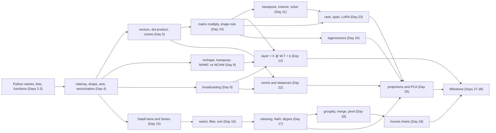
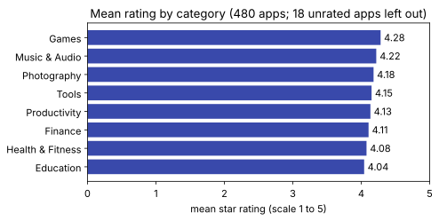

# Day 26: Month 1 Recap and Gaps

**Phase 1 · Week 4 · ~90 minutes**

## Objectives

By the end of today you can:

- [ ] Draw Month 1 from memory as one chain: Python → NumPy → matrices → pandas → linear algebra, and say what each link adds.
- [ ] Rate yourself honestly on 15 topics at three levels: *can explain*, *can code*, *can apply*.
- [ ] Take a 15-question diagnostic quiz and turn the wrong answers into a short list of gaps.
- [ ] Close each gap with a 5–10 minute drill whose expected output tells you when you're done.
- [ ] Write a spaced-repetition plan that brings your weak topics back at growing intervals through Month 2.

**Prerequisites.** All of Month 1. Week 1: [Day 1](day-01-setup.md) (setup), [Day 2](day-02-python-types.md) (core types), [Day 3](day-03-functions-classes.md) (functions and classes), [Day 4](day-04-numpy-arrays.md) (NumPy arrays), [Day 5](day-05-vectors.md) (vectors), [Day 6](day-06-week1-review.md) (review). Week 2: [Day 8](day-08-shapes-indexing.md) (shapes), [Day 9](day-09-broadcasting.md) (broadcasting), [Day 10](day-10-matrices-matmul.md) (matrix multiplication), [Day 11](day-11-transpose-identity-inverse.md) (transpose, identity, inverse), [Day 12](day-12-layer-is-matmul.md) (a layer is a matmul), [Day 13](day-13-week2-review.md) (review). Week 3: [Day 15](day-15-pandas-dataframes.md) (DataFrames), [Day 16](day-16-pandas-selecting.md) (selecting), [Day 17](day-17-pandas-cleaning.md) (cleaning), [Day 18](day-18-pandas-groupby-merge.md) (groupby and merge), [Day 19](day-19-matplotlib.md) (plotting), [Day 20](day-20-week3-review.md) (review). Week 4: [Day 22](day-22-norms-distances.md) (norms), [Day 23](day-23-rank-span.md) (rank and span), [Day 24](day-24-eigenvectors.md) (eigenvectors), [Day 25](day-25-projections-pca.md) (projections and PCA).

**Suggested time split.** 10 minutes on the map, 15 minutes on the rubric, 25 minutes on the quiz, 30 minutes on the drills for your two or three weakest rows, 10 minutes writing your review plan into your calendar.

---

## The big idea

Today is not a lesson; it is a **check-up**. You've covered a lot in 25 days, and some of it has already faded. That is normal. The goal today is to find *which* parts faded, fix them cheaply, and schedule them to come back before they fade again.

Think of it like a release-readiness review before you ship an app. You don't re-test every screen by hand. You run the test suite, look at what's red, fix those, and add the flaky ones to a watch list. Here the **rubric** is your test plan, the **quiz** is the test run, the **drills** are the fixes, and the **spaced-repetition plan** is the watch list.

Three rules make it work:

1. **Be honest, not kind.** "I recognise it when I read it" is not "I can explain it". Mark what you can do from a blank page.
2. **Fix the foundation first.** If broadcasting (Day 9) is shaky, PCA (Day 25) will feel shaky too, because it is built on it. Drill the earliest weak row first.
3. **Small and often beats long and once.** Five 15-minute reviews spread over a month keep more than one 75-minute cram.

---

## Month 1 on one page

Every week built a layer on the one before. The animation walks the stations in order; the panel at the bottom says what each one gave you and the one line of code that sums it up.

<figure class="diagram" markdown>
![Animated timeline with six stations on a road: Python (Week 1, Days 1–3), NumPy (Weeks 1–2, Days 4–9), Matrices (Week 2, Days 10–12), pandas (Week 3, Days 15–19), Linear algebra (Week 4, Days 22–25) and a finish flag for the Milestone (Days 27–28). An orange marker moves from station to station, the road behind it turns orange, the current station is highlighted, and a panel shows a headline, the topics and one line of code for that station. Small labels under the road mark the Day 6, 13 and 20 reviews and Day 26, today](../../assets/img/phase-1/day26-month-journey.svg)
<figcaption>Animated: Month 1 as one journey. Each station uses everything before it.</figcaption>
</figure>

The same month as a table, one idea to keep per week:

| Week | Days | You learned | The one idea to keep |
|---|---|---|---|
| 1 | [1](day-01-setup.md)–[6](day-06-week1-review.md) | venv, core types, functions, classes, NumPy arrays, vectors, dot product, cosine | A name points at an object; an `ndarray` is one dtype in one block of memory, so loops disappear. Cosine similarity compares direction, not length. |
| 2 | [8](day-08-shapes-indexing.md)–[13](day-13-week2-review.md) | shapes, broadcasting, matmul, transpose, inverse, `solve`, layers | Check shapes first. Inner dimensions match, outer survive. A layer is \( XW^\top + \mathbf{b} \). |
| 3 | [15](day-15-pandas-dataframes.md)–[20](day-20-week3-review.md) | DataFrames, selection, cleaning, groupby, merge, plotting | A DataFrame is a dict of NumPy-backed Series sharing an index. Clean once, merge `how="left"`, never truncate a bar axis. |
| 4 | [22](day-22-norms-distances.md)–[25](day-25-projections-pca.md) | norms, distances, rank, span, eigenvectors, projections, PCA | Length and distance depend on scale; rank counts the truly independent directions; eigenvectors are the directions a matrix only stretches; PCA keeps the directions of largest variance. |

And as a concept map. Arrows mean "is built on", so if a box is weak, check the boxes that point into it:



!!! android "Android bridge"
    Month 1 maps onto the stack you already know. Python is your Kotlin: the language everything else is written in. NumPy is the native layer underneath, like the `FloatBuffer` you hand to a LiteRT `Interpreter`: one typed block of memory that compiled code chews through without per-element overhead. Matrices are what that interpreter actually computes in its `FULLY_CONNECTED` and convolution ops. pandas is Room plus SQL: `groupby` is `GROUP BY`, `merge` is `JOIN`, and a left join keeps every row of your main table just like `LEFT JOIN`. Week 4's linear algebra is what lets you read a model card or a paper and know what "embedding", "low-rank" or "principal component" means.

---

## The self-assessment rubric

For each row, tick the levels you can honestly do **today, without notes**:

- **Can explain:** you could say it out loud to a colleague in two minutes, with an example, and answer "why?".
- **Can code:** you could type it from a blank file and get the right answer, looking up only function names.
- **Can apply:** given a new problem, you'd know this tool is the one to use, and spot the classic mistake.

Score each row 0–3 (the number of columns you ticked). Write the scores down; you'll use them twice more today.

| # | Topic | Lessons | Can explain | Can code | Can apply |
|---|---|---|---|---|---|
| 1 | Python names, copies, functions | [2](day-02-python-types.md), [3](day-03-functions-classes.md) | why `b = a` shares a list; why a mutable default is shared between calls | a function with `None` as the default; a `@dataclass` | spot an aliasing bug in someone's preprocessing code |
| 2 | NumPy arrays, `axis`, vectorization | [4](day-04-numpy-arrays.md) | why an `ndarray` beats a list (one dtype, contiguous, compiled loops) | per-column mean, per-row argmax, with no Python loop | pick the right `axis` on `(samples, features)` and `(batch, classes)` |
| 3 | Vectors, dot product, cosine | [5](day-05-vectors.md) | what a dot product measures; why cosine ignores length | `cosine(a, b)` from `@` and `np.linalg.norm` | rank documents by similarity to a query |
| 4 | Shapes: reshape vs transpose | [8](day-08-shapes-indexing.md) | why `reshape` never reorders memory and `transpose` does | HWC image → NCHW batch, and → NHWC batch | choose the right layout for LiteRT vs PyTorch |
| 5 | Broadcasting | [9](day-09-broadcasting.md) | the right-alignment rule; why stretching is free | center rows and columns; `keepdims=True` | find a silent `(n,)` vs `(n, 1)` bug |
| 6 | Matrix multiply and layers | [10](day-10-matrices-matmul.md), [12](day-12-layer-is-matmul.md) | the shape rule; why ReLU sits between layers | a 2-layer forward pass; count parameters and multiply-adds | estimate whether a layer fits a phone's budget |
| 7 | Transpose, inverse, `solve` | [11](day-11-transpose-identity-inverse.md) | what a determinant of 0 does to the plane | solve \( A\mathbf{x} = \mathbf{b} \) with `np.linalg.solve` and check it | know when there is no unique answer, and why `inv` is avoided |
| 8 | pandas selection | [15](day-15-pandas-dataframes.md), [16](day-16-pandas-selecting.md) | `.loc` (labels) vs `.iloc` (positions); why `&` needs parentheses | a multi-condition filter, sorted, top *n* | answer "which apps…?" questions on a new table |
| 9 | Cleaning and missing data | [17](day-17-pandas-cleaning.md) | drop vs fill vs flag; what `NaN` does to a mean | text → int, "Varies with device" → `NaN` → float, dates | audit a raw CSV before trusting any number from it |
| 10 | groupby and merge | [18](day-18-pandas-groupby-merge.md) | split-apply-combine; inner vs left join; `size` vs `count` | named aggregation; a left merge with `validate` and `indicator` | join a lookup table without losing or duplicating rows |
| 11 | Plotting | [19](day-19-matplotlib.md), [20](day-20-week3-review.md) | which chart answers which question; why log scales; truncated axes | a labelled figure with `fig, ax = plt.subplots()`, saved as SVG | pick an honest chart for a finding and word it without causal claims |
| 12 | Norms and distances | [22](day-22-norms-distances.md) | L1, L2, L∞; Euclidean vs cosine; why scale matters | `np.linalg.norm(..., ord=)`; brute-force nearest neighbour | choose a distance for embeddings vs raw features |
| 13 | Rank, span, independence | [23](day-23-rank-span.md) | what span and rank mean; why collinear features make \( X^\top X \) singular | `np.linalg.matrix_rank`; LoRA parameter counts | spot a duplicated feature; explain why LoRA is cheap |
| 14 | Eigenvectors | [24](day-24-eigenvectors.md) | directions a matrix only stretches; what the eigenvalue is | `np.linalg.eigh`, verify \( A\mathbf{v} = \lambda\mathbf{v} \), power iteration | read "symmetric → orthogonal eigenvectors" and know why PCA needs it |
| 15 | Projections and PCA | [25](day-25-projections-pca.md) | projection as a shadow; least squares as a projection; what PCA keeps | PCA from scratch: center, covariance, `eigh`, sort, project | decide how many components to keep from the explained-variance ratio |

**Reading your scores.** Out of 45: 38 or more is solid, 28–37 is normal for a first month, below 28 means spend tomorrow's milestone slot on the drills first. Row by row, which matters more: a **0 or 1** is a *red* row (re-read the lesson, then do the drill), a **2** is *amber* (do the drill), a **3** is *green* (skip to the review plan).

!!! warning "Common mistake: grading recognition as knowledge"
    Reading a solution and nodding along feels like understanding, but it tests recognition, which is far easier than recall. The rubric only counts what you can produce. If you're unsure whether to tick a box, the quiz below will settle it: a wrong answer drops that row by one.

---

## Diagnostic quiz

Fifteen questions, one per rubric row, in the same order. Answer each on paper first, *then* open the answer. For every question you get wrong, or right only by guessing, **lower that row's score by one**.

??? question "1. `a = [1, 2, 3]`, `b = a`, `c = a[:]`, `b.append(4)`. What are `a` and `c`? And what is wrong with `def add(x, seen=[]):`?"
    `a` is `[1, 2, 3, 4]` because `b` is another name for the same list; `c` is `[1, 2, 3]` because slicing made a new list. In `def add(x, seen=[])` the default list is created **once**, when `def` runs, and is shared by every call that doesn't pass `seen`, so it keeps growing. Use `seen=None` and `if seen is None: seen = []` inside. (Days 2 and 3; drill 1)

??? question "2. What do `[1, 2, 3] * 2` and `np.array([1, 2, 3]) * 2` give? And `X` has shape (100, 3): what shape is `X.mean(axis=0)`?"
    The list is repeated: `[1, 2, 3, 1, 2, 3]`. The array is multiplied element by element: `[2 4 6]`. `X.mean(axis=0)` has shape `(3,)`: the axis you name is the one that disappears, so you get one mean per column (feature). (Day 4; drill 2)

??? question "3. What is the cosine similarity of [1, 0] and [1, 1]? Of [2, 0] and [2, 2]? Why are they the same while the dot products differ?"
    Both are \( 1/\sqrt{2} \approx 0.707 \) (an angle of 45°). The dot products are 1 and 4. The dot product grows with both lengths, \( \mathbf{a}\cdot\mathbf{b} = \|\mathbf{a}\|\|\mathbf{b}\|\cos\theta \); cosine similarity divides the lengths out and keeps only the direction. That is why embedding search uses it. (Day 5; drill 3)

??? question "4. An image `img` has shape (224, 224, 3). Give the call that makes a PyTorch batch, and say why `img.reshape(1, 3, 224, 224)` is wrong even though the shape is right."
    `img.transpose(2, 0, 1)[np.newaxis]`, shape `(1, 3, 224, 224)` (NCHW). `reshape` keeps the memory order, so it just re-reads the interleaved R, G, B, R, G, B... values in new chunks: the "red channel" it produces is a mix of all three colours. Only `transpose` moves the channel axis. For LiteRT you keep NHWC: `img[np.newaxis]`, shape `(1, 224, 224, 3)`. (Day 8; drill 4)

??? question "5. What shape do (8, 1) and (3,) broadcast to? And why does `M - M.mean(axis=1)` fail for `M` of shape (3, 4)?"
    `(8, 3)`: align from the right, `1` vs `3` stretches to 3, then the missing axis on the left becomes 8. `M.mean(axis=1)` has shape `(3,)`, which aligns with the **last** axis of `(3, 4)`: 3 vs 4 is neither equal nor 1, so it raises `ValueError: operands could not be broadcast together`. Use `M.mean(axis=1, keepdims=True)`, shape `(3, 1)`. (Day 9; drill 5)

??? question "6. A batch `X` of shape (64, 20) goes through `nn.Linear(20, 50)`. What shape is the weight, what shape is the output, how many parameters are there, and how many multiply-adds?"
    Weight `(50, 20)` (out, in), bias `(50,)`. Output \( XW^\top + \mathbf{b} \): `(64, 20) @ (20, 50)` → `(64, 50)`. Parameters: \( 20 \cdot 50 + 50 = 1{,}050 \). Multiply-adds: \( 64 \cdot 20 \cdot 50 = 64{,}000 \) (128,000 FLOPs). (Days 10 and 12; drill 6)

??? question "7. \( A = \begin{bmatrix} 2 & 4 \\ 1 & 2 \end{bmatrix} \). What is its determinant, what does it do to the plane, and what does `np.linalg.solve(A, b)` do?"
    \( \det A = 2 \cdot 2 - 4 \cdot 1 = 0 \). The second column is twice the first, so every output lands on one line: the plane is squashed flat, information is lost, and there is no inverse. `solve` raises `LinAlgError: Singular matrix`. For an invertible \( A \), `solve` is the right tool: faster and more accurate than `np.linalg.inv(A) @ b`. (Day 11; drill 7)

??? question "8. After `s = apps.sort_values(\"reviews\", ascending=False)`, what is the difference between `s.loc[0]` and `s.iloc[0]`? And what is wrong with `apps[apps[\"rating\"] > 4.5 & apps[\"has_ads\"] == \"No\"]`?"
    `s.iloc[0]` is the first row by **position**: the most-reviewed app. `s.loc[0]` is the row whose **label** is 0: the app that was first in the file, wherever it now sits. Sorting moves rows but keeps their labels. The filter is missing parentheses: `&` binds tighter than `>` and `==`, so Python first tries `4.5 & apps["has_ads"]` and raises a `TypeError`. Write `apps[(apps["rating"] > 4.5) & (apps["has_ads"] == "No")]`. (Days 15 and 16; drill 8)

??? question "9. The cleaned table has 18 missing ratings. What does `apps[\"rating\"].mean()` do with them, and why is `apps[\"rating\"].fillna(0).mean()` wrong?"
    pandas skips `NaN` by default, so `.mean()` averages the 462 apps that have a rating: about 4.17. Filling with 0 claims that 18 unrated apps got zero stars (the scale doesn't even go below 1) and drags the mean down to about 4.01. Missing means "unknown", not "zero": leave it, drop it for this one calculation, or flag it with a column, depending on the question. (Day 17; drill 9)

??? question "10. You merge the 480 cleaned apps with `developers.csv` on `developer_id`. How many rows do an inner join and a left join give, and why?"
    Inner: 478. Left: 480. Two apps have developer `D099`, which isn't in `developers.csv`; an inner join silently drops them, a left join keeps them with `NaN` developer columns. Add `validate="many_to_one"` (each developer appears once on the right, so no row can be duplicated) and `indicator=True` to see exactly which rows didn't match. (Day 18; drill 10)

??? question "11. Which chart for: (a) the distribution of ratings, (b) reviews vs rating, (c) app count per category? Why do reviews usually need a log scale, and why must a bar axis start at zero?"
    (a) A histogram, (b) a scatter plot, (c) a bar chart, sorted. Reviews are extremely skewed (a few apps have millions, most have thousands), so on a linear axis almost every point is squashed against zero; a log axis gives each factor of 10 the same space. A bar's **length** is what the eye reads, so starting the axis at, say, 3.9 makes a 5% difference look like a 5× difference. (Day 19; drill 11)

??? question "12. For \( \mathbf{v} = [3, -4] \), give the L1, L2 and L∞ norms. And why standardize features before a Euclidean nearest-neighbour search?"
    L1 = \( |3| + |-4| = 7 \); L2 = \( \sqrt{9 + 16} = 5 \); L∞ = \( \max(3, 4) = 4 \). Euclidean distance adds squared differences across features, so a feature measured in millions (installs) drowns one measured in single digits (rating). Standardizing each column to mean 0 and standard deviation 1 makes every feature count on the same scale. (Day 22; drill 12)

??? question "13. What is the rank of \( \begin{bmatrix} 1 & 2 & 3 \\ 2 & 4 & 6 \\ 1 & 0 & 1 \end{bmatrix} \)? And how many trainable parameters does a rank-8 LoRA add to a 1024×1024 weight matrix?"
    Rank 2: row 2 is exactly twice row 1, so only two rows are independent (`np.linalg.matrix_rank` gives 2). LoRA learns \( W + BA \) with \( B \) of shape (1024, 8) and \( A \) of shape (8, 1024): \( 1024 \cdot 8 + 8 \cdot 1024 = 16{,}384 \) parameters instead of \( 1024^2 = 1{,}048{,}576 \), about 1.6%. (Day 23; drill 13)

??? question "14. For \( A = \begin{bmatrix} 2 & 1 \\ 1 & 2 \end{bmatrix} \), check that [1, 1] and [1, −1] are eigenvectors and give their eigenvalues. Why does a 90° rotation have no real eigenvectors?"
    \( A[1, 1] = [3, 3] = 3 \cdot [1, 1] \), eigenvalue 3. \( A[1, -1] = [1, -1] = 1 \cdot [1, -1] \), eigenvalue 1. Each stays on its own line, only stretched. A 90° rotation turns *every* non-zero vector off its line, so no real direction survives; its eigenvalues are the complex numbers \( \pm i \). And \( A \) is symmetric, so its eigenvectors are perpendicular, as these two are. (Day 24; drill 14)

??? question "15. List the steps of PCA from scratch. If the sorted covariance eigenvalues are 4 and 1, what fraction of the variance does PC1 explain?"
    Center each column (subtract its mean), compute the covariance matrix, take `np.linalg.eigh` (it's symmetric), sort eigenvalues and eigenvectors from largest to smallest, project the centered data onto the top eigenvectors. Explained variance ratio of PC1: \( 4 / (4 + 1) = 0.8 \), so 80%. Libraries get the same directions from `np.linalg.svd` of the centered data, which is more accurate. (Day 25; drill 15)

**Scoring.** 13–15 correct: you're ready for the milestone. 9–12: do the drills for every question you missed. 8 or fewer: do the drills, re-read the red rows' lessons, and redo this quiz on Day 29 before Month 2 starts.

---

## Gap drills

One drill per rubric row. Do the drills for your red and amber rows only, earliest row first. Each drill is 5–10 minutes: type the code from the task, compare with the expected output, open the solution only if you're stuck or done.

Run this setup block first: every drill below uses these names. It is the short `clean_apps` from [Day 18](day-18-pandas-groupby-merge.md). No internet? Download the files from the [Datasets page](../../datasets.md) and pass local paths to `read_csv`. Tested on numpy 2.5 and pandas 3.0.

```python
import numpy as np
import pandas as pd
import matplotlib.pyplot as plt

BASE = "https://manjulkadyan.github.io/ai-leaning/assets/data/"
apps_raw = pd.read_csv(BASE + "play_store_apps.csv")
devs = pd.read_csv(BASE + "developers.csv")

def clean_apps(df: pd.DataFrame) -> pd.DataFrame:
    """Return a cleaned copy of the Play Store apps table (short Day 17 version)."""
    out = df.drop_duplicates(ignore_index=True)
    return out.assign(
        category=out["category"].str.strip().str.title(),
        installs=(out["installs"]
                  .str.replace(",", "", regex=False)
                  .str.replace("+", "", regex=False)
                  .astype("int64")),
        size_mb=out["size_mb"].replace("Varies with device", np.nan).astype("float64"),
        last_updated=pd.to_datetime(out["last_updated"], format="%Y-%m-%d"),
    )

apps = clean_apps(apps_raw)
print(apps.shape, devs.shape)   # (480, 12) (40, 4)
```

### Drill 1: names, copies and defaults (Days 2–3)

**Task.** Write `add_tag(tag, tags=None)` that appends `tag` to `tags` and returns it, creating a fresh list when none is passed. Call it twice without a list, then once with an existing list, and show that the caller's list was changed in place.

**Expected output.**

```text
['ml']
['android']
['kotlin', 'python'] True
```

??? success "Solution"
    ```python
    def add_tag(tag, tags=None):
        if tags is None:          # a new list on every call, not one shared default
            tags = []
        tags.append(tag)
        return tags

    print(add_tag("ml"))
    print(add_tag("android"))     # with tags=[] as the default this would print ['ml', 'android']
    mine = ["kotlin"]
    result = add_tag("python", mine)
    print(mine, result is mine)   # same object: the function changed the caller's list
    ```

### Drill 2: `axis` and vectorization (Day 4)

**Task.** `scores` holds 4 examples × 3 classes. Without a Python loop, print the predicted class per example, the mean score per class, and the sum of squares of all entries.

```python
scores = np.array([[0.1, 2.0, 0.3],
                   [1.5, 0.2, 0.1],
                   [0.0, 0.1, 3.0],
                   [0.9, 1.1, 0.2]])
```

**Expected output.**

```text
[1 0 2 1]
[0.625 0.85  0.9  ]
17.47
```

??? success "Solution"
    ```python
    print(scores.argmax(axis=1))        # axis 1 (classes) disappears: one answer per example
    print(scores.mean(axis=0))          # axis 0 (examples) disappears: one mean per class
    print(round(float((scores ** 2).sum()), 2))
    ```

### Drill 3: dot product and cosine (Day 5)

**Task.** Write `cosine(a, b)` with `@` and `np.linalg.norm`. Among the three count vectors below, find the most similar pair and its cosine.

```python
docs = {"cat": np.array([3, 0, 1, 0]),
        "kitten": np.array([6, 0, 2, 1]),
        "car": np.array([0, 4, 0, 2])}
```

**Expected output.**

```text
cat    kitten 0.9877
cat    car    0.0
kitten car    0.0698
most similar: ('cat', 'kitten')
```

??? success "Solution"
    ```python
    from itertools import combinations

    def cosine(a, b):
        return float(a @ b / (np.linalg.norm(a) * np.linalg.norm(b)))

    sims = {}
    for x, y in combinations(docs, 2):
        sims[(x, y)] = cosine(docs[x], docs[y])
        print(f"{x:<6} {y:<6} {round(sims[(x, y)], 4)}")
    print("most similar:", max(sims, key=sims.get))
    ```
    "kitten" is twice as long as "cat" (it repeats words), but they point almost the same way, so cosine is close to 1.

### Drill 4: reshape vs transpose (Day 8)

**Task.** `img` is a tiny 2×3 RGB image in HWC layout. Build an NCHW batch of one, check that its channel 0 equals `img[:, :, 0]`, and show that the `reshape` shortcut fails the same check.

```python
img = np.arange(18).reshape(2, 3, 3)   # (H, W, C)
```

**Expected output.**

```text
(1, 3, 2, 3) True
(1, 3, 2, 3) False
```

??? success "Solution"
    ```python
    nchw = img.transpose(2, 0, 1)[np.newaxis]       # move C to the front, then add the batch axis
    print(nchw.shape, np.array_equal(nchw[0, 0], img[:, :, 0]))
    wrong = img.reshape(1, 3, 2, 3)                 # same shape, memory still read as R,G,B,R,G,B...
    print(wrong.shape, np.array_equal(wrong[0, 0], img[:, :, 0]))
    ```

### Drill 5: broadcasting and `keepdims` (Day 9)

**Task.** Subtract each row's mean from `M`. Show the error you get without `keepdims`, then fix it and check every row now averages to 0.

```python
M = np.arange(12.0).reshape(3, 4)
```

**Expected output.**

```text
ValueError: operands could not be broadcast together with shapes (3,4) (3,) 
[[-1.5 -0.5  0.5  1.5]
 [-1.5 -0.5  0.5  1.5]
 [-1.5 -0.5  0.5  1.5]]
[0. 0. 0.]
```

??? success "Solution"
    ```python
    try:
        M - M.mean(axis=1)                          # (3, 4) vs (3,): 4 vs 3 from the right, fails
    except ValueError as e:
        print("ValueError:", e)
    centered = M - M.mean(axis=1, keepdims=True)    # (3, 4) vs (3, 1): the 1 stretches to 4
    print(centered)
    print(centered.mean(axis=1))
    ```

### Drill 6: a two-layer forward pass (Days 10 and 12)

**Task.** For a batch of 5 examples with 4 features, run `Linear(4, 8)` → ReLU → `Linear(8, 3)` in NumPy. Print every shape, check the ReLU output has no negatives, and count parameters and multiply-adds.

**Expected output.**

```text
(5, 4) (5, 8) (5, 3)
True
params: 67
multiply-adds: 280
```

??? success "Solution"
    ```python
    rng = np.random.default_rng(26)
    X = rng.normal(size=(5, 4))
    W1, b1 = rng.normal(size=(8, 4)), np.zeros(8)     # (out, in), like nn.Linear
    W2, b2 = rng.normal(size=(3, 8)), np.zeros(3)

    H = np.maximum(0, X @ W1.T + b1)                  # (5, 4) @ (4, 8) -> (5, 8)
    Z = H @ W2.T + b2                                 # (5, 8) @ (8, 3) -> (5, 3)
    print(X.shape, H.shape, Z.shape)
    print(bool((H >= 0).all()))
    print("params:", W1.size + b1.size + W2.size + b2.size)       # 32 + 8 + 24 + 3
    print("multiply-adds:", 5 * 4 * 8 + 5 * 8 * 3)                 # batch*in*out per layer
    ```

### Drill 7: `solve` and singular matrices (Day 11)

**Task.** Solve \( 2x + y = 5,\ x + 3y = 10 \) with `np.linalg.solve`, check the answer by multiplying back, then show what happens with the singular matrix from quiz question 7.

**Expected output.**

```text
[1. 3.] True
det: 5.0
det: 0.0
LinAlgError: Singular matrix
```

??? success "Solution"
    ```python
    A = np.array([[2.0, 1.0], [1.0, 3.0]])
    b = np.array([5.0, 10.0])
    x = np.linalg.solve(A, b)
    print(x, np.allclose(A @ x, b))
    print("det:", round(float(np.linalg.det(A)), 6))

    S = np.array([[2.0, 4.0], [1.0, 2.0]])          # column 2 = 2 * column 1
    print("det:", round(float(np.linalg.det(S)), 6))
    try:
        np.linalg.solve(S, b)
    except np.linalg.LinAlgError as e:
        print("LinAlgError:", e)
    ```

### Drill 8: filter, sort, `.loc` vs `.iloc` (Days 15–16)

**Task.** Find the three most-reviewed Games with a rating of at least 4.5 and no ads (columns `app_name`, `rating`, `reviews`). Then sort all apps by reviews and print the `app_name` at position 0 and at label 0.

**Expected output.**

```text
14
            app_name  rating  reviews
107      Smart Notes     4.9   103411
226  Mega Cleaner Go     4.6    20676
301  Daily Lens Kids     4.5    20577
iloc[0]: Orbit Lens Lite
loc[0]: Bright Quest X
```

??? success "Solution"
    ```python
    mask = (apps["category"] == "Games") & (apps["rating"] >= 4.5) & (apps["has_ads"] == "No")
    print(mask.sum())
    print(apps[mask].nlargest(3, "reviews")[["app_name", "rating", "reviews"]].to_string())

    s = apps.sort_values("reviews", ascending=False)
    print("iloc[0]:", s.iloc[0]["app_name"])     # first by position: the most reviewed
    print("loc[0]:", s.loc[0]["app_name"])       # label 0: the first row of the file
    ```
    The names come from the synthetic dataset, so "Smart Notes" really is filed under Games there.

### Drill 9: audit and missing values (Day 17)

**Task.** From `apps_raw` and `apps`, print: the number of duplicate rows, the number of category spellings before and after cleaning, the missing `size_mb` count before and after, and the mean rating with and without `fillna(0)`.

**Expected output.**

```text
duplicates: 6
category spellings: 26 -> 8
size_mb NaN: 12 -> 20
mean rating: 4.17 (skip NaN) vs 4.01 (fillna(0), wrong)
```

??? success "Solution"
    ```python
    print("duplicates:", apps_raw.duplicated().sum())
    print("category spellings:", apps_raw["category"].nunique(), "->", apps["category"].nunique())
    print("size_mb NaN:", apps_raw["size_mb"].isna().sum(), "->", apps["size_mb"].isna().sum())
    print(f"mean rating: {apps['rating'].mean():.2f} (skip NaN) vs "
          f"{apps['rating'].fillna(0).mean():.2f} (fillna(0), wrong)")
    ```
    `size_mb` gains 8 missing values because the 8 "Varies with device" rows become `NaN` on purpose: they are unknown sizes, not text.

### Drill 10: a safe left join, then group (Day 18)

**Task.** Left-join `apps` to `devs` with `validate="many_to_one"` and `indicator=True`. Count matched and unmatched rows, then count apps per country, keeping the unmatched ones visible as their own group, top 4 plus the missing group.

**Expected output.**

```text
_merge
both          478
left_only       2
right_only      0
Name: count, dtype: int64
country
USA        165
India      100
Japan       53
Germany     41
NaN          2
dtype: int64
```

??? success "Solution"
    ```python
    full = apps.merge(devs, on="developer_id", how="left", validate="many_to_one", indicator=True)
    print(full["_merge"].value_counts())
    per_country = full.groupby("country", dropna=False).size().sort_values(ascending=False)
    print(pd.concat([per_country.head(4), per_country[per_country.index.isna()]]))
    ```

### Drill 11: an honest chart (Day 19)

**Task.** Plot the mean rating per category as a sorted horizontal bar chart with the axis starting at 0, labelled axes, a title that says what was left out, and the value printed at the end of each bar. Print the means too.

**Expected output.** The means (the figure is below):

```text
category
Education           4.04
Health & Fitness    4.08
Finance             4.11
Productivity        4.13
Tools               4.15
Photography         4.18
Music & Audio       4.22
Games               4.28
Name: rating, dtype: float64
```

??? success "Solution"
    ```python
    plt.rcParams.update({"font.size": 11, "svg.fonttype": "none"})
    means = apps.groupby("category")["rating"].mean().sort_values()
    print(means.round(2))

    fig, ax = plt.subplots(figsize=(7, 3.6), facecolor="white")
    ax.barh(means.index, means.values, color="#3949ab")
    ax.set_xlim(0, 5)                                   # bars start at 0: lengths stay honest
    ax.set_xlabel("mean star rating (scale 1 to 5)")
    ax.set_title("Mean rating by category (480 apps; 18 unrated apps left out)")
    for y, v in enumerate(means.values):
        ax.text(v + 0.05, y, f"{v:.2f}", va="center")
    fig.tight_layout()
    fig.savefig("day26-drill-ratings.svg", format="svg", bbox_inches="tight")
    ```

<figure class="diagram" markdown>

<figcaption>Drill 11's figure. With the axis starting at 0, the categories look as similar as they really are: 4.04 to 4.28.</figcaption>
</figure>

### Drill 12: norms and two kinds of nearest (Day 22)

**Task.** Print the L1, L2 and L∞ norms of `v`, then its unit vector and that vector's length. Then find the nearest point to `q` among `P`, once by Euclidean distance and once by cosine similarity, using broadcasting (no loop).

```python
v = np.array([3.0, -4.0, 12.0])
P = np.array([[1.0, 0.0], [10.0, 1.0], [0.0, 1.0]])
q = np.array([2.0, 0.3])
```

**Expected output.**

```text
19.0 13.0 12.0
[ 0.2308 -0.3077  0.9231] 1.0
euclidean: [1.0440 8.0306 2.1190] -> nearest P[0]
cosine:    [0.9889 0.9988 0.1483] -> nearest P[1]
```

??? success "Solution"
    ```python
    print(np.linalg.norm(v, ord=1), np.linalg.norm(v), np.linalg.norm(v, ord=np.inf))
    u = v / np.linalg.norm(v)
    print(u.round(4), round(float(np.linalg.norm(u)), 6))

    d = np.linalg.norm(P - q, axis=1)                                # (3, 2) - (2,) broadcasts
    c = (P @ q) / (np.linalg.norm(P, axis=1) * np.linalg.norm(q))
    np.set_printoptions(formatter={"float": "{:.4f}".format})
    print("euclidean:", d, "-> nearest P[%d]" % d.argmin())
    print("cosine:   ", c, "-> nearest P[%d]" % c.argmax())
    np.set_printoptions(formatter=None)                              # back to the default format
    ```
    `P[0]` is closest in *position*, `P[1]` in *direction*. Neither is "right": embeddings usually want direction (cosine), raw measurements usually want position (Euclidean, after standardizing).

### Drill 13: rank, a duplicated feature, LoRA (Day 23)

**Task.** Build a 5×3 feature matrix whose third column is `col0 + 2 * col1`. Show its rank, the rank of \( X^\top X \), and that \( \det(X^\top X) \) is (numerically) zero. Then compute the LoRA parameter count for a 4096×4096 weight with rank 8, and the fraction it is of the full matrix.

**Expected output.**

```text
rank X: 2   rank X.T @ X: 2   det ~ 0: True
full: 16,777,216   LoRA r=8: 65,536   fraction: 0.39%
```

??? success "Solution"
    ```python
    base = np.array([[1.0, 2.0], [0.0, 1.0], [3.0, 1.0], [2.0, 2.0], [1.0, 0.0]])
    X = np.column_stack([base, base[:, 0] + 2 * base[:, 1]])   # third feature adds nothing new
    G = X.T @ X
    print("rank X:", np.linalg.matrix_rank(X), "  rank X.T @ X:", np.linalg.matrix_rank(G),
          "  det ~ 0:", bool(np.isclose(np.linalg.det(G), 0.0, atol=1e-6)))

    d, r = 4096, 8
    full, lora = d * d, d * r + r * d                          # B is (d, r), A is (r, d)
    print(f"full: {full:,}   LoRA r={r}: {lora:,}   fraction: {lora / full:.2%}")
    ```
    Because \( X^\top X \) is singular, `np.linalg.solve(G, X.T @ y)` has no unique answer: infinitely many weightings of the three columns fit equally well. Drop the redundant column (or regularize) first.

### Drill 14: eigenvectors and power iteration (Day 24)

**Task.** Use `np.linalg.eigh` on the symmetric matrix from quiz question 14, verify \( A\mathbf{v} = \lambda\mathbf{v} \) for each pair, check the eigenvectors are perpendicular, then find the top eigenvector by power iteration from [1, 0].

**Expected output.**

```text
eigenvalues: [1. 3.]
A v = lambda v: True True
perpendicular: True
power iteration: [0.7071 0.7071] eigenvalue 3.0
```

??? success "Solution"
    ```python
    A = np.array([[2.0, 1.0], [1.0, 2.0]])
    vals, vecs = np.linalg.eigh(A)             # ascending eigenvalues; eigenvectors are COLUMNS
    print("eigenvalues:", vals.round(6))
    print("A v = lambda v:", *[bool(np.allclose(A @ vecs[:, i], vals[i] * vecs[:, i])) for i in range(2)])
    print("perpendicular:", bool(np.isclose(vecs[:, 0] @ vecs[:, 1], 0.0)))

    x = np.array([1.0, 0.0])
    for _ in range(30):                        # multiply, then rescale to length 1
        x = A @ x
        x = x / np.linalg.norm(x)
    print("power iteration:", x.round(4), "eigenvalue", round(float(x @ A @ x), 4))
    ```
    The sign of an eigenvector is arbitrary: `eigh` may return `[-0.7071, -0.7071]` on another machine, and it is the same line.

### Drill 15: PCA from scratch, checked with SVD (Day 25)

**Task.** Generate 500 correlated 2-D points. Do PCA by hand (center, covariance, `eigh`, sort descending), print the explained variance ratio, and check that the variances from `np.linalg.svd` of the centered data match. Then project onto PC1 and show the variance of the projected values equals the top eigenvalue.

**Expected output.**

```text
explained variance ratio: [0.9759 0.0241]
SVD agrees: True
variance along PC1 equals top eigenvalue: True
```

??? success "Solution"
    ```python
    rng = np.random.default_rng(26)
    Z = rng.normal(size=(500, 2))
    Xd = Z @ np.array([[2.0, 1.0], [0.0, 0.4]])         # stretch and tilt: correlated columns

    Xc = Xd - Xd.mean(axis=0)                           # 1. center
    C = np.cov(Xc, rowvar=False)                        # 2. covariance (2, 2), divides by n - 1
    vals, vecs = np.linalg.eigh(C)                      # 3. eigh: symmetric matrix
    order = np.argsort(vals)[::-1]                      # 4. largest first
    vals, vecs = vals[order], vecs[:, order]
    print("explained variance ratio:", (vals / vals.sum()).round(4))

    s = np.linalg.svd(Xc, compute_uv=False)             # singular values of the centered data
    print("SVD agrees:", bool(np.allclose(s ** 2 / (len(Xc) - 1), vals)))

    pc1 = Xc @ vecs[:, 0]                               # 5. project: one number per point
    print("variance along PC1 equals top eigenvalue:", bool(np.isclose(pc1.var(ddof=1), vals[0])))
    ```

!!! warning "Common mistake: drilling only what you're good at"
    Drills on green rows feel productive because they go smoothly. That smoothness is the sign you're not learning much. Spend today's 30 minutes on the reddest, *earliest* rows, even if it's Day 4 material: everything later sits on it.

---

## A spaced-repetition plan for Month 2

You forget fast at first and slower after each review: that is the **spacing effect**, one of the most replicated findings in memory research. The practical rule: review a topic just as it starts to get shaky, and make each gap longer than the last.

<figure class="diagram" markdown>

<figcaption>Animated: a conceptual illustration of spaced review, not measured data. Each review restores recall, and the next one can come later.</figcaption>
</figure>

### The rule for your rows

Day numbers continue the course's numbering: Days 27–28 are the milestone, and Month 2 starts on Day 29 with the same six-days-on, one-off rhythm (Days 35, 42 and 49 are rest days and Days 55–56 are the Month 2 milestone; see the [Month 2 plan](../../plan/month-02.md)).

| Row colour today | Review on | What a review is |
|---|---|---|
| Red (0–1) | Day 27, Day 29, Day 33, Day 40, Day 55 (about +1, +3, +7, +14, +30 days) | Re-answer its quiz question from memory, then redo its drill from a blank file. 15 minutes. |
| Amber (2) | Day 29, Day 36, Day 55 (about +3, +10, +30) | Redo the drill from a blank file. 10 minutes. |
| Green (3) | Day 55 | Re-answer its quiz question. 2 minutes. |

**Adjust as you go.** If a review goes cleanly, keep the next gap. If you get stuck, do the review again the next day and restart that row's intervals from +3. On Day 55, retake the whole quiz and re-score the rubric: that's your Month 1 retention number, and the input for the Month 2 retro.

### Which Month 1 rows Month 2 leans on

Month 2 covers calculus, probability, statistics and optimization, ending with a linear regression trained by gradient descent you derive by hand. Its daily lessons are still being written, so the weeks below follow the roadmap order (modules 1.6–1.9); move a row's extra review to the week that uses it.

| Month 2 week | Topic | Revisit these rows that week | Why they come back |
|---|---|---|---|
| Week 5 (Days 29–34) | Calculus: derivatives, gradients, chain rule | 2, 3, 12 | A gradient is a vector of partial derivatives; you'll compute it for all examples at once with `axis` and vectorization, and its length is an L2 norm. |
| Week 6 (Days 36–41) | Probability: distributions, Bayes' rule, expectation | 8, 10, 11 | Estimating a probability from data is counting rows with a boolean mask or `groupby(...).size()`, and a distribution is read from a histogram. |
| Week 7 (Days 43–48) | Statistics: mean, variance, sampling, correlation | 5, 9, 15 | Standardizing is broadcasting; missing values change a mean; covariance is the matrix PCA diagonalizes, and correlation is the cosine of two centered columns. |
| Week 8 (Days 50–55) | Optimization: loss, gradient descent, learning rate | 6, 7, 13, 14 | Predictions are \( X\mathbf{w} + b \); the closed-form answer is a `solve` on \( X^\top X \), which fails if features are collinear; the eigenvalues of \( X^\top X \) set how large a learning rate can be. |

!!! android "Android bridge"
    Think of the review intervals as WorkManager's `BackoffPolicy.EXPONENTIAL`, turned around: there, each *failure* makes the next retry wait longer; here, each *success* does. And just as you'd schedule a `PeriodicWorkRequest` rather than trust yourself to remember, put the review days in your calendar right now, with the row numbers in the event title.

!!! warning "Common mistake: re-reading instead of retrieving"
    A review means answering or coding *before* looking, then checking. Re-reading the lesson is passive and feels fluent, so it overestimates what you'll remember. If you can't produce the answer, then re-read, and schedule that row again sooner.

Copy this into your journal and fill it in now:

```markdown
# Month 1 recap (Day 26)

## Rubric scores (0-3)
| Row | Topic | Score | Colour |
|---|---|---|---|
| 1 | Python names, copies, functions | | |
| 2 | NumPy arrays, axis | | |
| ... | ... | | |
| 15 | Projections and PCA | | |
Total: __ / 45

## Quiz: __ / 15. Missed questions:

## Drills done today:

## Review calendar
- Day 27: rows __
- Day 29: rows __
- Day 33: rows __
- Day 36: rows __
- Day 40: rows __
- Day 55: full quiz + rubric re-score

## The one topic I most want solid before Month 2:
```

---

## Resources

- [3Blue1Brown: Essence of Linear Algebra](https://www.3blue1brown.com/topics/linear-algebra): the visual series behind Weeks 2 and 4. Re-watch the chapters on your red linear-algebra rows (span, matrix multiplication, determinant, eigenvectors).
- [Mathematics for Machine Learning (free PDF)](https://mml-book.github.io/): chapters 2–4 and 10 cover linear algebra, matrix decompositions and PCA in more depth when you want the proofs.
- [Khan Academy: Linear algebra](https://www.khanacademy.org/math/linear-algebra): short videos with practice problems, good for drilling one concept at a time.
- [NumPy: the absolute basics for beginners](https://numpy.org/doc/stable/user/absolute_beginners.html): the official refresher for rows 2, 4 and 5.
- [pandas user guide](https://pandas.pydata.org/docs/user_guide/index.html): the reference behind rows 8–10; the "Indexing and selecting data", "Working with missing data" and "Merge, join, concatenate and compare" pages map onto Days 16–18.
- [The Python Tutorial](https://docs.python.org/3/tutorial/): sections 3–5 and 9 cover row 1's types, functions and classes.
- [Michael Nielsen, "Augmenting Long-term Memory"](http://augmentingcognition.com/ltm.html): a long, practical essay on using spaced repetition to learn technical material; read it before you set up your review calendar.

## Checklist

- [ ] I can draw the Month 1 chain (Python → NumPy → matrices → pandas → linear algebra) and say what each link adds.
- [ ] I scored all 15 rubric rows honestly and wrote the scores down.
- [ ] I took the diagnostic quiz before opening the answers, and lowered the rows I missed.
- [ ] I did the drills for my red and amber rows, earliest first, and my output matched the expected output.
- [ ] I put my review days (Day 27, 29, 33, 36, 40, 55) in my calendar with row numbers.
- [ ] I copied the recap template into my journal and filled it in.

**Next:** [Days 27–28: Month 1 milestone](day-27-month1-milestone.md)
