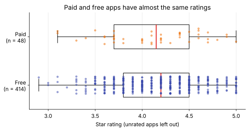

# Days 27–28: Month 1 Milestone

**Phase 1 · Week 4 · ~360 minutes (two sessions of about 3 hours)**

## Objectives

By the end of the weekend you can:

- [ ] Write matrix transpose, matrix multiplication and the L1 and L2 norms in plain Python, with no NumPy inside them.
- [ ] Prove those functions correct with tests: hand-worked examples, edge shapes, error cases, and random inputs checked against NumPy with `np.allclose`.
- [ ] Benchmark your functions against NumPy fairly, show NumPy's matmul is at least 100× faster at a stated size, and explain why some operations gain far less.
- [ ] Clean the Play Store dataset with a reusable function, then choose five questions of your own and answer each with one chart and one quoted number.
- [ ] Write findings that say what the data shows and no more: group sizes, caveats, and "is associated with" instead of "causes".
- [ ] Write a Month 1 retrospective and know what Month 2 asks of you.

**Prerequisites.** All of Month 1. The parts you lean on most: [Day 10](day-10-matrices-matmul.md) (matrix multiplication and its triple loop), [Day 11](day-11-transpose-identity-inverse.md) (transpose), [Day 13](day-13-week2-review.md) (the benchmark discipline and `best_time`), [Day 17](day-17-pandas-cleaning.md) (`clean_apps`), [Day 18](day-18-pandas-groupby-merge.md) (`groupby` and `merge`), [Day 19](day-19-matplotlib.md) (choosing and labelling charts), [Day 20](day-20-week3-review.md) (a guided version of Part 2), [Day 22](day-22-norms-distances.md) (norms) and [Day 26](day-26-month1-recap.md) (your recap and gap list).

**Suggested time split.** Day 27 (about 3 h): Part 1. 30 minutes on the spec and the math, 75 minutes writing the functions and getting the tests green, 45 minutes on the benchmark and writing down why the numbers look the way they do, 30 minutes for a stretch goal. Day 28 (about 3 h): Part 2. 20 minutes cleaning, 20 minutes choosing questions, 100 minutes on five charts and findings, 40 minutes on the report and the Month 1 retro.

---

## What a milestone is

A weekly mini-project told you what to build, step by step. A milestone doesn't. It is the month's exam, except that you set most of the questions and you grade yourself against a published rubric.

**Analogy.** It's the driving test after a month of lessons. During lessons the instructor told you when to indicate and when to brake. In the test the examiner only says "take the next left when it's safe" and watches. Nothing new is asked of you; what's new is that nobody prompts the steps. The test is designed to find out whether the skills are yours or the instructor's.

The milestone comes from the [Month 1 plan](../../plan/month-01.md), and it has two parts that test the two halves of the month:

1. **From scratch (Day 27).** Implement matrix multiplication, transpose and norms in plain Python, prove they give the same results as NumPy, and show NumPy is at least 100× faster. This tests Weeks 1, 2 and 4: Python, NumPy and linear algebra.
2. **Unguided analysis (Day 28).** Clean a real dataset with pandas and answer five questions with five plots. This tests Week 3: pandas and plotting, plus the judgement to say only what the data supports.

<figure class="diagram" markdown>
![Animated flow of the milestone in two rows. Row one, Part 1 on Day 27: Write (transpose, matmul, L1 and L2 in plain Python), Test (assert np.allclose on hand-worked and random shapes), Benchmark (at least 100 times faster at n = 128). Row two, Part 2 on Day 28: Clean (clean_apps plus merge developers), Explore (five questions, five charts), Report (one finding per chart, no causal claims). Both rows end in a Retro box with a checkered flag. A dot moves from box to box, the active box turns yellow, finished boxes get a green check mark, and a caption under the diagram explains each step](../../assets/img/phase-1/day27-milestone-flow.svg)
<figcaption>Animated: six steps over two days, then the retrospective. Each box gets its check mark only when it's done.</figcaption>
</figure>

A month counts as complete, per the [Study Plan](../../plan/index.md), when the project runs from a clean folder with a README, you can explain every line, and you have written a retrospective. So the deliverable is a folder:

```text
month1-milestone/
├── README.md            what this is, how to run it, the headline numbers
├── linalg_scratch.py    Part 1: transpose, matmul, norm_l1, norm_l2 + test_part1()
├── bench_scratch.py     Part 1: the benchmark table
├── analysis.ipynb       Part 2: clean, five questions, five charts (or analysis.py)
├── figures/             the five charts, saved as SVG or PNG
└── report.md            Part 2: the written report (template below)
```

Every block on this page also runs in your browser with ▶ Run, top to bottom, like notebook cells. Do the real work on your machine, in that folder.

!!! android "Android bridge"
    Think of Part 1 as writing a feature with its unit tests before anyone reviews it, and Part 2 as an investigation from Play Console data: "why did our rating drop in March?". The engineering habits transfer exactly. Tests come before benchmarks, as with Jetpack Macrobenchmark: a fast wrong answer is worthless. And the investigation habit is the one a good crash triage teaches: report what the data shows ("crashes are concentrated on Android 12 devices"), not a story you haven't checked ("Android 12 causes the crash").

---

## Part 1: linear algebra from scratch (Day 27)

### The spec

Write these functions in `linalg_scratch.py`. Inside them you may use only plain Python: lists, loops, comprehensions, `zip`, `sum`, `abs` and `math.sqrt`. NumPy is allowed only in the tests and the benchmark, as the reference to compare against.

| Function | Input → output | Rules |
|---|---|---|
| `shape(A)` | list of lists → `(rows, cols)` | raise `ValueError` if `A` is empty or its rows have different lengths |
| `transpose(A)` | `(n, m)` list of lists → `(m, n)` list of lists | entry `[i][j]` of the result is `A[j][i]`; never modify `A` |
| `matmul(A, B)` | `(n, m)` and `(m, p)` → `(n, p)` | raise `ValueError` if the inner sizes differ |
| `norm_l1(v)` | list of numbers → number | \( \sum_i \lvert v_i \rvert \) |
| `norm_l2(v)` | list of numbers → `float` | \( \sqrt{\sum_i v_i^2} \) |
| `test_part1()` | → prints `all Part 1 tests passed` | every check is an `assert`; it raises on the first failure |

Then a benchmark that times each function against its NumPy equivalent and prints one row per operation with the speed-up. **The pass mark:** NumPy's matmul is at least 100× faster than yours at \( n = 128 \), and you can explain the speed-up of every other row.

### The math, once more, one symbol at a time

You met all of this in Days 10, 11 and 22. Here it is in one place, because the code is a line-by-line translation of it.

**Transpose.** For a matrix \( A \) with \( n \) rows and \( m \) columns, \( A^\top \) ("A transpose") has \( m \) rows and \( n \) columns, and its entry in row \( i \), column \( j \) is \( A \)'s entry in row \( j \), column \( i \):

\[
(A^\top)_{ij} = A_{ji}
\]

Worked example: rows become columns.

\[
A = \begin{pmatrix} 1 & 2 & 3 \\ 4 & 5 & 6 \end{pmatrix}
\quad\Rightarrow\quad
A^\top = \begin{pmatrix} 1 & 4 \\ 2 & 5 \\ 3 & 6 \end{pmatrix}
\]

**Matrix multiplication.** For \( A \) of shape \( (n, m) \) and \( B \) of shape \( (m, p) \), the product \( C = AB \) has shape \( (n, p) \). Entry \( C_{ij} \) is the dot product of row \( i \) of \( A \) with column \( j \) of \( B \); the symbol \( \sum_{k=1}^{m} \) means "add up the following for \( k = 1, 2, \dots, m \)":

\[
C_{ij} = \sum_{k=1}^{m} A_{ik} B_{kj}
\]

Worked example, entry \( C_{11} \) of Day 10's product: row 1 of \( A \) is \( (1, 2, 3) \), column 1 of \( B = \begin{pmatrix} 7 & 8 \\ 9 & 10 \\ 11 & 12 \end{pmatrix} \) is \( (7, 9, 11) \), so \( C_{11} = 1 \cdot 7 + 2 \cdot 9 + 3 \cdot 11 = 58 \). The whole product is \( \begin{pmatrix} 58 & 64 \\ 139 & 154 \end{pmatrix} \).

A useful trick for the code: column \( j \) of \( B \) is row \( j \) of \( B^\top \). So if you transpose \( B \) once, every \( C_{ij} \) is "row \( i \) of \( A \)" dotted with "row \( j \) of \( B^\top \)", and both are plain Python lists you can `zip` together.

**Norms.** A norm measures the length of a vector \( \mathbf{v} = (v_1, \dots, v_n) \). The vertical bars \( \lvert v_i \rvert \) mean absolute value (drop the minus sign).

\[
\lVert \mathbf{v} \rVert_1 = \sum_{i=1}^{n} \lvert v_i \rvert
\qquad\qquad
\lVert \mathbf{v} \rVert_2 = \sqrt{\sum_{i=1}^{n} v_i^2}
\]

Worked example with \( \mathbf{v} = (3, -4) \): \( \lVert \mathbf{v} \rVert_1 = 3 + 4 = 7 \) (the walk along city blocks) and \( \lVert \mathbf{v} \rVert_2 = \sqrt{9 + 16} = 5 \) (the straight line). For every vector, \( \lVert \mathbf{v} \rVert_2 \le \lVert \mathbf{v} \rVert_1 \): the straight line is never longer than the city-block walk. Your tests will check that.

**Two facts that make good tests.** A test that only checks one hand-worked example can pass by accident. These must hold for *any* matrices, so a random test will catch a lot:

- Transposing twice gives back the original: \( (A^\top)^\top = A \).
- The transpose of a product is the product of the transposes, in reverse order: \( (AB)^\top = B^\top A^\top \). Check the shapes: \( AB \) is \( (n, p) \), so its transpose is \( (p, n) \), and \( B^\top A^\top \) is \( (p, m)(m, n) = (p, n) \). They match.

### Starter code

Every block on this page shares one namespace, so start with the imports:

```python
import math
import time

import numpy as np
```

Copy this into `linalg_scratch.py` and fill in the `TODO`s.

```python
def shape(A):
    """(rows, cols) of a list of lists; ValueError if empty or ragged."""
    # TODO: check A and A[0] are non-empty, and that every row has len(A[0]) entries
    raise NotImplementedError


def transpose(A):
    """A^T: entry [i][j] of the result is A[j][i]. A is not modified."""
    # TODO: n, m = shape(A); build m rows of n entries each
    raise NotImplementedError


def matmul(A, B):
    """C = A B for lists of lists: (n, m) times (m, p) gives (n, p)."""
    # TODO: check the inner sizes and raise ValueError; transpose B once,
    #       then C[i][j] = sum of products of row i of A and row j of B^T
    raise NotImplementedError


def norm_l1(v):
    # TODO: sum of absolute values
    raise NotImplementedError


def norm_l2(v):
    # TODO: square root of the sum of squares
    raise NotImplementedError
```

### Milestone 1: write the tests first

Write the tests before the functions. They are your spec in executable form, and when they all pass you are done. There are four kinds, from most to least obvious:

1. **Hand-worked examples** whose answers you computed above on paper.
2. **Edge shapes:** a 1×1 matrix, a row times a column (gives 1×1), a column times a row (gives a full matrix), a zero vector.
3. **Errors:** a shape mismatch and a ragged matrix must raise `ValueError`, like NumPy raises on bad shapes.
4. **Random inputs against NumPy**, on non-square shapes, plus the two facts above. A test on square matrices only can't catch a function that swaps \( m \) and \( p \).

Compare floats with `np.allclose` or `np.isclose`, never `==`. Your code adds the same numbers in a different order from NumPy, and floating-point addition isn't exactly associative, so the last digits can differ. The hand-worked examples use small integers, where `==` is safe.

```python
def test_part1():
    # 1. hand-worked examples
    assert transpose([[1, 2, 3], [4, 5, 6]]) == [[1, 4], [2, 5], [3, 6]]
    assert matmul([[1, 2, 3], [4, 5, 6]], [[7, 8], [9, 10], [11, 12]]) == [[58, 64], [139, 154]]
    assert norm_l1([3, -4]) == 7
    assert norm_l2([3, -4]) == 5.0
    # 2. edge shapes
    assert transpose([[7]]) == [[7]]
    assert matmul([[1, 2, 3]], [[4], [5], [6]]) == [[32]]          # row times column
    assert matmul([[4], [5], [6]], [[1, 2, 3]]) == [[4, 8, 12], [5, 10, 15], [6, 12, 18]]
    assert norm_l1([0.0, 0.0]) == 0 and norm_l2([0.0]) == 0
    # 3. errors must be raised, not swallowed
    for bad in (lambda: matmul([[1, 2]], [[1, 2]]),               # (1, 2) @ (1, 2)
                lambda: transpose([[1, 2], [3]])):                # ragged
        try:
            bad()
        except ValueError:
            pass
        else:
            raise AssertionError("expected ValueError")
    # 4. random, non-square inputs against NumPy, and two facts that always hold
    rng = np.random.default_rng(27)
    for n, m, p in [(1, 1, 1), (2, 3, 4), (5, 1, 3), (7, 6, 2), (16, 16, 16)]:
        A, B = rng.normal(size=(n, m)), rng.normal(size=(m, p))
        A_l, B_l = A.tolist(), B.tolist()
        assert np.allclose(transpose(A_l), A.T)
        assert transpose(transpose(A_l)) == A_l                   # (A^T)^T = A
        assert np.allclose(matmul(A_l, B_l), A @ B)
        assert np.allclose(transpose(matmul(A_l, B_l)),           # (AB)^T = B^T A^T
                           matmul(transpose(B_l), transpose(A_l)))
    for size in (1, 2, 10, 1000):
        v = rng.normal(size=size)
        assert np.isclose(norm_l1(v.tolist()), np.linalg.norm(v, ord=1))
        assert np.isclose(norm_l2(v.tolist()), np.linalg.norm(v))
        assert norm_l2(v.tolist()) <= norm_l1(v.tolist()) + 1e-12  # straight line <= city blocks
    print("all Part 1 tests passed")


test_part1()   # raises NotImplementedError until you fill in the TODOs: that's the point
```

Run it now: it fails. That is test-first development, and it's the right starting state. Now make it pass. If you get stuck on one function for more than 20 minutes, re-read the matching lesson rather than the solution.

!!! warning "Common mistake: building rows that share one list"
    `C = [[0.0] * p] * n` looks like an \( n \times p \) zero matrix, but it is **one** row list referenced \( n \) times: writing `C[0][0] = 5` changes every row (Day 2's sticky-note picture: three labels on one list). Build rows with a comprehension, `[[0.0] * p for _ in range(n)]`, or build each row directly as in the reference solution. Any test with more than one output row catches this bug; the 1×1 tests don't.

??? success "Reference solution for Part 1 (get your tests green first)"
    ```python
    def shape(A):
        """(rows, cols) of a list of lists; ValueError if empty or ragged."""
        if not A or not A[0]:
            raise ValueError("matrix must have at least one row and one column")
        cols = len(A[0])
        for i, row in enumerate(A):
            if len(row) != cols:
                raise ValueError(f"row {i} has {len(row)} entries, expected {cols}")
        return len(A), cols


    def transpose(A):
        """A^T: entry [i][j] of the result is A[j][i]. A is not modified."""
        n, m = shape(A)
        return [[A[j][i] for j in range(n)] for i in range(m)]


    def matmul(A, B):
        """C = A B for lists of lists: (n, m) times (m, p) gives (n, p)."""
        n, m = shape(A)
        m2, p = shape(B)
        if m != m2:
            raise ValueError(f"inner dimensions differ: {m} vs {m2}")
        Bt = transpose(B)                     # row j of B^T is column j of B
        return [[sum(a * b for a, b in zip(row, col)) for col in Bt] for row in A]


    def norm_l1(v):
        """Sum of absolute values."""
        return sum(abs(x) for x in v)


    def norm_l2(v):
        """Square root of the sum of squares."""
        return math.sqrt(sum(x * x for x in v))


    test_part1()
    # all Part 1 tests passed
    ```

    Design notes. `transpose` reads `A[j][i]`: the outer comprehension walks the result's rows (`i`, one per column of `A`), the inner walks its columns (`j`, one per row of `A`). `matmul` transposes `B` once, at a cost of \( m \cdot p \) copies, so the inner loop walks two lists side by side with `zip` instead of jumping down a column of `B` with `B[k][j]`. Each `sum(...)` is exactly \( C_{ij} = \sum_k A_{ik}B_{kj} \). And `shape` runs on every call, so a ragged matrix fails loudly with its row number instead of giving a wrong answer or an `IndexError` deep inside a loop.

    On your machine you can also run the tests with [pytest](https://docs.pytest.org/): it collects every function whose name starts with `test_` in files named `test_*.py`. Move `test_part1` into `test_linalg.py`, add `from linalg_scratch import *` at the top, and run `pytest -q`.

### Milestone 2: the benchmark

Reuse Day 13's fair timer: warm up once, run several times, report the **fastest** run (noise only ever makes things slower). Prepare the inputs outside the timed function, so you time only the operation.

Each pure-Python function gets a NumPy partner that does the same work:

- `matmul(A, B)` vs `A @ B` at \( n = 128 \): the stated size for the 100× pass mark.
- `transpose(M)` vs `M.T.copy()` on a 1000×1000 matrix. Plain `M.T` would be unfair: it is a **view** that only swaps two strides (Day 8) and moves no numbers, so it takes the same tiny time at any size. `.copy()` makes NumPy actually build the transposed matrix, as your function does.
- `norm_l1(v)` and `norm_l2(v)` vs `np.linalg.norm(v, ord=1)` and `np.linalg.norm(v)` on a vector of a million numbers.

```python
def best_time(fn, min_repeats=3, budget=0.2):
    """Warm up once, then run fn() at least min_repeats times and for about
    budget seconds. Return the FASTEST run, in seconds (Day 13)."""
    fn()
    best, spent, runs = float("inf"), 0.0, 0
    while runs < min_repeats or spent < budget:
        t0 = time.perf_counter()
        fn()
        dt = time.perf_counter() - t0
        best, spent, runs = min(best, dt), spent + dt, runs + 1
    return best


rng = np.random.default_rng(27)
A, B = rng.normal(size=(128, 128)), rng.normal(size=(128, 128))
M = rng.normal(size=(1000, 1000))
v = rng.normal(size=1_000_000)
A_l, B_l, M_l, v_l = A.tolist(), B.tolist(), M.tolist(), v.tolist()   # convert once

# Same answers first: a benchmark of a wrong function measures nothing
assert np.allclose(matmul(A_l, B_l), A @ B) and np.allclose(transpose(M_l), M.T)
assert np.isclose(norm_l1(v_l), np.linalg.norm(v, ord=1)) and np.isclose(norm_l2(v_l), np.linalg.norm(v))

cases = [
    ("matmul 128x128",      lambda: matmul(A_l, B_l), lambda: A @ B),
    ("transpose 1000x1000", lambda: transpose(M_l),   lambda: M.T.copy()),
    ("L1 norm, 1M values",  lambda: norm_l1(v_l),     lambda: np.linalg.norm(v, ord=1)),
    ("L2 norm, 1M values",  lambda: norm_l2(v_l),     lambda: np.linalg.norm(v)),
]
print(f"{'operation':<20} {'pure Python':>12} {'NumPy':>10} {'speed-up':>9}")
for name, py_fn, np_fn in cases:
    t_py, t_np = best_time(py_fn), best_time(np_fn)
    print(f"{name:<20} {t_py*1e3:9.1f} ms {t_np*1e3:7.3f} ms {t_py/t_np:8,.0f}x")
```

One run printed, on a 4-core cloud container (Python 3.13, NumPy 2.5 with OpenBLAS). **Yours will differ**, and in the browser both columns are slower because Python runs as WebAssembly on one thread:

```text
operation             pure Python      NumPy  speed-up
matmul 128x128           126.0 ms   0.043 ms    2,939x
transpose 1000x1000      121.1 ms   1.622 ms       75x
L1 norm, 1M values        38.7 ms   0.965 ms       40x
L2 norm, 1M values        37.7 ms   0.073 ms      516x
```

The pass mark is met: matmul at \( n = 128 \) is thousands of times faster in NumPy. But the four rows are not alike, and explaining why is part of the milestone.

### Reading the table

**Every row pays the interpreter tax.** Each pure-Python step (fetch a list item, check its type, multiply, create a new float object, update reference counts) costs tens of nanoseconds. NumPy runs the same loop as compiled machine code over raw 8-byte doubles packed side by side (Day 4). That alone is worth roughly 10× to 100×, and every row gets it.

**Matmul gets three more multipliers on top.** It does \( n^3 = 2{,}097{,}152 \) multiply-adds on only \( 3n^2 = 49{,}152 \) numbers, so each number loaded from memory is reused 128 times. That makes it **compute-bound**: its speed depends on how fast the CPU can do arithmetic, and BLAS (the compiled library behind `@`) is built to do arithmetic fast: SIMD instructions that multiply-add 4 or 8 numbers at once, tiles sized to stay in the CPU caches, and all cores at once (Day 13's table). Hence thousands, not tens.

**The other three are memory-bound.** A transpose does no arithmetic at all: it only moves a million numbers. A norm does one or two operations per number it reads. Their speed is set by how fast numbers come out of memory, and a faster CPU can't help much. Two details explain the differences between them:

- `np.linalg.norm(v)` computes \( \sqrt{\mathbf{v} \cdot \mathbf{v}} \) with one optimized dot product: a single pass over the data, no temporary array.
- `np.linalg.norm(v, ord=1)` computes `abs(v)` into a brand-new million-element array (8 MB), and then sums it: two passes over memory plus an allocation. That's why it gains only tens of times in this run, and why its time wobbles from run to run.

So "NumPy is 100× faster" is true where it matters most in ML (a neural network is mostly matrix multiplies, Day 12) and an overstatement for simple element-wise work. Writing that down in your README is worth more than a bigger number.

!!! warning "Common mistake: benchmarking a view"
    `best_time(lambda: M.T)` reports well under a microsecond at any size, because `M.T` copies nothing. You'd "prove" NumPy is a million times faster than your transpose. Whenever a NumPy result is suspiciously fast, ask whether it's a view (`np.shares_memory(M, M.T)` is `True`) or a lazy object, and make it do the real work.

### How to verify Part 1

- `test_part1()` prints `all Part 1 tests passed`, and **break it on purpose** once: change `A[j][i]` to `A[i][j]` in `transpose` and check a test fails. A test suite that can't fail proves nothing.
- The benchmark asserts pass before any timing is printed.
- At \( n = 128 \), the matmul row shows at least 100×. If it doesn't, check you converted with `.tolist()` outside the timer and that the NumPy side is a plain `A @ B` on float arrays.
- Your README states the size, the speed-up, your machine, and one sentence on why matmul gains far more than the norms.

### Stretch goals

1. **The L∞ norm.** Add `norm_linf(v)`, the largest absolute value \( \lVert \mathbf{v} \rVert_\infty = \max_i \lvert v_i \rvert \) (Day 22), and test it against `np.linalg.norm(v, ord=np.inf)`. Then check that \( \lVert \mathbf{v} \rVert_\infty \le \lVert \mathbf{v} \rVert_2 \le \lVert \mathbf{v} \rVert_1 \) on random vectors.
2. **A faster pure-Python transpose.** `[list(row) for row in zip(*A)]` is the idiomatic one-liner. Check it equals your `transpose`, time both on the 1000×1000 matrix, and explain the difference.
3. **Cosine similarity from your own parts.** Write `cosine(u, w)` using only `matmul`, `transpose` and `norm_l2` (treat `u` as a 1×n matrix), and check it against Day 5's NumPy formula.

??? success "Stretch solutions"
    ```python
    def norm_linf(v):
        return max(abs(x) for x in v)


    rng = np.random.default_rng(28)
    for size in (1, 5, 1000):
        x = rng.normal(size=size)
        xl = x.tolist()
        assert np.isclose(norm_linf(xl), np.linalg.norm(x, ord=np.inf))
        assert norm_linf(xl) <= norm_l2(xl) + 1e-12 <= norm_l1(xl) + 2e-12
    print("L-infinity checks passed")
    # L-infinity checks passed


    def transpose_zip(A):
        return [list(row) for row in zip(*A)]


    assert transpose_zip(M_l) == transpose(M_l)
    t_comp, t_zip = best_time(lambda: transpose(M_l)), best_time(lambda: transpose_zip(M_l))
    print(f"comprehension {t_comp*1e3:.0f} ms, zip(*A) {t_zip*1e3:.0f} ms")
    # comprehension 123 ms, zip(*A) 67 ms     (one run; yours will differ)


    def cosine(u, w):
        dot = matmul([u], transpose([w]))[0][0]     # (1, n) @ (n, 1) -> (1, 1)
        return dot / (norm_l2(u) * norm_l2(w))


    u, w = [1.0, 2.0, 3.0], [2.0, 4.0, 5.5]
    nu, nw = np.array(u), np.array(w)
    print(round(cosine(u, w), 6), round(float(nu @ nw / (np.linalg.norm(nu) * np.linalg.norm(nw))), 6))
    # 0.999111 0.999111

    ```

    `zip(*A)` unpacks the rows of `A` as separate arguments, and `zip` hands back one tuple per column: a transpose, done inside the C code of `zip`. The comprehension instead runs `A[j][i]` as Python bytecode, a million times, each a double index lookup. Same answer, fewer interpreter steps. It is still nowhere near `M.T.copy()`, because `zip` still creates a Python float object reference per entry.

---

## Part 2: an unguided analysis (Day 28)

On [Day 20](day-20-week3-review.md) you answered three questions that were handed to you. Today you choose five, and nobody tells you which chart, which column or which caveat. The only rule is the one from [Day 19](day-19-matplotlib.md): **one question, one chart, one number you can quote**.

### The spec

1. **Load and clean.** Load `play_store_apps.csv`, clean it with Day 17's `clean_apps` (copied below), and print the row count before and after. Merge `developers.csv` with a left join, `validate="many_to_one"`, and say how many apps have no developer match. (The datasets are described on the [Datasets page](../../datasets.md); they are synthetic, made to look real, so your findings are about this sample and not about the real Play Store.)
2. **Five questions** of your own, written down *before* you draw anything. Each must be answerable from these columns. At most one may repeat a Day 20 question.
3. **Five charts**, one per question, saved to `figures/`. Each has a title that states the finding, labelled axes with units, and group sizes where you compare groups.
4. **Five findings**, one short paragraph each: the number, what it means, and at least one caveat. No causal claims.
5. **A report** (`report.md`, template below) and a README with how to run it.

Here is the setup every analysis starts from. It loads both files, cleans, and merges. (In the browser, `BASE` downloads the files; on your machine, after downloading them from the [Datasets page](../../datasets.md), you can set `BASE = ""` and keep the CSVs next to your notebook. The code was tested on pandas 3.0.)

```python
import numpy as np
import pandas as pd
import matplotlib
matplotlib.use("Agg")            # draw into files, no window (leave this out in Jupyter)
import matplotlib.pyplot as plt

plt.rcParams.update({
    "font.size": 11,
    "figure.facecolor": "white",
    "savefig.facecolor": "white",
    "axes.spines.top": False,
    "axes.spines.right": False,
})

BASE = "https://manjulkadyan.github.io/ai-leaning/assets/data/"
raw = pd.read_csv(BASE + "play_store_apps.csv")
devs = pd.read_csv(BASE + "developers.csv")


def clean_apps(df: pd.DataFrame) -> pd.DataFrame:
    """Return a cleaned copy of the Play Store apps table (Day 17). The input is not modified."""
    out = df.drop_duplicates(ignore_index=True)
    return out.assign(
        category=out["category"].str.strip().str.title(),
        installs=(out["installs"]
                  .str.replace(",", "", regex=False)
                  .str.replace("+", "", regex=False)
                  .astype("int64")),
        size_mb=out["size_mb"].replace("Varies with device", np.nan).astype("float64"),
        last_updated=pd.to_datetime(out["last_updated"], format="%Y-%m-%d"),
        min_android=out["min_android"].map(
            lambda v: f"{v:.1f}" if v < 9 else str(int(v))
        ).astype("str"),
    )


apps = clean_apps(raw)
df = apps.merge(devs, on="developer_id", how="left", validate="many_to_one")
print(raw.shape, apps.shape, df.shape)
print("apps with no developer match:", df["developer_name"].isna().sum())
# (486, 12) (480, 12) (480, 15)
# apps with no developer match: 2
```

### Eight questions to choose from

Pick five of these, or write your own. Each line says which skills it exercises, so a good five covers most of them.

| # | Question | Columns | Chart that fits | Skills |
|---|---|---|---|---|
| 1 | Do paid apps get different ratings from free ones? | `price_usd`, `rating` | box plot with points | new column, `groupby`, missing values (**worked example below**) |
| 2 | How tightly do reviews track installs? | `reviews`, `installs` | log-log scatter | log scales (Day 19), correlation |
| 3 | Which minimum Android version is most common, and does it differ by category? | `min_android`, `category` | stacked or grouped bar | `crosstab` with `normalize` (Day 18) |
| 4 | Do apps from some developer countries rate higher? | `country`, `rating` | dot plot of means with counts | merge (Day 18), small groups |
| 5 | Do older studios have more installs? | `founded_year`, `installs` | box plot by founding decade | merge, binning with `pd.cut`, log axis |
| 6 | Within one category, do bigger downloads go with more installs? | `size_mb`, `installs`, `category` | scatter, one panel per category | `subplots`, filtering, NaN sizes |
| 7 | How are prices spread among paid apps, by category? | `price_usd`, `category` | strip or box plot | filtering, small groups |
| 8 | Are apps that need a newer Android version updated more recently? | `min_android`, `last_updated` | box plot of days since update | dates, ordering version strings (Day 17) |

Write your five down in `report.md` before you open the notebook. Questions written after looking at the charts tend to be the ones the charts happen to answer nicely, which is how people fool themselves.

### One worked example: question 1, from question to finding

This is the only question solved on this page, to show the level of care expected. Don't reuse it as one of your five.

**Step 1: make the question precise.** "Do paid apps get different ratings?" needs three decisions. What is "paid"? Price above zero. Which ratings? Only apps that have one: unrated apps are a missing value, not a zero. Different how? Compare the whole spread, not just the averages, because two groups with the same mean can look nothing alike.

```python
q = df.assign(pricing=np.where(df["price_usd"] > 0, "Paid", "Free"))
print(q["pricing"].value_counts().to_string())
print("unrated:", q["rating"].isna().sum())

rated = q.dropna(subset=["rating"])
summary = rated.groupby("pricing")["rating"].agg(
    apps="size", median="median", mean="mean",
    q1=lambda s: s.quantile(0.25), q3=lambda s: s.quantile(0.75),
    share_4_5_plus=lambda s: (s >= 4.5).mean(),
)
print(summary.round(2).to_string())
# pricing
# Free    430
# Paid     50
# unrated: 18
#          apps  median  mean   q1   q3  share_4_5_plus
# pricing
# Free      414    4.20  4.17  3.8  4.5            0.29
# Paid       48    4.15  4.12  3.7  4.5            0.27
```

`q1` and `q3` are the quartiles: a quarter of the ratings are below `q1` and a quarter above `q3`, so the middle half sits between them. That's the box in a box plot.

**Step 2: pick the chart.** Two groups and a numeric value: a box plot shows the median and the middle half; adding every app as a dot shows how many apps stand behind each box, which matters a lot when one group is about a ninth the size of the other. A bar chart of the two means would hide both.

```python
groups = ["Free", "Paid"]
data = [rated.loc[rated["pricing"] == g, "rating"].to_numpy() for g in groups]

fig, ax = plt.subplots(figsize=(8, 3.6))
ax.boxplot(data, orientation="horizontal", widths=0.5, showfliers=False,
           medianprops={"color": "#e53935", "linewidth": 2})
rng = np.random.default_rng(27)
for y, (vals, color) in enumerate(zip(data, ["#3949ab", "#ef6c00"]), start=1):
    jitter = rng.uniform(-0.18, 0.18, size=len(vals))   # spread the dots so they don't overlap
    ax.scatter(vals, y + jitter, s=12, alpha=0.45, color=color, zorder=3)
ax.set_yticks([1, 2], labels=[f"{g}\n(n = {len(v)})" for g, v in zip(groups, data)])
ax.set_xlabel("Star rating (unrated apps left out)")
ax.set_xlim(2.8, 5.1)
ax.set_title("Paid and free apps have almost the same ratings")
ax.grid(axis="x", alpha=0.3)
fig.savefig("day27-paid-vs-free.svg", format="svg", bbox_inches="tight")
plt.close(fig)
```

<figure class="diagram" markdown>

<figcaption>The worked example's chart. Boxes show the middle half of the ratings, the red line is the median, and every dot is one app.</figcaption>
</figure>

`orientation="horizontal"` needs matplotlib 3.10 or later; on older versions use `vert=False`. The dots are jittered: each gets a small random vertical offset so that apps with the same rating don't sit exactly on top of each other. The offset means nothing, which is why it has a fixed seed and no axis.

**Step 3: how sure are we?** A gap of 0.05 stars between two groups could easily be luck, especially with only 48 paid apps. A quick way to see how big a gap luck alone produces: shuffle the "paid" labels at random, so they *can't* be related to the rating, and measure the gap again, thousands of times.

```python
observed = summary.loc["Paid", "mean"] - summary.loc["Free", "mean"]
ratings = rated["rating"].to_numpy()
is_paid = (rated["pricing"] == "Paid").to_numpy()

rng = np.random.default_rng(27)
diffs = np.empty(5000)
for i in range(5000):
    fake = rng.permutation(is_paid)          # same 48 "paid" labels, handed out at random
    diffs[i] = ratings[fake].mean() - ratings[~fake].mean()
print(f"observed difference (paid - free): {observed:+.3f} stars")
print(f"shuffles with a gap at least that big: {(np.abs(diffs) >= abs(observed)).mean():.0%}")
# observed difference (paid - free): -0.050 stars
# shuffles with a gap at least that big: 46%
```

Random labels produce a gap at least this big in about half of the shuffles. So the real gap is the size that luck produces all the time: this data gives no evidence that paid and free apps rate differently. This is called a **permutation test**, and Month 2's statistics turns it into a proper tool with a name for that percentage (the *p-value*). For today, the intuition is enough. It's optional for your five, but it's the fastest way to stop yourself over-reading a small gap.

**Step 4: write the finding.** This is the paragraph that goes in the report:

> **Q1. Do paid apps get different ratings from free ones?** Barely, if at all. Among the 462 rated apps, the 48 paid apps have a median rating of 4.15 and the 414 free apps 4.20; the middle half of both groups spans about 3.7–3.8 to 4.5, and 27% versus 29% are rated 4.5 or more. A gap of 0.05 stars is one that shuffled labels produce in about half of random reshuffles, so it is consistent with chance. *Caveats:* only 48 paid apps; 18 unrated apps are left out; price is all-or-nothing here (a $0.99 app counts the same as a $9.99 one); and the dataset is synthetic. Even a real gap would not show that charging money *changes* ratings: paid apps may differ from free ones in category, audience or quality.

Look at what the paragraph does: it answers the question in the first words, quotes numbers from the code, gives group sizes, separates "consistent with chance" from "no difference", lists what was left out, and refuses to explain *why*. That last part is the hardest habit and the most valuable.

!!! warning "Common mistake: a causal verb on correlational data"
    "Ads lower ratings", "big apps drive installs", "Japanese studios make better apps". Each of these says one thing *causes* another, and none can be shown from a table of existing apps: something else (category, budget, audience) may drive both. Write "is associated with", "tends to have", "apps with X have, on average, Y". In Month 2's statistics you'll meet the phrase for this: **correlation is not causation**. Only an experiment, such as an A/B test where *you* assign the treatment at random, can show cause.

!!! warning "Common mistake: means of tiny groups"
    A category with 3 apps can have the "highest average rating" by accident. Always print the group size next to a group statistic (`agg(apps="size", ...)`), show it on the chart, and say so in the finding when a group is small. The 2 apps with no developer match (D099) are a group of their own: decide whether to drop them or label them "unknown", and say which you did.

### Grading rubric

Score your own report, honestly, then ask someone else (or yourself in a week) to score it again. Each row is 0, 1 or 2 points.

| Criterion | 0: Not yet | 1: Meets | 2: Strong |
|---|---|---|---|
| **Cleaning** | Raw data used, or cleaning done by hand in cells | `clean_apps` used; rows before and after printed | Plus: the merge is validated, orphans counted and handled on purpose |
| **Questions** | Vague ("look at ratings") or written after the charts | Five specific questions, each answerable from the columns | Plus: they cover different skills (groups, relationships, time, a merge) |
| **Chart choice** | Chart type doesn't fit the data (e.g. a line through categories) | Each chart fits its question | Plus: log scales or small multiples where the data needs them, with a reason |
| **Chart quality** | Missing axis labels or units; default titles | Labelled axes with units; group sizes shown | Plus: the title states the finding; nothing misleading (Day 19's truncated axes) |
| **Findings** | Restates the chart, or no number | Answers the question with a number from the code | Plus: at least one caveat per finding, and no causal language anywhere |
| **Reproducibility** | Fails on a fresh run, or depends on cell order | Runs top to bottom from a clean folder | Plus: README with run instructions; fixed seeds for anything random |

**Pass:** 8 of 12 or more, with no zeros. **Strong:** 11 or 12. A zero in any row means fixing that row before calling the month done, whatever the total.

### Report template

Copy this into `report.md`:

```markdown
# Month 1 milestone, Part 2: Play Store apps analysis

**Data.** play_store_apps.csv (486 rows raw → ___ after clean_apps) and developers.csv
(left join, ___ apps with no developer match: handled by ___).
Synthetic course dataset: findings describe this sample only.

**How to run.** `___` (one command, from a clean folder)

## Questions (written before any chart)
1.
2.
3.
4.
5.

## Q1. <question>


**Finding.** <the answer in the first sentence, with a number>
<what supports it: group sizes, medians or shares, a second number>
**Caveats.** <small groups, missing values, what was excluded, why this is not cause>

## Q2. ...
## Q3. ...
## Q4. ...
## Q5. ...

## What I would look at next
- <one follow-up question each analysis raised>

## Self-score (rubric)
Cleaning _/2 · Questions _/2 · Chart choice _/2 · Chart quality _/2 · Findings _/2 · Reproducibility _/2 = __/12
```

---

## Month 1 retrospective

The study plan asks for a short written retrospective every month, and for adjusting next month's plan if needed. This is the most important hour of the weekend: it turns four weeks of effort into a list of what to keep and what to change. Fill it in with Day 26's self-assessment open next to you.

```markdown
# Month 1 retrospective (Days 1–28)

## Milestone results
- Part 1: all tests pass? yes / no   matmul speed-up at n = 128: ____x
  My machine: CPU ___, cores ___, BLAS ___ (from np.show_config())
  Why matmul gains far more than the norms, in one sentence:
- Part 2: rubric self-score __/12   weakest row:
  My most interesting finding, in one sentence:

## Month 1 in one paragraph (as if explaining to a junior engineer)

## What I can now do without looking anything up
-
-
-

## Still shaky (from the Day 26 rubric), and the lesson to revisit
- topic: ___   lesson: ___   when: ___

## Time
Planned ~__ h, actual ~__ h. Days I skipped or doubled up:

## What worked (keep doing)
-

## What didn't (stop or change)
-

## Kotlin/Android habit that helped:
## Kotlin/Android habit that got in the way:

## Adjustments for Month 2
- Pace (keep / slow down / speed up):
- One study habit to add:
- One thing to drop:
```

!!! warning "Common mistake: a retro that's only a diary"
    "It went well, learned a lot" changes nothing next month. Every retro should end with at least one *specific, checkable* adjustment: "do the exercises before reading the solutions, every day" or "re-do Day 24's power iteration on Day 33". If you can't tell next month whether you did it, rewrite it.

---

## What's next in Month 2

Month 1 gave you the tools: Python, NumPy, pandas, plots, and the linear algebra of vectors and matrices. Month 2 gives you the mathematics of *learning*. The modules, from the [Roadmap](../../roadmap/index.md):

| Module | Topic | The question it answers | Where you've already seen a glimpse |
|---|---|---|---|
| 1.6 | **Calculus** | How does the output change when I nudge an input? Derivatives, partial derivatives, gradients, the chain rule | the slope of Day 13's log-log line |
| 1.7 | **Probability** | How do I reason about uncertainty? Random variables, distributions, conditional probability, Bayes' rule, expectation | `rng.normal`, `rng.permutation` |
| 1.8 | **Statistics** | What can I conclude from a sample? Mean and variance, sampling, confidence intervals, hypothesis tests, correlation vs causation | today's permutation test |
| 1.9 | **Optimization** | How does a model find its best weights? Loss functions, gradient descent, learning rate, convexity, local minima | Day 24's power iteration, which also improves an answer step by step |
| 1.10 | **Information theory basics** | How surprised is a model? Entropy, cross-entropy, KL divergence | (new) |

**The Month 2 milestone** (from the [Monthly Plan](../../plan/monthly.md)): linear regression trained with **hand-derived gradient descent**, with the loss below a target on a held-out set. In NumPy only, you will compute predictions with a matrix product (\( \hat{\mathbf{y}} = X\mathbf{w} + b \), Day 12's layer with one output), measure the error with the mean-squared-error loss, derive its gradient by hand with calculus, and write the loop that nudges the weights downhill until the loss stops falling. Every piece you built this weekend shows up in it: `matmul`, `transpose` (the gradient is \( X^\top \) times the errors) and norms (the size of the gradient tells you when to stop).

---

## Resources

- [Python docs: `unittest`](https://docs.python.org/3/library/unittest.html): the standard-library test framework, if you want structure beyond plain `assert`s.
- [pytest: Get started](https://docs.pytest.org/en/stable/getting-started.html): the test runner most Python projects use; it runs your `test_part1` unchanged.
- [NumPy: `numpy.linalg.norm`](https://numpy.org/doc/stable/reference/generated/numpy.linalg.norm.html): the `ord` argument and exactly what each norm computes, for checking Part 1.
- [NumPy: `numpy.allclose`](https://numpy.org/doc/stable/reference/generated/numpy.allclose.html): how `rtol` and `atol` decide "close enough".
- [Matplotlib: `boxplot` demo](https://matplotlib.org/stable/gallery/statistics/boxplot_demo.html): every option for box plots like the worked example's.
- [Python docs: `timeit`](https://docs.python.org/3/library/timeit.html): the standard benchmarking module; its notes explain why the minimum of several runs is the number to report.
- [Mathematics for Machine Learning (free book)](https://mml-book.github.io/): chapter 2 is Month 1's linear algebra; chapters 5 and 6 (vector calculus, probability) are a preview of Month 2.

## Checklist

- [ ] `test_part1()` passes, and I broke a function on purpose once to see a test fail.
- [ ] My benchmark asserts equal results before it times anything, and shows matmul at least 100× faster at n = 128.
- [ ] I can explain why matmul gains thousands of times while the L1 norm gains only tens.
- [ ] My analysis cleans with `clean_apps`, merges with `validate="many_to_one"`, and handles the unmatched developers on purpose.
- [ ] I wrote five questions before drawing, and made five labelled charts with group sizes.
- [ ] Every finding quotes a number, has a caveat, and uses no causal verbs.
- [ ] I scored my report with the rubric: at least 8/12 and no zeros.
- [ ] `month1-milestone/` runs from a clean folder and has a README.
- [ ] I wrote my Month 1 retrospective with at least one specific adjustment for Month 2.

**Next:** Month 2: calculus, probability and statistics (coming soon)
