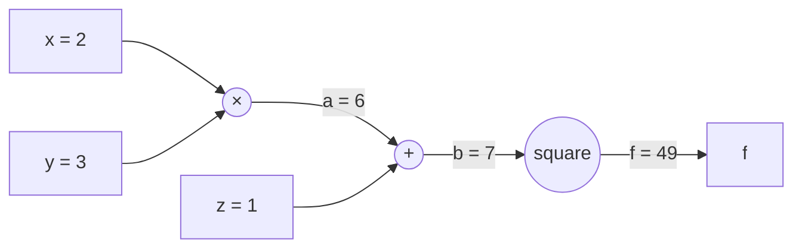
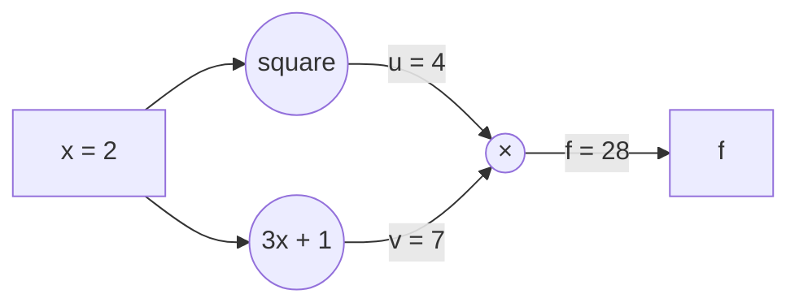

# Day 31: The Chain Rule and Computational Graphs

**Phase 1 · Week 5 · ~120 minutes**

## Objectives

- [ ] Read a formula as a **composition**: small functions fed into each other, inside to outside.
- [ ] State the **chain rule** in words ("rates multiply") and in both notations, and use it on a worked example by hand.
- [ ] Draw a **computational graph** for an expression and run its **forward pass** (values, left to right).
- [ ] Run the **backward pass** by hand: start with 1 at the output, multiply by each node's local gradient, and **add** where paths meet.
- [ ] Compute the gradient of a squared-error loss for one neuron \( \sigma(w x + b) \) with respect to \( w \) and \( b \), and check it numerically.
- [ ] Explain why this procedure, repeated over a whole network, *is* backpropagation, and why it is so much cheaper than nudging each weight.

**Prerequisites.** [Day 29](day-29-derivatives.md) (the derivative as a slope and as sensitivity, and the central difference), [Day 30](day-30-derivative-rules.md) (the derivative rules, including the sigmoid's \( \sigma'(z) = \sigma(z)(1 - \sigma(z)) \)) and [Day 12](day-12-layer-is-matmul.md) (a neuron is a weighted sum plus a bias, then an activation).

---

## The big idea

Day 30 gave you the derivative of every building block: \( x^2 \), \( e^x \), the sigmoid, ReLU. But no model is a single building block. A neural network is building blocks **fed into each other**: multiply by a weight, add a bias, squash with a sigmoid, compare with the target, square the error. Training needs the derivative of that whole stack with respect to every weight. Today's tool for that is the **chain rule**, and it is the single most used formula in deep learning.

**Analogy: gears.** Put three gears in a row. Turn the big one (call its angle \( x \)) and the middle one (\( u \)) turns 2× as fast; the small one (\( y \)) turns 3× as fast as the middle one. How fast does the small gear turn compared with the big one? You don't need to look at the big gear and the small gear together. Multiply the two links: \( 2 \times 3 = 6 \)×.

<figure class="diagram" markdown>

<figcaption>Animated: each gear only knows its own neighbour's rate, but the rates multiply along the chain: 2 × 3 = 6.</figcaption>
</figure>

That is the whole chain rule: **when one change drives another, which drives another, the rates multiply.** The rest of the lesson is bookkeeping, done with a picture called a **computational graph**, and the bookkeeping has a famous name: **backpropagation**.

| Question | Answer from today |
|---|---|
| How does a loss change when I nudge one weight deep inside a model? | Multiply the local rates along the path from that weight to the loss |
| What if a value is used in two places? | Add the contributions of the two paths |
| Why can PyTorch give me a million gradients in one call? | One backward pass through the graph reuses every shared product |
| Why do deep sigmoid networks learn slowly? | Many small rates multiplied together make a tiny product |

## Composition: functions fed into functions

A **composition** feeds the output of one function into another. Take

\[
f(x) = 3x + 1, \qquad g(u) = u^2
\]

Feed \( x \) into \( f \), then feed the result into \( g \):

\[
h(x) = g(f(x)) = (3x + 1)^2
\]

Symbol by symbol:

- \( f \) is the **inner** function: it acts first.
- \( g \) is the **outer** function: it acts on whatever \( f \) produced.
- \( u = f(x) \) is the **intermediate value** that passes between them. Naming it makes everything easier.

At \( x = 1 \): the inner step gives \( u = 3 \cdot 1 + 1 = 4 \), the outer step gives \( h = 4^2 = 16 \). Read \( g(f(x)) \) from the inside out, the same way code evaluates nested calls. The order matters: \( f(g(1)) = 3 \cdot 1^2 + 1 = 4 \), a different function.

```python
import math

def f(x):            # inner: multiply by 3, add 1
    return 3 * x + 1

def g(u):            # outer: square
    return u ** 2

def h(x):            # the composition "g after f"
    return g(f(x))

h(1), g(f(1)), f(g(1))    # (16, 16, 4)   order matters: f(g(1)) is a different function
```

You've written compositions all your career: `trim(lowercase(input))`, or a chain of Kotlin calls like `list.map { ... }.filter { ... }`. A neuron is one too: weighted sum, then add bias, then sigmoid.

## The chain rule

**The question.** If I nudge \( x \), how much does \( h(x) = g(f(x)) \) move? Follow the nudge through the chain (Day 29's "derivative as sensitivity"):

- Nudge \( x \) by a tiny amount. \( u \) moves by \( f'(x) \) times that amount (that's what the derivative of \( f \) means).
- \( u \) has moved, so \( g \) moves by \( g'(u) \) times *the movement of \( u \)*.

Multiply the two:

\[
h'(x) = g'(f(x)) \cdot f'(x)
\]

In words: **the derivative of the outer function, evaluated at the inner value, times the derivative of the inner function.** The same rule in Leibniz's notation (Day 29's \( \frac{dy}{dx} \)), writing \( y = g(u) \) and \( u = f(x) \):

\[
\frac{dy}{dx} = \frac{dy}{du} \cdot \frac{du}{dx}
\]

This form reads like the gears: "rate of \( y \) per \( u \)" times "rate of \( u \) per \( x \)" gives "rate of \( y \) per \( x \)". It looks as if the \( du \)s cancel like fractions. They aren't really fractions, but the memory aid gives the right answer.

**Worked example** at \( x = 1 \), for \( h(x) = (3x + 1)^2 \):

1. Forward: the inner value is \( u = 3 \cdot 1 + 1 = 4 \).
2. Inner rate: \( \frac{du}{dx} = 3 \) (the slope of the line \( 3x + 1 \)).
3. Outer rate: \( \frac{dy}{du} = 2u \) (power rule, Day 30), **at \( u = 4 \)**: \( 2 \cdot 4 = 8 \).
4. Multiply: \( \frac{dy}{dx} = 8 \cdot 3 = 24 \).

**Check by expanding**, the slow way: \( (3x + 1)^2 = 9x^2 + 6x + 1 \), whose derivative is \( 18x + 6 \), which is \( 24 \) at \( x = 1 \). Same answer, and the chain rule didn't need any expanding. That matters, because most compositions (a sigmoid of a sum, say) can't be expanded at all.

Check it numerically with Day 29's central difference too, \( \frac{f(x + h) - f(x - h)}{2h} \):

```python
def central_diff(fn, x, h=1e-5):
    """Day 29's central difference: slope of a tiny secant centered on x."""
    return (fn(x + h) - fn(x - h)) / (2 * h)

x = 1.0
u = f(x)                  # forward: the inner value
du_dx = 3                 # inner rate: slope of 3x + 1
dy_du = 2 * u             # outer rate: d(u²)/du = 2u, AT u = 4
u, dy_du, du_dx           # (4.0, 8.0, 3)
dy_du * du_dx             # 24.0   the chain rule
central_diff(h, 1.0)      # 24.000000000068408   numerical check agrees
```

And the "sensitivity" reading, directly: nudge \( x \) by 0.001, and \( h \) should move by about \( 24 \times 0.001 = 0.024 \).

```python
h(1.001) - h(1.0)         # 0.024008999999999503   ≈ 24 × 0.001
```

(The extra 0.000009 is the curve bending: the derivative is the rate for an *infinitely* small nudge.)

!!! warning "Common mistake: evaluating the outer derivative at x instead of at u"
    The outer rate is \( g'(u) \) **at the inner value** \( u = f(x) \), not \( g'(x) \). Here \( g'(x) = 2 \cdot 1 = 2 \) would give \( 2 \times 3 = 6 \), which is wrong; \( g'(f(x)) = 2 \cdot 4 = 8 \) gives the right 24. This is why the forward pass comes first: you need every intermediate value before you can evaluate any local rate.

### Longer chains: one factor per link

Nothing changes with more links: multiply one rate per link. Take \( y = \sqrt{1 + x^2} \) (the length of the hypotenuse of a right triangle with sides 1 and \( x \)) as three links:

\[
u = x^2, \qquad v = 1 + u, \qquad y = \sqrt{v}
\qquad\Rightarrow\qquad
\frac{dy}{dx} = \frac{dy}{dv} \cdot \frac{dv}{du} \cdot \frac{du}{dx}
\]

The three local rates: \( \frac{du}{dx} = 2x \); \( \frac{dv}{du} = 1 \) (adding a constant doesn't change slopes); and \( \sqrt{v} = v^{1/2} \), so by the power rule \( \frac{dy}{dv} = \tfrac{1}{2} v^{-1/2} = \frac{1}{2\sqrt{v}} \). At \( x = 2 \): \( u = 4 \), \( v = 5 \), \( y = \sqrt{5} \approx 2.236 \), and

\[
\frac{dy}{dx} = \frac{1}{2\sqrt{5}} \cdot 1 \cdot 4 = \frac{2}{\sqrt{5}} \approx 0.894
\]

```python
x = 2.0
u = x ** 2                 # forward, one link at a time
v = 1 + u
y = math.sqrt(v)
local_rates = [1 / (2 * math.sqrt(v)), 1.0, 2 * x]    # dy/dv, dv/du, du/dx
math.prod(local_rates)                                # 0.8944271909999159
central_diff(lambda t: math.sqrt(1 + t ** 2), 2.0)    # 0.894427191000524
```

## Computational graphs

With several inputs, chains branch, and keeping track in your head gets hard. A **computational graph** draws the bookkeeping:

- Each **node** is one simple operation (×, +, square, sigmoid…) whose derivative you know from Day 30.
- Each **edge** carries a value from one operation into the next.
- Inputs sit on the left, the final output on the right.

Here is \( f = (x \cdot y + z)^2 \) with \( x = 2, y = 3, z = 1 \), with names for the intermediate values: \( a = x \cdot y \) and \( b = a + z \), so \( f = b^2 \).



**Forward pass.** Evaluate left to right and **save every value**: \( a = 2 \cdot 3 = 6 \), \( b = 6 + 1 = 7 \), \( f = 7^2 = 49 \). Every deep learning framework does exactly this when you call a model on an input, and it keeps the saved values for the backward pass.

### A note on ∂, the "curly d"

\( f \) now has three inputs, and we want three answers: how much does \( f \) move if I nudge \( x \) alone? \( y \) alone? \( z \) alone? Each is an ordinary derivative in which the other inputs are **frozen** at their current values. To show "the others are frozen", mathematicians write a curly d: \( \frac{\partial f}{\partial x} \), read "partial f by partial x". Tomorrow (Day 32) treats these **partial derivatives** properly; for today, \( \frac{\partial f}{\partial x} \) just means "the sensitivity of \( f \) to \( x \), with the other inputs held still". A **gradient**, in today's sense, is any of these sensitivities of the final output.

### Backward pass by hand

Now go right to left. At each node, ask only a local question: *how does this node's output change with each of its own inputs?* That's the node's **local gradient**, and it needs only the values saved in the forward pass. Then:

> **gradient arriving at an input = gradient of the node's output × the local gradient**

The three node types here have simple local gradients:

| Node | Output | Local gradient for each input | So the gradient… |
|---|---|---|---|
| square | \( b^2 \) | \( 2b \) | is multiplied by \( 2b \) |
| add | \( a + z \) | 1 for \( a \), 1 for \( z \) | passes through **unchanged** to both inputs |
| multiply | \( x \cdot y \) | \( y \) for \( x \), \( x \) for \( y \) | is multiplied by **the other input** |

Step by step:

1. Start at the output: \( \frac{\partial f}{\partial f} = 1 \) (nudging \( f \) moves \( f \) by exactly that much).
2. Square node: \( \frac{\partial f}{\partial b} = 1 \times 2b = 2 \cdot 7 = 14 \).
3. Add node: \( \frac{\partial f}{\partial a} = 14 \times 1 = 14 \) and \( \frac{\partial f}{\partial z} = 14 \times 1 = 14 \).
4. Multiply node: \( \frac{\partial f}{\partial x} = 14 \times y = 42 \) and \( \frac{\partial f}{\partial y} = 14 \times x = 28 \).

<figure class="diagram" markdown>

<figcaption>Animated: the forward pass fills in values (blue); the backward pass sends gradients from the output to every input (red), one local multiplication per node.</figcaption>
</figure>

Each gradient is a **product along the path** from the output back to that input. For \( x \): \( 1 \times 2b \times 1 \times y \). Check it against the formula: freezing \( y \) and \( z \), the chain rule on \( (xy + z)^2 \) gives \( 2(xy + z) \cdot y = 2 \cdot 7 \cdot 3 = 42 \). Same number.

In code, a forward pass and a backward pass are just two short lists of assignments, the second in reverse order:

```python
x, y, z = 2.0, 3.0, 1.0

# forward pass: left to right, saving every intermediate value
a = x * y
b = a + z
out = b ** 2
a, b, out                 # (6.0, 7.0, 49.0)

# backward pass: right to left, gradient of the node's output × local gradient
d_out = 1.0               # ∂out/∂out
d_b = d_out * 2 * b       # square node: local gradient 2b
d_a = d_b * 1.0           # add node: passes the gradient through
d_z = d_b * 1.0
d_x = d_a * y             # multiply node: the OTHER input
d_y = d_a * x
d_b, d_a, d_z, d_x, d_y   # (14.0, 14.0, 14.0, 42.0, 28.0)
```

(Calling the output `out` keeps the name `f` for our earlier function; real code uses a naming pattern like `d_x` for "the gradient of the final output with respect to `x`".)

Now verify every gradient numerically: nudge one input at a time with the others frozen, exactly the meaning of \( \partial \):

```python
def F(x, y, z):
    return (x * y + z) ** 2

central_diff(lambda t: F(t, 3.0, 1.0), 2.0)   # 42.000000000896875   ∂f/∂x
central_diff(lambda t: F(2.0, t, 1.0), 3.0)   # 28.000000000361066   ∂f/∂y
central_diff(lambda t: F(2.0, 3.0, t), 1.0)   # 13.99999999946999    ∂f/∂z
```

All three agree with the backward pass to about 9 decimal places. Comparing a hand-derived (or library-computed) gradient with a numerical one like this is called **gradient checking**; on Day 33 you'll turn it into a reusable function.

!!! warning "Common mistake: doing the backward pass with values you didn't save"
    Every local gradient here uses forward values: \( 2b \) needs \( b = 7 \), the multiply node needs \( x \) and \( y \). If you recompute them with different numbers, or update a weight between the forward and backward pass, the gradients are silently wrong. Frameworks save these values for you (that's much of the memory used during training, and why inference, which skips the backward pass, needs far less).

## When paths meet, gradients add

So far each input reached the output by exactly one path. In real models, a value is often **used in two places**. Take \( f = u \cdot v \) with \( u = x^2 \) and \( v = 3x + 1 \): the input \( x \) feeds both branches.



Nudge \( x \), and *both* \( u \) and \( v \) move, and each movement changes \( f \). The effects of tiny nudges simply add up, so:

\[
\frac{df}{dx} = \underbrace{\frac{\partial f}{\partial u}\frac{du}{dx}}_{\text{path through } u} + \underbrace{\frac{\partial f}{\partial v}\frac{dv}{dx}}_{\text{path through } v}
\]

**The two rules of the backward pass**: **multiply along a path, add across paths.**

At \( x = 2 \): the forward pass gives \( u = 4 \), \( v = 7 \), \( f = 28 \). The multiply node sends \( \frac{\partial f}{\partial u} = v = 7 \) and \( \frac{\partial f}{\partial v} = u = 4 \). Along the paths: \( 7 \times \frac{du}{dx} = 7 \times 2x = 28 \) and \( 4 \times \frac{dv}{dx} = 4 \times 3 = 12 \). Total: \( 28 + 12 = 40 \).

Look at what we just did: \( v \cdot u' + u \cdot v' \) is **Day 30's product rule**. The product rule is the chain rule with two paths. Expanding confirms it: \( f = x^2(3x + 1) = 3x^3 + x^2 \), so \( f' = 9x^2 + 2x = 36 + 4 = 40 \).

```python
x = 2.0
u = x ** 2                # forward
v = 3 * x + 1
out = u * v
u, v, out                 # (4.0, 7.0, 28.0)

d_out = 1.0
d_u = d_out * v           # multiply node: the other input
d_v = d_out * u
d_x = 0.0                 # x is used twice: ACCUMULATE
d_x += d_u * (2 * x)      # path through u:  7 × 4 = 28
d_x += d_v * 3            # path through v:  4 × 3 = 12
d_x                                                   # 40.0
central_diff(lambda t: (t ** 2) * (3 * t + 1), 2.0)   # 40.000000000794955
```

!!! warning "Common mistake: overwriting a gradient instead of adding to it"
    Write `d_x = d_u * (2 * x)` and then `d_x = d_v * 3`, and you get 12 instead of 40, with no error message. Every autodiff system accumulates with `+=` for this reason. It's also why PyTorch's `.grad` adds up across calls to `backward()` until you reset it with `optimizer.zero_grad()`: forgetting to reset is the same bug in a different place.

## A neuron and its loss, by hand

Now the real thing: one neuron from Day 12, with one input, a sigmoid activation (Day 30) and a **squared-error loss**. The **loss** \( L \) is a single number that says how wrong the prediction is; training means changing the weight \( w \) and bias \( b \) to make it smaller. To know which way to change them, we need \( \frac{\partial L}{\partial w} \) and \( \frac{\partial L}{\partial b} \).

\[
z = w x + b, \qquad a = \sigma(z), \qquad L = (a - y)^2
\]

- \( x \) is the input and \( y \) is the **target**, the answer we wanted. Both are data, fixed.
- \( w \) and \( b \) are the **parameters** we're allowed to change.
- \( z \) is the weighted sum, \( a \) the neuron's output (its prediction), \( L \) the squared error.

Take \( x = 2 \), \( y = 1 \), \( w = 0.75 \), \( b = -0.5 \).

**Forward:** \( wx = 1.5 \), \( z = 1.5 - 0.5 = 1 \), \( a = \sigma(1) = \frac{1}{1 + e^{-1}} \approx 0.7311 \), \( L = (0.7311 - 1)^2 \approx 0.0723 \).

**Backward**, one local gradient per node:

1. \( \frac{\partial L}{\partial L} = 1 \).
2. Squared error: \( \frac{\partial L}{\partial a} = 2(a - y) = 2(0.7311 - 1) \approx -0.5379 \). Negative: raising \( a \) would *lower* the loss, which makes sense because \( a \) is below the target.
3. Sigmoid: its local gradient is \( \sigma(z)(1 - \sigma(z)) = a(1 - a) = 0.7311 \times 0.2689 \approx 0.1966 \) (Day 30's formula, using the saved \( a \)). So \( \frac{\partial L}{\partial z} \approx -0.5379 \times 0.1966 \approx -0.1058 \).
4. Add node (\( z = wx + b \)): passes \( -0.1058 \) unchanged to \( wx \) and to \( b \). So \( \frac{\partial L}{\partial b} \approx -0.1058 \).
5. Multiply node (\( wx \)): \( \frac{\partial L}{\partial w} = -0.1058 \times x = -0.2115 \), and \( \frac{\partial L}{\partial x} = -0.1058 \times w \approx -0.0793 \).

<figure class="diagram" markdown>

<figcaption>Animated: the same two passes on a neuron. The gradient of the loss reaches w and b through the sigmoid's local gradient (0.197).</figcaption>
</figure>

```python
def sigmoid(z):
    return 1 / (1 + math.exp(-z))

x, y = 2.0, 1.0           # data: input and target
w, b = 0.75, -0.5         # parameters

# forward
z = w * x + b
a = sigmoid(z)
L = (a - y) ** 2
z, a, L                   # (1.0, 0.7310585786300049, 0.07232948812851325)

# backward
dL_da = 2 * (a - y)       # squared error
dL_dz = dL_da * a * (1 - a)   # sigmoid: σ(z)(1 − σ(z)), using the saved a
dL_db = dL_dz * 1.0       # add node
dL_dw = dL_dz * x         # multiply node: the other input
dL_dx = dL_dz * w
print(f"dL/da = {dL_da:.4f}, dL/dz = {dL_dz:.4f}")
print(f"dL/dw = {dL_dw:.4f}, dL/db = {dL_db:.4f}, dL/dx = {dL_dx:.4f}")
# dL/da = -0.5379, dL/dz = -0.1058
# dL/dw = -0.2115, dL/db = -0.1058, dL/dx = -0.0793
```

Check against nudging each parameter:

```python
def loss(w, b):
    return (sigmoid(w * x + b) - y) ** 2

central_diff(lambda t: loss(t, b), w)    # -0.2115083711465293    matches dL_dw
central_diff(lambda t: loss(w, t), b)    # -0.1057541855697952    matches dL_db
```

**What the gradient is for.** Both gradients are negative: increasing \( w \) or \( b \) would decrease the loss. So take a small step *against* the gradient (a **learning rate** of 1.0 here, a size we just picked) and the loss should drop:

```python
lr = 1.0
w_new = w - lr * dL_dw    # minus a negative: w goes up
b_new = b - lr * dL_db
print(f"w: {w} -> {w_new:.4f}, b: {b} -> {b_new:.4f}")
print(f"loss: {loss(w, b):.4f} -> {loss(w_new, b_new):.4f}")
# w: 0.75 -> 0.9615, b: -0.5 -> -0.3942
# loss: 0.0723 -> 0.0317
```

One forward pass, one backward pass, one update. Repeat that thousands of times over many examples and you have **training by gradient descent** (Month 2 builds it fully on Day 51; Day 32 takes the first steps downhill). Notice \( \frac{\partial L}{\partial x} \) too: we don't update inputs, but in a deeper network this "gradient for the input" is exactly what gets passed back to the layer before, as that layer's incoming gradient.

### Many inputs: the same rule, once per weight

A real neuron has many inputs, \( z = \mathbf{w} \cdot \mathbf{x} + b \) (Day 5's dot product). Each weight \( w_i \) touches \( z \) only through its own product \( w_i x_i \), so the multiply-node rule gives \( \frac{\partial L}{\partial w_i} = \frac{\partial L}{\partial z} \cdot x_i \) for every \( i \) at once. In NumPy that's one line: the gradient for the weight vector is the incoming gradient times the input vector.

```python
import numpy as np

xv = np.array([2.0, -1.0, 0.5])     # three inputs
wv = np.array([0.4, 0.3, -0.2])     # three weights
bv, yv = 0.1, 1.0

zv = wv @ xv + bv                   # forward
av = 1 / (1 + np.exp(-zv))
Lv = (av - yv) ** 2

dz = 2 * (av - yv) * av * (1 - av)  # backward: loss, then sigmoid
dw = dz * xv                        # one gradient per weight: ∂L/∂z × xᵢ
db = dz
dw.round(4), round(float(db), 4)    # (array([-0.3549,  0.1774, -0.0887]), -0.1774)

def loss_vec(wv):
    return (1 / (1 + np.exp(-(wv @ xv + bv))) - yv) ** 2

num = [central_diff(lambda t: loss_vec(np.where(np.arange(3) == i, t, wv)), wv[i]) for i in range(3)]
np.round(num, 4)                    # array([-0.3549,  0.1774, -0.0887])   numerical: the same
```

(The `np.where` builds a copy of `wv` with only entry `i` replaced by `t`, so each nudge moves one weight and freezes the rest.) Day 33 turns this into the matrix form for a whole layer and a whole batch; the logic stays this one rule.

## Why this is backpropagation

**Backpropagation** is this backward pass, run over a whole network: forward pass saving every value, then one sweep from the loss back to the inputs, multiplying local gradients along paths and adding across them. Three things make it the engine of deep learning:

1. **Every node is simple.** A network of billions of parameters is still built from a few dozen kinds of operation (matmul, add, ReLU, softmax…), each with a known local gradient. A framework only needs to know those; the chain rule does the rest.
2. **Shared work is done once.** In the neuron, \( \frac{\partial L}{\partial z} \) was computed once and then reused for \( w \), \( b \) and \( x \). In a deep network, the gradient arriving at a layer is shared by every weight in that layer and every layer before it. One backward pass computes **all** the gradients at a cost of roughly two to three forward passes.
3. **The numerical alternative is hopeless at scale.** A central difference needs 2 forward passes *per parameter*. For a model with 1 million parameters and a 5 ms forward pass, that's \( 2 \times 10^6 \times 5 \text{ ms} = 10{,}000 \text{ s} \), almost 3 hours, for a single gradient. Backprop does it in the time of a few forward passes. Numerical derivatives stay useful as a **check**, on small examples, exactly as you've used them today.

This style, starting from one output and sweeping backward, is called **reverse-mode automatic differentiation**. It's what `loss.backward()` does in PyTorch: during the forward pass PyTorch records the graph of operations, and `backward()` walks it in reverse with the two rules above. On Day 34 you'll build a tiny version yourself, a `Value` class that records the graph and runs `backward()`.

### The chain rule's dark side: vanishing gradients

The chain rule multiplies one factor per layer, and Day 30 showed the sigmoid's local gradient is never above 0.25. Stack sigmoids, and the product shrinks fast:

```python
x = 0.5
local = []                   # the sigmoid's local gradient at each layer
for layer in range(10):
    s = sigmoid(x)
    local.append(s * (1 - s))
    x = s                    # the output feeds the next layer
print([round(g, 3) for g in local])
print(f"gradient reaching the input: {math.prod(local):.2e}")
# [0.235, 0.227, 0.225, 0.225, 0.225, 0.225, 0.225, 0.225, 0.225, 0.225]
# gradient reaching the input: 3.48e-07
```

Ten layers deep, a nudge to the input barely reaches the output: the gradient is multiplied by about 0.22 per layer, and ten of those leave \( 3.5 \times 10^{-7} \). Weights near the input get updates millions of times smaller than weights near the loss, so they barely learn. This **vanishing gradient** problem is a direct consequence of "multiply along a path", and it's why modern networks prefer ReLU (local gradient exactly 1 for positive inputs) and add **skip connections** that create a short extra path (and paths add!) from the loss to early layers.

!!! android "Android bridge: an animation's velocity is a chain rule"
    A `ValueAnimator` is a composition. Time becomes a fraction, the **interpolator** reshapes the fraction, and the result is mapped to pixels:

    \[
    t \;\xrightarrow{\;\div\,\text{duration}\;}\; \text{fraction} \;\xrightarrow{\;\text{interpolator}\;}\; \text{eased} \;\xrightarrow{\;\times\,\text{distance}\;}\; \text{position}
    \]

    `AccelerateInterpolator()` (default factor 1) returns `input * input`, so its local rate is \( 2 \cdot \text{fraction} \). The on-screen velocity is the product of the three local rates:

    ```kotlin
    val interpolator = AccelerateInterpolator()   // getInterpolation(f) = f * f
    val durationMs = 300f
    val distancePx = 600f

    fun velocityPxPerMs(timeMs: Float): Float {
        val fraction = timeMs / durationMs        // rate: 1 / durationMs
        val easedRate = 2f * fraction             // rate of f * f: 2f
        return distancePx * easedRate / durationMs   // multiply the links
    }
    // velocityPxPerMs(0f)   = 0.0 px/ms   starts at rest
    // velocityPxPerMs(300f) = 4.0 px/ms   ends twice as fast as the average 600 / 300 = 2
    ```

    That end velocity is what you'd need to hand off smoothly to a fling or a spring. And you can gradient-check it the same way, in a unit test: `(interpolator.getInterpolation(f + h) - interpolator.getInterpolation(f - h)) / (2 * h)` should be close to `2 * f`. Nested transforms obey the rule too: a child view with `scaleX = 1.5f` inside a parent with `scaleX = 2f` moves 3 screen pixels per pixel of its own content, because the scales (the rates) multiply.

    On the ML side, the same graph-plus-backward-pass idea runs on phones: LiteRT (TensorFlow Lite) on-device training works by exporting a model whose `train` signature already contains the backward pass, built by TensorFlow's automatic differentiation before conversion.

---

## Exercises

1. By hand, find the derivative of \( h(x) = (2x - 5)^3 \) at \( x = 3 \) with the chain rule: name the inner value, write the two local rates, multiply. Then check with `central_diff`.
2. For \( h(x) = \sigma(3x) \) (a sigmoid of a scaled input), derive \( h'(x) \) with the chain rule, evaluate it at \( x = 0 \), and check numerically. Then explain in one sentence why multiplying the input by 3 makes the sigmoid's slope at 0 three times steeper.
3. Draw the computational graph for \( f = (a + b) \cdot (b + c) \) with \( a = 1, b = 2, c = 3 \). Run the forward pass, then the backward pass by hand. Which input is used on two paths, and what is its gradient? Verify all three gradients numerically.
4. Redo the neuron with \( x = -1 \), target \( y = 0 \), \( w = 2 \), \( b = 0.5 \). Compute \( L \), \( \frac{\partial L}{\partial w} \) and \( \frac{\partial L}{\partial b} \) with a backward pass, check them numerically, then take one step with learning rate 1.0 and confirm the loss goes down.
5. Compute the derivative of \( \tanh(\tanh(\tanh(x))) \) at \( x = 0.5 \) with a loop that multiplies local gradients (Day 30: \( \tanh'(u) = 1 - \tanh^2(u) \)), and compare it with `central_diff`. Then do the same for ten nested `tanh`s and compare with the ten nested sigmoids above. Which vanishes more slowly, and why?
6. A model has 25 million parameters (about the size of a small image classifier) and one forward pass takes 20 ms. Estimate how long one gradient takes with central differences, and roughly how long with backprop if a backward pass costs about two forward passes.

??? success "Solutions"
    ```python
    # 1: inner u = 2x − 5 = 1 at x = 3; du/dx = 2; outer d(u³)/du = 3u² = 3 at u = 1
    # chain rule: 3 × 2 = 6
    central_diff(lambda t: (2 * t - 5) ** 3, 3.0)    # 6.000000000844218

    # 2: h'(x) = σ'(3x) · 3 = σ(3x)(1 − σ(3x)) · 3; at x = 0: 0.5 · 0.5 · 3 = 0.75
    central_diff(lambda t: sigmoid(3 * t), 0.0)      # 0.749999999943851
    ```
    The inner function \( 3x \) moves 3 times as fast as \( x \), and the chain rule multiplies the sigmoid's own slope (0.25 at 0) by that rate. This is what a weight does: a bigger \( |w| \) makes the neuron's response sharper.

    ```python
    # 3: forward p = a + b = 3, q = b + c = 5, f = p · q = 15
    # backward: ∂f/∂p = q = 5, ∂f/∂q = p = 3
    # a reaches f only through p:  ∂f/∂a = 5 × 1 = 5
    # c reaches f only through q:  ∂f/∂c = 3 × 1 = 3
    # b is used on TWO paths:      ∂f/∂b = 5 × 1 + 3 × 1 = 8
    def F3(a, b, c):
        return (a + b) * (b + c)

    (central_diff(lambda t: F3(t, 2.0, 3.0), 1.0),
     central_diff(lambda t: F3(1.0, t, 3.0), 2.0),
     central_diff(lambda t: F3(1.0, 2.0, t), 3.0))
    # (4.999999999988347, 7.999999999874773, 2.9999999998864264)

    # 4
    x, y, w, b = -1.0, 0.0, 2.0, 0.5
    z = w * x + b                       # -1.5
    a = sigmoid(z)
    L = (a - y) ** 2
    dL_dz = 2 * (a - y) * a * (1 - a)
    dL_dw, dL_db = dL_dz * x, dL_dz
    print(f"z = {z}, a = {a:.4f}, L = {L:.4f}")
    print(f"dL/dw = {dL_dw:.4f}, dL/db = {dL_db:.4f}")
    print(f"numerical: {central_diff(lambda t: loss(t, b), w):.4f}, {central_diff(lambda t: loss(w, t), b):.4f}")
    w2, b2 = w - 1.0 * dL_dw, b - 1.0 * dL_db
    print(f"loss: {loss(w, b):.4f} -> {loss(w2, b2):.4f}")
    # z = -1.5, a = 0.1824, L = 0.0333
    # dL/dw = -0.0544, dL/db = 0.0544
    # numerical: -0.0544, 0.0544
    # loss: 0.0333 -> 0.0278
    ```
    (`loss` from the lesson reads the global `x` and `y`, which we just changed, so it computes this exercise's loss.) The gradient for \( w \) is negative because the input is negative: raising \( w \) makes \( wx \) more negative, which pushes \( a \) towards the target 0.

    ```python
    # 5
    def nested_tanh_grad(x, depth):
        grad = 1.0
        for _ in range(depth):
            t = math.tanh(x)
            grad *= 1 - t ** 2       # local gradient of this layer, at its own input
            x = t
        return grad

    def nested_tanh(x, depth):
        for _ in range(depth):
            x = math.tanh(x)
        return x

    nested_tanh_grad(0.5, 3), central_diff(lambda t: nested_tanh(t, 3), 0.5)
    # (0.5339122920544043, 0.5339122920777761)
    nested_tanh_grad(0.5, 10)        # 0.2227595302644142
    ```
    Ten tanh layers keep a gradient of about 0.22, against \( 3.5 \times 10^{-7} \) for ten sigmoids. The tanh's local gradient is 1 at 0 and stays fairly large for small inputs (and nested tanhs drive the value towards 0, where it's steepest), while the sigmoid's is at most 0.25, and nested sigmoids settle near 0.66 (where \( \sigma(x) = x \)), where it's about 0.22.

    **6.** Central differences: \( 2 \times 25 \times 10^6 \times 20 \text{ ms} = 10^6 \text{ s} \), about 11.6 days for **one** gradient. Backprop: one forward (20 ms) plus a backward of about 40 ms, so about 60 ms. Roughly 17 million times faster, and you need thousands of gradients to train.

## Resources

- [3Blue1Brown: Visualizing the chain rule and product rule (Essence of Calculus, ch. 4)](https://www.youtube.com/watch?v=YG15m2VwSjA): nudges flowing through compositions, the picture behind today's "rates multiply" and "paths add".
- [3Blue1Brown: Backpropagation calculus (Neural Networks, ch. 4)](https://www.youtube.com/watch?v=tIeHLnjs5U8): the chain rule applied to a network, one weight at a time; watch it after this lesson.
- [CS231n: Backpropagation, Intuitions](https://cs231n.github.io/optimization-2/): Stanford's notes, with the same "add gate passes, multiply gate swaps" patterns and circuit diagrams.
- [Christopher Olah: Calculus on Computational Graphs: Backpropagation](https://colah.github.io/posts/2015-08-Backprop/): why summing over paths, done backward, is so efficient.
- [Dive into Deep Learning: Forward Propagation, Backward Propagation, and Computational Graphs](https://d2l.ai/chapter_multilayer-perceptrons/backprop.html): the same ideas for a whole layer, with matrices (preview of Day 33).
- [Andrej Karpathy: The spelled-out intro to neural networks and backpropagation: building micrograd](https://www.youtube.com/watch?v=VMj-3S1tku0): the best preparation for Day 34's mini-project.
- [Android reference: `AccelerateInterpolator`](https://developer.android.com/reference/android/view/animation/AccelerateInterpolator): the interpolator from the Android bridge.

## Checklist

- [ ] I can split a formula into a chain of simple functions and name each intermediate value.
- [ ] I can state the chain rule as \( \frac{dy}{dx} = \frac{dy}{du} \cdot \frac{du}{dx} \), and I evaluate the outer rate at the inner value.
- [ ] I can draw a computational graph and run its forward pass, saving every value.
- [ ] I can run a backward pass by hand: start with 1, multiply by local gradients along a path, add across paths.
- [ ] I know the local gradients of add (pass through), multiply (the other input), square (\( 2b \)) and sigmoid (\( a(1 - a) \)).
- [ ] I computed \( \frac{\partial L}{\partial w} \) and \( \frac{\partial L}{\partial b} \) for a neuron and checked them with central differences.
- [ ] I can explain why backpropagation gives all gradients for the price of a few forward passes, and why deep sigmoid chains make gradients vanish.

**Next:** [Day 32: Partial derivatives and the gradient](day-32-partial-derivatives-gradient.md)
