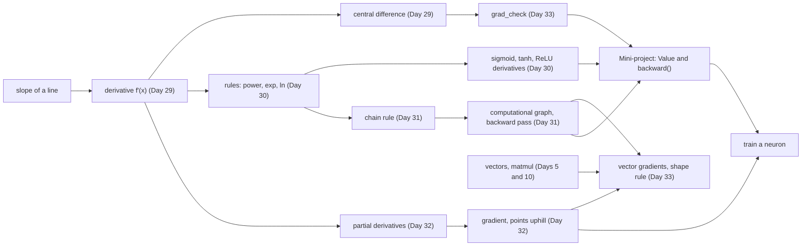

# Day 34: Week 5 Review and Mini-Project: A Tiny Autodiff Engine

**Phase 1 · Week 5 · ~180 minutes**

## Objectives

By the end of today you can:

- [ ] Explain, without notes, the main idea of each Week 5 lesson and how they chain together: slope, rules, chain rule, gradient, gradient of a vector.
- [ ] Answer the self-check questions and rebuild Day 33's MSE gradient and `grad_check` from a blank file.
- [ ] Build a small **autodiff engine**: a `Value` class that records every `+`, `−`, `*`, `/`, `**`, `exp`, `tanh` and `relu`, then computes every gradient with one `backward()` call.
- [ ] Explain why `backward()` has to visit the graph in **reverse topological order**, and why every gradient update is `+=` and not `=`.
- [ ] Check every operation of your engine against numerical derivatives, and the whole engine against a gradient you derived by hand.
- [ ] Train a single neuron with your engine and watch its loss fall.

**Prerequisites.** All of Week 5: [Day 29](day-29-derivatives.md) (derivatives, central differences), [Day 30](day-30-derivative-rules.md) (the rules, and the derivatives of sigmoid, tanh and ReLU), [Day 31](day-31-chain-rule.md) (the chain rule and computational graphs), [Day 32](day-32-partial-derivatives-gradient.md) (partial derivatives and the gradient) and [Day 33](day-33-vector-matrix-gradients.md) (vector gradients, the MSE gradient, `grad_check`). The `Value` class uses Python classes and dunder methods from [Day 3](day-03-functions-classes.md).

**Suggested time split.** 30 minutes recap and self-check, 25 minutes re-doing Day 33's gradient from blank, 100 minutes mini-project, 25 minutes stretch goals and the retro. All code was tested with Python 3.13 and NumPy 2.5.

---

## What this week gave you

Five days, one question: *if I nudge this number, how much does the output move?* That question is the whole of training. A model has millions of numbers (weights), a loss says how wrong it is, and training nudges every weight in the direction that makes the loss smaller. To do that you need the loss's slope with respect to every weight. This week built the tools to get it:

| Day | You learned | The one idea to keep |
|---|---|---|
| [29](day-29-derivatives.md) | secant → tangent, the derivative as a limit, \( f'(x) \) and \( \frac{df}{dx} \), forward vs central difference, the step size \( h \) | A derivative is a **sensitivity**: nudge \( x \) by a little, the output moves by about \( f'(x) \) times that. The central difference measures it with two calls to \( f \). |
| [30](day-30-derivative-rules.md) | constant, power, sum and product rules, \( e^x \) and \( \ln x \), sigmoid, tanh, ReLU, softplus | A small table of rules gives exact derivatives. \( \sigma'(x) = \sigma(x)(1-\sigma(x)) \) is never above 0.25, which is why deep sigmoid stacks learn slowly. |
| [31](day-31-chain-rule.md) | composition, the chain rule, computational graphs, forward then backward by hand | Local slopes **multiply** along a path and **add** across paths. Doing that backwards through a graph is backpropagation. |
| [32](day-32-partial-derivatives-gradient.md) | surfaces and contour maps, partial derivatives, the gradient \( \nabla f \), directional derivatives | Freeze all inputs but one to get a partial derivative. The gradient collects them, points **uphill**, and crosses contour lines at right angles, so \( -\nabla f \) is the way down. |
| [33](day-33-vector-matrix-gradients.md) | gradients with respect to vectors and matrices, the shape rule, \( \nabla = \frac{2}{n} X^\top (X\mathbf{w} - \mathbf{y}) \), `grad_check` | A gradient has the **same shape** as the parameter. Never trust a hand-derived gradient until a numerical check agrees with it. |

Here is the week as one journey. Today's engine sits at the end: it does Day 31's backward pass automatically, using Day 30's rules, and Day 29's nudges check that it is right.

<figure class="diagram" markdown>
![Animated row of six boxes, one per day, with a highlight and a red dot moving from left to right. Day 29, derivative: a parabola with a tangent line touching it at a red point, labelled slope equals f prime of x. Day 30, rules: x squared prime is 2x, e to the x prime is e to the x, sigma prime is sigma times one minus sigma, relu prime is 0 or 1. Day 31, chain rule: three connected nodes with a red arrow running back from the last to the first, labelled rates multiply. Day 32, gradient: three nested contour ellipses with a red gradient arrow pointing outward, labelled points uphill. Day 33, vector grads: w has shape 3 and the gradient has shape 3, the formula 2 over n X transpose times Xw minus y, and grad_check with a tick. Day 34, autodiff: a box named Value with the operations plus, minus, times, divide, power, exp, tanh, relu and the call backward. A two-line caption under the row explains each day as the highlight reaches it](../../assets/img/phase-1/day34-week5-journey.svg)
<figcaption>Animated: the week in one row. Each day answers "how much does the output move?" for a harder case, and today automates all of them.</figcaption>
</figure>

And here is how the concepts depend on each other. Arrows mean "is built on":



!!! android "Android bridge"
    You already use a dependency graph every day: Gradle's task graph. `assembleDebug` depends on `compileDebugKotlin`, which depends on `generateDebugBuildConfig`, and Gradle runs the tasks in an order where every task comes after the tasks it depends on (a **topological order**) and runs each task once, even if several tasks depend on it. Today's `backward()` does exactly that, in reverse: it sorts the computation so that every value comes after the values it was computed from, then walks that list backwards from the loss, so a value's gradient is complete before it is passed on to its inputs.

## Self-check

Answer out loud or on paper first, then open the answer. If you miss more than three, re-read that day's lesson before starting the project.

??? question "1. \( f(x) = x^2 \). Without a calculator, about how much does \( f \) change if you nudge \( x = 3 \) to \( 3.01 \)? Why only *about*?"
    \( f'(x) = 2x \), so \( f'(3) = 6 \): the output moves about \( 6 \times 0.01 = 0.06 \). The exact change is \( 3.01^2 - 9 = 0.0601 \). The derivative is the slope of the **tangent** line, and the curve bends away from that line a little, so for a finite nudge the prediction is close but not exact. The smaller the nudge, the better it gets. (Day 29)

??? question "2. Why is the central difference \( \frac{f(x+h) - f(x-h)}{2h} \) better than the forward difference \( \frac{f(x+h) - f(x)}{h} \)? And why not just use \( h = 10^{-12} \)?"
    The forward difference measures the slope of a secant that starts at \( x \), so the curve's bend gives it an error proportional to \( h \). The central difference is symmetric around \( x \), the bend cancels, and the error is proportional to \( h^2 \). For \( \sin \) at \( x = 1 \) with \( h = 10^{-5} \): forward error about \( 4 \times 10^{-6} \), central about \( 10^{-11} \). A tiny \( h \) fails for a different reason: \( f(x+h) \) and \( f(x-h) \) become almost equal float64 numbers, subtracting them loses most of their digits, and dividing by the tiny \( 2h \) magnifies what is left. At \( h = 10^{-12} \) the central error is back up to about \( 10^{-5} \). That is the U-shaped error curve from Day 29. (Day 29)

??? question "3. What is the largest value of \( \sigma'(x) \), and why does that matter for a network with ten sigmoid layers?"
    \( \sigma'(x) = \sigma(x)(1 - \sigma(x)) \) is largest at \( x = 0 \), where \( \sigma = 0.5 \), giving \( 0.5 \times 0.5 = 0.25 \). The chain rule multiplies one such factor per layer, so after ten layers the gradient reaching the first layer is at most \( 0.25^{10} \approx 10^{-6} \) times what it would be with factors of 1. The early layers barely learn: the **vanishing gradient** problem, and one reason ReLU (slope 1 for positive inputs) replaced sigmoid in hidden layers. (Day 30)

??? question "4. What is the derivative of ReLU at \( x = 0 \), and what does your engine use?"
    Mathematically there is none: the slope is 0 on the left and 1 on the right, so the limit doesn't exist at the kink. Software simply picks a value; today's engine (like PyTorch) uses 0. It rarely matters, because an input that is exactly 0.0 is rare. It does matter for gradient checks: the central difference at 0 gives \( \frac{h - 0}{2h} = 0.5 \), so never check ReLU right at its kink. (Day 30)

??? question "5. Use the chain rule to differentiate \( \sin(x^2) \), and evaluate it at \( x = 1 \)."
    Outer function \( \sin(u) \) with \( u = x^2 \). Its derivative is \( \cos(u) \), the inner one is \( 2x \), and the chain rule multiplies them: \( \cos(x^2) \cdot 2x \). At \( x = 1 \): \( 2\cos(1) \approx 1.0806 \). Gears analogy: if \( u \) turns 2 times as fast as \( x \) and \( \sin u \) turns \( \cos(1) \approx 0.54 \) times as fast as \( u \), then \( \sin u \) turns \( 2 \times 0.54 \) times as fast as \( x \). (Day 31)

??? question "6. In \( f = x \cdot y + x \), the input \( x \) is used twice. What is \( \frac{\partial f}{\partial x} \), and what does that say about the backward pass?"
    \( y + 1 \): the path through the product contributes \( y \), the direct path contributes 1, and contributions from different paths **add**. In a backward pass that means a node used in several places must collect a contribution from every place before its gradient is final. That one sentence explains both rules of today's engine: gradients are accumulated with `+=`, and nodes are processed in an order where all of a node's users come first. (Day 31)

??? question "7. \( f(x, y) = x^2 y \). What are \( \frac{\partial f}{\partial x} \), \( \frac{\partial f}{\partial y} \) and \( \nabla f \) at \( (1, 2) \)?"
    For \( \frac{\partial f}{\partial x} \), freeze \( y \) as a constant: \( 2xy = 4 \). For \( \frac{\partial f}{\partial y} \), freeze \( x \): \( x^2 = 1 \). The gradient stacks them: \( \nabla f(1, 2) = (4, 1) \). (Day 32)

??? question "8. You are standing on a loss surface and know \( \nabla L \). Which way is steepest downhill, and how fast does \( L \) change if you step in a unit direction \( \mathbf{u} \)?"
    The gradient points in the direction of steepest **ascent**, at right angles to the contour line through your point, so steepest descent is \( -\nabla L \). The rate of change in direction \( \mathbf{u} \) (with \( \lVert \mathbf{u} \rVert = 1 \)) is the directional derivative \( \nabla L \cdot \mathbf{u} \): a dot product, largest when \( \mathbf{u} \) points along \( \nabla L \), zero along the contour. Gradient descent repeats "step a little along \( -\nabla L \)". (Day 32)

??? question "9. A layer has weights \( W \) of shape (4, 3) and the loss is a single number. What shape is \( \frac{\partial L}{\partial W} \)? And what is \( \frac{\partial (\mathbf{w} \cdot \mathbf{x})}{\partial \mathbf{w}} \)?"
    (4, 3), the shape rule: the gradient has one entry per parameter, answering "if I nudge this one weight, how much does the loss move?", so it has the parameter's shape. That's what lets you write `W -= lr * grad_W`. And \( \frac{\partial (\mathbf{w} \cdot \mathbf{x})}{\partial \mathbf{w}} = \mathbf{x} \): nudging \( w_i \) moves \( w_1 x_1 + \dots + w_n x_n \) by \( x_i \) times the nudge. (Day 33)

??? question "10. Your `grad_check` returns 0.333 for your hand-derived linear-regression gradient. What does that tell you, and what is a good value?"
    Something is wrong. In float64, a relative error below about \( 10^{-7} \) means the gradients agree, and anything above about \( 10^{-4} \) is a bug. 0.333 is the signature of a gradient that is exactly half the true one, \( \frac{\lVert g - 2g \rVert}{\lVert g \rVert + \lVert 2g \rVert} = \frac{1}{3} \): you forgot the 2 in \( \frac{2}{n} X^\top(X\mathbf{w} - \mathbf{y}) \). A flipped sign gives exactly 1.0. (Day 33)

## Re-do from blank

Pick **Day 33's linear-regression gradient and `grad_check`**, and do them again in an empty file, without looking:

1. Make a small random problem: `X` of shape (6, 3), `y` of shape (6,), `w` of shape (3,), with `np.random.default_rng(34)`.
2. Write `mse_and_grad(w)` that returns the loss \( \frac{1}{n}\lVert X\mathbf{w} - \mathbf{y} \rVert^2 \) and the gradient \( \frac{2}{n} X^\top (X\mathbf{w} - \mathbf{y}) \), derived on paper first.
3. Write `numerical_grad(f, w, h=1e-5)` (a central difference for each entry) and `grad_check(f, w)`, which takes a function returning `(loss, gradient)` and returns one relative error.
4. Confirm the error is tiny, then break the gradient on purpose (drop the 2) and confirm the check catches it.

**Why this one.** It is the hardest thing the week asked you to derive, and it uses every day: derivatives and the power rule (Days 29 and 30), the chain rule through the residual \( X\mathbf{w} - \mathbf{y} \) (Day 31), one partial derivative per weight collected into a gradient (Day 32), and the shape rule that turns a sum over samples into \( X^\top \) (Day 33). It is also the safety net for today: the engine you build in the mini-project is checked exactly this way, by comparing its gradients with nudges.

??? success "Solution"
    ```python
    import numpy as np


    def numerical_grad(f, w, h=1e-5):
        """Central-difference gradient of a scalar function f at w, for any shape of w."""
        w = np.array(w, dtype=float)             # a private copy we can nudge
        g = np.zeros_like(w)
        for idx in np.ndindex(w.shape):
            old = w[idx]
            w[idx] = old + h
            f_plus = f(w)
            w[idx] = old - h
            f_minus = f(w)
            w[idx] = old                         # put it back
            g[idx] = (f_plus - f_minus) / (2 * h)
        return g


    def grad_check(f, w, h=1e-5):
        """f(w) returns (loss, analytic_grad). Returns the relative error against the numerical gradient."""
        _, g_a = f(w)
        g_n = numerical_grad(lambda v: f(v)[0], w, h)
        denom = np.linalg.norm(g_a) + np.linalg.norm(g_n)
        return 0.0 if denom == 0 else float(np.linalg.norm(g_a - g_n) / denom)


    rng = np.random.default_rng(34)
    X_lin = rng.normal(size=(6, 3))                  # 6 samples, 3 features
    y_lin = rng.normal(size=6)
    w_lin = rng.normal(size=3)


    def mse_and_grad(w):
        r = X_lin @ w - y_lin                            # residuals, shape (6,)
        loss = r @ r / len(y_lin)
        grad = (2 / len(y_lin)) * X_lin.T @ r            # shape (3,): the same shape as w
        return loss, grad


    loss, g = mse_and_grad(w_lin)
    print("loss:", round(loss, 4))
    print("analytic: ", g.round(6))
    print("numerical:", numerical_grad(lambda v: mse_and_grad(v)[0], w_lin).round(6))
    print(f"relative error: {grad_check(mse_and_grad, w_lin):.1e}")


    def forgot_the_2(w):
        loss, grad = mse_and_grad(w)
        return loss, grad / 2


    print(f"with the 2 forgotten: {grad_check(forgot_the_2, w_lin):.3f}")
    ```

    ```text
    loss: 1.0162
    analytic:  [0.494874 0.140247 1.295689]
    numerical: [0.494874 0.140247 1.295689]
    relative error: 4.0e-12
    with the 2 forgotten: 0.333
    ```

    The `X_lin`, `y_lin` names keep this block from clashing with the variables of the mini-project below. If your Day 33 version looks a little different (say, it builds the numerical gradient with a flat index), that's fine, as long as the two checks give the same verdicts.

---

## Mini-project: a tiny autodiff engine

On Day 33 you derived a gradient on paper, coded it, and checked it. That works for linear regression. It does not work for a network with fifty layers, attention, normalisation and a new idea every month: nobody derives those by hand. Instead, frameworks like PyTorch, TensorFlow and JAX compute gradients **automatically**. That is called **automatic differentiation**, or **autodiff**, and the version used for training, which runs the chain rule from the output backwards, is **reverse-mode autodiff**. Backpropagation is reverse-mode autodiff applied to a neural network.

Today you build one, for single numbers (scalars), in about 100 lines of Python. It is the same design as Andrej Karpathy's [micrograd](https://github.com/karpathy/micrograd), which he builds step by step in his video [*The spelled-out intro to neural networks and backpropagation: building micrograd*](https://www.youtube.com/watch?v=VMj-3S1tku0). Watch it after you have tried the milestones; it is the best two hours you can spend on this topic. The Month 4 milestone builds a fuller version of this engine that trains a multi-layer network, so what you write today is the core of that project.

### The idea, with an analogy

Think of a **receipt**. Every time your code computes a number, the engine prints a receipt and staples it to the result: "I am −6; I was made by multiplying 2 and −3." The result of the next step gets its own receipt pointing at that one, and so on, until the final loss holds a stack of receipts describing its whole history: a **computational graph**, built as a side effect of ordinary arithmetic.

Then `backward()` reads the receipts in reverse. Each receipt knows one small thing: the local derivative of its own operation ("for a product, the slope with respect to one input is the other input", Day 30). The chain rule (Day 31) says the gradient of the loss with respect to any number is the product of local slopes along each path from it to the loss, summed over all paths. So walking the receipts backwards and applying one local rule at each one gives every gradient in a single sweep.

!!! android "Android bridge: operator overloading"
    The trick that makes `x * y + z` print receipts is operator overloading, which you know from Kotlin: `operator fun plus(other: Value): Value` makes `a + b` call your code. Python's version is the dunder methods from Day 3: `__add__` for `a + b`, `__mul__` for `a * b`, `__pow__` for `a ** 2`, `__neg__` for `-a`. Python adds one twist Kotlin handles differently: for `3 + a`, Python first asks the int `3` (which doesn't know about `Value`), then falls back to `a.__radd__(3)`, the "reflected" version. In Kotlin you would write an extension `operator fun Double.plus(v: Value)` instead.

### The math, one symbol at a time

Every number in the engine is a node \( v \) with two fields:

- \( v.\text{data} \): its value, computed in the forward pass.
- \( v.\text{grad} \): the derivative of the final output \( L \) with respect to it, \( \frac{\partial L}{\partial v} \). "If I nudged this node, how much would the output move?"

Suppose an operation made the node \( \text{out} \) from an input \( a \). The chain rule says the part of \( a \)'s gradient that flows through \( \text{out} \) is

\[
\frac{\partial L}{\partial a} \mathrel{+}= \frac{\partial\, \text{out}}{\partial a} \cdot \frac{\partial L}{\partial\, \text{out}}
\]

Read it left to right: *add* to \( a \)'s gradient the **local derivative** (how much \( \text{out} \) moves when \( a \) moves, from Day 30's table) times the **upstream gradient** (how much \( L \) moves when \( \text{out} \) moves, already computed because we walk backwards). The \( \mathrel{+}= \) is there because \( a \) may feed several nodes, and contributions from different paths add (self-check question 6). That one line is the entire engine. Each operation only needs its local derivatives:

| Operation | Forward | Local derivative(s) | In code (`_backward`) |
|---|---|---|---|
| sum | \( \text{out} = a + b \) | \( 1 \) and \( 1 \) | `a.grad += out.grad`; `b.grad += out.grad` |
| product | \( \text{out} = a \cdot b \) | \( b \) and \( a \) | `a.grad += b.data * out.grad`; `b.grad += a.data * out.grad` |
| constant power | \( \text{out} = a^k \) | \( k a^{k-1} \) | `a.grad += k * a.data ** (k - 1) * out.grad` |
| exponential | \( \text{out} = e^a \) | \( e^a \), which is `out.data` | `a.grad += out.data * out.grad` |
| tanh | \( \text{out} = \tanh a \) | \( 1 - \tanh^2 a \) | `a.grad += (1 - out.data ** 2) * out.grad` |
| ReLU | \( \text{out} = \max(0, a) \) | 1 if \( a > 0 \), else 0 | `a.grad += (a.data > 0) * out.grad` |

Subtraction and division need no rows of their own: \( a - b = a + (-1 \cdot b) \) and \( a / b = a \cdot b^{-1} \), so the engine builds them from the rows above and the chain rule takes care of the rest.

**Worked example.** Take Day 31's expression \( f = (x \cdot y + z)^2 \) with \( x = 2 \), \( y = -3 \), \( z = 10 \). Forward, naming every intermediate:

\[
q = x \cdot y = -6, \qquad s = q + z = 4, \qquad f = s^2 = 16
\]

Backward, one node at a time, starting from \( \frac{\partial f}{\partial f} = 1 \):

1. \( f = s^2 \): \( s.\text{grad} \mathrel{+}= 2s \cdot 1 = 8 \).
2. \( s = q + z \): a sum passes the gradient through, so \( q.\text{grad} \mathrel{+}= 8 \) and \( z.\text{grad} \mathrel{+}= 8 \).
3. \( q = x \cdot y \): a product swaps the inputs, so \( x.\text{grad} \mathrel{+}= y \cdot 8 = -24 \) and \( y.\text{grad} \mathrel{+}= x \cdot 8 = 16 \).

Check one with a nudge (Day 29): \( x = 2.001 \) gives \( (2.001 \cdot (-3) + 10)^2 = 3.997^2 = 15.976 \), down by 0.024 from 16, which is \( -24 \times 0.001 \). The engine will reproduce these numbers exactly.

**Why the order matters.** Step 2 used \( s.\text{grad} \), so step 1 had to finish first. In general a node may only pass its gradient on once **every** node that uses it has added its contribution. An order where each node comes after everything it was computed from is a **topological order** (inputs first, output last). Walk it in reverse and every node is complete by the time you reach it. Building it is a depth-first search: before adding a node to the list, add all of its children.

<figure class="diagram" markdown>
![Animated computational graph for f equals x times y plus z, squared. Value boxes x with data 2, y with data minus 3, q with data minus 6, z with data 10, s with data 4 and f with data 16 are joined by grey forward arrows through operation circles for times, plus and power 2. All grads start as question marks. Step by step, a yellow highlight and red dashed arrows move backwards: f's grad becomes 1, then s's grad 8, then q's and z's grads 8, then x's grad minus 24 and y's grad 16. A strip at the bottom fills in the reversed topological order f, s, z, q, y, x, and a caption explains the local rule used at each step](../../assets/img/phase-1/day34-backward-flow.svg)
<figcaption>Animated: <code>backward()</code> on the worked example. Each step is one node's <code>_backward</code>, called in reversed topological order.</figcaption>
</figure>

### Spec

Build these in one file or notebook, `engine.py`:

| Piece | What it does | Rules |
|---|---|---|
| `Value(data, children=(), op="")` | wraps a float; fields `data`, `grad`, `_prev`, `_op`, `_backward` | `grad` starts at 0.0; a leaf's `_backward` does nothing |
| `+`, `*` | build a new `Value` and its `_backward` closure | accept plain numbers too, by wrapping them in `Value` |
| `**k`, `exp()`, `tanh()`, `relu()` | the other primitives | `k` must be a plain number; ReLU's slope at 0 is 0 |
| `-a`, `a - b`, `a / b`, `3 + a`, `3 * a`, `3 - a`, `3 / a` | built from the primitives | no new derivative code |
| `backward()` | fills `grad` of every node the output depends on | topological sort, `self.grad = 1`, then each `_backward` in reverse; always `+=` |
| `engine_derivative`, `numeric_derivative` | the engine's \( \frac{df}{dx} \), and Day 29's central difference | every op agrees to a relative error below \( 10^{-7} \) |
| `neuron`, `loss_fn`, training loop | a 2-input tanh neuron with mean squared error, trained by stepping downhill | gradients zeroed every step; loss and accuracy printed |

### Starter code

Copy this and fill in the `TODO`s. (Running it as it is only defines the empty methods; the milestones below fill them in, and their code replaces this class.)

```python
import math


class Value:
    """A scalar that remembers how it was computed, so it can compute gradients."""

    def __init__(self, data, children=(), op=""):
        # TODO: store data as a float, grad = 0.0, the children as a tuple, the op,
        #       and a _backward that does nothing
        raise NotImplementedError

    def __add__(self, other):
        # TODO: wrap a plain number; make out; define _backward with two += lines
        raise NotImplementedError

    def __mul__(self, other):
        # TODO: like __add__, with the product's local derivatives
        raise NotImplementedError

    def backward(self):
        # TODO: depth-first search into a list (children first), set self.grad = 1.0,
        #       then call every node's _backward in reverse order
        raise NotImplementedError
```

### Milestones

Do them in order. Every output below is real; the data and seeds are fixed, so yours should match exactly.

**Milestone 1: values that remember.** Start with the forward pass only: `+` and `*` that build the graph. No gradients yet.

```python
import math


class Value:
    """A number that remembers how it was computed."""

    def __init__(self, data, children=(), op=""):
        self.data = float(data)
        self.grad = 0.0                 # d(final output)/d(this value); filled in by backward()
        self._prev = tuple(children)    # the Values this one was computed from
        self._op = op                   # which operation made it, for printing

    def __repr__(self):
        return f"Value(data={self.data:g}, grad={self.grad:g})"

    def __add__(self, other):
        return Value(self.data + other.data, (self, other), "+")

    def __mul__(self, other):
        return Value(self.data * other.data, (self, other), "*")


x, y, z = Value(2.0), Value(-3.0), Value(10.0)
q = x * y
s = q + z
print(q, s)
print(s._op, s._prev)
print(s._prev[0]._op, s._prev[0]._prev)
```

```text
Value(data=-6, grad=0) Value(data=4, grad=0)
+ (Value(data=-6, grad=0), Value(data=10, grad=0))
* (Value(data=2, grad=0), Value(data=-3, grad=0))
```

`s` knows it was made by `+` from `q` and `z`, and `q` knows it was made by `*` from `x` and `y`: the receipts. `__repr__` (Day 3) is Python's `toString()`, and `:g` prints a float without trailing zeros.

**Milestone 2: the backward pass.** Each operation now also creates a small function, `_backward`, that applies its row of the table. It is a **closure**: it remembers `self`, `other` and `out` from the moment it was created, like a Kotlin lambda capturing local variables, so it can run much later when `backward()` calls it. This version replaces Milestone 1's class.

```python
class Value:
    """A number that remembers how it was computed, so it can compute gradients."""

    def __init__(self, data, children=(), op=""):
        self.data = float(data)
        self.grad = 0.0
        self._prev = tuple(children)
        self._op = op
        self._backward = lambda: None   # leaves (inputs, weights) have nothing to pass on

    def __repr__(self):
        return f"Value(data={self.data:g}, grad={self.grad:g})"

    def __add__(self, other):
        other = other if isinstance(other, Value) else Value(other)
        out = Value(self.data + other.data, (self, other), "+")

        def _backward():
            self.grad += 1.0 * out.grad          # d(a+b)/da = 1
            other.grad += 1.0 * out.grad         # d(a+b)/db = 1
        out._backward = _backward
        return out

    def __mul__(self, other):
        other = other if isinstance(other, Value) else Value(other)
        out = Value(self.data * other.data, (self, other), "*")

        def _backward():
            self.grad += other.data * out.grad   # d(a*b)/da = b
            other.grad += self.data * out.grad   # d(a*b)/db = a
        out._backward = _backward
        return out

    def backward(self):
        """Fill in .grad of every Value this one depends on."""
        order, seen = [], set()

        def visit(v):                    # depth-first: children before parents
            if v not in seen:
                seen.add(v)
                for child in v._prev:
                    visit(child)
                order.append(v)
        visit(self)

        self.grad = 1.0                  # d(output)/d(output) = 1
        for v in reversed(order):        # output first, inputs last
            v._backward()


x, y, z = Value(2.0), Value(-3.0), Value(10.0)
q = x * y
s = q + z
f = s * s                                # (x*y + z)^2, with s used twice
f.backward()
for name, v in [("f", f), ("s", s), ("q", q), ("x", x), ("y", y), ("z", z)]:
    print(name, v)
```

```text
f Value(data=16, grad=1)
s Value(data=4, grad=8)
q Value(data=-6, grad=8)
x Value(data=2, grad=-24)
y Value(data=-3, grad=16)
z Value(data=10, grad=8)
```

Every gradient matches the worked example. There is no `**` yet, so the square is written `s * s`, and that is a good test: both inputs of that product are the same node `s`. Its `_backward` runs `s.grad += 4 * 1` twice, once as `self` and once as `other`, and the two contributions add up to the correct 8. With `=` instead of `+=`, the second line would overwrite the first and leave 4.

`seen` is a Python `set` of `Value` objects. That works because a class without its own `__eq__` hashes by identity, like a Kotlin class that doesn't override `equals`/`hashCode`: two different nodes are different set members even when their data is equal.

**Milestone 3: the remaining operations.** Python lets you add methods to a class after it is defined, so this milestone attaches the new ones instead of repeating the whole class (the reference solution puts everything in one class body). Notice how short the second group is: subtraction, division and the reflected operations are built from the primitives, so they need no derivative code of their own.

```python
import math


def _pow(self, k):
    assert isinstance(k, (int, float)), "only constant powers: x ** 2, x ** -1, x ** 0.5"
    out = Value(self.data ** k, (self,), f"**{k}")

    def _backward():
        self.grad += k * self.data ** (k - 1) * out.grad     # power rule
    out._backward = _backward
    return out


def _exp(self):
    out = Value(math.exp(self.data), (self,), "exp")

    def _backward():
        self.grad += out.data * out.grad                     # (e^x)' = e^x, already computed
    out._backward = _backward
    return out


def _tanh(self):
    t = math.tanh(self.data)
    out = Value(t, (self,), "tanh")

    def _backward():
        self.grad += (1 - t ** 2) * out.grad                 # tanh' = 1 - tanh^2
    out._backward = _backward
    return out


def _relu(self):
    out = Value(max(0.0, self.data), (self,), "relu")

    def _backward():
        self.grad += (1.0 if self.data > 0 else 0.0) * out.grad   # slope 0 at x = 0, by choice
    out._backward = _backward
    return out


Value.__pow__ = _pow
Value.exp = _exp
Value.tanh = _tanh
Value.relu = _relu

# Everything else is built from the ops above, so it needs no new backward code.
Value.__neg__ = lambda self: self * -1                       # -a
Value.__sub__ = lambda self, other: self + (-other)          # a - b
Value.__truediv__ = lambda self, other: self * other ** -1   # a / b = a * b^-1
Value.__radd__ = lambda self, other: self + other            # 3 + a
Value.__rmul__ = lambda self, other: self * other            # 3 * a
Value.__rsub__ = lambda self, other: (-self) + other         # 3 - a
Value.__rtruediv__ = lambda self, other: Value(other) * self ** -1   # 3 / a

a = Value(1.5)
out = (2 - a) / a + (a ** 2).exp() * 0.1 - a.tanh() + (-a).relu()
out.backward()
print(out, a)
```

```text
Value(data=0.376959, grad=1) Value(data=1.5, grad=1.77673)
```

Check it by hand with Day 30's rules, term by term, at \( a = 1.5 \): \( \frac{d}{da}\frac{2-a}{a} = -\frac{2}{a^2} = -0.8889 \); \( \frac{d}{da} 0.1 e^{a^2} = 0.1 \cdot 2a \cdot e^{a^2} = 2.8463 \); \( -\frac{d}{da}\tanh a = -(1 - \tanh^2 1.5) = -0.1807 \); and \( \text{relu}(-1.5) = 0 \) is flat, slope 0. Sum: \( 1.7767 \). One `backward()` did all of that.

**Milestone 4: check every operation numerically.** Hand checks don't scale; Day 29's central difference does. For any one-input function built from `Value`s, compare what the engine says with what nudging says. The nudge only needs the forward pass, which is ordinary arithmetic, so it is an independent check of every `_backward`.

```python
def engine_derivative(f, x0):
    """df/dx at x0 from our engine: build the graph, run backward, read x.grad."""
    x = Value(x0)
    f(x).backward()
    return x.grad


def numeric_derivative(f, x0, h=1e-6):
    """Day 29's central difference, using only the forward pass."""
    return (f(Value(x0 + h)).data - f(Value(x0 - h)).data) / (2 * h)


CHECKS = [                                   # (name, function of one Value, where to test)
    ("x + 3", lambda x: x + 3, 0.7),
    ("3 + x", lambda x: 3 + x, 0.7),
    ("x - 3", lambda x: x - 3, 0.7),
    ("3 - x", lambda x: 3 - x, 0.7),
    ("-x", lambda x: -x, 0.7),
    ("x * 2.5", lambda x: x * 2.5, 0.7),
    ("x * x", lambda x: x * x, 0.7),
    ("x / 2.5", lambda x: x / 2.5, 0.7),
    ("2.5 / x", lambda x: 2.5 / x, 0.7),
    ("x ** 3", lambda x: x ** 3, 0.7),
    ("x ** -0.5", lambda x: x ** -0.5, 0.7),
    ("exp(x)", lambda x: x.exp(), 0.7),
    ("tanh(x)", lambda x: x.tanh(), 0.7),
    ("relu(x), x > 0", lambda x: x.relu(), 0.7),
    ("relu(x), x < 0", lambda x: x.relu(), -0.7),
    ("tanh(x*x + x) / x", lambda x: (x * x + x).tanh() / x, 0.7),
]

worst = 0.0
for name, fn, x0 in CHECKS:
    e, n = engine_derivative(fn, x0), numeric_derivative(fn, x0)
    err = abs(e - n) / max(1e-12, abs(e) + abs(n))
    worst = max(worst, err)
    print(f"{name:18} at {x0:+.1f}: engine {e:+.6f}  numeric {n:+.6f}  rel. error {err:.0e}")
print(f"worst relative error: {worst:.0e}")
```

```text
x + 3              at +0.7: engine +1.000000  numeric +1.000000  rel. error 4e-11
3 + x              at +0.7: engine +1.000000  numeric +1.000000  rel. error 4e-11
x - 3              at +0.7: engine +1.000000  numeric +1.000000  rel. error 4e-11
3 - x              at +0.7: engine -1.000000  numeric -1.000000  rel. error 4e-11
-x                 at +0.7: engine -1.000000  numeric -1.000000  rel. error 1e-11
x * 2.5            at +0.7: engine +2.500000  numeric +2.500000  rel. error 3e-12
x * x              at +0.7: engine +1.400000  numeric +1.400000  rel. error 1e-11
x / 2.5            at +0.7: engine +0.400000  numeric +0.400000  rel. error 1e-11
2.5 / x            at +0.7: engine -5.102041  numeric -5.102041  rel. error 2e-11
x ** 3             at +0.7: engine +1.470000  numeric +1.470000  rel. error 1e-11
x ** -0.5          at +0.7: engine -0.853735  numeric -0.853735  rel. error 2e-11
exp(x)             at +0.7: engine +2.013753  numeric +2.013753  rel. error 1e-12
tanh(x)            at +0.7: engine +0.634740  numeric +0.634740  rel. error 1e-11
relu(x), x > 0     at +0.7: engine +1.000000  numeric +1.000000  rel. error 1e-11
relu(x), x < 0     at -0.7: engine +0.000000  numeric +0.000000  rel. error 0e+00
tanh(x*x + x) / x  at +0.7: engine -0.631726  numeric -0.631726  rel. error 6e-12
worst relative error: 4e-11
```

Every op, both sides of every binary op (`x - 3` and `3 - x` run different code), and one composite agree to about \( 10^{-11} \), far below the \( 10^{-7} \) line from Day 33. The test points avoid \( x = 0 \) on purpose: ReLU has a kink there (the numerical slope would be 0.5, the engine's 0), and `2.5 / x` and `x ** -0.5` are undefined there.

**Milestone 5: two bugs to meet on purpose.** First, what happens if you call `backward()` twice on the same graph?

```python
f.backward()                     # a second time, on the same graph from Milestone 2
print("x.grad after two backward() calls:", x.grad)


def zero_grad(values):
    for v in values:
        v.grad = 0.0


zero_grad([f, s, q, x, y, z])
f.backward()
print("after zero_grad and one more call:", x.grad)
```

```text
x.grad after two backward() calls: -96.0
after zero_grad and one more call: -24.0
```

Not −48 (double), but −96. Every node still held its old gradient, so the second sweep added new contributions on top of stale ones, and the stale ones were themselves passed on: `s.grad` became 16, so `q.grad` became 8 + 16 = 24, so `x.grad` became −24 + (−3)(24) = −96. Gradients **accumulate** by design (that is the `+=`), so before every new backward pass you must reset them. In a training loop, the intermediate nodes are rebuilt from scratch on every forward pass, so only the parameters need zeroing. PyTorch has exactly the same rule, which is why every PyTorch training loop calls `optimizer.zero_grad()`.

!!! warning "Common mistake: `=` instead of `+=` in a `_backward`"
    `self.grad = other.data * out.grad` passes every test where each node is used once, and silently gives wrong gradients as soon as a value is reused (`x * x`, a weight shared across samples, a bias added to every row). That is why `CHECKS` includes `x * x` and `tanh(x*x + x) / x`. On the worked example, `=` would give `s.grad = 4` instead of 8, and every gradient behind it would be half what it should be. A useful habit: every line in a `_backward` starts with `something.grad +=`.

The second bug is a subtle one: if you give `Value` an `__eq__` (to compare data, say), Python sets its `__hash__` to `None`, the `seen` set in `backward()` raises `TypeError: unhashable type: 'Value'`, and even if you fixed the hashing, two different nodes with equal data would be treated as one. Leave identity comparison alone.

**Milestone 6: train a neuron.** Now use the engine for what it is for. The dataset is 20 points in the plane: 10 labelled +1 scattered around (1, 1) and 10 labelled −1 around (−1, −1). This block needs NumPy; it is imported again in case you skipped the re-do.

```python
import numpy as np

rng = np.random.default_rng(34)
n_per_class = 10
pos = rng.normal(loc=[1.0, 1.0], scale=0.8, size=(n_per_class, 2))
neg = rng.normal(loc=[-1.0, -1.0], scale=0.8, size=(n_per_class, 2))
X_toy = np.vstack([pos, neg])                       # (20, 2) inputs
y_toy = np.r_[np.ones(n_per_class), -np.ones(n_per_class)]   # labels +1 and -1
print(X_toy.shape, y_toy.shape)
print(X_toy[:3].round(2), y_toy[:3])
```

```text
(20, 2) (20,)
[[ 0.97 -0.01]
 [ 3.06  1.39]
 [ 1.51  0.83]] [1. 1. 1.]
```

The model is one neuron (Day 12), with tanh as its activation so that its output lies between −1 and +1, like the labels:

\[
p_i = \tanh(w_1 x_{i1} + w_2 x_{i2} + b), \qquad L = \frac{1}{n} \sum_{i=1}^{n} (p_i - y_i)^2
\]

\( p_i \) is the neuron's prediction for point \( i \), \( x_{i1} \) and \( x_{i2} \) are its two coordinates, and \( L \) is the mean squared error. Three parameters: \( w_1 \), \( w_2 \), \( b \). Write them as `Value`s and the loss as plain arithmetic; the graph builds itself.

```python
def neuron(params, x):
    """p = tanh(w1*x1 + w2*x2 + b): one neuron, two inputs."""
    w1, w2, b = params
    return (w1 * x[0] + w2 * x[1] + b).tanh()


def loss_fn(params, X, y):
    """Mean squared error between the neuron's outputs and the labels."""
    total = Value(0.0)
    for xi, yi in zip(X, y):
        total = total + (neuron(params, xi) - yi) ** 2
    return total / len(y)


params = [Value(0.1), Value(-0.3), Value(0.0)]      # w1, w2, b: a deliberately bad start
loss = loss_fn(params, X_toy, y_toy)
loss.backward()
print("loss:", round(loss.data, 4))
print("engine grads:", [round(p.grad, 6) for p in params])
```

```text
loss: 1.3485
engine grads: [-2.389189, -1.989203, 0.048909]
```

`x[0]` is a NumPy float and `yi` too; `Value * numpy float` works because our `__mul__` wraps anything that isn't a `Value`. Each parameter is used 20 times, once per point, so each gradient is a sum of 20 contributions, collected by `+=`.

Before trusting these numbers, check them two independent ways. The first is Day 33's method: derive the gradient by hand. With \( z_i = w_1 x_{i1} + w_2 x_{i2} + b \), the chain rule gives \( \frac{\partial L}{\partial z_i} = \frac{2}{n}(p_i - y_i)(1 - p_i^2) \) (the square's derivative, then tanh's), and then \( \frac{\partial L}{\partial w_1} = \sum_i \frac{\partial L}{\partial z_i} x_{i1} \), the same for \( w_2 \), and \( \frac{\partial L}{\partial b} = \sum_i \frac{\partial L}{\partial z_i} \). The second is the re-do's `grad_check`, on that hand-derived version.

```python
def numpy_loss_and_grad(theta):
    """The same loss, with the gradient derived by hand (chain rule, Days 31 and 33)."""
    w, b = theta[:2], theta[2]
    p = np.tanh(X_toy @ w + b)                      # (20,) outputs
    r = p - y_toy                                   # residuals
    loss = r @ r / len(y_toy)
    dz = (2 / len(y_toy)) * r * (1 - p ** 2)        # dL/dz for each sample
    grad = np.r_[X_toy.T @ dz, dz.sum()]            # [dL/dw1, dL/dw2, dL/db]
    return loss, grad


theta = np.array([0.1, -0.3, 0.0])
loss_np, grad_np = numpy_loss_and_grad(theta)
grad_engine = np.array([p.grad for p in params])
print("numpy grads: ", grad_np.round(6))
print(f"engine vs hand-derived: {np.linalg.norm(grad_engine - grad_np) / (np.linalg.norm(grad_engine) + np.linalg.norm(grad_np)):.1e}")
print(f"hand-derived vs numerical (grad_check): {grad_check(numpy_loss_and_grad, theta):.1e}")
```

```text
numpy grads:  [-2.389189 -1.989203  0.048909]
engine vs hand-derived: 7.5e-17
hand-derived vs numerical (grad_check): 5.0e-11
```

(This block uses `grad_check` from the re-do solution; run that first.) The engine and the hand derivation agree to the last bit of float64 (\( 10^{-16} \) is rounding noise), and the hand derivation agrees with nudging. Three methods, one answer. The difference is that the engine needed no derivation at all: change `neuron` to anything built from our ops and the gradients still come out right.

Now train. Each step is the loop you will write for every model from here on: forward, zero the gradients, backward, and step each parameter a little **against** its gradient, Day 32's "walk downhill". The step size is the **learning rate**, `lr`. (Week 8 studies gradient descent properly: why it converges, and how to choose `lr`.)

```python
params = [Value(0.1), Value(-0.3), Value(0.0)]      # start again from the same bad weights
lr = 0.2                                            # learning rate: the size of each downhill step
history = []
for step in range(60):
    loss = loss_fn(params, X_toy, y_toy)            # 1. forward: build a fresh graph
    for p in params:                                # 2. forget the last step's gradients
        p.grad = 0.0
    loss.backward()                                 # 3. backward: d(loss)/d(each param)
    for p in params:                                # 4. step downhill (Day 32)
        p.data -= lr * p.grad
    history.append(loss.data)
    if step % 10 == 0 or step == 59:
        print(f"step {step:2d}  loss {loss.data:.4f}  w1 {params[0].data:+.3f}  "
              f"w2 {params[1].data:+.3f}  b {params[2].data:+.3f}")

preds = [neuron(params, xi).data for xi in X_toy]
accuracy = np.mean(np.sign(preds) == y_toy)
print(f"accuracy: {accuracy:.0%}")
```

```text
step  0  loss 1.3485  w1 +0.578  w2 +0.098  b -0.010
step 10  loss 0.0646  w1 +0.928  w2 +0.498  b -0.046
step 20  loss 0.0433  w1 +1.058  w2 +0.643  b -0.025
step 30  loss 0.0337  w1 +1.145  w2 +0.744  b -0.005
step 40  loss 0.0280  w1 +1.211  w2 +0.823  b +0.012
step 50  loss 0.0241  w1 +1.265  w2 +0.890  b +0.027
step 59  loss 0.0215  w1 +1.306  w2 +0.943  b +0.038
accuracy: 100%
```

The printed weights are after that step's update; the loss is before it. The starting weights classify only 3 of the 20 points correctly (15%); 60 steps later the loss is 60 times smaller and every point is on the right side. `p.data -= lr * p.grad` changes the parameter's value in place; it is not tracked by the engine (it's ordinary float arithmetic on `.data`), which is what you want: the update is not part of the model. The picture:

```python
import matplotlib
matplotlib.use("Agg")            # draw into files, no window (leave this out in Jupyter)
import matplotlib.pyplot as plt

plt.rcParams.update({"font.size": 11, "figure.facecolor": "white", "savefig.facecolor": "white",
                     "axes.spines.top": False, "axes.spines.right": False})

fig, (ax1, ax2) = plt.subplots(1, 2, figsize=(12, 4.2))
ax1.plot(history, color="#3949ab", lw=2)
ax1.set_yscale("log")
ax1.set_xlabel("Training step")
ax1.set_ylabel("Mean squared error (log scale)")
ax1.set_title("Loss, computed and differentiated by Value")
ax1.grid(alpha=0.3)

ax2.scatter(*pos.T, color="#00897b", label="label +1", s=40)
ax2.scatter(*neg.T, color="#ef6c00", marker="s", label="label −1", s=40)
xs = np.linspace(-3.5, 3.5, 2)
for (w1, w2, b), style, label in [((0.1, -0.3, 0.0), ":", "boundary at the start"),
                                  ([p.data for p in params], "-", "boundary after 60 steps")]:
    ax2.plot(xs, -(w1 * xs + b) / w2, color="#555", ls=style, lw=1.8, label=label)
ax2.set_xlim(-3.5, 3.5)
ax2.set_ylim(-3.5, 3.5)
ax2.set_aspect("equal")
ax2.set_xlabel("x1")
ax2.set_ylabel("x2")
ax2.set_title("Where tanh(w1·x1 + w2·x2 + b) = 0")
ax2.legend(frameon=False, fontsize=9, loc="upper left", bbox_to_anchor=(1.0, 1.0))
fig.tight_layout()
fig.savefig("day34-neuron-training.svg", format="svg", bbox_inches="tight")
plt.close(fig)
```

<figure class="diagram" markdown>
![Two panels. Left: the training loss on a log scale falls steeply from about 1.35 at step 0 to about 0.2 within two steps, then keeps decreasing smoothly to about 0.02 at step 59. Right: 10 teal circles labelled plus 1 in the upper right and 10 orange squares labelled minus 1 in the lower left. A dotted line, the starting decision boundary, runs gently uphill through the middle of both groups, cutting each of them. A solid line, the boundary after 60 steps, runs steeply downhill from upper left to lower right and separates the two groups completely](../../assets/img/phase-1/day34-neuron-training.svg)
<figcaption>Milestone 6. Left: the loss your engine computed and differentiated, step by step. Right: the neuron's decision boundary before (dotted) and after (solid) training.</figcaption>
</figure>

The neuron says +1 where \( w_1 x_1 + w_2 x_2 + b > 0 \) and −1 where it is negative, so its **decision boundary** is the line \( w_1 x_1 + w_2 x_2 + b = 0 \), which is \( x_2 = -(w_1 x_1 + b) / w_2 \): the formula in the plotting loop. Training rotated that line until it separated the two groups.

!!! android "Android bridge: where this runs on a phone"
    Your phone almost never runs `backward()`. A model exported to LiteRT (TensorFlow Lite) contains only the forward pass: a graph of ops like `FULLY_CONNECTED` and `TANH`, and the interpreter walks it in topological order, exactly like your `visit` list, without the reverse sweep. Training happens on a server, where the autodiff engine (PyTorch, JAX, TensorFlow) records the graph and runs the backward pass. On-device training does exist (LiteRT can export special training signatures, and Gboard's federated learning trains on phones), and then the backward pass is just more ops in the exported graph, generated ahead of time by the framework's autodiff.

### How to verify it works

Paste these checks under your code and run them. Each one targets a specific way an autodiff engine can be wrong.

```python
# 1. The worked example, against the hand-computed numbers
x, y, z = Value(2.0), Value(-3.0), Value(10.0)
f = (x * y + z) ** 2
f.backward()
assert (f.data, x.grad, y.grad, z.grad) == (16.0, -24.0, 16.0, 8.0)
# 2. A Value used twice gets both contributions (+=, not =)
a = Value(3.0)
(a * a + a).backward()
assert a.grad == 7.0                                   # d(a² + a)/da = 2a + 1
# 3. Every op matches the central difference
for name, fn, x0 in CHECKS:
    e, n = engine_derivative(fn, x0), numeric_derivative(fn, x0)
    assert abs(e - n) <= 1e-6 * max(1.0, abs(e)), name
# 4. Plain numbers work on either side
assert (2 * Value(3.0)).data == 6.0 and (1 - Value(3.0)).data == -2.0 and (6 / Value(3.0)).data == 2.0
# 5. The engine's gradient equals the hand-derived NumPy gradient on the neuron
fresh = [Value(0.1), Value(-0.3), Value(0.0)]
loss_fn(fresh, X_toy, y_toy).backward()
_, g_hand = numpy_loss_and_grad(np.array([0.1, -0.3, 0.0]))
assert np.allclose([p.grad for p in fresh], g_hand)
# 6. Training worked
assert history[-1] < 0.05 * history[0] and accuracy == 1.0
print("all checks passed")
# all checks passed
```

If check 2 fails, look for an `=` in a `_backward`. If check 3 fails for one op, the printed name tells you which local derivative is wrong. If check 5 fails but 1 to 4 pass, compare your `loss_fn` with the formula: a missing `/ len(y)` scales every gradient by 20.

??? success "Reference solution (try the milestones first)"
    One standalone file: the whole engine as one class, the op checks, and the training run. It runs in well under a second.

    ```python
    """Week 5 mini-project: a tiny scalar autodiff engine, checked and used to train a neuron."""
    import math
    import numpy as np


    class Value:
        """A scalar that remembers how it was computed, so it can compute gradients."""

        def __init__(self, data, children=(), op=""):
            self.data = float(data)
            self.grad = 0.0
            self._prev = tuple(children)
            self._op = op
            self._backward = lambda: None

        def __repr__(self):
            return f"Value(data={self.data:g}, grad={self.grad:g})"

        # ----- the primitive ops: each knows its local derivative -----
        def __add__(self, other):
            other = other if isinstance(other, Value) else Value(other)
            out = Value(self.data + other.data, (self, other), "+")

            def _backward():
                self.grad += out.grad
                other.grad += out.grad
            out._backward = _backward
            return out

        def __mul__(self, other):
            other = other if isinstance(other, Value) else Value(other)
            out = Value(self.data * other.data, (self, other), "*")

            def _backward():
                self.grad += other.data * out.grad
                other.grad += self.data * out.grad
            out._backward = _backward
            return out

        def __pow__(self, k):
            assert isinstance(k, (int, float)), "only constant powers"
            out = Value(self.data ** k, (self,), f"**{k}")

            def _backward():
                self.grad += k * self.data ** (k - 1) * out.grad
            out._backward = _backward
            return out

        def exp(self):
            out = Value(math.exp(self.data), (self,), "exp")

            def _backward():
                self.grad += out.data * out.grad
            out._backward = _backward
            return out

        def tanh(self):
            t = math.tanh(self.data)
            out = Value(t, (self,), "tanh")

            def _backward():
                self.grad += (1 - t ** 2) * out.grad
            out._backward = _backward
            return out

        def relu(self):
            out = Value(max(0.0, self.data), (self,), "relu")

            def _backward():
                self.grad += (1.0 if self.data > 0 else 0.0) * out.grad
            out._backward = _backward
            return out

        # ----- everything else is built from the primitives -----
        def __neg__(self):
            return self * -1

        def __sub__(self, other):
            return self + (-other)

        def __truediv__(self, other):
            return self * other ** -1

        def __radd__(self, other):
            return self + other

        def __rmul__(self, other):
            return self * other

        def __rsub__(self, other):
            return (-self) + other

        def __rtruediv__(self, other):
            return Value(other) * self ** -1

        # ----- reverse-mode autodiff -----
        def backward(self):
            order, seen = [], set()

            def visit(v):
                if v not in seen:
                    seen.add(v)
                    for child in v._prev:
                        visit(child)
                    order.append(v)
            visit(self)
            self.grad = 1.0
            for v in reversed(order):
                v._backward()


    # ---------- check every op against the central difference ----------
    def engine_derivative(f, x0):
        x = Value(x0)
        f(x).backward()
        return x.grad


    def numeric_derivative(f, x0, h=1e-6):
        return (f(Value(x0 + h)).data - f(Value(x0 - h)).data) / (2 * h)


    CHECKS = [
        ("x + 3", lambda x: x + 3, 0.7), ("3 + x", lambda x: 3 + x, 0.7),
        ("x - 3", lambda x: x - 3, 0.7), ("3 - x", lambda x: 3 - x, 0.7),
        ("-x", lambda x: -x, 0.7), ("x * 2.5", lambda x: x * 2.5, 0.7),
        ("x * x", lambda x: x * x, 0.7), ("x / 2.5", lambda x: x / 2.5, 0.7),
        ("2.5 / x", lambda x: 2.5 / x, 0.7), ("x ** 3", lambda x: x ** 3, 0.7),
        ("x ** -0.5", lambda x: x ** -0.5, 0.7), ("exp(x)", lambda x: x.exp(), 0.7),
        ("tanh(x)", lambda x: x.tanh(), 0.7), ("relu(x), x > 0", lambda x: x.relu(), 0.7),
        ("relu(x), x < 0", lambda x: x.relu(), -0.7),
        ("tanh(x*x + x) / x", lambda x: (x * x + x).tanh() / x, 0.7),
    ]
    worst = 0.0
    for name, fn, x0 in CHECKS:
        e, n = engine_derivative(fn, x0), numeric_derivative(fn, x0)
        worst = max(worst, abs(e - n) / max(1e-12, abs(e) + abs(n)))
    print(f"{len(CHECKS)} op checks, worst relative error {worst:.0e}")

    # ---------- train one tanh neuron on a toy dataset ----------
    rng = np.random.default_rng(34)
    n_per_class = 10
    pos = rng.normal(loc=[1.0, 1.0], scale=0.8, size=(n_per_class, 2))
    neg = rng.normal(loc=[-1.0, -1.0], scale=0.8, size=(n_per_class, 2))
    X_toy = np.vstack([pos, neg])
    y_toy = np.r_[np.ones(n_per_class), -np.ones(n_per_class)]


    def neuron(params, x):
        w1, w2, b = params
        return (w1 * x[0] + w2 * x[1] + b).tanh()


    def loss_fn(params, X, y):
        total = Value(0.0)
        for xi, yi in zip(X, y):
            total = total + (neuron(params, xi) - yi) ** 2
        return total / len(y)


    params = [Value(0.1), Value(-0.3), Value(0.0)]
    lr = 0.2
    history = []
    for step in range(60):
        loss = loss_fn(params, X_toy, y_toy)
        for p in params:
            p.grad = 0.0
        loss.backward()
        for p in params:
            p.data -= lr * p.grad
        history.append(loss.data)

    preds = [neuron(params, xi).data for xi in X_toy]
    accuracy = np.mean(np.sign(preds) == y_toy)
    print(f"loss {history[0]:.4f} -> {history[-1]:.4f}, accuracy {accuracy:.0%}")
    print("w1, w2, b =", [round(p.data, 3) for p in params])
    ```

    ```text
    16 op checks, worst relative error 4e-11
    loss 1.3485 -> 0.0215, accuracy 100%
    w1, w2, b = [1.306, 0.943, 0.038]
    ```

    Design notes: only six methods contain derivative code (`+`, `*`, `**`, `exp`, `tanh`, `relu`); everything else is composed from them, so there are fewer places for a bug to hide. `tanh` and `exp` reuse the value computed in the forward pass instead of recomputing it. And the engine knows nothing about neurons or losses: `neuron` and `loss_fn` are ordinary Python functions, which is the property that makes autodiff frameworks so flexible.

    !!! note "The same thing in PyTorch (optional, on your machine with PyTorch installed)"
        PyTorch's `autograd` is this design, for tensors instead of scalars and with hundreds of ops. `x = torch.tensor(2.0, requires_grad=True)` is your `Value(2.0)`; arithmetic on it records the graph; `f.backward()` fills `x.grad`; gradients accumulate across calls, which is why training loops call `optimizer.zero_grad()`. Try Milestone 2's expression in PyTorch and you get the same −24, 16 and 8.

### Stretch goals

Each one builds on the code above, so run them after it.

1. **A logistic unit.** Add `log()` and `sigmoid()` to `Value` (Day 30 gives both derivatives), check them numerically, and check that `sigmoid()` agrees with `1 / (1 + (-x).exp())` built from the existing ops. Then train a logistic unit, \( p = \sigma(w_1 x_1 + w_2 x_2 + b) \), with labels 0 and 1 and the **binary cross-entropy** loss \( L = -\frac{1}{n}\sum_i \big[t_i \ln p_i + (1 - t_i)\ln(1 - p_i)\big] \), the standard loss for yes/no classification that you will meet properly in Phase 2.
2. **Look at the graph.** Write `topo_order(root)` that returns the list `backward()` builds. Print the nodes of the worked example in reverse order with their op and data, then count how many nodes the training loss graph has. Where do they all come from?
3. **No recursion.** Python stops recursion at a depth of about 1,000 by default (`sys.getrecursionlimit()`). Build a long, thin graph (5,000 additions in a chain), watch `backward()` fail with `RecursionError`, and write a version that builds the topological order with an explicit stack instead.
4. **A preview of Month 4: XOR.** One neuron draws one straight line, so it cannot learn XOR (output +1 when exactly one of two inputs is 1). Build a tiny network with 3 tanh hidden neurons and 1 tanh output neuron, and train it on the four XOR points with your engine.

??? success "Stretch solutions"
    **1. A logistic unit.**

    ```python
    def _log(self):
        assert self.data > 0, "log needs a positive input"
        out = Value(math.log(self.data), (self,), "log")

        def _backward():
            self.grad += (1 / self.data) * out.grad          # (ln x)' = 1/x
        out._backward = _backward
        return out


    def _sigmoid(self):
        s = 1 / (1 + math.exp(-self.data))
        out = Value(s, (self,), "sigmoid")

        def _backward():
            self.grad += s * (1 - s) * out.grad              # Day 30: sigma' = sigma(1 - sigma)
        out._backward = _backward
        return out


    Value.log = _log
    Value.sigmoid = _sigmoid

    for name, fn, x0 in [("log(x)", lambda x: x.log(), 0.7),
                         ("sigmoid(x)", lambda x: x.sigmoid(), 0.7),
                         ("1/(1+exp(-x))", lambda x: 1 / (1 + (-x).exp()), 0.7)]:
        print(f"{name:14} engine {engine_derivative(fn, x0):.6f}  numeric {numeric_derivative(fn, x0):.6f}")

    t01 = (y_toy + 1) / 2                                    # labels -1/+1 -> 0/1


    def bce_loss(params, X, t):
        """Binary cross-entropy of a logistic unit p = sigmoid(w1*x1 + w2*x2 + b)."""
        w1, w2, b = params
        total = Value(0.0)
        for xi, ti in zip(X, t):
            p = (w1 * xi[0] + w2 * xi[1] + b).sigmoid()
            total = total - (ti * p.log() + (1 - ti) * (1 - p).log())
        return total / len(t)


    params_lr = [Value(0.1), Value(-0.3), Value(0.0)]
    for step in range(60):
        loss = bce_loss(params_lr, X_toy, t01)
        for p in params_lr:
            p.grad = 0.0
        loss.backward()
        for p in params_lr:
            p.data -= 0.5 * p.grad
        if step % 20 == 0 or step == 59:
            print(f"step {step:2d}  cross-entropy {loss.data:.4f}")
    probs = [(params_lr[0] * xi[0] + params_lr[1] * xi[1] + params_lr[2]).sigmoid().data for xi in X_toy]
    print(f"accuracy: {np.mean((np.array(probs) > 0.5) == (t01 == 1)):.0%}")
    ```

    ```text
    log(x)         engine 1.428571  numeric 1.428571
    sigmoid(x)     engine 0.221713  numeric 0.221713
    1/(1+exp(-x))  engine 0.221713  numeric 0.221713
    step  0  cross-entropy 0.7788
    step 20  cross-entropy 0.0974
    step 40  cross-entropy 0.0624
    step 59  cross-entropy 0.0487
    accuracy: 100%
    ```

    The built-in `sigmoid()` and the one composed from `exp`, `+` and `/` give the same derivative: the chain rule through four small nodes reproduces \( \sigma(1 - \sigma) \) exactly. A dedicated op is still worth having, because it is one node instead of four, and real frameworks fuse such ops for speed. (With extreme inputs, `math.exp(-self.data)` overflows for `self.data` below about −709, and `p.log()` fails when `p` rounds to exactly 0 or 1; libraries compute the cross-entropy straight from \( z \) to avoid both. Phase 2 covers that.)

    **2. Look at the graph.**

    ```python
    def topo_order(root):
        order, seen = [], set()

        def visit(v):
            if v not in seen:
                seen.add(v)
                for child in v._prev:
                    visit(child)
                order.append(v)
        visit(root)
        return order


    x, y, z = Value(2.0), Value(-3.0), Value(10.0)
    f = (x * y + z) ** 2
    for v in reversed(topo_order(f)):
        print(f"{v._op or 'leaf':5} data {v.data:6g}")
    loss = loss_fn(params, X_toy, y_toy)
    print("nodes in the training loss graph:", len(topo_order(loss)))
    ```

    ```text
    **2   data     16
    +     data      4
    leaf  data     10
    *     data     -6
    leaf  data     -3
    leaf  data      2
    ```

    ```text
    nodes in the training loss graph: 226
    ```

    The order is f, s, z, q, y, x: the same as the strip in the animation. Note that z comes before q: any order works as long as every node comes after all the nodes that use it. For the loss, count per point: the two inputs become leaves (every plain number gets wrapped in a `Value`), then two products, two sums (`+ w2·x2`, `+ b`), the tanh, a leaf for \( -y_i \) and the sum that subtracts it (a NumPy float is negated as a plain number, so no extra nodes), the square, and the running total: 11 nodes, so 220 for 20 points. Add the 3 parameters, the starting `Value(0.0)`, and the division (a leaf for \( 20^{-1} = 0.05 \) and a product): 226. Real networks have millions of parameters and billions of operations, which is why frameworks work on whole **tensors** per node: one node for `X @ W` instead of one per multiplication.

    **3. No recursion.**

    ```python
    def backward_iterative(self):
        """Same as backward(), with an explicit stack instead of recursion."""
        order, seen = [], set()
        stack = [(self, False)]
        while stack:
            v, children_done = stack.pop()
            if children_done:
                order.append(v)                  # all its children are already in order
            elif v not in seen:
                seen.add(v)
                stack.append((v, True))          # come back to v after its children
                for child in v._prev:
                    stack.append((child, False))
        self.grad = 1.0
        for v in reversed(order):
            v._backward()


    a = Value(1.0)
    chain = a
    for _ in range(5000):
        chain = chain + 1e-3 * a                 # a long, thin graph
    try:
        chain.backward()
    except RecursionError as e:
        print("recursive backward:", type(e).__name__)
    a.grad = 0.0
    backward_iterative(chain)
    print("iterative backward: a.grad =", round(a.grad, 6))
    Value.backward = backward_iterative
    ```

    ```text
    recursive backward: RecursionError
    iterative backward: a.grad = 6.0
    ```

    `chain` is \( a + 5000 \times 0.001\,a = 6a \), so its derivative is 6. Each stack entry carries a flag: the first time a node is popped, it is pushed back with `True` and then its children are pushed on top, so the children are finished before the node is popped a second time and appended. That is the same order the recursion produced, without the call stack. The last line makes it the engine's `backward()` from now on. (The exact recursion depth at which the recursive version fails depends on the Python build; 5,000 is past the default limit.)

    **4. A preview of Month 4: XOR.**

    ```python
    rng = np.random.default_rng(4)
    X_xor = np.array([[0.0, 0.0], [0.0, 1.0], [1.0, 0.0], [1.0, 1.0]])
    y_xor = np.array([-1.0, 1.0, 1.0, -1.0])              # XOR: +1 when exactly one input is 1

    H = 3                                                  # hidden neurons
    W1 = [[Value(rng.normal()) for _ in range(2)] for _ in range(H)]
    b1 = [Value(0.0) for _ in range(H)]
    W2 = [Value(rng.normal()) for _ in range(H)]
    b2 = Value(0.0)
    mlp_params = [w for row in W1 for w in row] + b1 + W2 + [b2]


    def mlp(x):
        hidden = [(row[0] * x[0] + row[1] * x[1] + b).tanh() for row, b in zip(W1, b1)]
        out = b2
        for w, h in zip(W2, hidden):
            out = out + w * h
        return out.tanh()


    for step in range(301):
        loss = Value(0.0)
        for xi, yi in zip(X_xor, y_xor):
            loss = loss + (mlp(xi) - yi) ** 2
        loss = loss / 4
        for p in mlp_params:
            p.grad = 0.0
        loss.backward()
        for p in mlp_params:
            p.data -= 0.2 * p.grad
        if step % 100 == 0:
            print(f"step {step:3d}  loss {loss.data:.4f}")
    print("outputs:", [round(mlp(xi).data, 2) for xi in X_xor], "targets:", y_xor.tolist())
    print("parameters:", len(mlp_params))
    ```

    ```text
    step   0  loss 1.3790
    step 100  loss 0.2103
    step 200  loss 0.0304
    step 300  loss 0.0132
    outputs: [-0.89, 0.91, 0.89, -0.86] targets: [-1.0, 1.0, 1.0, -1.0]
    parameters: 13
    ```

    13 parameters, a hidden layer, and nothing new in the engine: the gradient of every weight in both layers comes from the same `backward()`. The hidden neurons each draw a line, and the output neuron combines them into a shape no single line can make. Training a small network can get stuck depending on the random starting weights; if you change the seed and the loss stalls near 0.5, try another seed or more hidden neurons. Month 4 turns this into a proper `Neuron`, `Layer` and `MLP` and trains it on real data.

---

## Weekly retro

Copy this into your learning journal and fill it in. Ten honest minutes here is worth more than an extra hour of reading.

```markdown
# Week 5 retro (Days 29–34)

## What I can now do without looking anything up
-
-

## What is still fuzzy (and which day to re-read)
-

## Self-check score: __ / 10
Questions I missed:

## Mini-project
- Milestones finished: 1 2 3 4 5 6
- Stretch goals finished: 1 2 3 4
- Worst relative error in my op checks:
- The bug my checks caught (or would have caught):
- In one sentence, why backward() needs a topological order:
- In one sentence, why every gradient update is += and not =:

## Time spent this week: __ hours (plan was ~13)

## Kotlin/Android habit that helped:
## Kotlin/Android habit that got in the way:

## One thing I'll do differently in Week 6 (probability):
```

## Resources

- [Andrej Karpathy: micrograd](https://github.com/karpathy/micrograd): the tiny autodiff engine today's project follows, about 100 lines for the engine and 50 for a small neural-network library on top. Read `engine.py` after you finish and compare it with yours.
- [Andrej Karpathy: The spelled-out intro to neural networks and backpropagation: building micrograd](https://www.youtube.com/watch?v=VMj-3S1tku0): a 2.5-hour video building micrograd from scratch, with every derivative checked numerically, exactly like today.
- [CS231n: Backpropagation, intuitions](https://cs231n.github.io/optimization-2/): Stanford's notes on computational graphs, local gradients and the "add at branches" rule, with worked circuits.
- [CS231n: Gradient checks](https://cs231n.github.io/neural-networks-3/): practical advice on numerical gradient checking, relative errors, and kinks like ReLU at zero.
- [PyTorch: A gentle introduction to `torch.autograd`](https://pytorch.org/tutorials/beginner/blitz/autograd_tutorial.html): the industrial version of your `Value` and `backward()`.
- [Dive into Deep Learning: Automatic differentiation](https://d2l.ai/chapter_preliminaries/autograd.html): a short chapter on autodiff in the frameworks, including why gradients accumulate.
- [Python docs: Emulating numeric types](https://docs.python.org/3/reference/datamodel.html#emulating-numeric-types): the full list of dunder methods such as `__add__`, `__radd__` and `__pow__`, and how Python picks between them.

## Checklist

- [ ] I scored at least 7/10 on the self-check, and re-read the lessons behind the questions I missed.
- [ ] I rebuilt the MSE gradient and `grad_check` from a blank file, and the check catches a missing factor of 2.
- [ ] My `Value` class supports `+`, `−`, `*`, `/`, `**`, `exp`, `tanh` and `relu`, with plain numbers on either side.
- [ ] Every op passes the numerical check with a relative error below \( 10^{-7} \).
- [ ] I can explain why `backward()` walks a reversed topological order, and why gradients are accumulated with `+=`.
- [ ] I know why gradients must be zeroed before each backward pass, and what happens if they aren't.
- [ ] My engine's gradient for the neuron matches the hand-derived one, and the neuron reaches 100% accuracy on the toy data.
- [ ] I finished at least one stretch goal.
- [ ] I wrote my Week 5 retro in the journal.

**Next:** Week 6 begins with Day 36: Probability and random variables, by simulation (coming soon)
