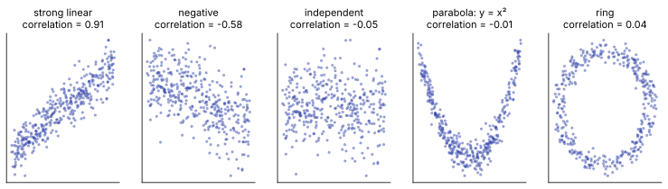

# Day 40: Joint Distributions, Independence and the Central Limit Theorem

**Phase 1 · Week 6 · ~120 minutes**

## Objectives

- [ ] Read and build a **joint distribution** of two variables as a 2-D table, and get its **marginals** and **conditional distributions** from it.
- [ ] Test **independence** by comparing the joint table with the outer product of its marginals.
- [ ] Compute **covariance** and **correlation** from a joint table and from data, and explain why zero correlation does **not** mean independence.
- [ ] Watch the **central limit theorem** happen: sums of uniform, exponential and dice values turning into a bell curve, and use it to approximate a probability.
- [ ] Explain why the CLT is the reason confidence intervals (Week 7) and mini-batch gradients behave the way they do.
- [ ] Sample a **2-D normal distribution**, draw its covariance ellipses from the eigenvectors of \( \Sigma \), and say what fraction of points each ellipse holds.

**Prerequisites.** [Day 23](day-23-rank-span.md) (outer products, rank), [Day 24](day-24-eigenvectors.md) and [Day 25](day-25-projections-pca.md) (covariance matrices, `eigh`, PCA), [Day 36](day-36-probability-basics.md) (probability, simulation), [Day 37](day-37-distributions.md) (normal distribution, density, \( \Phi \)), [Day 38](day-38-bayes-rule.md) (conditional probability) and [Day 39](day-39-expectation-variance.md) (\( \mathbb{E} \), variance, \( \sigma/\sqrt{n} \)).

---

## The big idea

Open Firebase Crashlytics for your app. The headline says "6% of sessions crashed". One number about one variable. Then you click **"by device"** and the story changes: low-end phones crash 15% of the time, high-end phones 2.5%. You've gone from looking at one variable to looking at **two variables together**, and the interesting fact (crashes depend on the device) only exists in the combined view.

That combined view is a **joint distribution**. It is the full table: how likely is each *combination* of values. Everything else you'll do today is read off that table:

| Question | Today's tool |
|---|---|
| How likely is each combination of device tier and crash? | The **joint** distribution \( P(X = x, Y = y) \) |
| How often do sessions crash, whatever the device? | A **marginal** distribution: add up a row or column |
| How often do *low-end* sessions crash? | A **conditional** distribution: zoom into one row |
| Does the device tell you anything about crashing? | **Independence**: is the table just "row probability × column probability"? |
| Do the two rise and fall together? | **Covariance** and **correlation** |

The second half of the lesson answers a question you met on Day 37 without an answer: **why is the bell curve everywhere?** The **central limit theorem** (CLT) says that when you add up many independent random pieces, the total is approximately normal, *whatever shape the pieces had*. Cold-start time, measurement noise, an average rating, a mini-batch gradient: all sums of many small pieces, all close to bell-shaped.

**Analogy.** Shake a jar of mixed nuts. One nut can be anything: a peanut, a cashew, a walnut. But the *weight of a handful of 30* barely depends on which nuts you got: the big ones and the small ones cancel out, and handful weights cluster tightly around a typical value in a symmetric bell. The CLT is that "handful" effect, made exact.

## Joint distributions: two variables in one table

Say we log 1,000 sessions of an app and record two things about each one:

- \( X \): the **device tier**: low-end, mid-range or high-end.
- \( Y \): whether the session **crashed**: 0 (no) or 1 (yes).

Counting every combination gives a 3 × 2 table of counts. Divide by the total and you have the **joint distribution**: for every pair of values, the probability of seeing that pair.

\[
P(X = x,\ Y = y)
\]

Read the comma as "and": \( P(X = \text{low},\ Y = 1) \) is "the probability that a session is on a low-end phone **and** crashes". Every entry is between 0 and 1 and, because every session lands in exactly one cell, all entries add up to 1.

```python
import numpy as np
import pandas as pd
import math

counts = np.array([[170, 30],    # low-end phones:  no crash, crash
                   [380, 20],    # mid-range phones
                   [390, 10]])   # high-end phones
joint = counts / counts.sum()    # divide by all 1,000 sessions
joint
# array([[0.17, 0.03],
#        [0.38, 0.02],
#        [0.39, 0.01]])
joint.sum()                      # 1.0
```

The numbers are made up but realistic. Now watch everything else fall out of this one table:

<figure class="diagram" markdown>
![Animation: a 3 by 2 table of joint probabilities with rows low-end, mid-range, high-end and columns no crash, crash: 0.17 0.03, 0.38 0.02, 0.39 0.01. A teal column P(tier) appears on the right with 0.20, 0.40, 0.40 (add across); an orange row P(crash) appears at the bottom with 0.94 and 0.06 (add down); the low-end row is highlighted yellow and the side panel shows P(crash | low) = 0.03 / 0.20 = 0.15; finally it tests independence: P(low) times P(crash) = 0.20 times 0.06 = 0.012, but the table says 0.03, so not independent](../../assets/img/phase-1/day40-joint-table.svg)
<figcaption>Animated: add across for one marginal, add down for the other, divide a row by its total for a conditional, and multiply marginals to test independence.</figcaption>
</figure>

### Marginals: add up the margins

If you only care about \( X \), add each row across. A low-end session either crashed or didn't, so

\[
P(X = x) = \sum_{y} P(X = x,\ Y = y)
\]

The \( \sum_y \) ("sum over \( y \)") means: add this up for every possible value of \( y \). For low-end: \( 0.17 + 0.03 = 0.20 \). This is called a **marginal** distribution because, on paper, you write these totals in the margin of the table. Adding *down* each column gives the other marginal, \( P(Y = y) \).

```python
p_tier = joint.sum(axis=1)       # add across each row: P(tier)
p_crash = joint.sum(axis=0)      # add down each column: P(crash)
p_tier                           # array([0.2, 0.4, 0.4])
p_crash                          # array([0.94, 0.06])
```

The marginal \( P(Y = 1) = 0.06 \) is the Crashlytics headline. The marginals are what you see when you look at one variable alone; the joint table always contains them, but you can't go back: many different joint tables have the same marginals.

### Conditional distributions: zoom into one row

"How often do **low-end** sessions crash?" is a question about one row only. Take the row \( [0.17, 0.03] \) and rescale it so it adds up to 1, by dividing by its total \( 0.20 \):

\[
P(Y = y \mid X = x) = \frac{P(X = x,\ Y = y)}{P(X = x)}
\]

The bar \( \mid \) reads "given". This is exactly Day 38's definition of conditional probability, applied to a whole row at once. **Worked example:** \( P(\text{crash} \mid \text{low}) = 0.03 / 0.20 = 0.15 \) and \( P(\text{no crash} \mid \text{low}) = 0.17 / 0.20 = 0.85 \).

```python
cond = joint / p_tier[:, None]   # divide each row by its own total (broadcasting, Day 9)
cond
# array([[0.85 , 0.15 ],
#        [0.95 , 0.05 ],
#        [0.975, 0.025]])
cond.sum(axis=1)                 # array([1., 1., 1.])   every row is now a distribution
```

Each row of `cond` is a complete probability distribution for \( Y \): the crash distribution *for that kind of phone*. Low-end crashes at 15%, mid-range at 5%, high-end at 2.5%.

### Simulating from a joint table

A joint table is also a recipe for generating data. Number the six cells 0 to 5, pick cells at random with their probabilities, and turn each cell number back into a (row, column) pair. `pd.crosstab` (Day 18) then rebuilds the table from the simulated sessions:

```python
rng = np.random.default_rng(40)
cells = rng.choice(6, size=100_000, p=joint.ravel())   # pick a cell, weighted by its probability
tier_idx, crash_idx = np.divmod(cells, 2)              # cell number -> (row, column)
sessions = pd.DataFrame({
    "tier": pd.Categorical(np.array(["low", "mid", "high"])[tier_idx],
                           categories=["low", "mid", "high"]),   # keep this row order
    "crashed": crash_idx,
})
print(pd.crosstab(sessions["tier"], sessions["crashed"], normalize="all").round(4).to_string())
print(pd.crosstab(sessions["tier"], sessions["crashed"], normalize="index").round(4).to_string())
```

```text
crashed       0       1
tier
low      0.1702  0.0305
mid      0.3769  0.0199
high     0.3929  0.0096
crashed       0       1
tier
low      0.8480  0.1520
mid      0.9498  0.0502
high     0.9762  0.0238
```

`normalize="all"` divides by the grand total: the estimated **joint** table. `normalize="index"` divides each row by its row total: the estimated **conditional** table. With 100,000 sessions both are within a few thousandths of the truth (the law of large numbers, Day 39).

### Independence: the table is an outer product

On Day 36, two events were **independent** when \( P(A \text{ and } B) = P(A)\,P(B) \). Two random variables are independent when that holds for **every cell**:

\[
P(X = x,\ Y = y) = P(X = x)\; P(Y = y) \qquad \text{for all } x, y
\]

Equivalently, every conditional row equals the marginal: knowing \( X \) tells you nothing about \( Y \). In matrix language, the whole table must be the **outer product** of the two marginals (Day 23): column vector of row totals times row vector of column totals.

```python
np.outer(p_tier, p_crash)        # what the table WOULD be if tier and crash were independent
# array([[0.188, 0.012],
#        [0.376, 0.024],
#        [0.376, 0.024]])
np.allclose(joint, np.outer(p_tier, p_crash))   # False
```

Under independence the low-end/crash cell would be \( 0.20 \times 0.06 = 0.012 \); the real table says \( 0.03 \), two and a half times more. Tier and crash are **dependent**.

Two fair dice are the textbook independent pair. Their joint table is \( 6 \times 6 \) with every cell \( 1/36 \), which is exactly the outer product of two \( [1/6, \dots, 1/6] \) vectors. And Day 23 gives a neat test: an outer product has **rank 1**, so an independent joint table always has rank 1.

```python
die = np.full(6, 1 / 6)
dice_joint = np.outer(die, die)            # 6x6, every cell 1/36
dice_joint[0, :3]                          # array([0.02777778, 0.02777778, 0.02777778])
np.linalg.matrix_rank(dice_joint)          # 1   independent
np.linalg.matrix_rank(joint)               # 2   tier and crash are not
```

!!! warning "Common mistake: checking one cell"
    Independence needs \( P(x, y) = P(x)\,P(y) \) in **every** cell. A single matching cell proves nothing. Exercise 1 has a table with nothing special about any single cell; only the full comparison (or the conditional rows) tells you the answer. With real data the cells never match *exactly* even when the variables are independent, because of sampling noise; deciding whether a gap is "real" is the hypothesis tests of Day 45.

### Real data: ads and ratings

Same idea on the course dataset. Is having ads related to an app's rating band? Load the data (the short cleaning from Days 17–19: drop the duplicate rows, keep the rated apps) and cut the rating into three bands:

```python
BASE = "https://manjulkadyan.github.io/ai-leaning/assets/data/"
apps = pd.read_csv(BASE + "play_store_apps.csv")
apps = apps.drop_duplicates().assign(
    installs=lambda d: d["installs"].str.replace(",", "").str.rstrip("+").astype(int),
)
rated = apps.dropna(subset=["rating"]).assign(
    band=lambda d: pd.cut(d["rating"], bins=[0, 3.95, 4.45, 5.0],
                          labels=["below 4.0", "4.0 to 4.4", "4.5 and up"]),
)
len(rated)                       # 462
J = pd.crosstab(rated["has_ads"], rated["band"], normalize="all")
print(J.round(3).to_string())
```

```text
band     below 4.0  4.0 to 4.4  4.5 and up
has_ads
No           0.126       0.136       0.108
Yes          0.197       0.253       0.180
```

No internet? Download the file from the [Datasets page](../../datasets.md) and pass the local path to `read_csv`. (Tested on pandas 3.0.) Ratings have one decimal, so the bin edges 3.95 and 4.45 split them cleanly.

```python
p_ads = J.sum(axis=1)
p_band = J.sum(axis=0)
print(p_ads.round(3).to_string())
print(p_band.round(3).to_string())
print(pd.DataFrame(np.outer(p_ads, p_band), index=J.index, columns=J.columns).round(3).to_string())
print(pd.crosstab(rated["has_ads"], rated["band"], normalize="index").round(3).to_string())
```

```text
has_ads
No     0.37
Yes    0.63
band
below 4.0     0.323
4.0 to 4.4    0.390
4.5 and up    0.288
band     below 4.0  4.0 to 4.4  4.5 and up
has_ads
No           0.119       0.144       0.107
Yes          0.203       0.245       0.181
band     below 4.0  4.0 to 4.4  4.5 and up
has_ads
No           0.339       0.368       0.292
Yes          0.313       0.402       0.285
```

The real table (first one) and the "if independent" outer product (third) differ by at most 0.008 in any cell, and the conditional rows (last) are similar: 29.2% of ad-free apps and 28.5% of apps with ads are in the top band. In this dataset, ads and rating band look **close to independent**. Whether gaps that small could be pure chance with 462 apps is exactly what Week 7 teaches you to answer.

## Continuous variables: joint density and the 2-D histogram

For continuous variables, like log-reviews and log-installs, there are no cells to list. Day 37 replaced "probability of a value" by **density**, where probability is the *area* under a curve. In two dimensions, the **joint density** \( p(x, y) \) is a surface over the plane, and the probability of landing in a region is the **volume** under the surface above that region.

You estimate it the same way as in 1-D: a histogram, now with 2-D bins. `np.histogram2d` counts the points in each rectangle. And the marginals still come from adding along rows or columns:

```python
x_rev = np.log10(rated["reviews"]).to_numpy()
y_inst = np.log10(rated["installs"]).to_numpy()
H, xedges, yedges = np.histogram2d(x_rev, y_inst, bins=[np.arange(0, 7.5, 0.5), np.arange(2.75, 8.5, 0.5)])
H.shape                              # (14, 11)   14 review bins x 11 install bins
H.sum()                              # 462.0      every app is in exactly one bin
H.sum(axis=1)                        # add over installs: the reviews marginal
# array([ 2.,  5., 11., 25., 57., 92., 91., 84., 60., 24.,  8.,  2.,  1.,  0.])
np.histogram(x_rev, bins=xedges)[0]  # the plain 1-D histogram of reviews: identical
# array([ 2,  5, 11, 25, 57, 92, 91, 84, 60, 24,  8,  2,  1,  0])
```

Here is the joint histogram with both marginals drawn in its margins:

```python
import matplotlib
matplotlib.use("Agg")            # draw into files, no window (leave this out in Jupyter)
import matplotlib.pyplot as plt

plt.rcParams.update({
    "font.size": 11,
    "figure.facecolor": "white",
    "savefig.facecolor": "white",
    "axes.spines.top": False,
    "axes.spines.right": False,
})

fig = plt.figure(figsize=(7.2, 6.2))
grid = fig.add_gridspec(2, 2, width_ratios=[4, 1.2], height_ratios=[1.2, 4], wspace=0.05, hspace=0.05)
ax = fig.add_subplot(grid[1, 0])
ax_top = fig.add_subplot(grid[0, 0], sharex=ax)
ax_side = fig.add_subplot(grid[1, 1], sharey=ax)
mesh = ax.pcolormesh(xedges, yedges, H.T, cmap="Blues", vmin=0)
for i in range(H.shape[0]):
    for j in range(H.shape[1]):
        if H[i, j] > 0:
            ax.text((xedges[i] + xedges[i + 1]) / 2, (yedges[j] + yedges[j + 1]) / 2, int(H[i, j]),
                    ha="center", va="center", fontsize=8, color="white" if H[i, j] > 25 else "#333")
ax.set_xlabel("log10(reviews)")
ax.set_ylabel("log10(installs)")
ax_top.bar(xedges[:-1], H.sum(axis=1), width=0.5, align="edge", color="#00897b", edgecolor="white")
ax_side.barh(yedges[:-1], H.sum(axis=0), height=0.5, align="edge", color="#ef6c00", edgecolor="white")
ax_top.set_ylabel("apps")
ax_side.set_xlabel("apps")
ax_top.tick_params(labelbottom=False)
ax_side.tick_params(labelleft=False)
ax_top.set_title("Joint counts of 462 apps, with both marginals")
fig.savefig("day40-joint-histogram.svg", format="svg", bbox_inches="tight")
plt.close(fig)
```

(`H.T` because `pcolormesh` wants rows to be the vertical axis, while `histogram2d` puts the first variable in rows.)

<figure class="diagram" markdown>

<figcaption>The joint histogram is a diagonal band: knowing an app's reviews narrows down its installs a lot. The marginals in the margins lose that information.</figcaption>
</figure>

Look at what each part tells you. The top marginal says "most apps have between 100 and 10,000 reviews". The side marginal says "installs range from 1,000 to 100 million". Neither says the two are linked; only the joint picture shows the tight diagonal band. A **conditional** distribution is a slice: pick one column (say reviews between \( 10^3 \) and \( 10^{3.5} \)), read the counts up that column and divide by their total.

## Covariance and correlation, revisited

On Days 24 and 25 you built covariance matrices from data. Now we can say what covariance *is* for random variables. For \( X \) with mean \( \mu_X \) and \( Y \) with mean \( \mu_Y \):

\[
\mathrm{Cov}(X, Y) = \mathbb{E}\big[(X - \mu_X)(Y - \mu_Y)\big]
\]

Symbol by symbol: \( X - \mu_X \) is "how far above or below its average \( X \) is". Multiply by the same thing for \( Y \): the product is **positive** when both are above average or both below, **negative** when one is above and the other below. \( \mathbb{E} \) averages that product over the joint distribution (Day 39: weight each value by its probability). Expanding the product with linearity of expectation gives a shortcut that is easier to compute:

\[
\mathrm{Cov}(X, Y) = \mathbb{E}[XY] - \mathbb{E}[X]\,\mathbb{E}[Y]
\]

(Expand: \( \mathbb{E}[XY - \mu_Y X - \mu_X Y + \mu_X\mu_Y] = \mathbb{E}[XY] - \mu_Y\mu_X - \mu_X\mu_Y + \mu_X\mu_Y \).) Note \( \mathrm{Cov}(X, X) = \mathbb{E}[X^2] - \mu_X^2 = \mathrm{Var}(X) \): variance is a variable's covariance with itself, which is why variances sit on the diagonal of a covariance matrix.

**Worked example on the crash table.** Code the tiers as numbers, low = 0, mid = 1, high = 2, and crash as 0/1.

- \( \mathbb{E}[X] = 0(0.2) + 1(0.4) + 2(0.4) = 1.2 \)
- \( \mathbb{E}[Y] = 0(0.94) + 1(0.06) = 0.06 \)
- \( \mathbb{E}[XY] \): only cells with \( x \ne 0 \) and \( y = 1 \) contribute: \( 1 \cdot 1 \cdot 0.02 + 2 \cdot 1 \cdot 0.01 = 0.04 \)
- \( \mathrm{Cov} = 0.04 - 1.2 \times 0.06 = -0.032 \). Negative: higher tier, fewer crashes.

```python
tier = np.array([0, 1, 2])       # code the tiers as numbers: low 0, mid 1, high 2
crash = np.array([0, 1])
E_tier = tier @ p_tier                      # E[X] = sum of value * probability
E_crash = crash @ p_crash                   # E[Y]
E_prod = (np.outer(tier, crash) * joint).sum()   # E[XY]: every cell's x*y, weighted
E_tier, E_crash, E_prod                     # (1.2000000000000002, 0.060000000000000005, 0.04)
E_prod - E_tier * E_crash                   # -0.03200000000000002
```

### From data: the sample covariance

With data instead of a known table, replace \( \mathbb{E} \) by an average over the \( n \) data points, dividing by \( n - 1 \) as `np.cov` does (Week 7 explains the \( n - 1 \)):

\[
\mathrm{cov}(x, y) = \frac{1}{n-1}\sum_{i=1}^{n} (x_i - \bar{x})(y_i - \bar{y})
\]

**Worked example.** Points \( (1, 2), (2, 3), (3, 5), (4, 6) \). Means \( \bar{x} = 2.5 \), \( \bar{y} = 4 \). Deviations \( x_i - \bar{x} = -1.5, -0.5, 0.5, 1.5 \) and \( y_i - \bar{y} = -2, -1, 1, 2 \). Products \( 3, 0.5, 0.5, 3 \), sum 7, so \( \mathrm{cov} = 7/3 \approx 2.333 \).

Covariance has a units problem: measure \( y \) in cents instead of dollars and it grows 100×. The **correlation** (Pearson's \( r \), or \( \rho \), "rho", for the true value) divides out both standard deviations:

\[
\rho = \frac{\mathrm{Cov}(X, Y)}{\sigma_X\, \sigma_Y}
\]

It is unitless and always between \( -1 \) and \( +1 \): \( +1 \) means the points lie exactly on a rising line, \( -1 \) on a falling line. Here \( s_x = \sqrt{5/3} \approx 1.291 \), \( s_y = \sqrt{10/3} \approx 1.826 \), so \( r = 2.333 / (1.291 \times 1.826) \approx 0.990 \).

```python
pts = np.array([[1., 2.], [2., 3.], [3., 5.], [4., 6.]])
xs, ys = pts[:, 0], pts[:, 1]
dx, dy = xs - xs.mean(), ys - ys.mean()
cov_xy = (dx * dy).sum() / (len(pts) - 1)
cov_xy                           # 2.3333333333333335
r = cov_xy / (xs.std(ddof=1) * ys.std(ddof=1))
r                                # 0.9899494936611666
np.cov(xs, ys)                   # the 2x2 covariance matrix of Days 24-25
# array([[1.66666667, 2.33333333],
#        [2.33333333, 3.33333333]])
np.corrcoef(xs, ys)              # the correlation matrix: 1 on the diagonal
# array([[1.        , 0.98994949],
#        [0.98994949, 1.        ]])
```

Correlation is the covariance of the **standardized** variables (Day 22's z-scores), which is why it ignores units and shifts:

```python
zx = (xs - xs.mean()) / xs.std(ddof=1)     # standardize both (Day 22)
zy = (ys - ys.mean()) / ys.std(ddof=1)
np.cov(zx, zy)[0, 1]                       # 0.9899494936611665   same as r
np.corrcoef(xs, 100 * ys + 7)[0, 1]        # 0.9899494936611666   change units: r doesn't move
```

That's what Day 25's `feats.corr()` table was: the covariance matrix of the standardized columns. And Day 39's rule \( \mathrm{Var}(X + Y) = \mathrm{Var}(X) + \mathrm{Var}(Y) + 2\,\mathrm{Cov}(X, Y) \) now reads naturally: positively correlated pieces make a sum swing more; negatively correlated pieces cancel.

### Independent means zero covariance

If \( X \) and \( Y \) are independent, every cell is \( p(x)\,p(y) \), so the double sum splits into two single sums:

\[
\mathbb{E}[XY] = \sum_x \sum_y x\,y\,p(x)\,p(y) = \Big(\sum_x x\,p(x)\Big)\Big(\sum_y y\,p(y)\Big) = \mathbb{E}[X]\,\mathbb{E}[Y]
\]

and the covariance \( \mathbb{E}[XY] - \mathbb{E}[X]\mathbb{E}[Y] \) is 0. **Independent ⇒ uncorrelated.** The reverse is false, and it is one of the most useful things to really understand today.

### Zero correlation does not mean independent

Let \( X \) be \( -1, 0 \) or \( 1 \), each with probability \( 1/3 \), and let \( Y = X^2 \). \( Y \) is *completely determined* by \( X \): as dependent as two variables can be. Yet:

- \( \mathbb{E}[X] = (-1 + 0 + 1)/3 = 0 \)
- \( \mathbb{E}[XY] = \mathbb{E}[X^3] = (-1 + 0 + 1)/3 = 0 \)
- \( \mathrm{Cov}(X, Y) = 0 - 0 \cdot \mathbb{E}[Y] = 0 \)

```python
xv = np.array([-1, 0, 1])           # X: -1, 0 or 1, each with probability 1/3
pX = np.full(3, 1 / 3)
yv = xv ** 2                        # Y = X squared: completely determined by X
E_X = xv @ pX
E_Y = yv @ pX
E_XY = (xv * yv) @ pX
E_X, E_Y, E_XY, E_XY - E_X * E_Y    # (0.0, 0.6666666666666666, 0.0, 0.0)   covariance 0
```

The joint table shows the dependence immediately. If \( X = 0 \) then \( Y = 0 \) for sure, yet \( P(Y = 0) = 1/3 \) overall:

```python
joint_xy = np.array([[0, 1/3],      # rows: X = -1, 0, 1   columns: Y = 0, 1
                     [1/3, 0],
                     [0, 1/3]])
pX_marg = joint_xy.sum(axis=1)
pY_marg = joint_xy.sum(axis=0)
pY_marg                             # array([0.33333333, 0.66666667])
np.outer(pX_marg, pY_marg).round(3) # what independence would require: nothing like joint_xy
# array([[0.111, 0.222],
#        [0.111, 0.222],
#        [0.111, 0.222]])
```

What went wrong? Covariance only measures **linear** (straight-line) association. For negative \( X \), \( Y \) goes *down* as \( X \) grows; for positive \( X \), *up*. The two halves cancel exactly. A gallery makes the point:

```python
rng = np.random.default_rng(40)
n = 400
t = rng.uniform(-2, 2, size=n)
noise = rng.normal(size=n)
angle = rng.uniform(0, 2 * np.pi, size=n)
panels = [
    ("strong linear", t, 0.9 * t + 0.45 * noise),
    ("negative", t, -0.5 * t + 0.85 * noise),
    ("independent", t, noise),
    ("parabola: y = x²", t, t ** 2 + 0.3 * noise),
    ("ring", np.cos(angle) + 0.08 * t, np.sin(angle) + 0.08 * noise),
]
fig, axes = plt.subplots(1, 5, figsize=(13, 3))
for ax, (name, px, py) in zip(axes, panels):
    rho = np.corrcoef(px, py)[0, 1]
    ax.scatter(px, py, s=5, alpha=0.4, color="#3949ab")
    ax.set_title(f"{name}\ncorrelation = {round(rho, 2) + 0.0:.2f}", fontsize=11)   # + 0.0 turns -0.0 into 0.0
    ax.set_xticks([])
    ax.set_yticks([])
    print(f"{name:18s} {rho:6.3f}")
fig.savefig("day40-correlation-gallery.svg", format="svg", bbox_inches="tight")
plt.close(fig)
# strong linear       0.910
# negative           -0.577
# independent        -0.049
# parabola: y = x²   -0.010
# ring                0.045
```

<figure class="diagram" markdown>

<figcaption>The last three all have correlation near 0, but only the middle one is independent: the parabola and the ring are strongly dependent, just not along a straight line.</figcaption>
</figure>

(The "independent" panel's \( -0.05 \) is sampling noise: 400 points never give exactly 0.)

!!! warning "Common mistake: \"the correlation is 0, so the features are unrelated\""
    A correlation near 0 rules out a *straight-line* relationship, nothing more. Feature selection by "drop everything with low correlation to the target" throws away U-shapes, thresholds and periodic effects that a tree or a neural network would happily use. Always plot before you conclude, and remember that dependence can hide in a shape correlation can't see.

## The central limit theorem

Now the second big idea. Start with something you can compute exactly.

### Two dice, exactly

The sum of two dice can be 2 to 12. From the \( 6 \times 6 \) joint table (independent, every cell \( 1/36 \)), the probability of each sum is the total of the cells along an anti-diagonal: one way to make 2, two ways to make 3, ..., six ways to make 7, then back down. A triangle:

```python
faces = np.arange(1, 7)
sums = np.add.outer(faces, faces)            # 6x6 table of a + b
sums[:2]
# array([[2, 3, 4, 5, 6, 7],
#        [3, 4, 5, 6, 7, 8]])
p_sum2 = np.bincount(sums.ravel(), weights=np.outer(die, die).ravel())[2:]   # P(sum = 2..12)
(p_sum2 * 36).round(6)                       # number of ways to make each sum, out of 36
# array([1., 2., 3., 4., 5., 6., 5., 4., 3., 2., 1.])
np.allclose(p_sum2, np.convolve(die, die))   # True
```

`np.bincount(..., weights=...)` adds up the probabilities of all cells with the same sum. That operation, "slide one pmf across the other, multiply and add", has a name, **convolution**, and `np.convolve` does it in one call. It gives the exact distribution of the sum of two independent discrete variables. Convolve again with `die` for three dice, and so on:

```python
def dice_sum_pmf(n):
    """Exact P(sum of n fair dice = k) for k = n .. 6n, by repeated convolution."""
    p = np.array([1.0])
    for _ in range(n):
        p = np.convolve(p, die)
    return p                       # p[0] is P(sum = n)

p10 = dice_sum_pmf(10)
len(p10), p10.sum()                # (51, 0.9999999999999997)   sums 10..60, total probability 1
exact = p10[45 - 10:].sum()        # P(sum >= 45)
exact                              # 0.03899452811436263
```

One die is flat. Two dice make a triangle. Then something remarkable happens:

<figure class="diagram" markdown>

<figcaption>Animated: the exact distribution of the sum of n dice, standardized. Flat, triangle, then bell: by n = 30 you can't tell it from the normal curve.</figcaption>
</figure>

### The theorem

To compare sums of different sizes, the animation **standardizes** them, exactly like Day 37's z-scores. Take \( n \) independent draws \( X_1, \dots, X_n \) of the same random variable, with mean \( \mu \) and standard deviation \( \sigma \). Their sum \( S_n = X_1 + \dots + X_n \) has mean \( n\mu \) and variance \( n\sigma^2 \) (Day 39), so subtract the one and divide by the square root of the other:

\[
Z_n = \frac{S_n - n\mu}{\sigma\sqrt{n}}
\]

\( Z_n \) always has mean 0 and standard deviation 1, by construction. The **central limit theorem** says something much stronger: as \( n \) grows, the *shape* of \( Z_n \)'s distribution approaches the **standard normal** \( \mathcal{N}(0, 1) \), whatever the shape of the original \( X \), as long as \( \sigma \) is finite. In practical terms, for large \( n \):

\[
S_n \approx \mathcal{N}(n\mu,\ n\sigma^2)
\qquad\qquad
\bar{X} = \frac{S_n}{n} \approx \mathcal{N}\!\left(\mu,\ \frac{\sigma^2}{n}\right)
\]

(\( \mathcal{N}(m, v) \) is shorthand for "a normal distribution with mean \( m \) and variance \( v \)".) Day 39 already gave you the mean and the spread of an average. The CLT adds the **shape**: it's a bell, so the 68–95–99.7 rule and Day 37's normal CDF apply to it.

**Worked example.** Roll 10 dice. What is the chance the total is 45 or more? One die has \( \mu = 3.5 \) and \( \sigma^2 = 35/12 \approx 2.917 \) (Day 39). The sum has mean \( 35 \) and standard deviation \( \sqrt{10 \times 35/12} \approx 5.401 \). Totals are whole numbers, so "45 or more" starts halfway between 44 and 45 (this **continuity correction** treats each whole number as a bar of width 1). Then \( z = (44.5 - 35)/5.401 \approx 1.759 \) and

\[
P(S_{10} \ge 45) \approx 1 - \Phi(1.759) \approx 0.0393
\]

where \( \Phi \) is the standard normal CDF from Day 37. The exact answer from the convolution above is 0.0390.

```python
def normal_cdf(z):
    """P(Z <= z) for a standard normal (Day 37's formula, for a single number)."""
    return 0.5 * (1 + math.erf(z / math.sqrt(2)))

mu, var = 3.5, 35 / 12             # one die: mean and variance (Day 39)
n_dice = 10
sd_sum = math.sqrt(n_dice * var)
sd_sum                             # 5.400617248673217
z = (44.5 - n_dice * mu) / sd_sum  # 44.5: halfway between 44 and 45 (continuity correction)
z                                  # 1.7590581895678479
1 - normal_cdf(z)                  # 0.03928381274727277   CLT approximation
rng = np.random.default_rng(40)
rolls = rng.integers(1, 7, size=(200_000, n_dice))
(rolls.sum(axis=1) >= 45).mean()   # 0.038345              simulation; exact is 0.03899
```

The normal approximation, from just two numbers (\( \mu \) and \( \sigma \)), lands within 0.0003 of a calculation that needed the whole 51-entry distribution.

### Any starting shape: a simulation

Dice are symmetric, which helps. The real surprise is lopsided starting shapes. The **exponential** distribution (time until the next random event, like the gap between crash reports) is heavily skewed: most values are small, a few are large. Simulate standardized sums of three very different sources and measure how normal they look:

- **within 1** and **within 2**: the fraction of \( Z \) with \( |Z| < 1 \) and \( |Z| < 2 \). The normal gives 0.683 and 0.954.
- **skew**: the average of \( Z^3 \). Cubing keeps the sign, so a long right tail makes it positive. The normal is symmetric: 0.

```python
def standardized_sums(draw, n, mu, sd, reps=100_000):
    """Simulate reps sums of n draws, then standardize: (S - n*mu) / (sd * sqrt(n))."""
    S = draw((reps, n)).sum(axis=1)
    return (S - n * mu) / (sd * np.sqrt(n))

rng = np.random.default_rng(40)
sources = {
    "uniform(0, 1)": (lambda size: rng.uniform(0, 1, size), 0.5, np.sqrt(1 / 12)),
    "exponential(1)": (lambda size: rng.exponential(1.0, size), 1.0, 1.0),
    "fair die": (lambda size: rng.integers(1, 7, size), 3.5, np.sqrt(35 / 12)),
}
print("source            n   mean    var   within 1  within 2   skew")
for name, (draw, mu_s, sd_s) in sources.items():
    for n_terms in [1, 2, 5, 30]:
        zs = standardized_sums(draw, n_terms, mu_s, sd_s)
        print(f"{name:15s} {n_terms:3d} {zs.mean():6.3f} {zs.var():6.3f} "
              f"{(np.abs(zs) < 1).mean():9.3f} {(np.abs(zs) < 2).mean():9.3f} {(zs ** 3).mean():6.3f}")
print(f"normal              {0:6.3f} {1:6.3f} {normal_cdf(1) - normal_cdf(-1):9.3f} "
      f"{normal_cdf(2) - normal_cdf(-2):9.3f} {0:6.3f}")
```

```text
source            n   mean    var   within 1  within 2   skew
uniform(0, 1)     1  0.003  1.003     0.575     1.000  0.010
uniform(0, 1)     2  0.001  0.997     0.652     0.966  0.003
uniform(0, 1)     5 -0.002  1.003     0.670     0.958 -0.005
uniform(0, 1)    30 -0.003  0.996     0.682     0.955  0.004
exponential(1)    1 -0.000  0.998     0.865     0.950  2.005
exponential(1)    2 -0.002  1.000     0.736     0.954  1.433
exponential(1)    5  0.001  0.999     0.699     0.959  0.888
exponential(1)   30  0.001  1.001     0.685     0.956  0.369
fair die          1  0.001  1.001     0.666     1.000  0.002
fair die          2  0.004  0.995     0.668     0.945  0.010
fair die          5  0.002  0.998     0.696     0.968  0.006
fair die         30  0.001  1.001     0.688     0.953  0.002
normal               0.000  1.000     0.683     0.954  0.000
```

How to read it:

- **Mean 0 and variance 1 in every row.** That's just the standardizing; it is true even for \( n = 1 \).
- **The shape is what changes.** The uniform reaches the normal's 0.683 / 0.954 by about \( n = 5 \) to 30. The exponential starts far off (86.5% within one standard deviation, skew 2) and gets there more slowly. Its skew shrinks like \( 2/\sqrt{n} \): 2.0, 1.41, 0.89, 0.37. The more lopsided the source, the bigger the \( n \) you need.
- **The die's "within" numbers jump around** because the sums are whole numbers, so a few possible values sit right on the boundaries \( \pm 1 \) and \( \pm 2 \).

The same experiment as pictures:

```python
grid_z = np.linspace(-4, 4, 400)
bell = np.exp(-grid_z ** 2 / 2) / np.sqrt(2 * np.pi)       # the standard normal density
fig, axes = plt.subplots(3, 4, figsize=(12, 7.2), sharex=True, sharey=True)
colors = ["#3949ab", "#00897b", "#ef6c00"]
for row, (name, (draw, mu_s, sd_s)) in enumerate(sources.items()):
    for col, n_terms in enumerate([1, 2, 5, 30]):
        ax = axes[row, col]
        zs = standardized_sums(draw, n_terms, mu_s, sd_s)
        if name == "fair die":                 # discrete: one bar per possible sum
            k = np.arange(n_terms, 6 * n_terms + 2) - 0.5
            edges = (k - n_terms * mu_s) / (sd_s * np.sqrt(n_terms))
        else:
            edges = np.linspace(-4, 4, 61)
        ax.hist(zs, bins=edges, density=True, color=colors[row], alpha=0.75)
        ax.plot(grid_z, bell, color="#e53935", lw=1.6)
        ax.set_xlim(-4, 4)
        ax.set_ylim(0, 1.05)
        if row == 0:
            ax.set_title(f"sum of n = {n_terms}")
        if col == 0:
            ax.set_ylabel(name)
fig.supxlabel("standardized sum  (S - n·μ) / (σ·√n)")
fig.savefig("day40-clt-grid.svg", format="svg", bbox_inches="tight")
plt.close(fig)
```

<figure class="diagram" markdown>

<figcaption>Three different starting shapes, one destination. The skewed exponential takes longest to forget where it came from.</figcaption>
</figure>

!!! warning "Common mistake: assuming the CLT always kicks in"
    The CLT has conditions, and real data breaks them:

    - **Finite variance.** Some distributions have tails so heavy that the variance is infinite. The classic one is the **Cauchy** distribution: the average of a million Cauchy draws is just as spread out as a single draw (see the code below). Revenue per user, where a few "whales" spend thousands, isn't that extreme, but it is heavy-tailed enough to need far more than 30 samples.
    - **Independence.** Sessions from the same user, or readings from the same sensor seconds apart, are correlated, and the effective \( n \) is much smaller than the count.
    - **The tails converge last.** Even when the middle of the bell matches, the probability of extreme values (4 or 5 \( \sigma \) out) can be badly off for moderate \( n \). Exercise 5 shows it.

```python
rng = np.random.default_rng(40)
for n_terms in [10, 1_000, 100_000]:
    means_u = rng.uniform(0, 1, size=(200, n_terms)).mean(axis=1)
    means_c = rng.standard_cauchy(size=(200, n_terms)).mean(axis=1)
    q_u = np.percentile(means_u, [25, 75])
    q_c = np.percentile(means_c, [25, 75])
    print(f"n = {n_terms:6d}   uniform means IQR {q_u[1] - q_u[0]:.4f}   Cauchy means IQR {q_c[1] - q_c[0]:.3f}")
# n =     10   uniform means IQR 0.1316   Cauchy means IQR 1.951
# n =   1000   uniform means IQR 0.0115   Cauchy means IQR 1.850
# n = 100000   uniform means IQR 0.0012   Cauchy means IQR 2.196
```

The IQR (interquartile range, the width of the middle 50%) of 200 averages: for the uniform it shrinks 10× every time \( n \) grows 100×, the \( \sigma/\sqrt{n} \) law. For the Cauchy it doesn't shrink at all. Averaging only helps when the variance is finite.

### Why the CLT underpins confidence intervals

Here is the CLT doing real work, and a preview of Week 7. Treat the 462 rated apps as a whole **population** and pretend you can only afford to look at 30 of them. How far can the average of 30 ratings be from the true average?

Ratings aren't normal at all: they're squashed against the 5-star ceiling. But the CLT says the **average of 30** is close to normal, centred on the true mean, with standard deviation \( \sigma/\sqrt{30} \):

```python
ratings = rated["rating"].to_numpy()      # treat these 462 apps as the whole population
mu_pop = ratings.mean()
sd_pop = ratings.std()                    # population sd: divide by N
print(f"population mean {mu_pop:.4f}, sd {sd_pop:.4f}")
rng = np.random.default_rng(40)
n_s = 30
samples = rng.choice(ratings, size=(20_000, n_s))   # 20,000 random samples of 30 apps (with replacement)
means = samples.mean(axis=1)
se = sd_pop / np.sqrt(n_s)              # the CLT's prediction for the spread of the means
print(f"mean of means {means.mean():.4f}, sd of means {means.std():.4f}, sigma/sqrt(n) {se:.4f}")
(np.abs(means - mu_pop) < 1.96 * se).mean()   # 0.94925   the normal says 0.95
# population mean 4.1656, sd 0.4534
# mean of means 4.1658, sd of means 0.0826, sigma/sqrt(n) 0.0828
```

1.96 is the number with 95% of a standard normal between \( -1.96 \) and \( +1.96 \), and indeed 94.9% of the sample means land within \( 1.96\,\sigma/\sqrt{n} \) of the truth. Now flip it around. If the sample mean is usually within \( 1.96\,\sigma/\sqrt{n} \) of the truth, then the truth is usually within \( 1.96\,\sigma/\sqrt{n} \) of the sample mean. In real life you don't know \( \sigma \) either, so use each sample's own standard deviation \( s \):

```python
s = samples.std(axis=1, ddof=1)                       # each sample's own sd estimate
lo = means - 1.96 * s / np.sqrt(n_s)
hi = means + 1.96 * s / np.sqrt(n_s)
print(f"first sample's interval: {lo[0]:.3f} to {hi[0]:.3f}")
((lo <= mu_pop) & (mu_pop <= hi)).mean()              # 0.93915   about 95% of intervals catch the truth
# first sample's interval: 4.004 to 4.329
```

That interval, \( \bar{x} \pm 1.96\, s/\sqrt{n} \), is a **95% confidence interval**, built from one sample of 30, and it catches the true mean about 94% of the time. (A bit under 95%, because \( s \) is itself a noisy estimate with only 30 points. Day 44 covers what a confidence interval does and doesn't promise, and the small-sample fix.) None of it would work without the CLT: it is what lets you use normal-curve numbers like 1.96 for the average of data that isn't normal.

### The CLT in machine learning

**Mini-batch gradients.** Day 39 showed that a mini-batch gradient is an average of \( B \) per-example gradients, so its noise shrinks like \( \sigma_g/\sqrt{B} \). The CLT adds the shape: even when single-example gradients are wildly skewed, the batch average is close to normal. That is why theory papers model SGD noise as Gaussian.

```python
rng = np.random.default_rng(40)
N = 10_000
x_tr = rng.normal(0, 1, size=N)
y_tr = 3 * x_tr + rng.normal(0, 1, size=N)
w_now = 1.0                                   # current weight of the model y_hat = w * x
g_each = 2 * (w_now * x_tr - y_tr) * x_tr     # per-example gradient of (w*x - y)^2 w.r.t. w
g_full = g_each.mean()
print(f"full-batch gradient {g_full:.3f}, sd of one example's gradient {g_each.std():.3f}")
for B in [1, 8, 64, 512]:
    idx = rng.integers(0, N, size=(5_000, B))           # 5,000 random mini-batches of size B
    g_batch = g_each[idx].mean(axis=1)
    print(f"B = {B:3d}  mean {g_batch.mean():7.3f}  sd {g_batch.std():6.3f}  "
          f"predicted sd {g_each.std() / np.sqrt(B):6.3f}  skew {(((g_batch - g_batch.mean()) / g_batch.std()) ** 3).mean():5.2f}")
# full-batch gradient -4.067, sd of one example's gradient 6.088
# B =   1  mean  -4.014  sd  6.167  predicted sd  6.088  skew -3.05
# B =   8  mean  -4.047  sd  2.182  predicted sd  2.152  skew -1.11
# B =  64  mean  -4.067  sd  0.776  predicted sd  0.761  skew -0.39
# B = 512  mean  -4.074  sd  0.266  predicted sd  0.269  skew -0.14
```

A single example's gradient has skew \( -3 \) (a long tail of big negative values); the average of 512 is almost symmetric. The CLT shows up in three more places:

- **Gaussian noise in models.** Linear regression's classic assumption, "errors are normal", is the CLT's bet that the error is the sum of many small unmeasured effects. Day 47 shows that this assumption is exactly what makes "minimize the MSE" the right loss.
- **Pre-activations.** A neuron computes \( \mathbf{w} \cdot \mathbf{x} + b \) (Day 12), a sum of hundreds of products. With random initial weights, that sum is close to normal, which is why weight-initialization schemes are designed by tracking its variance layer by layer.
- **Reporting results.** "Accuracy 91.2% ± 0.4% over 5 seeds" or an A/B test's conversion lift are averages, and their error bars come from this section.

## The 2-D normal distribution and its covariance ellipse

The normal distribution has a 2-D version, and you have already drawn it: the tilted cloud of Day 24, whose covariance eigenvectors were its axes. Its parameters are a **mean vector** \( \boldsymbol{\mu} \) (where the centre is) and a \( 2 \times 2 \) **covariance matrix** \( \Sigma \) (capital sigma; how it spreads):

\[
\boldsymbol{\mu} = \begin{bmatrix} \mu_1 \\ \mu_2 \end{bmatrix}
\qquad
\Sigma = \begin{bmatrix} \sigma_1^2 & \rho\,\sigma_1\sigma_2 \\ \rho\,\sigma_1\sigma_2 & \sigma_2^2 \end{bmatrix}
\]

The diagonal holds the two variances; the off-diagonal holds the covariance, \( \rho\,\sigma_1\sigma_2 \) (correlation times both standard deviations, from the formula for \( \rho \) above). The density is

\[
p(\mathbf{x}) = \frac{1}{2\pi\sqrt{\det \Sigma}}\, \exp\!\Big(-\tfrac{1}{2}\, d^2\Big)
\qquad
d^2 = (\mathbf{x} - \boldsymbol{\mu})^\top \Sigma^{-1} (\mathbf{x} - \boldsymbol{\mu})
\]

Don't let it scare you. It's Day 37's bell \( e^{-z^2/2} \) with \( z^2 \) replaced by \( d^2 \). The **squared Mahalanobis distance** \( d^2 \) is "how many standard deviations from the centre", measured in a way that accounts for the cloud's tilt and stretch. With \( \Sigma = I \) (identity) it's the ordinary squared distance \( \|\mathbf{x} - \boldsymbol{\mu}\|^2 \) of Day 22. The fraction in front, with \( \det \Sigma \) (Day 11's determinant: area scaling), only makes the total volume 1.

Points with the same \( d^2 \) have the same density, so the **contours are ellipses**, and Day 24 tells you their shape: write \( \Sigma = Q \Lambda Q^\top \) with eigenvalues \( \lambda_1 \ge \lambda_2 \). The ellipse \( d = k \) (the "\( k\sigma \) ellipse") has its axes along the eigenvectors, with half-lengths \( k\sqrt{\lambda_1} \) and \( k\sqrt{\lambda_2} \).

**Worked example.** \( \boldsymbol{\mu} = [1, 2] \), \( \Sigma = \begin{bmatrix} 3 & 1 \\ 1 & 3 \end{bmatrix} \). It has the form \( \begin{bmatrix} p & q \\ q & p \end{bmatrix} \) from Day 25, so its eigenvectors are \( [1, 1]/\sqrt{2} \) and \( [1, -1]/\sqrt{2} \), with eigenvalues \( p + q = 4 \) and \( p - q = 2 \). The 1σ ellipse runs along the 45° diagonal with half-length \( \sqrt{4} = 2 \), and across it with half-length \( \sqrt{2} \approx 1.41 \). The correlation is \( \rho = 1/\sqrt{3 \cdot 3} = 1/3 \).

```python
mu_vec = np.array([1.0, 2.0])
Sigma = np.array([[3.0, 1.0],
                  [1.0, 3.0]])
evals, evecs = np.linalg.eigh(Sigma)      # ascending (Day 24)
evals                                     # array([2., 4.])
evecs
# array([[-0.70710678,  0.70710678],
#        [ 0.70710678,  0.70710678]])     columns: [-1, 1]/√2 and [1, 1]/√2
Sigma[0, 1] / np.sqrt(Sigma[0, 0] * Sigma[1, 1])     # 0.3333333333333333   the correlation
```

Watch what the correlation does to the ellipse:

<figure class="diagram" markdown>
![Animation: 70 blue sample points and two ellipses, a red 1-sigma and an orange 2-sigma, around the origin, with black arrows along the ellipse axes; the correlation rho steps through -0.8, -0.4, 0, +0.4 and +0.8 with sigma 1 = 1.5 and sigma 2 = 1 fixed; at -0.8 the cloud is a thin ellipse tilted down to the right at -31.2 degrees, at 0 it is an upright ellipse aligned with the axes, at +0.8 a thin ellipse tilted up at 31.2 degrees; the side panel shows the covariance matrix, eigenvalues such as 2.978 and 0.272, and that their sum is always the trace 3.25](../../assets/img/phase-1/day40-cov-ellipse.svg)
<figcaption>Animated: same two standard deviations, five correlations. The ellipse's axes are Σ's eigenvectors and their lengths are √λ.</figcaption>
</figure>

### Sampling a 2-D normal

Start with two **independent** standard normals \( \mathbf{z} = [z_1, z_2] \): a round cloud. Multiply by a matrix \( L \) and shift by \( \boldsymbol{\mu} \): \( \mathbf{x} = \boldsymbol{\mu} + L\mathbf{z} \). A linear map turns the round cloud into a tilted ellipse (Day 11), and the covariance of the result is \( L L^\top \). (Why: \( \mathrm{Cov}(L\mathbf{z}) = \mathbb{E}[L\mathbf{z}\mathbf{z}^\top L^\top] = L\,\mathbb{E}[\mathbf{z}\mathbf{z}^\top]\,L^\top = L\,I\,L^\top \).) So you need an \( L \) with \( L L^\top = \Sigma \). `np.linalg.cholesky` gives one: a lower-triangular "square root" of \( \Sigma \).

```python
rng = np.random.default_rng(40)
Zstd = rng.normal(size=(100_000, 2))        # independent standard normals, one pair per row
L = np.linalg.cholesky(Sigma)               # a matrix with L @ L.T == Sigma
L
# array([[1.73205081, 0.        ],
#        [0.57735027, 1.63299316]])
pts_mvn = mu_vec + Zstd @ L.T               # x = mu + L z, for every row at once
pts_mvn.mean(axis=0).round(3)               # array([1.008, 1.999])
np.cov(pts_mvn, rowvar=False).round(3)
# array([[3.009, 0.995],
#        [0.995, 2.99 ]])
other = rng.multivariate_normal(mu_vec, Sigma, size=100_000)   # NumPy's built-in sampler
np.cov(other, rowvar=False).round(3)
# array([[3.008, 1.006],
#        [1.006, 2.985]])
```

(`Zstd @ L.T` applies \( L \) to every row at once, the same trick as Day 25's `raw @ R.T`.) The built-in `multivariate_normal` does the same job.

### How much falls inside each ellipse?

In 1-D you know the 68–95–99.7 rule. In 2-D the numbers are **different**, and smaller: a point has to be close in *both* directions at once. For a 2-D normal, the fraction inside the \( k\sigma \) ellipse is

\[
P(d \le k) = 1 - e^{-k^2/2}
\]

(Rotate and rescale the ellipse into a circle, and integrate the round bell \( e^{-r^2/2} \) over a disc of radius \( k \) in polar coordinates: \( \int_0^k r\,e^{-r^2/2}\,dr = 1 - e^{-k^2/2} \).) That gives 39.3% for \( k = 1 \), 86.5% for \( k = 2 \) and 98.9% for \( k = 3 \). Check it by computing \( d^2 \) for every simulated point; `np.linalg.solve` (Day 11) does the \( \Sigma^{-1} \) part without an inverse:

```python
def mahalanobis_sq(X, mu, Sigma):
    """Squared Mahalanobis distance of each row of X from mu: (x - mu)^T Sigma^-1 (x - mu)."""
    D = X - mu
    return (D * np.linalg.solve(Sigma, D.T).T).sum(axis=1)

d2 = mahalanobis_sq(pts_mvn, mu_vec, Sigma)
for k in [1, 2, 3]:
    print(f"inside the {k}-sigma ellipse: simulated {(d2 <= k ** 2).mean():.4f}   "
          f"formula 1 - exp(-k²/2) = {1 - math.exp(-k ** 2 / 2):.4f}")
# inside the 1-sigma ellipse: simulated 0.3944   formula 1 - exp(-k²/2) = 0.3935
# inside the 2-sigma ellipse: simulated 0.8635   formula 1 - exp(-k²/2) = 0.8647
# inside the 3-sigma ellipse: simulated 0.9892   formula 1 - exp(-k²/2) = 0.9889
```

Drawing the ellipses uses Day 24's decomposition directly: take a unit circle, stretch it by \( k\sqrt{\lambda} \) along each axis, rotate it with the eigenvector matrix, and move it to \( \boldsymbol{\mu} \):

```python
fig, ax = plt.subplots(figsize=(6.4, 5.6))
show = pts_mvn[:1500]
ax.scatter(show[:, 0], show[:, 1], s=6, alpha=0.35, color="#3949ab")
theta_c = np.linspace(0, 2 * np.pi, 200)
circle = np.stack([np.cos(theta_c), np.sin(theta_c)])           # unit circle, shape (2, 200)
for k, col in [(1, "#e53935"), (2, "#ef6c00"), (3, "#00897b")]:
    ring = mu_vec[:, None] + evecs @ (k * np.sqrt(evals)[:, None] * circle)   # stretch, rotate, move
    share = 1 - math.exp(-k ** 2 / 2)
    ax.plot(ring[0], ring[1], color=col, lw=2, label=f"{k}σ ellipse: {share:.1%} inside")
for lam, v, col in zip(evals, evecs.T, ["#00897b", "#e53935"]):
    v = v if v[0] > 0 else -v
    tip = mu_vec + np.sqrt(lam) * v
    ax.annotate("", xy=tip, xytext=mu_vec, arrowprops=dict(arrowstyle="-|>", color="black", lw=1.8))
    ax.text(*(tip + 0.25 * v), f"λ = {lam:.0f}", ha="left", va="center", fontsize=10,
            bbox=dict(facecolor="white", edgecolor="none", alpha=0.85))
ax.set_aspect("equal")
ax.set_xlabel("x₁")
ax.set_ylabel("x₂")
ax.set_title("2-D normal, μ = [1, 2], Σ = [[3, 1], [1, 3]]")
ax.legend(loc="upper left", frameon=False, fontsize=9)
ax.grid(alpha=0.3)
fig.savefig("day40-mvn-ellipses.svg", format="svg", bbox_inches="tight")
plt.close(fig)
```

<figure class="diagram" markdown>

<figcaption>The ellipses are contours of the density. Their axes are Σ's eigenvectors, and only 39% of the points fall inside the 1σ ellipse.</figcaption>
</figure>

Two facts tie this back to the rest of the course:

- **These ellipse axes are PCA's principal components** (Day 25). PCA finds the eigenvectors of the covariance matrix; for normal data they are literally the axes of the contour ellipses.
- **For a 2-D normal, zero correlation does mean independence.** With \( \rho = 0 \), \( \Sigma \) is diagonal and the density splits into a product \( p(x_1)\,p(x_2) \): the definition of independence. This is special to the normal; the parabola and ring above show it fails in general.

One more check, for a round cloud: equal standard deviations on both axes and no correlation, the way GPS position error is often modelled. If 68% of fixes land within 10 m, the circle of radius 10 m is the \( k \) with \( 1 - e^{-k^2/2} = 0.68 \), so \( k = \sqrt{-2\ln 0.32} \approx 1.51 \), and the per-axis standard deviation is \( 10 / 1.51 \approx 6.62 \) m:

```python
r68 = 10.0                                         # a reported accuracy of 10 m
sigma_axis = r68 / math.sqrt(-2 * math.log(1 - 0.68))
sigma_axis                                         # 6.624305621327817
1 - math.exp(-20 ** 2 / (2 * sigma_axis ** 2))     # 0.98951424   chance the truth is within 20 m
rng = np.random.default_rng(40)
err = rng.normal(0, sigma_axis, size=(100_000, 2)) # east and north errors, independent
dist = np.sqrt((err ** 2).sum(axis=1))
(dist <= 10).mean(), (dist <= 20).mean()           # (0.67894, 0.98987)
(np.abs(err[:, 0]) <= sigma_axis).mean()           # 0.6805   1-D: the familiar 68% within 1σ
```

(The 0.98951424 is exactly \( 1 - 0.32^4 \): doubling the radius raises \( e^{-k^2/2} \) to the fourth power.)

!!! android "Android bridge"
    `Location.getAccuracy()` (the `accuracy` property in Kotlin) is documented as the estimated horizontal accuracy radius in metres **at 68% confidence**: a 68% chance the true position is inside that circle. It is a statement about a 2-D distribution. Two things follow from today:

    - The 68% radius is **not** one standard deviation. A 1σ circle holds only 39% of a round 2-D normal; the 68% circle is about 1.51σ. Code that treats `accuracy` as a per-axis σ (say, in a Kalman filter that fuses GPS with step counts) underestimates the noise by a factor of 1.5.
    - To ask "how likely is the user inside my 20 m geofence?" you need the 2-D formula, not the 1-D rule. Assuming a round 2-D normal error (the documentation gives the 68% radius, not the error's exact distribution):

    ```kotlin
    import android.location.Location
    import kotlin.math.exp
    import kotlin.math.ln
    import kotlin.math.sqrt

    /** Per-axis standard deviation in metres, assuming a round 2-D normal error. */
    fun sigmaPerAxis(location: Location): Double {
        require(location.hasAccuracy())
        val r68 = location.accuracy.toDouble()      // radius of 68% confidence
        return r68 / sqrt(-2.0 * ln(1.0 - 0.68))    // ≈ r68 / 1.51
    }

    /** Probability that the true position is within radiusM metres of the fix. */
    fun probWithin(location: Location, radiusM: Double): Double {
        val s = sigmaPerAxis(location)
        return 1.0 - exp(-radiusM * radiusM / (2.0 * s * s))
    }
    ```

    With `accuracy = 10f`, `probWithin(location, 20.0)` is 0.9895, matching the Python above. The CLT shows up in sensors too: averaging \( N \) independent accelerometer samples shrinks the noise by \( \sqrt{N} \) and makes the remaining error close to normal. That's why a low-pass filter over a burst of `SensorEvent` values is steadier than any single reading (as long as the samples are close to independent, which consecutive readings at a high rate often aren't).

## Where this shows up in ML

| Today's idea | Where it appears |
|---|---|
| Joint distribution \( P(\mathbf{x}, y) \) | The thing every supervised model learns about: features and label together. A classifier estimates the conditional \( P(y \mid \mathbf{x}) \) |
| Marginals and conditionals | Naive Bayes (Day 41's mini-project) multiplies per-word conditionals; generative models learn \( P(\mathbf{x}) \) |
| Independence | Naive Bayes assumes features are independent given the class; train/test splits assume examples are independent |
| Zero correlation ≠ independence | Why feature selection by correlation misses non-linear signal |
| Covariance matrix | PCA (Day 25), feature whitening, the Mahalanobis distance for anomaly detection |
| Central limit theorem | Error bars, confidence intervals and A/B tests (Week 7), Gaussian noise models, mini-batch gradient noise |
| 2-D (multivariate) normal | Gaussian mixture models, Kalman filters, the noise in diffusion models, VAEs' latent space |

---

## Exercises

1. An app records whether users opted in to notifications (\( X \): 0 = no, 1 = yes) and whether they were still active after 7 days (\( Y \): 0 = no, 1 = yes). The joint table is \( \begin{bmatrix} 0.30 & 0.10 \\ 0.24 & 0.36 \end{bmatrix} \) (rows \( X \), columns \( Y \)). By hand: find both marginals, \( P(Y = 1 \mid X = 1) \) and \( P(Y = 1 \mid X = 0) \), decide whether \( X \) and \( Y \) are independent, and compute the covariance and correlation. Check with NumPy. Does this prove notifications *cause* retention?
2. Build the joint table of two independent variables with marginals \( P(A) = [0.5, 0.3, 0.2] \) and \( P(B) = [0.9, 0.1] \). Check its rank. Then simulate 50,000 pairs by drawing \( A \) and \( B \) separately, rebuild the table with `pd.crosstab(..., normalize="all")`, and report the largest gap from the exact table.
3. By hand, compute the sample covariance and correlation of the points \( (1, 5), (2, 3), (3, 4), (4, 1), (5, 2) \). Check with `np.cov` and `np.corrcoef`.
4. Let \( X \) be uniform on \( [-1, 1] \) and \( Y = |X| \). Show by simulation that their correlation is about 0, then show they are dependent by comparing \( P(Y > 0.5) \) with \( P(Y > 0.5 \mid X > 0.5) \). Explain the zero correlation in one sentence.
5. An old trick for generating normal numbers: add 12 uniform(0, 1) draws and subtract 6. Using the CLT, what mean and variance should the result have? Simulate 200,000 of them and check the mean, the variance, and the fractions within 1 and 2. Then compare the number of values with \( |Z| > 4 \) against what a true normal would give. What can this generator never produce, and why does that matter?
6. For \( \Sigma = \begin{bmatrix} 5 & 2 \\ 2 & 2 \end{bmatrix} \): find its eigenvalues and eigenvectors by hand (hint: trace and determinant), the correlation, and the half-lengths of the 2σ ellipse. Check with `eigh`. Simulate 200,000 points and confirm that about 86.5% fall inside the 2σ ellipse, while about 95.4% have their first coordinate within 2 standard deviations. Why are those two numbers different?

??? success "Solutions"
    ```python
    # 1: marginals: P(X) = [0.40, 0.60], P(Y) = [0.54, 0.46]
    J1 = np.array([[0.30, 0.10],     # rows: opted in to notifications? no, yes
                   [0.24, 0.36]])    # columns: still active after 7 days? no, yes
    p_opt, p_ret = J1.sum(axis=1), J1.sum(axis=0)
    p_opt, p_ret                     # (array([0.4, 0.6]), array([0.54, 0.46]))
    J1 / p_opt[:, None]              # P(retained | opted in) per row
    # array([[0.75, 0.25],
    #        [0.4 , 0.6 ]])
    np.outer(p_opt, p_ret)           # what independence would give
    # array([[0.216, 0.184],
    #        [0.324, 0.276]])
    cov1 = J1[1, 1] - p_opt[1] * p_ret[1]          # E[XY] - E[X]E[Y] with 0/1 coding
    corr1 = cov1 / np.sqrt(p_opt[1] * p_opt[0] * p_ret[1] * p_ret[0])   # Bernoulli variance p(1 - p)
    round(cov1, 4), round(corr1, 3)  # (0.084, 0.344)
    ```
    \( P(Y = 1 \mid X = 1) = 0.36/0.60 = 0.60 \) and \( P(Y = 1 \mid X = 0) = 0.10/0.40 = 0.25 \). Not independent: under independence the (yes, yes) cell would be \( 0.6 \times 0.46 = 0.276 \), not 0.36. With 0/1 coding, \( \mathbb{E}[XY] = P(X = 1, Y = 1) = 0.36 \), so \( \mathrm{Cov} = 0.36 - 0.6 \times 0.46 = 0.084 \). A 0/1 variable with \( P(1) = p \) has variance \( p(1 - p) \) (Day 39), so \( \rho = 0.084 / \sqrt{0.24 \times 0.2484} \approx 0.344 \). It does **not** prove causation: users who opt in may simply be the ones who already liked the app. Dependence is a fact about the table; causation needs an experiment (Days 45–46).

    ```python
    # 2
    pA = np.array([0.5, 0.3, 0.2])
    pB = np.array([0.9, 0.1])
    J2 = np.outer(pA, pB)
    J2
    # array([[0.45, 0.05],
    #        [0.27, 0.03],
    #        [0.18, 0.02]])
    np.linalg.matrix_rank(J2)                      # 1
    rng = np.random.default_rng(1)
    a2 = rng.choice(3, size=50_000, p=pA)          # drawn separately: independent by construction
    b2 = rng.choice(2, size=50_000, p=pB)
    est = pd.crosstab(a2, b2, normalize="all").to_numpy()
    est.round(3)                                   # matches J2 to 3 decimals
    np.abs(est - J2).max().round(4)                # 0.0005
    ```

    ```python
    # 3: means 3 and 3; deviations x: -2,-1,0,1,2   y: 2,0,1,-2,-1
    #    products -4, 0, 0, -2, -2 -> sum -8 -> cov = -8/4 = -2
    #    var x = 10/4 = 2.5, var y = 10/4 = 2.5 -> r = -2 / 2.5 = -0.8
    x3 = np.array([1., 2., 3., 4., 5.])
    y3 = np.array([5., 3., 4., 1., 2.])
    np.cov(x3, y3)
    # array([[ 2.5, -2. ],
    #        [-2. ,  2.5]])
    np.corrcoef(x3, y3)[0, 1]                      # -0.7999999999999999
    ```

    ```python
    # 4
    rng = np.random.default_rng(4)
    x4 = rng.uniform(-1, 1, size=100_000)
    y4 = np.abs(x4)
    np.corrcoef(x4, y4)[0, 1].round(4)             # -0.0017   about 0
    (y4 > 0.5).mean().round(4)                     # 0.5018    P(Y > 0.5)
    (y4[x4 > 0.5] > 0.5).mean()                    # 1.0       P(Y > 0.5 | X > 0.5): certain
    ```
    Knowing \( X > 0.5 \) makes \( Y > 0.5 \) certain, up from 50%, so they are dependent. The correlation is 0 because the V-shape is symmetric: on the left \( Y \) falls as \( X \) grows, on the right it rises, and the two straight-line trends cancel.

    ```python
    # 5: each uniform has mean 1/2 and variance 1/12, so the sum of 12 has mean 6 and
    #    variance 12 * 1/12 = 1. Subtracting 6 gives mean 0, variance 1.
    rng = np.random.default_rng(5)
    z5 = rng.uniform(0, 1, size=(200_000, 12)).sum(axis=1) - 6
    z5.mean().round(4), z5.var().round(4)          # (-0.0003, 0.9929)
    (np.abs(z5) < 1).mean().round(4), (np.abs(z5) < 2).mean().round(4)   # (0.6794, 0.9567)
    (np.abs(z5) > 4).sum(), 200_000 * 2 * (1 - normal_cdf(4))            # (2, 12.668496733247991)
    np.abs(z5).max().round(3)                      # 4.254
    ```
    The middle matches the normal well (0.679 and 0.957 against 0.683 and 0.954). The tails don't: a real normal would put about 13 of 200,000 values beyond \( \pm 4 \), this generator gave 2, and it can **never** go beyond \( \pm 6 \) (twelve draws can sum to at most 12). For anything that cares about rare events (risk estimates, outlier detection thresholds), that's a real bug. Use `rng.normal` instead.

    ```python
    # 6: trace 7, det 5*2 - 2*2 = 6, so λ satisfies λ² - 7λ + 6 = 0 -> λ = 6 and 1.
    #    λ = 6: (Σ - 6I)v = 0 -> [-1 2; 2 -4] v = 0 -> v = [2, 1]/√5
    #    λ = 1: (Σ - I)v = 0  -> [4 2; 2 1] v = 0   -> v = [1, -2]/√5
    Sigma6 = np.array([[5., 2.], [2., 2.]])
    ev6, V6 = np.linalg.eigh(Sigma6)
    ev6                                            # array([1., 6.])
    V6
    # array([[ 0.4472136 , -0.89442719],
    #        [-0.89442719, -0.4472136 ]])       ±[1, -2]/√5 and ±[2, 1]/√5
    Sigma6[0, 1] / np.sqrt(Sigma6[0, 0] * Sigma6[1, 1])   # 0.6324555320336759
    2 * np.sqrt(ev6)                               # array([2.        , 4.89897949])   2σ half-axes
    rng = np.random.default_rng(6)
    p6 = rng.multivariate_normal([0, 0], Sigma6, size=200_000)
    (mahalanobis_sq(p6, np.zeros(2), Sigma6) <= 4).mean()    # 0.86331
    (np.abs(p6[:, 0]) <= 2 * np.sqrt(5)).mean()              # 0.95425
    ```
    The correlation is \( 2/\sqrt{10} \approx 0.632 \), and the 2σ ellipse has half-axes \( 2\sqrt{6} \approx 4.90 \) along \( [2, 1] \) and \( 2\sqrt{1} = 2 \) along \( [1, -2] \). The first coordinate alone is a 1-D normal, so the 1-D rule gives 95.4% within 2σ. The ellipse asks for something stricter: being close in *both* directions at once. Its 86.5% comes from the 2-D formula \( 1 - e^{-2} \).

## Resources

- [3Blue1Brown: But what is the Central Limit Theorem?](https://www.youtube.com/watch?v=zeJD6dqJ5lo): sums of dice turning into a bell, animated, with the reasons behind \( \sqrt{n} \) and the \( \pi \) in the normal curve.
- [Seeing Theory (Brown University)](https://seeing-theory.brown.edu/): interactive visual chapters on probability distributions, including joint distributions and the central limit theorem.
- [Khan Academy: Statistics and probability](https://www.khanacademy.org/math/statistics-probability): units on random variables (joint and conditional distributions), sampling distributions and the CLT, with practice.
- [Mathematics for Machine Learning (free book)](https://mml-book.github.io/): chapter 6 covers joint, marginal and conditional distributions, covariance, independence and the multivariate Gaussian, with the linear algebra you know from Month 1.
- [NumPy docs: `Generator.multivariate_normal`](https://numpy.org/doc/stable/reference/random/generated/numpy.random.Generator.multivariate_normal.html), [`numpy.histogram2d`](https://numpy.org/doc/stable/reference/generated/numpy.histogram2d.html) and [`numpy.corrcoef`](https://numpy.org/doc/stable/reference/generated/numpy.corrcoef.html).
- [Android reference: `Location`](https://developer.android.com/reference/android/location/Location): `getAccuracy()` and its 68% confidence definition.

## Checklist

- [ ] I can read a joint table, add it across and down for the marginals, and divide a row by its total for a conditional distribution.
- [ ] I can test independence by comparing the joint table with the outer product of its marginals, and I know an independent table has rank 1.
- [ ] I can compute covariance with \( \mathbb{E}[XY] - \mathbb{E}[X]\,\mathbb{E}[Y] \) and correlation as covariance divided by both standard deviations.
- [ ] I can give an example of two variables that are dependent but have zero correlation.
- [ ] I can state the central limit theorem, standardize a sum, and approximate a probability with \( \Phi \) (with a continuity correction for whole numbers).
- [ ] I know when the CLT fails or is slow: infinite variance, dependence, heavy skew, and the far tails.
- [ ] I can explain why \( \bar{x} \pm 1.96\, s/\sqrt{n} \) catches the true mean about 95% of the time.
- [ ] I can sample a 2-D normal with \( \boldsymbol{\mu} + L\mathbf{z} \), draw its ellipses from the eigenvectors of \( \Sigma \), and say why only 39% of points fall inside the 1σ ellipse.

**Next:** [Day 41: Week 6 review and mini-project](day-41-week6-review.md)
