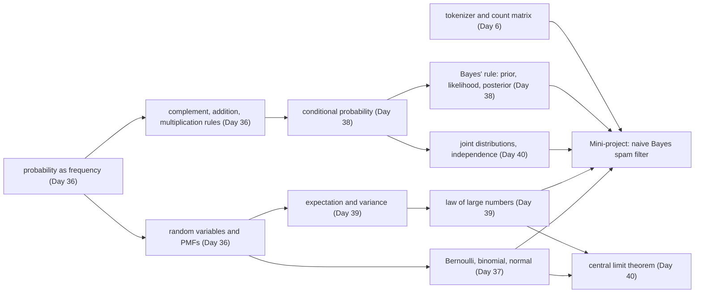

# Day 41: Week 6 Review and Mini-Project: A Naive Bayes Spam Filter

**Phase 1 · Week 6 · ~180 minutes**

## Objectives

By the end of today you can:

- [ ] Explain, without notes, the main idea of each Week 6 lesson and how they combine into one working classifier.
- [ ] Answer the self-check questions, and solve a base-rate problem three ways (count table, Bayes' rule, simulation) from a blank file.
- [ ] Build a **naive Bayes** spam filter from scratch in NumPy: tokenize, count, estimate word probabilities with **Laplace smoothing**, and score messages with **log probabilities**.
- [ ] Explain why the filter takes logs (so tiny numbers don't round to zero) and why it adds 1 to every count (so one unseen word can't veto a class).
- [ ] Evaluate it honestly on held-out messages with accuracy and a **confusion matrix**, and explain a wrong answer word by word.
- [ ] Say why 10 test messages give a very shaky accuracy, using this week's Bernoulli and variance ideas.

**Prerequisites.** All of Week 6: [Day 36](day-36-probability-basics.md) (events, frequencies, rules), [Day 37](day-37-distributions.md) (Bernoulli, binomial, normal), [Day 38](day-38-bayes-rule.md) (conditional probability, Bayes' rule), [Day 39](day-39-expectation-variance.md) (expectation, variance, law of large numbers) and [Day 40](day-40-joint-clt.md) (joint distributions, independence, central limit theorem). The mini-project reuses the tokenizer and count matrix from [Day 6](day-06-week1-review.md), one matrix multiply from [Day 10](day-10-matrices-matmul.md), and `exp`, `ln` and the sigmoid from [Day 30](day-30-derivative-rules.md).

**Suggested time split.** 30 minutes recap and self-check, 20 minutes on the re-do, 100 minutes mini-project, 30 minutes stretch goals and the retro. All code was tested with NumPy 2.5 and matplotlib 3.11.

---

## What this week gave you

Week 5 taught a model how to change. Week 6 taught you to reason about what you don't know for sure: which outcome comes next, how likely a cause is given what you saw, and how much an average can be trusted. Each day added one tool:

| Day | You learned | The one idea to keep |
|---|---|---|
| [36](day-36-probability-basics.md) | outcomes, events, probability as long-run frequency, simulation with `rng`, complement / addition / multiplication rules, discrete random variables, the birthday problem | A probability is what a frequency settles to over many repeats. When the maths is hard, simulate. |
| [37](day-37-distributions.md) | Bernoulli, binomial, uniform, normal, μ and σ, the 68–95–99.7 rule, z-scores, density and CDF | A distribution is a recipe for randomness. For continuous variables, probability is **area**, not height. |
| [38](day-38-bayes-rule.md) | conditional probability from a count table, independence, total probability, Bayes' rule, prior / likelihood / posterior, base rates | \( P(A \mid B) \neq P(B \mid A) \). The base rate (the prior) can outweigh an accurate test. |
| [39](day-39-expectation-variance.md) | expected value, linearity, variance and standard deviation, variance of a sum, the law of large numbers | Averages of \( n \) independent noisy things wobble \( \sqrt{n} \) times less. That is why mini-batch gradients work. |
| [40](day-40-joint-clt.md) | joint and marginal distributions, conditional distributions, independence vs correlation, covariance, the central limit theorem, the 2-D normal | Zero correlation does not mean independent. Sums and averages of many small effects come out bell-shaped. |

Today's spam filter uses every row of that table. Watch each day hand over its piece:

<figure class="diagram" markdown>
![Animated row of six boxes, Day 36 probability, Day 37 distributions, Day 38 Bayes' rule, Day 39 averages, Day 40 independence and Day 41 naive Bayes, lighting up in turn while a panel below explains the piece each one adds to the spam filter: the prior 0.4 from counting, each class as a loaded word die, Bayes' rule to flip the question, smoothing because 30 messages is a noisy estimate, the naive independence step that turns the likelihood into a product, and logs that turn the product into a sum](../../assets/img/phase-1/day41-week6-map.svg)
<figcaption>Animated: the week as one machine. Each lesson supplies one line of the formula at the bottom.</figcaption>
</figure>

And here is how the concepts depend on each other. Arrows mean "is built on":



!!! android "Android bridge"
    You have shipped probability for years without the vocabulary. A Crashlytics crash-free rate is a long-run frequency (Day 36). A 5% staged rollout is a Bernoulli trial per user (Day 37). "Most crashes come from one phone model" is a conditional probability that needs the base rate of that model before it means anything (Day 38). Firebase Performance's averages over many traces are the law of large numbers at work (Day 39). Today you turn those ideas into the classic first ML model for text: the kind of filter that can sit behind a `NotificationListenerService` and decide, on the phone, which notifications look like spam.

## Self-check

Answer out loud or on paper first, then open the answer. If you miss more than three, re-read that day's lesson before starting the project.

??? question "1. A simulated fair coin gives 7 heads in 10 flips. Is the coin biased? What would convince you?"
    Not from this. The binomial (Day 37) says a fair coin gives 7 or more heads in 10 flips with probability \( (120 + 45 + 10 + 1) / 1024 = 176/1024 \approx 0.172 \), about one run in six. Probability is a *long-run* frequency (Day 36): with 10 flips, the frequency of heads still wobbles a lot. Flip 10,000 times: a fair coin then lands within about ±0.01 of 0.5 roughly 95% of the time, so 0.7 would be overwhelming evidence.

??? question "2. Each session of your app crashes with probability 0.002, independently. What is the chance a user who opens it 500 times sees at least one crash?"
    Use the complement (Day 36): "at least one crash" is the opposite of "no crash in any of the 500". Independent sessions multiply: \( P(\text{no crash}) = 0.998^{500} \approx 0.368 \), so \( P(\text{at least one}) \approx 1 - 0.368 = 0.632 \). A 99.8% crash-free *session* rate still means most heavy users have seen a crash. Adding 500 × 0.002 = 1.0 would be wrong: that is the *expected number* of crashes (Day 39), not a probability.

??? question "3. Why is it more likely than not that two of 23 people share a birthday?"
    Because the question is about *pairs*, and 23 people make \( \binom{23}{2} = 253 \) pairs, each with a 1/365 chance of matching. Exactly (Day 36): \( P(\text{no match}) = \frac{365}{365} \cdot \frac{364}{365} \cdots \frac{343}{365} \approx 0.493 \), so \( P(\text{match}) \approx 0.507 \). The same pair-counting is why hash collisions arrive much sooner than intuition says.

??? question "4. A normal distribution with σ = 0.1 has height about 3.99 at its peak. How can a probability be bigger than 1?"
    The height is not a probability; it is a **density** (Day 37). For a continuous variable, probability is the *area* under the curve over an interval, and the total area is 1. A narrow curve must be tall to enclose area 1: the peak height is \( 1/(\sigma\sqrt{2\pi}) = 1/(0.1 \cdot 2.5066) \approx 3.99 \). The probability of any single exact value is 0.

??? question "5. Suppose app ratings were normal with mean 4.15 and standard deviation 0.45. What is the z-score of a 3.25-star app, and roughly what share of apps rate lower?"
    \( z = (3.25 - 4.15) / 0.45 = -2 \): two standard deviations below the mean (Day 37). By the 68–95–99.7 rule, 95% of values lie within ±2σ, so 5% lie outside, half on each side: about 2.5% rate lower (the exact normal answer is 2.3%). Real ratings are capped at 5 and skewed, so treat this as a rough guide, not a fact about the data.

??? question "6. A disease affects 1% of people. A test catches 99% of cases and wrongly flags 5% of healthy people. You test positive. How likely is it that you are sick?"
    About 17%. Use natural frequencies (Day 38): of 10,000 people, 100 are sick and 99 of them test positive; 9,900 are healthy and 495 of them test positive. So 99 of the 594 positives are sick: \( 99/594 \approx 0.167 \). Bayes' rule says the same: \( \frac{0.99 \cdot 0.01}{0.99 \cdot 0.01 + 0.05 \cdot 0.99} \approx 0.167 \). The low base rate (the prior) beats the accurate test. Today's spam filter is this calculation, run once per word.

??? question "7. In your game, 2% of players buy a $5 pack, 0.5% buy a $20 pack, and the rest buy nothing. What is the expected revenue per player, and for 10,000 players?"
    \( E = 0.02 \cdot 5 + 0.005 \cdot 20 + 0.975 \cdot 0 = 0.10 + 0.10 = \$0.20 \) per player (Day 39). By **linearity of expectation**, the expected total for 10,000 players is 10,000 × 0.20 = $2,000, and linearity holds even if players influence each other. The *spread* around $2,000 is another matter: that needs the variance.

??? question "8. One die has variance 35/12 ≈ 2.92. What is the variance of the sum of two independent dice, and the standard deviation of the average of 100 dice? Why does this matter for training?"
    Variances of independent variables add (Day 39): two dice give 35/6 ≈ 5.83. The average of 100 dice has variance \( 2.92 / 100 \), so standard deviation \( \sqrt{2.92}/\sqrt{100} \approx 1.71/10 = 0.171 \): ten times less wobble than one die. A mini-batch gradient is an average of per-example gradients, so a batch of 100 cuts the noise of a single-example gradient by about 10× (Week 8 uses this).

??? question "9. X is −1, 0 or 1 with equal probability, and Y = X². What is their correlation? Are they independent?"
    The covariance is \( E[XY] - E[X]E[Y] = E[X^3] - 0 \cdot E[Y] = 0 \), so the correlation is 0. But they are completely *dependent*: knowing X tells you Y exactly, and \( P(Y = 0 \mid X = 0) = 1 \) while \( P(Y = 0) = 1/3 \) (Day 40). Correlation only measures *straight-line* association. Independence is the much stronger statement \( P(x, y) = P(x)P(y) \) for every pair, and it is exactly what naive Bayes assumes about words today.

??? question "10. Session lengths are very skewed (most are short, a few are hours long). Why does a histogram of the *average* session length of 50 random users still look like a bell curve?"
    The central limit theorem (Day 40): the sum, and so the average, of many independent draws is approximately normal whatever the shape of one draw, centred on the true mean with standard deviation \( \sigma/\sqrt{50} \). That is what makes confidence intervals for an average possible next week, even for data that looks nothing like a bell.

## Re-do from blank

Pick **Day 38's base-rate problem** and solve it again in an empty file, three ways, without looking:

> 10% of incoming messages are spam. A simple rule, "the message contains the word *free*", fires on 60% of spam and on 5% of real messages. A message just triggered the rule. What is the probability that it is spam?

1. **By a count table**: turn the percentages into counts out of 10,000 messages and read the answer off the table.
2. **By Bayes' rule**: \( P(\text{spam} \mid \text{free}) = \dfrac{P(\text{free} \mid \text{spam})\,P(\text{spam})}{P(\text{free})} \), with \( P(\text{free}) \) from the law of total probability.
3. **By simulation**: draw 100,000 messages with `rng`, decide for each one whether it is spam and whether the rule fires, then measure the share of flagged messages that are spam.

**Why this one.** It is the hardest idea of the week, because intuition gets it wrong: most people answer "60%" (that is \( P(\text{free} \mid \text{spam}) \), the question turned around). It also uses every other day: a frequency (Day 36), a Bernoulli draw per message (Day 37), conditioning (Day 38), and a simulated frequency settling on the exact answer (Day 39). And it is the exact engine of today's project: naive Bayes is this calculation, done for every word of a message at once.

??? success "Solution (this is also the first ▶ Run block of the page)"
    ```python
    import numpy as np

    # 1. The table: natural frequencies out of 10,000 messages
    n = 10_000
    n_spam = 0.10 * n                        # 1,000 spam, 9,000 ham
    free_and_spam = 0.60 * n_spam            # the rule fires on 60% of spam: 600
    free_and_ham = 0.05 * (n - n_spam)       # ... and on 5% of ham: 450
    print("by the table:  ", round(free_and_spam / (free_and_spam + free_and_ham), 4))

    # 2. Bayes' rule: P(spam | free) = P(free | spam) P(spam) / P(free)
    p_free = 0.60 * 0.10 + 0.05 * 0.90       # total probability: 0.105
    print("by the formula:", round(0.60 * 0.10 / p_free, 4))

    # 3. Simulation: draw 100,000 messages, then whether the rule fires on each
    rng = np.random.default_rng(38)
    is_spam = rng.random(100_000) < 0.10
    fires = np.where(is_spam, rng.random(100_000) < 0.60, rng.random(100_000) < 0.05)
    print("by simulation: ", round(is_spam[fires].mean(), 4), "from", fires.sum(), "flagged")
    ```

    ```text
    by the table:   0.5714
    by the formula: 0.5714
    by simulation:  0.5692 from 10432 flagged
    ```

    | | rule fires | rule doesn't fire | total |
    |---|---|---|---|
    | spam | 600 | 400 | 1,000 |
    | ham | 450 | 8,550 | 9,000 |
    | total | 1,050 | 8,950 | 10,000 |

    600 of the 1,050 flagged messages are spam: \( 600/1050 \approx 0.571 \). The rule is far better than nothing (it lifts 10% to 57%), but on its own it would hide 450 real messages out of every 10,000. The simulation lands within 0.003 of the exact answer from about 10,400 flagged messages, as the law of large numbers promises. `np.where(cond, a, b)` picks from `a` where `cond` is true and from `b` elsewhere, so each message gets the right firing probability for its class.

---

## Mini-project: a naive Bayes spam filter

The re-do used **one** clue, the word *free*. A real message has ten words, and every one of them is a clue. Today you build a classifier that weighs all of them at once, learns how much each word counts from a few labelled examples, and explains its own decisions. It is called **naive Bayes**, it made email spam filtering practical in the early 2000s, and it is still a strong baseline for short text: fast to train, tiny to ship, and easy to debug.

### The idea, with an analogy

Picture each class as a **loaded die with one face per word**. Spam's die lands on "claim", "now" and "prize" a lot; ham's die (ham means a real message) lands on "lunch", "tomorrow" and "can". A message, in this story, is made by picking a class, then rolling that class's die once per word. It is a silly model of how people write, and that is the "naive" part, but it gives a precise question: **which die more likely rolled this message?**

You answer it like a detective weighing clues. You start with a hunch (40% of messages are spam: the **prior**). Each word moves the odds a bit: "claim" pushes hard towards spam, "can" pulls towards ham, "the" barely moves anything. Add up the pushes, and you have a verdict and a confidence.

| Week 6 idea | Where it appears today |
|---|---|
| probability as frequency (Day 36) | \( P(\text{spam}) \) = share of training messages that are spam |
| a distribution over outcomes (Day 37) | each class's word die: \( P(\text{word} \mid \text{class}) \), one probability per vocabulary word, summing to 1 |
| Bayes' rule (Day 38) | from "how likely are these words if it's spam?" to "how likely is spam given these words?" |
| estimates are noisy (Day 39) | 30 training messages give shaky frequencies, so we smooth them |
| independence (Day 40) | the naive assumption: once the class is known, words are independent, so their probabilities multiply |

### The math, one symbol at a time

**Bayes' rule for a message.** Write a message as its words \( w_1, w_2, \dots, w_m \), and let \( c \) stand for a class, ham or spam. Bayes' rule (Day 38) gives

\[
P(c \mid w_1, \dots, w_m) = \frac{P(w_1, \dots, w_m \mid c)\; P(c)}{P(w_1, \dots, w_m)}
\]

- \( P(c) \) is the **prior**: how common the class is before reading a word.
- \( P(w_1, \dots, w_m \mid c) \) is the **likelihood**: how probable these exact words are if the message came from class \( c \).
- The bottom is the same for both classes, so to *compare* ham with spam you can ignore it, and divide at the end so the two answers add up to 1.

**The naive step.** The likelihood of a whole sentence is hopeless to estimate directly: you will never see the same sentence twice. So assume that, once you know the class, the words are **independent** (Day 40). Independent probabilities multiply (Day 36), and the likelihood becomes one small factor per word:

\[
P(w_1, \dots, w_m \mid c) = P(w_1 \mid c) \cdot P(w_2 \mid c) \cdots P(w_m \mid c) = \prod_{i=1}^{m} P(w_i \mid c)
\]

The big \( \prod \) (capital Greek pi) means "multiply all of these", the way \( \sum \) means "add all of these". The assumption is false ("gift" and "card" clearly travel together in spam), but the classifier usually still picks the right class, because it only needs the *bigger* score to win, not the exact probabilities.

**Estimating \( P(w \mid c) \) by counting.** Pour all the training messages of class \( c \) into one bag of words. Let \( \text{count}(w, c) \) be how many times word \( w \) appears in that bag, and \( N_c \) the total number of words in it. The obvious estimate is the frequency \( \text{count}(w, c) / N_c \) (Day 36). It has a fatal flaw: a word that never appeared in ham gets \( P = 0 \), and one zero in a product makes the whole product zero. One unlucky word would veto the class, however much the other words say. **Laplace smoothing** pretends every word of the vocabulary was seen \( \alpha \) extra times (usually \( \alpha = 1 \)) in every class. With \( V \) words in the vocabulary:

\[
P(w \mid c) = \frac{\text{count}(w, c) + \alpha}{N_c + \alpha V}
\]

The \( \alpha V \) at the bottom keeps the \( V \) probabilities summing to exactly 1. It is the "frequency is only an estimate" lesson of Day 39 in one line: with little data, pull the estimates gently towards "every word equally likely".

**Worked example.** Train on four tiny messages: ham "lunch now" and "lunch at noon", spam "win cash now" and "win now". The vocabulary has \( V = 6 \) words: at, cash, lunch, noon, now, win. Each class bag holds \( N_c = 5 \) words, so every smoothed probability has bottom \( 5 + 1 \cdot 6 = 11 \):

| word | at | cash | lunch | noon | now | win |
|---|---|---|---|---|---|---|
| count in ham | 1 | 0 | 2 | 1 | 1 | 0 |
| \( P(w \mid \text{ham}) \) | 2/11 | 1/11 | 3/11 | 2/11 | 2/11 | 1/11 |
| count in spam | 0 | 1 | 0 | 0 | 2 | 2 |
| \( P(w \mid \text{spam}) \) | 1/11 | 2/11 | 1/11 | 1/11 | 3/11 | 3/11 |

Classify the new message "win lunch now". The priors are both 2/4 = 0.5. Multiply the prior by one factor per word:

\[
\text{ham: } 0.5 \cdot \tfrac{1}{11} \cdot \tfrac{3}{11} \cdot \tfrac{2}{11} = \tfrac{3}{1331} \approx 0.002254
\qquad
\text{spam: } 0.5 \cdot \tfrac{3}{11} \cdot \tfrac{1}{11} \cdot \tfrac{3}{11} = \tfrac{4.5}{1331} \approx 0.003381
\]

Divide each by their sum so they add to 1: \( P(\text{spam} \mid \text{win lunch now}) = 4.5 / (4.5 + 3) = 0.6 \). Without smoothing, "lunch" never appeared in spam, so the spam score would be exactly 0, and "win" would count for nothing. The same numbers in NumPy:

```python
# The toy example: counts of each vocabulary word in each class
vocab_toy = ["at", "cash", "lunch", "noon", "now", "win"]
counts_toy = np.array([[1, 0, 2, 1, 1, 0],     # ham:  "lunch now", "lunch at noon"
                       [0, 1, 0, 0, 2, 2]])    # spam: "win cash now", "win now"
alpha = 1.0
lik_toy = (counts_toy + alpha) / (counts_toy.sum(axis=1, keepdims=True) + alpha * 6)
print((lik_toy * 11).round(3))                 # numerators over 11
print(lik_toy.sum(axis=1))                     # each row is a probability distribution

msg = [vocab_toy.index(w) for w in ["win", "lunch", "now"]]
joint = 0.5 * lik_toy[:, msg].prod(axis=1)     # P(class) * product of P(word | class)
print(joint.round(6), "P(spam | message) =", round(joint[1] / joint.sum(), 4))
```

```text
[[2. 1. 3. 2. 2. 1.]
 [1. 2. 1. 1. 3. 3.]]
[1. 1.]
[0.002254 0.003381] P(spam | message) = 0.6
```

`lik_toy[:, msg]` picks the three columns of the message's words from both rows at once (Day 8's fancy indexing), giving a `(2, 3)` array, and `.prod(axis=1)` multiplies along each row.

**Why logs.** A real message multiplies dozens of probabilities around 0.01. The product shrinks so fast that a computer can't store it: a `float64` can't hold anything positive below about \( 5 \times 10^{-324} \), and smaller results are rounded to exactly 0. This is called **underflow**. The fix is the rule \( \ln(a \cdot b) = \ln a + \ln b \) (Day 30): take logs and the product becomes a sum of moderate negative numbers, which never underflows. Since \( \ln \) only ever grows when its input grows, the class with the bigger product also has the bigger log, so comparisons are unchanged.

```python
p_word = 0.01                 # a typical word probability
print(p_word ** 200)          # the product of 200 of them
print(200 * np.log(p_word))   # the same quantity as a sum of logs
print(np.log(0.0))            # what an unsmoothed zero turns into
```

```text
0.0
-921.0340371976182
-inf
```

\( 0.01^{200} = 10^{-400} \) rounds to `0.0`, while its log, \( 200 \ln 0.01 \approx -921.03 \), is an ordinary number. The last line is why smoothing matters even with logs: \( \ln 0 = -\infty \) (NumPy also prints a `RuntimeWarning: divide by zero`), and \( -\infty \) plus anything is still \( -\infty \).

**The score you will compute.** Taking logs of prior × product, and counting a word that appears twice twice, the score of class \( c \) for a message is

\[
\text{score}(c) = \ln P(c) + \sum_{w} \text{count}(w) \cdot \ln P(w \mid c)
\]

where \( \text{count}(w) \) is how often vocabulary word \( w \) appears in the message. That sum over the vocabulary is a dot product between the message's count row (Day 6) and the class's row of log probabilities. For a whole matrix of messages \( X \) (one row each) and a `(2, V)` matrix of log probabilities \( L \), every score is one matrix multiply (Day 10): \( X L^\top \), plus the log priors broadcast across the rows (Day 9).

**From two scores to a probability.** The difference \( d = \text{score}(\text{spam}) - \text{score}(\text{ham}) \) is the **log-odds**: \( \ln \) of how many times more likely spam is than ham. Undoing the log and normalising gives

\[
P(\text{spam} \mid \text{message}) = \frac{e^{\text{score(spam)}}}{e^{\text{score(spam)}} + e^{\text{score(ham)}}} = \frac{1}{1 + e^{-d}} = \sigma(d)
\]

(divide top and bottom by \( e^{\text{score(spam)}} \) to get the middle step). That is the **sigmoid** from Day 30. So naive Bayes is a sum of per-word evidence pushed through a sigmoid, exactly the shape of the logistic regression you will train in Month 3; the difference is that naive Bayes *counts* its weights instead of learning them by gradient descent. Here is that sum being built, word by word, for a real test message from today's project:

<figure class="diagram" markdown>

<figcaption>Animated: each word adds its log-likelihood ratio to the running log-odds; the sigmoid turns the final total into a probability.</figcaption>
</figure>

### Spec

Build these functions in one file or notebook, `spam_nb.py`:

| Function | Input → output | Rules |
|---|---|---|
| `tokenize`, `build_vocab`, `count_matrix` | from [Day 6](day-06-week1-review.md) | unchanged; words not in the vocabulary are ignored |
| `stratified_split(y, test_frac, seed)` | labels → `(train_idx, test_idx)` | shuffle each class separately with `np.random.default_rng(seed)`; 25% of each class goes to test |
| `fit_nb(X, y, alpha)` | counts, labels → `(log_prior, log_lik)` | shapes `(2,)` and `(2, V)`; Laplace smoothing; row 0 is ham, row 1 is spam |
| `log_scores(X, log_prior, log_lik)` | → `(n, 2)` | one matrix multiply plus the priors, no Python loop |
| `spam_probability(scores)` | → `(n,)` | the sigmoid of spam score minus ham score |
| `confusion_matrix(y_true, y_pred)` | → `(2, 2)` integers | row = true class, column = predicted class |
| `explain(text, ...)` | one message → `P(spam)` | prints each word's evidence and the running total |

The **vocabulary comes from the training messages only.** Test messages must look to the model like messages from the future: words it has never seen. Building the vocabulary from all 40 messages would leak information about the test set into training (the data-leakage warning from [Day 17](day-17-pandas-cleaning.md)).

### Starter code

The dataset is 40 short SMS-style messages, **made up for this lesson**: 24 ham, 16 spam. The phone shortcodes like 80080 are invented too. Copy both blocks into `spam_nb.py` (or a notebook) and fill in the `TODO`s. (Running the second block as it is only defines the empty functions; the milestones below fill them in.)

```python
"""Week 6 mini-project: a naive Bayes spam filter from scratch."""
import string

import numpy as np

# MADE-UP messages, written for this lesson. 0 = ham (a real message), 1 = spam.
MESSAGES = [
    # ham (0): everyday messages between people
    ("Are you free for lunch tomorrow?", 0),
    ("Running ten minutes late, sorry!", 0),
    ("Can you pick up milk on the way home?", 0),
    ("Happy birthday! Hope you have a great day", 0),
    ("The meeting moved to 3pm, room 4B", 0),
    ("Did you see the game last night?", 0),
    ("Call me when you land", 0),
    ("Thanks for dinner, it was lovely", 0),
    ("I pushed the fix, can you review the PR?", 0),
    ("Mum says hi, call her this weekend", 0),
    ("Are we still on for the movie tonight?", 0),
    ("Your parcel is at my place, grab it anytime", 0),
    ("Let's get coffee next week", 0),
    ("I left my charger at your flat", 0),
    ("See you at the gym at 7", 0),
    ("The build is green again, nice work", 0),
    ("Can you send me the photos from the trip?", 0),
    ("Don't forget the dentist at 10 tomorrow", 0),
    ("Good luck with the interview today!", 0),
    ("I'm home, the door code is the usual", 0),
    ("Who's bringing snacks on Saturday?", 0),
    ("Free tonight? We could cook at mine", 0),
    ("Lunch was great, let's do it again", 0),
    ("Can you call me back when you are free", 0),
    # spam (1): made-up promotions and scams
    ("WINNER! You have won a free prize, call now to claim", 1),
    ("URGENT: your account is suspended, click the link to verify", 1),
    ("Congratulations, you won a $1000 gift card! Claim now", 1),
    ("Free entry to win a new phone, text WIN to 80080", 1),
    ("You have been selected for a cash prize, reply YES to claim", 1),
    ("Cheap loans approved today, no credit check, call now", 1),
    ("Claim your free ringtones now, text TONE to 80080", 1),
    ("Your package is on hold, pay the fee at the link", 1),
    ("Win a holiday for two! Click the link to enter now", 1),
    ("Final notice: claim your reward before midnight", 1),
    ("Earn cash fast from home, click here to start", 1),
    ("Limited offer: free phone upgrade, call now", 1),
    ("You won! Reply WIN to get your prize today", 1),
    ("Your bank account needs verification, click the link now", 1),
    ("Exclusive deal: 90% off, text STOP to opt out", 1),
    ("Get a free gift card, just reply with your address", 1),
]
texts = [text for text, _ in MESSAGES]
y = np.array([label for _, label in MESSAGES])
print(len(texts), "messages:", (y == 0).sum(), "ham,", (y == 1).sum(), "spam")
```

```text
40 messages: 24 ham, 16 spam
```

```python
def tokenize(text: str) -> list[str]:
    # TODO: Day 6's tokenizer: lowercase, delete punctuation, split
    raise NotImplementedError


def build_vocab(docs: list[list[str]]) -> dict[str, int]:
    # TODO: Day 6: sorted distinct words -> column index
    raise NotImplementedError


def count_matrix(docs: list[list[str]], vocab: dict[str, int]) -> np.ndarray:
    # TODO: Day 6: X[i, j] = count of word j in message i; skip unknown words
    raise NotImplementedError


def stratified_split(y: np.ndarray, test_frac: float = 0.25, seed: int = 41):
    # TODO: for each class, rng.permutation of its row numbers; first 25% go to test
    raise NotImplementedError


def fit_nb(X: np.ndarray, y: np.ndarray, alpha: float = 1.0):
    # TODO: log priors (2,), and log of (count + alpha) / (class total + alpha * V), shape (2, V)
    raise NotImplementedError


def log_scores(X: np.ndarray, log_prior: np.ndarray, log_lik: np.ndarray) -> np.ndarray:
    # TODO: one matrix multiply plus the priors -> shape (n, 2)
    raise NotImplementedError


def spam_probability(scores: np.ndarray) -> np.ndarray:
    # TODO: the sigmoid of (spam score - ham score)
    raise NotImplementedError


def confusion_matrix(y_true: np.ndarray, y_pred: np.ndarray) -> np.ndarray:
    # TODO: 2x2 counts, row = true class, column = predicted class
    raise NotImplementedError
```

### Milestones

Do them in order. Every output below is real, and since the messages and the seed are fixed, yours should match exactly.

**Milestone 1: tokenize and look.** Paste your Day 6 tokenizer and count matrix, and look at a couple of messages before anything else.

```python
_NO_PUNCT = str.maketrans("", "", string.punctuation)


def tokenize(text: str) -> list[str]:
    """Lowercase, delete ASCII punctuation, split on whitespace (Day 6)."""
    return text.lower().translate(_NO_PUNCT).split()


def build_vocab(docs: list[list[str]]) -> dict[str, int]:
    """Map every distinct word to a column index, in alphabetical order (Day 6)."""
    words = sorted({w for doc in docs for w in doc})
    return {w: i for i, w in enumerate(words)}


def count_matrix(docs: list[list[str]], vocab: dict[str, int]) -> np.ndarray:
    """Row i, column j = how many times word j appears in message i (Day 6)."""
    X = np.zeros((len(docs), len(vocab)), dtype=np.int64)
    for i, doc in enumerate(docs):
        for w in doc:
            if w in vocab:                     # words outside the vocabulary are ignored
                X[i, vocab[w]] += 1
    return X


docs = [tokenize(t) for t in texts]
print(docs[24])
print(docs[26])
lengths = np.array([len(d) for d in docs])
print("mean words per message: ham", lengths[y == 0].mean().round(2), " spam", lengths[y == 1].mean().round(2))
```

```text
['winner', 'you', 'have', 'won', 'a', 'free', 'prize', 'call', 'now', 'to', 'claim']
['congratulations', 'you', 'won', 'a', '1000', 'gift', 'card', 'claim', 'now']
mean words per message: ham 7.08  spam 9.56
```

Punctuation removal turned `$1000` into `1000` and `WINNER!` into `winner`. The dollar sign and the shouting were clues, and the tokenizer threw them away: remember that when you get to stretch goals.

**Milestone 2: split, then build the vocabulary from training only.** Shuffling each class separately is called a **stratified** split: it guarantees both classes appear in the test set in the same 60/40 proportion as overall. With only 16 spam messages, a plain shuffle could easily put 1 or 7 of them in the test set.

```python
def stratified_split(y: np.ndarray, test_frac: float = 0.25, seed: int = 41):
    """Shuffle each class separately and put test_frac of it in the test set."""
    rng = np.random.default_rng(seed)
    test = []
    for c in (0, 1):
        idx = rng.permutation(np.flatnonzero(y == c))   # this class's rows, shuffled
        test.extend(idx[: round(len(idx) * test_frac)])
    test = np.sort(np.array(test))
    train = np.setdiff1d(np.arange(len(y)), test)        # everything else
    return train, test


train_idx, test_idx = stratified_split(y)
print("train:", len(train_idx), "messages,", y[train_idx].sum(), "spam")
print("test: ", len(test_idx), "messages,", y[test_idx].sum(), "spam")

vocab = build_vocab([docs[i] for i in train_idx])        # training messages only
X_train = count_matrix([docs[i] for i in train_idx], vocab)
X_test = count_matrix([docs[i] for i in test_idx], vocab)
y_train, y_test = y[train_idx], y[test_idx]
print(len(vocab), "words;", X_train.shape, X_test.shape)
print("test words the model knows:", X_test.sum(), "of",
      sum(len(docs[i]) for i in test_idx), "total")
```

```text
train: 30 messages, 12 spam
test:  10 messages, 4 spam
140 words; (30, 140) (10, 140)
test words the model knows: 43 of 80 total
```

`np.flatnonzero(y == c)` gives the row numbers where the mask is true, and `np.setdiff1d` gives every row number not in the test set. Notice the last line: almost half of the test words (37 of 80) were never seen in training, so `count_matrix` simply ignores them. With 30 training messages, the model is reading the test set through a keyhole.

**Milestone 3: train.** Training naive Bayes is counting: no loop of gradient steps, just one pass over the data. `X[y == c]` keeps the rows of class \( c \) (Day 4's boolean masks) and `.sum(axis=0)` adds them into one row of word counts.

```python
def fit_nb(X: np.ndarray, y: np.ndarray, alpha: float = 1.0):
    """Multinomial naive Bayes. Returns log P(class), shape (2,), and log P(word | class), shape (2, V)."""
    priors = np.array([np.mean(y == c) for c in (0, 1)])
    counts = np.stack([X[y == c].sum(axis=0) for c in (0, 1)])         # (2, V) word counts
    totals = counts.sum(axis=1, keepdims=True)                         # (2, 1) words per class
    lik = (counts + alpha) / (totals + alpha * X.shape[1])             # Laplace smoothing
    return np.log(priors), np.log(lik)


log_prior, log_lik = fit_nb(X_train, y_train)
print("P(ham), P(spam):", np.exp(log_prior))
print("each class's word probabilities sum to:", np.exp(log_lik).sum(axis=1))

counts = np.stack([X_train[y_train == c].sum(axis=0) for c in (0, 1)])
print("training words per class (ham, spam):", counts.sum(axis=1))
for w in ["claim", "free", "the", "lunch"]:
    j = vocab[w]
    print(f"{w:>6}: counts {counts[:, j]}, P(w|ham) = {np.exp(log_lik[0, j]):.4f}, "
          f"P(w|spam) = {np.exp(log_lik[1, j]):.4f}")
```

```text
P(ham), P(spam): [0.6 0.4]
each class's word probabilities sum to: [1. 1.]
training words per class (ham, spam): [126 117]
 claim: counts [0 3], P(w|ham) = 0.0038, P(w|spam) = 0.0156
  free: counts [3 3], P(w|ham) = 0.0150, P(w|spam) = 0.0156
   the: counts [9 5], P(w|ham) = 0.0376, P(w|spam) = 0.0233
 lunch: counts [1 0], P(w|ham) = 0.0075, P(w|spam) = 0.0039
```

Check one by hand: "claim" appears 3 times in the 117 spam words, so \( P(\text{claim} \mid \text{spam}) = (3 + 1)/(117 + 140) = 4/257 \approx 0.0156 \), and 0 times in ham, so smoothing gives it \( 1/(126 + 140) = 1/266 \approx 0.0038 \) instead of a fatal zero. And look at "free": the word everyone expects to be spammy is almost neutral here, because the ham messages say "are you free for lunch" and "call me back when you are free". The data, not your intuition, sets the weights.

**Milestone 4: score the test messages.** The shapes are the whole design: `(10, 140) @ (140, 2)` gives `(10, 2)`, and the `(2,)` priors broadcast onto every row.

```python
def log_scores(X: np.ndarray, log_prior: np.ndarray, log_lik: np.ndarray) -> np.ndarray:
    """log P(class) + sum over words of count * log P(word | class). Shape (n, 2)."""
    return X @ log_lik.T + log_prior          # (n, V) @ (V, 2) + (2,) -> (n, 2)


def spam_probability(scores: np.ndarray) -> np.ndarray:
    """P(spam | message) from the two log scores: the sigmoid of their difference."""
    return 1.0 / (1.0 + np.exp(scores[:, 0] - scores[:, 1]))


scores = log_scores(X_test, log_prior, log_lik)
p_spam = spam_probability(scores)
y_pred = scores.argmax(axis=1)                # the bigger score wins
for i, s, p, yp in zip(test_idx, scores, p_spam, y_pred):
    print(f"true {y[i]} pred {yp}  log scores {s[0]:7.2f} {s[1]:7.2f}  P(spam) {p:.3f}  {texts[i]}")
```

```text
true 0 pred 1  log scores   -9.38   -8.28  P(spam) 0.750  The meeting moved to 3pm, room 4B
true 0 pred 0  log scores  -12.07  -14.39  P(spam) 0.090  Did you see the game last night?
true 0 pred 0  log scores  -19.55  -23.69  P(spam) 0.016  I pushed the fix, can you review the PR?
true 0 pred 0  log scores   -5.00   -5.08  P(spam) 0.479  Mum says hi, call her this weekend
true 0 pred 0  log scores   -8.28   -9.12  P(spam) 0.300  The build is green again, nice work
true 0 pred 0  log scores  -24.56  -28.66  P(spam) 0.016  Lunch was great, let's do it again
true 1 pred 1  log scores  -43.10  -35.47  P(spam) 1.000  Free entry to win a new phone, text WIN to 80080
true 1 pred 1  log scores  -31.53  -25.24  P(spam) 0.998  Claim your free ringtones now, text TONE to 80080
true 1 pred 1  log scores  -10.58   -9.02  P(spam) 0.826  Final notice: claim your reward before midnight
true 1 pred 1  log scores  -46.08  -40.54  P(spam) 0.996  You won! Reply WIN to get your prize today
```

The log scores themselves are meaningless on their own (longer messages simply have more negative scores, because more probabilities were multiplied); only their *difference* matters. The `1.000` is a rounded 0.9995: a log-odds of 7.6 makes spam about 2,000 times more likely than ham. One message is wrong: a meeting reminder was called spam with 75% confidence. Milestone 5 finds out why.

**Milestone 5: evaluate, and explain the mistake.**

```python
def confusion_matrix(y_true: np.ndarray, y_pred: np.ndarray) -> np.ndarray:
    """Row = true class, column = predicted class: [[TN, FP], [FN, TP]]."""
    cm = np.zeros((2, 2), dtype=np.int64)
    for t, p in zip(y_true, y_pred):
        cm[t, p] += 1
    return cm


cm = confusion_matrix(y_test, y_pred)
print(cm)
print("accuracy:", (y_pred == y_test).mean())
(tn, fp), (fn, tp) = cm
print(f"spam caught: {tp} of {tp + fn};  real messages wrongly hidden: {fp} of {tn + fp}")
print("always-ham baseline accuracy:", (y_test == 0).mean())
```

```text
[[5 1]
 [0 4]]
accuracy: 0.9
spam caught: 4 of 4;  real messages wrongly hidden: 1 of 6
always-ham baseline accuracy: 0.6
```

The **confusion matrix** puts the true class on the rows and the prediction on the columns. The diagonal holds the right answers: 5 **true negatives** (ham kept) and 4 **true positives** (spam caught). Off the diagonal are the two kinds of mistake, and they are not equally bad: a **false negative** (spam let through, here 0) is an annoyance; a **false positive** (a real message hidden, here 1) can mean a missed delivery code or a friend's message. Always compare against a baseline: "always say ham" already scores 0.6, so 0.9 is an improvement of 3 messages, not of 90%.

Now ask the model why it hid the meeting reminder:

```python
def explain(text: str, vocab: dict[str, int], log_prior: np.ndarray, log_lik: np.ndarray) -> float:
    """Print each word's evidence and return P(spam | text)."""
    word_ratio = log_lik[1] - log_lik[0]           # log P(w|spam) - log P(w|ham), per word
    total = log_prior[1] - log_prior[0]
    print(f"{'prior':>10} {total:+.3f}")
    for w in tokenize(text):
        if w in vocab:
            total += word_ratio[vocab[w]]
            print(f"{w:>10} {word_ratio[vocab[w]]:+.3f}   running total {total:+.3f}")
        else:
            print(f"{w:>10}  (not in the vocabulary: skipped)")
    p = 1.0 / (1.0 + np.exp(-total))
    print(f"log-odds {total:+.3f}  ->  P(spam) = {p:.3f}")
    return p


p_meeting = explain("The meeting moved to 3pm, room 4B", vocab, log_prior, log_lik)
```

```text
     prior -0.405
       the -0.476   running total -0.882
   meeting  (not in the vocabulary: skipped)
     moved  (not in the vocabulary: skipped)
        to +1.980   running total +1.098
       3pm  (not in the vocabulary: skipped)
      room  (not in the vocabulary: skipped)
        4b  (not in the vocabulary: skipped)
log-odds +1.098  ->  P(spam) = 0.750
```

Five of the seven words were never seen in training, so the whole decision rested on "the" and "to". And "to" appears 6 times in the training spam ("call now to claim", "click the link to verify", "text STOP to opt out") and never in the training ham, so it became one of the strongest spam words in the model. That is the naive Bayes failure in one picture: a tiny training set, a common word that happened to be lopsided, and no other evidence to outvote it. More data fixes it; so does throwing out such "stop words" (Day 6's stretch goal), which stretch goal 4 below lets you test.

!!! warning "Common mistake: trusting the accuracy of 10 messages"
    Each test message is one Bernoulli trial (Day 37): right or wrong. If the true accuracy is about 0.88, the measured accuracy on 10 messages has standard deviation \( \sqrt{0.88 \cdot 0.12 / 10} \approx 0.10 \) (Day 39), so 0.9 is consistent with anything from about 0.7 to 1.0. Stretch goal 2 measures this directly by re-splitting 500 times. Never report a test accuracy without the size of the test set.

**Milestone 6: open the model up.** The model is just two rows of 140 numbers, so you can read it. For each word, the difference \( \ln P(w \mid \text{spam}) - \ln P(w \mid \text{ham}) \) is exactly how much one use of that word adds to the log-odds:

```python
inv_vocab = {i: w for w, i in vocab.items()}
word_ratio = log_lik[1] - log_lik[0]
spammy = np.argsort(-word_ratio, kind="stable")     # most spammy first; ties stay alphabetical
hammy = np.argsort(word_ratio, kind="stable")       # most hammy first
print("spammy:", [(inv_vocab[j], float(word_ratio[j].round(2))) for j in spammy[:8]])
print("hammy: ", [(inv_vocab[j], float(word_ratio[j].round(2))) for j in hammy[:8]])
```

```text
spammy: [('now', 1.98), ('to', 1.98), ('click', 1.64), ('link', 1.64), ('claim', 1.42), ('a', 1.13), ('account', 1.13), ('card', 1.13)]
hammy:  [('are', -1.35), ('can', -1.35), ('me', -1.35), ('at', -1.22), ('it', -1.06), ('my', -1.06), ('tomorrow', -1.06), ('tonight', -1.06)]
```

`kind="stable"` keeps tied words in alphabetical order, so your list matches this one. A chart makes the shape clearer:

```python
import matplotlib
matplotlib.use("Agg")            # draw into files, no window (leave this out in Jupyter)
import matplotlib.pyplot as plt

plt.rcParams.update({"font.size": 11, "figure.facecolor": "white", "savefig.facecolor": "white",
                     "axes.spines.top": False, "axes.spines.right": False})

top = np.concatenate([spammy[:10], hammy[:10][::-1]])     # 10 spammiest, then 10 hammiest
fig, ax = plt.subplots(figsize=(7, 6))
colors = ["#e53935" if word_ratio[j] > 0 else "#00897b" for j in top]
ax.barh([inv_vocab[j] for j in top], word_ratio[top], color=colors)
ax.invert_yaxis()                                           # spammiest at the top
ax.axvline(0, color="#555", lw=1)
ax.set_xlabel("log P(word | spam) − log P(word | ham)   (log-odds added per use)")
ax.set_title("Word evidence learned from 30 training messages")
for j, v in zip(top, word_ratio[top]):
    c = counts[:, j]
    ax.text(v + (0.05 if v > 0 else -0.05), inv_vocab[j], f"ham {c[0]}, spam {c[1]}",
            va="center", ha="left" if v > 0 else "right", fontsize=9, color="#555")
ax.set_xlim(-2.6, 3.0)
fig.savefig("day41-word-evidence.svg", format="svg", bbox_inches="tight")
```

<figure class="diagram" markdown>

<figcaption>The whole model, read as a chart: how far one use of each word pushes the log-odds, with the counts that produced it.</figcaption>
</figure>

Read it with a critic's eye. "click", "link", "claim" and "cash" are what you'd expect. "to" and "a" are not spam words in any real sense; they lead the list because spam messages here are longer and more formal ("click the link to verify"). The hammy side is all pronouns and plans ("can", "me", "tomorrow"), which is a real pattern: people write to each other about each other. Notice too that every word with counts like "ham 0, spam 2" has the same bar length: with this little data, the model can only tell "seen twice" from "seen three times", which is Day 39's noisy-frequency lesson made visible.

!!! warning "Common mistake: building the vocabulary (or anything else) from all the data"
    If the vocabulary came from all 40 messages, the test words would no longer be unknown, and the test accuracy would describe a situation that never happens in real use: new messages *do* contain new words. Anything you compute from data (vocabularies, counts, means for standardization) comes from the training set only, then gets applied unchanged to the test set.

!!! android "Android bridge: shipping this model"
    A trained naive Bayes model is two priors and a `2 × V` table of log probabilities. With a 20,000-word vocabulary in `float32`, that is about 160 KB: ship it as an asset, load it into a `FloatArray`, and keep the vocabulary as a `HashMap<String, Int>`. Scoring a notification is a loop over its tokens that adds `logLik[spam][j] - logLik[ham][j]` to a running total, then `1 / (1 + exp(-total))` with `kotlin.math.exp`: microseconds, no TensorFlow Lite needed, and it runs fully on device, so message text never leaves the phone. Use the same tokenizer in Kotlin as in Python, or the indices won't match: this "training/serving skew" is the most common bug when moving any text model to a phone. And choose the decision threshold for your product, not 0.5: hiding a real message costs more than showing a spam one (stretch goal 1).

### How to verify it works

Run these checks after the milestones. Each one tests a promise the spec makes:

```python
# 1. The split: disjoint, complete, and each class split 75/25
assert len(np.intersect1d(train_idx, test_idx)) == 0
assert len(train_idx) + len(test_idx) == len(y)
assert y[test_idx].sum() == 4 and (y[test_idx] == 0).sum() == 6
# 2. Each class's smoothed word probabilities form a distribution, with no zeros
assert np.allclose(np.exp(log_lik).sum(axis=1), 1.0)
assert np.isfinite(log_lik).all()
# 3. The hand-worked toy example: P(spam | "win lunch now") = 0.6
toy_docs = [tokenize(s) for s in ["lunch now", "lunch at noon", "win cash now", "win now"]]
toy_vocab = build_vocab(toy_docs)
toy_prior, toy_lik = fit_nb(count_matrix(toy_docs, toy_vocab), np.array([0, 0, 1, 1]))
toy_x = count_matrix([tokenize("win lunch now")], toy_vocab)
assert np.isclose(spam_probability(log_scores(toy_x, toy_prior, toy_lik))[0], 0.6)
# 4. Logs agree with the direct product for a short message
x = count_matrix([tokenize("claim your prize now")], vocab)
direct = np.exp(log_prior) * np.prod(np.exp(log_lik) ** x, axis=1)
assert np.allclose(np.log(direct), log_scores(x, log_prior, log_lik)[0])
# 5. Words the model never saw change nothing
a = log_scores(count_matrix([tokenize("claim now")], vocab), log_prior, log_lik)
b = log_scores(count_matrix([tokenize("claim now zxqv blorp")], vocab), log_prior, log_lik)
assert np.allclose(a, b)
# 6. The confusion matrix accounts for every test message
assert cm.sum() == len(y_test) and np.trace(cm) == (y_pred == y_test).sum()
print("all checks passed")
```

```text
all checks passed
```

Check 3 is the most valuable: the hand-worked toy example becomes a unit test of the real functions. Check 4 proves the log version computes the same quantity as the direct product, on a message short enough not to underflow. Check 5 confirms that unknown words are ignored, not counted as zero-probability words.

??? success "Reference solution (try the milestones first)"
    One standalone file: everything above, in order, with a `main()` that trains, evaluates, reads the model and classifies three new messages. It runs in well under a second.

    ```python
    """Week 6 mini-project: a naive Bayes spam filter from scratch (reference solution)."""
    import string

    import numpy as np

    # MADE-UP messages, written for this lesson. 0 = ham (a real message), 1 = spam.
    MESSAGES = [
        # ham (0): everyday messages between people
        ("Are you free for lunch tomorrow?", 0),
        ("Running ten minutes late, sorry!", 0),
        ("Can you pick up milk on the way home?", 0),
        ("Happy birthday! Hope you have a great day", 0),
        ("The meeting moved to 3pm, room 4B", 0),
        ("Did you see the game last night?", 0),
        ("Call me when you land", 0),
        ("Thanks for dinner, it was lovely", 0),
        ("I pushed the fix, can you review the PR?", 0),
        ("Mum says hi, call her this weekend", 0),
        ("Are we still on for the movie tonight?", 0),
        ("Your parcel is at my place, grab it anytime", 0),
        ("Let's get coffee next week", 0),
        ("I left my charger at your flat", 0),
        ("See you at the gym at 7", 0),
        ("The build is green again, nice work", 0),
        ("Can you send me the photos from the trip?", 0),
        ("Don't forget the dentist at 10 tomorrow", 0),
        ("Good luck with the interview today!", 0),
        ("I'm home, the door code is the usual", 0),
        ("Who's bringing snacks on Saturday?", 0),
        ("Free tonight? We could cook at mine", 0),
        ("Lunch was great, let's do it again", 0),
        ("Can you call me back when you are free", 0),
        # spam (1): made-up promotions and scams
        ("WINNER! You have won a free prize, call now to claim", 1),
        ("URGENT: your account is suspended, click the link to verify", 1),
        ("Congratulations, you won a $1000 gift card! Claim now", 1),
        ("Free entry to win a new phone, text WIN to 80080", 1),
        ("You have been selected for a cash prize, reply YES to claim", 1),
        ("Cheap loans approved today, no credit check, call now", 1),
        ("Claim your free ringtones now, text TONE to 80080", 1),
        ("Your package is on hold, pay the fee at the link", 1),
        ("Win a holiday for two! Click the link to enter now", 1),
        ("Final notice: claim your reward before midnight", 1),
        ("Earn cash fast from home, click here to start", 1),
        ("Limited offer: free phone upgrade, call now", 1),
        ("You won! Reply WIN to get your prize today", 1),
        ("Your bank account needs verification, click the link now", 1),
        ("Exclusive deal: 90% off, text STOP to opt out", 1),
        ("Get a free gift card, just reply with your address", 1),
    ]

    _NO_PUNCT = str.maketrans("", "", string.punctuation)


    def tokenize(text: str) -> list[str]:
        """Lowercase, delete ASCII punctuation, split on whitespace (Day 6)."""
        return text.lower().translate(_NO_PUNCT).split()


    def build_vocab(docs: list[list[str]]) -> dict[str, int]:
        """Map every distinct word to a column index, in alphabetical order (Day 6)."""
        words = sorted({w for doc in docs for w in doc})
        return {w: i for i, w in enumerate(words)}


    def count_matrix(docs: list[list[str]], vocab: dict[str, int]) -> np.ndarray:
        """Row i, column j = how many times word j appears in message i (Day 6)."""
        X = np.zeros((len(docs), len(vocab)), dtype=np.int64)
        for i, doc in enumerate(docs):
            for w in doc:
                if w in vocab:                     # words outside the vocabulary are ignored
                    X[i, vocab[w]] += 1
        return X


    def stratified_split(y: np.ndarray, test_frac: float = 0.25, seed: int = 41):
        """Shuffle each class separately and put test_frac of it in the test set."""
        rng = np.random.default_rng(seed)
        test = []
        for c in (0, 1):
            idx = rng.permutation(np.flatnonzero(y == c))   # this class's rows, shuffled
            test.extend(idx[: round(len(idx) * test_frac)])
        test = np.sort(np.array(test))
        train = np.setdiff1d(np.arange(len(y)), test)        # everything else
        return train, test


    def fit_nb(X: np.ndarray, y: np.ndarray, alpha: float = 1.0):
        """Multinomial naive Bayes. Returns log P(class), shape (2,), and log P(word | class), shape (2, V)."""
        priors = np.array([np.mean(y == c) for c in (0, 1)])
        counts = np.stack([X[y == c].sum(axis=0) for c in (0, 1)])         # (2, V) word counts
        totals = counts.sum(axis=1, keepdims=True)                         # (2, 1) words per class
        lik = (counts + alpha) / (totals + alpha * X.shape[1])             # Laplace smoothing
        return np.log(priors), np.log(lik)


    def log_scores(X: np.ndarray, log_prior: np.ndarray, log_lik: np.ndarray) -> np.ndarray:
        """log P(class) + sum over words of count * log P(word | class). Shape (n, 2)."""
        return X @ log_lik.T + log_prior          # (n, V) @ (V, 2) + (2,) -> (n, 2)


    def spam_probability(scores: np.ndarray) -> np.ndarray:
        """P(spam | message) from the two log scores: the sigmoid of their difference."""
        return 1.0 / (1.0 + np.exp(scores[:, 0] - scores[:, 1]))


    def confusion_matrix(y_true: np.ndarray, y_pred: np.ndarray) -> np.ndarray:
        """Row = true class, column = predicted class: [[TN, FP], [FN, TP]]."""
        cm = np.zeros((2, 2), dtype=np.int64)
        for t, p in zip(y_true, y_pred):
            cm[t, p] += 1
        return cm


    def classify(text, vocab, log_prior, log_lik):
        """P(spam | text) for one new message."""
        x = count_matrix([tokenize(text)], vocab)
        return spam_probability(log_scores(x, log_prior, log_lik))[0]


    def main():
        texts = [t for t, _ in MESSAGES]
        y = np.array([label for _, label in MESSAGES])
        docs = [tokenize(t) for t in texts]
        train_idx, test_idx = stratified_split(y)
        vocab = build_vocab([docs[i] for i in train_idx])
        X_train = count_matrix([docs[i] for i in train_idx], vocab)
        X_test = count_matrix([docs[i] for i in test_idx], vocab)
        log_prior, log_lik = fit_nb(X_train, y[train_idx])

        y_pred = log_scores(X_test, log_prior, log_lik).argmax(axis=1)
        print(f"{len(train_idx)} train / {len(test_idx)} test messages, {len(vocab)} words")
        print(confusion_matrix(y[test_idx], y_pred))
        print("accuracy:", (y_pred == y[test_idx]).mean())

        ratio = log_lik[1] - log_lik[0]
        inv = {i: w for w, i in vocab.items()}
        print("spammiest:", [inv[j] for j in np.argsort(-ratio, kind="stable")[:5]])
        print("hammiest: ", [inv[j] for j in np.argsort(ratio, kind="stable")[:5]])
        for text in ["Claim your free gift card now", "Are you free to call now?",
                     "Lunch tomorrow at mine?"]:
            print(f"P(spam) = {classify(text, vocab, log_prior, log_lik):.3f}  {text}")


    main()
    ```

    ```text
    30 train / 10 test messages, 140 words
    [[5 1]
     [0 4]]
    accuracy: 0.9
    spammiest: ['now', 'to', 'click', 'link', 'claim']
    hammiest:  ['are', 'can', 'me', 'at', 'it']
    P(spam) = 0.997  Claim your free gift card now
    P(spam) = 0.856  Are you free to call now?
    P(spam) = 0.018  Lunch tomorrow at mine?
    ```

    The second new message is a polite question that the model calls spam at 86%: "to", "now" and "call" all lean spammy in 30 messages. It is the meeting-reminder mistake again, and a good reason to read your model before you trust it.

### Stretch goals

Each one builds on the milestone code above, so run them after it.

1. **A threshold for hiding notifications.** Instead of "bigger score wins" (which is the same as \( P(\text{spam}) > 0.5 \)), hide a message only when \( P(\text{spam}) > t \). Try \( t \) = 0.5, 0.8, 0.9 and 0.99 on the test set and count spam caught and real messages hidden. Which would you ship?
2. **How shaky is 0.9?** Re-run the whole pipeline (split, vocabulary, fit, predict) for 500 different seeds and look at the distribution of test accuracy. Compare its spread with the Bernoulli formula \( \sqrt{p(1-p)/n} \) with \( n = 10 \).
3. **How much smoothing?** Repeat stretch 2 for \( \alpha \) = 0.01, 0.1, 0.5, 1, 2, 5, 20 and 50. What happens at the extremes, and why should you be suspicious of picking the best \( \alpha \) this way?
4. **Bernoulli naive Bayes.** Instead of a word die, give each class one biased coin per vocabulary word (Day 37): "does this word appear in the message, yes or no?". Absent words now count as evidence too. Implement it with smoothing \( (\text{messages containing } w + 1)/(\text{messages in class} + 2) \) and compare with the multinomial model on the same split. Then try your own idea, for example removing stop words, or keeping `$` and `!` as tokens.

??? success "Stretch solutions"
    **1. Thresholds.**

    ```python
    # Stretch 1: a stricter threshold for hiding a notification
    for t in [0.5, 0.8, 0.9, 0.99]:
        pred_t = (p_spam > t).astype(int)
        (tn_t, fp_t), (fn_t, tp_t) = confusion_matrix(y_test, pred_t)
        print(f"threshold {t:4}: spam caught {tp_t}/4, real messages hidden {fp_t}/6")
    ```

    ```text
    threshold  0.5: spam caught 4/4, real messages hidden 1/6
    threshold  0.8: spam caught 4/4, real messages hidden 0/6
    threshold  0.9: spam caught 3/4, real messages hidden 0/6
    threshold 0.99: spam caught 3/4, real messages hidden 0/6
    ```

    At 0.8 the meeting reminder (0.750) is no longer hidden and all 4 spam are still caught, because the weakest spam ("Final notice…") scored 0.826. At 0.9 that spam slips through. On 10 messages, any of these is a guess; with real data you would draw this trade-off for many thresholds (a ROC or precision-recall curve, in Month 3) and pick the point your product can live with. For hiding someone's messages, err on the side of showing them.

    **2. Many splits.**

    ```python
    # Stretch 2: how much does the test accuracy depend on the split?
    def run_once(seed: int, alpha: float = 1.0) -> float:
        tr, te = stratified_split(y, seed=seed)
        v = build_vocab([docs[i] for i in tr])
        lp, ll = fit_nb(count_matrix([docs[i] for i in tr], v), y[tr], alpha)
        pred = log_scores(count_matrix([docs[i] for i in te], v), lp, ll).argmax(axis=1)
        return (pred == y[te]).mean()


    accs = np.array([run_once(seed) for seed in range(500)])
    print("mean accuracy:", accs.mean().round(3), " std:", accs.std().round(3))
    print("share of splits with each accuracy:")
    vals, freq = np.unique(accs, return_counts=True)
    for v_, f in zip(vals, freq):
        print(f"  {v_:.1f}: {f / len(accs):.3f}")
    p_hat = accs.mean()
    print("Bernoulli formula for one split's std:", np.sqrt(p_hat * (1 - p_hat) / 10).round(3))
    ```

    ```text
    mean accuracy: 0.875  std: 0.099
    share of splits with each accuracy:
      0.6: 0.022
      0.7: 0.082
      0.8: 0.268
      0.9: 0.384
      1.0: 0.244
    Bernoulli formula for one split's std: 0.105
    ```

    The same model and the same 40 messages give anything from 0.6 to 1.0 depending only on which 10 messages land in the test set. The spread (0.099) is close to the Bernoulli formula's 0.105; it is a little smaller partly because the splits overlap heavily (they all reuse the same 40 messages) and the formula assumes 10 independent trials. Our seed-41 result of 0.9 is a fairly ordinary draw. Averaging over many splits like this is the idea behind **cross-validation**, which Month 3 makes systematic.

    **3. Smoothing strength.**

    ```python
    # Stretch 3: how much smoothing?
    for a_ in [0.01, 0.1, 0.5, 1.0, 2.0, 5.0, 20.0, 50.0]:
        accs_a = np.array([run_once(seed, alpha=a_) for seed in range(500)])
        print(f"alpha {a_:5}: mean accuracy {accs_a.mean():.3f}")
    ```

    ```text
    alpha  0.01: mean accuracy 0.850
    alpha   0.1: mean accuracy 0.853
    alpha   0.5: mean accuracy 0.862
    alpha   1.0: mean accuracy 0.875
    alpha   2.0: mean accuracy 0.905
    alpha   5.0: mean accuracy 0.944
    alpha  20.0: mean accuracy 0.817
    alpha  50.0: mean accuracy 0.637
    ```

    Tiny \( \alpha \) trusts the noisy counts too much: a word seen once in one class becomes a huge clue. Huge \( \alpha \) drowns the counts: every word's probability approaches \( 1/V \) in both classes, the word evidence vanishes, and the model falls back to the prior, which always says ham (0.6 accuracy, the baseline). The middle is best, and with this little data, more smoothing than the default helps. But there is a trap: we chose \( \alpha \) by looking at test accuracy, so 0.944 is now an optimistic number. Settings like \( \alpha \) (**hyperparameters**) must be chosen on a separate *validation* set, and the test set used once at the end. That is the train / validation / test discipline of the Month 2 milestone.

    **4. Bernoulli naive Bayes.**

    ```python
    # Stretch 4: Bernoulli naive Bayes: one biased coin per word and class (Day 37)
    def fit_bernoulli_nb(X: np.ndarray, y: np.ndarray):
        present = (X > 0).astype(float)
        priors = np.array([np.mean(y == c) for c in (0, 1)])
        # P(word appears | class), smoothed: one made-up message with it, one without
        p = np.stack([(present[y == c].sum(axis=0) + 1) / ((y == c).sum() + 2) for c in (0, 1)])
        return np.log(priors), np.log(p), np.log(1 - p)


    def bernoulli_scores(X, log_prior, log_p, log_not_p):
        present = (X > 0).astype(float)
        # absent words count too: each one adds log(1 - p)
        return present @ log_p.T + (1 - present) @ log_not_p.T + log_prior


    bp, bl, bnl = fit_bernoulli_nb(X_train, y_train)
    b_pred = bernoulli_scores(X_test, bp, bl, bnl).argmax(axis=1)
    print(confusion_matrix(y_test, b_pred))
    print("Bernoulli NB accuracy on the same split:", (b_pred == y_test).mean())
    ```

    ```text
    [[6 0]
     [1 3]]
    Bernoulli NB accuracy on the same split: 0.9
    ```

    Same accuracy, different mistakes: the Bernoulli model keeps the meeting reminder but lets "Final notice: claim your reward before midnight" through. Counting absent words changes the evidence: a short message misses most of the spam vocabulary, and each missing spammy word now pushes towards ham. (Watch the cost too: `(1 - present) @ log_not_p.T` touches every vocabulary word for every message, while the multinomial score only needs the words that are present.) Multinomial naive Bayes is usually the better choice for longer texts, Bernoulli for very short ones; on 10 test messages you cannot tell them apart, which stretch 2 just taught you.

---

## Weekly retro

Copy this into your learning journal and fill it in. Ten honest minutes here is worth more than an extra hour of reading.

```markdown
# Week 6 retro (Days 36–41)

## What I can now do without looking anything up
-
-

## What is still fuzzy (and which day to re-read)
-

## Self-check score: __ / 10
Questions I missed:

## Mini-project
- Milestones finished: 1 2 3 4 5 6
- Stretch goals finished: 1 2 3 4
- My test accuracy and confusion matrix:
- The mistake my filter made, explained word by word:
- The threshold I would ship for a notification filter, and why:
- One thing about my data I only noticed by reading the model:

## Time spent this week: __ hours (plan was ~12)

## Kotlin/Android habit that helped:
## Kotlin/Android habit that got in the way:

## One thing I'll do differently in Week 7 (statistics):
```

## Resources

- [Jurafsky and Martin, *Speech and Language Processing* (free draft)](https://web.stanford.edu/~jurafsky/slp3/): the chapter on naive Bayes and text classification derives today's model, smoothing and evaluation in the same order, with a worked example.
- [Manning, Raghavan and Schütze, *Introduction to Information Retrieval* (free online)](https://nlp.stanford.edu/IR-book/): chapter 13, "Text classification and Naive Bayes", covers both the multinomial and the Bernoulli models from stretch goal 4.
- [Paul Graham, "A Plan for Spam" (2002)](https://www.paulgraham.com/spam.html): the essay that made Bayesian spam filtering popular, with the practical tricks real filters added.
- [scikit-learn: Naive Bayes](https://scikit-learn.org/stable/modules/naive_bayes.html): `MultinomialNB` and `BernoulliNB`, the library versions of today's project, with `alpha` as the smoothing parameter (Phase 2).
- [3Blue1Brown: Bayes theorem, the geometry of changing beliefs](https://www.youtube.com/watch?v=HZGCoVF3YvM): a visual version of the re-do's count table.
- [Seeing Theory (Brown University)](https://seeing-theory.brown.edu/): interactive visualizations of this week's ideas: probability, distributions, Bayesian inference and the central limit theorem.
- [NumPy: random Generator](https://numpy.org/doc/stable/reference/random/generator.html): `default_rng`, `random`, `permutation` and the other draws used all week.

## Checklist

- [ ] I scored at least 7/10 on the self-check, and re-read the lessons behind the questions I missed.
- [ ] I solved the base-rate problem by table, by Bayes' rule and by simulation, and all three agree.
- [ ] I can explain the naive assumption, and why the classifier works even though it is false.
- [ ] I can explain why the filter adds 1 to every count and why it works with logs.
- [ ] My filter matches the outputs above: accuracy 0.9 and confusion matrix `[[5 1] [0 4]]`, and all the verification checks pass.
- [ ] I can explain the meeting-reminder mistake word by word.
- [ ] I built the vocabulary from the training messages only, and can say why.
- [ ] I finished at least one stretch goal.
- [ ] I wrote my Week 6 retro in the journal.

**Next:** Week 7 begins with [Day 43: Samples, populations and the sampling distribution](day-43-sampling.md)
