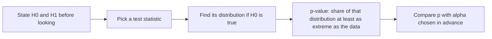

# Day 45: Hypothesis Tests, p-values and A/B Tests

**Phase 1 · Week 7 · ~120 minutes**

## Objectives

- [ ] State a null and an alternative hypothesis for a real question, and pick a test statistic for it.
- [ ] Explain a p-value as "how surprising would this data be if nothing were going on", and list three things it does **not** mean.
- [ ] Run a permutation test properly: enumerate it by hand for 6 values, then simulate it for 462 apps.
- [ ] Compute a two-sample z test by formula, check it against the permutation test, and know when to switch to the t test.
- [ ] Test a difference in conversion rates, the bread and butter of A/B testing.
- [ ] Define the significance level, type I and type II errors and power, and measure each by simulation.
- [ ] Compute the sample size an A/B test needs before you start it.
- [ ] Recognise multiple comparisons and p-hacking (including "peeking"), and show by simulation how they inflate false positives.

**Prerequisites.** [Day 20](day-20-week3-review.md) and [Day 27](day-27-month1-milestone.md) (the shuffle test you already ran), [Day 37](day-37-distributions.md) (binomial and normal distributions, `normal_cdf`), [Day 39](day-39-expectation-variance.md) (variance of a sum, \( \sigma/\sqrt{n} \)), [Day 43](day-43-sampling.md) (standard error, \( n - 1 \)) and [Day 44](day-44-confidence-intervals.md) (confidence intervals).

---

## The big idea

A courtroom starts from **"innocent until proven guilty"**. The prosecution doesn't have to prove guilt with certainty; it has to show evidence that would be very hard to explain *if the defendant were innocent*. If the evidence is only mildly odd, the verdict is "not guilty", which is not the same as "innocent": it means "not enough evidence".

A hypothesis test is that procedure, with numbers:

| Courtroom | Hypothesis test | Symbol |
|---|---|---|
| "The defendant is innocent" (the default) | **Null hypothesis**: nothing is going on, the difference is zero | \( H_0 \) |
| "The defendant is guilty" | **Alternative hypothesis**: something is going on | \( H_1 \) |
| The evidence | **Test statistic**: one number computed from the data | e.g. \( d \), \( z \), \( t \) |
| "How hard is this to explain if innocent?" | **p-value**: probability of evidence at least this strong, if \( H_0 \) is true | \( p \) |
| "Beyond reasonable doubt" | **Significance level**, the line you drew in advance | \( \alpha \), usually 0.05 |
| Convicting an innocent person | **Type I error** (false positive) | probability \( \alpha \) |
| Letting a guilty person go | **Type II error** (false negative) | probability \( \beta \) |

On Days 20 and 27 you already did this once, informally: you shuffled labels and counted how often luck produced a gap as big as the real one. Today that shuffle test gets its proper name, a formula version, an error budget and an honest list of the ways people fool themselves with it. And it gets its most common job in the app world: deciding whether variant B of a screen really beat variant A.

**Analogy for an app developer.** Your crash rate went from 0.21% to 0.25% after a release. Is the release worse, or is that just this week's noise? You can't rerun the week. What you *can* do is ask: "if the release changed nothing, how often would a week look this bad anyway?" If the answer is "every other week", relax. If it's "once in five years", roll back.

## The recipe

Every test today follows the same five steps:



Step 3 is where the methods differ. You can get the "null distribution" by **simulation** (shuffle, flip, resample) or by **formula** (the normal curve, thanks to Day 40's central limit theorem). The rest of the recipe never changes.

## A first test: is this coin fair?

A friend flips a coin 20 times and gets 15 heads. Is the coin biased?

1. **Hypotheses.** \( H_0 \): the coin is fair, the probability of heads is \( 0.5 \). \( H_1 \): it isn't (it could be biased either way).
2. **Test statistic.** \( X \), the number of heads. We saw \( X = 15 \).
3. **Null distribution.** If \( H_0 \) is true, \( X \) is binomial with \( n = 20 \), \( p = 0.5 \) (Day 37): \( P(X = k) = \binom{20}{k} / 2^{20} \). Its expected value is \( 10 \).
4. **p-value.** "At least as extreme as 15" means at least as far from 10 as 15 is: 15 or more heads, **or 5 or fewer** (a coin biased towards tails would be just as interesting). Add up those probabilities.

<figure class="diagram" markdown>

<figcaption>Animated: a p-value is the area of the null distribution at least as extreme as what you saw, in both directions for a two-sided test.</figcaption>
</figure>

Worked by hand: the counts of ways to get 15, 16, ..., 20 heads are \( \binom{20}{15} = 15504 \), \( 4845 \), \( 1140 \), \( 190 \), \( 20 \) and \( 1 \). They sum to \( 21700 \), and \( 2^{20} = 1048576 \), so

\[
P(X \ge 15) = \frac{21700}{1048576} \approx 0.0207
\qquad
p = P(X \ge 15) + P(X \le 5) = 2 \times 0.0207 \approx 0.041
\]

```python
import math
import numpy as np

n_flips, k_seen = 20, 15
p_k = np.array([math.comb(n_flips, k) for k in range(n_flips + 1)]) / 2 ** n_flips  # Day 37's binomial pmf, p = 0.5
upper = p_k[15:].sum()                 # P(X >= 15)
lower = p_k[:6].sum()                  # P(X <= 5), the mirror-image tail
print(f"P(X >= 15) = {upper:.5f}   P(X <= 5) = {lower:.5f}   two-sided p = {upper + lower:.5f}")

rng = np.random.default_rng(45)
heads = rng.binomial(n_flips, 0.5, size=100_000)   # 100,000 worlds where the coin IS fair
print(f"simulated: {np.mean(np.abs(heads - 10) >= 5):.5f}")
# P(X >= 15) = 0.02069   P(X <= 5) = 0.02069   two-sided p = 0.04139
# simulated: 0.04006
```

The formula and the simulation agree: **a fair coin produces something this lopsided about 4 times in 100.** That is the whole meaning of \( p = 0.041 \). It's fairly surprising, so most people would say "some evidence the coin is biased". It is not proof: 4 in 100 is not 0.

**One-sided vs two-sided.** If, *before flipping*, you had a reason to care only about "biased towards heads", you could use \( H_1 \): \( p > 0.5 \) and count only the upper tail, \( p = 0.021 \). Deciding that *after* seeing 15 heads, to halve your p-value, is cheating. Use two-sided tests unless you wrote the direction down in advance.

### The same test with the normal curve

Simulating or summing a binomial is easy here, but most real statistics have no neat exact distribution. The universal shortcut is the **z score** from Day 37: how many standard deviations the statistic sits from what \( H_0 \) expects.

\[
z = \frac{\text{observed} - \text{expected under } H_0}{\text{standard deviation under } H_0}
\]

Under \( H_0 \) the binomial has mean \( np = 10 \) and standard deviation \( \sqrt{np(1-p)} = \sqrt{20 \times 0.25} = \sqrt{5} \approx 2.236 \). So \( z = (15 - 10)/2.236 = 2.236 \). By the central limit theorem (Day 40), \( z \) is roughly standard normal under \( H_0 \), so the two-sided p-value is the area of the bell beyond \( \pm 2.236 \): \( p = 2\,(1 - \Phi(|z|)) \), where \( \Phi \) is the standard normal CDF. We reuse Day 37's helper:

```python
def normal_cdf(x, mu=0.0, sigma=1.0):
    """P(X <= x) for a normal variable (Day 37's helper)."""
    z = (np.asarray(x, dtype=float) - mu) / sigma
    return 0.5 * (1 + np.vectorize(math.erf)(z / np.sqrt(2)))

z = (15 - 10) / np.sqrt(20 * 0.5 * 0.5)          # (observed - expected) / sd under H0
print(f"z = {z:.3f}   normal-approximation p = {2 * (1 - normal_cdf(abs(z))):.4f}")
# z = 2.236   normal-approximation p = 0.0253
```

0.025 instead of 0.041: with only 20 flips the bell is a rough fit to the bars (the bars are chunky, and the bell ignores half of the bar at 15). With hundreds of observations the approximation becomes excellent, as you'll see below. When the exact answer is cheap, prefer it.

!!! warning "Common mistake: reading a p-value backwards"
    \( p = 0.041 \) means **P(data this extreme | \( H_0 \) true) = 0.041**. It does **not** mean:

    - "There's a 4.1% chance the coin is fair." That's P(\( H_0 \) | data), the reverse conditional. Day 38 showed how different those two can be: you'd need a prior and Bayes' rule to get it.
    - "There's a 95.9% chance the effect is real."
    - "The effect is big." A tiny, useless effect gets a tiny p-value with enough data.

    And a large p-value does not prove \( H_0 \). "Not guilty" is not "innocent": it may just mean the trial was too small.

## The permutation test, properly

The coin had a textbook null distribution. Most questions don't: "do games rate higher than other apps?" has no binomial to look up. The **permutation test** builds the null distribution from the data itself, using one idea:

> If \( H_0 \) is true and the group label has nothing to do with the rating, then the labels are just arbitrary tags. Any shuffling of them was equally likely to be the one we got.

So you shuffle the labels many times, recompute the statistic each time, and see where the real value falls among the shuffled ones.

**By hand, with 6 apps.** Three games rated 4.6, 4.5, 4.4 and three education apps rated 4.3, 4.1, 3.9. The test statistic is the difference in means, \( d = \bar{x}_\text{games} - \bar{x}_\text{edu} = 4.5 - 4.1 = 0.40 \). There are \( \binom{6}{3} = 20 \) ways to choose which 3 of the 6 apps carry the "games" label, so here we can list the whole null distribution instead of sampling it:

<figure class="diagram" markdown>

<figcaption>Animated: each shuffle of the labels gives one difference "from luck alone"; the p-value is the share of all splits at least as extreme as the real one.</figcaption>
</figure>

```python
from itertools import combinations

ratings6 = np.array([4.6, 4.5, 4.4, 4.3, 4.1, 3.9])    # first three are games, last three education
observed6 = ratings6[:3].mean() - ratings6[3:].mean()
diffs6 = []
for idx in combinations(range(6), 3):                 # every way to choose which 3 are "games"
    mask = np.zeros(6, dtype=bool)
    mask[list(idx)] = True
    diffs6.append(ratings6[mask].mean() - ratings6[~mask].mean())
diffs6 = np.round(diffs6, 4)
print(len(diffs6), "splits; observed =", round(observed6, 4))
print(np.sort(diffs6))
print("p =", np.mean(np.abs(diffs6) >= abs(observed6) - 1e-9))
```

```text
20 splits; observed = 0.4
[-0.4    -0.3333 -0.2667 -0.2    -0.2    -0.1333 -0.0667 -0.0667 -0.0667
  0.      0.      0.0667  0.0667  0.0667  0.1333  0.2     0.2     0.2667
  0.3333  0.4   ]
p = 0.1
```

(The `- 1e-9` makes the comparison immune to floating-point dust: \( 4.5 - 4.1 \) is not exactly \( 0.4 \) in binary.) Every game outrates every education app, the most extreme split possible, and still \( p = 2/20 = 0.10 \). **Six data points can never produce strong evidence**: the smallest p-value this test can reach is 0.10. Sample size limits what any test can conclude.

**For real: 462 apps.** Do games rate higher than all other categories? Load and clean the dataset as on Day 17 (lesson tested on pandas 3.0; you can also download the CSV from the [Datasets](../../datasets.md) page and read a local copy):

```python
import pandas as pd

BASE = "https://manjulkadyan.github.io/ai-leaning/assets/data/"
apps = pd.read_csv(BASE + "play_store_apps.csv")      # or a local copy from the Datasets page
apps = apps.drop_duplicates()
apps["category"] = apps["category"].str.strip().str.title()
rated = apps[apps["rating"].notna()]
is_game = (rated["category"] == "Games").to_numpy()
ratings = rated["rating"].to_numpy()
print(len(rated), "rated apps,", is_game.sum(), "games")
print(f"games mean = {ratings[is_game].mean():.3f}   others mean = {ratings[~is_game].mean():.3f}")
# 462 rated apps, 114 games
# games mean = 4.283   others mean = 4.127
```

\( H_0 \): the category label has nothing to do with the rating. \( H_1 \): games and other apps differ in mean rating. With 462 apps there are about \( 5 \times 10^{110} \) ways to place 114 "games" labels, so we can't list them; we sample 10,000 at random. This is Day 20's `shuffle_test` with one improvement:

```python
def permutation_test(values, in_a, n_shuffles=10_000, seed=45):
    """Two-sided permutation test for a difference in means (group A minus the rest).
    Returns (observed difference, array of shuffled differences, p-value)."""
    values = np.asarray(values, dtype=float)
    in_a = np.asarray(in_a, dtype=bool)
    observed = values[in_a].mean() - values[~in_a].mean()
    rng = np.random.default_rng(seed)
    diffs = np.empty(n_shuffles)
    for i in range(n_shuffles):
        fake = rng.permutation(in_a)                  # same group sizes, labels scrambled
        diffs[i] = values[fake].mean() - values[~fake].mean()
    extreme = np.sum(np.abs(diffs) >= abs(observed))
    p = (extreme + 1) / (n_shuffles + 1)              # count the real labelling as one of the shuffles
    return observed, diffs, p

obs, diffs, p_perm = permutation_test(ratings, is_game)
print(f"observed difference: {obs:+.4f} stars")
print(f"shuffles at least as extreme: {np.sum(np.abs(diffs) >= abs(obs))} of {len(diffs)}")
print(f"p = {p_perm:.4f}")
print(f"spread of the shuffled differences (sd): {diffs.std():.4f}")
# observed difference: +0.1563 stars
# shuffles at least as extreme: 21 of 10000
# p = 0.0022
# spread of the shuffled differences (sd): 0.0488
```

The improvement is the **+1**: the real labelling is itself one of the possible shuffles, so counting it keeps the p-value from ever being exactly 0 (a test that ran 10,000 shuffles can't honestly claim "less than 1 in 10,000"). Only 21 of 10,000 random labellings produced a gap as big as the real 0.156 stars. **If the category label meant nothing, a gap this large would be very rare.** So we reject \( H_0 \): games really do rate higher in this dataset. (Remember it's synthetic; and "higher" says nothing about *why*. Day 46 is about that.)

Because the shuffles are random, so is this p-value. A count of 21 has a sampling wobble of roughly \( \pm\sqrt{21} \approx \pm 4.6 \), so 0.0022 really means "somewhere around 0.001 to 0.003". Running 200,000 shuffles (try it: it takes a few seconds) settles it at about 0.0013. More shuffles buy precision, never a different conclusion.

## The two-sample z test: the same answer from a formula

Look at the shuffled differences on a histogram and a familiar shape appears: a bell centred at 0. That's no accident. A difference of two means is a sum of many small independent pieces, so the central limit theorem (Day 40) makes it close to normal. If we can predict that bell's width from a formula, we don't need to shuffle at all.

**The width.** From Day 43, the mean of \( n \) values with standard deviation \( \sigma \) has standard error \( \sigma/\sqrt{n} \), so its variance is \( \sigma^2/n \). From Day 39, the variance of a difference of independent quantities is the **sum** of their variances (a minus sign doesn't cancel randomness, it adds more). So the standard error of \( \bar{x}_A - \bar{x}_B \) is

\[
\mathrm{SE} = \sqrt{\frac{s_A^2}{n_A} + \frac{s_B^2}{n_B}}
\]

- \( s_A, s_B \): the sample standard deviations of the two groups (with \( n - 1 \), Day 43), standing in for the unknown \( \sigma \)s.
- \( n_A, n_B \): the group sizes.

Then the test statistic is "how many standard errors is the observed difference away from the 0 that \( H_0 \) predicts":

\[
z = \frac{\bar{x}_A - \bar{x}_B - 0}{\mathrm{SE}}
\qquad\qquad
p = 2\,\big(1 - \Phi(|z|)\big)
\]

**Worked example.** Games: \( n_A = 114 \), \( \bar{x}_A = 4.2833 \), \( s_A = 0.4255 \). Others: \( n_B = 348 \), \( \bar{x}_B = 4.1270 \), \( s_B = 0.4568 \).

\[
\mathrm{SE} = \sqrt{\frac{0.4255^2}{114} + \frac{0.4568^2}{348}} = \sqrt{0.001588 + 0.000600} = \sqrt{0.002188} \approx 0.0468
\qquad
z = \frac{0.1563}{0.0468} \approx 3.34
\]

A difference of 3.34 standard errors. On Day 37's 68–95–99.7 rule, 3 standard deviations already covers 99.7% of the bell, so the two tails beyond 3.34 hold well under 0.3%.

```python
def two_sample_z(a, b):
    """Difference in means a - b, its standard error, z and the two-sided normal p-value."""
    a, b = np.asarray(a, dtype=float), np.asarray(b, dtype=float)
    diff = a.mean() - b.mean()
    se = np.sqrt(a.var(ddof=1) / len(a) + b.var(ddof=1) / len(b))
    z = diff / se
    p = 2 * (1 - normal_cdf(abs(z)))
    return diff, se, z, float(p)

games, others = ratings[is_game], ratings[~is_game]
print(f"games:  n = {len(games)}, mean = {games.mean():.4f}, s = {games.std(ddof=1):.4f}")
print(f"others: n = {len(others)}, mean = {others.mean():.4f}, s = {others.std(ddof=1):.4f}")
diff, se, z, p_z = two_sample_z(games, others)
print(f"diff = {diff:.4f}   SE = {se:.4f}   z = {z:.3f}   p = {p_z:.5f}")
# games:  n = 114, mean = 4.2833, s = 0.4255
# others: n = 348, mean = 4.1270, s = 0.4568
# diff = 0.1563   SE = 0.0468   z = 3.342   p = 0.00083
```

Now put the formula's bell on top of the 10,000 shuffles:

```python
import matplotlib
matplotlib.use("Agg")            # draw into files, no window (leave this out in Jupyter)
import matplotlib.pyplot as plt

plt.rcParams.update({
    "font.size": 11,
    "figure.facecolor": "white",
    "savefig.facecolor": "white",
    "axes.spines.top": False,
    "axes.spines.right": False,
})

fig, ax = plt.subplots(figsize=(9, 4))
ax.hist(diffs, bins=60, density=True, color="#c5cae9", edgecolor="#3949ab", lw=0.5,
        label="10,000 shuffled differences")
grid = np.linspace(-0.22, 0.22, 400)
ax.plot(grid, np.exp(-grid ** 2 / (2 * se ** 2)) / (se * np.sqrt(2 * np.pi)), color="#00897b", lw=2,
        label=f"normal curve, mean 0, sd = SE = {se:.3f}")
ax.axvline(obs, color="#e53935", lw=2, label=f"observed difference = {obs:+.3f}")
ax.axvline(-obs, color="#e53935", lw=1.5, ls="--", label="its mirror image")
ax.set_xlabel("difference in mean rating, games minus others (stars)")
ax.set_ylabel("density")
ax.set_title("What luck alone produces, and where the real data lands")
ax.legend(frameon=False, loc="upper center", bbox_to_anchor=(0.5, -0.22), ncol=2, fontsize=9)
fig.tight_layout()
fig.savefig("day45-permutation-null.svg", format="svg", bbox_inches="tight")
```

<figure class="diagram" markdown>

<figcaption>The permutation test's null distribution (bars) and the z test's formula (green curve) describe the same bell. The real difference sits far out in its tail.</figcaption>
</figure>

Both methods agree on the verdict: a p-value around 0.001, strong evidence. The small gap between them (0.0008 vs about 0.0013 for a very long permutation run) has a precise cause. Shuffling mixes the groups, so the permutation bell's width uses one *pooled* spread for everyone (sd 0.0488); the z formula lets each group keep its own spread (0.0468), and games happen to be slightly less spread out. Two reasonable models of "nothing is going on", two slightly different answers. When they disagree a lot, suspect a small sample or very skewed data, and trust the permutation test.

**Tests and confidence intervals are two views of one calculation.** Day 44's 95% interval for the difference is \( 0.156 \pm 1.96 \times 0.0468 = [0.065, 0.248] \). It excludes 0, which is exactly the statement "the two-sided z test gives \( p < 0.05 \)". In reports, give the interval: it says *how big* the effect is, not only that it isn't zero.

### Small samples: the t test

The z test pretends the standard error is known exactly. It isn't: it's computed from \( s_A \) and \( s_B \), which are themselves noisy, very noisy when each group has 5 or 10 values. That extra uncertainty makes the true null distribution of the statistic slightly **wider-tailed** than the normal bell. William Gosset worked out its shape in 1908 (publishing as "Student", because his employer, the Guinness brewery, didn't allow staff to publish under their own names): **Student's t distribution**. It has one setting, the **degrees of freedom** \( \nu \) ("nu"), roughly "how much data the spread estimate rests on". Small \( \nu \), fat tails; as \( \nu \) grows, it becomes the normal curve.

The standard version for two groups is **Welch's t test**: the same statistic as the z test (now called \( t \)), compared with a t distribution whose degrees of freedom come from this formula (you never need to memorise it; it's what every library computes):

\[
\nu = \frac{\left(\frac{s_A^2}{n_A} + \frac{s_B^2}{n_B}\right)^2}{\frac{(s_A^2/n_A)^2}{n_A - 1} + \frac{(s_B^2/n_B)^2}{n_B - 1}}
\]

The t distribution's CDF isn't in Python's `math` module, but its density is a known formula, so we can integrate it numerically with `np.trapezoid` (adding up thin trapezoids under the curve) and check the result against values from any printed t table:

```python
def t_cdf_two_sided_p(t, df):
    """Two-sided p-value from Student's t distribution, by numerically integrating its density."""
    c = math.exp(math.lgamma((df + 1) / 2) - math.lgamma(df / 2)) / math.sqrt(df * math.pi)
    grid = np.linspace(0, abs(t), 20_001)
    density = c * (1 + grid ** 2 / df) ** (-(df + 1) / 2)
    return 1 - 2 * np.trapezoid(density, grid)        # 1 minus the middle area

for df_ in (5, 10, 30, 1000):
    print(f"df = {df_:4d}: p at t = 1.96 is {t_cdf_two_sided_p(1.96, df_):.4f}")
print(f"table check: p(2.228, df=10) = {t_cdf_two_sided_p(2.228, 10):.4f}, p(2.571, df=5) = {t_cdf_two_sided_p(2.571, 5):.4f}")
# df =    5: p at t = 1.96 is 0.1073
# df =   10: p at t = 1.96 is 0.0784
# df =   30: p at t = 1.96 is 0.0593
# df = 1000: p at t = 1.96 is 0.0503
# table check: p(2.228, df=10) = 0.0500, p(2.571, df=5) = 0.0500
```

(`math.lgamma` is the logarithm of the gamma function, a smooth version of the factorial; the density's constant uses it.) At \( t = 1.96 \), which the normal curve calls \( p = 0.05 \), a t distribution with 5 degrees of freedom says 0.107: with tiny samples the z test is overconfident. By 1,000 degrees of freedom the two are the same. And the table check reproduces the textbook critical values 2.228 and 2.571. Now Welch's test on our data, at full size and shrunk to 8 apps per group:

```python
def welch_t_test(a, b):
    """Welch's two-sample t test: same statistic as the z test, t-distribution p-value."""
    a, b = np.asarray(a, dtype=float), np.asarray(b, dtype=float)
    va, vb = a.var(ddof=1) / len(a), b.var(ddof=1) / len(b)
    t = (a.mean() - b.mean()) / np.sqrt(va + vb)
    df = (va + vb) ** 2 / (va ** 2 / (len(a) - 1) + vb ** 2 / (len(b) - 1))
    return t, df, t_cdf_two_sided_p(t, df)

t, df_w, p_t = welch_t_test(games, others)
print(f"all data:  t = {t:.3f}, df = {df_w:.1f}, p = {p_t:.5f}   (z test said {p_z:.5f})")

rng = np.random.default_rng(7)
small_g = rng.choice(games, size=8, replace=False)
small_o = rng.choice(others, size=8, replace=False)
print("small games: ", small_g)
print("small others:", small_o)
_, _, z_s, p_zs = two_sample_z(small_g, small_o)
t_s, df_s, p_ts = welch_t_test(small_g, small_o)
_, _, p_ps = permutation_test(np.r_[small_g, small_o], np.r_[np.ones(8, bool), np.zeros(8, bool)])
print(f"8 vs 8: z test p = {p_zs:.4f}   t test p = {p_ts:.4f} (df = {df_s:.1f})   permutation p = {p_ps:.4f}")
# all data:  t = 3.342, df = 204.9, p = 0.00099   (z test said 0.00083)
# small games:  [4.4 4.  4.7 4.3 4.5 4.9 4.5 4.8]
# small others: [4.4 4.6 4.2 3.8 4.8 4.5 3.7 4.4]
# 8 vs 8: z test p = 0.2099   t test p = 0.2319 (df = 13.1)   permutation p = 0.2481
```

(`np.r_[a, b]` glues arrays end to end, like `np.concatenate`.) With 8 apps per group the z test gives the smallest p-value of the three, because it ignores the noise in \( s \). The rule of thumb: **use Welch's t test for comparing two means**, always; it costs nothing at large \( n \) and protects you at small \( n \). (On your own machine, `scipy.stats.ttest_ind(a, b, equal_var=False)` computes the same thing.) Note that the same 0.16-star effect is now nowhere near significant: 16 apps simply can't detect it. Keep that in mind for the section on power.

!!! warning "Common mistake: “not significant” read as “no effect”"
    The 8-vs-8 test above gives \( p \approx 0.23 \), yet we know from the full data that games do rate higher. A non-significant result from a small test is **absence of evidence, not evidence of absence**. Always report the confidence interval: here it would run from clearly negative to clearly positive, which says honestly "we can't tell", rather than "there's no difference".

## Testing proportions: the A/B test

Most app experiments measure a **rate**: the share of users who finish onboarding, subscribe, or crash. Each user is a 0/1 outcome, a Bernoulli variable (Day 37) with mean \( p \) and variance \( p(1-p) \) (Day 39).

**The experiment.** You show 5,000 new users the old onboarding (control, A) and 5,000 a new one (variant B), assigned at random. Conversions: 250 in A, 290 in B. That's 5.0% versus 5.8%, a 16% relative lift. Ship it?

- \( H_0 \): both versions convert at the same rate. \( H_1 \): they don't.
- If \( H_0 \) is true, both groups share one rate, best estimated by pooling everyone: \( \hat{p} = (250 + 290)/10000 = 0.054 \). (The hat on \( \hat{p} \) means "estimated from data".)
- The standard error of the difference of two rates, under \( H_0 \), is the formula from the last section with \( s^2 = \hat{p}(1 - \hat{p}) \) for both groups:

\[
\mathrm{SE} = \sqrt{\hat{p}(1-\hat{p})\left(\frac{1}{n_A} + \frac{1}{n_B}\right)} = \sqrt{0.054 \times 0.946 \times \left(\tfrac{1}{5000} + \tfrac{1}{5000}\right)} \approx 0.00452
\]

\[
z = \frac{0.058 - 0.050}{0.00452} \approx 1.77
\qquad
p = 2\,(1 - \Phi(1.77)) \approx 0.077
\]

```python
n_a, conv_a = 5000, 250            # control: old onboarding
n_b, conv_b = 5000, 290            # variant: new onboarding
p_a, p_b = conv_a / n_a, conv_b / n_b
p_pool = (conv_a + conv_b) / (n_a + n_b)              # the conversion rate if H0 is true
se_pool = np.sqrt(p_pool * (1 - p_pool) * (1 / n_a + 1 / n_b))
z_ab = (p_b - p_a) / se_pool
p_ab = 2 * (1 - normal_cdf(abs(z_ab)))
print(f"control {p_a:.2%}  variant {p_b:.2%}  lift {p_b - p_a:+.2%} ({(p_b - p_a) / p_a:+.0%} relative)")
print(f"pooled rate {p_pool:.4f}   SE {se_pool:.5f}   z = {z_ab:.3f}   p = {p_ab:.4f}")

outcome = np.r_[np.ones(conv_a), np.zeros(n_a - conv_a), np.ones(conv_b), np.zeros(n_b - conv_b)]
in_b = np.r_[np.zeros(n_a, bool), np.ones(n_b, bool)]
obs_ab, diffs_ab, p_ab_perm = permutation_test(outcome, in_b, n_shuffles=5_000)
print(f"permutation test: observed {obs_ab:+.4f}, p = {p_ab_perm:.4f}")
# control 5.00%  variant 5.80%  lift +0.80% (+16% relative)
# pooled rate 0.0540   SE 0.00452   z = 1.770   p = 0.0768
# permutation test: observed +0.0080, p = 0.0846
```

The permutation test needs no new code: a rate is just the mean of 0/1 outcomes, so shuffling "A"/"B" labels over 10,000 users works exactly as before. Both say \( p \approx 0.08 \): **a 16% lift that could easily be noise.** The 95% interval for the lift (with the unpooled SE, Day 44 style) is \( 0.008 \pm 1.96 \times 0.00452 = [-0.09\%, +1.69\%] \): anything from a tiny loss to a big win. With 5,000 users per group, this experiment simply can't tell. How many users *would* it need? That's the question of power, after one more piece of vocabulary.

## Significance level and the two kinds of error

To turn a p-value into a decision, choose a **significance level** \( \alpha \) *before* the experiment, and reject \( H_0 \) when \( p < \alpha \). Then exactly four things can happen:

| | **\( H_0 \) is true** (no real effect) | **\( H_1 \) is true** (a real effect) |
|---|---|---|
| **Reject \( H_0 \)** ("it worked!") | **Type I error**, false positive. Probability \( \alpha \) | Correct. Probability \( 1 - \beta \), the **power** |
| **Don't reject** ("no evidence") | Correct. Probability \( 1 - \alpha \) | **Type II error**, false negative. Probability \( \beta \) |

Why does \( \alpha \) equal the false positive rate? Because if \( H_0 \) is true, the p-value is "the probability of something at least this extreme under \( H_0 \)", so \( p < 0.05 \) happens in exactly 5% of experiments, by construction. Put differently: **when nothing is going on, p-values are uniformly spread between 0 and 1.** Check it with 10,000 **A/A tests**, experiments where both groups get the *same* version (a real practice: teams run them to test their pipeline), and 10,000 A/B tests where B is truly better, 5.8% vs 5.0%:

```python
def prop_z_test(conv_a, n_a, conv_b, n_b):
    """Vectorised two-proportion z test: works on arrays of experiments at once."""
    p_pool = (conv_a + conv_b) / (n_a + n_b)
    se = np.sqrt(p_pool * (1 - p_pool) * (1 / n_a + 1 / n_b))
    z = (conv_b / n_b - conv_a / n_a) / se
    return 2 * (1 - normal_cdf(np.abs(z)))

rng = np.random.default_rng(45)
n_exp = 10_000
aa = prop_z_test(rng.binomial(5000, 0.05, n_exp), 5000, rng.binomial(5000, 0.05, n_exp), 5000)
ab = prop_z_test(rng.binomial(5000, 0.05, n_exp), 5000, rng.binomial(5000, 0.058, n_exp), 5000)
print(f"A/A tests (no real effect):     {np.mean(aa < 0.05):.3f} have p < 0.05   <- type I error rate")
print(f"A/B tests (5.0% vs 5.8% true):  {np.mean(ab < 0.05):.3f} have p < 0.05   <- power")
print(f"A/B tests that missed it:       {np.mean(ab >= 0.05):.3f}                 <- type II error rate")
# A/A tests (no real effect):     0.051 have p < 0.05   <- type I error rate
# A/B tests (5.0% vs 5.8% true):  0.420 have p < 0.05   <- power
# A/B tests that missed it:       0.580                 <- type II error rate
```

`rng.binomial(5000, 0.05, n_exp)` draws the number of conversions among 5,000 users, 10,000 times at once, so each "experiment" costs one random number per group. The A/A false positive rate is 5.1%, as promised. And the shocker: when B **really is** 16% better, a 5,000-per-group experiment detects it only 42% of the time. Most of the time, the team would conclude "the new onboarding doesn't help" and throw away a genuine improvement.

## Power and sample size

**Power** is the probability that the test detects an effect that is really there: \( 1 - \beta \). The picture: one bell for the z statistic if \( H_0 \) is true, a second bell, shifted right, if \( H_1 \) is true. The line at 1.96 is fixed by \( \alpha \). Power is how much of the \( H_1 \) bell lands past the line.

<figure class="diagram" markdown>
![Animation: a blue bell centred at 0 labelled "H0 true: no real lift" with small red tails beyond dashed lines at −1.96 and +1.96; an orange bell labelled "H1 true: 5.0% → 5.8%" sits centred at 1.77 for n = 5,000 users per group, with its part beyond 1.96 shaded teal (power 0.42) and the rest orange (type II error 0.57); it then jumps to a centre of 2.80 for n = 12,526 (power 0.80, type II error 0.20) and to 4.34 for n = 30,000 (power 0.99, type II error 0.01), while the red type I error area stays the same](../../assets/img/phase-1/day45-errors-power.svg)
<figcaption>Animated: more users shrink the standard error, which pushes the H₁ bell away from H₀'s; the red false-positive area α stays fixed, the teal power grows.</figcaption>
</figure>

Why the bell moves: its centre is the true lift divided by the standard error, \( 0.008/\mathrm{SE} \). The standard error shrinks like \( 1/\sqrt{n} \) (Day 39), so the centre grows like \( \sqrt{n} \). The animation's numbers come from this formula, where \( \mathrm{SE}_1 \) is the standard error when \( H_1 \) is true (each group with its own rate):

\[
\text{power} \approx \Phi\!\left(\frac{|p_B - p_A|}{\mathrm{SE}_1} - 1.96\right)
\qquad
\mathrm{SE}_1 = \sqrt{\frac{p_A(1-p_A)}{n} + \frac{p_B(1-p_B)}{n}}
\]

(It ignores the tiny chance of landing past \( -1.96 \) on the wrong side.) Check it against simulation:

```python
def power_formula(p1, p2, n, z_crit=1.96):
    """Approximate power of a two-sided two-proportion z test with n users per group."""
    se = np.sqrt(p1 * (1 - p1) / n + p2 * (1 - p2) / n)
    return normal_cdf(abs(p2 - p1) / se - z_crit)

ns = np.array([1000, 2000, 5000, 10_000, 12_526, 20_000, 30_000])
sim_power = [np.mean(prop_z_test(rng.binomial(n, 0.05, 4000), n, rng.binomial(n, 0.058, 4000), n) < 0.05)
             for n in ns]
for n, sp in zip(ns, sim_power):
    print(f"n = {n:6d} per group   power: simulated {sp:.3f}   formula {power_formula(0.05, 0.058, n):.3f}")
# n =   1000 per group   power: simulated 0.132   formula 0.121
# n =   2000 per group   power: simulated 0.193   formula 0.200
# n =   5000 per group   power: simulated 0.432   formula 0.425
# n =  10000 per group   power: simulated 0.716   formula 0.707
# n =  12526 per group   power: simulated 0.798   formula 0.800
# n =  20000 per group   power: simulated 0.942   formula 0.943
# n =  30000 per group   power: simulated 0.991   formula 0.991
```

**Sample size.** Turn the power formula around: to get power \( 1 - \beta \) at level \( \alpha \), the \( H_1 \) bell's centre must sit \( z_{\alpha/2} + z_\beta \) standard errors from 0, where \( z_{\alpha/2} = 1.96 \) (the line) and \( z_\beta = 0.8416 \) (the point with 80% of the bell to its left, for power 0.8). Solving \( |p_B - p_A| / \mathrm{SE}_1 = z_{\alpha/2} + z_\beta \) for \( n \):

\[
n = \frac{(z_{\alpha/2} + z_\beta)^2 \,\big(p_A(1-p_A) + p_B(1-p_B)\big)}{(p_B - p_A)^2}
\]

**Worked example.** To detect 5.0% → 5.8% with \( \alpha = 0.05 \) and 80% power: \( (1.96 + 0.8416)^2 = 7.849 \); \( 0.05 \times 0.95 + 0.058 \times 0.942 = 0.10214 \); \( 0.008^2 = 0.000064 \). So \( n = 7.849 \times 0.10214 / 0.000064 \approx 12{,}526 \) users **per group**.

```python
z_a, z_b = 1.96, 0.8416                                # alpha = 0.05 two-sided, power = 0.80
print(f"check: Phi(1.96) = {normal_cdf(1.96):.4f}   Phi(0.8416) = {normal_cdf(0.8416):.4f}")

def sample_size(p1, p2, z_alpha=1.96, z_beta=0.8416):
    """Users per group to detect p1 -> p2 with a two-sided test (alpha 0.05, power 0.8 by default)."""
    return math.ceil((z_alpha + z_beta) ** 2 * (p1 * (1 - p1) + p2 * (1 - p2)) / (p2 - p1) ** 2)

for p2 in (0.058, 0.055, 0.0525):
    print(f"5.0% -> {p2:.2%}: {sample_size(0.05, p2):7,d} users per group")
# check: Phi(1.96) = 0.9750   Phi(0.8416) = 0.8000
# 5.0% -> 5.80%:  12,526 users per group
# 5.0% -> 5.50%:  31,232 users per group
# 5.0% -> 5.25%: 122,123 users per group
```

Halve the effect you want to detect and you need roughly **four times** the users: the effect is squared in the denominator. That's Day 39's \( \sqrt{n} \) again, and it's the single most important number in experiment planning. A 0.25-point lift on a 5% conversion needs 122,000 users per group; if your app gets 2,000 new users a week, that test would take over two years. Better to test bolder changes.

```python
fig, (ax1, ax2) = plt.subplots(1, 2, figsize=(11, 4.2))
bins = np.linspace(0, 1, 21)
ax1.hist(aa, bins=bins, color="#c5cae9", edgecolor="#3949ab", label="A/A: no real difference")
ax1.hist(ab, bins=bins, color="#ffcc80", edgecolor="#ef6c00", alpha=0.75, label="A/B: true 5.0% vs 5.8%")
ax1.axvline(0.05, color="#e53935", lw=1.5, ls="--", label="alpha = 0.05")
ax1.set_xlabel("p-value")
ax1.set_ylabel("number of experiments (of 10,000)")
ax1.set_title("p-values of 10,000 experiments, n = 5,000 per group")
ax1.legend(frameon=False)

n_grid = np.linspace(500, 30_000, 200)
ax2.plot(n_grid, power_formula(0.05, 0.058, n_grid), color="#00897b", lw=2, label="formula")
ax2.plot(ns, sim_power, "o", color="#ef6c00", label="simulated (4,000 experiments each)")
ax2.axhline(0.8, color="#555", lw=1, ls=":")
ax2.axvline(sample_size(0.05, 0.058), color="#555", lw=1, ls=":")
ax2.annotate("80% power at\n12,526 per group", xy=(12_526, 0.8), xytext=(15_500, 0.45),
             arrowprops=dict(arrowstyle="->", color="#555"), color="#555")
ax2.set_ylim(0, 1.02)
ax2.set_xlabel("users per group")
ax2.set_ylabel("power: P(p < 0.05)")
ax2.set_title("Power to detect 5.0% vs 5.8%")
ax2.legend(frameon=False, loc="lower right")
fig.tight_layout()
fig.savefig("day45-power.svg", format="svg", bbox_inches="tight")
```

<figure class="diagram" markdown>

<figcaption>Left: with no real effect, p-values are flat, so 5% of them fall below 0.05 by construction; a real effect piles them up near 0. Right: power grows with sample size, and the formula matches simulation.</figcaption>
</figure>

!!! warning "Common mistake: running the test, then computing the sample size"
    Power analysis is done **before** the experiment, from the smallest effect worth acting on (the "minimum detectable effect"). Computing power afterwards from the effect you happened to observe ("post-hoc power") adds nothing: it's just the p-value in disguise. If you can't afford the sample size the formula asks for, change the plan (a bolder variant, a more sensitive metric, a longer run), not the analysis.

## Multiple comparisons

\( \alpha = 0.05 \) is the false positive rate of **one** test. Run many tests and the chance that at least one of them "wins" by luck grows fast. If \( m \) independent tests all have a true \( H_0 \), each avoids a false positive with probability 0.95, so

\[
P(\text{at least one false positive}) = 1 - 0.95^m
\]

**Worked example.** With 20 metrics on your experiment dashboard (retention day 1, day 7, sessions, crashes, revenue, ...), \( 1 - 0.95^{20} = 1 - 0.358 = 0.642 \). Even if the variant does nothing at all, two experiments in three will show something "significant".

The simplest fix is the **Bonferroni correction**: with \( m \) tests, use \( \alpha/m \) for each. That keeps the chance of *any* false positive at most \( \alpha \) (it's conservative: you lose some power).

```python
for m in (1, 5, 20, 100):
    print(f"{m:3d} tests: P(at least one false positive) = {1 - 0.95 ** m:.3f}")

rng = np.random.default_rng(45)
m, n_exp = 20, 5000
pvals = prop_z_test(rng.binomial(5000, 0.05, (n_exp, m)), 5000, rng.binomial(5000, 0.05, (n_exp, m)), 5000)
print(f"simulated, 20 metrics with no real effect: {np.mean((pvals < 0.05).any(axis=1)):.3f} of experiments 'win' something")
print(f"with Bonferroni (p < 0.05 / 20):            {np.mean((pvals < 0.05 / m).any(axis=1)):.3f}")
#   1 tests: P(at least one false positive) = 0.050
#   5 tests: P(at least one false positive) = 0.226
#  20 tests: P(at least one false positive) = 0.642
# 100 tests: P(at least one false positive) = 0.994
# simulated, 20 metrics with no real effect: 0.637 of experiments 'win' something
# with Bonferroni (p < 0.05 / 20):            0.051
```

Back to the Play Store. Suppose that instead of asking about games in advance, you test **every** category against the rest, 8 tests, and report whichever look good:

```python
rows = []
for cat in sorted(rated["category"].unique()):
    in_cat = (rated["category"] == cat).to_numpy()
    d, _, zc, pc = two_sample_z(ratings[in_cat], ratings[~in_cat])
    rows.append({"category": cat, "n": int(in_cat.sum()), "diff": round(d, 3), "z": round(zc, 2), "p": round(pc, 4)})
table = pd.DataFrame(rows).sort_values("p")
table["p < 0.05"] = table["p"] < 0.05
table["p < 0.05/8"] = table["p"] < 0.05 / 8
print(table.to_string(index=False))
```

```text
        category   n   diff     z      p  p < 0.05  p < 0.05/8
           Games 114  0.156  3.34 0.0008      True        True
       Education  65 -0.143 -2.27 0.0234      True       False
Health & Fitness  40 -0.096 -1.23 0.2181     False       False
         Finance  27 -0.062 -0.86 0.3921     False       False
   Music & Audio  35  0.059  0.76 0.4489     False       False
    Productivity  61 -0.036 -0.56 0.5787     False       False
           Tools  74 -0.017 -0.29 0.7704     False       False
     Photography  46  0.016  0.23 0.8170     False       False
```

Games survives the correction (\( 0.0008 < 0.00625 \)). Education's \( p = 0.023 \) would have made a headline on its own ("education apps rate lower!"), but as the second-best of 8 tests it doesn't clear the Bonferroni bar. It may be real; this data just can't tell it apart from the luck of looking 8 times. The honest report says that you ran 8 tests.

## p-hacking, and the trap of peeking

**p-hacking** is any way of getting \( p < 0.05 \) by making choices after seeing the data: testing many metrics and reporting the winner, trying several subgroups ("it works for Android 14 users in Brazil!"), removing "outliers" until the result appears, switching from two-sided to one-sided, or **stopping the experiment as soon as it looks significant**. Each choice is a hidden extra test, so the real false positive rate is far above the 5% printed on the report. None of it requires bad intent; it's what curious people do naturally with a dashboard.

Peeking is the one app teams fall into most, because the dashboard updates every day. Simulate it: 4,000 A/A experiments (no real effect), 250 new users per group per day for 20 days, a z test on the running totals each day:

```python
rng = np.random.default_rng(45)
n_exp, days, per_day = 4000, 20, 250
daily_a = rng.binomial(per_day, 0.05, (n_exp, days))           # conversions per day, control
daily_b = rng.binomial(per_day, 0.05, (n_exp, days))           # same true rate: an A/A test
cum_a, cum_b = daily_a.cumsum(axis=1), daily_b.cumsum(axis=1)  # running totals after each day
n_so_far = per_day * np.arange(1, days + 1)                    # users per group after each day
p_daily = prop_z_test(cum_a, n_so_far, cum_b, n_so_far)        # shape (4000, 20): a p-value per day

print(f"look once, at day 20:            {np.mean(p_daily[:, -1] < 0.05):.3f} false positives")
print(f"look every day, stop at p < 0.05: {np.mean((p_daily < 0.05).any(axis=1)):.3f} false positives")
# look once, at day 20:            0.051 false positives
# look every day, stop at p < 0.05: 0.235 false positives
```

`prop_z_test` works on the whole `(4000, 20)` grid at once by broadcasting (Day 9): `n_so_far` has shape `(20,)` and lines up with the columns. Same experiments, same data: looking once gives the promised 5%, looking daily and stopping at the first "win" gives **23.5%**.

```python
fig, (ax1, ax2) = plt.subplots(1, 2, figsize=(11, 4.2), width_ratios=[1.4, 1])
day_axis = np.arange(1, days + 1)
for i, c in zip(range(6), ["#3949ab", "#00897b", "#ef6c00", "#8e24aa", "#6d4c41", "#546e7a"]):
    ax1.plot(day_axis, p_daily[i], color=c, lw=1.3, marker="o", ms=3)
ax1.axhline(0.05, color="#e53935", lw=1.5, ls="--", label="p = 0.05")
ax1.set_yscale("log")
ax1.set_xlabel("day of the experiment")
ax1.set_ylabel("p-value so far (log scale)")
ax1.set_title("Six A/A experiments, checked every day")
ax1.set_xticks([1, 5, 10, 15, 20])
ax1.legend(frameon=False, loc="lower right")

looks = np.arange(1, days + 1)
fp = [np.mean((p_daily[:, :k] < 0.05).any(axis=1)) for k in looks]
ax2.plot(looks, fp, "o-", color="#e53935", ms=4)
ax2.axhline(0.05, color="#555", lw=1, ls=":")
ax2.text(20, 0.058, "the promised 5%", ha="right", color="#555")
ax2.set_ylim(0, 0.3)
ax2.set_xticks([1, 5, 10, 15, 20])
ax2.set_xlabel("number of daily looks")
ax2.set_ylabel("false positive rate")
ax2.set_title("Peeking inflates false positives")
fig.tight_layout()
fig.savefig("day45-peeking.svg", format="svg", bbox_inches="tight")
```

<figure class="diagram" markdown>

<figcaption>Left: with no real effect, a p-value wanders, and one of six dips below 0.05 on day 2, for over a week mid-test, and twice more near the end. Right: the more often you are allowed to stop on a "win", the more false wins you collect.</figcaption>
</figure>

Look at the green path: an experiment with **no real effect** that was "significant" on day 2, for nine days in the middle, and again on days 18 and 20. A team that peeks ships it on day 2. The p-value isn't broken; it answers "how surprising is this at a fixed, pre-planned sample size", and stopping at a lucky moment breaks that premise.

The fixes, in order of simplicity:

1. **Fix the sample size in advance** (from the power calculation) and test once, at the end. Look at the dashboard for bugs and crashes, not for the winner.
2. If you must be able to stop early, plan the looks in advance and use a stricter threshold per look (exercise 5 finds one by simulation). Professional tools use **sequential tests** designed for this ("always-valid" p-values, group-sequential designs); that's beyond today, but now you know why they exist.

## The A/B test, framed end to end

Putting it all together, a trustworthy experiment looks like this. Day 48's mini-project runs every step on a full synthetic experiment log.

1. **Write the plan before launching.** One primary metric (e.g. onboarding completion), the hypotheses, \( \alpha \) (0.05), the minimum effect worth shipping, and the sample size from the power formula. Secondary metrics are labelled as exploratory.
2. **Randomise the users** (Day 36's stable hashing) and check the split: if you planned 50/50 and got 5,180 vs 4,820, that imbalance itself is a red flag for a bug (a "sample ratio mismatch"), and you should test it before trusting anything else.
3. **Run to the planned size.** Include full weeks, since behaviour differs on weekends.
4. **Test once**: a two-proportion z test (or a permutation test) for rates, Welch's t test (or a permutation test) for means like revenue per user.
5. **Report the effect with its confidence interval**, the p-value, and how many tests you ran. Then decide, using the interval: a significant lift of +0.01% isn't worth the code it adds; a non-significant interval of \( [-0.1\%, +1.7\%] \) means "inconclusive", not "no effect".

!!! android "Android bridge: Firebase A/B Testing on top of Remote Config"
    In an Android app, the standard way to run step 2 is **Firebase A/B Testing**, which assigns users to variants of a **Remote Config** parameter. The app only reads a value; the console decides which users get which value, at random, in the proportions you set:

    ```kotlin
    import com.google.firebase.Firebase
    import com.google.firebase.analytics.analytics
    import com.google.firebase.remoteconfig.remoteConfig

    val remoteConfig = Firebase.remoteConfig
    remoteConfig.setDefaultsAsync(mapOf("onboarding_variant" to "old"))   // control if nothing is fetched

    remoteConfig.fetchAndActivate().addOnCompleteListener {
        when (remoteConfig.getString("onboarding_variant")) {
            "new" -> showNewOnboarding()
            else -> showOldOnboarding()
        }
    }

    // When the user finishes onboarding: this event is the conversion the test compares
    fun onOnboardingFinished() {
        Firebase.analytics.logEvent("onboarding_complete", null)
    }
    ```

    In the console you create the experiment, choose the share of users to include and the split between variants, and pick a **goal metric** (here the `onboarding_complete` event; retention, crash-free users and revenue are also available). The console runs the statistics for you and reports each variant's estimated improvement with an interval. Today's lesson is how to read that page without fooling yourself:

    - **Decide the run length up front** from the sample size formula, using your real daily new-user count, and don't stop the experiment the first day a variant is marked as leading.
    - **Every extra goal metric is another test.** Pick one primary metric; treat the others as hints for the next experiment.
    - **An "activation event"** (an option in the experiment setup) restricts the analysis to users who actually reached the changed screen. Users who never saw the onboarding can't be affected by it, and including them adds noise that costs power.
    - Remote Config caches values (12 hours by default between fetches in production), so a user might see the control on the first launch and the variant later. Fetch early (for example on the splash screen) so each user sees one consistent variant.

    The Play Console's **store listing experiments** run the same kind of test on your store page (icon, screenshots, description), measuring installs instead of an in-app event.

## Where this shows up in ML

| Today's idea | Where you'll meet it |
|---|---|
| Permutation test | Permutation feature importance (Month 3): shuffle one feature's column and measure how much the model's score drops |
| Two-sample tests, CIs | "Is model B really better than model A?" on a test set; with the *same* test examples for both, compare per-example errors (a paired test) |
| A/B tests | Shipping a new recommendation or ranking model: offline metrics pick candidates, an online A/B test decides |
| Power and sample size | How big a test set must be to detect a 1-point accuracy gain (a few hundred examples can't, Day 44's interval shows why) |
| Multiple comparisons | Hyperparameter search: try 200 settings and the best validation score is partly luck, which is why a final, untouched **test set** exists (Day 55 and Month 3) |
| p-hacking | "Benchmark overfitting": tuning a model on the test set until it wins |

---

## Exercises

1. A coin lands heads 60 times in 100 flips. Compute the exact two-sided p-value from the binomial pmf and the normal-approximation p-value with \( z \). Do they agree on "significant at 0.05"? Why might they differ?
2. Paid vs free apps (Day 27's question). Run `permutation_test`, `two_sample_z` and `welch_t_test` on the ratings of paid apps (`price_usd > 0`) vs free apps. What do you conclude, and how would you phrase it in one sentence without claiming "no difference"?
3. An A/B test of a paywall: 480 of 4,000 users subscribe in control, 540 of 4,000 in the variant. Compute the z test's p-value. Then compute how many users per group a follow-up test would need to detect a 12.0% → 13.5% change with 80% power.
4. Simulate 2,000 A/A experiments where each group has only **5** ratings drawn from a normal distribution with mean 4.2 and sd 0.45. What fraction does the z test call significant at 0.05? And Welch's t test? Which one keeps its promise?
5. Using `p_daily` from the peeking simulation, find a per-look threshold that keeps the false positive rate of "look every day for 20 days, stop at the first win" close to 5%. Try 0.05, 0.01, 0.005 and 0.0025.
6. Your colleague says: "We got \( p = 0.03 \), so there's a 97% chance the new feature works." Write two sentences explaining what \( p = 0.03 \) actually means, and name one piece of information you'd need to estimate the chance the feature works.

??? success "Solutions"
    Run these after the lesson's code blocks (they reuse its functions and data).

    ```python
    # 1
    p100 = np.array([math.comb(100, k) for k in range(101)]) / 2 ** 100
    p_exact = p100[60:].sum() + p100[:41].sum()          # >= 60 heads or <= 40 heads
    z1 = (60 - 50) / np.sqrt(100 * 0.5 * 0.5)
    print(f"exact p = {p_exact:.4f}   z = {z1:.1f}   normal p = {2 * (1 - normal_cdf(z1)):.4f}")
    # exact p = 0.0569   z = 2.0   normal p = 0.0455
    ```
    They land on opposite sides of 0.05. The exact test includes the whole bar at 60 (and at 40), while the bell's area starting exactly at \( z = 2 \) cuts each of those bars in half. (Starting the area half a step earlier, at 59.5, is called a *continuity correction* and gives \( z = 1.9 \), \( p \approx 0.057 \).) The lesson: a result right at the threshold is not meaningfully different from one just above it. Treat 0.05 as a guide, not a cliff.

    ```python
    # 2
    paid = (rated["price_usd"] > 0).to_numpy()
    obs2, _, p2_perm = permutation_test(ratings, paid)
    _, _, z2, p2_z = two_sample_z(ratings[paid], ratings[~paid])
    t2, df2, p2_t = welch_t_test(ratings[paid], ratings[~paid])
    print(f"paid - free = {obs2:+.4f}   permutation p = {p2_perm:.3f}   z p = {p2_z:.3f}   Welch t p = {p2_t:.3f} (df = {df2:.1f})")
    # paid - free = -0.0499   permutation p = 0.484   z p = 0.494   Welch t p = 0.497 (df = 57.0)
    ```
    All three agree, \( p \approx 0.49 \): a gap this size appears half the time by luck. One sentence: "In this sample, paid apps rated 0.05 stars lower than free ones, a difference well within what chance produces (\( p \approx 0.49 \)); with only 48 paid apps, the data can't rule out a real difference of a few tenths of a star either way."

    ```python
    # 3
    p3 = prop_z_test(480, 4000, 540, 4000)
    print(f"12.0% vs 13.5%: p = {float(p3):.4f}")
    print(f"users per group for 80% power: {sample_size(0.12, 0.135):,d}")
    # 12.0% vs 13.5%: p = 0.0443
    # users per group for 80% power: 7,758
    ```
    \( p = 0.044 \): significant at 0.05, but only just, and the test had less than 80% power for this effect (it would need 7,758 per group). A borderline win from an under-powered test deserves a confirmation run.

    ```python
    # 4
    rng = np.random.default_rng(4)
    z_rej = t_rej = 0
    for _ in range(2000):
        a = rng.normal(4.2, 0.45, 5)
        b = rng.normal(4.2, 0.45, 5)                      # same true mean: H0 is true
        z_rej += two_sample_z(a, b)[3] < 0.05
        t_rej += welch_t_test(a, b)[2] < 0.05
    print(f"type I error with 5 per group: z test {z_rej / 2000:.3f}   t test {t_rej / 2000:.3f}")
    # type I error with 5 per group: z test 0.109   t test 0.053
    ```
    The z test promises 5% false positives and delivers 11%, because it treats the noisy \( s \) as exact. Welch's t test keeps the promise.

    ```python
    # 5
    for thr in (0.05, 0.01, 0.005, 0.0025):
        print(f"threshold {thr:<6}: 20 looks give {np.mean((p_daily < thr).any(axis=1)):.3f} false positives")
    # threshold 0.05  : 20 looks give 0.235 false positives
    # threshold 0.01  : 20 looks give 0.057 false positives
    # threshold 0.005 : 20 looks give 0.029 false positives
    # threshold 0.0025: 20 looks give 0.013 false positives
    ```
    About 0.01 per look keeps the overall rate near 5%. Bonferroni (\( 0.05/20 = 0.0025 \)) is much stricter than needed (1.3%), because the daily p-values are strongly correlated: day 12's data contains day 11's. The price of the stricter threshold is power, so an experiment you plan to peek at needs more users.

    **6.** \( p = 0.03 \) means: *if the feature had no effect at all*, a difference at least as large as the one observed would turn up in about 3% of experiments like this one. It's a statement about the data assuming no effect, not about the probability that the effect is real. To estimate "the chance the feature works" you'd need a **prior**: how often features like this one work in your team's experience (Day 38's Bayes' rule). If only 1 in 10 ideas truly helps, a good share of the "significant" wins at \( p \approx 0.03 \) are still false positives.

## Resources

- [Seeing Theory (Brown University)](https://seeing-theory.brown.edu/): the "Frequentist Inference" chapter has interactive visualizations of hypothesis tests, p-values and confidence intervals.
- [OpenIntro Statistics (free book)](https://www.openintro.org/book/os/): chapters on foundations for inference, inference for proportions and for numerical data (including the t test), at exactly today's level.
- [Khan Academy: Statistics and probability](https://www.khanacademy.org/math/statistics-probability): the significance tests units, with practice on p-values, type I/II errors and power.
- [Evan Miller: How Not To Run an A/B Test](https://www.evanmiller.org/how-not-to-run-an-ab-test.html): the classic short essay on the peeking problem, with a sample size calculator on the same site.
- [The ASA statement on p-values (Wasserstein and Lazar, 2016)](https://doi.org/10.1080/00031305.2016.1154108): six principles for what p-values do and don't mean, from the American Statistical Association.
- [Firebase A/B Testing](https://firebase.google.com/docs/ab-testing) and [Firebase Remote Config](https://firebase.google.com/docs/remote-config): how experiments are set up and analysed in Android apps.
- [NumPy: `Generator.permutation`](https://numpy.org/doc/stable/reference/random/generated/numpy.random.Generator.permutation.html) and [`Generator.binomial`](https://numpy.org/doc/stable/reference/random/generated/numpy.random.Generator.binomial.html): the two random draws today's simulations are built on.

## Checklist

- [ ] I can state \( H_0 \) and \( H_1 \) for a question, and choose two-sided unless a direction was fixed in advance.
- [ ] I can explain a p-value in one sentence, and I know it is not the probability that \( H_0 \) is true.
- [ ] I can run a permutation test, by full enumeration for tiny data and by random shuffles for real data.
- [ ] I can compute a two-sample z statistic from means, standard deviations and sizes, and I use Welch's t test for small samples.
- [ ] I can test the difference between two conversion rates, and report the confidence interval alongside the p-value.
- [ ] I can define \( \alpha \), type I and type II errors and power, and I showed by simulation that A/A tests give 5% false positives.
- [ ] I can compute the users per group an A/B test needs, and I know halving the effect needs about 4× the users.
- [ ] I can explain why testing many metrics, or peeking every day, inflates false positives, and how to prevent it.

**Next:** Day 46: Correlation, causation and confounders (coming soon)
