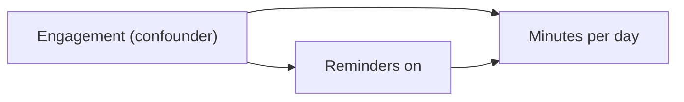
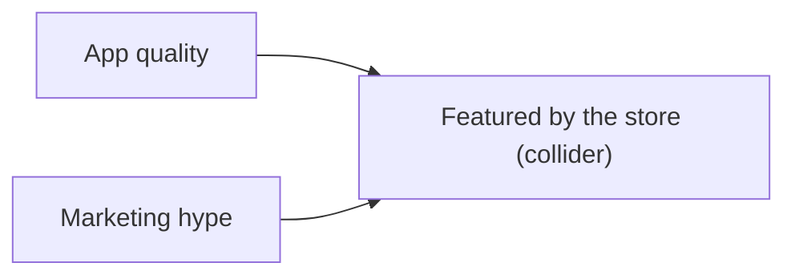

# Day 46: Correlation, Causation and Confounders

**Phase 1 · Week 7 · ~90 minutes**

## Objectives

- [ ] Compute Pearson's correlation by hand and in NumPy, and list the three things it is blind to: curves, outliers and causes.
- [ ] Compute Spearman's rank correlation by hand (ranks, then Pearson), and say when to prefer it.
- [ ] Name the four ways two columns can move together without one causing the other: confounding, reverse causation, selection and chance.
- [ ] Work through a Simpson's paradox table and explain the reversal as a change of mix (a weighted average).
- [ ] Draw confounders, mediators and colliders as causal diagrams, and say which ones to adjust for.
- [ ] Show by simulation why a randomized experiment recovers the true effect when observational data can't.
- [ ] Find "significant" correlations in pure noise, and correct for having looked at many.

**Prerequisites.** [Day 20](day-20-week3-review.md) (Pearson's \( r \) as the cosine of centred vectors, the shuffle test, the "no causal words" rule), [Day 38](day-38-bayes-rule.md) (conditional probability), [Day 40](day-40-joint-clt.md) (covariance, independence vs correlation), [Day 44](day-44-confidence-intervals.md) (sampling noise) and [Day 45](day-45-hypothesis-tests.md) (p-values, permutation tests, multiple comparisons). The adjustment trick uses `np.linalg.lstsq` from [Day 25](day-25-projections-pca.md).

---

## The big idea

Your analytics dashboard shows that users who turned on reminder notifications spend **4.4 more minutes a day** in the app than users who didn't. The product manager wants to force the permission prompt on everyone. Should they?

Not yet. Who turns notifications on? Users who already like the app. They would spend more time in it with or without reminders. The 4.4 minutes is a mix of two things: what reminders do, and what kind of person says yes to them. Later today you'll simulate exactly this world and find that the reminders' true effect is 1 minute; the other 3.4 minutes are the users.

**Analogy.** Cities with more fire engines have more fire damage. Nobody concludes that fire engines start fires: big cities have more of both. "City size" is a **confounder**, a third thing that pushes both columns up. Correlation measures how two columns move together; it says nothing about *why*.

Two columns can move together for five reasons, and only the first is the one you hope for:

| Reason | Shape | Example |
|---|---|---|
| **Causation** | X → Y | reminders bring people back |
| **Reverse causation** | Y → X | people who use the app a lot are the ones who find the notification setting |
| **Confounding** | Z → X and Z → Y | engaged users both opt in and stay longer |
| **Selection (a collider)** | you only look at rows where X or Y was high | "among featured apps, the hyped ones are worse" |
| **Chance** | nothing | you tested 200 columns and reported the best one |

Today you meet a tool for each: a better correlation (Spearman), a way to compare like with like (stratifying), a picture that says what to adjust for (causal diagrams), the one design that defeats confounding (randomization), and a correction for looking too many times.

## Pearson correlation, recap

Day 20 defined **Pearson's correlation** \( r \) as the cosine similarity of the two centred columns. Write them as vectors \( \mathbf{x} \) and \( \mathbf{y} \) of length \( n \), one entry per row, and let \( \bar{x} \) ("x bar") be the mean of \( \mathbf{x} \):

\[
r = \frac{\sum_{i=1}^{n} (x_i - \bar{x})(y_i - \bar{y})}{\sqrt{\sum_{i=1}^{n} (x_i - \bar{x})^2}\;\sqrt{\sum_{i=1}^{n} (y_i - \bar{y})^2}}
\]

- The top is a dot product of the centred vectors: each term is positive when \( x_i \) and \( y_i \) are on the same side of their means.
- The bottom is the product of their lengths, so \( r \) always lies between −1 and +1.
- Divide top and bottom by \( n - 1 \) and you get Day 40's form, \( r = \dfrac{\operatorname{cov}(x, y)}{s_x\, s_y} \): the covariance divided by both standard deviations.

**Worked example.** \( \mathbf{x} = (1, 2, 3, 4, 5) \), \( \mathbf{y} = (2, 1, 4, 3, 5) \). Both means are 3, so the centred vectors are \( (-2, -1, 0, 1, 2) \) and \( (-1, -2, 1, 0, 2) \). Dot product: \( 2 + 2 + 0 + 0 + 4 = 8 \). Squared lengths: \( 4 + 1 + 0 + 1 + 4 = 10 \) for both. So \( r = 8 / (\sqrt{10}\sqrt{10}) = 0.8 \). In Day 40's form: \( \operatorname{cov} = 8/4 = 2 \), both variances are \( 10/4 = 2.5 \), and \( 2 / 2.5 = 0.8 \).

```python
import numpy as np
import pandas as pd

def pearson(x, y):
    """Pearson correlation: the cosine similarity of the centred vectors (Day 20)."""
    x = np.asarray(x, dtype=float)
    y = np.asarray(y, dtype=float)
    xc, yc = x - x.mean(), y - y.mean()
    return (xc @ yc) / (np.linalg.norm(xc) * np.linalg.norm(yc))

x = np.array([1., 2., 3., 4., 5.])
y = np.array([2., 1., 4., 3., 5.])
pearson(x, y)                                            # 0.7999999999999998
np.corrcoef(x, y)[0, 1]                                  # 0.7999999999999999
np.cov(x, y)[0, 1] / (x.std(ddof=1) * y.std(ddof=1))     # 0.7999999999999998   cov / (s_x s_y)
```

(The last digits differ only by floating-point rounding: all three are 0.8.)

What \( r \) does and doesn't see:

```python
pearson(x, 100 * y + 7)     # 0.7999999999999999   rescaling or shifting a column changes nothing
pearson(x, -y)              # -0.7999999999999998  flipping one column flips the sign
u = np.linspace(-3, 3, 13)
pearson(u, u ** 2)          # 0.0   y is a perfect function of x, yet r = 0
a = np.array([1., 2., 3., 4., 5., 6., 7., 8.])
b = np.array([5., 3., 6., 2., 7., 4., 3., 5.])
pearson(a, b)                                     # -0.01730580438837217   no relationship
pearson(np.append(a, 30.), np.append(b, 30.))     # 0.9486872103889112    add ONE extreme point
```

Three lessons in five lines. Pearson measures **straight-line** association only, so a perfect U-shape scores 0 (Day 40 made the same point: zero correlation does not mean independent). And one extreme row can manufacture a "strong" correlation from nothing, because the formula squares distances from the mean and the outlier owns most of them.

## Spearman rank correlation

The fix for both problems is to stop using the values and use their **order**. Replace every value by its **rank**: 1 for the smallest, 2 for the next, up to \( n \). Then compute Pearson on the ranks. That's **Spearman's rank correlation**, written \( \rho \) (the Greek letter "rho"):

\[
\rho = r\big(\operatorname{rank}(\mathbf{x}),\ \operatorname{rank}(\mathbf{y})\big)
\]

Ranks throw away *how far apart* values are and keep only *which is bigger*. So Spearman asks a looser question than Pearson: "when x goes up, does y tend to go up?" (a **monotonic** relationship), not "do the points lie on a straight line?".

**Ties.** If two values are equal, they share the average of the ranks they would occupy. In \( (10, 30, 20, 30) \) the two 30s would be ranks 3 and 4, so each gets 3.5.

**A shortcut formula.** When there are no ties, let \( d_i \) be the difference between the two ranks of row \( i \). Then

\[
\rho = 1 - \frac{6 \sum_{i} d_i^2}{n(n^2 - 1)}
\]

It gives exactly the same number as Pearson on the ranks; it's just quicker by hand. **Worked example**, same data as before: \( \mathbf{x} = (1, 2, 3, 4, 5) \) has ranks \( (1, 2, 3, 4, 5) \), and \( \mathbf{y} = (2, 1, 4, 3, 5) \) has ranks \( (2, 1, 4, 3, 5) \) (the values happen to be their own ranks). The differences are \( d = (-1, 1, -1, 1, 0) \), so \( \sum d^2 = 4 \) and

\[
\rho = 1 - \frac{6 \cdot 4}{5 \cdot (25 - 1)} = 1 - \frac{24}{120} = 0.8
\]

```python
def ranks(values):
    """Rank from 1 (smallest) to n; tied values share the average of their ranks."""
    return pd.Series(values).rank().to_numpy()

def spearman(x, y):
    """Spearman rank correlation: Pearson's r computed on the ranks."""
    return pearson(ranks(x), ranks(y))

ranks([10, 30, 20, 30])     # array([1. , 3.5, 2. , 3.5])   the tied 30s share 3.5
ranks(y)                    # array([2., 1., 4., 3., 5.])
d = ranks(x) - ranks(y)
d                           # array([-1.,  1., -1.,  1.,  0.])
1 - 6 * (d ** 2).sum() / (len(x) * (len(x) ** 2 - 1))   # 0.8   the shortcut
spearman(x, y)                                          # 0.7999999999999998   the definition
```

Now the cases where the two disagree:

```python
y_curve = np.array([1., 4., 9., 16., 100.])         # always rising, but not in a straight line
pearson(x, y_curve), spearman(x, y_curve)            # (0.7952035738296034, 0.9999999999999998)
spearman(a, b), spearman(np.append(a, 30.), np.append(b, 30.))   # (-0.024098134635593994, 0.2857243743174461)
spearman(x, np.exp(y)), spearman(np.log(x), y)       # (0.7999999999999998, 0.7999999999999998)
```

- A curve that always rises gets \( \rho = 1 \) (perfectly monotonic) while Pearson says 0.80.
- The outlier that pushed Pearson from −0.02 to 0.95 only moves Spearman to 0.29: as a rank, the extreme point is just "the biggest", one rank above the next.
- Any increasing transformation (log, exp, square root of positive numbers) leaves the ranks, and so \( \rho \), unchanged. Pearson changes with every one of them.

<figure class="diagram" markdown>

<figcaption>Left: a curve Spearman sees better. Middle: an outlier fools Pearson but not Spearman. Right: a U-shape fools both, because neither measures "any relationship". Always plot.</figcaption>
</figure>

The code for that figure (synthetic data, seeded):

```python
import matplotlib
matplotlib.use("Agg")            # draw into files, no window (leave this out in Jupyter)
import matplotlib.pyplot as plt

plt.rcParams.update({"font.size": 11, "figure.facecolor": "white", "savefig.facecolor": "white",
                     "axes.spines.top": False, "axes.spines.right": False})

rng = np.random.default_rng(46)
xs = np.sort(rng.uniform(0, 4, 60))
panels = [
    ("Curved but always rising", xs, np.exp(1.2 * xs) + rng.normal(0, 3, 60)),
    ("No relation + one outlier", np.append(rng.normal(5, 1, 30), 15.0), np.append(rng.normal(5, 1, 30), 15.0)),
    ("U-shape: dependent, yet r near 0", np.linspace(-2, 2, 60), np.linspace(-2, 2, 60) ** 2 + rng.normal(0, 0.3, 60)),
]
fig, axes = plt.subplots(1, 3, figsize=(12, 3.6))
for ax, (title, px, py) in zip(axes, panels):
    ax.scatter(px, py, s=16, color="#3949ab", alpha=0.7)
    ax.set_title(f"{title}\nPearson r = {pearson(px, py):+.2f}   Spearman = {spearman(px, py):+.2f}", fontsize=10.5)
    ax.grid(alpha=0.3)
fig.tight_layout()
fig.savefig("day46-pearson-vs-spearman.svg", format="svg", bbox_inches="tight")
plt.close(fig)
[(round(pearson(px, py), 3), round(spearman(px, py), 3)) for _, px, py in panels]
# [(0.834, 0.943), (0.723, -0.058), (0.051, 0.029)]
```

### Spearman on the Play Store data

Installs and reviews are both wildly skewed (Day 19). Load and clean the course dataset with the short cleaning from Days 17–19 (tested on pandas 3.0; no internet? download the file from the [Datasets page](../../datasets.md) and pass the local path):

```python
BASE = "https://manjulkadyan.github.io/ai-leaning/assets/data/"
apps = pd.read_csv(BASE + "play_store_apps.csv")
apps = apps.drop_duplicates().assign(
    category=lambda d: d["category"].str.strip().str.title(),
    installs=lambda d: d["installs"].str.replace(",", "").str.rstrip("+").astype(int),
    size_mb=lambda d: d["size_mb"].replace("Varies with device", np.nan).astype(float),
)
apps.shape                                                         # (480, 12)
pearson(apps["installs"], apps["reviews"])                         # 0.971508293135462
pearson(np.log10(apps["installs"]), np.log10(apps["reviews"]))     # 0.9348374171726952
spearman(apps["installs"], apps["reviews"])                        # 0.9488432236357311
spearman(np.log10(apps["installs"]), np.log10(apps["reviews"]))    # 0.9488432236357311   logs change nothing
apps["installs"].nunique()                                         # 10   only 10 buckets: lots of ties
print(apps[["installs", "reviews", "rating", "size_mb"]].corr(method="spearman").round(2).to_string())
#           installs  reviews  rating  size_mb
# installs      1.00     0.95    0.00     0.12
# reviews       0.95     1.00   -0.02     0.10
# rating        0.00    -0.02    1.00     0.12
# size_mb       0.12     0.10    0.12     1.00
```

Pearson on the raw counts gives 0.97, *higher* than on the logs. Is that real? Drop the three biggest apps and ask again:

```python
top3 = apps["installs"].nlargest(3).index      # the three biggest apps
rest = apps.drop(top3)
round(pearson(rest["installs"], rest["reviews"]), 3), round(spearman(rest["installs"], rest["reviews"]), 3)
# (0.861, 0.948)
```

Three apps out of 480 were worth 0.11 of Pearson's \( r \); Spearman didn't move. On skewed columns, raw Pearson mostly measures whether the giants agree.

!!! warning "Common mistake: Series.corr with method='spearman' needs SciPy"
    `DataFrame.corr(method="spearman")` works with pandas alone, but `Series.corr(other, method="spearman")` imports SciPy and fails with `ModuleNotFoundError` if it isn't installed. Either use the DataFrame version, or rank first and use Pearson, as `spearman` above does: `s1.rank().corr(s2.rank())`.

## Correlation is not causation: confounders

Back to the big question. A **confounder** is a variable that causes both the "treatment" (the thing you're tempted to credit) and the outcome. Before the simulation, here is a mild real example from the dataset.

### A confounder in the Play Store data

Bigger apps have slightly higher ratings: \( r = 0.12 \). Is it size?

```python
d = apps[["category", "size_mb", "rating"]].dropna()
len(d)                                           # 442
round(pearson(d["size_mb"], d["rating"]), 3)     # 0.12
print(d.groupby("category").agg(apps=("rating", "size"), mean_size=("size_mb", "mean"),
                                mean_rating=("rating", "mean")).sort_values("mean_size").round(2).to_string())
#                   apps  mean_size  mean_rating
# category
# Finance             27      24.43         4.11
# Tools               71      28.05         4.15
# Photography         44      29.26         4.19
# Productivity        60      30.00         4.14
# Health & Fitness    38      30.06         4.07
# Music & Audio       34      31.30         4.23
# Education           62      33.19         4.04
# Games              106      87.88         4.29
```

Games are almost three times bigger than everything else **and** have the highest mean rating. So "bigger apps rate higher" could be mostly "Games rate higher, and games are big". To compare like with like, measure each app against its **own category's** average (Day 18's `transform` returns one value per row), then correlate those within-category deviations:

```python
size_within = d["size_mb"] - d.groupby("category")["size_mb"].transform("mean")
rating_within = d["rating"] - d.groupby("category")["rating"].transform("mean")
round(pearson(size_within, rating_within), 3)    # 0.026
```

Inside categories the correlation is 0.026: essentially nothing. Most of the 0.12 was *between* categories. This is called **stratifying** (or "controlling for") the category. It doesn't prove category is the cause either; it says the size–rating link mostly disappears once you compare apps with their own kind. (The dataset is synthetic, see [Datasets](../../datasets.md), so this is a finding about the data, not about real games.)

### The reminder-notification world, simulated

Real data never tells you the true effect, so build a world where you know it. 20,000 users. Each has an engagement level: sessions in their first week (a Poisson count, around 5). Engaged users are more likely to turn reminders on. Minutes per day in month two depend on engagement (+2 per first-week session) and on reminders (+1.0, the **true effect**), plus noise.

```python
rng = np.random.default_rng(46)
n = 20_000
week1 = rng.poisson(5, size=n)                          # sessions in the first week: the confounder
p_on = 1 / (1 + np.exp(-(-2 + 0.4 * week1)))            # engaged users opt in more (a sigmoid, Day 30)
notif = rng.random(n) < p_on                            # True = turned reminders on
minutes = 5 + 2 * week1 + 1.0 * notif + rng.normal(0, 4, size=n)   # true effect of reminders: +1.0
round(notif.mean(), 3)                                              # 0.5   half the users opted in
round(minutes[notif].mean() - minutes[~notif].mean(), 2)           # 4.38  the dashboard's number
round(week1[notif].mean(), 2), round(week1[~notif].mean(), 2)      # (5.86, 4.16)
round(pearson(notif, minutes), 3)                                   # 0.356
```

The naive gap is 4.38 minutes, more than four times the true 1.0. The reason is in the third line: the opted-in group had 5.86 first-week sessions on average against 4.16, and every session is worth 2 minutes. \( 1.0 + 2 \times (5.86 - 4.16) = 4.4 \): effect plus confounding, almost exactly.

**Fix 1: stratify.** Compare reminders-on against reminders-off *at the same engagement level*, then average those gaps, weighting each level by how many users it has:

```python
users = pd.DataFrame({"week1": week1, "notif": notif, "minutes": minutes})
by_level = users.groupby(["week1", "notif"])["minutes"].mean().unstack()
print(by_level.head(6).round(2).to_string())
# notif  False  True
# week1
# 0       4.83   6.23
# 1       7.01   7.54
# 2       9.36  10.06
# 3      11.06  11.92
# 4      12.97  14.17
# 5      14.98  15.98
gap = by_level[True] - by_level[False]                  # the gap at each engagement level
weight = users.groupby("week1").size()                  # how many users at each level
ok = gap.notna()                                        # levels where both groups exist
round((gap[ok] * weight[ok]).sum() / weight[ok].sum(), 2)   # 1.01
```

**Fix 2: adjust with a regression.** Fit minutes from both columns at once with Day 25's least squares. The coefficient on `notif` is its effect *holding `week1` fixed*:

```python
X = np.column_stack([notif, week1, np.ones(n)])         # columns: treatment, confounder, intercept
w, *_ = np.linalg.lstsq(X, minutes)
w.round(2)                                              # array([0.98, 1.99, 5.08])   ≈ 1, 2, 5: the true rules
X_naive = np.column_stack([notif, np.ones(n)])          # leave the confounder out
np.linalg.lstsq(X_naive, minutes)[0].round(2)           # array([ 4.38, 13.37])   the naive gap again
```

Both fixes recover about 1.0. Both have the same catch, and it is a big one: **they only work for confounders you measured.** Here `week1` is in the table. In real life, "how much this user likes the app" is not a column, and whatever you leave out keeps leaking into the estimate. Hold that thought until the randomization section.

!!! warning "Common mistake: \"we controlled for everything\""
    Adding columns to a regression removes the confounding from *those* columns only. You can't adjust for motivation, taste, or which users your marketing reached, because you don't have them. An observational estimate is always "the effect, plus whatever confounding is left". Say so in the write-up.

## Simpson's paradox

Confounding can do more than inflate an effect. It can **flip its sign**. Here is a made-up but realistic release table: version 5.0 of an app went first to a market where most users have low-end phones, while most version 4.9 sessions still came from high-end phones. Low-end phones crash more often, whatever the version.

| Device tier | v4.9 sessions | v4.9 crashes | v4.9 crash rate | v5.0 sessions | v5.0 crashes | v5.0 crash rate |
|---|---|---|---|---|---|---|
| High-end | 8,000 | 160 | **2.0%** | 2,000 | 30 | **1.5%** |
| Low-end | 2,000 | 120 | **6.0%** | 8,000 | 400 | **5.0%** |
| **All** | 10,000 | 280 | **2.8%** | 10,000 | 430 | **4.3%** |

Read it row by row: on high-end phones 5.0 crashes less (1.5% vs 2.0%). On low-end phones 5.0 crashes less (5.0% vs 6.0%). Pooled together, 5.0 crashes **more** (4.3% vs 2.8%). Better in every group, worse overall. That is **Simpson's paradox**.

<figure class="diagram" markdown>
![Animation in four steps on a scatter of 36 made-up apps, app size on the horizontal axis and rating on the vertical: first all points grey with a dashed red line rising across them and the panel reading pooled r = +0.73; then the points are coloured by category, teal Tools small and low, indigo Photography in the middle, orange Games big and high; then a falling line appears through each colour with the panel reading r = -0.89, -0.85, -0.86 inside the groups; finally the panel says category drives both size and rating, a confounder](../../assets/img/phase-1/day46-simpson-flip.svg)
<figcaption>Animated: the same reversal with a continuous variable. Pooled, bigger apps rate higher; inside every category, bigger apps rate lower.</figcaption>
</figure>

### Why it happens: a weighted average with different weights

An overall rate is a **weighted average** of the group rates, weighted by where that version's sessions came from:

\[
\text{overall rate} = \sum_{\text{tiers } t} (\text{share of sessions in } t) \times (\text{crash rate in } t)
\]

For v4.9: \( 0.8 \times 2.0\% + 0.2 \times 6.0\% = 1.6\% + 1.2\% = 2.8\% \). For v5.0: \( 0.2 \times 1.5\% + 0.8 \times 5.0\% = 0.3\% + 4.0\% = 4.3\% \). Version 5.0 has better rates but a much worse **mix**: 80% of its sessions are on the phones that crash most. Compare the versions with the *same* mix (v4.9's) and 5.0 wins: \( 0.8 \times 1.5\% + 0.2 \times 5.0\% = 2.2\% \), below 2.8%.

```python
crashes = pd.DataFrame({
    "tier":     ["high-end", "high-end", "low-end", "low-end"],
    "version":  ["4.9", "5.0", "4.9", "5.0"],
    "sessions": [8000, 2000, 2000, 8000],
    "crashes":  [160, 30, 120, 400],
})
crashes["crash_rate"] = crashes["crashes"] / crashes["sessions"]
print(crashes.to_string())
#        tier version  sessions  crashes  crash_rate
# 0  high-end     4.9      8000      160       0.020
# 1  high-end     5.0      2000       30       0.015
# 2   low-end     4.9      2000      120       0.060
# 3   low-end     5.0      8000      400       0.050
```

```python
overall = crashes.groupby("version")[["sessions", "crashes"]].sum()
overall["crash_rate"] = overall["crashes"] / overall["sessions"]
print(overall.to_string())
#          sessions  crashes  crash_rate
# version
# 4.9         10000      280       0.028
# 5.0         10000      430       0.043
print(crashes.pivot_table(index="tier", columns="version", values="crash_rate").to_string())
# version    4.9    5.0
# tier
# high-end  0.02  0.015
# low-end   0.06  0.050
```

```python
rate = crashes.pivot_table(index="tier", columns="version", values="crash_rate")
share = crashes.pivot_table(index="tier", columns="version", values="sessions")
share = share / share.sum()                       # each version's sessions split across tiers
print(share.to_string())
# version   4.9  5.0
# tier
# high-end  0.8  0.2
# low-end   0.2  0.8
(rate * share).sum()                              # weighted averages = the overall rates
# version
# 4.9    0.028
# 5.0    0.043
# dtype: float64
(rate["5.0"] * share["4.9"]).sum()                # 0.022000000000000002   5.0's tier rates, 4.9's device mix
```

**So which answer is right, the pooled or the split one?** The numbers can't tell you. The *story* can: device tier affected which version a session ran (the rollout went to a low-end market first) **and** affected crashes. That makes tier a confounder, so the split table answers "does 5.0 crash less?", and the answer is yes. The next section turns "the story" into a picture you can reason with.

Is there a full Simpson's reversal in the Play Store data? I checked every pair of numeric columns, overall versus within categories, and found none: the size and rating example above shrinks from 0.12 to 0.03 but never flips. That's why the table and the animation use made-up numbers. One famous real case is in Exercise 2.

!!! android "Android bridge: comparing releases in Android vitals and Crashlytics"
    Simpson's paradox is a daily hazard in release dashboards. A new version's crash rate or ANR rate is computed over whoever happens to be running it, and early adopters aren't a random slice: a staged rollout that targets certain countries, an internal or beta track full of developers with flagship phones, or users on auto-update over Wi-Fi all have different device mixes from your whole user base. Before declaring "5.0 is worse", split the comparison by the things that drive crashes regardless of version: device model or RAM tier, Android version, country. Firebase Crashlytics and Play Console's Android vitals both let you filter by device and OS version; compare the versions *within* each filter, then look at the mix. And if a regression appears only in the pooled number, check whether the mix changed before you roll back.

## Causal diagrams: what to adjust for

A **causal diagram** (a directed acyclic graph, or DAG) draws each variable as a box and each direct cause as an arrow. You never prove a diagram from data; you write down what you believe about how the world works, and the diagram then tells you what to compare. Three shapes cover most situations.

**Confounder: Z causes both X and Y.** Adjust for it (stratify, or put it in the regression).



**Mediator: X causes M, and M causes Y.** The mediator is *how* the effect travels. Don't adjust for it if you want the total effect, or you'll subtract away the very effect you're measuring.


If reminders work by bringing people back more often, then comparing users "with the same number of sessions" removes the main route by which reminders help, and the effect would look close to zero. Same arithmetic as adjusting for a confounder, opposite conclusion: which one is right depends on the arrows, not the data.

**Collider: X and Y both cause C.** Never adjust for it, and never filter on it.



### Colliders create correlation out of nothing

Suppose the store features an app when quality plus hype is high: a great app gets in, a loudly marketed app gets in, a great *and* loud app certainly gets in. Quality and hype are generated independently, so across all apps they are unrelated. Now look only at featured apps:

```python
rng = np.random.default_rng(41)
n_apps = 2000
quality = rng.normal(size=n_apps)
hype = rng.normal(size=n_apps)                    # drawn independently of quality
featured = quality + hype > 1.5                   # the store features great OR loud apps
round(pearson(quality, hype), 3)                  # 0.003    unrelated, as built
int(featured.sum())                               # 290
round(pearson(quality[featured], hype[featured]), 3)   # -0.711   among featured apps: strongly negative
```

Among featured apps, the hyped ones really are worse, on average. Not because hype hurts quality, but because a featured app with little hype *must* be great to have got in, and a featured app with mediocre quality *must* be heavily hyped. Filtering on the collider made the two causes compete. This is also called **Berkson's paradox** or **selection bias**.

<figure class="diagram" markdown>

<figcaption>Animated: quality and hype are independent; selecting the featured apps (a collider) makes them look strongly negatively related.</figcaption>
</figure>

Colliders hide in innocent-looking filters. "Users who left a review" (people review when delighted *or* furious), "apps still on the store" (survivors), "crashes reported by users who didn't uninstall": each is a selection on something your variables cause. Day 43's survivorship bias is the same mechanism.

!!! warning "Common mistake: adjusting for everything available"
    "More controls is safer" is false. Adjusting for a confounder removes bias; adjusting for a mediator removes part of the effect; adjusting for (or filtering on) a collider *adds* bias that wasn't there. Draw the diagram first, then decide column by column.

## Randomized experiments: the fix

Every fix so far needs you to *know and measure* the confounders. A randomized experiment needs neither. If a **coin** decides who gets reminders, then engagement, motivation, phone model and everything else you never measured has no way to influence who is in which group. The arrow from the confounder into the treatment is cut.

<figure class="diagram" markdown>

<figcaption>Animated: when a coin assigns the treatment, the confounder can no longer reach it, and the simple difference in means is the true effect.</figcaption>
</figure>

Same 20,000 users, same engagement, same true effect, but now a coin decides:

```python
rng = np.random.default_rng(2026)
notif_ab = rng.random(n) < 0.5                    # a coin decides, not the user
minutes_ab = 5 + 2 * week1 + 1.0 * notif_ab + rng.normal(0, 4, size=n)
round(week1[notif_ab].mean(), 2), round(week1[~notif_ab].mean(), 2)   # (5.01, 5.01)   balanced by chance alone
round(minutes_ab[notif_ab].mean() - minutes_ab[~notif_ab].mean(), 2) # 1.0   the true effect
```

No stratifying, no regression, no list of confounders: a plain difference of means gives 1.0. That's why an **A/B test** (Day 45) is the gold standard for "does this feature *cause* more usage?". The randomization doesn't make the groups identical; it makes their differences pure chance, and chance is exactly what Day 44's confidence intervals and Day 45's p-values measure.

When you can't randomize (you can't randomly assign users a phone model, or make some users install your app late), you're back to observational data: stratify on the confounders you have, draw the diagram, report what you couldn't measure, and use causal words carefully.

!!! android "Android bridge: Firebase A/B Testing and Remote Config"
    Firebase A/B Testing runs exactly this coin flip for you: it randomly assigns users to a control group and variants, delivers each group a different Remote Config value (say `reminders_default_on = true` or `false`), and compares the goal metric across groups. In app code you only read the flag:

    ```kotlin
    val remoteConfig = Firebase.remoteConfig
    remoteConfig.fetchAndActivate().addOnCompleteListener {
        val remindersOn = remoteConfig.getBoolean("reminders_default_on")
        reminderScheduler.setEnabled(remindersOn)
    }
    ```

    The design point is the one from today: **randomize the thing you control** (whether the reminder is on by default, or whether the permission prompt is shown), not the thing users choose. Comparing users who *granted* `POST_NOTIFICATIONS` on Android 13+ against users who denied it is observational again, with all the confounding above. Compare by **assigned** group, whether or not each user went along with it; that comparison keeps the randomization's protection.

## Spurious correlations from many comparisons

The last way to fool yourself needs no confounder at all. Make a target column of pure noise for 100 users, and 200 more columns of pure noise as "features". Nothing is related to anything.

```python
rng = np.random.default_rng(3)
n_users, n_feats = 100, 200
target = rng.normal(size=n_users)                       # pure noise
features = rng.normal(size=(n_users, n_feats))          # 200 more columns of pure noise
r_all = np.array([pearson(features[:, j], target) for j in range(n_feats)])
best = int(np.abs(r_all).argmax())
best, round(r_all[best], 3)                             # (39, -0.31)   "feature 39 predicts the target!"
int((np.abs(r_all) > 0.2).sum())                        # 9
round(r_all.std(), 3), round(1 / np.sqrt(n_users), 3)   # (0.102, 0.1)
```

With no real relationship, sample correlations still scatter around 0 with a standard deviation of about \( 1/\sqrt{n} \) (here 0.1), the same \( \sqrt{n} \) that shrinks standard errors on Day 43. About 5% of them land beyond \( \pm 2/\sqrt{n} \), so out of 200 you expect about 10 "notable" ones (here 9), and the best of 200 is usually around 0.3.

A permutation test (Day 45) on feature 39 *alone* says it's significant. The honest test asks a different question: "if nothing is going on, how often is the **best of 200** at least this strong?" Shuffle the target, recompute all 200 correlations, keep the maximum, and repeat:

```python
one = np.array([pearson(features[:, best], rng.permutation(target)) for _ in range(2000)])
np.mean(np.abs(one) >= abs(r_all[best]))              # 0.0015   p-value if this were the ONLY feature tested

Z = (features - features.mean(axis=0)) / features.std(axis=0)   # standardize every feature once
def max_abs_r(t):
    """Largest |r| between t and any of the 200 features (r = mean of products of z-scores)."""
    tz = (t - t.mean()) / t.std()
    return np.abs(Z.T @ tz / len(t)).max()

round(max_abs_r(target), 3)                            # 0.31   the same best |r| as above
null_max = np.array([max_abs_r(rng.permutation(target)) for _ in range(2000)])
np.mean(null_max >= np.abs(r_all[best]))               # 0.2705   p-value for "the best of 200"
np.quantile(null_max, [0.5, 0.95]).round(3)            # array([0.289, 0.357])
```

Tested alone, \( p = 0.0015 \). Tested honestly, as the winner of 200 tries, \( p \approx 0.27 \): completely ordinary. The median "best of 200" in pure noise is 0.29, and you'd need beyond 0.36 to be surprising. Day 45's **Bonferroni correction** is the quick version of the same idea: with 200 tests, require \( p < 0.05 / 200 \) for each; 0.0015 doesn't pass 0.00025.

(`max_abs_r` uses a fact worth knowing: Pearson's \( r \) is the mean of the products of the two columns' z-scores, \( r = \frac{1}{n}\sum_i z_{x,i}\, z_{y,i} \) with z-scores computed using the \( n \) version of the standard deviation. One matrix product then gives all 200 correlations at once.)

### Trends: correlation between things that merely drift

A second source of spurious correlation is time. Two series that each **drift** (a random walk: each day adds a random step to yesterday's value) wander in long runs, and two independent runs often happen to go the same way, or opposite ways:

```python
rng = np.random.default_rng(3)
steps = rng.normal(size=(2000, 2, 250))                 # 2000 pairs of independent series
walks = steps.cumsum(axis=2)                            # running totals: random walks
r_steps = np.array([pearson(s[0], s[1]) for s in steps])
r_walks = np.array([pearson(w_[0], w_[1]) for w_ in walks])
round(np.mean(np.abs(r_steps) > 0.5), 3), round(np.mean(np.abs(r_walks) > 0.5), 3)   # (0.0, 0.389)
```

Independent daily *steps* never reach \( |r| > 0.5 \) in 2,000 tries; the independent *walks* built from them do 39% of the time. Daily active users, total downloads, a competitor's rating and the price of coffee all trend, so all of them "correlate". Correlate the **changes** (`np.diff`) instead of the levels, and most of that disappears.

```python
fig, (ax1, ax2) = plt.subplots(1, 2, figsize=(12, 3.8))
ax1.hist(r_all, bins=30, color="#c5cae9", edgecolor="#3949ab")
for edge in (-2 / np.sqrt(n_users), 2 / np.sqrt(n_users)):
    ax1.axvline(edge, color="#ef6c00", ls="--", lw=1.5)
ax1.annotate(f"best of 200: r = {r_all[best]:+.2f}", xy=(r_all[best], 1), xytext=(r_all[best] + 0.01, 19),
             ha="left", color="#e53935", arrowprops=dict(arrowstyle="->", color="#e53935"),
             bbox=dict(facecolor="white", edgecolor="none", alpha=0.9))
ax1.set_xlabel("correlation with the target (all pure noise)")
ax1.set_ylabel("number of features")
ax1.set_title("200 noise features, 100 users: dashed = ±2/√n")
k = int(np.argmax(np.abs(r_walks)))
ax2.plot(walks[k, 0], color="#3949ab", label="series A")
ax2.plot(walks[k, 1], color="#00897b", label="series B")
ax2.set_xlabel("day")
ax2.set_title(f"Two independent random walks: r = {r_walks[k]:+.2f}")
ax2.legend(frameon=False)
for ax in (ax1, ax2):
    ax.grid(alpha=0.3)
fig.tight_layout()
fig.savefig("day46-spurious.svg", format="svg", bbox_inches="tight")
plt.close(fig)
round(r_walks[k], 3)          # -0.961
```

<figure class="diagram" markdown>

<figcaption>Left: in pure noise, a few of 200 correlations always look notable. Right: the most extreme of 2,000 pairs of independent random walks, r = −0.96.</figcaption>
</figure>

!!! warning "Common mistake: reporting the winner of a search as if it were the only test"
    Dashboards with dozens of segments, notebooks that loop over every column, and "let's check 20 metrics in the A/B test" are all many-comparison machines. Decide the question and the metric *before* looking (Day 45's pre-registration), correct for the number of tests you ran, and treat a surprising winner as a hypothesis to test again on fresh data.

## Where this shows up in ML

A model is a correlation machine. It learns whatever patterns predict the target in the training data, causal or not. That has consequences you will meet over and over:

- **Shortcut features.** A classifier learns a confounder instead of the thing you care about: a spam filter that keys on a sender domain common in its training spam, an image model that recognises the background typical of one class. It scores well on test data from the same source and fails when the confounder changes.
- **Distribution shift.** A correlation holds only while the mechanism behind it holds. Trained on users from one market, a churn model can break in another, because the confounders (device mix, network) differ.
- **Feature importance is not a cause.** "This feature has a large weight" means it helps *predict*; changing it in the real world may do nothing. Day 25's warning about reading PCA components as causes applies to every model.
- **Correlated features.** Installs and reviews are 0.95 correlated (Spearman). A linear model can split the credit between them almost arbitrarily: Day 23's near-collinear columns again.
- **Selection in your training data.** Train on "users who rated the app" or "apps that survived a year" and you train on a collider-filtered world.
- **Many comparisons, ML edition.** Trying hundreds of feature sets or hyperparameters against one validation set is the 200-feature search above. That's why Phase 2 keeps a test set you look at only once.

Prediction doesn't need causation: a model that predicts churn from correlations is useful for deciding whom to email. **Decisions** do: "if we turn reminders on, will people stay?" is a causal question, and only an experiment (or a carefully argued causal diagram) answers it.

---

## Exercises

1. By hand, compute Pearson's \( r \) and Spearman's \( \rho \) for \( \mathbf{x} = (1, 2, 3, 4) \) and \( \mathbf{y} = (1, 3, 2, 10) \). Check with `pearson` and `spearman`. Why is Pearson the larger of the two here?
2. **A real Simpson's paradox.** A 1986 study of kidney-stone treatments (Charig et al., *BMJ*) reported: treatment A, small stones 81 successes of 87 patients, large stones 192 of 263; treatment B, small 234 of 270, large 55 of 80. Compute each treatment's success rate by stone size and overall. Which treatment is better, and what is the confounder? (Hint: doctors tended to give A, the more invasive treatment, to the harder cases.)
3. For each scenario, draw the diagram and say whether Z is a confounder, a mediator or a collider, and whether to adjust for it: (a) X = app uses Jetpack Compose, Y = crash rate, Z = team size; (b) X = app shrank its APK size, Y = installs, Z = install conversion rate on the store listing; (c) X = app quality, Y = how much the developer spends on ads, Z = "appears in the top-100 chart".
4. Rerun the collider simulation with the cut-offs `quality + hype > 0`, `> 1.5` and `> 2.5`. How does the correlation among the selected apps change, and why? Then select on `hype > 1.0` alone: is there still a spurious correlation?
5. Repeat the 200-noise-features experiment with 1,000 users instead of 100. What is the largest \( |r| \), how many features exceed \( 2/\sqrt{n} \), and how does that compare with what you'd expect?
6. On the Play Store data, compare the overall correlation between `size_mb` and `log10(installs)` with the within-category correlation. How much of the association is between categories?

??? success "Solutions"
    **1.** Means 2.5 and 4. Centred: \( (-1.5, -0.5, 0.5, 1.5) \) and \( (-3, -1, -2, 6) \). Dot product \( 4.5 + 0.5 - 1 + 9 = 13 \); squared lengths 5 and 50, so \( r = 13 / \sqrt{250} \approx 0.822 \). Ranks of \( \mathbf{y} \): \( (1, 3, 2, 4) \), so \( d = (0, -1, 1, 0) \), \( \sum d^2 = 2 \), and \( \rho = 1 - 6 \cdot 2 / (4 \cdot 15) = 0.8 \).

    ```python
    x1 = np.array([1., 2., 3., 4.])
    y1 = np.array([1., 3., 2., 10.])
    round(pearson(x1, y1), 3), round(spearman(x1, y1), 3)   # (0.822, 0.8)
    ```
    The point (4, 10) is far above the others and lines up with the trend, so Pearson rewards its size; as a rank it is just "4th", one above the 3rd.

    **2.**

    ```python
    stones = pd.DataFrame({
        "size":      ["small", "small", "large", "large"],
        "treatment": ["A", "B", "A", "B"],
        "patients":  [87, 270, 263, 80],
        "successes": [81, 234, 192, 55],
    })
    by_size = stones.pivot_table(index="size", columns="treatment", values=["successes", "patients"])
    print((by_size["successes"] / by_size["patients"]).round(3).to_string())
    # treatment      A      B
    # size
    # large      0.730  0.688
    # small      0.931  0.867
    tot = stones.groupby("treatment")[["successes", "patients"]].sum()
    (tot["successes"] / tot["patients"]).round(3)
    # treatment
    # A    0.780
    # B    0.826
    # dtype: float64
    ```
    A wins for small stones (93.1% vs 86.7%) and for large stones (73.0% vs 68.8%), yet B wins overall (82.6% vs 78.0%). Stone size is the confounder: large stones are harder to treat **and** were mostly given treatment A (263 of A's 350 patients had large stones, against 80 of B's 350). Since size affected both the treatment choice and the outcome, compare within size: A is better.

    **3.** (a) Team size plausibly affects both the technology choice and the crash rate (more testers, more process): a **confounder**, adjust for it. (b) A smaller APK raises the store's install conversion, which raises installs: Z is a **mediator** on the path X → Z → Y; to measure the total effect of shrinking, don't adjust for it. (c) Both quality and ad spend push an app into the top-100: a **collider**. Looking only at chart apps would create a spurious (likely negative) correlation between quality and ad spend; don't filter on it.

    **4.**

    ```python
    rng = np.random.default_rng(41)
    q = rng.normal(size=2000)
    h = rng.normal(size=2000)
    for cut in [0.0, 1.5, 2.5]:
        keep = q + h > cut
        print(f"q + h > {cut}: {keep.sum():4d} apps, r = {pearson(q[keep], h[keep]):+.3f}")
    # q + h > 0.0: 1002 apps, r = -0.460
    # q + h > 1.5:  290 apps, r = -0.711
    # q + h > 2.5:   71 apps, r = -0.819
    keep = h > 1.0                                    # select on hype alone
    round(pearson(q[keep], h[keep]), 3)               # 0.042
    ```
    The stricter the selection, the more the two causes have to "make up" for each other, so the correlation gets more negative. Selecting on hype alone is not selecting on a collider of the two (quality plays no part in the filter), so quality and hype stay unrelated: 0.042 is noise.

    **5.**

    ```python
    rng = np.random.default_rng(3)
    t5 = rng.normal(size=1000)
    F5 = rng.normal(size=(1000, 200))
    r5 = np.array([pearson(F5[:, j], t5) for j in range(200)])
    round(np.abs(r5).max(), 3), round(2 / np.sqrt(1000), 3), int((np.abs(r5) > 2 / np.sqrt(1000)).sum())
    # (0.084, 0.063, 4)
    ```
    The noise band shrinks with \( 1/\sqrt{n} \): with 1,000 users the best of 200 is only 0.084. About 5% of 200, so 10, would be expected beyond \( 2/\sqrt{n} \); this run got 4, within the normal chance variation of that count. More data makes chance correlations smaller, but never zero, so the winner of a big search still needs a correction.

    **6.**

    ```python
    d6 = apps[["category", "size_mb", "installs"]].dropna().assign(log_installs=lambda t: np.log10(t["installs"]))
    within = lambda col: d6[col] - d6.groupby("category")[col].transform("mean")
    round(pearson(d6["size_mb"], d6["log_installs"]), 3), round(pearson(within("size_mb"), within("log_installs")), 3)
    # (0.128, 0.082)
    ```
    The correlation drops from 0.128 to 0.082 within categories: about a third of it comes from differences between categories (Games are big and install well), and a weak within-category association remains. Both are small; neither says making an app bigger would bring installs.

## Resources

- [Seeing Theory, Brown University](https://seeing-theory.brown.edu/): interactive visual chapters on probability and statistics, including correlation and regression.
- [Stanford Encyclopedia of Philosophy: Simpson's Paradox](https://plato.stanford.edu/entries/paradox-simpson/): a careful explanation of the paradox, its history and its link to causal reasoning.
- [Tyler Vigen: Spurious Correlations](https://www.tylervigen.com/spurious-correlations): hundreds of absurd real-data correlations between trending series, a good antidote to over-reading \( r \).
- [Brady Neal: Introduction to Causal Inference (free course)](https://www.bradyneal.com/causal-inference-course): lecture videos and a free book on causal graphs, confounders, colliders and experiments, written for an ML audience.
- [Causal Inference: The Mixtape (free online book)](https://mixtape.scunning.com/): Scott Cunningham's readable introduction, with chapters on DAGs and randomization.
- [pandas docs: `DataFrame.corr`](https://pandas.pydata.org/docs/reference/api/pandas.DataFrame.corr.html) and [NumPy docs: `numpy.corrcoef`](https://numpy.org/doc/stable/reference/generated/numpy.corrcoef.html).
- [Firebase A/B Testing](https://firebase.google.com/docs/ab-testing): randomized experiments on Remote Config values and notifications in Android apps.

## Checklist

- [ ] I can compute Pearson's \( r \) by hand and know it only sees straight lines and is easily moved by outliers.
- [ ] I can compute Spearman's \( \rho \) from ranks, including ties, and know it is unchanged by any increasing transform.
- [ ] I can list five reasons two columns correlate, and give an Android example of each.
- [ ] I can stratify a comparison by a confounder, and adjust for it with `np.linalg.lstsq`.
- [ ] I can explain Simpson's paradox as a weighted average with different mixes, and decide which table answers the question.
- [ ] I can draw confounders, mediators and colliders, and know to adjust for the first, not the second (for a total effect), and never the third.
- [ ] I can explain why randomization recovers the true effect without measuring any confounder.
- [ ] I can show that the best of many noise correlations looks significant, and test it honestly with a max-statistic permutation test or Bonferroni.

**Next:** Day 47: Maximum likelihood estimation (coming soon)
