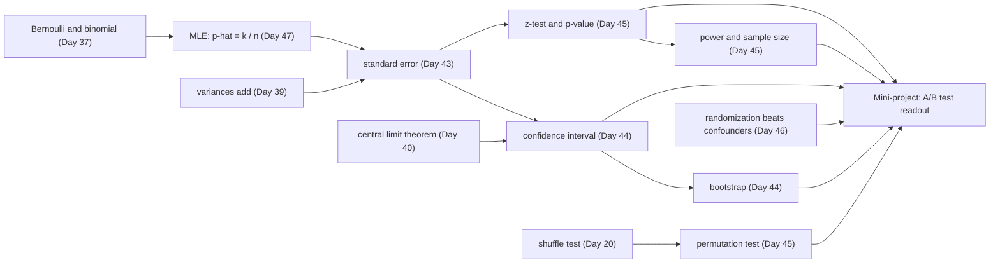

# Day 48: Week 7 Review and Mini-Project: Reading Out an A/B Test

**Phase 1 · Week 7 · ~180 minutes**

## Objectives

By the end of today you can:

- [ ] Explain, without notes, the main idea of each Week 7 lesson and where each one shows up when you read out an experiment.
- [ ] Answer the self-check questions, and rebuild Day 44's "what does 95% mean" coverage simulation from a blank file.
- [ ] Check that an experiment's randomization worked, with a **sample ratio mismatch** test and a covariate **balance table**, before looking at any outcome.
- [ ] Measure a conversion lift with a 95% confidence interval two ways (formula and bootstrap), and test it two ways (z-test and permutation test).
- [ ] Write a **decision rule before seeing the data**, with a primary metric and guardrails, and apply it mechanically.
- [ ] Compute how many users the next test needs with a sample-size formula, and check the answer by simulating thousands of experiments.

**Prerequisites.** All of Week 7: [Day 43](day-43-sampling.md) (populations, samples, standard error, \( n-1 \)), [Day 44](day-44-confidence-intervals.md) (confidence intervals, the bootstrap), [Day 45](day-45-hypothesis-tests.md) (hypothesis tests, p-values, power), [Day 46](day-46-correlation-causation.md) (correlation, causation, confounders) and [Day 47](day-47-maximum-likelihood.md) (maximum likelihood). The mini-project also uses the Bernoulli and binomial distributions from [Day 37](day-37-distributions.md), "variances of independent things add" from [Day 39](day-39-expectation-variance.md), and the shuffle test you first wrote on [Day 20](day-20-week3-review.md).

**Suggested time split.** 30 minutes recap and self-check, 20 minutes on the re-do, 100 minutes mini-project, 30 minutes stretch goals and the retro. All code was tested with NumPy 2.5, pandas 3.0 and matplotlib 3.11.

---

## What this week gave you

Week 6 taught you to reason about randomness when you know how it works. Week 7 turned the question around: you see only data, and you want to say something true about the world that produced it, together with how sure you are. Each day added one tool:

| Day | You learned | The one idea to keep |
|---|---|---|
| [43](day-43-sampling.md) | population vs sample, parameter vs statistic, sampling bias, the sampling distribution of the mean, standard error \( \sigma/\sqrt{n} \), dividing by \( n-1 \) | A statistic is a random variable: draw another sample and it changes. Its spread is the **standard error**, which shrinks like \( 1/\sqrt{n} \). A biased sample stays biased however big it gets. |
| [44](day-44-confidence-intervals.md) | what a 95% CI means, the normal-approximation CI, coverage by simulation, the bootstrap, a CI for a proportion | "95%" describes the **method**: 95 of 100 intervals built this way cover the truth. When there is no formula, resample your sample with replacement. |
| [45](day-45-hypothesis-tests.md) | null and alternative, test statistic, p-value, permutation and z/t tests, type I/II errors, power, multiple comparisons, A/B tests | A p-value is "how surprising would data like this be if nothing were going on". It is **not** the probability that nothing is going on. |
| [46](day-46-correlation-causation.md) | Pearson and Spearman correlation, confounders, Simpson's paradox, causal diagrams, randomized experiments | Correlation is not causation, because a third thing can drive both. Random assignment is the one design that cuts every arrow into the treatment. |
| [47](day-47-maximum-likelihood.md) | likelihood vs probability, MLE for a coin and a normal, log-likelihood, MSE and cross-entropy as MLE | Pick the parameter that makes the data you saw most probable. For a 0/1 outcome that is simply \( k/n \); for models it is the loss you minimize. |

An **A/B test** is where all five meet. You randomly split users into two groups, show each a different version of a feature, and compare an outcome. Watch each day hand over its step of the readout:

<figure class="diagram" markdown>
![Animated row of six boxes, Day 43 sampling, Day 44 intervals, Day 45 tests, Day 46 causation, Day 47 likelihood and Day 48 decision, lighting up in turn while a panel below explains the step each one adds to today's A/B test: control converts 876 of 9,993 users with a standard error of 0.28 points; the lift is plus 1.17 points with a 95% interval from plus 0.36 to plus 1.97; z is 2.83 and p is 0.0046; random assignment balances every covariate; the observed rate is the maximum-likelihood estimate; and the pre-registered rule says ship, with 14,665 users per group needed for the next test](../../assets/img/phase-1/day48-week7-map.svg)
<figcaption>Animated: the week as one readout. Each lesson supplies one step; the formula at the bottom is the whole primary analysis.</figcaption>
</figure>

Here is how the ideas depend on each other. Arrows mean "is built on":



!!! android "Android bridge"
    You have shipped features behind flags for years: a `RemoteConfig` boolean, a staged rollout in the Play Console, a build variant for dogfooders. This week gives those flags a statistics layer. A staged rollout to 10% asks "does it crash?"; an A/B test asks "does it *help*, by how much, and how sure are we?". The engineering half of an experiment (assigning users, logging events, not losing data on one side) is your job as an Android engineer, and today you will see that a bug there can quietly produce a confident, wrong answer.

## Self-check

Answer out loud or on paper first, then open the answer. If you miss more than three, re-read that day's lesson before starting the project.

??? question "1. In an A/B test of a new paywall, what is the population, what is the parameter, and what is the statistic?"
    The **population** is every user who would ever see this paywall, including future ones. The **parameter** is the true conversion rate \( p \) of each version over that population: a fixed number nobody knows. The **statistic** is what you compute from the users you happened to get, such as \( \hat{p} = 876 / 9{,}993 = 0.0877 \). Run the test again with different users and the statistic changes; the parameter doesn't. (Day 43)

??? question "2. A group of 10,000 users converts at about 9%. What is the standard error of the observed rate, and how many users would halve it?"
    A conversion is a Bernoulli variable with variance \( p(1-p) \), so the rate's standard error is \( \sqrt{p(1-p)/n} = \sqrt{0.09 \cdot 0.91 / 10{,}000} \approx 0.0029 \), about 0.29 percentage points. The standard error shrinks like \( 1/\sqrt{n} \), so halving it needs **four times** the users: 40,000. (Days 39 and 43)

??? question "3. Why does the sample variance divide by \( n - 1 \)? And what do `np.var(x)` and `pd.Series(x).var()` each divide by?"
    The deviations are measured from the sample's own mean \( \bar{x} \), which sits closer to the sample's points than the true mean does, so the squared deviations come out a little too small on average. Dividing by \( n-1 \) instead of \( n \) corrects that exactly, on average (Bessel's correction). NumPy's `np.var` divides by \( n \) unless you pass `ddof=1`; pandas' `.var()` divides by \( n-1 \) by default. With 10,000 users the difference is invisible; with 5 it is 25%. (Day 43)

??? question "4. Your 95% CI for the lift is (+0.36, +1.97) percentage points. A colleague says: 'so there's a 95% chance the true lift is in there.' What is the careful reading?"
    The true lift is a fixed number; this particular interval either contains it or doesn't. The 95% belongs to the **procedure**: if you ran the experiment many times and built an interval each time, about 95% of those intervals would contain the true lift (Day 44's coverage simulation shows exactly this). In practice, "we are 95% confident the lift is between +0.36 and +1.97 points" is the accepted shorthand, as long as you remember what stands behind it. (Day 44)

??? question "5. Why does the bootstrap resample *with* replacement? When would you use it instead of a formula?"
    Drawing \( n \) values *without* replacement from a sample of \( n \) just gives the same sample in a different order, so every resample would have the same mean and you'd learn nothing about the spread. With replacement, some users appear twice and some not at all, which mimics drawing a fresh sample from a population that looks like yours. Use it when there's no simple formula: a median, a ratio such as relative lift, a revenue metric with a heavy tail, or a statistic made of several steps. (Day 44)

??? question "6. A test gives p = 0.03. Which of these are true? (a) There's a 3% chance the feature does nothing. (b) If the feature did nothing, a difference at least this large would turn up about 3% of the time. (c) The effect is large."
    Only **(b)**. The p-value is computed *assuming* the null hypothesis is true, so it can't also be the probability that the null is true (that would need Bayes' rule and a prior, Day 38). And it says nothing about size: with millions of users, a tiny, useless difference can have \( p < 0.001 \). That is why you always report the effect with a confidence interval, not just the p-value. (Day 45)

??? question "7. What are a type I and a type II error, and name four things that raise a test's power."
    Type I: declaring an effect when there is none (false alarm); its rate is \( \alpha \), usually 0.05. Type II: missing an effect that exists; its rate is \( \beta \), and **power** is \( 1 - \beta \), the chance of detecting a real effect. Power goes up with (1) more users, (2) a larger true effect, (3) a less noisy metric (smaller variance), and (4) a larger \( \alpha \), which you pay for in false alarms. (Day 45)

??? question "8. An experiment dashboard shows 20 metrics, each tested at α = 0.05, and the feature truly changes none of them. How many 'significant' results do you expect, and how likely is at least one?"
    Expected false alarms: \( 20 \times 0.05 = 1 \). The chance of at least one (treating the tests as independent): \( 1 - 0.95^{20} \approx 1 - 0.358 = 0.64 \). So a single green metric among 20 is what "nothing happened" usually looks like. Fixes: name **one primary metric** in advance, and use a stricter threshold (for example \( \alpha / 20 \), the Bonferroni correction) for the rest. (Day 45)

??? question "9. Users who turned on a new 'focus mode' retain 30% better than users who didn't. Why can't you conclude that focus mode causes retention, and what would let you?"
    The users chose themselves. Engaged users are both more likely to discover and enable a new setting *and* more likely to stay: engagement is a **confounder** driving both (Day 46's causal diagram: an arrow from engagement into each). Comparing groups that differ in who they are can show any gap, even one with the wrong sign (Simpson's paradox). The fix is to **randomize**: offer focus mode to a random half of users. A coin flip has no arrows coming into it, so on average the groups are the same in engagement and everything else, measured or not, and the only systematic difference left is the feature. (Day 46)

??? question "10. 3 of 20 users convert. Write the likelihood of \( p \), and find the maximum-likelihood estimate with Week 5 calculus."
    Each user is a Bernoulli trial, so the probability of this exact data is \( L(p) = p^3 (1-p)^{17} \). Take logs to turn the product into a sum: \( \ell(p) = 3 \ln p + 17 \ln(1-p) \). Set the derivative to zero: \( \frac{3}{p} - \frac{17}{1-p} = 0 \), so \( 3(1-p) = 17p \) and \( \hat{p} = 3/20 = 0.15 \). The MLE is the observed rate, which is why today's \( \hat{p} = k/n \) is not just a sensible guess but the maximum-likelihood one. The same principle, applied to models, turns "assume Gaussian noise" into the MSE loss and "assume Bernoulli labels" into cross-entropy. (Day 47)

## Re-do from blank

Pick **Day 44's coverage experiment** and do it again in an empty file, without looking:

1. Treat the 462 rated apps of the Play Store dataset as a population and compute its true mean rating \( \mu \).
2. Draw 2,000 random samples of 40 apps. For each, build the normal-approximation 95% interval \( \bar{x} \pm 1.96 \cdot s/\sqrt{n} \) (with \( s \) from `ddof=1`) and count how many intervals contain \( \mu \).
3. For one sample, compare that interval with a bootstrap percentile interval from 5,000 resamples.

**Why this one.** It is the week in a dozen lines: sampling from a population (Day 43), the standard error with \( n-1 \) (Day 43), the interval (Day 44), the bootstrap (Day 44), and the frequentist meaning of "95%" that Day 45's p-values and today's decision rule rest on. It is also the experiment that makes the meaning of a confidence interval stick: once you have *watched* about 1 interval in 20 miss, you stop reading a single interval as a certainty. If you can write it from memory, the mini-project's formulas will feel familiar rather than magic.

??? success "Solution"
    ```python
    import numpy as np
    import pandas as pd

    BASE = "https://manjulkadyan.github.io/ai-leaning/assets/data/"
    raw = pd.read_csv(BASE + "play_store_apps.csv")
    ratings = raw.drop_duplicates()["rating"].dropna().to_numpy()   # our "population"
    mu, N = ratings.mean(), len(ratings)
    print(f"population: N = {N}, true mean rating mu = {mu:.4f}")

    rng = np.random.default_rng(44)
    n, n_repeats, z = 40, 2_000, 1.96
    covered = 0
    for _ in range(n_repeats):
        sample = rng.choice(ratings, size=n, replace=False)        # one survey of 40 apps
        se = sample.std(ddof=1) / np.sqrt(n)                        # Day 43: s / sqrt(n), with n - 1
        lo, hi = sample.mean() - z * se, sample.mean() + z * se     # Day 44: normal-approximation CI
        covered += lo <= mu <= hi
    print(f"{covered} of {n_repeats} intervals covered mu: {covered / n_repeats:.1%}")

    # One sample, two intervals: formula vs bootstrap percentile
    sample = rng.choice(ratings, size=n, replace=False)
    se = sample.std(ddof=1) / np.sqrt(n)
    boot = np.array([rng.choice(sample, size=n).mean() for _ in range(5_000)])   # WITH replacement
    print(f"sample mean {sample.mean():.3f}")
    print(f"formula   95% CI: ({sample.mean() - z * se:.3f}, {sample.mean() + z * se:.3f})")
    print(f"bootstrap 95% CI: ({np.percentile(boot, 2.5):.3f}, {np.percentile(boot, 97.5):.3f})")
    ```

    ```text
    population: N = 462, true mean rating mu = 4.1656
    1900 of 2000 intervals covered mu: 95.0%
    sample mean 4.242
    formula   95% CI: (4.097, 4.388)
    bootstrap 95% CI: (4.100, 4.380)
    ```

    Exactly 95.0% is partly luck: with 2,000 repeats, the coverage you measure is itself uncertain by about \( \sqrt{0.95 \cdot 0.05 / 2000} \approx 0.5 \) percentage points, so anything from about 94% to 96% would be a pass. Day 44 explains why 1.96 slightly undercovers for small samples (Student's \( t \) uses a bigger multiplier, about 2.02 for 40 apps), and here the finite population of 462 apps happens to push the other way. The formula and bootstrap intervals agree to about 0.01 stars, as they should for a mean of 40 values. No internet? Download the file from the [Datasets page](../../datasets.md) and use your local path.

---

## Mini-project: reading out an A/B test

A subscription app (made up for this lesson) has redesigned its **paywall**, the screen that asks users to subscribe. For 14 days, every new visitor to the paywall was assigned by a coin flip to the old design (**control**) or the new one (**treatment**). You have the experiment log: one row per user, about 20,000 rows. Your job is to write the readout that decides whether the new paywall ships.

The log is **synthetic**: it is generated by code you can read, with a hidden truth built in. That is a feature, not a shortcut. With real data you never learn whether your conclusion was right; here you can check at the end.

### The idea, with an analogy

You already compare builds this way. Startup time is noisy, so you don't run each build once and compare two numbers: you run each many times, look at the spread, and only believe a difference that is larger than the run-to-run noise. An A/B test is the same with users instead of runs, plus three extra disciplines that this week taught you:

| Step | Question | This week's tool |
|---|---|---|
| **Validity** | Did the coin flip actually work, or did a bug make the groups different? | sample ratio mismatch test, balance table (Days 43, 46) |
| **Estimate** | How big is the effect, and how sure are we? | lift with a 95% CI, by formula and by bootstrap (Days 44, 47) |
| **Surprise** | Could chance alone produce this? | z-test and permutation test (Day 45) |
| **Decide** | Ship or not, by a rule written *before* seeing the results? | pre-registered decision rule with guardrails |
| **Plan** | How many users does the next test need? | sample size and power, checked by simulation (Day 45) |

### The math, one symbol at a time

Everything below uses a small, round example: control converts 100 of 1,000 users, treatment 120 of 1,000.

**The rates.** Let \( n_A \) be the number of users in control and \( k_A \) the number who converted; the same with \( B \) for treatment. Each user's conversion is a Bernoulli variable (Day 37), and the maximum-likelihood estimate of its probability is the observed rate (Day 47):

\[
\hat{p}_A = \frac{k_A}{n_A} = \frac{100}{1000} = 0.10, \qquad \hat{p}_B = \frac{120}{1000} = 0.12
\]

The hat on \( p \) is read "p hat" and means "an estimate of \( p \) from data".

**The lift** is the difference \( \Delta = \hat{p}_B - \hat{p}_A = 0.02 \): two **percentage points** (pp). Say "points" for absolute differences, and "percent" for relative ones: here the relative lift is \( 0.02 / 0.10 = +20\% \). Mixing the two up is the most common way to mislead with an A/B result.

**Its standard error.** One rate has standard error \( \sqrt{\hat{p}(1-\hat{p})/n} \) (Day 43). The two groups are independent, and variances of independent things add (Day 39), so the variance of the difference is the sum of the two variances:

\[
\mathrm{SE}(\Delta) = \sqrt{\frac{\hat{p}_A(1-\hat{p}_A)}{n_A} + \frac{\hat{p}_B(1-\hat{p}_B)}{n_B}} = \sqrt{\frac{0.10 \cdot 0.90}{1000} + \frac{0.12 \cdot 0.88}{1000}} = \sqrt{0.0000900 + 0.0001056} \approx 0.0140
\]

**The 95% confidence interval** is the estimate plus or minus 1.96 standard errors (Day 44): \( 0.02 \pm 1.96 \cdot 0.0140 = (-0.0074, +0.0474) \). It contains 0, so this small test cannot rule out "no effect".

**The z-test.** Under the null hypothesis \( H_0 \) ("the paywall makes no difference"), both groups share one rate, best estimated by pooling everyone: \( \bar{p} = (100 + 120)/2000 = 0.11 \). The standard error under \( H_0 \) uses that pooled rate:

\[
\mathrm{SE}_0 = \sqrt{\bar{p}(1-\bar{p})\left(\frac{1}{n_A} + \frac{1}{n_B}\right)} = \sqrt{0.11 \cdot 0.89 \cdot 0.002} \approx 0.0140, \qquad z = \frac{\Delta}{\mathrm{SE}_0} \approx 1.43
\]

The two-sided p-value is the chance that a standard normal lands at least 1.43 away from 0: \( p = 2\,(1 - \Phi(1.43)) \approx 0.153 \), where \( \Phi \) (capital phi) is the normal CDF from Day 37. Day 45 wrote its own `normal_cdf`; today we use the ready-made one in Python's standard library, `statistics.NormalDist().cdf`, whose inverse `inv_cdf` turns 0.975 back into 1.96. No SciPy needed.

**Sample size.** Suppose you want to detect a lift of \( \delta \) (the **minimum detectable effect**, MDE) with significance level \( \alpha = 0.05 \) and power 80%. The test fires when the observed lift exceeds \( 1.96\,\mathrm{SE} \). If the true lift is \( \delta \), the observed lift is roughly normal around \( \delta \) with spread \( \mathrm{SE} \), and it exceeds the threshold 80% of the time when the threshold sits 0.84 SE *below* \( \delta \) (because \( \Phi(0.84) \approx 0.80 \)). So you need \( \delta = (1.96 + 0.84)\,\mathrm{SE} \). With \( n \) users per group, \( \mathrm{SE} = \sqrt{(p_A(1-p_A) + p_B(1-p_B))/n} \); solve for \( n \):

\[
n = \frac{(z_{\alpha/2} + z_{\beta})^2 \,\big(p_A(1-p_A) + p_B(1-p_B)\big)}{\delta^2}
\]

Here \( z_{\alpha/2} = 1.96 \) and \( z_{\beta} = 0.8416 \) (the z-value with 80% below it). For 10% → 12%: \( n = 2.8016^2 \cdot (0.09 + 0.1056) / 0.02^2 \approx 3{,}838.1 \), so round **up** to 3,839 users per group. Notice the \( \delta^2 \) at the bottom: halving the effect you want to see multiplies the users you need by four.

```python
import numpy as np
from statistics import NormalDist

std_normal = NormalDist()                 # mean 0, standard deviation 1 (Day 37)
print(round(std_normal.cdf(1.96), 4), round(std_normal.inv_cdf(0.975), 4))

k_a, n_a, k_b, n_b = 100, 1000, 120, 1000
p_a, p_b = k_a / n_a, k_b / n_b
se = np.sqrt(p_a * (1 - p_a) / n_a + p_b * (1 - p_b) / n_b)
lift = p_b - p_a
print(f"lift {lift:.3f}, SE {se:.5f}, 95% CI ({lift - 1.96 * se:.4f}, {lift + 1.96 * se:.4f})")

p_pool = (k_a + k_b) / (n_a + n_b)
se0 = np.sqrt(p_pool * (1 - p_pool) * (1 / n_a + 1 / n_b))
z = lift / se0
p_value = 2 * (1 - std_normal.cdf(abs(z)))
print(f"pooled p {p_pool:.2f}, SE0 {se0:.5f}, z {z:.3f}, p-value {p_value:.3f}")

z_a, z_b = std_normal.inv_cdf(0.975), std_normal.inv_cdf(0.80)
n_needed = (z_a + z_b) ** 2 * (p_a * (1 - p_a) + p_b * (1 - p_b)) / (p_b - p_a) ** 2
print(f"z_alpha/2 {z_a:.4f}, z_beta {z_b:.4f}, n per group {n_needed:.1f} -> round up")
# 0.975 1.96
# lift 0.020, SE 0.01399, 95% CI (-0.0074, 0.0474)
# pooled p 0.11, SE0 0.01399, z 1.429, p-value 0.153
# z_alpha/2 1.9600, z_beta 0.8416, n per group 3838.1 -> round up
```

**Two validity checks** come before any of that.

- **Sample ratio mismatch (SRM).** With a fair coin and \( N \) users, the number in treatment is Binomial(\( N \), 0.5) (Day 37): mean \( N/2 \), standard deviation \( \sqrt{N \cdot 0.5 \cdot 0.5} \). For \( N = 20{,}000 \) that's 10,000 ± 70.7. A count of 10,300 would be \( z = 4.2 \) standard deviations off: not bad luck, a bug. SRM is the most common sign that an experiment is broken, and the classic causes are engineering ones: one variant crashes before it logs, or one variant's users get filtered out by a later step.
- **Balance.** Things measured *before* the experiment (device tier, new or returning, last week's sessions) can't be affected by the paywall, so randomization should make them look the same in both groups. The **standardized mean difference** \( \mathrm{SMD} = (\bar{x}_B - \bar{x}_A) / \sqrt{(s_A^2 + s_B^2)/2} \) measures each gap in units of the spread; a common rule of thumb calls \( |\mathrm{SMD}| < 0.1 \) balanced. Unlike a p-value, the SMD doesn't get "more significant" just because the groups are big.

### Spec

Build these in one file or notebook, `ab_readout.py`:

| Function | Input → output | Rules |
|---|---|---|
| `make_experiment(n_users, seed)` | → log DataFrame | given below; do not change it |
| `RULE` | a dict | written before any outcome is looked at |
| `srm_check(n_control, n_treatment)` | → `(z, p)` | binomial z-test against a 50/50 split |
| `smd(a, b)`, `balance_table(df)` | → float; → one row per covariate | covariates: `new_user`, `pre_sessions`, one 0/1 column per device tier |
| `lift_ci(k_c, n_c, k_t, n_t)` | → `(lift, se, (lo, hi))` | unpooled SE, 95% |
| `two_proportion_ztest(k_c, n_c, k_t, n_t)` | → `(z, p)` | pooled SE under \( H_0 \), two-sided |
| `bootstrap_means(x_c, x_t, n_boot, seed)`, `percentile_ci(samples)` | → two arrays; → `(lo, hi)` | resample each group with replacement |
| `permutation_test(x_c, x_t, n_perm, seed)` | → `(observed, diffs, p)` | two-sided, \( p = (\text{extreme} + 1)/(n_\text{perm} + 1) \) |
| `mean_diff_ci(x_c, x_t)` | → `(d, se, (lo, hi))` | for the guardrails, any numeric column |
| `decide(rule, srm_p, max_abs_smd, lift_lo, lift_hi, guard)` | → `(decision, reasons)` | the rule, applied mechanically |
| `n_per_group`, `power_at`, `simulated_power` | → int; → float; → float | the sample-size formula, its inverse, and a simulation check |

### Starter code

Copy this under the generator below and fill in the `TODO`s. (Running it as it is only defines the empty functions; the milestones fill them in.)

```python
"""Week 7 mini-project: read out an A/B test with a pre-registered decision rule."""
import math
from statistics import NormalDist


def srm_check(n_control, n_treatment, share_treatment=0.5):
    # TODO: binomial mean and sd of the treatment count; z; two-sided p from NormalDist
    raise NotImplementedError


def balance_table(df):
    # TODO: covariates as floats; per covariate: control mean, treatment mean, SMD
    raise NotImplementedError


def lift_ci(k_c, n_c, k_t, n_t, level=0.95):
    # TODO: rates, unpooled SE, lift +- z * SE
    raise NotImplementedError


def two_proportion_ztest(k_c, n_c, k_t, n_t):
    # TODO: pooled rate, SE under H0, z, two-sided p
    raise NotImplementedError


def bootstrap_means(x_c, x_t, n_boot=2_000, seed=7):
    # TODO: in a loop, rng.choice(x, size=len(x)) for each group; keep both means
    raise NotImplementedError


def permutation_test(x_c, x_t, n_perm=5_000, seed=11):
    # TODO: pool, shuffle, split at the original sizes, difference of means; count extremes
    raise NotImplementedError


def decide(rule, srm_p, max_abs_smd, lift_lo, lift_hi, guard):
    # TODO: validity first, then guardrails, then the primary metric
    raise NotImplementedError


def n_per_group(p_base, mde, alpha=0.05, power=0.80):
    # TODO: the sample-size formula; math.ceil at the end
    raise NotImplementedError
```

### Milestones

Do them in order. The data and every seed are fixed, so your numbers should match the ones below exactly.

**Milestone 1: generate the log and check its shape, not its outcomes.** Read the generator before you run it. The first block decides who the users are, then a coin flip assigns the variant, and only then are outcomes drawn. The hidden truth is in the last few lines; try to forget it until the verification step.

```python
import numpy as np
import pandas as pd
from statistics import NormalDist


def make_experiment(n_users=20_000, seed=92):
    """A MADE-UP A/B test log, one row per user. Every number in it is synthetic.

    The story: a subscription app tests a redesigned paywall screen for 14 days.
    'control' sees the old paywall, 'treatment' the new one.
    """
    rng = np.random.default_rng(seed)
    # Who the users are (decided before the experiment starts)
    tier = rng.choice(["low", "mid", "high"], size=n_users, p=[0.3, 0.5, 0.2])
    new_user = rng.random(n_users) < 0.4
    usual = np.select([tier == "low", tier == "mid"], [2.0, 3.0], default=4.5)
    pre_sessions = rng.poisson(np.where(new_user, 0.5 * usual, usual))   # the week BEFORE
    # The experiment: a fair coin per user
    variant = np.where(rng.random(n_users) < 0.5, "treatment", "control")
    is_t = variant == "treatment"
    # What happens during the 14 days (this is the hidden truth you will try to recover)
    sessions = rng.poisson(1.0 + 1.5 * pre_sessions)                     # paywall: no effect
    base = (np.select([tier == "low", tier == "mid"], [0.05, 0.075], default=0.11)
            + 0.005 * np.minimum(pre_sessions, 10))
    converted = rng.random(n_users) < base * np.where(is_t, 1.12, 1.0)   # +12% relative
    yearly = rng.random(n_users) < np.where(is_t, 0.26, 0.30)            # plan mix shifts
    revenue = np.where(converted, np.where(yearly, 29.99, 4.99), 0.0)
    return pd.DataFrame({
        "user_id": [f"u{i:05d}" for i in range(n_users)],
        "variant": variant,
        "device_tier": tier,
        "new_user": new_user,
        "pre_sessions": pre_sessions,
        "sessions": sessions,
        "converted": converted.astype("int64"),
        "revenue_usd": revenue,
    })


log = make_experiment()
print(log.shape)
print(log.head().to_string())
print(log.dtypes.to_string())
```

```text
(20000, 8)
  user_id    variant device_tier  new_user  pre_sessions  sessions  converted  revenue_usd
0  u00000  treatment         mid     False             6         7          0          0.0
1  u00001    control         low     False             0         3          0          0.0
2  u00002    control         mid     False             3         6          0          0.0
3  u00003  treatment         mid     False             0         1          0          0.0
4  u00004    control         low     False             0         1          0          0.0
user_id             str
variant             str
device_tier         str
new_user           bool
pre_sessions      int64
sessions          int64
converted         int64
revenue_usd     float64
```

`np.select` picks, for each user, the value of the first condition that is true (`low` → 2.0, `mid` → 3.0, anything else → the `default`). `rng.poisson(lam)` draws a count with mean `lam`, a natural model for "number of sessions". Pandas 3 stores the text columns with its `str` dtype. Now some sanity checks on the log itself, and the group sizes, but **no outcome averages yet**:

```python
assert log["user_id"].is_unique, "a user appears twice"
assert set(log["variant"]) == {"control", "treatment"}
assert log["converted"].isin([0, 1]).all()
assert (log["revenue_usd"] > 0).eq(log["converted"] == 1).all(), "revenue without a conversion"
print(log["variant"].value_counts().to_string())
print(log.groupby("variant")["revenue_usd"].apply(lambda s: sorted(s.unique())).to_string())
```

```text
variant
treatment    10007
control       9993
variant
control      [0.0, 4.99, 29.99]
treatment    [0.0, 4.99, 29.99]
```

These are the checks you'd run on any event export: one row per user, only the two expected variants, conversion is 0/1, and revenue appears exactly when a user converted. The only prices are the monthly plan (4.99) and the yearly plan (29.99).

**Milestone 2: write the decision rule before looking.** This is the step that separates an experiment from a fishing trip. If you look at the results first, you will (honestly, without meaning to) pick the metric, the time window and the threshold that tell the story you hoped for: Day 45's p-hacking, in a product setting. So you write down, *now*: one primary metric, what "ship" means, and the guardrails, metrics that may not get meaningfully worse.

```python
RULE = {
    "written_on": "before looking at any outcome",
    "primary_metric": "converted",        # share of users who subscribe within 14 days
    "alpha": 0.05,                        # so every interval is a 95% CI
    "ship_if": "the 95% CI for the conversion lift lies entirely above 0",
    "guardrails": {                       # lowest acceptable relative change (CI lower bound)
        "sessions": -0.03,                # engagement may not drop by more than 3%
        "revenue_usd": -0.10,             # revenue per user may not drop by more than 10%
    },
    "validity": {"srm_p_min": 0.001, "smd_max": 0.1},
}
print(RULE["ship_if"])
```

```text
the 95% CI for the conversion lift lies entirely above 0
```

The guardrails are **non-inferiority** checks: you don't need to prove that sessions went up, only that they didn't drop by more than 3%. "More than 3%" is judged on the pessimistic end, the lower bound of the 95% CI of the relative change. In a real team, this dict is a document that product, data and engineering sign before launch.

**Milestone 3: check the randomization.** First the split:

```python
def srm_check(n_control, n_treatment, share_treatment=0.5):
    """Sample ratio mismatch: is the split consistent with the coin we meant to flip?"""
    n = n_control + n_treatment
    expected = n * share_treatment
    sd = np.sqrt(n * share_treatment * (1 - share_treatment))   # binomial sd (Day 37)
    z = (n_treatment - expected) / sd
    p = 2 * (1 - NormalDist().cdf(abs(z)))
    return z, p


counts = log["variant"].value_counts()
z_srm, p_srm = srm_check(counts["control"], counts["treatment"])
print(f"control {counts['control']}, treatment {counts['treatment']}: z = {z_srm:.2f}, p = {p_srm:.2f}")
z_bad, p_bad = srm_check(9_700, 10_300)
print(f"a broken split, 9,700 vs 10,300: z = {z_bad:.2f}, p = {p_bad:.6f}")
```

```text
control 9993, treatment 10007: z = 0.10, p = 0.92
a broken split, 9,700 vs 10,300: z = 4.24, p = 0.000022
```

7 users more than an exact half is a tenth of a standard deviation: nothing. The broken example shows what a bug looks like: 300 off is 4.2 standard deviations, \( p \approx 0.00002 \). The rule's threshold is strict (0.001) on purpose: an SRM check runs on every experiment, and you want it to fire only for real problems. Now the balance of the pre-experiment covariates:

```python
def smd(control, treatment):
    """Standardized mean difference: the gap in units of the pooled spread."""
    pooled_sd = np.sqrt((control.var(ddof=1) + treatment.var(ddof=1)) / 2)
    return (treatment.mean() - control.mean()) / pooled_sd


def balance_table(df):
    covariates = pd.DataFrame({
        "new_user": df["new_user"].astype(float),
        "pre_sessions": df["pre_sessions"].astype(float),
        "tier_low": (df["device_tier"] == "low").astype(float),
        "tier_mid": (df["device_tier"] == "mid").astype(float),
        "tier_high": (df["device_tier"] == "high").astype(float),
    })
    is_t = df["variant"] == "treatment"
    rows = {}
    for name, col in covariates.items():
        rows[name] = {"control": col[~is_t].mean(), "treatment": col[is_t].mean(),
                      "smd": smd(col[~is_t], col[is_t])}
    return pd.DataFrame(rows).T


balance = balance_table(log)
print(balance.round(4).to_string())
print("largest |SMD|:", round(balance["smd"].abs().max(), 4))
```

```text
              control  treatment     smd
new_user       0.4045     0.3914 -0.0267
pre_sessions   2.3780     2.3873  0.0051
tier_low       0.3010     0.3022  0.0026
tier_mid       0.5017     0.4989 -0.0056
tier_high      0.1973     0.1990  0.0041
largest |SMD|: 0.0267
```

A dot chart of the SMDs (sometimes called a "love plot") makes it scannable:

```python
import matplotlib
matplotlib.use("Agg")            # draw into files, no window (leave this out in Jupyter)
import matplotlib.pyplot as plt

plt.rcParams.update({"font.size": 11, "figure.facecolor": "white", "savefig.facecolor": "white",
                     "axes.spines.top": False, "axes.spines.right": False})

fig, ax = plt.subplots(figsize=(7.5, 3.2))
names = balance.index[::-1]
ax.axvspan(-0.1, 0.1, color="#e0f2f1")             # the |SMD| < 0.1 "balanced" zone
ax.axvline(0, color="#555", lw=0.8)
ax.scatter(balance.loc[names, "smd"], names, color="#3949ab", s=40, zorder=3)
for y, name in enumerate(names):
    ax.text(0.205, y, f"{balance.loc[name, 'control']:.3f} vs {balance.loc[name, 'treatment']:.3f}",
            va="center", fontsize=9, color="#555")
ax.set_xlim(-0.2, 0.2)
ax.set_xlabel("Standardized mean difference, treatment − control (shaded: |SMD| < 0.1)")
ax.set_title("Randomization check: covariates measured before the test")
fig.tight_layout()
fig.savefig("day48-balance.svg", format="svg", bbox_inches="tight")
plt.close(fig)
```

<figure class="diagram" markdown>

<figcaption>Randomization check. Every covariate's gap is a small fraction of the shaded "balanced" zone: the coin flip did its job.</figcaption>
</figure>

The largest gap is in `new_user` (40.4% vs 39.1%), an SMD of −0.027. Some gap always exists, because a coin flip balances groups only *on average*; that's why the next milestones use confidence intervals, whose width already accounts for this kind of chance imbalance. Both checks pass, so the experiment is valid and you may now look at outcomes.

**Milestone 4: the primary metric with the formula.**

```python
control = log[log["variant"] == "control"]
treatment = log[log["variant"] == "treatment"]
k_c, n_c = int(control["converted"].sum()), len(control)
k_t, n_t = int(treatment["converted"].sum()), len(treatment)


def lift_ci(k_c, n_c, k_t, n_t, level=0.95):
    """Absolute lift p_t - p_c with a normal-approximation CI (unpooled SE)."""
    p_c, p_t = k_c / n_c, k_t / n_t
    se = np.sqrt(p_c * (1 - p_c) / n_c + p_t * (1 - p_t) / n_t)
    z = NormalDist().inv_cdf(0.5 + level / 2)
    lift = p_t - p_c
    return lift, se, (lift - z * se, lift + z * se)


def two_proportion_ztest(k_c, n_c, k_t, n_t):
    """z and two-sided p-value under H0: both groups share one conversion rate."""
    p_pool = (k_c + k_t) / (n_c + n_t)
    se0 = np.sqrt(p_pool * (1 - p_pool) * (1 / n_c + 1 / n_t))
    z = (k_t / n_t - k_c / n_c) / se0
    return z, 2 * (1 - NormalDist().cdf(abs(z)))


lift, se_lift, (lo, hi) = lift_ci(k_c, n_c, k_t, n_t)
z_conv, p_conv = two_proportion_ztest(k_c, n_c, k_t, n_t)
p_c = k_c / n_c
print(f"control:   {k_c} / {n_c} = {k_c / n_c:.4f}")
print(f"treatment: {k_t} / {n_t} = {k_t / n_t:.4f}")
print(f"lift {lift:+.4f} (SE {se_lift:.4f}), 95% CI ({lo:+.4f}, {hi:+.4f})")
print(f"relative lift {lift / p_c:+.1%}, CI roughly ({lo / p_c:+.1%}, {hi / p_c:+.1%})")
print(f"z = {z_conv:.2f}, p = {p_conv:.4f}")
```

```text
control:   876 / 9993 = 0.0877
treatment: 994 / 10007 = 0.0993
lift +0.0117 (SE 0.0041), 95% CI (+0.0036, +0.0197)
relative lift +13.3%, CI roughly (+4.1%, +22.5%)
z = 2.83, p = 0.0046
```

The new paywall converts 9.93% against 8.77%: +1.17 points, or +13.3% relative. The 95% CI runs from +0.36 to +1.97 points, entirely above zero, and \( z = 2.83 \) gives \( p = 0.0046 \). The "roughly" in the relative line is honest: dividing both ends by the control rate treats that rate as if it were known exactly, which it isn't. The bootstrap handles that properly.

**Milestone 5: the same interval by bootstrap.** No formula this time: resample each group with replacement, recompute both rates, repeat 2,000 times, and read the middle 95% of the resulting lifts. Because each resample recomputes the control rate too, the relative lift's uncertainty comes out right without any extra algebra.

```python
def bootstrap_means(x_c, x_t, n_boot=2_000, seed=7):
    """Resample each group WITH replacement; return the two arrays of bootstrap means."""
    rng = np.random.default_rng(seed)
    x_c, x_t = np.asarray(x_c, dtype=float), np.asarray(x_t, dtype=float)
    m_c, m_t = np.empty(n_boot), np.empty(n_boot)
    for i in range(n_boot):
        m_c[i] = rng.choice(x_c, size=len(x_c)).mean()
        m_t[i] = rng.choice(x_t, size=len(x_t)).mean()
    return m_c, m_t


def percentile_ci(samples, level=0.95):
    tail = (1 - level) / 2 * 100
    return np.percentile(samples, tail), np.percentile(samples, 100 - tail)


bc, bt = bootstrap_means(control["converted"], treatment["converted"])
boot_lift = bt - bc
boot_rel = bt / bc - 1
print("bootstrap lift CI:     ({:+.4f}, {:+.4f})".format(*percentile_ci(boot_lift)))
print("bootstrap relative CI: ({:+.1%}, {:+.1%})".format(*percentile_ci(boot_rel)))
print(f"bootstrap SE {boot_lift.std(ddof=1):.4f} vs formula SE {se_lift:.4f}")
```

```text
bootstrap lift CI:     (+0.0039, +0.0196)
bootstrap relative CI: (+4.1%, +23.2%)
bootstrap SE 0.0041 vs formula SE 0.0041
```

Formula and bootstrap agree to within 0.0003 on the absolute lift, and the bootstrap's relative interval (+4.1%, +23.2%) is a little wider on the top than the "roughly" version, because it includes the uncertainty in the denominator. Agreement between two methods with different assumptions is the cheapest robustness check you have.

**Milestone 6: how surprising is it? The permutation test.** This is Day 20's shuffle test, now with the name Day 45 gave it: if the paywall did nothing, the labels "control" and "treatment" are arbitrary, so shuffle them and see how often a lift this big appears.

```python
def permutation_test(x_c, x_t, n_perm=5_000, seed=11):
    """Two-sided permutation test for a difference in means."""
    rng = np.random.default_rng(seed)
    x_c, x_t = np.asarray(x_c, dtype=float), np.asarray(x_t, dtype=float)
    pooled = np.concatenate([x_c, x_t])
    observed = x_t.mean() - x_c.mean()
    diffs = np.empty(n_perm)
    for i in range(n_perm):
        shuffled = rng.permutation(pooled)                 # labels scrambled, sizes kept
        diffs[i] = shuffled[:len(x_t)].mean() - shuffled[len(x_t):].mean()
    extreme = np.sum(np.abs(diffs) >= abs(observed))
    return observed, diffs, (extreme + 1) / (n_perm + 1)


obs_perm, null_diffs, p_perm = permutation_test(control["converted"], treatment["converted"])
print(f"observed lift {obs_perm:+.4f}")
print(f"shuffles at least as extreme: {np.sum(np.abs(null_diffs) >= abs(obs_perm))} of {len(null_diffs)}")
print(f"permutation p = {p_perm:.4f}   z-test p = {p_conv:.4f}")
print(f"null spread {null_diffs.std(ddof=1):.4f}")
```

```text
observed lift +0.0117
shuffles at least as extreme: 24 of 5000
permutation p = 0.0050   z-test p = 0.0046
null spread 0.0041
```

24 of 5,000 shuffles reached a lift as far from zero as the real one. The "+1" on the top and bottom counts the real labelling as one of the possible labellings, so the p-value can never be reported as exactly 0, which no finite number of shuffles could justify. The permutation p (0.0050) and the z-test p (0.0046) agree, and so does the spread: the shuffled lifts have standard deviation 0.0041, the same as the formula's SE. Three methods, one answer. Here are the two distributions side by side:

```python
fig, (ax1, ax2) = plt.subplots(1, 2, figsize=(11, 3.8))
ax1.hist(boot_lift * 100, bins=40, color="#9fa8da", edgecolor="white")
blo, bhi = percentile_ci(boot_lift)
for v in (blo, bhi):
    ax1.axvline(v * 100, color="#3949ab", lw=2)
ax1.axvline(0, color="#555", lw=1, ls="--")
ax1.errorbar(lift * 100, ax1.get_ylim()[1] * 0.08, xerr=1.96 * se_lift * 100, fmt="D", color="#ef6c00",
             capsize=5, label="formula: lift ± 1.96 SE")
ax1.set_xlabel("Conversion lift, treatment − control (percentage points)")
ax1.set_ylabel("Bootstrap resamples")
ax1.set_title(f"What we measured: 95% CI ({blo * 100:+.2f}, {bhi * 100:+.2f}) pp")
ax1.legend(frameon=False, loc="upper left", fontsize=9)

ax2.hist(null_diffs * 100, bins=40, color="#b0bec5", edgecolor="white")
ax2.axvline(obs_perm * 100, color="#e53935", lw=2)
ax2.axvline(-obs_perm * 100, color="#e53935", lw=1, ls=":")
ax2.text(obs_perm * 100 - 0.03, ax2.get_ylim()[1] * 0.85, f"real data\n{obs_perm * 100:+.2f} pp",
         color="#e53935", fontsize=9, ha="right")
ax2.set_xlabel("Lift if the paywall did nothing (percentage points)")
ax2.set_ylabel("Shuffles")
ax2.set_title(f"{len(null_diffs):,} shuffled labellings: p = {p_perm:.4f}")
fig.tight_layout()
fig.savefig("day48-lift.svg", format="svg", bbox_inches="tight")
plt.close(fig)
```

<figure class="diagram" markdown>
![Two histograms. Left: 2,000 bootstrap lifts in percentage points, a bell shape centred near plus 1.2, with blue vertical lines at the bootstrap 95% limits plus 0.39 and plus 1.96, a dashed line at zero to the left of the whole bell, and an orange diamond with error bars showing the formula interval, which matches the blue lines. Right: 5,000 lifts from shuffled labels, a bell centred on zero spreading from about minus 1.3 to plus 1.3 points; a red line marks the real lift of plus 1.17 points in the far right tail, a dotted red line marks minus 1.17, and the title gives p = 0.0050](../../assets/img/phase-1/day48-lift.svg)
<figcaption>Left: what we measured, with its uncertainty; zero is outside the interval. Right: what "the paywall did nothing" looks like; the real lift sits in the far tail.</figcaption>
</figure>

Read the two panels as two different questions. The left one is the **estimate**: where the true lift probably is. The right one is the **test**: what you'd see if the true lift were zero. They are the same width because both are driven by the same sampling noise, just centred in different places.

**Milestone 7: the guardrails.** A paywall that converts more users can still be a bad trade, for example if it pushes people towards the cheaper plan. Check both guardrails against their limits:

```python
def mean_diff_ci(x_c, x_t, level=0.95):
    """Difference in means with a normal-approximation CI (any numeric column)."""
    x_c, x_t = np.asarray(x_c, dtype=float), np.asarray(x_t, dtype=float)
    d = x_t.mean() - x_c.mean()
    se = np.sqrt(x_c.var(ddof=1) / len(x_c) + x_t.var(ddof=1) / len(x_t))
    z = NormalDist().inv_cdf(0.5 + level / 2)
    return d, se, (d - z * se, d + z * se)


guardrails = {}
for metric in RULE["guardrails"]:
    base_mean = control[metric].mean()
    d, se, (g_lo, g_hi) = mean_diff_ci(control[metric], treatment[metric])
    guardrails[metric] = {"control": base_mean, "treatment": treatment[metric].mean(),
                          "rel_change": d / base_mean, "rel_lo": g_lo / base_mean,
                          "rel_hi": g_hi / base_mean, "limit": RULE["guardrails"][metric]}
guard = pd.DataFrame(guardrails).T
print(guard.astype(float).round(4).to_string())

rc, rt = bootstrap_means(control["revenue_usd"], treatment["revenue_usd"], seed=8)
print("revenue per user, bootstrap relative CI: ({:+.1%}, {:+.1%})".format(*percentile_ci(rt / rc - 1)))
paid = log[log["converted"] == 1]
print(paid.groupby("variant")["revenue_usd"].agg(converters="size", yearly_share=lambda s: (s > 5).mean(),
                                                 revenue_per_converter="mean").round(3).to_string())
```

```text
             control  treatment  rel_change  rel_lo  rel_hi  limit
sessions      4.5641     4.6062      0.0092 -0.0118  0.0303  -0.03
revenue_usd   1.0303     1.1277      0.0945 -0.0334  0.2224  -0.10
revenue per user, bootstrap relative CI: (-3.8%, +24.0%)
           converters  yearly_share  revenue_per_converter
variant                                                   
control           876         0.271                 11.754
treatment         994         0.255                 11.353
```

Sessions per user: +0.9%, CI (−1.2%, +3.0%), well clear of the −3% limit. Revenue per user: +9.5%, but with a wide CI from −3.3% to +22.2% (the bootstrap agrees: −3.8% to +24.0%), so the revenue *gain* is not established, only that a loss worse than −10% is unlikely. The last table shows why revenue is so uncertain and why it moved less than conversion: the new paywall's converters picked the yearly plan slightly less often (25.5% vs 27.1%), so each converter brings in less, $11.35 vs $11.75. Revenue per user is a heavy-tailed metric (mostly zeros, a few 29.99s), so it needs far more users than conversion to measure precisely.

**Milestone 8: decide.** Now apply the rule you wrote in Milestone 2, mechanically. The function checks validity first (a broken experiment decides nothing), then guardrails, then the primary metric:

```python
def decide(rule, srm_p, max_abs_smd, lift_lo, lift_hi, guard):
    """Apply the pre-registered rule. Returns (decision, reasons)."""
    reasons = []
    if srm_p < rule["validity"]["srm_p_min"] or max_abs_smd > rule["validity"]["smd_max"]:
        return "INVALID: investigate the assignment, decide nothing", ["randomization check failed"]
    breached = [m for m, row in guard.iterrows() if row["rel_lo"] < row["limit"]]
    if breached:
        return "DO NOT SHIP", [f"guardrail {m}: CI lower bound {guard.loc[m, 'rel_lo']:+.1%} "
                               f"< limit {guard.loc[m, 'limit']:+.0%}" for m in breached]
    reasons += [f"guardrail {m}: CI lower bound {row['rel_lo']:+.1%} >= limit {row['limit']:+.0%}"
                for m, row in guard.iterrows()]
    if lift_lo > 0:
        return "SHIP", [f"lift CI ({lift_lo:+.4f}, {lift_hi:+.4f}) is above 0"] + reasons
    if lift_hi < 0:
        return "DO NOT SHIP", [f"lift CI ({lift_lo:+.4f}, {lift_hi:+.4f}) is below 0"] + reasons
    return "INCONCLUSIVE: no decision, plan a bigger test", [f"lift CI ({lift_lo:+.4f}, {lift_hi:+.4f}) contains 0"] + reasons


decision, reasons = decide(RULE, p_srm, balance["smd"].abs().max(), lo, hi, guard)
print(decision)
for r in reasons:
    print(" -", r)
```

```text
SHIP
 - lift CI (+0.0036, +0.0197) is above 0
 - guardrail sessions: CI lower bound -1.2% >= limit -3%
 - guardrail revenue_usd: CI lower bound -3.3% >= limit -10%
```

!!! warning "Common mistake: peeking and stopping early"
    It's tempting to open the dashboard every morning and stop the test the first day \( p < 0.05 \). Don't: each look is another chance for noise to cross the line, so with daily peeks over two weeks the real false-alarm rate is far above 5% (Day 45's multiple comparisons, spread over time). Fix the sample size or duration in advance from the power calculation, and read the result once, at the end. If you need to look early (for example to catch a crash), look only at guardrails and SRM, or use a method designed for repeated looks (sequential testing).

**Milestone 9: plan the next test.** The team now wants to test a third paywall design against the new one. The new paywall becomes the control, with a baseline of 9.93%. How many users per group would that test need?

```python
import math


def n_per_group(p_base, mde, alpha=0.05, power=0.80):
    """Users per group to detect an absolute lift `mde` with a two-sided test."""
    z_a = NormalDist().inv_cdf(1 - alpha / 2)
    z_b = NormalDist().inv_cdf(power)
    p_new = p_base + mde
    return math.ceil((z_a + z_b) ** 2 * (p_base * (1 - p_base) + p_new * (1 - p_new)) / mde ** 2)


def power_at(p_base, mde, n, alpha=0.05):
    """Approximate power of the two-sided test with n users per group (the far tail ignored)."""
    p_new = p_base + mde
    se = np.sqrt((p_base * (1 - p_base) + p_new * (1 - p_new)) / n)
    return NormalDist().cdf(abs(mde) / se - NormalDist().inv_cdf(1 - alpha / 2))


def simulated_power(p_base, mde, n, n_sims=4_000, alpha=0.05, seed=3):
    """Run n_sims fake experiments; return the share whose z-test is significant."""
    rng = np.random.default_rng(seed)
    k_c = rng.binomial(n, p_base, size=n_sims)          # converters in control (Day 37)
    k_t = rng.binomial(n, p_base + mde, size=n_sims)
    p_pool = (k_c + k_t) / (2 * n)
    z = (k_t - k_c) / n / np.sqrt(p_pool * (1 - p_pool) * 2 / n)
    return np.mean(np.abs(z) > NormalDist().inv_cdf(1 - alpha / 2))


p_next = k_t / n_t            # the new paywall becomes the next test's control
print(f"next test's baseline: {p_next:.4f}")
for mde in (0.005, 0.010, 0.015):
    n_req = n_per_group(p_next, mde)
    print(f"MDE {mde * 100:.1f} pp: {n_req:>6,} per group, "
          f"formula power {power_at(p_next, mde, n_req):.3f}, simulated {simulated_power(p_next, mde, n_req):.3f}")
print(f"this test's power for a 1.0 pp lift at ~10,000 per group: {power_at(p_c, 0.010, 10_000):.2f}")
```

```text
next test's baseline: 0.0993
MDE 0.5 pp: 57,426 per group, formula power 0.800, simulated 0.802
MDE 1.0 pp: 14,665 per group, formula power 0.800, simulated 0.805
MDE 1.5 pp:  6,654 per group, formula power 0.800, simulated 0.812
this test's power for a 1.0 pp lift at ~10,000 per group: 0.68
```

The `simulated_power` function runs 4,000 fake experiments in one go: the number of converters in a group of \( n \) users is Binomial(\( n \), \( p \)) (Day 37), so `rng.binomial` replaces 4,000 × 2 × \( n \) coin flips. In every case about 80% of the simulated experiments come out significant, confirming the formula. Two sobering numbers: detecting half a point needs 57,426 users per group, four times the 1-point case; and the test you just read out, with about 10,000 per group, had only a **68%** chance of detecting a true 1-point lift. You were not guaranteed to see the effect that was there.

```python
fig, ax = plt.subplots(figsize=(8.5, 4))
ns = np.geomspace(1_000, 200_000, 200)
colors = {0.005: "#ef6c00", 0.010: "#3949ab", 0.015: "#00897b"}
for mde, color in colors.items():
    ax.plot(ns, [power_at(p_next, mde, n) for n in ns], color=color, lw=2,
            label=f"MDE {mde * 100:.1f} pp (formula)")
    n_dots = np.geomspace(2_000, 150_000, 8).astype(int)
    ax.scatter(n_dots, [simulated_power(p_next, mde, n, n_sims=1_000) for n in n_dots],
               color=color, s=22, zorder=3)
    n_req = n_per_group(p_next, mde)
    ax.plot([n_req, n_req], [0, 0.8], color=color, lw=1, ls=":")
    ax.text(n_req, 0.02, f"{n_req:,}", color=color, fontsize=8.5, ha="center",
            bbox={"facecolor": "white", "edgecolor": "none", "pad": 1})
ax.axhline(0.8, color="#555", lw=1, ls="--")
ax.text(1_050, 0.82, "80% power", fontsize=9, color="#555")
ax.set_xscale("log")
ax.set_xlim(1_000, 200_000)
ax.set_ylim(0, 1.02)
ax.set_xlabel("Users per group (log scale)")
ax.set_ylabel("Power: chance of a significant result")
ax.set_title(f"Planning the next test (baseline {p_next:.1%}); dots = 1,000 simulated experiments")
ax.legend(frameon=False, loc="lower right", fontsize=9)
ax.grid(alpha=0.3)
fig.tight_layout()
fig.savefig("day48-power.svg", format="svg", bbox_inches="tight")
plt.close(fig)
```

<figure class="diagram" markdown>

<figcaption>Planning the next test. Halving the effect you want to detect moves its curve right by a factor of four. Dots (simulations) confirm the formula curves.</figcaption>
</figure>

**Milestone 10: write it up.** A readout is read by people who will not run your code. It fits on one page and leads with the decision. Copy this template:

```markdown
# Experiment readout: <name>                       Decision: <SHIP / DO NOT SHIP / INCONCLUSIVE / INVALID>

## What we tested
- Change: <one sentence>      Population: <who was eligible>      Dates: <start – end>
- Assignment: <unit (user/device), split, how randomized>
- Pre-registered rule (link, dated before launch): primary <metric>; ship if <criterion>;
  guardrails <metric ≥ limit, ...>; alpha <0.05>; planned n <per group>

## Validity
- Split: <n_control> / <n_treatment>, SRM p = <...>        Largest |SMD|: <...> (<covariate>)
- Anything unusual in logging, outages, overlapping experiments: <...>

## Results
| Metric | Control | Treatment | Change (abs.) | 95% CI | Relative | p |
|---|---|---|---|---|---|---|
| <primary> | | | | | | |
| <guardrail 1> | | | | | | |
| <guardrail 2> | | | | | | |

## Decision and why
<Apply the rule in two or three sentences. Quote the CI, not just the p-value.>

## Caveats
- <power, metrics that are too noisy to conclude, novelty effects, segments NOT pre-registered>

## Next
- <follow-up test, its MDE and required n per group>
```

!!! example "The filled-in readout for today's experiment"
    **Experiment readout: redesigned paywall. Decision: SHIP.**

    We randomized 20,000 users who reached the paywall, 50/50 by user, to the old design (control) or the redesigned one (treatment) for 14 days. The pre-registered rule: ship if the 95% CI for the conversion lift is entirely above zero, provided sessions per user and revenue per user do not fall by more than 3% and 10% (CI lower bounds). The split was 9,993 / 10,007 (SRM p = 0.92), and all pre-experiment covariates were balanced (largest |SMD| 0.027).

    | Metric | Control | Treatment | Change | 95% CI | Relative | p |
    |---|---|---|---|---|---|---|
    | Conversion (primary) | 8.77% | 9.93% | +1.17 pp | +0.36 to +1.97 pp | +13.3% (bootstrap CI +4.1% to +23.2%) | 0.0046 |
    | Sessions per user | 4.56 | 4.61 | +0.04 | −1.2% to +3.0% (relative) | +0.9% | n/a |
    | Revenue per user | $1.03 | $1.13 | +$0.10 | −3.3% to +22.2% (relative) | +9.5% | n/a |

    Conversion rose by 1.17 points, with an interval entirely above zero, confirmed by a permutation test (p = 0.0050), and neither guardrail came near its limit, so the rule says ship. Caveats: the revenue gain is not established, because the CI includes zero and the new paywall's converters choose the yearly plan slightly less often (25.5% vs 27.1%); this test had only 68% power for a 1-point lift; and the result covers 14 days, so a novelty effect can't be ruled out. Next: test a third design against this one; detecting a 1-point lift needs 14,665 users per group.

Notice what the readout does *not* say: no segment results that weren't pre-registered, and no causal story about *why* users convert more. The experiment establishes that the paywall causes the lift (randomization, Day 46); it doesn't say which part of the redesign did it.

!!! android "Android bridge: the engineering half of an experiment"
    With Firebase, the variant usually reaches the app as a Remote Config parameter: you call `fetchAndActivate()` and then read, say, `remoteConfig.getBoolean("new_paywall")`, and Firebase A/B Testing assigns users to variants and reports the metrics you choose from Google Analytics events. The statistics above assume things that only your code can guarantee:

    - **Log exposure where the user actually sees the variant.** If the event that puts a user "in" the experiment is logged at app start, but the paywall is only shown later, most users in both groups never saw anything, and the effect is diluted. Firebase A/B Testing lets you set an *activation event* for exactly this reason.
    - **Watch for SRM-shaped bugs.** A variant that crashes or ANRs before its first analytics event, a fetch that times out and leaves some users on the in-app defaults, an activation that only applies on the next launch: each can remove users from one side only. That breaks the coin flip, and stretch goal 2 shows the result can look *better*, not worse.
    - **Randomize by a stable unit.** Assign by user or installation, not by session, or one person sees both paywalls and the groups are no longer independent.

### How to verify it works

Paste these checks under your functions and run them. Some use tiny inputs where you know the answer; the last group checks your readout against the truth hidden in the generator, which you can only do because the data is synthetic.

```python
# 1. Small cases where you know the answer
assert srm_check(5_000, 5_000) == (0.0, 1.0)
l, s, (a, b) = lift_ci(100, 1000, 120, 1000)
assert np.isclose(l, 0.02) and np.isclose(s, 0.013986, atol=1e-6)
z_w, p_w = two_proportion_ztest(100, 1000, 120, 1000)
assert np.isclose(z_w, 1.4292, atol=1e-4) and np.isclose(p_w, 0.153, atol=1e-3)
assert n_per_group(0.10, 0.02) == 3839
# 2. The permutation test at its two extremes
same = np.ones(50)
assert permutation_test(same[:25], same[25:], n_perm=200)[2] == 1.0       # identical: nothing is surprising
split = np.r_[np.zeros(25), np.ones(25)]
assert permutation_test(split[:25], split[25:], n_perm=200)[2] == 1 / 201  # never matched by a shuffle
# 3. Three ways to get the uncertainty of the lift agree
assert abs(boot_lift.std(ddof=1) - se_lift) < 0.0003
assert abs(null_diffs.std(ddof=1) - se_lift) < 0.0003
# 4. The decision function takes every branch
ok = pd.DataFrame({"rel_lo": [-0.01], "limit": [-0.03]}, index=["sessions"])
bad = pd.DataFrame({"rel_lo": [-0.05], "limit": [-0.03]}, index=["sessions"])
assert decide(RULE, 0.5, 0.01, 0.001, 0.02, ok)[0] == "SHIP"
assert decide(RULE, 0.5, 0.01, -0.001, 0.02, ok)[0].startswith("INCONCLUSIVE")
assert decide(RULE, 0.5, 0.01, 0.001, 0.02, bad)[0] == "DO NOT SHIP"
assert decide(RULE, 1e-5, 0.01, 0.001, 0.02, ok)[0].startswith("INVALID")
# 5. The generator's truth: +12% conversion (relative), +3.0% revenue per user, 0% sessions
true_rev = 1.12 * (0.74 * 4.99 + 0.26 * 29.99) / (0.70 * 4.99 + 0.30 * 29.99) - 1
print(f"true revenue change {true_rev:+.1%}")
assert lo / p_c < 0.12 < hi / p_c
assert guard.loc["revenue_usd", "rel_lo"] < true_rev < guard.loc["revenue_usd", "rel_hi"]
assert guard.loc["sessions", "rel_lo"] < 0 < guard.loc["sessions", "rel_hi"]
print("all checks passed")
# true revenue change +3.0%
# all checks passed
```

The generator multiplies every user's conversion probability by 1.12, so the true relative lift is exactly +12%, inside the bootstrap interval (+4.1%, +23.2%). It also shifts the plan mix from 30% to 26% yearly, which makes the true revenue change \( 1.12 \times 11.49 / 12.49 - 1 \approx +3.0\% \), inside the revenue CI, and the paywall has no effect on sessions, so 0 sits inside that CI too. Our point estimate of the relative lift (+13.3%) is close to the truth (+12%); the revenue estimate (+9.5%) is far from the truth (+3.0%), which is exactly what its wide interval warned about.

!!! note "About the seed"
    The default `seed=92` was chosen, among a few hundred, so that the main story is clean: a valid experiment with a clear primary result and quiet guardrails. That's fine for teaching, and it's also a reminder that any single experiment is one draw. Stretch goal 1 uses another seed where chance produces a guardrail scare.

??? success "Reference solution (try the milestones first)"
    One standalone file: the generator, the rule and every function from the milestones, with a `main()` that prints the readout. It runs in about two seconds; the figures are left out to keep it short (they are in Milestones 3, 6 and 9).

    ```python
    """Week 7 mini-project: read out an A/B test with a pre-registered decision rule."""
    import math
    from statistics import NormalDist

    import numpy as np
    import pandas as pd

    RULE = {
        "written_on": "before looking at any outcome",
        "primary_metric": "converted",        # share of users who subscribe within 14 days
        "alpha": 0.05,                        # so every interval is a 95% CI
        "ship_if": "the 95% CI for the conversion lift lies entirely above 0",
        "guardrails": {                       # lowest acceptable relative change (CI lower bound)
            "sessions": -0.03,                # engagement may not drop by more than 3%
            "revenue_usd": -0.10,             # revenue per user may not drop by more than 10%
        },
        "validity": {"srm_p_min": 0.001, "smd_max": 0.1},
    }


    def make_experiment(n_users=20_000, seed=92):
        """A MADE-UP A/B test log, one row per user. Every number in it is synthetic.

        The story: a subscription app tests a redesigned paywall screen for 14 days.
        'control' sees the old paywall, 'treatment' the new one.
        """
        rng = np.random.default_rng(seed)
        # Who the users are (decided before the experiment starts)
        tier = rng.choice(["low", "mid", "high"], size=n_users, p=[0.3, 0.5, 0.2])
        new_user = rng.random(n_users) < 0.4
        usual = np.select([tier == "low", tier == "mid"], [2.0, 3.0], default=4.5)
        pre_sessions = rng.poisson(np.where(new_user, 0.5 * usual, usual))   # the week BEFORE
        # The experiment: a fair coin per user
        variant = np.where(rng.random(n_users) < 0.5, "treatment", "control")
        is_t = variant == "treatment"
        # What happens during the 14 days (this is the hidden truth you will try to recover)
        sessions = rng.poisson(1.0 + 1.5 * pre_sessions)                     # paywall: no effect
        base = (np.select([tier == "low", tier == "mid"], [0.05, 0.075], default=0.11)
                + 0.005 * np.minimum(pre_sessions, 10))
        converted = rng.random(n_users) < base * np.where(is_t, 1.12, 1.0)   # +12% relative
        yearly = rng.random(n_users) < np.where(is_t, 0.26, 0.30)            # plan mix shifts
        revenue = np.where(converted, np.where(yearly, 29.99, 4.99), 0.0)
        return pd.DataFrame({
            "user_id": [f"u{i:05d}" for i in range(n_users)],
            "variant": variant,
            "device_tier": tier,
            "new_user": new_user,
            "pre_sessions": pre_sessions,
            "sessions": sessions,
            "converted": converted.astype("int64"),
            "revenue_usd": revenue,
        })


    def srm_check(n_control, n_treatment, share_treatment=0.5):
        """Sample ratio mismatch: is the split consistent with the coin we meant to flip?"""
        n = n_control + n_treatment
        expected = n * share_treatment
        sd = np.sqrt(n * share_treatment * (1 - share_treatment))   # binomial sd (Day 37)
        z = (n_treatment - expected) / sd
        p = 2 * (1 - NormalDist().cdf(abs(z)))
        return z, p


    def smd(control, treatment):
        """Standardized mean difference: the gap in units of the pooled spread."""
        pooled_sd = np.sqrt((control.var(ddof=1) + treatment.var(ddof=1)) / 2)
        return (treatment.mean() - control.mean()) / pooled_sd


    def balance_table(df):
        covariates = pd.DataFrame({
            "new_user": df["new_user"].astype(float),
            "pre_sessions": df["pre_sessions"].astype(float),
            "tier_low": (df["device_tier"] == "low").astype(float),
            "tier_mid": (df["device_tier"] == "mid").astype(float),
            "tier_high": (df["device_tier"] == "high").astype(float),
        })
        is_t = df["variant"] == "treatment"
        rows = {}
        for name, col in covariates.items():
            rows[name] = {"control": col[~is_t].mean(), "treatment": col[is_t].mean(),
                          "smd": smd(col[~is_t], col[is_t])}
        return pd.DataFrame(rows).T


    def lift_ci(k_c, n_c, k_t, n_t, level=0.95):
        """Absolute lift p_t - p_c with a normal-approximation CI (unpooled SE)."""
        p_c, p_t = k_c / n_c, k_t / n_t
        se = np.sqrt(p_c * (1 - p_c) / n_c + p_t * (1 - p_t) / n_t)
        z = NormalDist().inv_cdf(0.5 + level / 2)
        lift = p_t - p_c
        return lift, se, (lift - z * se, lift + z * se)


    def two_proportion_ztest(k_c, n_c, k_t, n_t):
        """z and two-sided p-value under H0: both groups share one conversion rate."""
        p_pool = (k_c + k_t) / (n_c + n_t)
        se0 = np.sqrt(p_pool * (1 - p_pool) * (1 / n_c + 1 / n_t))
        z = (k_t / n_t - k_c / n_c) / se0
        return z, 2 * (1 - NormalDist().cdf(abs(z)))


    def bootstrap_means(x_c, x_t, n_boot=2_000, seed=7):
        """Resample each group WITH replacement; return the two arrays of bootstrap means."""
        rng = np.random.default_rng(seed)
        x_c, x_t = np.asarray(x_c, dtype=float), np.asarray(x_t, dtype=float)
        m_c, m_t = np.empty(n_boot), np.empty(n_boot)
        for i in range(n_boot):
            m_c[i] = rng.choice(x_c, size=len(x_c)).mean()
            m_t[i] = rng.choice(x_t, size=len(x_t)).mean()
        return m_c, m_t


    def percentile_ci(samples, level=0.95):
        tail = (1 - level) / 2 * 100
        return np.percentile(samples, tail), np.percentile(samples, 100 - tail)


    def permutation_test(x_c, x_t, n_perm=5_000, seed=11):
        """Two-sided permutation test for a difference in means."""
        rng = np.random.default_rng(seed)
        x_c, x_t = np.asarray(x_c, dtype=float), np.asarray(x_t, dtype=float)
        pooled = np.concatenate([x_c, x_t])
        observed = x_t.mean() - x_c.mean()
        diffs = np.empty(n_perm)
        for i in range(n_perm):
            shuffled = rng.permutation(pooled)                 # labels scrambled, sizes kept
            diffs[i] = shuffled[:len(x_t)].mean() - shuffled[len(x_t):].mean()
        extreme = np.sum(np.abs(diffs) >= abs(observed))
        return observed, diffs, (extreme + 1) / (n_perm + 1)


    def mean_diff_ci(x_c, x_t, level=0.95):
        """Difference in means with a normal-approximation CI (any numeric column)."""
        x_c, x_t = np.asarray(x_c, dtype=float), np.asarray(x_t, dtype=float)
        d = x_t.mean() - x_c.mean()
        se = np.sqrt(x_c.var(ddof=1) / len(x_c) + x_t.var(ddof=1) / len(x_t))
        z = NormalDist().inv_cdf(0.5 + level / 2)
        return d, se, (d - z * se, d + z * se)


    def decide(rule, srm_p, max_abs_smd, lift_lo, lift_hi, guard):
        """Apply the pre-registered rule. Returns (decision, reasons)."""
        reasons = []
        if srm_p < rule["validity"]["srm_p_min"] or max_abs_smd > rule["validity"]["smd_max"]:
            return "INVALID: investigate the assignment, decide nothing", ["randomization check failed"]
        breached = [m for m, row in guard.iterrows() if row["rel_lo"] < row["limit"]]
        if breached:
            return "DO NOT SHIP", [f"guardrail {m}: CI lower bound {guard.loc[m, 'rel_lo']:+.1%} "
                                   f"< limit {guard.loc[m, 'limit']:+.0%}" for m in breached]
        reasons += [f"guardrail {m}: CI lower bound {row['rel_lo']:+.1%} >= limit {row['limit']:+.0%}"
                    for m, row in guard.iterrows()]
        if lift_lo > 0:
            return "SHIP", [f"lift CI ({lift_lo:+.4f}, {lift_hi:+.4f}) is above 0"] + reasons
        if lift_hi < 0:
            return "DO NOT SHIP", [f"lift CI ({lift_lo:+.4f}, {lift_hi:+.4f}) is below 0"] + reasons
        return "INCONCLUSIVE: no decision, plan a bigger test", [f"lift CI ({lift_lo:+.4f}, {lift_hi:+.4f}) contains 0"] + reasons


    def n_per_group(p_base, mde, alpha=0.05, power=0.80):
        """Users per group to detect an absolute lift `mde` with a two-sided test."""
        z_a = NormalDist().inv_cdf(1 - alpha / 2)
        z_b = NormalDist().inv_cdf(power)
        p_new = p_base + mde
        return math.ceil((z_a + z_b) ** 2 * (p_base * (1 - p_base) + p_new * (1 - p_new)) / mde ** 2)


    def power_at(p_base, mde, n, alpha=0.05):
        """Approximate power of the two-sided test with n users per group (the far tail ignored)."""
        p_new = p_base + mde
        se = np.sqrt((p_base * (1 - p_base) + p_new * (1 - p_new)) / n)
        return NormalDist().cdf(abs(mde) / se - NormalDist().inv_cdf(1 - alpha / 2))


    def main():
        log = make_experiment()
        control = log[log["variant"] == "control"]
        treatment = log[log["variant"] == "treatment"]

        # Validity: the assignment
        z_srm, p_srm = srm_check(len(control), len(treatment))
        balance = balance_table(log)
        print(f"split {len(control)} / {len(treatment)}, SRM p = {p_srm:.2f}, "
              f"largest |SMD| = {balance['smd'].abs().max():.3f}")

        # Primary metric: conversion
        k_c, n_c = int(control["converted"].sum()), len(control)
        k_t, n_t = int(treatment["converted"].sum()), len(treatment)
        lift, se, (lo, hi) = lift_ci(k_c, n_c, k_t, n_t)
        z, p = two_proportion_ztest(k_c, n_c, k_t, n_t)
        bc, bt = bootstrap_means(control["converted"], treatment["converted"])
        b_lo, b_hi = percentile_ci(bt - bc)
        _, _, p_perm = permutation_test(control["converted"], treatment["converted"])
        print(f"conversion {k_c / n_c:.4f} -> {k_t / n_t:.4f}, lift {lift:+.4f}")
        print(f"  formula CI ({lo:+.4f}, {hi:+.4f}), bootstrap CI ({b_lo:+.4f}, {b_hi:+.4f})")
        print(f"  z-test p = {p:.4f}, permutation p = {p_perm:.4f}")

        # Guardrails, relative to the control mean
        rows = {}
        for metric, limit in RULE["guardrails"].items():
            d, _, (g_lo, g_hi) = mean_diff_ci(control[metric], treatment[metric])
            base = control[metric].mean()
            rows[metric] = {"rel_change": d / base, "rel_lo": g_lo / base, "rel_hi": g_hi / base,
                            "limit": limit}
        guard = pd.DataFrame(rows).T
        print(guard.round(4).to_string())

        decision, reasons = decide(RULE, p_srm, balance["smd"].abs().max(), lo, hi, guard)
        print("DECISION:", decision)
        for r in reasons:
            print("  -", r)

        p_next = k_t / n_t
        print(f"next test (baseline {p_next:.4f}, MDE 1 pp, 80% power): "
              f"{n_per_group(p_next, 0.01):,} users per group")


    if __name__ == "__main__":
        main()
    ```

    Printed output:

    ```text
    split 9993 / 10007, SRM p = 0.92, largest |SMD| = 0.027
    conversion 0.0877 -> 0.0993, lift +0.0117
      formula CI (+0.0036, +0.0197), bootstrap CI (+0.0039, +0.0196)
      z-test p = 0.0046, permutation p = 0.0050
                 rel_change  rel_lo  rel_hi  limit
    sessions         0.0092 -0.0118  0.0303  -0.03
    revenue_usd      0.0945 -0.0334  0.2224  -0.10
    DECISION: SHIP
      - lift CI (+0.0036, +0.0197) is above 0
      - guardrail sessions: CI lower bound -1.2% >= limit -3%
      - guardrail revenue_usd: CI lower bound -3.3% >= limit -10%
    next test (baseline 0.0993, MDE 1 pp, 80% power): 14,665 users per group
    ```

    Design notes: validity, estimation and decision are separate functions, so you can unit-test each without the others (as the verification block does); `decide` takes numbers, not the raw log, so it can be reused for any experiment; every random step has its own seed, so the readout is reproducible to the last digit.

### Stretch goals

Each one builds on the milestone code above, so run them after it.

1. **A guardrail scare from pure chance.** Generate the experiment with `seed=48` and recompute the sessions guardrail. Then remove the part of `sessions` that last week's sessions already predict, \( \text{adjusted} = \text{sessions} - \theta\,(\text{pre} - \overline{\text{pre}}) \) with \( \theta = \mathrm{cov}(\text{pre}, \text{sessions}) / \mathrm{var}(\text{pre}) \), and recompute. What happened, and why would you have to pre-register this adjustment?
2. **Catch a logging bug.** Simulate a bug where 25% of treatment users on low-tier devices crash before they are logged. Does the SRM check catch it? Does the balance table? What does the bug do to the measured lift?
3. **Segments.** Compute the lift and its CI separately for each device tier. Which segments are "significant", and what should the readout say about them?
4. **A permutation test without a loop.** For a 0/1 metric, shuffling labels only changes *how many converters land in treatment*, and that count follows a hypergeometric distribution (drawing \( n_B \) users without replacement from a pool with \( k_A + k_B \) converters). Use `rng.hypergeometric` to run 200,000 shuffles in one line, and compare the p-value with the loop's.

??? success "Stretch solutions"
    **1. A guardrail scare from pure chance.**

    ```python
    log48 = make_experiment(seed=48)
    c48, t48 = log48[log48["variant"] == "control"], log48[log48["variant"] == "treatment"]
    print("largest |SMD|:", round(balance_table(log48)["smd"].abs().max(), 4))
    print(balance_table(log48).round(4).loc[["pre_sessions"]].to_string())
    d, se, (s_lo, s_hi) = mean_diff_ci(c48["sessions"], t48["sessions"])
    base_mean = c48["sessions"].mean()
    print(f"raw sessions: change {d / base_mean:+.1%}, CI ({s_lo / base_mean:+.1%}, {s_hi / base_mean:+.1%})")

    # CUPED-style adjustment: remove the part of `sessions` that pre_sessions already predicts
    pre = log48["pre_sessions"].to_numpy(float)
    post = log48["sessions"].to_numpy(float)
    theta = np.cov(pre, post)[0, 1] / pre.var(ddof=1)
    adjusted = post - theta * (pre - pre.mean())
    is_t48 = (log48["variant"] == "treatment").to_numpy()
    d, se_adj, (a_lo, a_hi) = mean_diff_ci(adjusted[~is_t48], adjusted[is_t48])
    print(f"theta = {theta:.3f}")
    print(f"adjusted: change {d / base_mean:+.1%}, CI ({a_lo / base_mean:+.1%}, {a_hi / base_mean:+.1%}), "
          f"SE {se_adj:.4f} vs raw {se:.4f}")
    ```

    ```text
    largest |SMD|: 0.0385
                  control  treatment     smd
    pre_sessions     2.46     2.3877 -0.0385
    raw sessions: change -2.5%, CI (-4.6%, -0.5%)
    theta = 1.502
    adjusted: change -0.2%, CI (-1.5%, +1.0%), SE 0.0304 vs raw 0.0501
    ```

    With this seed the coin flip happened to send slightly more engaged users to control (2.46 vs 2.39 sessions the week before, an SMD of −0.04, well inside "balanced"). Because sessions this fortnight depend strongly on sessions last week, that small head start shows up as a 2.5% drop with a CI down to −4.6%, which would **breach** the −3% guardrail. Adjusting for the pre-period removes the head start: the change becomes −0.2%, CI (−1.5%, +1.0%), and the SE drops by about 40%, because most of the user-to-user variation in sessions is explained by who the user already was. This is the idea behind **CUPED** (Controlled-experiment Using Pre-Experiment Data), widely used by experimentation platforms. But it only counts if the rule said so *before* the data came in. Choosing the adjustment after seeing a scary number is exactly the forking-paths problem from Day 45: you could equally have "adjusted away" a real harm.

    **2. Catch a logging bug.**

    ```python
    rng_bug = np.random.default_rng(5)
    crashed = ((log["variant"] == "treatment") & (log["device_tier"] == "low")
               & (rng_bug.random(len(log)) < 0.25))                   # these users never got logged
    buggy = log[~crashed]
    counts_b = buggy["variant"].value_counts()
    z_b, p_b = srm_check(counts_b["control"], counts_b["treatment"])
    print(f"users lost: {crashed.sum()}; control {counts_b['control']}, treatment {counts_b['treatment']}")
    print(f"SRM: z = {z_b:.2f}, p = {p_b:.2e}")
    print(balance_table(buggy).round(4).loc[["tier_low", "tier_high"]].to_string())
    c_b, t_b = buggy[buggy["variant"] == "control"], buggy[buggy["variant"] == "treatment"]
    lift_b = lift_ci(c_b["converted"].sum(), len(c_b), t_b["converted"].sum(), len(t_b))[0]
    print(f"lift with the bug {lift_b:+.4f} vs without {lift:+.4f}")
    ```

    ```text
    users lost: 795; control 9993, treatment 9212
    SRM: z = -5.64, p = 1.74e-08
               control  treatment     smd
    tier_low    0.3010     0.2420 -0.1331
    tier_high   0.1973     0.2161  0.0464
    lift with the bug +0.0144 vs without +0.0117
    ```

    The SRM check fires loudly (\( z = -5.6 \), far below the 0.001 threshold), and the balance table shows where to look: low-tier devices are now under-represented in treatment (24.2% vs 30.1%, SMD −0.13). The bug *inflates* the lift from +1.17 to +1.44 points, because it removed users who convert less (low-tier devices) from treatment only. Nothing about the outcome looked wrong: a bigger, still significant lift. Only the validity checks reveal that the comparison is no longer fair, and `decide` would return "INVALID". In real life you'd find the crash, fix it, and rerun the experiment; you can't repair a broken randomization after the fact.

    **3. Segments.**

    ```python
    rows = {}
    for tier in ["low", "mid", "high"]:
        seg = log[log["device_tier"] == tier]
        c_s, t_s = seg[seg["variant"] == "control"], seg[seg["variant"] == "treatment"]
        l_s, se_s, (lo_s, hi_s) = lift_ci(c_s["converted"].sum(), len(c_s), t_s["converted"].sum(), len(t_s))
        z_s, p_s = two_proportion_ztest(c_s["converted"].sum(), len(c_s), t_s["converted"].sum(), len(t_s))
        rows[tier] = {"users": len(seg), "control": c_s["converted"].mean(), "lift": l_s,
                      "ci_lo": lo_s, "ci_hi": hi_s, "p": p_s}
    segments = pd.DataFrame.from_dict(rows, orient="index")
    print(segments.round(4).to_string())
    print("Bonferroni threshold for 3 segments:", round(0.05 / 3, 4))
    ```

    ```text
          users  control    lift   ci_lo   ci_hi       p
    low    6032   0.0572  0.0142  0.0019  0.0266  0.0241
    mid   10005   0.0914  0.0114 -0.0002  0.0230  0.0541
    high   3963   0.1247  0.0084 -0.0125  0.0292  0.4328
    Bonferroni threshold for 3 segments: 0.0167
    ```

    Only the low tier has \( p < 0.05 \), and none clears the Bonferroni threshold of 0.0167 for three looks. More importantly, the three intervals overlap heavily (low +0.2 to +2.7 points, mid −0.02 to +2.3, high −1.3 to +2.9): the data is consistent with the same lift everywhere, which is in fact the truth (the generator multiplies every user's rate by 1.12). Each segment has fewer users, so its CI is wider and its "significance" is mostly a statement about its size. A segment result that wasn't pre-registered goes into the readout as a hypothesis for the next test, not as a finding.

    **4. A permutation test without a loop.**

    ```python
    def permutation_test_binary(k_c, n_c, k_t, n_t, n_perm=200_000, seed=11):
        """Same test for a 0/1 metric, no loop: under shuffling, the number of converters
        that land in treatment follows a hypergeometric distribution."""
        rng = np.random.default_rng(seed)
        k_total = k_c + k_t
        k_t_shuffled = rng.hypergeometric(k_total, n_c + n_t - k_total, n_t, size=n_perm)
        diffs = k_t_shuffled / n_t - (k_total - k_t_shuffled) / n_c
        observed = k_t / n_t - k_c / n_c
        return (np.sum(np.abs(diffs) >= abs(observed) - 1e-12) + 1) / (n_perm + 1)


    print(f"hypergeometric p = {permutation_test_binary(k_c, n_c, k_t, n_t):.4f} "
          f"(loop {p_perm:.4f}, z-test {p_conv:.4f})")
    ```

    ```text
    hypergeometric p = 0.0047 (loop 0.0050, z-test 0.0046)
    ```

    40 times as many shuffles in a fraction of the time, and the same answer. With 200,000 shuffles the p-value is accurate to about ±0.0002, so the remaining gap to the z-test is mostly the normal approximation, not simulation noise. The small `1e-12` guards against floating-point ties: a shuffled lift equal to the observed one, computed in a different order, might otherwise differ in the last bit.

---

## Weekly retro

Copy this into your learning journal and fill it in. Ten honest minutes here is worth more than an extra hour of reading.

```markdown
# Week 7 retro (Days 43–48)

## What I can now do without looking anything up
-
-

## What is still fuzzy (and which day to re-read)
-

## Self-check score: __ / 10
Questions I missed:

## Mini-project
- Milestones finished: 1 2 3 4 5 6 7 8 9 10
- Stretch goals finished: 1 2 3 4
- My decision for the paywall, and the one number that drove it:
- The validity check I would most likely have skipped without the milestones:
- One sentence I wrote that over-claimed (causal, "proves", a segment), and how I fixed it:

## Time spent this week: __ hours (plan was ~12)

## Kotlin/Android habit that helped:
## Kotlin/Android habit that got in the way:

## One thing I'll do differently in Week 8 (optimization and information theory):
```

## Resources

- [Python docs: `statistics.NormalDist`](https://docs.python.org/3/library/statistics.html#normaldist-objects): the normal CDF and its inverse used for every z-value and p-value today, in the standard library.
- [NumPy: `Generator.binomial`](https://numpy.org/doc/stable/reference/random/generated/numpy.random.Generator.binomial.html) and [`Generator.hypergeometric`](https://numpy.org/doc/stable/reference/random/generated/numpy.random.Generator.hypergeometric.html): the two shortcuts behind the power simulation and stretch goal 4.
- [OpenIntro Statistics (free book)](https://www.openintro.org/book/os/): its inference chapters cover confidence intervals and tests for proportions and differences, with randomization tests alongside the formulas.
- [Khan Academy: Statistics and probability](https://www.khanacademy.org/math/statistics-probability): practice on confidence intervals, significance tests and errors and power if any self-check question felt shaky.
- [Seeing Theory (Brown University)](https://seeing-theory.brown.edu/): the "Frequentist Inference" chapter animates confidence intervals and the bootstrap.
- [Firebase A/B Testing](https://firebase.google.com/docs/ab-testing) and [Firebase Remote Config](https://firebase.google.com/docs/remote-config): how experiments are set up and delivered in Android apps, including activation events.

## Checklist

- [ ] I scored at least 7/10 on the self-check, and re-read the lessons behind the questions I missed.
- [ ] I rebuilt the coverage simulation from a blank file and can explain what "95%" refers to.
- [ ] I wrote the decision rule before computing any outcome, and my `decide` function returns the right answer for every branch.
- [ ] My SRM check and balance table pass on the clean log, and I know which engineering bugs would make them fail.
- [ ] My lift, CIs and p-values match the milestone outputs, and the formula, bootstrap and permutation results agree with each other.
- [ ] I can compute the users needed for a given MDE, and explain why halving the MDE quadruples it.
- [ ] I wrote a one-page readout that leads with the decision, quotes intervals, and states its caveats.
- [ ] I finished at least one stretch goal.
- [ ] I wrote my Week 7 retro in the journal.

**Next:** Week 8 begins with [Day 50: Loss functions: what "wrong" means](day-50-loss-functions.md)
