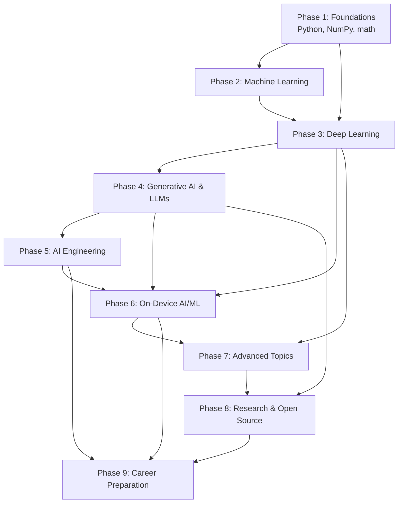

# Curriculum Roadmap

This is the whole journey on one page: nine phases, in prerequisite order, roughly **12 months at 1.5–2 hours a day**. Each phase lists its modules, marks what is **essential** (everyone needs it) versus **optional** (a specialization you can defer), and says what it unlocks.

!!! info "Legend"
    :material-star: **Essential**: required for later phases or for any AI engineering job.
    :material-star-outline: **Optional**: valuable specialization; skip on a first pass if you are short on time.
    :material-android: **On-device focus**: where your Android background pays off most.

## How the phases depend on each other

You can't skip Phase 1. Linear algebra and probability are the language every later idea is written in. Phases 5 and 6 overlap heavily in practice, so they're taught back to back.

## Timeline at a glance

| Phase | Months | Weeks | Outcome you can show |
|---|---|---|---|
| 1. Foundations | 1–2 | 1–8 | A NumPy-only linear regression trained with your own gradient descent |
| 2. Machine Learning | 3 | 9–13 | An end-to-end scikit-learn project with a proper evaluation report |
| 3. Deep Learning | 4–5 | 14–21 | A PyTorch CNN and a tiny transformer trained from scratch |
| 4. Generative AI & LLMs | 6–7 | 22–29 | A RAG app with evals, plus a LoRA fine-tune |
| 5. AI Engineering | 8 | 30–34 | A deployed, monitored LLM service with cost and latency dashboards |
| 6. On-Device AI/ML | 9–10 | 35–42 | An Android app running a quantized vision model and an on-device LLM offline |
| 7. Advanced Topics | 11 | 43–47 | One specialization project (speech, diffusion, recsys, or RL) |
| 8. Research & Open Source | 11–12 | 46–50 | A reproduced paper result and a merged open-source contribution |
| 9. Career Preparation | 12 | 49–52 | Portfolio site, system-design practice, interview readiness |

---

## Phase 1: Foundations (Months 1–2)

**Why it exists.** ML models are math executed by code. Without the math you can call APIs but not debug, tune, or design. Without Python fluency you'll fight the tooling instead of the problem.

**Prerequisites.** None. Your programming experience lets you move fast on Python syntax; the math starts from school level.

| # | Module | Level | Key ideas |
|---|---|---|---|
| 1.1 | Python for Kotlin developers | :material-star: | Dynamic typing, lists/dicts, comprehensions, functions, classes, virtual envs, Jupyter |
| 1.2 | NumPy | :material-star: | ndarrays, shapes, broadcasting, vectorization, dtypes |
| 1.3 | pandas | :material-star: | DataFrames, indexing, groupby, joins, cleaning missing data |
| 1.4 | Plotting (Matplotlib) | :material-star: | Line, scatter, histograms; seeing data before modeling it |
| 1.5 | Linear algebra | :material-star: | Vectors, dot product, matrices, matrix multiplication, transpose, norms, eigen-intuition |
| 1.6 | Calculus | :material-star: | Derivatives, partial derivatives, gradients, chain rule |
| 1.7 | Probability | :material-star: | Random variables, distributions, conditional probability, Bayes' rule, expectation |
| 1.8 | Statistics | :material-star: | Mean/variance, sampling, confidence intervals, hypothesis tests, correlation vs causation |
| 1.9 | Optimization | :material-star: | Loss functions, gradient descent, learning rate, convexity, local minima |
| 1.10 | Information theory basics | :material-star-outline: | Entropy, cross-entropy, KL divergence (needed again in Phase 3 and 4) |

**Milestone.** Implement linear regression with NumPy only: compute predictions with a matrix product, the mean-squared-error loss, its gradient by hand, and a gradient descent loop that converges.

---

## Phase 2: Machine Learning (Month 3)

**Why it exists.** Before neural networks, you need the core workflow every model shares: data in, features, fit, evaluate, generalize. Classic ML is also still what many production systems run.

**Prerequisites.** Phase 1.

| # | Module | Level | Key ideas |
|---|---|---|---|
| 2.1 | What is learning? | :material-star: | Supervised vs unsupervised vs reinforcement; training vs inference |
| 2.2 | Data preparation | :material-star: | Train/validation/test splits, leakage, scaling, encoding categories |
| 2.3 | Feature engineering | :material-star: | Creating, selecting and transforming features |
| 2.4 | Linear & logistic regression | :material-star: | Regression vs classification, sigmoid, decision boundaries |
| 2.5 | Trees and ensembles | :material-star: | Decision trees, random forests, gradient boosting (XGBoost/LightGBM) |
| 2.6 | Other classifiers | :material-star-outline: | k-NN, SVMs, Naive Bayes |
| 2.7 | Clustering & dimensionality reduction | :material-star: | k-means, PCA, t-SNE/UMAP for visualization |
| 2.8 | Evaluation | :material-star: | Accuracy, precision, recall, F1, ROC-AUC, confusion matrix, regression metrics |
| 2.9 | Overfitting & generalization | :material-star: | Bias–variance, regularization (L1/L2), cross-validation |
| 2.10 | scikit-learn pipelines | :material-star: | Reproducible preprocessing + model in one object |

**Milestone.** An end-to-end tabular project (e.g., churn or housing prices) with a written report: baseline, three models compared with cross-validation, the right metric justified, and an error analysis.

---

## Phase 3: Deep Learning (Months 4–5)

**Why it exists.** Neural networks learn features themselves, which is what made images, audio and language tractable. Every modern AI system, including LLMs and every on-device model you'll ship, is a neural network.

**Prerequisites.** Phases 1–2, especially gradients and the chain rule.

| # | Module | Level | Key ideas |
|---|---|---|---|
| 3.1 | The neuron and the MLP | :material-star: | Weights, biases, layers, forward pass |
| 3.2 | Activation functions | :material-star: | Sigmoid, tanh, ReLU, GELU; why non-linearity matters |
| 3.3 | Loss functions | :material-star: | MSE, cross-entropy, and when to use which |
| 3.4 | Backpropagation | :material-star: | The chain rule as an algorithm; computational graphs; build a micro-autograd |
| 3.5 | Optimizers | :material-star: | SGD, momentum, Adam, learning-rate schedules |
| 3.6 | Training in practice | :material-star: | Initialization, batch norm, dropout, early stopping, debugging training curves |
| 3.7 | PyTorch | :material-star: | Tensors, autograd, `nn.Module`, DataLoader, training loops, GPU |
| 3.8 | CNNs | :material-star: :material-android: | Convolution, pooling, ResNet, MobileNet (designed for phones) |
| 3.9 | RNNs and LSTMs | :material-star-outline: | Sequence modeling and why it was replaced |
| 3.10 | Embeddings | :material-star: | Representing words, items and images as vectors |
| 3.11 | Attention and transformers | :material-star: | Self-attention, multi-head attention, positional encoding, encoder/decoder |
| 3.12 | Transfer learning | :material-star: | Pretrained backbones, fine-tuning, freezing layers |

**Milestone.** Train an image classifier in PyTorch (MobileNet transfer learning), and build a character-level transformer from scratch following Karpathy's "Let's build GPT".

---

## Phase 4: Generative AI and LLMs (Months 6–7)

**Why it exists.** LLMs are the center of current AI engineering work. Understanding how they are trained and run lets you choose, prompt, adapt and ship them responsibly.

**Prerequisites.** Phase 3, especially transformers and embeddings.

| # | Module | Level | Key ideas |
|---|---|---|---|
| 4.1 | Tokenization | :material-star: | BPE, SentencePiece, vocabularies, why tokens ≠ words |
| 4.2 | Pretraining | :material-star: | Next-token prediction, scaling laws, data mixtures |
| 4.3 | Post-training | :material-star: | Instruction tuning, RLHF, DPO; why chat models behave differently from base models |
| 4.4 | Inference | :material-star: | Sampling, temperature, top-k/top-p, KV cache, speculative decoding |
| 4.5 | Context windows | :material-star: | Limits, long-context tricks, cost of attention |
| 4.6 | Prompting | :material-star: | System prompts, few-shot, chain-of-thought, structured output |
| 4.7 | Fine-tuning | :material-star: | Full fine-tuning vs LoRA/QLoRA; when to fine-tune vs prompt vs RAG |
| 4.8 | Quantization | :material-star: :material-android: | INT8, INT4, GPTQ, AWQ, GGUF; accuracy vs size trade-offs |
| 4.9 | Embeddings & vector databases | :material-star: | Semantic search, cosine similarity, ANN indexes (HNSW), pgvector, FAISS |
| 4.10 | RAG | :material-star: | Chunking, retrieval, reranking, grounding, citations |
| 4.11 | Tool calling & agents | :material-star: | Function calling, agent loops, MCP, planning, failure modes |
| 4.12 | Evaluation | :material-star: | Benchmarks, LLM-as-judge, golden sets, regression evals |
| 4.13 | Hallucinations & safety | :material-star: | Why models confabulate, mitigation, prompt injection, guardrails |

**Milestone.** A documentation Q&A app using RAG with an eval set of 50+ questions and measured accuracy, plus a LoRA fine-tune of a small open model with before/after evaluation.

---

## Phase 5: AI Engineering (Month 8)

**Why it exists.** A model in a notebook is not a product. This phase is the production discipline: serving, testing, monitoring, and keeping cost, latency and risk under control. It's where your senior engineering experience transfers most directly.

**Prerequisites.** Phase 4.

| # | Module | Level | Key ideas |
|---|---|---|---|
| 5.1 | Using model APIs well | :material-star: | Streaming, retries, rate limits, caching, batching |
| 5.2 | Model serving | :material-star: | FastAPI, vLLM, TGI, Triton; throughput vs latency |
| 5.3 | Deployment | :material-star: | Docker, GPUs in the cloud, autoscaling, serverless inference |
| 5.4 | Testing AI systems | :material-star: | Unit tests around non-deterministic outputs, eval-driven development |
| 5.5 | Evaluation pipelines | :material-star: | Offline evals in CI, online A/B tests, human review loops |
| 5.6 | Monitoring & observability | :material-star: | Tracing, drift, quality metrics, user feedback |
| 5.7 | Scalability & reliability | :material-star: | Fallbacks, timeouts, model routing, graceful degradation |
| 5.8 | Security & privacy | :material-star: | Prompt injection defense, PII handling, data retention, threat modeling |
| 5.9 | Cost optimization | :material-star: | Token budgets, caching, smaller models, distillation |
| 5.10 | MLOps tooling | :material-star-outline: | MLflow, Weights & Biases, model registries, feature stores |

**Milestone.** Deploy the Phase 4 RAG app as a containerized service with tracing, an eval suite running in CI, and a dashboard of latency, cost per request, and answer quality.

---

## Phase 6: On-Device AI/ML (Months 9–10) :material-android:

**Why it exists.** Running models on the phone gives privacy, offline use, zero server cost and low latency, but under tight memory, power and thermal limits. This is your target specialization and where Android expertise is rare and valuable.

**Prerequisites.** Phase 3 (models), Phase 4.8 (quantization), Phase 5 (production thinking). Your Android experience covers the app side.

| # | Module | Level | Key ideas |
|---|---|---|---|
| 6.1 | Why on-device? | :material-star: | Privacy, latency, cost, offline; and the constraints |
| 6.2 | Mobile hardware for ML | :material-star: | CPU, GPU, NPU/DSP, memory bandwidth, thermals, battery |
| 6.3 | TensorFlow Lite → LiteRT | :material-star: | The `.tflite` format, interpreter, delegates, the LiteRT rename and new APIs |
| 6.4 | Model conversion | :material-star: | PyTorch → LiteRT (AI Edge Torch), PyTorch → ONNX, ONNX → other runtimes |
| 6.5 | Quantization for mobile | :material-star: | Post-training quantization, quantization-aware training, INT8/INT4, float16 |
| 6.6 | Hardware acceleration | :material-star: | GPU delegate, NNAPI's deprecation, vendor NPU delegates (Qualcomm QNN, MediaTek) |
| 6.7 | MediaPipe | :material-star: | Ready-made tasks (vision, text, audio), MediaPipe Tasks API, custom pipelines |
| 6.8 | On-device LLMs | :material-star: | LiteRT-LM, MediaPipe LLM Inference, Gemini Nano / AICore, llama.cpp, MLC LLM |
| 6.9 | ONNX Runtime Mobile | :material-star: | Execution providers, cross-platform deployment |
| 6.10 | Core ML (iOS) | :material-star-outline: | coremltools, Apple Neural Engine; useful for cross-platform roles |
| 6.11 | Memory & performance | :material-star: | Model loading, memory mapping, warm-up, benchmarking, profiling |
| 6.12 | Offline & hybrid inference | :material-star: | On-device first with cloud fallback, model updates, model delivery |
| 6.13 | Multimodal mobile AI | :material-star-outline: | Camera + vision models, speech, on-device multimodal LLMs |

**Milestone.** An Android app (Kotlin, Compose) that runs a quantized image classifier with the GPU delegate and an on-device LLM for offline chat or summarization, with a benchmark table of latency, memory and battery across at least two devices.

---

## Phase 7: Advanced Topics (Month 11)

**Why it exists.** Specializations that deepen your range. Pick **two** on a first pass; return to the others later.

**Prerequisites.** Phase 3; Phase 6 for the efficiency topics.

| # | Module | Level | Key ideas |
|---|---|---|---|
| 7.1 | Multimodal models | :material-star: | Vision-language models (CLIP, LLaVA, Gemma 3), audio-language models |
| 7.2 | Computer vision | :material-star-outline: :material-android: | Detection (YOLO), segmentation, pose, OCR |
| 7.3 | Speech AI | :material-star-outline: :material-android: | ASR (Whisper), TTS, wake words, streaming audio |
| 7.4 | Diffusion models | :material-star-outline: | Denoising, latent diffusion, on-device image generation |
| 7.5 | Recommendation systems | :material-star-outline: | Collaborative filtering, two-tower models, ranking |
| 7.6 | Reinforcement learning | :material-star-outline: | MDPs, Q-learning, policy gradients, RL for LLMs |
| 7.7 | Model compression | :material-star: :material-android: | Pruning, distillation, low-rank factorization |
| 7.8 | Efficient inference | :material-star: :material-android: | Operator fusion, FlashAttention, sparsity, batching on edge |

**Milestone.** One specialization project shipped end to end, e.g., an offline voice assistant on Android combining on-device ASR and an LLM.

---

## Phase 8: Research and Open Source (Months 11–12)

**Why it exists.** The field moves monthly. Reading papers and contributing to open source is how you keep up and how you build visible credibility.

**Prerequisites.** Phases 3–4.

| # | Module | Level | Key ideas |
|---|---|---|---|
| 8.1 | How to read a paper | :material-star: | Three-pass method, reading the figures first, finding code |
| 8.2 | Landmark papers | :material-star: | Attention Is All You Need, ResNet, BERT, GPT-3, LoRA, MobileNet, Chinchilla |
| 8.3 | Reproducing experiments | :material-star: | Picking a feasible result, controlling variables, reporting honestly |
| 8.4 | Benchmarks | :material-star: | MMLU, HumanEval, MLPerf Mobile; what they measure and what they miss |
| 8.5 | Contributing to open source | :material-star: | Finding good first issues in LiteRT, MediaPipe, llama.cpp, Hugging Face |
| 8.6 | Staying current | :material-star: | arXiv, Papers with Code, newsletters, conference talks |

**Milestone.** A reproduced result from a paper (written up on your site) and at least one merged pull request in an AI open-source project.

---

## Phase 9: Career Preparation (Month 12)

**Why it exists.** Turning skills into a role. Your story is "senior mobile engineer who ships AI on devices", which is a rare profile; this phase makes it legible to hiring teams.

**Prerequisites.** Phases 5–6 and portfolio projects from earlier phases.

| # | Module | Level | Key ideas |
|---|---|---|---|
| 9.1 | Portfolio | :material-star: | 3–4 polished projects with READMEs, demos, benchmarks, write-ups |
| 9.2 | AI system design | :material-star: | Designing RAG systems, recommendation pipelines, on-device/cloud hybrids |
| 9.3 | ML interview fundamentals | :material-star: | Explaining bias–variance, backprop, attention, metrics, clearly |
| 9.4 | Coding interviews for ML | :material-star: | NumPy/PyTorch implementation questions |
| 9.5 | Job-description analysis | :material-star: | Mapping roles (AI Engineer, ML Engineer, On-Device ML Engineer) to skills |
| 9.6 | Industry skills | :material-star: | Communicating trade-offs, product sense for AI features |

**Milestone.** Portfolio published, five mock system-design interviews completed, and a targeted list of roles with a gap analysis.

---

## Your three portfolio projects (built across phases)

1. **Doc-Q&A RAG service** (Phases 4–5): cloud LLM app with evals, monitoring and cost tracking.
2. **Offline AI Android app** (Phase 6): quantized vision model plus on-device LLM, with published benchmarks.
3. **Specialization project** (Phase 7): e.g., on-device speech assistant or compressed multimodal model.

Each one maps to a common job requirement and together they tell a coherent story.
